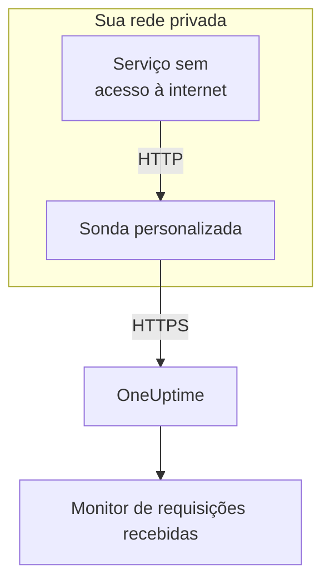

# Ingress de requisições recebidas

Um serviço sem acesso à internet ainda pode enviar heartbeats a um [monitor de requisições recebidas](/docs/monitor/incoming-request-monitor). Em vez disso, ele os envia a uma [sonda personalizada](/docs/probe/custom-probe) na própria rede, e a sonda os repassa ao OneUptime.

:::cards
- [Como funciona](#como-funciona): Do seu serviço ao monitor, passando pela sonda.
- [Ativar o listener](#ativar-o-listener): Uma única configuração na sonda, para Docker, Docker Compose ou Kubernetes.
- [Enviar requisições à sonda](#enviar-requisições-à-sonda): Trocar a URL para a qual seu serviço envia, e nada mais.
- [Solução de problemas](#solução-de-problemas): O que a sonda registra quando uma requisição não passa.
:::

## Como funciona



1. **Seu serviço envia a requisição à sonda.** O mesmo `GET` ou `POST`, com a mesma chave secreta, que enviaria ao OneUptime, para uma porta em que a sonda escuta.
2. **A sonda responde na hora.** Ela responde `200` antes de repassar a requisição, então seu serviço nunca espera pelo OneUptime.
3. **A sonda a repassa.** Ela envia a requisição ao OneUptime com o método, os cabeçalhos e o corpo, e adiciona um cabeçalho `OneUptime-Probe-Id` que identifica a sonda.
4. **O OneUptime a lê como sempre.** Os critérios do monitor veem a requisição como se o serviço a tivesse enviado diretamente.

O listener roda numa porta própria, separada das verificações de saúde da sonda, então você pode abri-lo para a sua rede privada sem abrir mais nada.

## Quando usar

Use o listener quando:

- Seus serviços rodam num segmento de rede isolado sem acesso HTTPS de saída
- Você precisa manter todo o tráfego de monitoramento dentro da sua VPC ou rede local
- Você quer um único ponto de saída, a sonda, autorizado a alcançar o OneUptime
- Você já implantou uma [sonda personalizada](/docs/probe/custom-probe) e quer reaproveitá-la para heartbeats recebidos

Se seus serviços já conseguem alcançar `https://oneuptime.com` (ou sua URL auto-hospedada) diretamente, você **não** precisa deste recurso: chame a URL de heartbeat direto do serviço.

## Antes de começar

- **Uma sonda personalizada em execução.** O **Status** dela mostra **Conectado**. Veja [Sondas personalizadas](/docs/probe/custom-probe) para instalar uma.
- **Um monitor de requisições recebidas.** A URL de heartbeat dele contém a chave secreta que seu serviço envia: veja [Monitor de requisições recebidas](/docs/monitor/incoming-request-monitor).
- **Uma porta no host da sonda que seus serviços alcançam.** Os exemplos usam `3875`.

## Ativar o listener

Defina `PROBE_INGRESS_PORT` com a porta que o listener deve usar. Qualquer valor maior que `0` o ativa; sem definir, ou `0`, o deixa desativado.

:::tabs
@tab Docker
```bash
docker run --name oneuptime-probe --network host \
  -e PROBE_KEY=<probe-key> \
  -e PROBE_ID=<probe-id> \
  -e ONEUPTIME_URL=https://oneuptime.com \
  -e PROBE_INGRESS_PORT=3875 \
  -d oneuptime/probe:release
```

Sem `--network host`, publique a porta com `-p 3875:3875`.
@tab Docker Compose
```yaml title="docker-compose.yml"
services:
  oneuptime-probe:
    image: oneuptime/probe:release
    container_name: oneuptime-probe
    environment:
      - PROBE_KEY=<probe-key>
      - PROBE_ID=<probe-id>
      - ONEUPTIME_URL=https://oneuptime.com
      - PROBE_INGRESS_PORT=3875
    network_mode: host
    restart: always
```

Sem `network_mode: host`, publique a porta em `ports:` como `"3875:3875"`.
@tab Kubernetes
```yaml title="oneuptime-probe.yaml"
apiVersion: apps/v1
kind: Deployment
metadata:
  name: oneuptime-probe
spec:
  selector:
    matchLabels:
      app: oneuptime-probe
  template:
    metadata:
      labels:
        app: oneuptime-probe
    spec:
      containers:
        - name: oneuptime-probe
          image: oneuptime/probe:release
          env:
            - name: PROBE_KEY
              value: "<probe-key>"
            - name: PROBE_ID
              value: "<probe-id>"
            - name: ONEUPTIME_URL
              value: "https://oneuptime.com"
            - name: PROBE_INGRESS_PORT
              value: "3875"
          ports:
            - name: ingress
              containerPort: 3875
---
apiVersion: v1
kind: Service
metadata:
  name: oneuptime-probe-ingress
spec:
  selector:
    app: oneuptime-probe
  ports:
    - name: ingress
      port: 3875
      targetPort: 3875
  type: ClusterIP
```

Os serviços do cluster então enviam para `http://oneuptime-probe-ingress.<namespace>.svc.cluster.local:3875/heartbeat/<secret-key>`.
:::

Quando o listener está no ar, o log da sonda diz `Probe ingress listener started on port 3875 (heartbeat / incoming-request endpoints)`.

## Enviar requisições à sonda

Seu serviço envia para a sonda em vez do OneUptime. Substitua a URL pública de heartbeat:

```text
https://oneuptime.com/heartbeat/<secret-key>
```

pela URL de ingress da sonda:

```text
http://<probe-host>:<PROBE_INGRESS_PORT>/heartbeat/<secret-key>
```

O caminho, o método, o corpo e os cabeçalhos são idênticos no resto, então qualquer código cliente existente só precisa trocar a URL base. A sonda também aceita `/incoming-request/<secret-key>`, que funciona do mesmo jeito.

```bash
# GET heartbeat
curl http://probe.internal:3875/heartbeat/YOUR_SECRET_KEY

# POST heartbeat with JSON body
curl -X POST http://probe.internal:3875/heartbeat/YOUR_SECRET_KEY \
  -H "Content-Type: application/json" \
  -d '{"status": "healthy", "version": "1.2.3"}'

# Cron job
*/5 * * * * curl -s http://probe.internal:3875/heartbeat/YOUR_SECRET_KEY > /dev/null
```

## Como as requisições são repassadas

| O quê | Como a sonda lida com isso |
| --- | --- |
| A resposta | `200` com um objeto JSON vazio (`{}`), enviada antes de a requisição ser repassada. Como no OneUptime, ela é enviada aconteça o que acontecer depois: uma chave secreta errada também a recebe. |
| Os métodos | `POST` é repassado como `POST`. `GET`, e `HEAD`, são repassados como `GET`. Os outros métodos recebem um `404` da sonda. |
| Os cabeçalhos | Todos, exceto os hop-by-hop (`Host`, `Connection`, `Content-Length`, `Transfer-Encoding`, `Keep-Alive`, `Proxy-Authenticate`, `Proxy-Authorization`, `TE`, `Trailer`, `Upgrade`) e `Content-Encoding`, pois a sonda encaminha o corpo sem compressão. A sonda adiciona `OneUptime-Probe-Id`. |
| O corpo | Corpos JSON e de formulário de até 50 MB, como quando você envia direto ao OneUptime. Como lá, qualquer outro corpo chega vazio ao monitor. |
| As novas tentativas | Quando um repasse falha, a sonda tenta de novo até `PROBE_INGRESS_FORWARD_RETRY_LIMIT` vezes, esperando 2 s, depois 4 s, depois 8 s, e nunca mais de 15 s. Depois registra a falha e descarta a requisição. |
| Os proxies | O repasse passa pelo proxy da sonda quando `HTTP_PROXY_URL` ou `HTTPS_PROXY_URL` está definida. |
| Para onde vai | `ONEUPTIME_URL` seguida de `/incoming-request-ingest/incoming-request/<secret-key>`. |

## Variáveis de ambiente

| Variável | Padrão | O que faz |
| --- | --- | --- |
| `PROBE_INGRESS_PORT` | sem definir (desativado) | A porta que o listener usa. Qualquer valor maior que `0` o ativa. |
| `PROBE_INGRESS_FORWARD_TIMEOUT_MS` | `10000` | Quanto cada repasse ao OneUptime pode demorar, em milissegundos. Um valor abaixo de `1000` volta ao padrão. |
| `PROBE_INGRESS_FORWARD_RETRY_LIMIT` | `3` | Quantas vezes um repasse que falhou é tentado de novo. `0` desativa as novas tentativas. |

As variáveis normais da sonda (`PROBE_KEY`, `PROBE_ID`, `ONEUPTIME_URL` e as variáveis de proxy) valem todas: veja [Sondas personalizadas](/docs/probe/custom-probe) para a lista completa.

## Considerações de segurança

- **O endpoint não tem autenticação, de propósito**: a chave secreta no caminho da URL *é* a autenticação, assim como no endpoint público `oneuptime.com`. Trate a chave secreta como uma credencial.
- **Mantenha o listener na sua rede privada.** Ele não deve ser alcançável pela internet. Use uma network policy, uma regra de firewall ou um serviço `ClusterIP` para limitar quem pode alcançá-lo.
- **Coloque TLS na frente se precisar de criptografia na sua rede.** O listener fala HTTP simples. Coloque-o atrás de um balanceador de carga interno ou de um ingress controller para ter TLS nesse trecho. O repasse da sonda ao OneUptime usa HTTPS quando `ONEUPTIME_URL` começa com `https://`.
- **Limite você mesmo o tamanho do corpo se 50 MB for demais.** Coloque na frente do listener um proxy reverso com um limite menor.

## Solução de problemas

:::details O log da sonda nunca diz que o listener iniciou
`PROBE_INGRESS_PORT` não está definida, vale `0` ou não é um número. Defina um número de porta e reinicie a sonda. A linha de log é `Probe ingress listener started on port <port> (heartbeat / incoming-request endpoints)`.
:::

:::details A sonda registra `Probe ingress: failed to forward to <url> after N attempts`
A sonda não conseguiu alcançar o OneUptime, nem depois das novas tentativas. Verifique a conectividade de saída da sonda, as configurações de proxy e o valor de `ONEUPTIME_URL`. Se a sonda também mostra **Desconectado**, veja [Sondas personalizadas](/docs/probe/custom-probe) para descobrir onde as requisições dela param.
:::

:::details A sonda registra `Probe ingress: probe ID not available, forwarding without it`
A sonda ainda não terminou de se conectar ao OneUptime, então repassa a requisição sem o cabeçalho `OneUptime-Probe-Id`. A requisição chega ao monitor mesmo assim.
:::

:::details O monitor recebe as requisições, mas não pela sonda
Seu serviço ainda envia para a URL pública. Confira se ele envia para `http://<probe-host>:<port>/...`: um nome DNS ou uma entrada em `/etc/hosts` que aponta para outro lugar é a causa habitual.
:::

:::details O monitor não recebe nada e a sonda não registra nada
A requisição nunca chegou à sonda. Confira se o serviço alcança o host da sonda na porta: uma regra de firewall, uma porta não publicada ou um Service do Kubernetes que não seleciona o pod da sonda.
:::

## Próximos passos

:::cards
- [Monitor de requisições recebidas](/docs/monitor/incoming-request-monitor): Decidir o que conta como um heartbeat saudável.
- [Sondas personalizadas](/docs/probe/custom-probe): Instalar a sonda, e cada configuração que ela lê.
:::
