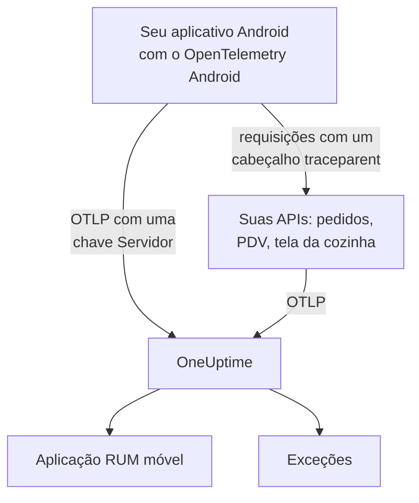

# Configuração para Android

Instrumente um aplicativo Android nativo com o OpenTelemetry Android para que ele se reporte ao OneUptime como uma aplicação RUM móvel: os crashes e ANRs dele, os quadros lentos e congelados, as inicializações do aplicativo, as telas, as sessões e as requisições de rede, rastreados até o seu backend.

:::cards
- [Adicionar o OpenTelemetry Android](#adicionar-o-opentelemetry-android): Uma dependência do Gradle e algumas linhas na inicialização do aplicativo.
- [O que ele relata](#o-que-ele-relata): Crashes, ANRs, quadros congelados, inicializações e sessões, e onde cada um vai parar.
- [Rastrear requisições até o seu backend](#rastrear-requisições-até-o-seu-backend): Um span para cada chamada do OkHttp, com um `traceparent` nela.
- [Rastrear os seus próprios fluxos de trabalho](#rastrear-os-seus-próprios-fluxos-de-trabalho): Um pedido do cardápio até a cozinha, um terminal de pagamento, uma impressora.
- [Quiosques e outros dispositivos que você possui](#quiosques-e-outros-dispositivos-que-você-possui): Dar nome a cada dispositivo, configurá-lo pelo seu MDM, manter os dados enquanto estiver offline.
:::

## Como funciona

O OpenTelemetry Android roda dentro do seu aplicativo. Ele envia traços, registros e métricas ao OneUptime por OTLP com uma chave de ingestão **Servidor** e adiciona um cabeçalho W3C `traceparent` às requisições que o seu aplicativo faz, para que os spans do seu backend se juntem aos traços do aplicativo.



## Antes de começar

- Um aplicativo Android cujo `minSdk` seja 23 ou superior, compilado com `compileSdk` 34 ou superior. Com um `minSdk` abaixo de 26, ative o [desugaring da biblioteca principal](https://developer.android.com/studio/write/java8-support#library-desugaring), com o Android Gradle Plugin 8.3.0 ou posterior e `android.useFullClasspathForDexingTransform=true` em `gradle.properties`.
- Uma chave de ingestão **Servidor**, criada em **Configurações do projeto → Telemetria e APM → Chaves de ingestão** com **Criar chave de ingestão**. Uma chave **Navegador** é recusada a partir de um aplicativo: ela é verificada contra o cabeçalho `Origin`, que um aplicativo não envia.
- Estas configurações de OTLP. Se você hospeda o OneUptime por conta própria, troque `https://oneuptime.com` pelo seu próprio host.

| Configuração | Valor |
| --- | --- |
| Endpoint OTLP | `https://oneuptime.com/otlp` |
| Cabeçalho | `x-oneuptime-token: YOUR_TELEMETRY_INGESTION_TOKEN` |

> [!WARNING]
> A chave vai dentro do seu aplicativo, e um aplicativo pode ser descompactado, então parta do princípio de que alguém vai copiá-la. Na página da chave, defina um **Nome do serviço fixado**, um **Requests Per Minute Limit** e uma data em **Expira em**, e troque a chave a cada versão.

## Adicionar o OpenTelemetry Android

:::steps
### Adicionar a dependência

```kotlin title="app/build.gradle.kts"
dependencies {
    implementation("io.opentelemetry.android:android-agent:1.8.1")
}
```

O agente traz consigo a instrumentação de crashes, ANRs, renderização lenta, atividades, fragmentos, rede e sessões. Confira [as versões dele](https://github.com/open-telemetry/opentelemetry-android/releases) para ver se há uma versão mais nova.

### Iniciá-lo quando o aplicativo inicia

```kotlin title="KioskApplication.kt"
import android.app.Application
import io.opentelemetry.android.OpenTelemetryRum
import io.opentelemetry.android.agent.OpenTelemetryRumInitializer

class KioskApplication : Application() {
    lateinit var otelRum: OpenTelemetryRum

    override fun onCreate() {
        super.onCreate()

        otelRum = OpenTelemetryRumInitializer.initialize(this) {
            httpExport {
                baseUrl = "https://oneuptime.com/otlp"
                baseHeaders = mapOf("x-oneuptime-token" to BuildConfig.ONEUPTIME_TOKEN)
            }
            resource {
                put("service.name", "kiosk-ordering")
                put("deployment.environment.name", "production")
            }
        }
    }
}
```

`baseUrl` é o endpoint sem um sinal: o agente acrescenta `/v1/traces`, `/v1/logs` e `/v1/metrics` a ele. Defina `service.name`, ou o aplicativo recebe o nome do rótulo dele no launcher. Ele é a identidade da aplicação no OneUptime, então mantenha-o igual de uma versão para outra.

Indique a classe no `android:name` do elemento `<application>` do seu manifesto. `BuildConfig.ONEUPTIME_TOKEN` representa o lugar onde o seu build guarda a chave; uma frota pode, em vez disso, recebê-la do MDM dela, como mostra [Quiosques e outros dispositivos que você possui](#quiosques-e-outros-dispositivos-que-você-possui).

### Iniciar o aplicativo e verificar se chega

```bash
curl -i https://oneuptime.com/otlp/v1/validate \
  -H "x-oneuptime-token: YOUR_TELEMETRY_INGESTION_TOKEN"
```

`200` com `"valid": true` significa que a chave foi aceita. Depois, inicie o aplicativo e use-o por um momento: ele aparece em **Produtos → Recursos → Monitoramento de Usuários Reais**, com o nome do seu `service.name`. O agente grava a telemetria em disco antes de enviá-la, então o primeiro lote pode levar um minuto para chegar.
:::

## O que ele relata

O OpenTelemetry Android registra tudo isso por conta própria. Os atributos de dispositivo que ele define, `device.model.identifier`, `device.model.name` e `device.manufacturer`, classificam o aplicativo como uma aplicação RUM móvel e preenchem a página **Clientes** dela. Ele também define `os.name`, `os.version` e um `app.installation.id` para cada instalação, e nenhum `device.id`.

| O quê | Como o agente envia | Onde aparece no OneUptime |
| --- | --- | --- |
| Crashes | Um evento `app.crash` com o tipo, a mensagem e o stack trace da exceção | **Exceções**, como não tratados |
| ANRs | Um evento `device.anr` com a pilha da thread principal, assim que o aplicativo para de responder por cerca de 5 segundos | **Exceções**, como não tratados, sob o tipo `ANR` |
| Quadros lentos e congelados | Um evento `app.jank` com `app.jank.frame_count`, os quadros mais lentos que 16 ms (`app.jank.threshold` é `0.016`) ou 700 ms (`0.7`) | **Registros**, com `@event.name:app.jank` |
| Inicializações do aplicativo | Um span `AppStart`, com `start.type` definido como `cold`, `warm` ou `hot` | **Traços** |
| Telas | Um span para cada etapa do ciclo de vida de uma atividade ou de um fragmento, e `app.screen.name` em cada span e registro | **Traços** |
| Sessões | `session.id` em cada span e registro, e os eventos `session.start` e `session.end` | **Traços** e **Registros**, pesquisados com `@session.id:` |
| Mudanças de rede | Um evento `network.change`, e `network.connection.type` em cada span e registro | **Registros** |

Crashes e ANRs chegam a **Exceções** como não tratados, agrupados pelos stack traces deles, com a sessão em que aconteceram. O agente salva um crash em disco enquanto o aplicativo morre e o envia de lá, então um crash que acontece offline ainda chega quando o aplicativo volta a rodar com rede.

A **Visão geral** da aplicação resume isso para você: **Sessões**, **Sessões sem falhas**, **Falhas**, **ANRs**, **Inicializações do app**, **Inicialização a frio (p95)** e **Quadros congelados**, e cada um abre as exceções, os spans ou os eventos que conta. Enquanto o aplicativo não envia inicializações ou quadros, os gráficos deles dizem o que os ativa. As **Recomendações** dela oferecem monitores para falhas, ANRs, inicializações a frio lentas, quadros congelados e um aplicativo que para de reportar.

Uma sessão termina depois de 15 minutos em segundo plano, ou depois de 4 horas. Um aplicativo que nunca vai para segundo plano, como um quiosque, mantém uma única sessão por 4 horas, então rastreie a visita de cada cliente como um span próprio, como mostra [Rastrear os seus próprios fluxos de trabalho](#rastrear-os-seus-próprios-fluxos-de-trabalho).

As chamadas `android.util.Log` do seu próprio aplicativo também viram registros quando você adiciona `android-log-library` e `android-log-agent` ao lado dos módulos do OkHttp abaixo: a tag de cada chamada vai em `android.log.tag`, e uma chamada com um throwable é uma exceção em **Exceções**. O OpenTelemetry Android não lê o Logcat.

## Rastrear requisições até o seu backend

Adicione a instrumentação do OkHttp e o plugin ByteBuddy com o qual ela é compilada:

```kotlin title="app/build.gradle.kts"
plugins {
    // ...the plugins your app already applies, then:
    id("net.bytebuddy.byte-buddy-gradle-plugin") version "1.18.15"
}

dependencies {
    implementation("io.opentelemetry.android:android-agent:1.8.1")
    implementation("io.opentelemetry.android.instrumentation:okhttp3-library:1.8.1-alpha")
    byteBuddy("io.opentelemetry.android.instrumentation:okhttp3-agent:1.8.1-alpha")
}
```

O plugin instrumenta a própria classe `OkHttpClient`, então todo cliente do aplicativo é rastreado, inclusive os que as bibliotecas criam. Cada requisição vira um span de cliente com o nome do método dela, com a URL, o código de status e a duração, e leva um cabeçalho W3C `traceparent`. Um backend instrumentado com [OpenTelemetry](/docs/telemetry/open-telemetry) continua o traço a partir desse cabeçalho, então a API de pedidos, a ponte com o PDV e o serviço da tela da cozinha adicionam os seus spans ao mesmo traço que o toque no quiosque.

- `HttpURLConnection` tem o mesmo par de módulos: `httpurlconnection-library` e `httpurlconnection-agent`.
- Sem o plugin, envolva um cliente você mesmo: `OkHttpTelemetry.builder(otelRum.openTelemetry).build().createCallFactory(client)`, de `io.opentelemetry.instrumentation:opentelemetry-okhttp-3.0`.
- Um span aberto no seu código, como na próxima seção, é o pai das requisições feitas dentro dele.

## Rastrear os seus próprios fluxos de trabalho

Obtenha um tracer do agente e crie um span para o pedido de um cliente, com um span filho para cada etapa dele. Cada etapa passa então a ter a sua própria duração e os seus próprios erros, e o pedido diz como terminou:

```kotlin title="OrderTrace.kt"
import io.opentelemetry.api.trace.Span
import io.opentelemetry.api.trace.StatusCode
import io.opentelemetry.api.trace.Tracer
import io.opentelemetry.context.Context

class OrderTrace(private val tracer: Tracer) {
    // order.session: from the first tap to the order reaching the kitchen.
    private val order: Span = tracer.spanBuilder("order.session").startSpan()
    private val parent: Context = Context.current().with(order)

    // One step: menu.browse, cart.customize, payment.process, pos.inject.
    fun <T> step(name: String, block: (Span) -> T): T {
        val span = tracer.spanBuilder(name).setParent(parent).startSpan()
        return try {
            span.makeCurrent().use { block(span) }
        } catch (error: Throwable) {
            span.recordException(error)
            span.setStatus(StatusCode.ERROR)
            throw error
        } finally {
            span.end()
        }
    }

    fun complete() = finish("completed")

    fun abandon(reason: String) {
        order.setAttribute("order.abandon_reason", reason)
        finish("abandoned")
    }

    private fun finish(outcome: String) {
        order.setAttribute("order.outcome", outcome)
        order.end()
    }
}
```

```kotlin title="CheckoutFlow.kt"
val order = OrderTrace(otelRum.openTelemetry.getTracer("kiosk.ordering"))

order.step("cart.customize") { span ->
    span.setAttribute("cart.items", cart.size.toLong())
}
order.step("payment.process") { terminal.charge(cart.total) }
order.step("pos.inject") { posApi.submit(cart) } // its OkHttp span is a child
order.complete()
```

Envolva da mesma forma cada chamada ao SDK de um terminal de pagamento, de uma impressora, de um scanner ou de um leitor NFC, e diga qual dispositivo foi, para que um dispositivo lento ou com falha seja um span lento ou com falha:

```kotlin title="ReceiptPrinter.kt"
order.step("printer.print") { span ->
    span.setAttribute("peripheral.type", "printer")
    span.setAttribute("peripheral.model", printer.model)
    span.setAttribute("peripheral.connection", "usb")
    printer.print(receipt, timeoutMillis = 10_000)
}
```

Os nomes dos atributos ficam a seu critério: mantenha-os iguais em todos os aplicativos, para que um único filtro encontre todas as impressoras. Defina um tempo limite para cada chamada, porque um span só termina quando a chamada dele retorna. Uma etapa que abrange várias telas, como navegar pelo cardápio, é um span que você inicia quando a tela abre e encerra quando ela fecha, com o mesmo pai. Para um fato sem duração, como uma impressora ficando sem papel, envie um evento: `otelRum.emitEvent("printer.paper_low")`.

Em **Traços**, filtre pelo nome de uma etapa para ver quanto tempo ela leva e com que frequência falha, e por `@order.outcome:abandoned` para encontrar os pedidos que nunca foram concluídos.

## Quiosques e outros dispositivos que você possui

### Dar nome a cada dispositivo

O OneUptime arquiva um aplicativo móvel por aplicação, nunca por dispositivo, então um aplicativo em milhares de celulares nunca lista os celulares dos seus usuários. Para os dispositivos que você possui, dê um nome a cada um em `host.name`. Cada dispositivo aparece então em **Inventário** como um host, ao lado das suas outras máquinas, com a marca, o modelo e a versão do sistema operacional que o agente informa, o que você adiciona abaixo e quando foi visto pela última vez:

```kotlin title="KioskApplication.kt"
resource {
    put("service.name", "kiosk-ordering")
    put("host.name", deviceName)
    put("host.serial_number", serialNumber)
    put("device.type", "kiosk")
    put("device.location", "Store 0412")
}
```

A telemetria do aplicativo continua com a aplicação RUM dele, e o dispositivo não vira um host em **Hosts**: um aplicativo não informa métricas de host, então não haveria nada para mostrar ali. A página do dispositivo em **Inventário** mostra os registros, traços e exceções dele, e `@resource.host.name:` os encontra em **Traços** e **Registros**. Um dispositivo que não envia nada por 30 dias sai do **Inventário**. Para ver o próprio dispositivo, a memória, o armazenamento e as reinicializações dele e os crashes de todos os aplicativos instalados nele, adicione o [Agente Android](/docs/telemetry/android-agent) e dê a ele o mesmo nome no `device_name` dele: o dispositivo passa então a ser também um host em **Hosts**, e continua sendo um único item em **Inventário**.

### Configurar a frota a partir do seu MDM

Um aplicativo pode ler as configurações gerenciadas do Android, que todo serviço de gerenciamento de dispositivos envia aos seus dispositivos. Leia delas a chave e o nome do dispositivo, em vez de embuti-los no aplicativo:

```kotlin title="KioskApplication.kt"
import android.content.RestrictionsManager

val restrictions = (getSystemService(RESTRICTIONS_SERVICE) as RestrictionsManager)
    .applicationRestrictions
val token = restrictions.getString("oneuptime_token").orEmpty()
val deviceName = restrictions.getString("device_name") ?: android.os.Build.MODEL
val serialNumber = restrictions.getString("device_serial").orEmpty()
```

Depois, passe `token` para `baseHeaders` no lugar de `BuildConfig.ONEUPTIME_TOKEN`, e `deviceName` e `serialNumber` para o recurso acima. No Esper, cole a configuração abaixo em **Managed Configuration** do aplicativo, em um blueprint. O Esper preenche os placeholders em cada dispositivo, com o Esper Agent 8.00.0764 ou posterior:

```json title="Managed configuration"
{
  "oneuptime_token": "YOUR_TELEMETRY_INGESTION_TOKEN",
  "device_name": "${esper.deviceName}",
  "device_serial": "${esper.serialNumber}"
}
```

Faça a convergência dos dispositivos depois de uma alteração, para que eles leiam os novos valores. Declare as mesmas chaves em um `app_restrictions.xml` se o seu MDM pedir um schema. O Esper recusa um APK sem assinatura v1, então assine a versão com o esquema v1, além do v2 ou do v3.

### Importar a frota do Esper

Conecte o seu locatário do Esper ao inventário, e todos os dispositivos que o Esper registra são listados, inclusive os dispositivos cujo aplicativo nunca foi iniciado, com o que só o Esper sabe: o grupo, a versão do Android, o nível do patch de segurança, o número de série, a bateria, o armazenamento, os aplicativos instalados e o último check-in. Um dispositivo que para de fazer check-in aparece como offline, com o tempo que passou desde o último. Veja [Importar dispositivos do Esper](/docs/inventory/overview#importar-dispositivos-do-esper).

Um dispositivo cujo aplicativo o nomeia como acima é um só item com o que o aplicativo envia: `host.name` é o nome dele no Esper. O OneUptime encontra o item de um dispositivo por `host.name` e depois por `host.serial_number`, então dê a cada dispositivo o mesmo nome e o mesmo número de série em todos os aplicativos que reportam a partir dele e nas configurações `device_name` e `device_serial` do Android Agent.

### Guardar o que é registrado enquanto está offline

O agente grava cada span, registro e métrica em disco antes de enviá-los. Enquanto a rede está fora do ar, ele os mantém ali e os envia quando ela volta, até 18 horas depois. Ele guarda 10 MB; aumente esse limite para um dispositivo que fica offline com frequência:

```kotlin title="KioskApplication.kt"
diskBuffering {
    maxCacheSize = 50 * 1024 * 1024
}
```

## Solução de problemas

:::details O aplicativo aparece em Serviços em vez de Monitoramento de Usuários Reais
O OpenTelemetry Android define `device.model.identifier` sozinho, então o aplicativo foi configurado com outro SDK, ou o recurso dele foi substituído com `resource(Resource)`, que descarta os atributos próprios do agente. Use o bloco `resource { }`, que se soma a eles. O serviço já criado não vira uma aplicação RUM, então exclua-o em **Produtos → Serviços** quando a telemetria RUM chegar.
:::

:::details Nada chega, ou a chave é recusada
Execute a verificação da chave em [Adicionar o OpenTelemetry Android](#adicionar-o-opentelemetry-android). Um `401` significa que a chave é desconhecida, foi revogada, desativada ou expirou. Uma chave **Navegador** é recusada a partir de um aplicativo: use uma chave **Servidor**. Confira se `baseUrl` termina em `/otlp`, sem `/v1/traces`: o agente acrescenta o caminho sozinho.
:::

:::details Um crash ou um ANR não está em Exceções
Um crash é salvo enquanto o aplicativo morre, e um ANR assim que a thread principal fica travada por cerca de 5 segundos. Os dois esperam em disco até o dispositivo poder enviá-los, então olhe de novo depois que o aplicativo tiver rodado por um minuto com rede. Inicie o agente no início do `onCreate` da sua `Application`, antes de qualquer coisa que possa causar um crash, para que o handler de crashes dele esteja instalado primeiro.
:::

:::details Um dispositivo não aparece no Inventário
Só é listado um dispositivo cujo aplicativo define `host.name`. Confira o valor nos atributos de recurso de um span: um valor vazio não nomeia nenhum dispositivo, e dois dispositivos com o mesmo nome são uma única linha.
:::

## Próximos passos

:::cards
- [Configuração para dispositivos móveis](/docs/rum/mobile-setup): iOS, React Native e as demais plataformas.
- [Agente Android](/docs/telemetry/android-agent): Monitorar o próprio dispositivo: a integridade, as reinicializações, os aplicativos instalados e os crashes de todos os aplicativos.
- [Exceções](/docs/telemetry/exceptions): Fazer a triagem dos crashes e ANRs que o seu aplicativo relata.
- [Explorador de traços](/docs/telemetry/traces-explorer): Acompanhar um pedido do quiosque até a cozinha.
- [Gerenciar aplicações](/docs/rum/applications): Nomes, rótulos, proprietários e retenção.
:::
