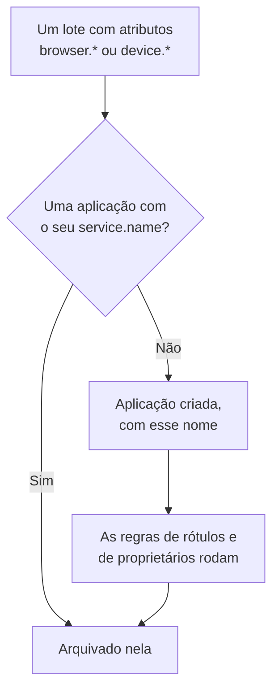

# Gerenciar aplicações

O OneUptime cria uma aplicação RUM na primeira vez que chega a telemetria do seu aplicativo. Esta página cobre o que você gerencia a partir daí: o nome da aplicação, seus rótulos e proprietários, por quanto tempo os dados dela são mantidos, o arquivamento, quem pode vê-la e os alertas.

:::cards
- [Como uma aplicação é criada](#como-uma-aplicação-é-criada): Reconhecida pelo seu `service.name` e criada com o seu primeiro lote.
- [Rótulos](#rótulos): Agrupe aplicações e decida quem pode acessá-las.
- [Retenção](#retenção): Por quanto tempo a telemetria e as gravações são mantidas.
- [Permissões](#permissões): Quem pode ver as aplicações e quem pode assistir às gravações.
:::

## Como uma aplicação é criada

Você não precisa criar uma aplicação RUM. Quando chega um lote de telemetria com atributos de navegador ou de dispositivo e um `service.name`, o OneUptime o arquiva na aplicação com esse `service.name` e cria a aplicação se o projeto ainda não tiver nenhuma.



- O `service.name` é a identidade da aplicação e é comparado sem diferenciar maiúsculas de minúsculas: `Storefront-Web` e `storefront-web` são uma única aplicação.
- Um novo `service.name` inicia uma nova aplicação. A antiga mantém o seu histórico e passa para **Desconectado**, a nova começa vazia, e as duas nunca são mescladas.
- Use um `service.name` por aplicativo, não um por ambiente. Diferencie os ambientes com um rótulo como `oneuptime.label.env=production`, para que eles compartilhem uma aplicação e um histórico.

### Renomear uma aplicação

O **Nome de exibição** começa como o `service.name`. Para alterá-lo, abra a página **Configurações** da aplicação e clique em **Editar detalhes** no cartão **Detalhes do aplicativo**, onde você também edita a descrição e os rótulos. A telemetria é associada pelo **Nome do app (service.name)**, que o cartão mostra e que nunca muda, então renomear é seguro.

### Adicionar uma aplicação você mesmo

Crie uma aplicação você mesmo quando quiser que os rótulos, os proprietários ou a política de reprodução dela estejam prontos antes do primeiro visitante.

:::steps
#### Abrir a lista de aplicações

Vá para **Produtos → Recursos → Monitoramento de Usuários Reais** e clique em **Criar: Aplicação RUM**.

#### Informar o nome do app

Preencha **Nome do app (service.name)** com o `service.name` que o seu aplicativo vai enviar, exatamente como ele o envia.

#### Dar um nome e salvar

A aplicação recebe o nome do seu app, assim como uma descoberta. Para mostrar outro nome, abra **Mais campos** e informe um **Nome de exibição**; a descrição e os rótulos também ficam ali. Depois salve o formulário.
:::

Em seguida, o guia de configuração da aplicação se abre sozinho, com o nome do app como `service.name` do trecho. A última etapa dele, **Aguardar a conexão**, avisa quando chegam os primeiros dados.

Se o projeto já tiver uma aplicação com esse `service.name`, descoberta, adicionada antes ou arquivada, o formulário avisa em vez de criar uma segunda.

## Status da conexão

Uma aplicação mostra **Conectado** enquanto a telemetria chega e **Desconectado** após 15 minutos sem nenhuma. Contam tanto a telemetria do OpenTelemetry quanto o tráfego de reprodução de sessões.

**Visto pela última vez** é atualizado a cada poucos minutos em vez de a cada lote, então pode ficar até cerca de cinco minutos atrás do tráfego real, e os 15 minutos dão margem para isso. O tempo em que o próprio OneUptime estava fora do ar ou colocando em dia a sua fila de ingestão não conta.

**Desconectado** não é um erro por si só: uma ferramenta interna sem visitantes à noite está realmente desconectada. Se há pessoas usando o aplicativo, consulte [Solução de problemas de RUM](/docs/rum/troubleshooting).

## Rótulos

Os rótulos agrupam as aplicações em listas e filtros. Eles também decidem o que um membro restrito a alguns rótulos pode acessar: esse membro só vê as aplicações que têm um desses rótulos. Uma aplicação recebe rótulos de três formas:

| Como | Onde |
| --- | --- |
| Manualmente | No formulário de criação, em **Mais campos**, ou depois com **Editar detalhes** no cartão **Detalhes do aplicativo** da página **Configurações** da aplicação. Para várias de uma vez, selecione-as na lista e escolha **Adicionar rótulos** em **Ações em massa**. |
| Pela telemetria | Um atributo de recurso chamado `oneuptime.label.<name>` adiciona o rótulo `<name>:<value>`, como mostrado abaixo. |
| Por uma regra de rótulos | Uma regra adiciona rótulos a cada nova aplicação que corresponde a ela. Consulte [Regras de rótulos e regras de proprietários](#regras-de-rótulos-e-regras-de-proprietários). |

Defina os atributos no mesmo recurso que `service.name`, por exemplo no arquivo `src/telemetry.ts` da [Configuração para navegadores](/docs/rum/browser-setup):

```ts
const resource = defaultResource().merge(
  resourceFromAttributes({
    [ATTR_SERVICE_NAME]: "storefront-web",
    "oneuptime.label.team": "payments",
    "oneuptime.label.env": "production",
  }),
);
```

Isso adiciona os rótulos `team:payments` e `env:production` e os cria no projeto se não existirem. Escrever o nome do atributo no rótulo mantém `oneuptime.label.team=prod` e `oneuptime.label.env=prod` separados. Um rótulo com mais de 100 caracteres é cortado em 100, e um valor vazio ou que não seja uma string não adiciona nada.

## Regras de rótulos e regras de proprietários

Uma regra adiciona rótulos ou proprietários a cada nova aplicação que corresponde a ela. Abra **Monitoramento de Usuários Reais → Configurações → Regras de Rótulos**, ou **Regras de proprietário**, e crie a regra em duas etapas:

1. Em **Corresponder**, **Todas as aplicações RUM**, onde uma regra nova começa, corresponde a todas as aplicações. Para restringi-la, escolha **Somente as aplicações RUM que atendem às condições** e adicione condições sobre **Rótulos do Aplicativo** (tem algum, todos ou nenhum dos rótulos que você escolher), **Nome do Aplicativo** ou **Descrição do Aplicativo** (é igual a, contém, começa com, termina com ou corresponde a um padrão).
2. Em **Rótulos**, ou **Proprietários** para uma regra de proprietários, escolha o que a regra adiciona. Uma nova regra precisa adicionar pelo menos um rótulo ou um proprietário. O **Nome** é preenchido a partir do que você escolhe, como _Add team:payments_ ou _Add Payments as owners_, até você digitar um nome próprio. A **Descrição**, e **Notificar proprietários** em uma regra de proprietários, ficam em **Mais campos**.

As regras rodam quando uma aplicação é criada, incluindo as descobertas. Para aplicar uma regra às aplicações que você já tem, abra o menu **⋯** da linha dela e escolha **Executar agora**: consulte [Executar regras em recursos existentes](/docs/configuration/run-rules-now). Uma regra que uma edição deixou sem nada para adicionar aparece marcada com **Não adiciona nada** na lista. [Regras de rótulos e proprietários](/docs/configuration/label-and-owner-rules) cobre os formulários completos.

### Proprietários

Os proprietários são as pessoas e as equipes responsáveis por uma aplicação. As regras de proprietários os adicionam às novas aplicações. Para adicioná-los ou removê-los manualmente, selecione aplicações na lista e escolha **Adicionar proprietário** ou **Remover proprietário** em **Ações em massa**; a API os adiciona por `/rum-application-owner-user` e `/rum-application-owner-team`. Com **Notificar proprietários** ativado, que é o padrão, cada proprietário que uma regra adiciona é avisado. Desative-o antes de rodar uma regra em muitas aplicações se ninguém precisar ser notificado.

## Retenção

A telemetria de uma aplicação e as gravações dela são mantidas por tempos diferentes:

| Dados | Mantidos por | Definido em |
| --- | --- | --- |
| Registros, métricas, traços e perfis | A retenção do projeto, a menos que a aplicação a substitua | A página **Configurações** da aplicação |
| Gravações da reprodução de sessões | 7 dias por padrão, ou 1, 14, 30 ou 90 dias | **Replay Policy**, com **Editar política → Limites** |

### Retenção da telemetria

Por padrão, a telemetria de uma aplicação é mantida pela retenção do projeto, definida em **Configurações do projeto → Telemetria e APM → Retenção de dados**. Dois cartões na página **Configurações** da aplicação a substituem:

- **Retenção de Dados de Telemetria** contém **Reter dados de telemetria por (dias)**, um valor para toda a telemetria da aplicação. Deixe vazio para usar a retenção do projeto.
- **Retenção por tipo de telemetria** contém um padrão para registros, traços, métricas e perfis, e para registros por severidade e traços por status. Um valor deixado vazio recorre ao valor da aplicação e, depois, ao do projeto.

As substituições de retenção fazem parte da [Edição Enterprise](/docs/self-hosted/enterprise), e do plano Scale e superiores no OneUptime Cloud. Sem elas, os cartões mostram o que o plano adiciona, e a aplicação mantém a retenção do projeto.

Em um plano Cloud inferior, uma substituição que sobrou de um teste continua valendo para a telemetria nova. A página **Configurações** a mostra em um cartão **Substituição de retenção** com um botão **Remover substituição**, que funciona em todos os planos: a partir daí a aplicação mantém a retenção do projeto, e o que já está armazenado mantém a retenção com que foi armazenado. Definir uma substituição de novo exige o plano Scale.

### Retenção da reprodução de sessões

As gravações têm a sua própria retenção, definida na página **Replay Policy** da aplicação com **Editar política → Limites**: 7 dias por padrão, ou 1, 14, 30 ou 90 dias. Ela é curta de propósito, porque uma gravação é muito mais sensível, e muito maior, do que um span. O cartão **Retenção da reprodução de sessões** da página **Configurações** a mostra (_Session replays are kept for 7 days._), e o botão **Editar em Replay Policy** dele abre a política.

Uma retenção de telemetria mais longa não mantém as gravações por mais tempo. As contagens, os sinais e o dispositivo de uma sessão expiram com as imagens dela; só os registros, os spans e as exceções da sessão seguem a retenção da telemetria. Consulte [Retenção e exclusão](/docs/telemetry/session-replay#retenção-e-exclusão).

> [!TIP]
> O RUM costuma ser a telemetria mais volumosa de um projeto, porque cresce com os seus usuários e não com os seus servidores. Uma retenção mais curta aqui, e uma mais longa nos seus serviços de backend, é uma configuração comum.

## Arquivamento e exclusão

**Arquivar** esconde uma aplicação de **Todos os aplicativos** enquanto ela continua coletando telemetria. Arquive uma aplicação que você não acompanha mais, mas cujo histórico quer manter.

- Clique em **Arquivar** na página **Configurações** da aplicação, ou selecione várias aplicações na lista e arquive-as juntas.
- As aplicações arquivadas ficam em **Monitoramento de Usuários Reais → Avançado → Arquivado**. **Avançado** começa recolhido no menu lateral: clique nele para mostrar **Arquivado**. Use **Desarquivar** ali em uma aplicação, ou em várias de uma vez.

**Excluir aplicação**, na seção **Avançado** do menu lateral da aplicação, exclui a aplicação de forma definitiva. Se o aplicativo ainda envia telemetria, o próximo lote dele recria a aplicação, sem nenhuma das suas configurações, então pare a instrumentação primeiro.

Para apagar os dados de uma pessoa em vez de uma aplicação inteira, registre uma solicitação de apagamento: consulte [Apagar sessões](/docs/telemetry/session-replay#apagar-sessões).

## Permissões

Qualquer pessoa com a função Viewer do projeto pode ver as aplicações RUM e a telemetria delas. A reprodução de sessões fica fora dessa função de propósito: listar gravações, assistir a uma e ver quem a assistiu são permissões separadas. Os proprietários e administradores do projeto têm todas elas. Os seletores de permissão mostram cada permissão pelo seu título, aqui em itálico.

| Permissão | Permite que um membro |
| --- | --- |
| `ReadRumApplication` (_Read RUM Application_) | Veja as aplicações e as páginas de telemetria delas. |
| `CreateRumApplication`, `EditRumApplication`, `DeleteRumApplication` | Adicione, edite e exclua aplicações. |
| `ReadRumSessionReplay` (_List Session Replays_) | Liste as sessões gravadas e os detalhes delas, sem reproduzi-las nem saber quem era o usuário. |
| `ReadRumSessionReplayPayload` (_Watch Session Replays_) | Reproduza gravações e leia a referência e os atributos do usuário identificado. |
| `ReadRumSessionReplayAudit` (_Read Session Replay Audit_) | Leia o **Registro de acesso aos replays**: quem assistiu a qual gravação. |
| `DeleteRumSessionReplay` (_Delete Session Replays_) | Exclua gravações. |
| `CreateRumSessionErasureRequest`, `ReadRumSessionErasureRequest` | Registre solicitações de apagamento e acompanhe-as. |
| `ReadRumApplicationLabelRule`, `ReadRumApplicationOwnerRule` (e os seus Create, Edit e Delete) | Gerencie as regras de rótulos e as regras de proprietários. |
| `ReadRumApplicationOwnerUser`, `ReadRumApplicationOwnerTeam` (e os seus Create, Edit e Delete) | Adicione e remova proprietários pela API. |

Uma divisão útil: dê a um engenheiro de suporte `ReadRumApplication` e `ReadRumSessionReplay`. Ele consegue ver quais sessões tiveram erros sem assistir à tela de ninguém nem saber quem era o usuário. Dê `ReadRumSessionReplayPayload` só para as pessoas que precisam; os membros com `ReadRumSessionReplayAudit` passam a ver cada reprodução na página **Registro de acesso aos replays** da aplicação. [Quem pode assistir a uma gravação](/docs/telemetry/session-replay#quem-pode-assistir-a-uma-gravação) mostra o que cada permissão libera na lista de sessões e no reprodutor.

## Alertas sobre dados RUM

A telemetria RUM é feita de registros, métricas e traços comuns, então não existe um monitor RUM separado: os monitores de sempre funcionam com ela. A forma mais rápida de começar é a página **Recomendações** da aplicação, que oferece monitores já limitados à aplicação:

| Grupo | Recomendações |
| --- | --- |
| Core Web Vitals | Poor Largest Contentful Paint, Poor Interaction to Next Paint, Poor Cumulative Layout Shift, Slow First Contentful Paint e Slow Time to First Byte. Consulte [Core Web Vitals](/docs/rum/web-vitals). |
| Erros | Failed User Operations e Unhandled Browser Exceptions. |
| Reprodução de sessões | Os quatro [alertas de orçamento de armazenamento](/docs/telemetry/session-replay#alertas-de-orçamento-de-armazenamento), que avisam antes que o limite diário do projeto ou o orçamento mensal da aplicação se esgote. São oferecidos assim que a aplicação grava uma reprodução, e o par mensal quando ela também tem um orçamento mensal. |

Para criar o seu próprio monitor, escolha o que lê o sinal:

- [Monitor de métricas](/docs/monitor/metrics-monitor): uma Core Web Vital, ou qualquer métrica que o seu aplicativo envie.
- [Monitor de traces](/docs/monitor/traces-monitor): a taxa de erros ou a latência do lado do cliente.
- [Monitor de logs](/docs/monitor/logs-monitor): um padrão nos registros do navegador.
- [Monitor de exceções](/docs/monitor/exceptions-monitor): exceções do lado do cliente novas ou em alta.

Limite à aplicação o monitor que você criar, para que um serviço de backend com uma assinatura parecida não o dispare.

## Próximos passos

:::cards
- [Reprodução de sessões](/docs/telemetry/session-replay): Grave o que os usuários viram, com política e retenção próprias.
- [Regras de rótulos e proprietários](/docs/configuration/label-and-owner-rules): Os dois formulários de regra, passo a passo.
- [Executar regras em recursos existentes](/docs/configuration/run-rules-now): Aplique uma nova regra às aplicações que você já tem.
- [Solução de problemas de RUM](/docs/rum/troubleshooting): Quando uma aplicação está faltando, vazia ou aparece como Desconectado.
:::
