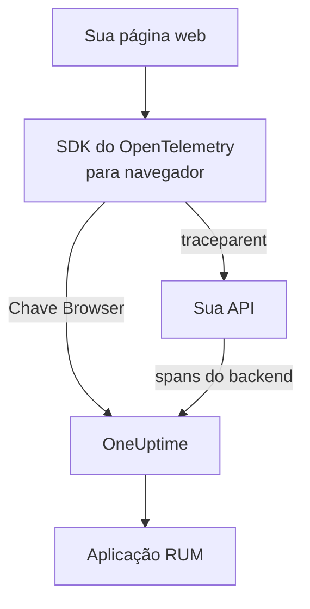

# Configuração para navegadores

Instrumente um aplicativo web com o SDK do OpenTelemetry para navegador para que ele se reporte ao OneUptime como uma aplicação RUM. Carregamentos de página e requisições chegam como traços, e a mesma configuração leva seus erros, registros, métricas e Core Web Vitals.

:::cards
- [Configurar](#configurar): Seis passos de uma chave Browser até o seu primeiro carregamento de página.
- [Ligar ao seu backend](#ligar-aos-seus-traços-de-backend): Unir os spans do navegador aos traços de backend que eles iniciam.
- [Relatar erros](#relatar-erros-não-tratados): Enviar erros não tratados para a visão de Exceções.
- [Solução de problemas](#solução-de-problemas): O que verificar quando nada chega.
:::

## Como funciona

O SDK roda nos navegadores dos seus visitantes. Ele registra um span para cada carregamento de página e cada requisição e os exporta direto para o OneUptime com uma chave de ingestão **Browser**, sem coletor ou proxy seu no meio.



## Antes de começar

- Um aplicativo web cujo código você possa alterar e implantar de novo, com as dependências instaladas pelo npm.
- As origens de onde suas páginas são servidas, por exemplo `https://app.example.com`. Uma chave Browser só aceita requisições das origens que você lista nela.
- Uma função que possa criar chaves de ingestão: proprietários e administradores do projeto podem, assim como qualquer pessoa com a permissão **Create Telemetry Ingestion Key**.

## Configurar

:::steps
### Criar uma chave de ingestão Browser

1. Vá para **Produtos → Configurações do projeto**.
2. No menu lateral, expanda **Telemetria e APM** e selecione **Chaves de ingestão**.
3. Clique em **Criar chave de ingestão** e escolha **Browser** como **Tipo de chave**.
4. Na etapa **Configurações do navegador**, liste suas origens em **Allowed Origins** como um array JSON, por exemplo `["https://app.example.com"]`, e crie a chave. No plano gratuito do OneUptime Cloud, uma última etapa **Cobrança** mostra antes o preço da telemetria.


A nova chave abre em uma página própria. Copie a **Chave secreta** dela: é o token que o SDK envia como `x-oneuptime-token`.


### Instalar os pacotes

```bash
npm install @opentelemetry/api \
  @opentelemetry/sdk-trace-web \
  @opentelemetry/resources \
  @opentelemetry/semantic-conventions \
  @opentelemetry/opentelemetry-browser-detector \
  @opentelemetry/exporter-trace-otlp-http \
  @opentelemetry/context-zone \
  @opentelemetry/instrumentation \
  @opentelemetry/instrumentation-document-load \
  @opentelemetry/instrumentation-fetch \
  @opentelemetry/instrumentation-xml-http-request
```

### Criar o arquivo de telemetria

Crie `src/telemetry.ts`. `browserDetector` adiciona os atributos `browser.*` que classificam a telemetria como RUM, e `service.name` dá nome à aplicação.

```ts title="src/telemetry.ts"
import {
  WebTracerProvider,
  BatchSpanProcessor,
} from "@opentelemetry/sdk-trace-web";
import { OTLPTraceExporter } from "@opentelemetry/exporter-trace-otlp-http";
import { ZoneContextManager } from "@opentelemetry/context-zone";
import { registerInstrumentations } from "@opentelemetry/instrumentation";
import { DocumentLoadInstrumentation } from "@opentelemetry/instrumentation-document-load";
import { FetchInstrumentation } from "@opentelemetry/instrumentation-fetch";
import { XMLHttpRequestInstrumentation } from "@opentelemetry/instrumentation-xml-http-request";
import {
  defaultResource,
  detectResources,
  resourceFromAttributes,
} from "@opentelemetry/resources";
import { browserDetector } from "@opentelemetry/opentelemetry-browser-detector";
import { ATTR_SERVICE_NAME } from "@opentelemetry/semantic-conventions";

const ONEUPTIME_URL = "https://oneuptime.com";
// Public: it ships in your page. It must be a Browser ingestion key.
const ONEUPTIME_TOKEN = "YOUR_TELEMETRY_INGESTION_TOKEN";

/*
 * browserDetector supplies the browser.* attributes. Without them this
 * telemetry is classified as a backend Service, not a RUM application.
 * The attributes set last win, so service.name here overrides the
 * "unknown_service" that defaultResource() provides.
 */
const resource = defaultResource()
  .merge(detectResources({ detectors: [browserDetector] }))
  .merge(
    resourceFromAttributes({
      [ATTR_SERVICE_NAME]: "storefront-web",
    }),
  );

const provider = new WebTracerProvider({
  resource: resource,
  spanProcessors: [
    new BatchSpanProcessor(
      new OTLPTraceExporter({
        url: `${ONEUPTIME_URL}/otlp/v1/traces`,
        headers: { "x-oneuptime-token": ONEUPTIME_TOKEN },
      }),
    ),
  ],
});

provider.register({
  contextManager: new ZoneContextManager(),
});

registerInstrumentations({
  instrumentations: [
    new DocumentLoadInstrumentation(),
    new FetchInstrumentation({
      // See "Linking to your backend traces" before widening this.
      propagateTraceHeaderCorsUrls: [/^https:\/\/api\.example\.com/],
    }),
    new XMLHttpRequestInstrumentation({
      propagateTraceHeaderCorsUrls: [/^https:\/\/api\.example\.com/],
    }),
  ],
});
```

### Importá-lo primeiro

Faça dele a primeira importação do seu aplicativo. As instrumentações modificam `fetch` e `XMLHttpRequest`, e uma requisição feita antes da modificação não é rastreada.

```ts
// src/index.tsx (React), src/main.ts (Vue / Angular), etc.
import "./telemetry";
import React from "react";
// ... the rest of your app
```

### Verificar a chave

Pergunte ao OneUptime se ele aceita a chave antes de procurar em qualquer outro lugar:

```bash
curl -i https://oneuptime.com/otlp/v1/validate \
  -H "x-oneuptime-token: YOUR_TELEMETRY_INGESTION_TOKEN"
```

`200` com `"valid": true` significa que a chave foi aceita; para uma chave Browser, a mensagem acrescenta que ela só funciona a partir de um navegador, de uma das origens permitidas. `401` significa que a chave é desconhecida, foi revogada, desativada ou expirou.

### Carregar uma página

Abra o seu site. Em até um minuto, a aplicação aparece em **Produtos → Recursos → Monitoramento de Usuários Reais**, com o nome do seu `service.name`.
:::

## O que uma chave Browser permite

Tudo o que está no snippet vai para os seus visitantes, então qualquer pessoa pode copiar o token da sua página. Uma chave Browser limita o que uma cópia pode fazer:

| Configuração | O que faz |
| --- | --- |
| **Allowed Origins** | As requisições só são aceitas destas origens, cada uma com seu esquema e a porta, se houver. Um host pode começar com um único curinga `*.`: `https://*.example.com` abrange todos os subdomínios de `example.com`, mas não o próprio `example.com`. |
| **Requests Per Minute Limit** | Um único teto para todos os visitantes que usam a chave: 6000 requisições por minuto, a menos que você defina o seu. |
| **Pinned Service Name** | Força `service.name` em tudo o que a chave grava, para que uma cópia não possa fazer a telemetria dela passar por um dos seus serviços de backend. |
| **Expira em** | Depois desta data, a chave deixa de ser aceita. |
| **Habilitado** | Desligue para interromper na hora uma chave vazada. |

Uma chave Browser grava traços, registros e métricas OTLP, além de reproduções de sessão; todas as outras vias de ingestão a recusam. Essas configurações são alteradas na página da própria chave. O tipo de chave não pode ser mudado depois que a chave é criada.

> [!WARNING]
> Nunca coloque uma chave **Servidor** em uma página. Uma chave Servidor grava qualquer tipo de telemetria de qualquer lugar, sem verificar a origem, então qualquer pessoa que leia a sua página poderia gravar no seu projeto.

## Definir `browser.*` sem o detector

`browserDetector` lê a [API UA Client Hints](https://wicg.github.io/ua-client-hints/), que só os navegadores Chromium têm. No Safari e no Firefox, ele define `browser.language` e `user_agent.original`, mas não `browser.platform`, `browser.brands` nem `browser.mobile`.

Isso ainda basta para classificar a telemetria como RUM, porque `browser.language` sozinho marca um lote como RUM de navegador. A página **Clientes**, porém, lista as plataformas a partir de `browser.platform`, então visitas pelo Safari e pelo Firefox não acrescentam nenhuma linha ali.

Para dispensar o detector, ou para dar uma plataforma a todo navegador, defina os atributos você mesmo:

```ts
const resource = defaultResource().merge(
  resourceFromAttributes({
    [ATTR_SERVICE_NAME]: "storefront-web",
    // browser.language or browser.platform marks the telemetry as browser RUM.
    "browser.language": navigator.language,
    "browser.platform":
      (navigator as any).userAgentData?.platform ?? "unknown",
    "browser.mobile": (navigator as any).userAgentData?.mobile ?? false,
    "user_agent.original": navigator.userAgent,
  }),
);
```

Mantenha `browser.platform` genérico. Cada valor diferente vira uma linha da página **Clientes**, então uma string de user-agent completa ou um valor por usuário cria ali uma lista sem fim, e ainda é um problema de privacidade.

## Rastrear mudanças de rota

`DocumentLoadInstrumentation` rastreia apenas o primeiro carregamento. Em um aplicativo de página única, as mudanças de rota ficam invisíveis até que você as registre, o que exige poucas linhas no seu roteador:

```ts
import { trace } from "@opentelemetry/api";

const tracer = trace.getTracer("app-router");

function onRouteChange(to: string): void {
  const span = tracer.startSpan("route-change", {
    attributes: { "app.route": to },
  });
  // End it when the route's data has loaded and the view has painted.
  requestAnimationFrame(() => {
    return span.end();
  });
}
```

Adicione `@opentelemetry/instrumentation-user-interaction` para rastrear também cliques e outros eventos do DOM. Para o INP de cada rota, veja [Aplicativos de página única](/docs/rum/web-vitals#aplicativos-de-página-única).

## Ligar aos seus traços de backend

`propagateTraceHeaderCorsUrls` decide quais requisições entre origens levam um cabeçalho W3C `traceparent`, que liga o span do navegador ao traço de backend que ele iniciou. Requisições para a própria origem da sua página o levam sem nenhuma configuração.

> [!WARNING]
> Não o defina como `/.*/`. O cabeçalho transforma uma requisição simples entre origens em uma com preflight, então qualquer API de terceiros que não liste `traceparent` no seu `Access-Control-Allow-Headers` começa a falhar.

Liste apenas origens que você controla e configurou:

```ts
new FetchInstrumentation({
  propagateTraceHeaderCorsUrls: [
    /^https:\/\/api\.example\.com/,
    /^https:\/\/auth\.example\.com/,
  ],
});
```

Com o [Session Replay](/docs/telemetry/session-replay) instalado, as requisições para a sua própria origem também levam o ID de sessão da reprodução, que arquiva a telemetria do seu backend sob a gravação: veja [Unir os traços à reprodução de sessões](#unir-os-traços-à-reprodução-de-sessões).

## Unir os traços à reprodução de sessões

Se você também usa o [Session Replay](/docs/telemetry/session-replay), a sua telemetria de **backend** se junta à gravação sem nenhum código aqui. Enquanto uma sessão é enviada, o gravador adiciona um membro `tracestate` com o ID de sessão às requisições que a sua página faz para a própria origem e deixa o `traceparent` para a sua `FetchInstrumentation` / `XMLHttpRequestInstrumentation`. Os spans do seu backend recebem o ID de sessão na ingestão, em todo serviço que continua o contexto de trace W3C, e os registros e exceções dele se juntam à gravação pelo ID do traço. Veja [Correlacionar com o restante da sua telemetria](/docs/telemetry/session-replay#correlating-with-your-other-telemetry) para saber como funciona, o que não cobre e qual chave o desliga.

O gravador também lê de volta o `traceparent` que as suas instrumentações definem, quer a chamada passe uma URL (com ou sem objeto init) quer um objeto `Request`, para que cada linha de requisição na reprodução leve ao seu traço de backend. Para uma API em outra origem, liste-a acima em `propagateTraceHeaderCorsUrls`; as requisições dela não levam ID de sessão e se juntam à gravação pelo ID do traço. **Trace propagation origins** na política de reprodução da aplicação faz o mesmo para páginas *sem* este SDK.

O que os cabeçalhos não alcançam são os spans de navegador deste SDK: carregamentos de documento, mudanças de rota e os erros que você relata. Para arquivá-los também sob a gravação, marque cada span com `session.id` quando ele começa. O gravador informa o ID por meio de `onSessionChange`, que dispara na hora se já existe uma sessão e de novo sempre que o ID muda: quando o visitante volta depois de 30 minutos ocioso, no limite de 4 horas, quando `identify()` indica outro usuário ou quando outra aba do mesmo visitante o mudou primeiro.

```ts title="src/replaySession.ts"
import type { Context } from "@opentelemetry/api";
import type {
  ReadableSpan,
  Span,
  SpanProcessor,
} from "@opentelemetry/sdk-trace-web";

declare global {
  interface Window {
    OneUptimeReplayQueue?: Array<Array<unknown>>;
  }
}

let replaySessionId: string | null = null;

// The recorder script loads asynchronously. The queue is applied the
// moment it starts and stays live afterwards, so this works either way.
(window.OneUptimeReplayQueue = window.OneUptimeReplayQueue || []).push([
  "onSessionChange",
  (sessionId: string): void => {
    replaySessionId = sessionId;
  },
]);

export class ReplaySessionSpanProcessor implements SpanProcessor {
  public onStart(span: Span, _parentContext: Context): void {
    if (replaySessionId) {
      span.setAttribute("session.id", replaySessionId);
    }
  }

  public onEnd(_span: ReadableSpan): void {}

  public forceFlush(): Promise<void> {
    return Promise.resolve();
  }

  public shutdown(): Promise<void> {
    return Promise.resolve();
  }
}
```

Depois, coloque-o em primeiro lugar entre os processadores de spans do provider em `src/telemetry.ts`:

```ts
import { ReplaySessionSpanProcessor } from "./replaySession";

const provider = new WebTracerProvider({
  resource: resource,
  spanProcessors: [
    new ReplaySessionSpanProcessor(),
    new BatchSpanProcessor(
      new OTLPTraceExporter({
        url: `${ONEUPTIME_URL}/otlp/v1/traces`,
        headers: { "x-oneuptime-token": ONEUPTIME_TOKEN },
      }),
    ),
  ],
});
```

Os spans iniciados a partir daí levam o ID, a aba **Traços** do player os lista no relógio da gravação, e cada um deles no painel leva de volta ao momento na reprodução. Um processador de spans marca cada span com o ID vigente quando ele começou; gravar o ID em `resource.attributes` reetiquetaria os spans que ainda esperavam no lote de exportação quando a sessão mudou. O listener recebe o ID assim que o gravador inicia, antes de qualquer consentimento ou gatilho de captura, então, se isso importar, marque os spans só depois que a sua página tiver o consentimento.

## Content Security Policy

Se o seu site envia uma Content Security Policy, o navegador bloqueia as requisições do exportador até você permitir o OneUptime em `connect-src`. Nada falha de forma visível: a página simplesmente não relata nada.

```text
connect-src 'self' https://oneuptime.com;
```

Mescle-o à sua diretiva `connect-src` existente. Se você hospeda o OneUptime por conta própria, use o seu próprio host.

## Relatar erros não tratados

O SDK do OpenTelemetry para navegador não captura erros não tratados. Relate-os você mesmo, e eles aparecem em **Exceções** ao lado dos erros do seu backend:

```ts
import { trace, SpanStatusCode } from "@opentelemetry/api";

const tracer = trace.getTracer("app-errors");

window.addEventListener("error", (event: ErrorEvent) => {
  const span = tracer.startSpan("window.onerror");
  span.recordException(event.error ?? new Error(event.message));
  span.setStatus({ code: SpanStatusCode.ERROR });
  span.end();
});

window.addEventListener("unhandledrejection", (event: PromiseRejectionEvent) => {
  const span = tracer.startSpan("unhandledrejection");
  span.recordException(
    event.reason instanceof Error ? event.reason : new Error(String(event.reason)),
  );
  span.setStatus({ code: SpanStatusCode.ERROR });
  span.end();
});
```

Com o [Session Replay](/docs/telemetry/session-replay), o gravador também captura erros não tratados e os marca na linha do tempo da reprodução. A página da exceção mostra então um cartão **Watch what the user saw**, que abre a reprodução dez segundos antes do erro. Com a política padrão, toda sessão é gravada, falhe algo ou não; o erro só decide onde o cartão abre.

## Adicionar registros e métricas

Os traços bastam para preencher a visão geral. Adicione os pipelines de registros e de métricas quando quiser os registros do navegador no OneUptime, ou para enviar os [Core Web Vitals](/docs/rum/web-vitals):

```bash
npm install @opentelemetry/api-logs @opentelemetry/sdk-logs \
  @opentelemetry/exporter-logs-otlp-http \
  @opentelemetry/sdk-metrics @opentelemetry/exporter-metrics-otlp-http
```

```ts
import { LoggerProvider, BatchLogRecordProcessor } from "@opentelemetry/sdk-logs";
import { OTLPLogExporter } from "@opentelemetry/exporter-logs-otlp-http";
import { MeterProvider, PeriodicExportingMetricReader } from "@opentelemetry/sdk-metrics";
import { OTLPMetricExporter } from "@opentelemetry/exporter-metrics-otlp-http";
import { logs } from "@opentelemetry/api-logs";
import { metrics } from "@opentelemetry/api";

const headers = { "x-oneuptime-token": ONEUPTIME_TOKEN };

logs.setGlobalLoggerProvider(
  new LoggerProvider({
    resource: resource,
    processors: [
      new BatchLogRecordProcessor({
        exporter: new OTLPLogExporter({
          url: `${ONEUPTIME_URL}/otlp/v1/logs`,
          headers,
        }),
      }),
    ],
  }),
);

metrics.setGlobalMeterProvider(
  new MeterProvider({
    resource: resource,
    readers: [
      new PeriodicExportingMetricReader({
        exporter: new OTLPMetricExporter({
          url: `${ONEUPTIME_URL}/otlp/v1/metrics`,
          headers,
        }),
        exportIntervalMillis: 30000,
      }),
    ],
  }),
);
```

Monte-os com o mesmo objeto `resource`. Um pipeline de registros ou de métricas cujo recurso não tenha `browser.*` é arquivado como um serviço de backend separado.

## Referência de endpoints

| Sinal | Endpoint | Cabeçalho |
| --- | --- | --- |
| Traços | `POST {host}/otlp/v1/traces` | `x-oneuptime-token: <token>` |
| Métricas | `POST {host}/otlp/v1/metrics` | `x-oneuptime-token: <token>` |
| Registros | `POST {host}/otlp/v1/logs` | `x-oneuptime-token: <token>` |

`{host}` é `https://oneuptime.com`, ou o seu próprio host se você roda o OneUptime por conta própria; troque-o nas URLs do OTLP e na entrada da Content Security Policy. O OneUptime aceita OTLP/JSON e OTLP/protobuf. Os endpoints respondem a requisições entre origens de qualquer origem e permitem o cabeçalho `x-oneuptime-token`, então um navegador exporta diretamente para eles.

## Solução de problemas

:::details Nenhuma requisição ao OneUptime na aba Rede
Abra as ferramentas de desenvolvedor do navegador, vá para a aba Rede e filtre por `otlp`: você procura `POST /otlp/v1/traces`. Nenhuma requisição significa que o SDK nunca iniciou:

- `telemetry.ts` não é a primeira importação, ou o seu bundler a descartou.
- O processador de lotes ainda não exportou. Ele espera alguns segundos para encher um lote, então aguarde, ou vá para outra página, antes de concluir que nada é enviado.
- Uma variável de ambiente de build ficou como `undefined`, então a URL do exportador está quebrada. Registre a URL uma vez na inicialização.
:::

:::details O navegador bloqueia a requisição
- Um erro de Content Security Policy no console significa que `connect-src` ainda não permite o OneUptime: veja [Content Security Policy](#content-security-policy).
- Um erro de CORS quase sempre significa que a requisição nunca chegou ao OneUptime, cujos endpoints permitem qualquer origem: procure um proxy corporativo, um bloqueador de anúncios ou um erro de digitação no host.
:::

:::details O OneUptime recusa a requisição
- `422` com `Origin https://app.example.com is not allowed for this browser ingestion key.` significa que a origem exata da página (esquema, host e porta) está faltando nas **Allowed Origins** da chave.
- `422` com `This telemetry ingestion key has been disabled.` significa que alguém desligou a chave. Ligue-a de novo ou use outra chave.
- `401` significa que a chave é desconhecida, foi revogada ou expirou. Faça a verificação da chave em [Configurar](#configurar) e depois crie uma chave Browser válida.
- `404` significa que a URL está errada. O exportador de traços precisa do caminho completo, `/otlp/v1/traces`.
:::

:::details O aplicativo aparece em Serviços em vez de Monitoramento de Usuários Reais
O recurso não tem nenhum atributo `browser.*`, então a telemetria foi arquivada como serviço de backend. Adicione o `browserDetector` ou defina os atributos como em [Definir `browser.*` sem o detector](#definir-browser-sem-o-detector).

Confira o que você envia na aba Rede, no payload da requisição: `resourceSpans[0].resource.attributes` é a lista que decide. O serviço já criado não vira uma aplicação RUM, então exclua-o em **Produtos → Serviços** quando a telemetria RUM chegar.
:::

:::details A página Clientes está vazia no Safari ou no Firefox
As linhas de clientes vêm de `browser.platform`, que o `browserDetector` só define nos navegadores Chromium. Defina-o você mesmo para listar as visitas pelo Safari e pelo Firefox: veja [Definir `browser.*` sem o detector](#definir-browser-sem-o-detector).
:::

## Próximos passos

:::cards
- [Core Web Vitals](/docs/rum/web-vitals): Enviar LCP, INP, CLS, FCP e TTFB da mesma página.
- [Reprodução de sessões](/docs/telemetry/session-replay): Gravar o que o usuário viu, ao lado destes traços.
- [Gerenciar aplicações](/docs/rum/applications): Nomes, rótulos, proprietários e retenção.
- [Solução de problemas de RUM](/docs/rum/troubleshooting): Cada verificação, na ordem em que os problemas costumam acontecer.
:::
