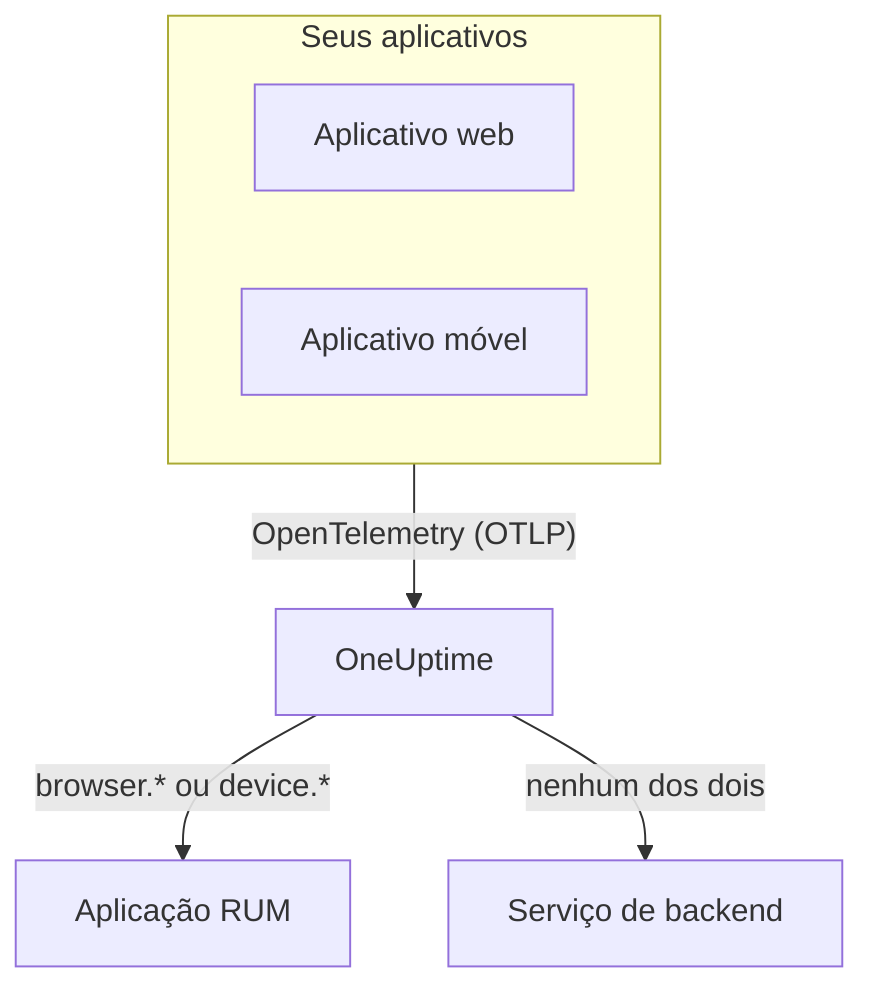

# Visão geral do RUM

O Real User Monitoring (RUM) mostra o que os usuários reais vivem nos seus aplicativos web e móveis: carregamentos de página, requisições, erros e Core Web Vitals, informados pelo próprio aplicativo em vez de por uma sonda. O OneUptime guarda essa telemetria em uma aplicação RUM que você pode exibir em gráficos, pesquisar e monitorar com alertas.

:::cards
- [Como funciona](#como-funciona): Um único pipeline do OpenTelemetry, classificado como RUM na chegada.
- [Como o OneUptime reconhece o RUM](#como-o-oneuptime-reconhece-o-rum): Os atributos de recurso que decidem isso.
- [O que você ganha](#o-que-você-ganha): A visão geral, os vitals, os exploradores e as reproduções.
- [Primeiros passos](#primeiros-passos): De uma chave de ingestão ao seu primeiro carregamento de página.
:::

## Como funciona

O RUM usa o mesmo pipeline do OpenTelemetry que o resto do OneUptime. Não há agente de RUM nem formato de transmissão próprio: você aponta um SDK do OpenTelemetry para navegador ou para dispositivos móveis para o OneUptime, e a telemetria é classificada como RUM quando chega.

- **Uma aplicação por aplicativo.** A identidade dela é o `service.name` que o seu SDK informa, e o OneUptime cria a aplicação no primeiro lote de telemetria.
- **Nunca contada duas vezes.** A telemetria do cliente pertence apenas à sua aplicação RUM; ela não aparece também como serviço de backend.
- **O Session Replay é uma camada separada e opcional.** Ele tem um snippet próprio e controles de privacidade próprios: veja [Reprodução de sessões](/docs/telemetry/session-replay).

## Onde encontrar

Abra **Produtos → Recursos → Monitoramento de Usuários Reais**. **Todos os aplicativos** lista suas aplicações com **Tipo de cliente**, **Status** e **Visto pela última vez**. Outras duas seções do menu lateral começam recolhidas:

- **Configurações**: **Regras de proprietário**, **Regras de Rótulos** e a chave **Session Replay** de todo o projeto.
- **Avançado**: **Arquivado**, as aplicações que você arquivou.

O menu lateral de uma aplicação agrupa as páginas dela assim; **Configurações**, **Desenvolvedores** e **Avançado** começam recolhidas:

| Seção | Páginas |
| --- | --- |
| **Básico** | **Visão geral**, **Recommendations**, **Documentação** |
| **Observabilidade** | **Métricas**, **Registros**, **Traços**, **Clientes** |
| **Session Replay** | **Session Replay**, **User Flows**, **Replay Users**, **Health**, **Replay Policy**, **Replay Access Log**, **Documentação** |
| **Configurações** | **Configurações** |
| **Desenvolvedores** | **Terraform**, **API**, **Assistentes de IA** |
| **Avançado** | **Excluir aplicação** |

## Como o OneUptime reconhece o RUM

A maioria das perguntas do tipo "meu aplicativo não aparece" termina aqui. O OneUptime decide, para cada lote de telemetria que chega, a partir dos **atributos de recurso** dele:

1. Um lote cujo recurso tem `browser.platform`, `browser.language` ou um `browser.brands` não vazio é RUM de **navegador**.
2. Caso contrário, um lote com `device.id` ou `device.model.identifier` é RUM **móvel**.
3. Caso contrário, um lote com `device.manufacturer` e sem identidade de host (`host.name`, `host.id` ou `k8s.node.name`) também é RUM **móvel**.
4. Todo o resto é um serviço de backend.

SDKs de backend nunca definem `browser.*`, `device.id` nem `device.model.identifier`, então esses são sinais claros. `device.manufacturer` é a exceção: o inventário de um host também informa com ele o fabricante de uma máquina, então ele só conta em um recurso sem identidade de host. Veja [Atributos de inventário](/docs/telemetry/host-otel-collector#atributos-de-inventário-ip-mac-número-de-série-fabricante-modelo-firmware).

| Atributo | Obrigatório | O que faz |
| --- | --- | --- |
| `service.name` | **Sim** | A identidade da aplicação, por exemplo `storefront-web`. Sem ele, nenhuma aplicação RUM é criada. |
| `browser.platform`, `browser.language`, `browser.brands` | Um deles, na web | Marca o lote como RUM de navegador. `browser.platform` também preenche a página **Clientes**. |
| `device.id`, `device.model.identifier` | Um deles, em dispositivos móveis | Marca o lote como RUM móvel. `device.model.identifier` também preenche a página **Clientes**. |
| `device.manufacturer` | Não | Marca o lote como RUM móvel somente quando o recurso não traz identidade de host. |
| `telemetry.sdk.language` | Não | Exibido na visão geral, por exemplo `webjs` ou `swift`. |
| `telemetry.sdk.version` | Não | Exibido como versão do SDK; quando falta, o `oneuptime.agent.version` é lido. |
| `oneuptime.label.<name>` | Não | Adiciona o rótulo de projeto `<name>:<value>` à aplicação. |

O OneUptime encontra a aplicação pelo `service.name`, sem diferenciar maiúsculas de minúsculas, e a cria quando o projeto não tem nenhuma. Um novo `service.name` inicia uma nova aplicação, então mantenha-o estável e diferencie ambientes com um rótulo em vez de um nome novo. [Gerenciar aplicações](/docs/rum/applications) trata de nomes, rótulos, proprietários e retenção.

> [!IMPORTANT]
> O SDK do OpenTelemetry para navegador não adiciona atributos `browser.*` a menos que você adicione o detector de recursos do navegador ou os defina você mesmo. Só com `service.name`, a telemetria vira um serviço de backend, não uma aplicação RUM. [Configuração para navegadores](/docs/rum/browser-setup) mostra as duas formas.

## O que você ganha

| Onde | O que mostra |
| --- | --- |
| **Visão geral** | Blocos de **Page loads**, **Page load time (p95)**, **Eventos**, **Taxa de erro**, **Event duration (p95)**, **Exceções**, **Clientes** e **Sessions recorded**, e gráficos de tendência do intervalo de tempo que você escolher. |
| **Core Web Vitals** | Um cartão na visão geral com LCP, INP, CLS, FCP e TTFB, cada um avaliado pelos limites do Google, e o INP de cada rota de um aplicativo de página única. Veja [Core Web Vitals](/docs/rum/web-vitals) e [Aplicativos de página única](/docs/rum/web-vitals#aplicativos-de-página-única). |
| **Métricas**, **Registros**, **Traços** | Os exploradores de telemetria, limitados a esta aplicação. |
| **Clientes** | As plataformas de navegador e os modelos de dispositivo em que a aplicação foi usada: uma lista curta por plataforma, nunca uma linha por usuário. |
| **Session Replay** | Gravações de sessões reais, ao lado dos erros, traços e registros delas: veja [Reprodução de sessões](/docs/telemetry/session-replay). |
| **Recommendations** | Monitores prontos para a aplicação: Core Web Vitals ruins, requisições com falha, exceções do navegador e, assim que ela grava, orçamentos do Session Replay. |

As contagens vêm dos spans que a sua instrumentação envia. **Page loads** conta o span `documentLoad` que a instrumentação de carregamento de página registra em cada carregamento completo, então uma mudança de rota dentro de um aplicativo de página única não é um carregamento de página.

Uma aplicação mostra **Conectado** enquanto a telemetria chega e **Desconectado** depois de 15 minutos sem ela. O tempo em que o próprio OneUptime estava fora do ar ou colocando em dia sua fila de ingestão não conta para esses 15 minutos.

## Primeiros passos

:::steps
### Criar uma chave de ingestão

Abra **Configurações do projeto → Telemetria e APM → Chaves de ingestão** e clique em **Criar chave de ingestão**. Um aplicativo web precisa de uma chave **Browser**, que só funciona a partir das origens que você listar. Um aplicativo móvel precisa de uma chave **Servidor**, porque um SDK móvel não envia o cabeçalho `Origin`.

### Instrumentar seu aplicativo

Siga [Configuração para navegadores](/docs/rum/browser-setup) para um aplicativo web, ou [Configuração para dispositivos móveis](/docs/rum/mobile-setup) para Android, iOS, React Native e outras plataformas.

### Abrir uma página

Carregue uma página do seu site ou abra o seu aplicativo. A aplicação aparece em **Produtos → Recursos → Monitoramento de Usuários Reais** no primeiro lote de telemetria, com o nome do seu `service.name`. Não é preciso criá-la antes.

### Adicionar vitals e reproduções

Quando o básico chegar, envie os [Core Web Vitals](/docs/rum/web-vitals) e adicione a [Reprodução de sessões](/docs/telemetry/session-replay). Os dois são opcionais.
:::

Se nada aparecer, [Solução de problemas de RUM](/docs/rum/troubleshooting) percorre as causas na ordem em que costumam acontecer.

## Próximos passos

:::cards
- [Configuração para navegadores](/docs/rum/browser-setup): Instrumentar um aplicativo web com o SDK do OpenTelemetry para navegador.
- [Configuração para dispositivos móveis](/docs/rum/mobile-setup): Android, iOS, React Native e qualquer outro SDK do OpenTelemetry.
- [Core Web Vitals](/docs/rum/web-vitals): Enviar LCP, INP, CLS, FCP e TTFB, e ler o INP rota por rota.
- [Reprodução de sessões](/docs/telemetry/session-replay): Ver o que o usuário viu, ao lado dos erros e traços dele.
:::
