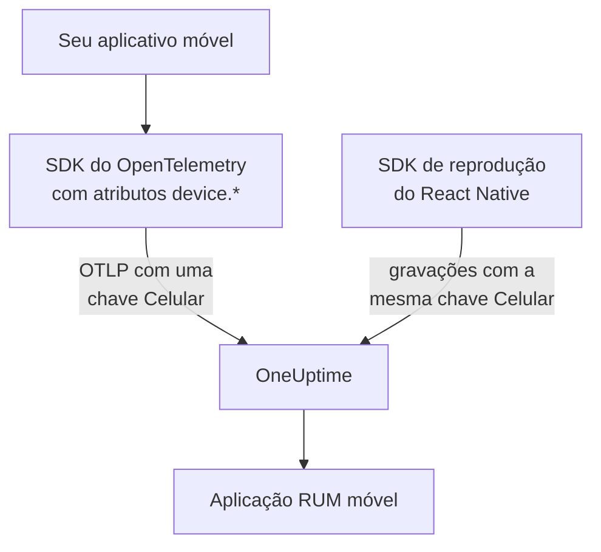

# Configuração para dispositivos móveis

Instrumente um aplicativo Android, iOS ou React Native com o OpenTelemetry para que ele se reporte ao OneUptime como uma aplicação RUM móvel. Qualquer outra plataforma com um SDK do OpenTelemetry funciona da mesma forma.

:::cards
- [O que o OneUptime precisa](#o-que-o-oneuptime-precisa): Dois atributos de recurso, enviados com uma chave Celular.
- [Configurar sua plataforma](#configurar-sua-plataforma): Android, iOS, React Native e as demais.
- [Falhas e travamentos no iOS](#falhas-e-travamentos-no-ios): Os relatórios do MetricKit e do KSCrash em Exceções, nomeados pelos seus dSYMs.
- [Verificar se chega](#verificar-se-chega): Testar a chave e depois encontrar o aplicativo.
- [Session Replay em dispositivos móveis](#session-replay-em-dispositivos-móveis): Gravações para aplicativos React Native.
:::

## Como funciona

O seu aplicativo exporta OTLP direto para o OneUptime com uma chave de ingestão **Celular**, fixada ao aplicativo, então tudo o que ele envia é arquivado como esse aplicativo RUM móvel. Com qualquer outra chave, são os atributos `device.*` no recurso dele que o classificam como RUM móvel, e não como serviço de backend.



## O que o OneUptime precisa

Dois atributos de recurso, em cada lote que o seu aplicativo exporta:

| Atributo | O que é |
| --- | --- |
| `service.name` | A identidade da aplicação, por exemplo `storefront-android`. |
| `device.id` ou `device.model.identifier` | Marca a telemetria como RUM móvel. `device.model.identifier` também preenche a página **Clientes**. |

Enviada com qualquer outra chave, a telemetria sem um atributo de dispositivo chega mesmo assim e você pode consultá-la, mas ela é arquivada como serviço de backend em vez de aplicação RUM.

`device.manufacturer` também marca um lote como móvel, mas só em um recurso sem identidade de host, porque o inventário de um host informa com ele o fabricante de uma máquina. Defina também `device.id` ou `device.model.identifier`, como faz cada receita abaixo, e isso nunca importa.

Faça de `device.id` um identificador próprio da instalação, nunca um ID de publicidade nem nada que identifique uma pessoa. O OneUptime só o lê para reconhecer a telemetria móvel.

## Antes de começar

- Um aplicativo com um SDK do OpenTelemetry: o SDK Java do OpenTelemetry ou o OpenTelemetry Android, o opentelemetry-swift, ou o SDK JavaScript do OpenTelemetry para React Native.
- Uma chave de ingestão **Celular**, criada em **Configurações do projeto → Telemetria e APM → Chaves de ingestão** com **Criar chave de ingestão**, com o `service.name` do seu aplicativo em **Nome do serviço fixado**. Uma chave **Navegador** é recusada a partir de um aplicativo móvel: ela é verificada contra o cabeçalho `Origin`, que os SDKs móveis não enviam. Nunca coloque uma chave **Servidor** em um aplicativo.
- Estas configurações de OTLP. Se você hospeda o OneUptime por conta própria, troque `https://oneuptime.com` pelo seu próprio host.

| Configuração | Valor |
| --- | --- |
| Endpoint OTLP | `https://oneuptime.com/otlp` |
| Cabeçalho | `x-oneuptime-token: YOUR_TELEMETRY_INGESTION_TOKEN` |
| Traços | `POST https://oneuptime.com/otlp/v1/traces` |
| Métricas | `POST https://oneuptime.com/otlp/v1/metrics` |
| Registros | `POST https://oneuptime.com/otlp/v1/logs` |

> [!WARNING]
> A chave vai dentro do seu aplicativo, e um aplicativo pode ser descompactado, então parta do princípio de que alguém vai copiá-la. Uma cópia de uma chave Celular só pode enviar os traços, registros, métricas e reproduções de sessões deste aplicativo, arquivados sob o seu **Nome do serviço fixado**, e nunca a partir de uma página web. Ainda assim, ela pode enviar dados inventados para este aplicativo, até o **Limite de solicitações por minuto** da chave, então adicione uma data em **Expira em** e troque a chave a cada versão.

## Configurar sua plataforma

Os snippets mostram o formato da configuração. Os SDKs móveis do OpenTelemetry mudam suas APIs entre versões, então confira os nomes dos métodos na versão que você fixar. O que o OneUptime precisa nunca muda: o endpoint, o cabeçalho, `service.name` e um atributo `device.*`.

:::tabs
@tab Android
Use o SDK Java do OpenTelemetry e o exportador OTLP dele, que rodam no Android:

```kotlin title="app/build.gradle.kts"
dependencies {
    implementation(platform("io.opentelemetry:opentelemetry-bom:<latest>"))
    implementation("io.opentelemetry:opentelemetry-sdk")
    implementation("io.opentelemetry:opentelemetry-exporter-otlp")
}
```

```kotlin title="StorefrontApplication.kt"
import android.app.Application
import android.os.Build
import io.opentelemetry.exporter.otlp.http.trace.OtlpHttpSpanExporter
import io.opentelemetry.sdk.OpenTelemetrySdk
import io.opentelemetry.sdk.resources.Resource
import io.opentelemetry.sdk.trace.SdkTracerProvider
import io.opentelemetry.sdk.trace.export.BatchSpanProcessor

class StorefrontApplication : Application() {
    override fun onCreate() {
        super.onCreate()

        val resource = Resource.getDefault().toBuilder()
            .put("service.name", "storefront-android")
            .put("device.manufacturer", Build.MANUFACTURER)
            .put("device.model.identifier", Build.MODEL)
            .build()

        val exporter = OtlpHttpSpanExporter.builder()
            .setEndpoint("https://oneuptime.com/otlp/v1/traces")
            .addHeader("x-oneuptime-token", BuildConfig.ONEUPTIME_TOKEN)
            .build()

        OpenTelemetrySdk.builder()
            .setTracerProvider(
                SdkTracerProvider.builder()
                    .setResource(resource)
                    .addSpanProcessor(BatchSpanProcessor.builder(exporter).build())
                    .build()
            )
            .buildAndRegisterGlobal()
    }
}
```

O agente [OpenTelemetry Android](https://github.com/open-telemetry/opentelemetry-android) acrescenta por cima crashes, ANRs, quadros lentos e congelados e inicializações do aplicativo, e define `device.model.identifier` e `device.manufacturer` no próprio recurso. [Configuração para Android](/docs/rum/android-setup) o configura no lugar do código acima.
@tab iOS
Use o [opentelemetry-swift](https://github.com/open-telemetry/opentelemetry-swift) e defina os atributos de dispositivo você mesmo: o recurso que cada versão adiciona por conta própria mudou entre versões.

```swift
let resource = Resource(attributes: [
    "service.name": .string("storefront-ios"),
    "device.model.identifier": .string(UIDevice.current.model),
    "device.manufacturer": .string("Apple"),
    "device.id": .string(UIDevice.current.identifierForVendor?.uuidString ?? ""),
    "telemetry.sdk.language": .string("swift"),
])

let exporter = OtlpHttpTraceExporter(
    endpoint: URL(string: "https://oneuptime.com/otlp/v1/traces")!,
    config: OtlpConfiguration(
        headers: [("x-oneuptime-token", oneUptimeToken)]
    )
)

OpenTelemetry.registerTracerProvider(
    tracerProvider: TracerProviderBuilder()
        .with(resource: resource)
        .add(spanProcessor: BatchSpanProcessor(spanExporter: exporter))
        .build()
)
```

`UIDevice.current.model` devolve um nome curto como `iPhone`, o que mantém a página **Clientes** com uma linha por tipo de dispositivo. `identifierForVendor` é a instalação pela qual o OneUptime conta as instalações sem falhas, como diz [Marcar as sessões](#marcar-as-sessões).
@tab React Native
O React Native executa o SDK JavaScript do OpenTelemetry, então monte o provider, o exportador OTLP e o processador de lotes como em [Configuração para navegadores](/docs/rum/browser-setup), com três mudanças: envie com uma chave **Celular**, deixe de fora `browserDetector` e `DocumentLoadInstrumentation`, e defina os atributos de dispositivo você mesmo.

```ts
import { Platform } from "react-native";
import * as Device from "expo-device"; // or react-native-device-info
import {
  defaultResource,
  resourceFromAttributes,
} from "@opentelemetry/resources";

const resource = defaultResource().merge(
  resourceFromAttributes({
    "service.name": "storefront-mobile",
    "device.manufacturer": Device.manufacturer ?? Platform.OS,
    "device.model.identifier":
      Device.modelId ?? Device.modelName ?? "unknown",
    "telemetry.sdk.language": "webjs",
  }),
);
```

`Device.modelId` só é definido no iOS, então o Android recorre a `Device.modelName`.
@tab Outras plataformas
Flutter, Unity, .NET MAUI, um cliente embarcado ou um gravador OTLP próprio funcionam, desde que o recurso traga `service.name` e um atributo `device.*`. Um SDK que lê as variáveis de ambiente padrão do OpenTelemetry as usa como estão:

```bash
OTEL_EXPORTER_OTLP_ENDPOINT="https://oneuptime.com/otlp"
OTEL_EXPORTER_OTLP_HEADERS="x-oneuptime-token=YOUR_TELEMETRY_INGESTION_TOKEN"
OTEL_RESOURCE_ATTRIBUTES="service.name=storefront-mobile,device.manufacturer=Acme,device.model.identifier=AC-100"
```

O SDK acrescenta `/v1/traces`, `/v1/metrics` e `/v1/logs` ao endpoint por conta própria.
:::

## Falhas e travamentos no iOS

O opentelemetry-swift 2.3 e posteriores reportam as falhas e os travamentos de um aplicativo iOS pela instrumentação MetricKit dele, que entrega cada diagnóstico da Apple ao OpenTelemetry como um registro de log. O OneUptime os arquiva como arquiva as falhas e os ANRs do OpenTelemetry Android, então eles aparecem em **Exceções** e na **Visão geral** da aplicação:

| Diagnóstico da Apple | Nome do evento | Em Exceções |
| --- | --- | --- |
| Uma falha | `metrickit.diagnostic.crash` | Uma exceção não tratada, com o tipo do que encerrou o aplicativo: a exceção Objective-C no iOS 17 e posteriores, senão a exceção Mach (`EXC_BAD_ACCESS`), senão o sinal (`SIGSEGV`) |
| Um travamento | `metrickit.diagnostic.hang` | Uma exceção não tratada do tipo **Hang**, a contraparte de um ANR no iOS, que guarda quanto tempo o travamento durou |

O bloco **Falhas** da Visão geral conta as falhas, e o bloco **ANRs** dela conta os travamentos junto com os ANRs do Android. Cada stack trace é desenhado como as threads de um relatório de falha, primeiro a thread que falhou ou travou. Um frame do código do seu aplicativo é nomeado pela função dele, como `CartViewController.checkout()`, assim que o dSYM do build dele é enviado, como em [Enviar seus dSYMs](#enviar-seus-dsyms). Todos os outros frames nomeiam o binário deles e a posição do código dentro desse binário, e **Binary Images** lista o UUID de cada binário, que indica o dSYM de qual build o nomeia.

As falhas e os travamentos são agrupados pelos frames do seu aplicativo na thread que falhou ou travou: pelas funções deles onde um dSYM os nomeou, para que uma falha continue sendo uma única exceção de uma versão para a seguinte, e pelos deslocamentos deles no binário onde nenhum o fez, que mudam a cada build. Um relatório é nomeado quando chega, então envie os dSYMs de um build antes de publicá-lo: uma falha que chegou antes do dSYM dela mantém os deslocamentos.

:::steps
### Exportar logs além de spans

O MetricKit reporta os diagnósticos como registros de log, então registre um logger provider ao lado do tracer provider, com o mesmo recurso, endpoint e cabeçalho:

```swift
let logExporter = OtlpHttpLogExporter(
    endpoint: URL(string: "https://oneuptime.com/otlp/v1/logs")!,
    config: OtlpConfiguration(
        headers: [("x-oneuptime-token", oneUptimeToken)]
    )
)

OpenTelemetry.registerLoggerProvider(
    loggerProvider: LoggerProviderBuilder()
        .with(resource: resource)
        .with(processors: [
            BatchLogRecordProcessor(logRecordExporter: logExporter),
        ])
        .build()
)
```

### Registrar a instrumentação MetricKit

Adicione o produto `MetricKitInstrumentation` do opentelemetry-swift e registre-o no MetricKit depois que o logger provider estiver registrado:

```swift
import MetricKit
import MetricKitInstrumentation

// MXMetricManager keeps only a weak reference: hold this for the app's lifetime.
let metricKitInstrumentation = MetricKitInstrumentation()
MXMetricManager.shared.add(metricKitInstrumentation)
```

### Marcar as sessões

Os blocos **Sessões** e **Sessões sem falhas** contam o `session.id` dos seus spans. O produto `Sessions` do opentelemetry-swift o define: adicione `SessionSpanProcessor` ao tracer provider e envolva o processador de logs em `SessionLogRecordProcessor`, para que os diagnósticos também tragam uma sessão.

A linha sob **Sessões sem falhas** mostra a parcela das instalações que não tiveram falha, e **Daily Crash Rate** e **Daily ANR Rate** alertam sobre a parcela que teve. Uma instalação é o `device.id` do recurso acima, o identificador do aplicativo para o fornecedor: um por dispositivo para todos os seus aplicativos, mantido enquanto algum deles continuar instalado, então reinstalar seu único aplicativo cria uma nova instalação, e reinstalar um de dois não. Uma versão do opentelemetry-swift que define `app.installation.id` é contada por ele em vez disso.

### Enviar seus dSYMs

O Xcode grava um dSYM para cada binário do seu aplicativo quando arquiva o aplicativo, e o App Store Connect os devolve em **Download dSYMs**. Envie-os após cada arquivamento, a partir da CI ou de uma fase de build do Xcode, com a [CLI do OneUptime](/docs/cli/index) e uma chave Servidor própria do seu build: uma chave com um **Nome do serviço fixado**, como a que vai dentro do seu aplicativo, é recusada, porque um dSYM nomeia os frames de cada aplicativo do projeto que distribui o binário dele.

```bash
oneuptime dsym upload "$ARCHIVE_PATH/dSYMs" --app storefront-ios --url https://oneuptime.com --ingestion-key YOUR_TELEMETRY_INGESTION_TOKEN
```

A CLI lê pacotes `.dSYM`, pastas e zips deles, e arquivos DWARF onde estiverem, e envia apenas o UUID, a arquitetura e os nomes de funções de cada binário: os dSYMs de um aplicativo grande têm centenas de megabytes, os nomes deles, alguns poucos. Sem a CLI, envie o arquivo DWARF de um dSYM, ou um zip de pacotes `.dSYM`, como está, com até 50 MB por arquivo:

```bash
curl --fail -X POST "https://oneuptime.com/dsyms/v1/upload" \
  -H "x-oneuptime-token: YOUR_TELEMETRY_INGESTION_TOKEN" \
  -F "appName=storefront-ios" \
  -F "dsym=@MyApp.app.dSYM/Contents/Resources/DWARF/MyApp"
```

Cada binário é mantido pelo UUID dele por 400 dias, então uma versão que ainda está nos telefones das pessoas meses depois continua sendo nomeada, e enviar um build de novo substitui o que foi mantido para ele. Um dSYM pertence ao projeto, não a um aplicativo: um framework que dois dos seus aplicativos incorporam é nomeado em ambos.
:::

> [!NOTE]
> A Apple entrega os diagnósticos do MetricKit ao aplicativo em uma inicialização posterior, imediatamente no iOS 15 e posteriores e uma vez por dia antes disso, então uma falha ou um travamento pode chegar minutos ou um dia depois de acontecer, e é contado quando chega. "0 falhas na última hora" na Visão geral de um aplicativo iOS ainda não é uma boa notícia. Um diagnóstico traz a sessão que o reportou, não a que ele encerrou.

O opentelemetry-swift não registra nenhum span quando o aplicativo inicia, então os blocos **Inicializações do app** e **Inicialização a frio (p95)** ficam vazios até o seu aplicativo registrar um: um span chamado `AppStart`, com `start.type` definido como `cold`, `warm` ou `hot`, do início do processo até a primeira tela ficar pronta.

### Quando o KSCrash também reporta uma falha

O opentelemetry-swift também pode reportar falhas pelo KSCrash, que envia o relatório dele como um registro de log `device.crash` na próxima vez que o aplicativo é aberto, com a hora em que o aplicativo falhou. Um aplicativo que registra os dois reporta cada falha duas vezes: o KSCrash na próxima inicialização, o MetricKit na próxima inicialização ou até um dia depois. O OneUptime conta essa falha uma vez: o primeiro relatório a chegar é a ocorrência, e o segundo é mantido ao lado dela, na mesma exceção, como evidência da mesma falha, sem ser contado em nenhum bloco, gráfico ou monitor. Nas **Ocorrências** da exceção, a ocorrência mostra **Relatado duas vezes**.

Dois relatórios só são tomados por uma única falha quando tudo isto vale:

- Eles vêm dos dois relatores, KSCrash e MetricKit. Nenhum dos dois reporta uma falha duas vezes, então dois relatórios do mesmo relator são duas falhas.
- Eles vêm da mesma instalação: o mesmo `app.installation.id`, ou `device.id`.
- Eles estão a no máximo 26 horas de distância: o MetricKit marca uma falha com o fim do dia sobre o qual reporta, o KSCrash com o momento da falha.
- Eles concordam no sinal, na exceção Mach e na exceção Objective-C, sempre que os dois nomeiam uma.
- As threads que falharam concordam frame a frame a partir de onde a thread começou, para dentro, por binário e deslocamento, em cada frame do código do seu aplicativo que qualquer um dos dois nomeie. Uma falha inteiramente no código da Apple precisa concordar em pelo menos três frames, e em todos eles.

Cada relatório é pareado uma vez, com o mais próximo no tempo, então duas falhas do mesmo bug em uma instalação, com minutos de diferença, são duas ocorrências, cada uma com o seu segundo relatório. Quando o OneUptime não consegue comparar um relatório com os outros da instalação dele, ele o conta, então uma falha é contada duas vezes no pior caso, nunca perdida.

## Verificar se chega

:::steps
### Testar a chave

Antes de revisar as configurações do SDK, pergunte ao OneUptime se ele aceita a chave:

```bash
curl -i https://oneuptime.com/otlp/v1/validate \
  -H "x-oneuptime-token: YOUR_TELEMETRY_INGESTION_TOKEN"
```

`200` com `"valid": true` significa que a chave foi aceita. Uma chave Browser também responde `200`, mas a mensagem dela diz que só funciona a partir de um navegador: um aplicativo móvel precisa de uma chave Celular. `401` significa que a chave é desconhecida, foi revogada, desativada ou expirou, e nenhuma configuração do SDK resolve isso.

### Iniciar o aplicativo

Execute o aplicativo e use-o por um momento. Ele aparece em **Produtos → Recursos → Monitoramento de Usuários Reais** no primeiro lote de telemetria, com o nome do seu `service.name`.

### Abrir a página Clientes

Abra a página **Clientes** da aplicação: cada modelo de dispositivo de `device.model.identifier` tem uma linha. Se a página continuar vazia enquanto **Traços** se enche, os atributos de dispositivo não estão chegando ao recurso.
:::

## Session Replay em dispositivos móveis

Aplicativos React Native podem gravar sessões com `@oneuptime/react-native-replay`. Ele grava a árvore de views nativa como um wireframe, nunca capturas de tela nem o texto na tela, e as gravações dele abrem no mesmo player que as da web. Ele envia com a mesma chave **Celular** do seu SDK do OpenTelemetry, com o **Nome do serviço fixado** da chave como `appIdentifier`, então o aplicativo leva uma só chave. Uma chave **Navegador** cujas **Origens permitidas** listam o seu aplicativo como `app://` seguido do ID do aplicativo Android ou do ID de bundle do iOS também funciona. [Instalar no React Native](/docs/telemetry/session-replay#instalação-no-react-native) mostra o passo a passo.

Aplicativos nativos de Android e iOS, e as demais plataformas, não têm gravador de sessão: a página **Reprodução de sessões** deles fica vazia, enquanto traços, registros, métricas, exceções e a página **Clientes** funcionam normalmente.

## Solução de problemas

:::details A verificação da chave devolve 401, ou a chave é recusada
Um `401` significa que a chave é desconhecida, foi revogada, desativada ou expirou: crie uma chave Celular e recompile o aplicativo com ela.

Uma chave Browser passa na verificação, mas toda exportação de um aplicativo móvel é recusada com um `422` que diz `This request did not send an Origin header, so it cannot be checked against the allowed origins of this browser ingestion key. Use a mobile ingestion key in a mobile app, and a server ingestion key on a server.` Use uma chave **Celular**. Uma chave Celular também é recusada com um `422` por gRPC, a partir de uma página web e para uma reprodução de sessão cujo `appIdentifier` não é o **Nome do serviço fixado** dela: exporte por OTLP/HTTP e dê ao SDK de reprodução o nome fixado da chave.
:::

:::details O aplicativo aparece em Serviços em vez de Monitoramento de Usuários Reais
A telemetria foi enviada com uma chave que não é Celular, e o recurso não tem `device.id` nem `device.model.identifier`, então ela foi arquivada como serviço de backend. Envie com uma chave Celular, ou defina-os como em [Configurar sua plataforma](#configurar-sua-plataforma).

O serviço já criado não vira uma aplicação RUM, então exclua-o em **Produtos → Serviços** quando a telemetria RUM chegar.
:::

:::details A página Clientes está vazia
As linhas de clientes vêm apenas de `device.model.identifier`. Um SDK que define só `device.id` ou `device.manufacturer` arquiva o aplicativo como RUM móvel, mas não lista clientes: defina também `device.model.identifier`.
:::

:::details O status diz Sem tráfego recente enquanto as pessoas usam o aplicativo
O status passa para **Sem tráfego recente** depois de 15 minutos sem telemetria. Se as pessoas estão usando o aplicativo:

- Um amostrador pode estar descartando tudo: procure um amostrador always-off ou uma taxa muito baixa.
- O aplicativo pode enviar telemetria só para ações que ninguém fez nesse período.
- A chave pode ter sido revogada, ou ter expirado, desde a versão: teste-a como em [Verificar se chega](#verificar-se-chega).
:::

## Próximos passos

:::cards
- [Reprodução de sessões](/docs/telemetry/session-replay): Gravar sessões do React Native, ao lado dos traços delas.
- [Gerenciar aplicações](/docs/rum/applications): Nomes, rótulos, proprietários e retenção.
- [OpenTelemetry](/docs/telemetry/open-telemetry): Os endpoints, limites e erros do OTLP em detalhe.
- [Solução de problemas de RUM](/docs/rum/troubleshooting): Cada verificação, na ordem em que os problemas costumam acontecer.
:::
