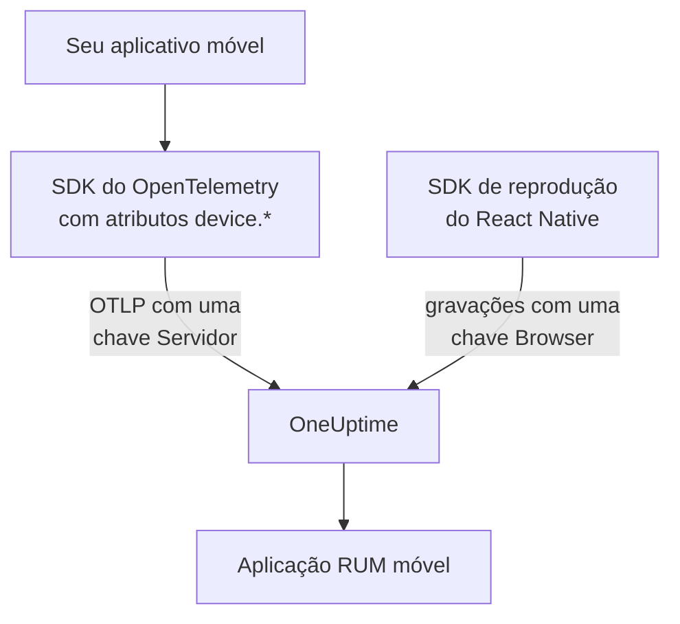

# Configuração para dispositivos móveis

Instrumente um aplicativo Android, iOS ou React Native com o OpenTelemetry para que ele se reporte ao OneUptime como uma aplicação RUM móvel. Qualquer outra plataforma com um SDK do OpenTelemetry funciona da mesma forma.

:::cards
- [O que o OneUptime precisa](#o-que-o-oneuptime-precisa): Dois atributos de recurso, enviados com uma chave Servidor.
- [Configurar sua plataforma](#configurar-sua-plataforma): Android, iOS, React Native e as demais.
- [Verificar se chega](#verificar-se-chega): Testar a chave e depois encontrar o aplicativo.
- [Session Replay em dispositivos móveis](#session-replay-em-dispositivos-móveis): Gravações para aplicativos React Native.
:::

## Como funciona

O seu aplicativo exporta OTLP direto para o OneUptime com uma chave de ingestão **Servidor**. São os atributos `device.*` no recurso dele que o classificam como RUM móvel, e não como serviço de backend.



## O que o OneUptime precisa

Dois atributos de recurso, em cada lote que o seu aplicativo exporta:

| Atributo | O que é |
| --- | --- |
| `service.name` | A identidade da aplicação, por exemplo `storefront-android`. |
| `device.id` ou `device.model.identifier` | Marca a telemetria como RUM móvel. `device.model.identifier` também preenche a página **Clientes**. |

Sem um atributo de dispositivo, a telemetria chega mesmo assim e você pode consultá-la, mas ela é arquivada como serviço de backend em vez de aplicação RUM.

`device.manufacturer` também marca um lote como móvel, mas só em um recurso sem identidade de host, porque o inventário de um host informa com ele o fabricante de uma máquina. Defina também `device.id` ou `device.model.identifier`, como faz cada receita abaixo, e isso nunca importa.

Faça de `device.id` um identificador próprio da instalação, nunca um ID de publicidade nem nada que identifique uma pessoa. O OneUptime só o lê para reconhecer a telemetria móvel.

## Antes de começar

- Um aplicativo com um SDK do OpenTelemetry: o SDK Java do OpenTelemetry ou o OpenTelemetry Android, o opentelemetry-swift, ou o SDK JavaScript do OpenTelemetry para React Native.
- Uma chave de ingestão **Servidor**, criada em **Configurações do projeto → Telemetria e APM → Chaves de ingestão** com **Criar chave de ingestão**. Uma chave **Browser** é recusada a partir de um aplicativo móvel: ela é verificada contra o cabeçalho `Origin`, que os SDKs móveis não enviam.
- Estas configurações de OTLP. Se você hospeda o OneUptime por conta própria, troque `https://oneuptime.com` pelo seu próprio host.

| Configuração | Valor |
| --- | --- |
| Endpoint OTLP | `https://oneuptime.com/otlp` |
| Cabeçalho | `x-oneuptime-token: YOUR_TELEMETRY_INGESTION_TOKEN` |
| Traços | `POST https://oneuptime.com/otlp/v1/traces` |
| Métricas | `POST https://oneuptime.com/otlp/v1/metrics` |
| Registros | `POST https://oneuptime.com/otlp/v1/logs` |

> [!WARNING]
> A chave vai dentro do seu aplicativo, e um aplicativo pode ser descompactado, então parta do princípio de que alguém vai copiá-la. Na página da chave, defina um **Pinned Service Name** para que uma cópia não possa gravar com os nomes dos seus serviços de backend, adicione um **Requests Per Minute Limit** e uma data em **Expira em**, e troque a chave a cada versão.

## Configurar sua plataforma

Os snippets mostram o formato da configuração. Os SDKs móveis do OpenTelemetry mudam suas APIs entre versões, então confira os nomes dos métodos na versão que você fixar. O que o OneUptime precisa nunca muda: o endpoint, o cabeçalho, `service.name` e um atributo `device.*`.

:::tabs
@tab Android
Use o SDK Java do OpenTelemetry e o exportador OTLP dele, que rodam no Android:

```kotlin title="app/build.gradle.kts"
dependencies {
    implementation(platform("io.opentelemetry:opentelemetry-bom:<latest>"))
    implementation("io.opentelemetry:opentelemetry-sdk")
    implementation("io.opentelemetry:opentelemetry-exporter-otlp")
}
```

```kotlin title="StorefrontApplication.kt"
import android.app.Application
import android.os.Build
import io.opentelemetry.exporter.otlp.http.trace.OtlpHttpSpanExporter
import io.opentelemetry.sdk.OpenTelemetrySdk
import io.opentelemetry.sdk.resources.Resource
import io.opentelemetry.sdk.trace.SdkTracerProvider
import io.opentelemetry.sdk.trace.export.BatchSpanProcessor

class StorefrontApplication : Application() {
    override fun onCreate() {
        super.onCreate()

        val resource = Resource.getDefault().toBuilder()
            .put("service.name", "storefront-android")
            .put("device.manufacturer", Build.MANUFACTURER)
            .put("device.model.identifier", Build.MODEL)
            .build()

        val exporter = OtlpHttpSpanExporter.builder()
            .setEndpoint("https://oneuptime.com/otlp/v1/traces")
            .addHeader("x-oneuptime-token", BuildConfig.ONEUPTIME_TOKEN)
            .build()

        OpenTelemetrySdk.builder()
            .setTracerProvider(
                SdkTracerProvider.builder()
                    .setResource(resource)
                    .addSpanProcessor(BatchSpanProcessor.builder(exporter).build())
                    .build()
            )
            .buildAndRegisterGlobal()
    }
}
```

O agente [OpenTelemetry Android](https://github.com/open-telemetry/opentelemetry-android) acrescenta instrumentação automática por cima e define atributos de dispositivo no próprio recurso. Se você o usa, aponte o exportador dele para o mesmo endpoint e cabeçalho e confira se `device.model.identifier` chega ao recurso na sua versão.
@tab iOS
Use o [opentelemetry-swift](https://github.com/open-telemetry/opentelemetry-swift) e defina os atributos de dispositivo você mesmo: o recurso que cada versão adiciona por conta própria mudou entre versões.

```swift
let resource = Resource(attributes: [
    "service.name": .string("storefront-ios"),
    "device.model.identifier": .string(UIDevice.current.model),
    "device.manufacturer": .string("Apple"),
    "telemetry.sdk.language": .string("swift"),
])

let exporter = OtlpHttpTraceExporter(
    endpoint: URL(string: "https://oneuptime.com/otlp/v1/traces")!,
    config: OtlpConfiguration(
        headers: [("x-oneuptime-token", oneUptimeToken)]
    )
)

OpenTelemetry.registerTracerProvider(
    tracerProvider: TracerProviderBuilder()
        .with(resource: resource)
        .add(spanProcessor: BatchSpanProcessor(spanExporter: exporter))
        .build()
)
```

`UIDevice.current.model` devolve um nome curto como `iPhone`, o que mantém a página **Clientes** com uma linha por tipo de dispositivo.
@tab React Native
O React Native executa o SDK JavaScript do OpenTelemetry, então monte o provider, o exportador OTLP e o processador de lotes como em [Configuração para navegadores](/docs/rum/browser-setup), com três mudanças: envie com uma chave **Servidor**, deixe de fora `browserDetector` e `DocumentLoadInstrumentation`, e defina os atributos de dispositivo você mesmo.

```ts
import { Platform } from "react-native";
import * as Device from "expo-device"; // or react-native-device-info
import {
  defaultResource,
  resourceFromAttributes,
} from "@opentelemetry/resources";

const resource = defaultResource().merge(
  resourceFromAttributes({
    "service.name": "storefront-mobile",
    "device.manufacturer": Device.manufacturer ?? Platform.OS,
    "device.model.identifier":
      Device.modelId ?? Device.modelName ?? "unknown",
    "telemetry.sdk.language": "webjs",
  }),
);
```

`Device.modelId` só é definido no iOS, então o Android recorre a `Device.modelName`.
@tab Outras plataformas
Flutter, Unity, .NET MAUI, um cliente embarcado ou um gravador OTLP próprio funcionam, desde que o recurso traga `service.name` e um atributo `device.*`. Um SDK que lê as variáveis de ambiente padrão do OpenTelemetry as usa como estão:

```bash
OTEL_EXPORTER_OTLP_ENDPOINT="https://oneuptime.com/otlp"
OTEL_EXPORTER_OTLP_HEADERS="x-oneuptime-token=YOUR_TELEMETRY_INGESTION_TOKEN"
OTEL_RESOURCE_ATTRIBUTES="service.name=storefront-mobile,device.manufacturer=Acme,device.model.identifier=AC-100"
```

O SDK acrescenta `/v1/traces`, `/v1/metrics` e `/v1/logs` ao endpoint por conta própria.
:::

## Verificar se chega

:::steps
### Testar a chave

Antes de revisar as configurações do SDK, pergunte ao OneUptime se ele aceita a chave:

```bash
curl -i https://oneuptime.com/otlp/v1/validate \
  -H "x-oneuptime-token: YOUR_TELEMETRY_INGESTION_TOKEN"
```

`200` com `"valid": true` significa que a chave foi aceita. Uma chave Browser também responde `200`, mas a mensagem dela diz que só funciona a partir de um navegador: um aplicativo móvel precisa de uma chave Servidor. `401` significa que a chave é desconhecida, foi revogada, desativada ou expirou, e nenhuma configuração do SDK resolve isso.

### Iniciar o aplicativo

Execute o aplicativo e use-o por um momento. Ele aparece em **Produtos → Recursos → Monitoramento de Usuários Reais** no primeiro lote de telemetria, com o nome do seu `service.name`.

### Abrir a página Clientes

Abra a página **Clientes** da aplicação: cada modelo de dispositivo de `device.model.identifier` tem uma linha. Se a página continuar vazia enquanto **Traços** se enche, os atributos de dispositivo não estão chegando ao recurso.
:::

## Session Replay em dispositivos móveis

Aplicativos React Native podem gravar sessões com `@oneuptime/react-native-replay`. Ele grava a árvore de views nativa como um wireframe, nunca capturas de tela nem o texto na tela, e as gravações dele abrem no mesmo player que as da web. Ele envia com uma chave **Browser** cujas **Allowed Origins** listam o seu aplicativo como `app://` seguido do ID do aplicativo Android ou do ID de bundle do iOS: uma chave diferente da chave Servidor que o seu SDK do OpenTelemetry usa. [Instalar no React Native](/docs/telemetry/session-replay#install-in-react-native) mostra o passo a passo.

Aplicativos nativos de Android e iOS, e as demais plataformas, não têm gravador de sessão: a página **Session Replay** deles fica vazia, enquanto traços, registros, métricas, exceções e a página **Clientes** funcionam normalmente.

## Solução de problemas

:::details A verificação da chave devolve 401, ou a chave é recusada
Um `401` significa que a chave é desconhecida, foi revogada, desativada ou expirou: crie uma chave Servidor e recompile o aplicativo com ela.

Uma chave Browser passa na verificação, mas toda exportação de um aplicativo móvel é recusada com um `422` que diz `This request did not send an Origin header, so it cannot be checked against the allowed origins of this browser ingestion key. Use a server ingestion key for requests that are not sent by a browser.` Use uma chave **Servidor**.
:::

:::details O aplicativo aparece em Serviços em vez de Monitoramento de Usuários Reais
O recurso não tem `device.id` nem `device.model.identifier`, então a telemetria foi arquivada como serviço de backend. Defina-os como em [Configurar sua plataforma](#configurar-sua-plataforma).

O serviço já criado não vira uma aplicação RUM, então exclua-o em **Produtos → Serviços** quando a telemetria RUM chegar.
:::

:::details A página Clientes está vazia
As linhas de clientes vêm apenas de `device.model.identifier`. Um SDK que define só `device.id` ou `device.manufacturer` arquiva o aplicativo como RUM móvel, mas não lista clientes: defina também `device.model.identifier`.
:::

:::details O status diz Desconectado enquanto as pessoas usam o aplicativo
O status passa para **Desconectado** depois de 15 minutos sem telemetria. Se as pessoas estão usando o aplicativo:

- Um amostrador pode estar descartando tudo: procure um amostrador always-off ou uma taxa muito baixa.
- O aplicativo pode enviar telemetria só para ações que ninguém fez nesse período.
- A chave pode ter sido revogada, ou ter expirado, desde a versão: teste-a como em [Verificar se chega](#verificar-se-chega).
:::

## Próximos passos

:::cards
- [Reprodução de sessões](/docs/telemetry/session-replay): Gravar sessões do React Native, ao lado dos traços delas.
- [Gerenciar aplicações](/docs/rum/applications): Nomes, rótulos, proprietários e retenção.
- [OpenTelemetry](/docs/telemetry/open-telemetry): Os endpoints, limites e erros do OTLP em detalhe.
- [Solução de problemas de RUM](/docs/rum/troubleshooting): Cada verificação, na ordem em que os problemas costumam acontecer.
:::
