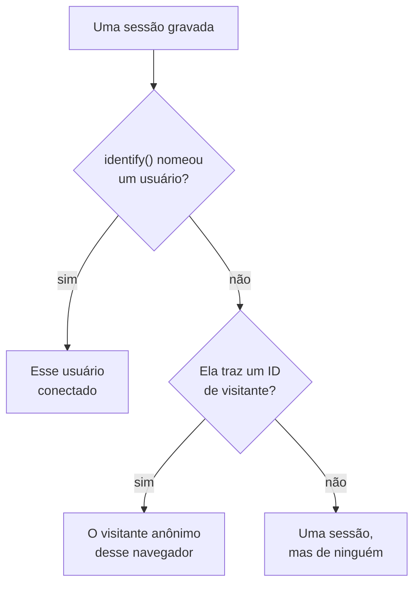

# Análise de produto

A análise de produto conta as pessoas que usam uma aplicação RUM e como correm as suas sessões: usuários ativos, novos, recorrentes, conectados e inativos, e sessões por dispositivo, navegador, país e página. Ela conta as sessões que a [Reprodução de sessões](/docs/telemetry/session-replay) grava, por isso não precisa de um snippet próprio, e guarda os seus números por 13 meses, muito depois de as gravações expirarem.

:::cards
- [Como as pessoas são contadas](#como-as-pessoas-são-contadas): Um usuário conectado uma vez, um navegador anônimo uma vez.
- [Usuários](#usuários): Usuários ativos, novos, recorrentes, conectados, totais e inativos.
- [Sessões](#sessões): Quantas, quanto duram, e por dispositivo, navegador, país e página.
- [Privacidade e retenção](#privacidade-e-retenção): 13 meses, nenhum nome guardado, apagado a pedido.
:::

## Como as pessoas são contadas

O menu lateral de uma aplicação tem uma seção **Análise de produto** com duas páginas, **Usuários** e **Sessões**. Ambas contam as sessões que a Reprodução de sessões grava, por isso começam quando o gravador da aplicação começa, e uma sessão que a política de reprodução deixa sem gravar não é contada. Cada sessão conta para uma pessoa, ou para ninguém:

- **Um usuário conectado conta uma vez**, em cada navegador e dispositivo que usa: ele é reconhecido pelo hash unidirecional da referência que a sua página passou a `identify()` (veja [Identificar os seus usuários](/docs/telemetry/session-replay#identificar-os-seus-usuários)).
- **Um navegador anônimo conta uma vez**, pelo seu [ID de visitante anônimo](/docs/telemetry/session-replay#visitantes-anônimos). Dois navegadores são dois visitantes, e as sessões que um navegador teve antes de alguém se conectar nele continuam sendo do seu visitante.
- **Uma sessão de um gravador mais antigo**, que não enviava ID de visitante, conta como sessão, mas não como pessoa.

Os dias são contados no seu próprio fuso horário.

## Usuários

**Usuários** conta as pessoas do intervalo que você escolhe:

| Bloco | O que conta |
| --- | --- |
| **Usuários ativos** | Todos os que vieram no intervalo: cada usuário conectado uma vez e cada navegador anônimo uma vez. |
| **Novos usuários** | Usuários ativos cuja primeira visita foi no intervalo. |
| **Usuários recorrentes** | Usuários ativos que já tinham vindo antes de o intervalo começar. |
| **Usuários conectados** | Usuários ativos que a sua aplicação conectou com `identify()`, e a parte deles em todos os usuários ativos. |
| **Total de usuários** | Todos os que a aplicação viu nos últimos 13 meses. |
| **Usuários inativos** | Pessoas que vieram antes, mas não nos últimos 30 dias, ou nos 7, 14, 60 ou 90 dias que você escolher. |

Os três primeiros também dizem como mudaram em relação ao período anterior. Abaixo dos blocos, **Usuários ativos** traça, para cada dia, as pessoas que vieram nesse dia, as que vieram nos 7 dias até ele e as que vieram nos 30 dias até ele, e **Usuários novos e recorrentes** divide em dois as pessoas de cada dia.

**Pessoas** lista todos os que os blocos contam, uma linha por pessoa, primeiro os vistos mais recentemente, e o seu filtro mostra as pessoas de um bloco, os visitantes anônimos ou todos. Abra uma pessoa para ver a primeira e a última visita e cada uma das suas sessões dos últimos 13 meses, com **Assistir** em cada uma cuja gravação ainda é mantida.

## Sessões

**Sessões** conta as sessões que começaram no intervalo: **Sessões**, **Sessões conectadas**, **Duração mediana das sessões**, **Páginas por sessão**, **Sessões com erros** e **Sessões com frustração**. Abaixo dos blocos:

- **Sessões por dispositivo** traça as sessões de cada dia vindas de computadores, telefones e tablets. A sessão de um aplicativo móvel numa tela cujo lado menor mede 600 pontos ou mais conta como de tablet.
- **Duração das sessões** ordena as sessões terminadas pelo tempo que duraram, de menos de 10 segundos a mais de 30 minutos. Uma sessão que ainda está sendo gravada ainda não tem duração.
- **Detalhamento** classifica usuários e sessões por tipo de dispositivo, navegador, sistema operacional, país, versão do aplicativo, página de entrada ou página, primeiro os com mais usuários.

## Privacidade e retenção

- **13 meses.** Os números de um mês são removidos no primeiro dia do 13º mês seguinte, por isso os últimos 12 meses completos estão sempre lá, seja qual for a retenção própria das gravações (7 dias por padrão).
- **Nenhum nome guardado.** Os números guardam a chave unidirecional de um usuário conectado e o ID de visitante de um navegador, nunca a referência, as características ou um endereço IP. Uma linha nomeia um usuário conectado só enquanto uma das suas gravações ainda é mantida, e só para uma função que pode ler a identidade; senão, mostra **Usuário conectado** ou **Visitante anônimo** e o início do ID.
- **Apagado a pedido.** Um pedido de apagamento remove também aqui os números correspondentes (veja [Apagar sessões](/docs/telemetry/session-replay#apagar-sessões)).

## Quem pode vê-la

Ler as duas páginas exige o mesmo que ler a lista de sessões: `ReadRumSessionReplay` (_List Session Replays_) ou `ReadRumSessionReplayPayload` (_Watch Session Replays_), que os proprietários e administradores do projeto têm. Ver quem é um usuário conectado, e pesquisar pessoas por nome, exige a permissão de identidade descrita em [Quem pode assistir a uma gravação](/docs/telemetry/session-replay#quem-pode-assistir-a-uma-gravação).

## Próximos passos

:::cards
- [Reprodução de sessões](/docs/telemetry/session-replay): Grave as sessões que estas páginas contam, e assista a elas.
- [Gerenciar aplicações](/docs/rum/applications): Nomes, rótulos, proprietários e retenção.
- [Visão geral do RUM](/docs/rum/index): O que mais uma aplicação RUM mostra.
:::
