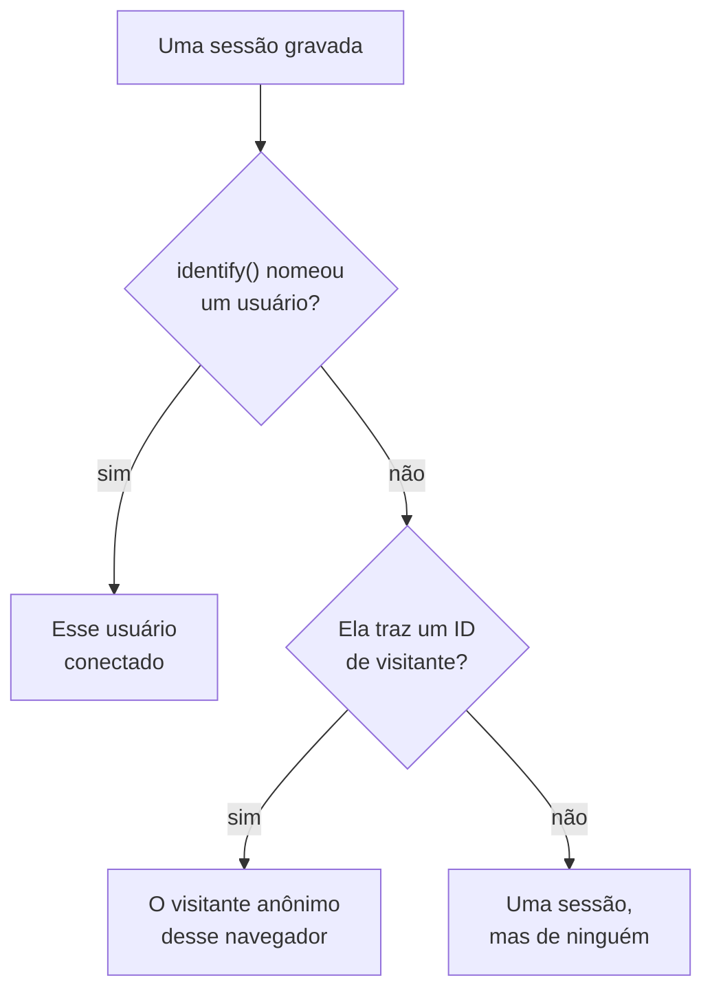

# Análise de produto

A análise de produto conta as pessoas que usam uma aplicação RUM, como correm as suas sessões e o que elas fazem: usuários ativos, novos, recorrentes, conectados e inativos, sessões por dispositivo, navegador, país e página, e os eventos que o seu app envia, como tendências, funis e retenção. Ela conta as sessões que a [Reprodução de sessões](/docs/telemetry/session-replay) grava e os eventos que o gravador dela envia, por isso não precisa de um snippet próprio, e guarda os seus números por 13 meses, muito depois de as gravações expirarem.

:::cards
- [Usuários](#usuários): Usuários ativos, novos, recorrentes, conectados, totais e inativos.
- [Sessões](#sessões): Quantas, quanto duram, e por dispositivo, navegador, país e página.
- [Enviar eventos e métricas](#enviar-eventos-e-métricas): O que as pessoas fazem, e os números que a sua página mede.
- [Eventos](#eventos): Com que frequência algo aconteceu, quem o fez e onde.
- [Funis](#funis): Quem seguiu em frente, etapa por etapa, e quanto tempo levou.
- [Retenção de usuários](#retenção-de-usuários): Quem voltou, coorte por coorte.
:::

## Como as pessoas são contadas

O menu lateral de uma aplicação tem uma seção **Análise de produto**: **Usuários**, **Sessões**, **Eventos**, **Funis**, **Retenção de usuários**, **Fluxos de usuários** e **Configurações de análise**. **Usuários** e **Sessões** contam as sessões que a Reprodução de sessões grava, por isso começam quando o gravador da aplicação começa, e uma sessão que a política de reprodução deixa sem gravar não é contada. Cada sessão conta para uma pessoa, ou para ninguém:



- **Um usuário conectado conta uma vez**, em cada navegador e dispositivo que usa: ele é reconhecido pelo hash unidirecional da referência que a sua página passou a `identify()` (veja [Identificar os seus usuários](/docs/telemetry/session-replay#identificar-os-seus-usuários)).
- **Um navegador anônimo conta uma vez**, pelo seu [ID de visitante anônimo](/docs/telemetry/session-replay#visitantes-anônimos). Dois navegadores são dois visitantes, e as sessões que um navegador teve antes de alguém se conectar nele continuam sendo do seu visitante.
- **Uma sessão de um gravador mais antigo**, que não enviava ID de visitante, conta como sessão, mas não como pessoa.

**Eventos**, **Funis** e **Retenção de usuários** contam as pessoas da mesma forma, a partir dos eventos que o gravador envia de cada sessão, gravada ou não (veja [Enviar eventos e métricas](#enviar-eventos-e-métricas)).

Os dias são contados no seu próprio fuso horário.

## Usuários

**Usuários** conta as pessoas do intervalo que você escolhe:

| Bloco | O que conta |
| --- | --- |
| **Usuários ativos** | Todos os que vieram no intervalo: cada usuário conectado uma vez e cada navegador anônimo uma vez. |
| **Novos usuários** | Usuários ativos cuja primeira visita foi no intervalo. |
| **Usuários recorrentes** | Usuários ativos que já tinham vindo antes de o intervalo começar. |
| **Usuários conectados** | Usuários ativos que a sua aplicação conectou com `identify()`, e a parte deles em todos os usuários ativos. |
| **Total de usuários** | Todos os que a aplicação viu nos últimos 13 meses. |
| **Usuários inativos** | Pessoas que vieram antes, mas não nos últimos 30 dias, ou nos 7, 14, 60 ou 90 dias que você escolher. |

Os três primeiros também dizem como mudaram em relação ao período anterior. Abaixo dos blocos, **Usuários ativos** traça, para cada dia, as pessoas que vieram nesse dia, as que vieram nos 7 dias até ele e as que vieram nos 30 dias até ele, e **Usuários novos e recorrentes** divide em dois as pessoas de cada dia.

**Pessoas** lista todos os que os blocos contam, uma linha por pessoa, primeiro os vistos mais recentemente, e o seu filtro mostra as pessoas de um bloco, os visitantes anônimos ou todos. Abra uma pessoa para ver a primeira e a última visita e cada uma das suas sessões dos últimos 13 meses, com **Assistir** em cada uma cuja gravação ainda é mantida.

## Sessões

**Sessões** conta as sessões que começaram no intervalo: **Sessões**, **Sessões conectadas**, **Duração mediana das sessões**, **Páginas por sessão**, **Sessões com erros** e **Sessões com frustração**. Abaixo dos blocos:

- **Sessões por dispositivo** traça as sessões de cada dia vindas de computadores, telefones e tablets. A sessão de um aplicativo móvel numa tela cujo lado menor mede 600 pontos ou mais conta como de tablet.
- **Duração das sessões** ordena as sessões terminadas pelo tempo que duraram, de menos de 10 segundos a mais de 30 minutos. Uma sessão que ainda está sendo gravada ainda não tem duração.
- **Detalhamento** classifica usuários e sessões por tipo de dispositivo, navegador, sistema operacional, país, versão do aplicativo, página de entrada ou página, primeiro os com mais usuários.

## Enviar eventos e métricas

Os eventos são enviados enquanto **Enviar eventos de análise de produto** está ativado, na página **Configurações de análise** da aplicação. Ele começa ativado numa aplicação nova, e desativado numa aplicação criada antes de ele existir, por isso ative-o lá. A Reprodução de sessões também precisa estar ativada para a aplicação, pois é o gravador dela que envia os eventos; o gravador de React Native ainda não envia nenhum.

Cada sessão em que o gravador do navegador é executado envia sozinha o seu início e cada página que visualiza, incluindo as mudanças de rota de um app de página única, quer a amostra e a política de reprodução gravem essa sessão, quer não. Os seus próprios eventos e números vêm do código da sua página:

```js
OneUptimeReplay.track("Signed up", { plan: "pro" });
OneUptimeReplay.metric("cart.value", 42.5, { currency: "EUR" });
```

| Chamada | O que envia |
| --- | --- |
| `track(name, properties?)` | Um evento que **Eventos**, **Funis** e **Retenção de usuários** contam, e um marcador na linha do tempo da reprodução quando a sessão é gravada. `name` ≤ 64 caracteres; ≤ 20 propriedades com valores de texto, número ou booleano, chave ≤ 40 caracteres, valor ≤ 200 caracteres. |
| `metric(name, value, attributes?)` | Um número que a sua página mediu, como ponto de uma métrica da aplicação (veja [Painéis e alertas](#painéis-e-alertas)). `name` ≤ 100 caracteres entre letras, dígitos, `_`, `.`, `-` e `/`, começando por uma letra e não por `oneuptime.`; `value` um número finito; `attributes` como as propriedades de `track()`. |

Antes de o gravador ser carregado, coloque as mesmas chamadas em `window.OneUptimeReplayQueue` como `["track", name, properties]` e `["metric", name, value, attributes]` (veja [API JavaScript](/docs/telemetry/session-replay#api-javascript)).

- **Cada sessão, gravada ou não.** A amostra e a política de envio da reprodução decidem quais sessões são gravadas, não quais são contadas. Nada é enviado com Do Not Track ou Global Privacy Control, e nada é guardado de uma origem que a aplicação não permite. Quando a política exige consentimento, os eventos esperam por `grantConsent()`, no máximo 500, e `revokeConsent()` os descarta.
- **Mascarados como a gravação.** Com _Mask all text_, os valores de propriedades e atributos são mascarados antes de saírem da página, então um detalhamento por um deles mostra marcadores, não os seus valores; nomes de eventos, chaves de propriedades e valores de métricas são enviados como foram escritos. Um valor que você precisa ler nesse modo vai em uma tag de sessão (`setTags()`), que nunca é mascarada, então não coloque dados pessoais nela. As tags aparecem na sessão e em uma pesquisa `tag:key=value` na lista de sessões, não nos detalhamentos destas páginas. Uma página é enviada como o seu caminho, sem a query nem o fragmento.
- **Em pequenos lotes**, a cada 5 segundos e quando a aba fica oculta. Um evento que chega ao OneUptime mais de 3 dias depois de acontecer é descartado, e um projeto pode enviar 60.000 eventos e pontos de métrica por minuto, somando todas as suas aplicações; acima disso, o gravador espera e os envia de novo.

`metric()` não envia nada enquanto os eventos estão desativados, e `getDiagnostics().productAnalytics` diz se estão ativados (veja [`getDiagnostics()`](/docs/telemetry/session-replay#getdiagnostics)).

### Propriedades de usuário

Para detalhar e segmentar os eventos por quem os fez, liste chaves de características de `identify()` em **Propriedades de usuário para análise**, em **Configurações de análise**, como `["plan", "role"]`, no máximo 20, comparadas tal como estão escritas. Cada evento passa então a levar essas características do usuário conectado, tal como a sua página as passou a `identify()`. As outras características nunca saem da página, e nenhuma sai enquanto **Capturar a identidade do usuário final** está desativado. Não liste características que contenham dados pessoais, como um endereço de e-mail.

## Eventos

**Eventos** mostra um evento de cada vez: o evento mais frequente do seu app até você escolher outro, ou a página mais vista enquanto ele não envia nenhum. O seletor também lista **Sessão iniciada** e cada página vista, e **Todos os eventos**, abaixo, lista cada evento do intervalo com quantas vezes aconteceu e quantas pessoas o fizeram; escolha um para vê-lo acima.

- Os blocos contam os **Eventos** do evento, com quantos cada pessoa fez em média, os seus **Usuários** e as suas **Sessões**.
- **Eventos e usuários** traça, para cada dia, quantas vezes o evento aconteceu e quantas pessoas o fizeram nesse dia.
- **Detalhamento** classifica o evento por tipo de dispositivo, navegador, sistema operacional, país, versão do app, página, propriedade do evento ou propriedade de usuário, com os eventos, os usuários e a fatia de cada valor. Escolha um valor para mostrar só ele.

**Segmento** limita a página aos eventos cujos campos têm os valores que você escolhe: **Adicionar filtro**, depois um campo e um valor, comparados exatamente. Um segmento tem no máximo 5 filtros, e um evento precisa atender a todos. O endereço da página guarda o evento, o intervalo, o segmento e o detalhamento, por isso um link abre a mesma visão.

## Funis

**Funis** acompanha as pessoas por 2 a 6 etapas em ordem, cada uma um evento como **Eventos** os lista. Das pessoas que fizeram a primeira etapa no intervalo, conta quantas fizeram depois a segunda, depois a terceira, todas dentro do tempo que você escolhe a partir da primeira etapa: **Em até 1 hora**, **Em até 1 dia**, **Em até 7 dias**, **Em até 14 dias** ou **Em até 30 dias**. **Adicionar etapa** adiciona uma.

Em **Conversão** ficam a fatia das pessoas que fizeram todas as etapas e, para cada etapa, quantas pessoas a alcançaram, que fatia das pessoas da primeira etapa isso representa, quantas desistiram desde a etapa anterior e o tempo mediano que levaram a partir dela. Quem tentou mais de uma vez conta uma vez, pela tentativa que foi mais longe.

O segmento de um funil, e o de uma tabela de retenção, usa os campos que todo evento leva e as propriedades de usuário, não as propriedades próprias de um evento, já que as suas etapas são eventos diferentes.

## Retenção de usuários

**Retenção de usuários** agrupa as pessoas pelo dia, semana ou mês do intervalo em que fizeram um evento pela primeira vez, **Pessoas que fizeram**, e mostra que fatia de cada grupo fez outro, **E voltaram para fazer**, nesse período e em cada um dos seguintes. Os dois são **Sessão iniciada** até você escolher outros.

**Coortes** define o período: **Por dia**, **Por semana** ou **Por mês**. Quando o intervalo tem mais períodos do que uma tabela mostra, 32 dias, 26 semanas ou 13 meses, a página alonga as coortes e avisa.

Cada linha é uma coorte e quantas pessoas ela tem, e cada célula a fatia delas que voltou nesse período, mais escura quanto mais voltaram. Um período que ainda não começou fica vazio.

**Todas as coortes**, acima delas, conta as coortes como uma só: em cada período, as pessoas que voltaram sobre as pessoas das coortes que chegaram a ele, de modo que uma coorte de 200 pessoas pesa quatro vezes mais que uma de 50. Ela aparece assim que duas coortes têm alguém.

## Funis e tabelas de retenção salvos

**Funis salvos**, na página **Funis**, e **Tabelas de retenção salvas**, em **Retenção de usuários**, listam o que a sua equipe salvou para a aplicação, para abrir de novo ou mostrar num painel. Um funil salvo guarda as etapas, o tempo para concluí-las e o segmento, e uma tabela de retenção salva os dois eventos, o período e o segmento. Nenhum dos dois guarda o intervalo de tempo: a página guarda o seu, e um painel lê o seu.

- **+ Salvar funil** ou **+ Salvar tabela de retenção** salva o que a página mostra, com um nome. Uma aplicação guarda no máximo 100 de cada.
- Escolha um para abri-lo. O endereço da página o nomeia, então um link o abre para todos que podem vê-lo. Quando você muda o que ele mostra, o nome dele avisa, e **Atualizar** salva a mudança.
- **Editar** renomeia um, e **Excluir** o exclui para todos. **Limpar visualização** fecha o que está aberto e mantém o que a página mostra.
- Um link para um que foi excluído, ou que você não pode ver, avisa, e a página abre sem ele.

## Painéis e alertas

Cada evento também é contado, minuto a minuto, como uma métrica da aplicação, e cada chamada a `metric()` é um ponto de uma métrica própria, com o nome que ela dá. Trace-as na página **Métricas** da aplicação, adicione-as a um painel ou crie alertas sobre elas com um monitor de métricas; **Abrir Métricas**, em **Todos os eventos**, abre a página.

| Métrica | O que conta | Por |
| --- | --- | --- |
| `oneuptime.rum.product.events` | Os seus eventos `track()`, por minuto | `event.name` |
| `oneuptime.rum.product.sessions` | Sessões que começaram, por minuto | `device.type` |
| `oneuptime.rum.product.page.views` | Páginas vistas, por minuto | `device.type` |

Estas três não são cobradas, e `metric()` recusa um nome que começa com `oneuptime.`, por isso nada do que a sua página envia se passa por elas. Os seus pontos de `metric()` são guardados e cobrados como as outras métricas da aplicação.

Um funil ou uma tabela de retenção salvos também vão para um painel: os widgets **Funil** e **Retenção de usuários**, no grupo **Análise de produto** do catálogo de widgets, mostram um no intervalo de tempo do painel, e **Abrir em Funis** ou **Abrir em Retenção de usuários** o abre na sua página (veja [Widgets de painel](/docs/dashboards/widgets#análise-de-produto)).

## Privacidade e retenção

- **13 meses.** Os números de um mês são removidos no primeiro dia do 13º mês seguinte, por isso os últimos 12 meses completos estão sempre lá, seja qual for a retenção própria das gravações (7 dias por padrão). Os eventos são guardados da mesma forma.
- **Nenhum nome guardado.** Os números guardam a chave unidirecional de um usuário conectado e o ID de visitante de um navegador, nunca a referência ou um endereço IP, e das características só as propriedades de usuário que você lista. Uma linha nomeia um usuário conectado só enquanto uma das suas gravações ainda é mantida, e só para uma função que pode ler a identidade; senão, mostra **Usuário conectado** ou **Visitante anônimo** e o início do ID.
- **Apagado a pedido.** Um pedido de apagamento remove também aqui os números e eventos correspondentes (veja [Apagar sessões](/docs/telemetry/session-replay#apagar-sessões)).

## Quem pode vê-la

Ler estas páginas exige o mesmo que ler a lista de sessões: `ReadRumSessionReplay` (_List Session Replays_) ou `ReadRumSessionReplayPayload` (_Watch Session Replays_), que os proprietários e administradores do projeto têm. Ver quem é um usuário conectado, e pesquisar pessoas por nome, exige `ReadRumSessionReplayPayload` (_Watch Session Replays_), como descreve [Quem pode assistir a uma gravação](/docs/telemetry/session-replay#quem-pode-assistir-a-uma-gravação).

Salvar, renomear e excluir funis e tabelas de retenção salvos exige as mesmas permissões que ler estas páginas, e um widget de painel só mostra um a quem as tem.

Ativar ou desativar os eventos exige `EditRumApplication` (_Edit RUM Application_) ou a função de proprietário, administrador ou membro do projeto. Listar propriedades de usuário exige `EditRumApplication` ou a função de proprietário ou administrador, já que isso decide o que é guardado sobre as pessoas conectadas.

## Próximos passos

:::cards
- [Reprodução de sessões](/docs/telemetry/session-replay): Grave as sessões que estas páginas contam, e assista a elas.
- [Gerenciar aplicações](/docs/rum/applications): Nomes, rótulos, proprietários e retenção.
- [Visão geral do RUM](/docs/rum/index): O que mais uma aplicação RUM mostra.
:::
