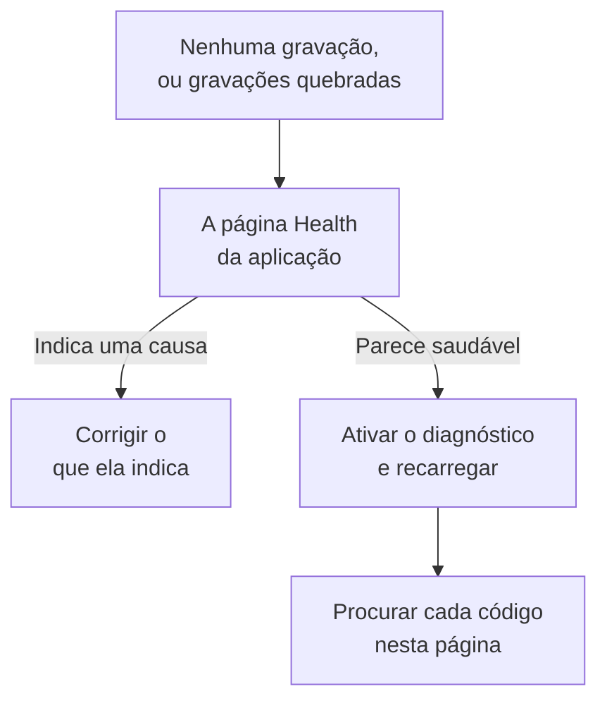

# Solução de problemas de reprodução de sessões

Quando nenhuma gravação chega, ou elas chegam quebradas, esta página encontra o motivo. A reprodução de sessões grava todas as sessões por padrão e as envia enquanto acontecem, então uma página saudável envia um fragmento a cada 15 segundos, mais ou menos, enquanto o usuário faz alguma coisa. Uma aba ociosa não produz eventos e não envia nada, e depois de cinco minutos sem entrada o gravador pausa de vez (`recording-paused-idle`), então mova o mouse ou clique antes de julgar uma instalação pela aba Rede. Se mesmo assim você não vê nenhuma requisição para o OneUptime, uma das causas abaixo é o motivo.

:::cards
- [Ativar o diagnóstico](#ativar-o-diagnóstico): Faça o gravador explicar cada decisão no console.
- [Códigos](#códigos): Cada linha que o gravador imprime, e o que fazer.
- [Um firewall na frente do OneUptime recusa os fragmentos](#um-firewall-na-frente-do-oneuptime-recusa-os-fragmentos): Regras para verificar e exclusões para adicionar.
- [Faltam imagens, ícones ou estilos na reprodução](#faltam-imagens-ícones-ou-estilos-na-reprodução): Gravações que tocam, mas não como o seu usuário as viu.
:::



A única configuração em que o silêncio é normal é enviar _On error or frustration_ (`OnErrorOrFrustration`): o gravador então mantém um buffer circular em memória e só envia quando algo dá errado, o que parece exatamente uma instalação quebrada até um gatilho disparar. Verifique qual você usa antes de procurar qualquer outra coisa: a linha `config-accepted` mais abaixo imprime isso.

Comece pelo lado do servidor se puder. A página **Integridade** da aplicação, na seção **Reprodução de sessões** do menu lateral dela, indica a causa quando nada chega: o gravador nunca carregou, carregou mas não enviou nada e por quê, os envios estão sendo recusados e por qual motivo, ou o orçamento se esgotou. Consulte [Saúde da gravação](/docs/telemetry/session-replay#saúde-da-gravação). O que vem a seguir é o lado do navegador: ative o diagnóstico, recarregue uma vez e leia o console.

As gravações chegam, mas tocam com imagens quebradas, ícones faltando ou áreas sem estilo? Isso é uma questão de reprodução, respondida em [Faltam imagens, ícones ou estilos na reprodução](#faltam-imagens-ícones-ou-estilos-na-reprodução).

## Ativar o diagnóstico

Escolha a chave que estiver à mão. Todas fazem a mesma coisa.

:::tabs
@tab No navegador
No navegador com o problema. Não precisa de novo deploy, funciona em produção e sobrevive a recargas:

```js
localStorage.setItem("oneuptime.sessionReplay.debug", "true");
// then reload the page
```

Desative de novo com:

```js
localStorage.removeItem("oneuptime.sessionReplay.debug");
```
@tab Com um link
Para alguém que não é técnico, ou uma página em que você não consegue abrir um console, adicione `oneuptime_debug=1` à URL. Também funciona no fragmento da URL, que sobrevive a um servidor que remove parâmetros de consulta que não conhece:

```text
https://your-app.example.com/checkout?oneuptime_debug=1
https://your-app.example.com/checkout#oneuptime_debug=1
```
@tab Na tag script
Para um ambiente de staging, onde você quer o diagnóstico ativado para todos:

```html
<script
  src="https://oneuptime.com/telemetry/session-replay/v1/recorder.js"
  data-oneuptime-token="YOUR_TELEMETRY_INGESTION_KEY"
  data-oneuptime-app-identifier="YOUR_RUM_APP_IDENTIFIER"
  data-oneuptime-debug="true"
  crossorigin="anonymous"
  async
></script>
```
@tab No global de inicialização
Se você configura o gravador com o global de inicialização:

```js
window.__ONEUPTIME_SESSION_REPLAY__ = {
  host: "https://oneuptime.com",
  token: "YOUR_TELEMETRY_INGESTION_KEY",
  appIdentifier: "YOUR_RUM_APP_IDENTIFIER",
  debug: true,
};
```
@tab No deployment
No deployment do OneUptime, a única chave que não precisa de ninguém na frente do navegador com o problema. Defina `SESSION_REPLAY_DEBUG=true` e reinicie. Cada gravador que esta instância serve passa a registrar, em todas as páginas em que roda, então ative, colete uma recarga e desative. Não muda nenhuma política: nem a amostragem, nem o mascaramento, nem o consentimento. Consulte [Notas para instalações auto-hospedadas](/docs/telemetry/session-replay#notas-para-instalações-auto-hospedadas) para as outras configurações do deployment.
@tab Em tempo de execução
Depois que o gravador carregar:

```js
OneUptimeReplay.setDebug(true);
```
:::

A saída tem esta aparência:

```text
[OneUptime Session Replay] loader-start: Loader running.
[OneUptime Session Replay] init-options-read: Init options read. {host: "https://oneuptime.com", appIdentifier: "checkout-web", …}
[OneUptime Session Replay] config-fetch-start: Requesting the policy. {url: "https://oneuptime.com/telemetry/session-replay/v1/config", …}
[OneUptime Session Replay] config-accepted: Policy accepted. {captureTrigger: "Always", samplePercentage: 100, …}
[OneUptime Session Replay] recording: Recording and uploading …
```

## Obter a linha do tempo sem ativar nada antes

O gravador guarda as suas últimas 250 decisões, com o diagnóstico ativado ou não. Se o problema já aconteceu, você não precisa reproduzi-lo com o registro ativado — peça isto em vez disso:

```js
copy(JSON.stringify(OneUptimeReplay.getDiagnostics(), null, 2));
```

Isso retorna a versão do gravador, o id da sessão, o seu `state` (`recording`, `uploading`, `not-sampled`, `stopped`…), por que ele parou, se parou, a `bootstrapDecision`, a resposta de cada barreira em `decisions` (amostrada ou não, estado do consentimento, se os envios são permitidos e o que os bloqueia, a última diretiva do servidor), as `capabilities` do gravador e a lista completa de registros — incluindo os do carregador, que roda antes de o artefato do gravador existir e é onde a maioria das desistências é decidida. Por construção, não contém nenhum conteúdo da página; consulte [O que o diagnóstico nunca contém](#o-que-o-diagnóstico-nunca-contém). Os campos estão descritos em [`getDiagnostics()`](/docs/telemetry/session-replay#getdiagnostics).

**Se aparecer `OneUptimeReplay is not defined`**, o artefato do gravador nunca carregou — o que já é, por si só, a resposta para boa parte dos códigos abaixo, e justamente quando você mais quer a linha do tempo. Os registros continuam lá, em um global em que o carregador escreve antes de o artefato existir:

```js
copy(JSON.stringify(window.__ONEUPTIME_SESSION_REPLAY_DEBUG__.records, null, 2));
```

Cole qualquer um dos dois no seu ticket de suporte — ou em **Ask the browser** na página **Integridade** da aplicação, que explica cada código que ele contém. Muitas vezes isso basta sozinho.

## Quando o silêncio é normal: a política acionada por erros

Esta seção só se aplica se `config-accepted` imprimiu `captureTrigger: "OnErrorOrFrustration"`. Com a política `Always` padrão, o gravador envia à medida que grava, e silêncio em uma página com a qual o usuário interage significa que algo está realmente errado — continue lendo além desta seção.

Se o console disser isto:

```text
[OneUptime Session Replay] recording: Recording into memory. Nothing uploads until a trigger fires - call OneUptimeReplay.captureSession() to force one.
```

…então o gravador está funcionando. Com uma política acionada por erros, uma página saudável faz exatamente uma requisição ao OneUptime por carregamento de página (a busca da configuração) e não envia mais nada até acontecer um erro, um 5xx, um sinal de frustração ou o estouro de um orçamento de desempenho.

Para testar o caminho de ponta a ponta, force um envio:

```js
OneUptimeReplay.captureSession("installation test");
```

Você deve ver na hora um `POST /telemetry/session-replay/v1/chunk` na aba Rede e uma linha `chunk-accepted` no console. Se vir, a instalação está correta e a reprodução vai aparecer no painel em cerca de um minuto, com o seu motivo marcado na linha do tempo dela.

Um `202` com `chunk-accepted` é o que você procura. Um `204` registra `chunk-not-recorded` em vez disso: a requisição estava correta e o servidor decidiu não armazená-la — orçamento estourado, não amostrada ou aplicação desativada. É uma resposta da política, não uma falha de instalação, e a linha `server-directive` ao lado diz qual.

Para voltar a gravar todas as sessões, defina **Quando enviar uma gravação** como _Always_ e **Porcentagem de amostragem** acima de 0 na página **Replay Policy** da aplicação. É o padrão de fábrica.

## Códigos

Cada linha carrega um `code` estável. Procure o seu aqui.

### Inicialização

| code | o que significa |
| --- | --- |
| `loader-start` | O script do gravador rodou. Se você não vê isto com o diagnóstico ativado, o próprio script nunca rodou — verifique a requisição `<script>` na aba Rede e o `script-src` da sua CSP. |
| `init-options-read` | Opções encontradas. Confira `host` e `appIdentifier` no detalhe: `appIdentifier` precisa corresponder exatamente à aplicação RUM, e `host` precisa ser a sua origem do OneUptime, não a do seu próprio aplicativo. |
| `init-options-incomplete` | Falta uma opção obrigatória. O detalhe diz qual de `hasHost` / `hasToken` / `hasAppIdentifier` é false. Se `hasHost` for false, a tag script não tem um `src` do qual deduzir o host — adicione `data-oneuptime-host`. |
| `privacy-signal` | O navegador envia Do Not Track ou Global Privacy Control e ele está sendo respeitado — pela página (nada na tag script diz o contrário) ou pela política do servidor. Nada é gravado; com `stage: "before-config-fetch"` nenhuma requisição de configuração é feita também. Não é uma falha. Defina `data-oneuptime-respect-do-not-track="false"` só se a sua base legal realmente não depender do sinal. |
| `init-options-missing` | Não há nada para ler na página: nem uma tag `script[data-oneuptime-token]` nem `window.__ONEUPTIME_SESSION_REPLAY__`. O atributo marcador está escrito errado, o snippet foi parar em outro documento ou um gerenciador de tags o removeu. |
| `loader-threw` | Um erro do próprio gravador, não da sua configuração. Relate-o com a saída do diagnóstico. |

### Política

| code | o que significa |
| --- | --- |
| `config-fetch-start` | Prestes a pedir a política. A `url` no detalhe é a URL exata — confira se ela responde de um navegador. |
| `config-fetch-rejected` | O endpoint respondeu algo diferente de 2xx. Consulte [Status da busca da configuração](#status-da-busca-da-configuração) abaixo. |
| `config-fetch-failed` | A requisição nunca terminou: `connect-src` da CSP, um bloqueador de anúncios, DNS, TLS, ausência de conexão ou um tempo limite de 5 segundos. O navegador costuma registrar a sua própria linha ao lado desta. |
| `config-body-unparseable` | O endpoint respondeu 2xx com um corpo que não é JSON de forma alguma. Diferente de `config-fetch-failed`: a requisição *terminou*, então algo no caminho — um proxy, um portal cativo, uma página intermediária de SSO — respondeu no lugar do OneUptime. |
| `config-unparseable` | O corpo *era* JSON válido, mas não um objeto — `null`, uma string, um array. Um proxy que reescreve, ou um servidor que responde a outro caminho. |
| `config-disabled` | O servidor diz que a reprodução está desativada aqui. O `disabledReason` no detalhe é a resposta: consulte [disabledReason](#disabledreason) abaixo. |
| `config-recorder-version-invalid` | A política não indicava exatamente `latest` em minúsculas, então não foi possível montar nenhuma URL de artefato. Um proxy que reescreve ou uma resposta adulterada — um deployment sem build informa `config-disabled` com `recorder-not-built` em vez disso. |
| `config-accepted` | Política aceita. O detalhe é a política inteira — `captureTrigger`, `samplePercentage`, `consentMode`, `maskingMode`. |
| `config-field-defaulted` | O servidor não enviou nenhum valor para um campo da política (indicado no detalhe), então este gravador usou o padrão do produto. Informativo: normalmente um servidor mais antigo que o gravador. Se o painel mostrar outro valor para esse campo, atualize o OneUptime. |
| `config-value-unrecognised` | O servidor enviou um valor que este build do gravador não conhece, então ele recorreu ao mais seguro — que pode não ser o que o seu painel mostra. Normalmente uma página que ainda roda um gravador de um deployment anterior. |
| `directive-stop` | O servidor mandou este gravador se retirar. Verifique a saúde da gravação da aplicação em busca de um orçamento, um limite de frequência ou um kill switch. |

#### Status da busca da configuração

| status | correção |
| --- | --- |
| `401` | O token de ingestão está errado, foi revogado, expirou ou é de outro projeto. Crie um em **Configurações do projeto → Telemetria e APM → Chaves de ingestão** e confirme-o com `GET /session-replay/v1/validate` — envie a chave como o gravador envia e adicione o cabeçalho `x-oneuptime-app-identifier`, e a resposta também traz `isSessionReplayEnabled` para essa aplicação, `sessionReplayDisabledDetail` indicando a chave desligada quando não está ativada, `isIngestEnabledOnThisInstance` e o `keyType`. |
| `400` | Falta `data-oneuptime-app-identifier`. |
| `403` | A origem da página não está nos **Origens permitidas** da chave de ingestão. Adicione-a, ou use uma chave cuja lista de origens permitidas cubra esta página. |
| `404` | O caminho não foi resolvido na origem do OneUptime. Quase sempre um `data-oneuptime-host` errado — ou um proxy reverso na frente do OneUptime que não encaminha `/telemetry/*`. |
| `5xx` | Uma falha do lado do servidor; verifique os logs do app OneUptime. |

#### disabledReason

| valor | o que fazer |
| --- | --- |
| `not-enabled-for-application` | A reprodução de sessões está desativada para esta aplicação RUM, o identificador não corresponde a nenhuma, ou o projeto não tem a reprodução permitida. `disabledDetail` diz qual: `application-not-enabled` (a chave desta aplicação), `project-not-allowed` (a chave do projeto inteiro, em **Monitoramento de Usuários Reais → Configurações → Reprodução de sessões**), `application-unknown` (nenhuma aplicação tem este `appIdentifier` — confira a grafia na página **Replay Policy** da aplicação) ou `project-killed` (um kill switch do operador neste deployment). |
| `budget-exhausted` | O orçamento diário de bytes do projeto ou o orçamento mensal da aplicação já se esgotou, então os gravadores recebem ordem de não gravar em vez de enviar fragmentos que seriam recusados. `disabledDetail` é `project-daily-budget-exhausted` ou `app-monthly-budget-exhausted`, e `budgetResetsAt` diz quando ele é liberado. Aumente o orçamento na página **Replay Policy**, ou espere a renovação. |
| `recorder-not-built` | **O deployment não tem artefato do gravador.** Nada na página do cliente consegue corrigir isso. O build que produz `packages/App/FeatureSet/BrowserRecorder/public/dist/manifest.json` não rodou, ou o resultado dele não chegou à imagem em execução. Refaça o build e o deploy do app OneUptime. É a resposta típica em uma instalação auto-hospedada em que a reprodução nunca funcionou. |
| `disabled-by-default` | `SESSION_REPLAY_ENABLED_BY_DEFAULT=false` neste deployment. Mude para `true` — e defina antes `SESSION_REPLAY_MAX_BYTES_PER_PROJECT_PER_DAY` se você hospeda, porque a reprodução é a tabela mais pesada que você tem. |
| `ingest-disabled` | `SESSION_REPLAY_INGEST_ENABLED=false` neste deployment. |
| `policy-unavailable` | O servidor não conseguiu resolver a política — normalmente Redis ou Postgres. Falha de forma fechada de propósito. Verifique os logs do app OneUptime. |
| `not-reported` | O servidor é mais antigo que este campo. Use em vez disso o painel **Test your installation** do painel de controle, na página **Replay Policy**. |

### O artefato

| code | o que significa |
| --- | --- |
| `artifact-requested` | O pacote mais recente do gravador está sendo injetado. A `url` é a exata. |
| `artifact-load-failed` | Não carregou. Em ordem de probabilidade: um `script-src` da CSP que não permite a sua origem do OneUptime, uma divergência de SRI (um proxy que reescreve o pacote) ou um 404 porque este deployment não gerou o build do gravador. |
| `artifact-url-invalid` | A política não indicava exatamente `latest` em minúsculas, então nenhuma URL foi montada. Uma resposta de configuração adulterada ou passada por um proxy. |
| `artifact-api-missing` | O pacote carregou, mas não publicou `window.OneUptimeReplay` — outro script da página o sobrescreveu. |
| `bootstrap` | O artefato do gravador está inicializando. |
| `bootstrap-already-started` | Duas cópias do snippet na mesma página. Remova uma. |
| `bootstrap-already-running` | `bootstrap()` foi chamado de novo enquanto um gravador já estava rodando. Inofensivo; normalmente uma integração duplicada. |
| `bootstrap-cancelled` | Um `revokeConsent()` ou `stop()` na fila de `window.OneUptimeReplayQueue` rodou antes de o gravador iniciar, então esta sessão não é gravada. Correto se o seu banner já tinha sido recusado. |
| `start-stopped` | `start()` não recebeu nenhuma política utilizável no caminho do pacote próprio. O motivo exato está na linha `config-*` logo acima. |
| `rrweb-did-not-start` | O gravador do DOM se recusou a iniciar. Relate isso. |
| `rrweb-error` | O gravador do DOM teve um erro interno nesta página (o nome do erro está no detalhe; é registrado uma vez). A gravação pode pular ou congelar em torno desse ponto, e após três erros assim a sessão carrega um aviso de fidelidade dizendo isso. Relate com o framework da página e o nome do erro. |

### Gravação e envio

| code | o que significa |
| --- | --- |
| `not-sampled` | Esta sessão perdeu o sorteio da amostragem, então nada é gravado. A amostragem é determinística pelo id da sessão, então recarregar não vai ajudar esta sessão. Aumente a porcentagem de amostragem. |
| `recording` | Gravando. Leia o detalhe: `uploading: true` é o estado normal com o gatilho padrão `Always`. `uploading: false` com `captureTrigger: "OnErrorOrFrustration"` é o outro estado saudável, sem requisições. |
| `same-origin-propagation` | Registrado uma vez quando o gravador inicia: se ele adiciona contexto de traço (`traceparent`, e um `tracestate` que carrega o id da sessão) às requisições para a origem da própria página. `enabled: true` com `reason: "on"` é o padrão. `reason: "policy-off"` significa que **Propagação de traços da mesma origem** está desativado na página **Replay Policy** da aplicação; `reason: "opaque-origin"` significa que a página não tem uma origem própria (um iframe em sandbox, `about:blank`, `srcdoc` ou `file:`), então nada conta como mesma origem. Mesmo ativados, os cabeçalhos só vão nas requisições feitas enquanto a sessão envia, e nunca em um `POST` para um caminho que termina em `/v1/traces`, `/v1/logs` ou `/v1/metrics` (as exportações do OpenTelemetry da própria página). Registrado mais uma vez, com `reason: "agent-stand-down"` e um campo `agent` (`DD_RUM`, `NREUM` ou `elasticApm`), na primeira vez em um carregamento de página em que o gravador deixa o `traceparent` de uma requisição de mesma origem para esse agente porque ele está configurado para rastrear a requisição (o Datadog RUM só em uma sessão que ele rastreia); a requisição continua recebendo o membro do `tracestate`, e só é vinculada se o agente realmente enviar um `traceparent`, o que o Datadog só faz em uma sessão do Datadog rastreada e amostrada para traços. O New Relic (`NREUM`) envia o seu próprio `tracestate` no lugar do membro, então as requisições dele só são vinculadas pelo id do traço (consulte [as abas Logs e Traces estão vazias](#as-abas-logs-e-traces-do-reprodutor-estão-vazias)). Consulte [Correlacionar com o resto da sua telemetria](/docs/telemetry/session-replay#correlacionar-com-o-resto-da-sua-telemetria). |
| `same-origin-propagation-tripped` | Uma requisição à qual o gravador tinha adicionado contexto de traço falhou no nível da rede, normalmente uma requisição de mesma origem redirecionada para outra origem que não permite `traceparent` e `tracestate`. O gravador parou de adicioná-los pelo resto deste carregamento de página. `retried: true` significa que era um `fetch` `GET` ou `HEAD` sem corpo e ele foi enviado mais uma vez exatamente como a sua página o fez; `false` significa que não podia ser repetido e falhou: nada além de um `fetch` `GET` ou `HEAD` sem corpo (nenhum XHR, nenhum outro método, nenhuma requisição com corpo) é repetido. Cancelamentos e tempos limite da sua própria página não o acionam, nem uma falha enquanto o navegador se declara offline; o próximo carregamento de página começa do zero. Consulte [Downloads ou redirecionamentos falham depois de ativar a reprodução de sessões](#downloads-ou-redirecionamentos-falham-depois-de-ativar-a-reprodução-de-sessões). |
| `trigger` | Aconteceu algo que vale a pena guardar. A `reason` é uma de `error`, `frustration`, `performance`, `sampled` ou `manual`. |
| `upload-started` | O pre-roll do buffer está sendo descarregado. Os POSTs de fragmentos começam aqui. |
| `upload-blocked-consent` | Um gatilho disparou e nada foi enviado porque o consentimento nunca foi dado. Com o modo de consentimento `RequireExplicit`, a sua página precisa chamar `OneUptimeReplay.grantConsent()` quando o seu banner for aceito. |
| `chunk-discarded-consent` | A mesma causa, uma camada abaixo: um fragmento completo foi descartado. |
| `chunk-accepted` | Um fragmento chegou e foi armazenado. A instalação funciona. |
| `chunk-not-recorded` | O servidor aceitou a requisição e decidiu de propósito não gravá-la — orçamento estourado, não amostrada, aplicação desativada ou o limite de fragmentos por sessão. A linha `server-directive` ao lado traz o motivo. A instalação está correta; a política ou o orçamento não são os que você espera. |
| `chunk-post-failed` | O POST nunca chegou ao servidor, antes de esta página ter enviado algo com sucesso. `connect-src` da CSP, um bloqueador de anúncios ou CORS na origem de ingestão — ou uma página que perdeu a conexão antes do seu primeiro envio. Conta para o disjuntor. |
| `chunk-held-offline` | Modo offline: o dispositivo está sem conexão (o navegador se declara offline, ou uma requisição nunca chegou a um servidor que já tinha respondido antes). A gravação continua e o fragmento espera; `queueDepth` é quantos estão esperando e `retryInMs` quando será a próxima tentativa. Não conta como falha e nada se perde. |
| `back-online` | A primeira requisição depois de uma interrupção chegou ao servidor. Os fragmentos na fila estão sendo enviados, do mais antigo ao mais novo. |
| `browser-offline` | O navegador emitiu o seu evento `offline`. A gravação continua; o gravador abre o seu armazenamento offline para que os fragmentos de uma aba fechada agora sejam mantidos. |
| `browser-online` | O navegador emitiu o seu evento `online`, e os `queuedChunks` estão sendo enviados agora em vez de pelo temporizador de nova tentativa. |
| `offline-queue-full` | A interrupção durou mais que a fila de envio (240 fragmentos ou 4 MB): os `dropped` fragmentos mais antigos foram descartados para manter os mais novos. A sessão mostra uma lacuna onde eles estavam. |
| `offline-flush-stored` | A página foi ocultada ou fechada enquanto estava offline, então os seus últimos fragmentos foram gravados no IndexedDB do navegador em vez de enviados. `storeOpen: false` significa que o armazenamento não tinha terminado de abrir e uma aba que fecha ainda pode perdê-los. A próxima página do aplicativo os envia. |
| `final-flush-deferred` | A requisição de encerramento não conseguia levar todos os fragmentos, e o restante (`kept`) foi gravado no IndexedDB para a próxima página em vez de descartado. |
| `offline-chunks-restored` | Esta página encontrou `chunks` que uma página anterior gravou offline e não conseguiu enviar, e está enviando esses antes dos seus. |
| `offline-chunk-claimed-elsewhere` | Outra aba do mesmo aplicativo já enviou um fragmento que esta aba tinha armazenado, então esta aba o pulou. Nada está faltando. |
| `chunk-post-server-error` | O servidor respondeu 5xx. O gravador tenta de novo; `consecutiveFailures` em relação a `maxFlushFailures` no detalhe mostra o quão perto ele está de desistir. |
| `chunk-retry-scheduled` | Uma falha que pode ser repetida (rede, 5xx ou uma limitação do servidor) colocou o fragmento na fila de novas tentativas; `inMs` no detalhe é a pausa antes da próxima tentativa, e `queueDepth` quantos fragmentos estão esperando. Nada se perdeu ainda. |
| `chunk-retry` | A pausa terminou e os fragmentos na fila estão sendo enviados de novo. |
| `chunk-abandoned` | Um fragmento falhou vezes demais e foi descartado; o envio continua com o próximo. A sessão vai mostrar uma lacuna onde ele estava. Veja a linha `chunk-post-*` anterior para a causa. |
| `final-chunk-carried-queue` | A página foi ocultada ou fechada enquanto ainda havia fragmentos na fila de novas tentativas, e eles saíram como frames adicionais da única requisição da página ao ser ocultada: `frames` é quantos a requisição levou, `bytes` o tamanho total dela. Nada se perdeu — o que não coube é informado por `final-flush-partial`. |
| `final-flush-truncated` | Quando a página saiu havia mais no buffer do que uma requisição keepalive consegue levar, então os eventos mais antigos do fragmento de encerramento foram descartados para ele caber; `droppedEvents` diz quantos. O fim da sessão — a parte que você normalmente procura — é o que sobrevive. |
| `final-flush-partial` | A requisição de encerramento não conseguiu levar todos os fragmentos que recebeu: `sent` frames saíram e `dropped` não. O fragmento de fechamento é escolhido primeiro, então o que se perde são fragmentos mais antigos na fila, e a sessão mostra uma lacuna onde eles estavam. |
| `chunk-too-large` | Um fragmento ainda passava do limite por requisição depois da compressão — um snapshot de página inteira indivisível de um DOM muito grande. Só o tamanho declarado dele é enviado, o servidor responde 422, e a sessão carrega um aviso de fidelidade no lugar desse snapshot em vez de falhar. |
| `envelope-trimmed` | O JSON de cabeçalho do fragmento passava do limite de envelope de 8 KB do servidor, então campos opcionais foram descartados nesta ordem até ele caber: ids de traço, rotas, atributos, tags, avisos de fidelidade (`shed` lista o que saiu). As imagens não são afetadas; a sessão pode perder alguns dados de correlação ou de tags. Normalmente 20 tags e 20 atributos no comprimento máximo na mesma sessão. |
| `final-chunk-too-large` | Um fragmento enviado quando a página saiu passava dos 56 KB que o gravador se permite para um descarregamento ao ocultar a página — de propósito abaixo da cota keepalive combinada de 64 KB do navegador. Com `sealed: true` era o fragmento final: os eventos dele foram descartados, então a gravação termina alguns segundos antes, e um fragmento final vazio sai no lugar dele, de modo que a sessão continua terminando com a aba e a sequência de fragmentos não tem lacunas. Com `sealed: false` não era um fragmento final: foi descartado inteiro, nada foi selado, e a sessão continua aberta com uma lacuna onde estava esse fragmento. Nos dois casos, o que se perde são os eventos desse fragmento; um fragmento na fila que não pôde viajar na mesma requisição é informado separadamente, por `final-flush-partial`. |
| `upload-blocked-transport` | Um gatilho disparou quando o envio já estava desativado para esta página. A linha `transport-disabled` acima diz por quê. |
| `chunk-rejected-terminal` | O envio parou de vez. `status: 401` é um token errado; `status: 403` é uma origem que não está na lista de origens permitidas da aplicação ou da chave; `status: 404` é um host errado. Corrija e recarregue — o gravador não tenta de novo sozinho. Leia `answeredBy` primeiro: `"not-oneuptime"` significa que a recusa não veio do OneUptime — respondeu um firewall de aplicações web, uma CDN ou um proxy na frente dele, ou o host não é o OneUptime. Consulte [Um firewall na frente do OneUptime recusa os fragmentos](#um-firewall-na-frente-do-oneuptime-recusa-os-fragmentos). |
| `chunk-refused` | Um fragmento foi recusado (grande demais, ou ilegível) e a gravação continuou sem ele. |
| `chunk-refused-terminal` | O envio parou porque o servidor vai recusar todos os fragmentos deste gravador: ou o `error` no detalhe é um ao qual o servidor sempre responde da mesma forma (`unsupported-wire-version` — um gravador que o servidor não aceita mais; `app-identifier-mismatch` ou `missing-app-identifier` — o fragmento indica uma aplicação diferente daquela para a qual a política foi buscada; `malformed-body` / `malformed-envelope` / `missing-envelope` — um proxy que reescreve a requisição), ou todos os fragmentos recentes foram recusados como malformados. Atualize o OneUptime para que o gravador publicado corresponda ao servidor, e relate com o diagnóstico se persistir. |
| `chunk-throttled` | Frequência limitada. Os envios pausam e retomam sozinhos. |
| `transport-disabled` | O disjuntor desarmou após falhas repetidas. A `reason` diz qual. |
| `server-directive` | O servidor mudou o que o gravador deve fazer no meio da sessão. A `reason` é um vocabulário fechado — consulte [Status do POST de fragmentos](#status-do-post-de-fragmentos) abaixo. |
| `recorder-stopped-by-server` | O servidor mandou o gravador parar. Normalmente o orçamento diário de bytes. |
| `recorder-throttled-by-server` | O servidor pediu ao gravador para ir mais devagar. Os envios retomam sozinhos; não há nada a fazer. |
| `recorder-stopped-transport` | O envio falhou de forma permanente, então a gravação parou e o buffer foi liberado. A `reason` é a mesma que `transport-disabled` informou. |
| `recorder-stopped` | A gravação terminou, com os totais da sessão: `droppedEvents`, `droppedChunks`, `flushFailures`. Os três devem ser 0 em uma sessão saudável. |
| `session-ended-idle` | Nada aconteceu na página por 30 minutos, então a sessão terminou — com a data da última atividade, não do momento em que o gravador percebeu (`idleForMs` diz há quanto tempo foi isso). Nada mais é enviado, e as requisições para a sua própria origem não carregam nenhum id de sessão, até o usuário voltar; uma aba aberta sem ninguém na frente não inicia uma nova sessão a cada meia hora. |
| `recording-paused-idle` | Ninguém pressionou uma tecla, clicou, moveu o mouse, rolou a roda ou tocou na página por 5 minutos, então a gravação pausou (`idleForMs` diz quanto tempo tinha passado). Nada é capturado nem enviado, e as requisições para a sua própria origem não carregam nenhum id de sessão, até a próxima entrada retomar a mesma sessão — consulte [Tempo ocioso](/docs/telemetry/session-replay#tempo-ocioso). Normal em qualquer aba deixada de lado. |
| `recording-resumed` | O usuário voltou enquanto a gravação estava pausada, então ela retomou na mesma sessão a partir de um snapshot novo (`pausedForMs` diz quanto tempo ficou pausada). O reprodutor pula o trecho intermediário. |
| `session-rotated` | Uma nova sessão começou (o usuário voltou depois de 30 minutos ocioso, a sessão chegou a 4 horas, `identify()` indicou um usuário diferente do dono da sessão — `rotationReason: "identity-change"` — ou outra aba do mesmo visitante iniciou uma antes — `rotationReason: "adopted"`). A gravação continua com um novo id, os ouvintes de `onSessionChange` são avisados, e a partir daí as requisições para a sua própria origem carregam o novo id. |
| `command-queue-not-an-array` | `window.OneUptimeReplayQueue` não é um array, então todos os comandos na fila foram ignorados. Ele precisa ser um array de entradas `[command, ...arguments]`. |
| `command-queue-unknown-command` | O nome de um comando na fila não foi reconhecido — confira a grafia com a [API JavaScript](/docs/telemetry/session-replay#api-javascript). |
| `command-queue-command-failed` | Um comando na fila lançou uma exceção ao ser aplicado — o `command` e o `name` do erro estão no detalhe. O resto da fila rodou mesmo assim. Normalmente um argumento com o formato errado (uma string onde se espera um objeto de atributos). |

#### Status do POST de fragmentos

O que o endpoint de ingestão responde ao `POST` de um fragmento, como você veria na aba Rede. Só os 4xx que não são 429 significam que a instalação está errada.

| status | o que significa |
| --- | --- |
| `202` | Aceito e na fila para armazenamento. Se também trouxer `directive: "stop"` com o motivo `session-chunk-cap`, os fragmentos desta requisição que estavam abaixo do limite por sessão chegaram e nada depois deles vai chegar — uma aba aberta por muito tempo que atinge o fim do que uma sessão pode conter, não uma falha. |
| `204` | Recebido e de propósito não armazenado. Um 204 não tem corpo, então a diretiva viaja em cabeçalhos: `x-oneuptime-replay-directive` é `stop` quando o gravador deve se retirar (reprodução desativada, não amostrada, orçamento estourado, no limite) ou `continue` quando só esta requisição foi recusada, e `x-oneuptime-replay-reason` traz o motivo. `consent-required` é o que volta com `continue`: o modo de consentimento é _Require explicit_ e a página ainda não chamou `grantConsent()`, então o gravador continua gravando e tenta de novo. O vocabulário de motivos é `ingest-disabled`, `instance-not-offering-replay`, `policy-unavailable`, `not-enabled`, `origin-not-allowed`, `session-chunk-cap`, `not-sampled`, `rate-limited`, `rate-counter-unavailable`, `budget-exhausted`, `budget-counter-unavailable`, `app-monthly-budget-exhausted` e `consent-required`, e a página **Integridade** os conta pelo nome. |
| `400` | O frame não pôde ser atendido, e o próximo do mesmo build também não poderia, então o corpo traz `directive: "stop"` e um código `error` estável: `empty-body`, `missing-envelope`, `envelope-too-large`, `malformed-envelope`, `malformed-body`, `unsupported-wire-version`, `truncated-payload`, `too-many-frames`, `app-identifier-mismatch`, `missing-app-identifier` ou `chunk-index-malformed` (um `chunkIndex` ausente, negativo, fracionário ou absurdo). Seis deles — `unsupported-wire-version`, `app-identifier-mismatch`, `missing-app-identifier`, `malformed-body`, `malformed-envelope`, `missing-envelope` — param o envio imediatamente (`chunk-refused-terminal`); qualquer outro 400 é perdoado uma vez e para o envio depois de três seguidos. Quase sempre um proxy que reescreve a requisição, ou um gravador e um servidor de versões diferentes. |
| `401` | A chave de ingestão está errada, foi revogada, expirou ou é de outro projeto. |
| `403` | A origem da página não está na lista de origens permitidas da chave de ingestão nem da aplicação. Terminal — o gravador não tenta de novo. Um 403 cujo corpo é uma página HTML, ou está vazio, não veio do OneUptime: um firewall de aplicações web recusou a requisição — consulte [Um firewall na frente do OneUptime recusa os fragmentos](#um-firewall-na-frente-do-oneuptime-recusa-os-fragmentos). |
| `413` | O corpo passava do limite por requisição. O gravador divide os fragmentos bem abaixo dele, então é um proxy que expandiu de novo um corpo comprimido. Esse fragmento é descartado; a sessão continua. |
| `422` | `snapshot-too-large`: um frame declarou um payload acima do limite — um snapshot de página inteira indivisível que não cabe. Por fragmento, não terminal: a sessão sobrevive com um aviso de fidelidade dizendo que esse snapshot está faltando, e a reprodução retoma no próximo. Deixe o DOM mais leve, ou espere uma lacuna nesse carregamento de página. |
| `429` | Frequência limitada. `Retry-After` diz por quanto tempo; os envios pausam e retomam sozinhos. |
| `503` | O armazenamento de fragmentos não estava acessível. O gravador tenta de novo. |

### Chamadas que a sua página fez

Estes registram o que o seu próprio código pediu ao gravador. Servem para confirmar que um banner de consentimento ou uma captura manual realmente chegou ao gravador, e quando.

| code | o que significa |
| --- | --- |
| `api-capture-session` | `captureSession()` foi chamado. `hasReason` diz se ele trazia um motivo para a linha do tempo. |
| `api-grant-consent` | `grantConsent()` foi chamado. |
| `api-revoke-consent` | `revokeConsent()` foi chamado. Tudo o que estava no buffer foi descartado e o envio parou; o gravador continua rodando só em memória, então um `grantConsent()` posterior continua com uma nova sessão. |
| `api-stop` | `stop()` foi chamado. O último fragmento foi enviado e a sessão foi selada; nada é gravado pelo resto da vida da página. |
| `api-no-recorder` | Uma das chamadas acima rodou sem nenhum gravador ativo — normalmente porque rodou antes de o artefato do gravador carregar. Coloque entradas `[command, ...arguments]` em `window.OneUptimeReplayQueue` em vez disso, e elas são aplicadas assim que ele chega. |

## Nenhuma requisição na aba Rede

Siga esta lista; ela está ordenada pela frequência com que cada causa é a resposta.

1. **Filtre por `session-replay`, não pelo identificador da aplicação.** A requisição de configuração é um `GET`, e é a única requisição que uma sessão saudável sem gatilho faz.
2. **Existe um `GET .../session-replay/v1/config`?**
   - **Não, e também não há `loader-start` no console** → o script nunca rodou. Confira se o elemento `<script>` está no DOM, se a requisição dele deu certo e o `script-src` da sua CSP.
   - **Não, mas `privacy-signal` está no console** → Do Not Track ou GPC. Funcionando como esperado.
   - **Sim, diferente de 2xx** → consulte [Status da busca da configuração](#status-da-busca-da-configuração).
3. **Nenhum `POST` de fragmento?** Interaja com a página primeiro — uma aba ociosa não tem nada para enviar. Depois leia a linha `recording`. Com o gatilho padrão `Always`, `uploading` deve ser `true` e os fragmentos devem sair a cada 15 segundos de atividade, mais ou menos; `uploading: false` com `OnErrorOrFrustration` é normal — chame `OneUptimeReplay.captureSession()` para forçar um e confirmar que o caminho funciona.
4. **Ainda nada depois de `captureSession()`?** Procure `upload-blocked-consent` (chame `grantConsent()`), `not-sampled` ou `transport-disabled`.

## Um firewall na frente do OneUptime recusa os fragmentos

Se o gravador chega ao OneUptime pela sua própria borda — um firewall de aplicações web como Azure Front Door ou Application Gateway, Cloudflare, ou um proxy ModSecurity ou Coraza — esse firewall inspeciona cada fragmento antes de o OneUptime vê-lo. Quando ele recusa um, você vê:

- `POST`s de fragmentos que respondem `403` (às vezes `400` ou `406`) com uma página HTML ou um corpo vazio, em vez do JSON do OneUptime;
- `chunk-rejected-terminal` no console com `answeredBy: "not-oneuptime"`, e o envio parado pelo resto da página;
- no log do firewall, um id de regra como `920420` (_Request content type is not allowed by policy_), `921110` (_HTTP Request Smuggling Attack_) e depois `949110` (_Inbound Anomaly Score Exceeded_).

A verificação mais rápida é para onde vão as requisições. Se o host do gravador é o seu próprio domínio (por exemplo `https://app.example.com/telemetry/...`, encaminhado para o OneUptime), o seu firewall está no caminho. Carregar o gravador diretamente do seu host do OneUptime tira o seu firewall do caminho por completo.

### O que o gravador envia

Escreva qualquer exclusão exatamente para isto, e nada mais amplo:

| O quê | Como é |
| --- | --- |
| Requisições | `GET /telemetry/session-replay/v1/config`, `POST /telemetry/session-replay/v1/chunk` e a requisição de preflight CORS `OPTIONS` do navegador para cada uma. Os mesmos caminhos sem o prefixo `/telemetry` também estão ativos. |
| `Content-Type` | `application/octet-stream`. Gravadores gerados antes desta mudança enviavam `application/vnd.oneuptime.session-replay.v1`, que a regra 920420 recusa. |
| Cabeçalhos | `x-oneuptime-token` e `x-oneuptime-app-identifier` nas duas requisições; `x-oneuptime-user-ref` na requisição de configuração quando a sua página identificou um usuário. Nenhum `Content-Encoding`. |
| Corpo | Nem JSON, nem formulário, nem XML: um ou mais frames de `<envelope JSON>` seguidos da gravação, normalmente comprimida com gzip. Um firewall o lê como bytes opacos. |

Além disso, o gravador adiciona os cabeçalhos `traceparent` e `tracestate` às requisições da sua página para a origem dela (consulte [Correlacionar com o resto da sua telemetria](/docs/telemetry/session-replay#correlacionar-com-o-resto-da-sua-telemetria)). Esses vão para o seu backend, não para o OneUptime, então só importam aqui se o firewall na frente do seu próprio site recusa ou remove cabeçalhos desconhecidos.

### OWASP Core Rule Set 3.3 e Azure DRS 2.x

Não há nada a configurar. `application/octet-stream` está na lista de tipos de conteúdo permitidos por padrão do rule set, então a 920420 o deixa passar, e um corpo desse tipo nunca é decomposto em argumentos, então as regras de injeção nunca veem as URLs de página nem os valores de atributos dentro dele. A única regra que lê esse corpo bruto, a 921110, procura texto no formato de uma linha de requisição HTTP: um nome de método como `get`, um espaço e depois uma quebra de linha ou `HTTP/1.1`. O gravador escreve cada fragmento de modo que esse padrão não possa aparecer — `%`, `&` e `http/` saem como escapes JSON, o que não deixa nada que a decodificação de URL e de entidades do firewall consiga transformar em uma quebra de linha, e a quebra de linha de cada frame tem um espaço na frente. O OneUptime lê o fragmento exatamente como antes.

Os DRS 2.1 e 2.2 do Azure Front Door são baseados no CRS 3.3.2 e 3.3.4, então isto também os cobre.

Se uma página ainda roda um gravador anterior a esta mudança — uma aba aberta há muito tempo, ou um build de aplicativo móvel que não foi atualizado — os fragmentos dele carregam o tipo de conteúdo antigo e são recusados até que ela seja recarregada ou atualizada. Para cobrir esse período no Azure Front Door, adicione uma regra personalizada que corresponda a `RequestUri` contendo `/session-replay/v1/chunk` e ao cabeçalho de requisição `Content-Type` igual a `application/vnd.oneuptime.session-replay.v1`, com a ação _Allow_. Remova-a quando esses clientes tiverem sumido.

### OWASP Core Rule Set 4

O CRS 4 tirou `application/octet-stream` da sua lista padrão de permitidos, então a 920420 recusa os fragmentos até você permitir esse tipo — só para o caminho dos fragmentos, não para o site inteiro:

```apache
# REQUEST-900-EXCLUSION-RULES-BEFORE-CRS.conf
SecRule REQUEST_FILENAME "@endsWith /session-replay/v1/chunk" \
    "id:1000100,phase:1,pass,nolog,ctl:ruleRemoveById=920420"
```

O corpo do fragmento não precisa de mais nada: a mesma codificação mantém a 921110 em silêncio no CRS 4.

### Suas requisições do OpenTelemetry também são bloqueadas

O exportador OTLP/HTTP do SDK do OpenTelemetry para navegador envia `application/json`, que um firewall analisa — e então cada atributo de span é um argumento para as regras de injeção. Um `http.url` de um span com uma query string basta para acionar uma; uma linha do log do firewall que indica `JsonValue:resourceSpans.scopeSpans.spans.attributes.value.stringValue` é este caso. O OneUptime não pode mudar o que esse SDK envia, então a correção está no firewall: exclua da inspeção os valores do payload OTLP só nos caminhos OTLP (`/otlp/v1/traces`, `/otlp/v1/logs`, `/otlp/v1/metrics`). No Azure Front Door, associe uma política de WAF separada à rota que serve esses caminhos, e adicione nela exclusões de regras gerenciadas com a variável de correspondência _Request body JSON arg names_, o operador _Starts with_ e os seletores `resourceSpans`, `resourceLogs` e `resourceMetrics`, limitadas às regras ou grupos de regras que o seu log mostra disparando.

## A lista de sessões diz «N chunks missing», ou o reprodutor desenha lacunas

Uma gravação é enviada como uma sequência numerada de fragmentos por aba. O finalizador registra cada índice que nunca chegou como um fragmento faltando, a lista mostra a sessão como **Parcial** com os segundos que faltam, e o reprodutor desenha uma lacuna rotulada onde a sequência pula, e passa por cima dela — de propósito, porque a alternativa seria reproduzir mutações sobre um buraco e mostrar um DOM que o usuário nunca viu.

Então o número sempre diz a verdade. O que ele significa depende de onde está o buraco:

- **Um buraco bem no fim** é o caso comum e inofensivo: o navegador fechou ou foi para outra página no meio de um descarregamento. Procure `final-flush-partial` ou `final-chunk-carried-queue` no console. Um `final-chunk-too-large` com `sealed: true` perde os últimos segundos sem deixar uma lacuna na sequência de fragmentos.
- **Um buraco no meio** é um fragmento que o servidor recusou ou nunca recebeu. `chunk-refused`, `chunk-abandoned`, `chunk-post-failed`, `chunk-not-recorded` e `final-chunk-too-large` com `sealed: false` no console indicam cada um uma causa diferente, e a linha `server-directive` ao lado traz o motivo do servidor.
- **A mesma lacuna no mesmo lugar em toda sessão, em uma página com um DOM grande**, era um defeito dos gravadores antigos, corrigido no gravador que esta versão do OneUptime publica. Esses builds dividiam um snapshot de página inteira do rrweb maior que o limite de descarregamento de 256 KB em pedaços rotulados como `snapshotPart`, que nada do lado receptor jamais juntava de volta, então o snapshot — e cada índice de fragmento que ele ocupava — era descartado a cada carregamento de página, e nada na página do cliente podia evitar isso. O gravador atual nunca divide um snapshot. O servidor conta o que recusa, então um gravador antigo aparece na página **Integridade** como descartes com o motivo `snapshot-fragment-unsupported`. Recarregue a página afetada para obter o `latest` sem o cache do navegador; as gravações já feitas ficam como estão.

Lacunas não são a mesma coisa que trechos ociosos: um trecho ocioso é gravação em que nada aconteceu, desenhado em cinza na linha do tempo e que pode ser pulado; uma lacuna é gravação que nunca chegou, desenhada em âmbar.

## O reprodutor diz Buffering, ou um fragmento não carregou

O reprodutor busca a gravação em segmentos de 15 segundos à medida que a agulha se aproxima deles. _Buffering_ significa que o próximo segmento ainda não chegou; depois de oito segundos ele oferece **Tentar novamente**. Um segmento que falha de vez mostra um erro com **Tentar novamente** e **Copy diagnostic** — este último traz o id da sessão, a aba, o segmento e a geração, que é o que o suporte precisa. Uma sessão cuja gravação expirou mostra uma explicação no lugar do palco, enquanto as abas Logs, Traces e Errors continuam funcionando com a sua telemetria.

## Faltam imagens, ícones ou estilos na reprodução

Uma gravação guarda o endereço de cada imagem, e de cada folha de estilos que o gravador não conseguiu ler, em vez do arquivo, e o reprodutor os carrega desses endereços no seu navegador enquanto você assiste; consulte [Imagens, estilos e fontes durante a reprodução](/docs/telemetry/session-replay#imagens-estilos-e-fontes-durante-a-reprodução). Quando um não carrega, a reprodução fica diferente do que o seu usuário viu:

- ícones de imagem quebrada, às vezes com o texto alternativo da imagem ao lado, como «web» ou «close»;
- um logotipo ou uma foto de produto faltando;
- áreas que perderam os estilos: texto simples, layouts empilhados, controles com a aparência padrão do navegador;
- um banner ou uma caixa de diálogo que o seu site normalmente esconde e que aparece, porque a regra que o esconde está em uma folha de estilos que não carregou. A barra _You're offline. This is a read only version of the page._ de um portal do Power Pages é um desses: ela está em todas as páginas do portal, escondida por uma folha de estilos de `content.powerapps.com`. É um elemento do próprio portal, não o [modo offline](/docs/telemetry/session-replay#modo-offline) do OneUptime, e não diz nada sobre a conexão do seu usuário;
- texto em outra fonte, o que pode mudar as quebras de linha;
- fontes de ícones desenhadas como quadrados vazios, ou como as palavras que representam.

### Verifique isto primeiro

1. **Leia as notas de captura abaixo do reprodutor.** Quando imagens ou folhas de estilos não puderam carregar no seu navegador, a primeira nota diz isso — por exemplo _2 images didn't load in this replay_ — e indica os sites de onde vieram. Ela cobre todas as abas que o reprodutor tocou desde que você abriu a sessão. **Detalhes da sessão** (`I`) → **Fidelity** → **Missing assets** lista cada endereço, até os 200 primeiros. Fontes web, imagens de fundo CSS e imagens que a sua página criou no navegador (endereços `blob:`) não estão nessa lista; procure-as no DevTools (abaixo).
2. **Verifique o modo de mascaramento.** Uma sessão gravada com _Mask all text_ não carrega nem as imagens nem as fontes web dela, por design (uma imagem que a página tinha como URL `data:` faz parte da gravação, e continua aparecendo), e as notas de captura dela dizem _Images and web fonts are not loaded_. O mesmo vale para uma sessão cujo modo de mascaramento não foi informado, ou não é um que o painel reconhece. As folhas de estilos carregam mesmo assim nos dois casos. **Detalhes da sessão** → **Privacidade** mostra o modo que a sessão informa, que é o modo do carregamento de página mais recente dela.
3. **Verifique se também falhou para o seu usuário.** Abra a aba **Erros** do painel de eventos nesse momento: uma linha _Resource failed to load_ para o mesmo arquivo significa que ele também estava quebrado na tela do seu usuário, e a reprodução o mostra fielmente.

### Encontrar a causa no DevTools

Abra as ferramentas de desenvolvedor do navegador na aba do painel (F12, ou Cmd+Option+I em um Mac), selecione **Network**, recarregue a página e toque até onde algo falta. Filtre pelo host indicado na nota de captura, ou por tipo (**Img**, **CSS**, **Font**), e leia o status do arquivo que falhou; o **Console** diz em palavras por que o navegador o recusou. As strings abaixo são as que o Chrome e o Edge mostram; o Firefox e o Safari as escrevem de outro jeito.

| O que você vê | Por que o arquivo não carregou | O que mudar |
| --- | --- | --- |
| `401` ou `403` | O arquivo precisa do login do seu usuário, ou o servidor dele o recusa: uma lista de IPs permitidos, uma regra de firewall ou uma proteção contra hotlinking que exige um `Referer` do seu próprio site. Um link assinado expirado também costuma responder `403`. | Sirva arquivos estáticos como logotipos, ícones e folhas de estilos sem login, e faça a proteção contra hotlinking aceitar requisições sem `Referer` e requisições cujo `Referer` seja a sua origem do OneUptime: as requisições feitas pelo CSS, como imagens de fundo e fontes, a enviam no Chrome e no Edge. Um arquivo que só um usuário logado consegue buscar não pode aparecer em uma reprodução. |
| `404` ou `410` | O arquivo não existe mais: um deploy mudou o nome com hash dele, ou ele foi excluído. A reprodução pede o arquivo como ele está agora, não como estava quando o seu usuário o viu. | Mantenha online os arquivos dos seus deploys anteriores por tanto tempo quanto você mantém as gravações. Um arquivo que não existe mais não pode ser recuperado. |
| _CORS error_, e no console _No 'Access-Control-Allow-Origin' header is present on the requested resource_ | Uma fonte web, ou uma imagem que a sua página carrega com `crossorigin`. O navegador só as usa em outro site com a permissão do servidor, e a reprodução roda na origem do OneUptime. | Envie `Access-Control-Allow-Origin: *`, ou a sua origem do OneUptime, com esses arquivos. |
| `ERR_BLOCKED_BY_RESPONSE.NotSameOrigin` ou `ERR_BLOCKED_BY_RESPONSE.NotSameSite` no console, e `(blocked:CORP not "same-origin")` ou `(blocked:CORP not "same-site")` no painel Network | O servidor envia `Cross-Origin-Resource-Policy: same-origin` ou `same-site`, que nega o arquivo a qualquer outro site. | Envie `Cross-Origin-Resource-Policy: cross-origin` nos arquivos estáticos, ou não envie esse cabeçalho. |
| `(blocked:mixed-content)`, e um erro de console terminando em _This request has been blocked; the content must be served over HTTPS_ | Uma folha de estilos, uma fonte, um candidato de `srcset` ou uma imagem dentro de `<picture>` em `http://` em um painel `https`. As outras imagens `http://` (um `` simples, um pôster de vídeo, um fundo CSS) são promovidas para `https://` em vez disso, com um aviso _Mixed Content_, e falham onde o host não tem `https`. | Sirva os arquivos por `https`. |
| `(blocked:csp)`, e uma linha de console dizendo que o arquivo _violates the following Content Security Policy directive_ | A linha indica a diretiva que o recusou. `img-src data: blob:` ou `font-src data:` é a política da própria reprodução para uma sessão que toca sem as imagens e as fontes web dela (_Mask all text_, ou um modo de mascaramento não informado ou não reconhecido), e `object-src 'none'` ou `media-src 'none'` é a política dela para incorporações, vídeo e áudio em toda gravação: as duas são intencionais. Qualquer outra diretiva vem de uma `Content-Security-Policy` no próprio painel do OneUptime, que também vale dentro da reprodução; em uma instalação auto-hospedada, normalmente é um proxy reverso que a adiciona. | Nada, para a política da própria reprodução. Para a do painel, permita `https:`, ou os hosts que as suas páginas usam, nos `img-src`, `style-src` e `font-src` dela. |
| Um erro de rede como `ERR_NAME_NOT_RESOLVED` ou `ERR_CONNECTION_TIMED_OUT` | O seu navegador não consegue chegar ao host: um nome de intranet, um host acessível só por VPN, uma lista de IPs permitidos que não inclui você. | Assista à reprodução de uma rede que consiga chegar a ele. |
| `ERR_BLOCKED_BY_CLIENT` no console, e `(blocked:other)` no painel Network | Uma extensão do seu navegador, como um bloqueador de anúncios ou de rastreadores, recusou o arquivo. O seu usuário pode tê-lo visto; a nota de captura também indica essa causa. | Permita o site nessa extensão, ou assista à reprodução em um perfil do navegador sem ela. Não há nada para mudar no seu site. |
| `(blocked:origin)` no arquivo de sprite, que é do tipo **Other**, então o filtro **Img** o esconde, e no console _Unsafe attempt to load URL … Domains, protocols and ports must match._ | O ícone é desenhado a partir de um arquivo de sprite SVG (`<use href="/icons.svg#close">`). Os navegadores só deixam `<use>` apontar para um arquivo da própria origem da página, e a reprodução roda na do OneUptime, então estes nunca aparecem, nem a partir do seu próprio domínio. | Coloque o sprite inline na página (`<use href="#close">`), ou desenhe o ícone com `` ou um `<svg>` inline. |
| `(blocked:other)` em um endereço `blob:`, e no console _Not allowed to load local resource: blob:…_ | Uma imagem que a sua página criou no navegador com `URL.createObjectURL`: uma pré-visualização de upload, ou uma imagem que ela buscou com um token. Um endereço `blob:` só significa algo dentro da aba que o criou, então estas nunca carregam em uma reprodução, e as notas de captura não as listam. | Nada: uma reprodução não consegue mostrá-las. |

### Portais do Power Pages

- A folha de estilos da barra offline e os ícones `web.png` e `close.png` dela vêm de `content.powerapps.com`, que os serve para qualquer site, então o reprodutor os carrega e a barra continua escondida, como estava para o seu usuário. Se ela aparecer mesmo assim, as notas de captura indicam a folha de estilos de `content.powerapps.com` que não carregou no seu navegador. Verifique se a sua rede, ou uma política em um painel auto-hospedado, deixa você chegar a esse host; um `404` significa que essa versão do arquivo não é mais servida.
- As fontes de ícones que o portal serve do próprio domínio, como Glyphicons (`/fonts/glyphicons-halflings-regular.woff2`), só carregam quando o portal permite a sua origem do OneUptime por CORS. Adicione-a (por exemplo `https://oneuptime.com`) à configuração de site `HTTP/Access-Control-Allow-Origin` no aplicativo Portal Management, ou em **Security** → **Advanced settings** → **CORS** no estúdio de design do Power Pages.
- Páginas, arquivos web e imagens que exigem login no portal — atrás de permissões de página ou de tabela, ou em um site privado — continuam quebrados na reprodução, porque o seu navegador não tem a sessão do portal do seu usuário.

As gravações de portal feitas antes de o OneUptime carregar esses arquivos durante a reprodução, as que mostravam a barra offline em toda reprodução, agora também tocam com ela escondida, desde que a folha de estilos que indicam ainda seja servida: não há nada para mudar em uma gravação.

## O aplicativo RUM diz «Desconectado»

O rótulo de status e **Visto pela última vez** na página da aplicação informam quando a telemetria chegou pela última vez para essa aplicação. A reprodução de sessões conta: tanto um gravador buscando a sua política quanto um fragmento aceito os atualizam, então uma aplicação instrumentada só com o snippet de reprodução continua Conectado. Em versões anteriores só a telemetria RUM do OpenTelemetry fazia isso, então uma aplicação só com reprodução mostrava «Desconectado» com um Visto pela última vez de dias atrás enquanto os gravadores dela funcionavam perfeitamente.

Então «Conectado» significa que *algo* está informando — não que tudo esteja. Visualizações de página, taxa de erros, duração p95 e clientes vêm do SDK do OpenTelemetry para navegador, que é instalado à parte; quando eles marcam zero enquanto chegam gravações, a página Visão geral da aplicação diz isso diretamente.

## A telemetria RUM é separada

A reprodução de sessões e os traços RUM são dois pipelines independentes com dois modos de falha independentes. Um gravador funcionando não implica que a telemetria RUM chegue, e uma aplicação RUM funcionando não é pré-requisito para o gravador carregar.

Se as suas requisições OTLP estão faltando na aba Rede, isso é o SDK do OpenTelemetry para navegador da sua página, não este gravador — consulte [Solução de problemas de RUM](/docs/rum/troubleshooting), que cobre em ordem as causas do lado do SDK.

## As abas Logs e Traces do reprodutor estão vazias

Essas abas mostram a telemetria do seu backend vinculada à gravação, sem código da sua parte: os spans marcados com o id da sessão na ingestão, a partir do `tracestate` que o gravador adiciona às requisições da sua página para a origem dela, e os registros e as exceções desses mesmos traços, juntados pelo id do traço. Consulte [Correlacionar com o resto da sua telemetria](/docs/telemetry/session-replay#correlacionar-com-o-resto-da-sua-telemetria). Quando continuam vazias, siga esta lista:

1. **O gravador adicionou os cabeçalhos?** Com o diagnóstico ativado, `same-origin-propagation` deve dizer `enabled: true`. `reason: "policy-off"` significa que **Propagação de traços da mesma origem** está desativado para a aplicação; `"opaque-origin"` significa que a página não tem uma origem própria. Uma linha `same-origin-propagation-tripped` significa que uma requisição falhou e o gravador parou de adicioná-los pelo resto do carregamento de página (consulte [mais abaixo](#downloads-ou-redirecionamentos-falham-depois-de-ativar-a-reprodução-de-sessões)). No DevTools, um `fetch` de mesma origem feito enquanto a sessão envia carrega `tracestate: oneuptime=sid:…`. Nada é adicionado antes do consentimento com _Require explicit_, nem antes de um gatilho com _On error or frustration_.
2. **Há `tracestate` mas não `traceparent`?** Uma requisição de mesma origem que mostra `tracestate: oneuptime=…` no DevTools mas nenhum `traceparent` significa que outro agente de rastreamento da página fez o gravador se retirar, e depois não adicionou ele mesmo um `traceparent`. O seu backend descarta um `tracestate` que chega sem ele, então nada é vinculado. Com o diagnóstico ativado, procure `same-origin-propagation` com `reason: "agent-stand-down"`: o `agent` dele indica o Datadog RUM (`DD_RUM`) ou o Elastic APM (`elasticApm`). Com o Datadog, normalmente é uma sessão que o Datadog não amostra para traços: com um `traceSampleRate` abaixo de 100 e o `traceContextInjection: "sampled"` padrão, ele não envia nenhum `traceparent` nas outras sessões dele. Defina `traceSampleRate: 100` para vincular cada sessão que ele rastreia; `traceContextInjection: "all"` envia um `traceparent` nessas sessões também, mas marcado como não amostrado, então o amostrador `ParentBased` padrão do seu backend descarta os traços delas mesmo assim. Com o Elastic APM, confira se o `disableInstrumentations` dele não inclui `fetch` nem `xmlhttprequest`. Caso contrário, configure esse agente para propagar um `traceparent` W3C para a sua própria origem. Com o SDK do OpenTelemetry para navegador, confira se a URL não está no `ignoreUrls` da instrumentação dele. O New Relic (`NREUM`) mostra outro sintoma, tratado no passo 5.
3. **A sua API está em outra origem?** As requisições dela não recebem nada a menos que a origem esteja em **Origens de propagação de traços**, e então só um `traceparent`, que é associado pelo id do traço. Se a linha da requisição na aba Rede também não tem link para um traço, a origem não está na lista e a sua página não define `traceparent` por conta própria.
4. **O seu backend continua o contexto de traço W3C?** Os propagadores do OpenTelemetry dele precisam incluir `tracecontext` (o SDK de Go não propaga nada até `otel.SetTextMapPropagator(propagation.TraceContext{})`), e nenhum proxy ou CDN na frente dele pode remover `traceparent` e `tracestate`. Um traço de backend cujo id corresponde ao id do traço da linha de Rede, mas cujos spans faltam na aba, aponta para cá.
5. **A requisição já carregava um `tracestate`?** O Datadog RUM, o Elastic RUM e algumas configurações do OpenTelemetry enviam o seu próprio. O gravador não escreve no cabeçalho de outro fornecedor, então esses spans não são marcados e só são vinculados pelo id do traço. O New Relic com o rastreamento distribuído ativado (`agent-stand-down` indica `NREUM`) envia o seu próprio `tracestate` com cada `traceparent` que adiciona, no lugar do membro: o DevTools mostra um `traceparent` e um `tracestate` sem nenhuma entrada `oneuptime=`. As chamadas `XMLHttpRequest` dele e as chamadas `fetch` feitas com um objeto `Request` são vinculadas pelo id do traço; um `fetch` chamado com uma URL não é vinculado de forma alguma quando o New Relic carrega primeiro, porque o New Relic envia uma cópia das opções da requisição que o gravador nunca vê. Nenhuma configuração do New Relic traz o membro de volta; só desativar o rastreamento distribuído dele faz isso, e então o gravador cria o `traceparent` por conta própria.
6. **Há traços mas os registros estão vazios?** Os registros são juntados pelo id do traço, então o seu backend precisa escrevê-los dentro do span da requisição, com um logger do OpenTelemetry que registre o id do traço ativo.
7. **A amostragem descartou?** Um traço que o seu backend descarta nunca chega ao OneUptime; consulte [Amostragem dos traços iniciados no navegador](/docs/telemetry/session-replay#amostragem-dos-traços-iniciados-no-navegador).

Uma aba bloqueada que indica uma permissão significa que a sua função não pode ler Logs nem Traces. As gravações do React Native não vinculam nada sozinhas: o SDK não instrumenta a rede, então anexe você mesmo `session.id` a partir de `onSessionChange()`.

## Downloads ou redirecionamentos falham depois de ativar a reprodução de sessões

Uma requisição para a sua própria origem que o servidor redireciona para outra origem (um download enviado para uma URL pré-assinada do S3, do GCS ou do Azure Blob, um avatar servido por uma CDN) leva junto os cabeçalhos `traceparent` e `tracestate` que o gravador adicionou. O navegador então precisa pedir permissão à outra origem com uma requisição de preflight CORS, e se essa origem não permite esses cabeçalhos, a requisição falha com um erro de CORS no console.

O gravador desarma um disjuntor na primeira falha desse tipo. Ele registra `same-origin-propagation-tripped`, para de adicionar cabeçalhos pelo resto do carregamento de página e repete uma vez um `fetch` `GET` ou `HEAD` sem corpo, exatamente como a sua página o fez (`retried: true` no detalhe), então a sua página recebe o resultado da nova tentativa. Nada além de um `fetch` `GET` ou `HEAD` sem corpo (nenhum `XMLHttpRequest`, nenhum outro método, nenhuma requisição com corpo) é repetido, então essa requisição continua falhando, e o próximo carregamento de página volta a adicionar os cabeçalhos. Para corrigir de vez, você pode:

- permitir `traceparent` e `tracestate` na configuração de CORS da outra origem (no S3, os `AllowedHeaders` de CORS do bucket), ou
- desativar **Propagação de traços da mesma origem** na página **Replay Policy** da aplicação, e tirar a sua própria origem de **Origens de propagação de traços** se você a colocou lá, senão as requisições dela continuam recebendo um `traceparent`. A telemetria do backend então só é vinculada para as origens em **Origens de propagação de traços** e para as requisições que a sua página rastreia por conta própria.

Consulte [Redirecionamentos para outra origem](/docs/telemetry/session-replay#redirecionamentos-para-outra-origem).

## Toda sessão da lista diz Anonymous ou Visitor

O gravador não sabe quem é o seu usuário a menos que a sua página diga. Chame `OneUptimeReplay.identify(userRef, traits)` assim que souber, ou coloque na fila em `window.OneUptimeReplayQueue` antes de o script carregar — consulte [Identificar os seus usuários](/docs/telemetry/session-replay#identificar-os-seus-usuários). Até lá, a lista agrupa as sessões de um navegador sob _Visitor a1b2c3_, o [id de visitante](/docs/telemetry/session-replay#visitantes-anônimos) aleatório que o gravador cria para cada navegador, que acompanha um navegador e nunca uma pessoa entre dispositivos; a página **Replay Users** e o menu de outras sessões do reprodutor funcionam com ele, a busca `user:` não.

Cinco coisas que as linhas dizem:

- **_Visitor_ em todas as linhas** — o gravador está atualizado e a sua página não chama `identify()`, ou chama depois de a sessão terminar. `hasTraits` em `getDiagnostics()` é `true` assim que um `identify()` com atributos chega ao gravador.
- **_Anonymous_ em vez de _Visitor_** — essas sessões vieram de um gravador gerado antes de existirem os ids de visitante. Verifique se `visitor-id` aparece em `getDiagnostics().capabilities`; se não aparecer, recarregue a página para obter o gravador `latest` atual.
- **Um id _Visitor_ diferente a cada carregamento de página no mesmo navegador** — o gravador não conseguiu gravar no `localStorage` (navegação privada, dados do site bloqueados), então criou um id novo a cada carregamento. A gravação continua funcionando; só se perde o agrupamento entre visitas.
- **_Visitor_ mesmo com a sua página chamando `identify()`** — verifique se **Capturar a identidade do usuário final** está ativado para a aplicação. Se estiver desativado, a referência nunca sai do navegador, por design, e a sessão continua sendo de um visitante. Uma linha que diz _Hidden_ é outra coisa: a página identificou alguém e a sua função não pode ver quem.
- **Algumas sessões de um usuário logado dizem _Visitor_ e outras o nomeiam** — uma sessão recebe o nome do usuário assim que qualquer uma das páginas dela chama `identify()`, e a partir daí cada página e aba dessa sessão carrega o usuário, incluindo páginas que nunca o chamam sozinhas (consulte [Identificar os seus usuários](/docs/telemetry/session-replay#identificar-os-seus-usuários)). Uma linha _Visitor_ é uma sessão em que nenhuma página identificou ninguém: normalmente uma página de login deixada aberta, uma visita que terminou antes de o usuário fazer login, ou uma nova sessão — depois de 30 minutos ocioso ou do limite de 4 horas — em uma página que não tinha chamado `identify()` sozinha. Chamar `identify()` em cada carregamento de página em que o seu aplicativo conhece o usuário, não só logo depois do login, cobre o último caso. Um usuário que sai e outro que entra no mesmo navegador recebem cada um a sua própria sessão: `identify()` com uma referência diferente encerra a sessão atual e inicia uma nova.

## O que o diagnóstico nunca contém

O diagnóstico não carrega nenhum conteúdo da página, e isso é imposto em vez de prometido:

- O detalhe de cada registro é limitado, no nível dos tipos, a strings, números, booleanos e null. Um nó do DOM, uma Response ou qualquer outro objeto passado de JavaScript sem tipos é substituído por `<object omitted>` antes de o registro ser criado, não só antes de ser impresso.
- Os valores de string são truncados.
- As URLs que aparecem nos registros são ou os próprios endpoints do OneUptime ou URLs já limpas de query strings e fragmentos pelo mesmo limpador que a própria gravação usa.

Então a saída de `getDiagnostics()` pode ser colada com segurança em um ticket de suporte. O que não é uma boa ideia é deixar o diagnóstico ativado para todos os visitantes de um site em produção — não por motivos de privacidade, mas porque é ruído nos consoles dos seus usuários finais.

## Ainda com problemas?

Reúna isto antes de pedir ajuda:

- A saída de `OneUptimeReplay.getDiagnostics()`.
- O status da requisição `session-replay/v1/config`.
- O que dizem a página **Integridade** da aplicação e o painel **Test your installation** de **Replay Policy**. Eles respondem pelo lado do servidor, que é a metade que um navegador não consegue ver.
- Para imagens, ícones ou estilos faltando: o endereço de um arquivo que não carregou (**Missing assets** os lista) e a linha que o console do navegador imprimiu para ele.

Depois escreva para support@oneuptime.com ou abra uma issue no [GitHub](https://github.com/OneUptime/oneuptime).

## Próximos passos

:::cards
- [Reprodução de sessões](/docs/telemetry/session-replay): A instalação, a política e cada configuração que esta página cita.
- [Solução de problemas de RUM](/docs/rum/troubleshooting): Quando o que falta é a telemetria do OpenTelemetry e não as gravações.
- [Configuração para navegadores](/docs/rum/browser-setup): Chaves de ingestão, origens permitidas e a Content Security Policy.
:::
