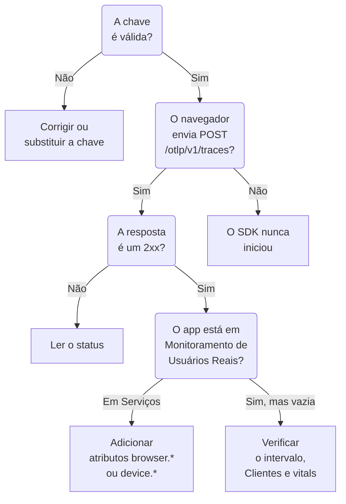

# Solução de problemas de RUM

Quando uma aplicação RUM está faltando, está vazia ou mostra **Desconectado**, siga esta página em ordem. Cada verificação descarta uma parte do caminho entre o seu aplicativo e o OneUptime, na ordem em que esses problemas costumam acontecer.

:::cards
- [Verificar a chave](#verificar-a-chave): A verificação mais rápida, e todo o resto depende dela.
- [Verificar o que sai do navegador](#verificar-o-que-sai-do-navegador): A requisição de exportação nas ferramentas de desenvolvedor do navegador.
- [Verificar onde a telemetria chega](#verificar-onde-a-telemetria-chega): Uma aplicação RUM ou um serviço de backend.
- [Problemas de reprodução de sessões](#problemas-de-reprodução-de-sessões): Um pipeline separado, com página própria.
:::

## Onde a telemetria RUM para

A telemetria passa por três verificações no caminho até uma aplicação RUM. Encontre a primeira que falha:



## Verificar a chave

Verifique a chave primeiro. É a verificação mais rápida, e nada do que vem depois funciona sem uma chave que o OneUptime aceite:

```bash
curl -i https://oneuptime.com/otlp/v1/validate \
  -H "x-oneuptime-token: YOUR_TELEMETRY_INGESTION_TOKEN"
```

| Resposta | O que significa |
| --- | --- |
| `200` com `"valid": true` | O OneUptime aceita a chave. A resposta também informa o seu `keyType` e o seu `projectId`. Passe para a próxima verificação. |
| `401` com `"valid": false` | A chave está ausente, é desconhecida, foi revogada, desativada ou expirou, e a `message` diz qual. Crie uma chave ativa em **Configurações do projeto → Telemetria e APM → Chaves de ingestão**. |

Um aplicativo web precisa de uma chave **Navegador**, e um aplicativo móvel de uma chave **Servidor**: consulte [Configuração para navegadores](/docs/rum/browser-setup) e [Configuração para dispositivos móveis](/docs/rum/mobile-setup). Os endpoints de exportação também rejeitam uma chave errada com `401`, como a especificação OTLP pede, então um SDK bem-comportado registra a rejeição em vez de tentar de novo. Essa linha passa despercebida com facilidade no console do navegador, e esta verificação responde diretamente.

## Verificar o que sai do navegador

Abra as ferramentas de desenvolvedor do navegador na página do aplicativo, selecione a aba Rede e filtre por `otlp`. Você procura `POST /otlp/v1/traces` respondida com um status `2xx`.

### Nenhuma requisição

O SDK nunca iniciou. Quase sempre é uma destas causas:

- `telemetry.ts` não é a primeira importação do seu aplicativo, ou o seu bundler o removeu. As instrumentações modificam `fetch` e `XMLHttpRequest`, então uma requisição feita antes dessa modificação não é rastreada, e um arquivo que o bundler removeu não executa nada.
- O processador em lote ainda não exportou. `BatchSpanProcessor` espera alguns segundos para encher um lote, então espere, ou vá para outra página, antes de concluir que nada é enviado.
- Uma variável de ambiente de build ficou como `undefined`, e a URL do exportador está quebrada. Registre a URL uma vez na inicialização.

### O navegador bloqueia a requisição

- **Um erro de Content Security Policy no console.** A política da sua página ainda não permite o OneUptime. Adicione-o à sua diretiva `connect-src` existente, ou use o seu próprio host se você hospeda o OneUptime:

  ```text
  connect-src 'self' https://oneuptime.com;
  ```

- **Um erro de CORS.** Os endpoints OTLP aceitam requisições de qualquer origem e permitem o cabeçalho `x-oneuptime-token`, então uma falha de CORS real quase sempre significa que a requisição nunca chegou ao OneUptime: procure um proxy corporativo, um bloqueador de anúncios ou um erro de digitação no host. Confira a URL da requisição na aba Rede.

### A requisição recebe um status de erro

**`401`.** A chave é desconhecida, foi revogada ou expirou. Execute a [verificação da chave](#verificar-a-chave) e depois use uma chave ativa.

**`404`.** A URL está errada. O exportador de traços precisa do caminho completo, `/otlp/v1/traces`. Um erro comum é passar o endereço base (`https://oneuptime.com/otlp`) para um exportador que espera a URL completa, ou a URL completa para um que acrescenta o caminho por conta própria e termina em `/otlp/v1/traces/v1/traces`.

**`413`.** O lote passou do que um proxy aceita. O ingress do próprio OneUptime aceita até 4 MB em `/otlp`, mas um proxy que você coloca na frente do OneUptime pode ser mais rígido — o ingress-nginx, por exemplo, define `proxy-body-size` como 1 MB por padrão — então, se você tiver um, aumente também o limite dele para `/otlp`. Em qualquer caso, um `maxExportBatchSize` menor no `BatchSpanProcessor` reduz cada exportação:

```ts
new BatchSpanProcessor(exporter, { maxExportBatchSize: 100 });
```

Um navegador raramente envia lotes tão grandes, a menos que os spans carreguem atributos grandes, como uma pilha de chamadas inteira ou um corpo de resposta. Reduzi-los é a melhor solução.

**`422`.** O OneUptime recusou a chave aqui, e a mensagem diz por quê. `Origin https://app.example.com is not allowed for this browser ingestion key.` significa que a origem exata da página, com o seu esquema e a sua porta, se houver, está faltando nos **Origens permitidas** da chave. `This telemetry ingestion key has been disabled.` significa que alguém desativou a chave.

**`429`.** O **Requests Per Minute Limit** da chave se esgotou: `Too many telemetry requests for this ingestion key. Please retry later.` Uma chave Browser permite 6000 requisições por minuto para todos os seus visitantes juntos, a menos que você defina um limite próprio na chave.

**`403` com uma página HTML, ou um corpo vazio.** O OneUptime responde a toda recusa em JSON, então este veio de algo na frente dele, normalmente um firewall de aplicações web no seu próprio domínio, se você faz o OneUptime passar por ele. O firewall analisa OTLP/JSON e compara cada atributo de span com as suas regras de injeção, então uma URL com uma query string em um span basta para ele bloquear, e o log do firewall indica a regra. Exclua o payload OTLP da inspeção só nos caminhos OTLP: [Suas requisições do OpenTelemetry também são bloqueadas](/docs/rum/session-replay-troubleshooting#suas-requisições-do-opentelemetry-também-são-bloqueadas) mostra como, e cobre o gravador de reproduções atrás do mesmo firewall.

## Verificar onde a telemetria chega

A requisição funciona, mas o aplicativo aparece em **Produtos → Serviços** em vez de **Produtos → Recursos → Monitoramento de Usuários Reais**. É o relato mais comum, e a causa quase sempre é um recurso sem atributos de cliente. O OneUptime só arquiva um lote como RUM quando o recurso dele carrega um destes:

| Tipo | Atributos |
| --- | --- |
| Navegador | `browser.platform`, `browser.language` ou um `browser.brands` não vazio |
| Móvel | `device.id` ou `device.model.identifier`, ou `device.manufacturer` em um recurso sem identidade de host (`host.name`, `host.id` ou `k8s.node.name`) |

Um `service.name` sozinho cria um serviço de backend. O SDK do OpenTelemetry para navegador não adiciona nenhum atributo `browser.*` a menos que você adicione o detector de recursos do navegador ou os defina você mesmo: consulte [Configuração para navegadores](/docs/rum/browser-setup).

Para ver o que você realmente envia, abra a requisição OTLP na aba Rede e olhe o payload dela: `resourceSpans[0].resource.attributes` é a lista que decide. Se não houver nenhum atributo `browser.*`, o SDK não o está adicionando, diga o que disser a documentação dele.

Adicione os atributos, e o próximo lote cria a aplicação RUM. O serviço criado primeiro não vira uma aplicação RUM, porque são registros separados, então exclua-o em **Produtos → Serviços** quando a telemetria RUM chegar.

> [!NOTE]
> Um recurso cujo único atributo de cliente é `device.manufacturer`, e que também tem identidade de host, é lido como uma máquina e não como um telefone, porque o inventário de um host informa o fabricante com o mesmo atributo. Adicione `device.id` ou `device.model.identifier`, e o lote é arquivado como RUM móvel, carregue ele o que carregar além disso.

## A aplicação está vazia

A aplicação existe, mas as páginas dela não mostram nada.

- **Verifique o intervalo de tempo.** A visão geral mostra a última hora por padrão, então um lote de teste de hoje de manhã fica de fora.
- **Espere alguns minutos.** A ingestão passa por uma fila, e **Visto pela última vez** é atualizado a cada poucos minutos em vez de a cada lote.
- **Verifique o projeto.** Uma chave grava no seu próprio projeto, então a telemetria enviada com a chave de outro projeto está lá, não aqui.

## A página Clientes está vazia

A página **Clientes** lista `browser.platform` na web e `device.model.identifier` no móvel. Dois motivos para ela ficar vazia mesmo quando todo o resto funciona:

- **Safari e Firefox.** `browserDetector` lê a API UA Client Hints, que só os navegadores Chromium têm. Nos outros ele define `browser.language`, que basta para arquivar a telemetria como RUM, mas não `browser.platform`. Defina `browser.platform` você mesmo para que esses clientes apareçam.
- **Um SDK móvel que só define `device.manufacturer`.** Isso arquiva a telemetria como RUM móvel, mas a página **Clientes** precisa de `device.model.identifier`.

## Core Web Vitals mostra «No web vitals reported yet»

O cartão só se preenche com as métricas que o seu aplicativo envia, então traços sozinhos nunca o preenchem. Verifique se você exporta métricas, se os nomes delas estão entre os que o OneUptime lê e se elas aparecem na página **Métricas** da aplicação. [O cartão diz «No web vitals reported yet»](/docs/rum/web-vitals#solução-de-problemas) passa por cada verificação, incluindo os valores perdidos quando um visitante fecha a aba antes da próxima exportação.

## O status diz Desconectado enquanto as pessoas usam o aplicativo

Uma aplicação passa para **Desconectado** após 15 minutos sem telemetria. Se há pessoas usando o aplicativo:

- **Um amostrador pode estar descartando tudo.** Verifique se você não definiu um amostrador sempre desligado, nem uma proporção muito baixa.
- **O aplicativo pode enviar telemetria só em algumas interações**, e ninguém as usou nesse período.
- **A chave pode ter sido revogada ou desativada** depois do deploy: execute de novo a [verificação da chave](#verificar-a-chave).

Um aplicativo interno ou de pouco tráfego sem visitantes à noite está realmente desconectado. Não é uma falha.

## Problemas de reprodução de sessões

A reprodução de sessões é um pipeline separado com os seus próprios problemas: o script do gravador, as listas de origens permitidas, o consentimento, a Content Security Policy e o mascaramento. [Solução de problemas de reprodução de sessões](/docs/rum/session-replay-troubleshooting) cobre tudo isso. Comece por lá, e comece ativando o diagnóstico do gravador, porque a maioria das falhas dele é silenciosa de propósito:

```js
localStorage.setItem("oneuptime.sessionReplay.debug", "true");
// then reload the page
```

A página **Integridade** da aplicação, na seção **Reprodução de sessões** dela, e o painel **Test your installation** de **Replay Policy** verificam a chave, as listas de origens permitidas e a política do lado do servidor, e dizem por que nada chega. O console do navegador dá a metade que o servidor não consegue ver.

Com a política padrão, um gravador envia um fragmento a cada 15 segundos, mais ou menos, enquanto o usuário interage com a página. Uma aba ociosa não tem nada para enviar, então clique ou mova o mouse primeiro; depois, se não houver nenhuma requisição de fragmento, algo está errado. Se o aplicativo só envia _On error or frustration_, o silêncio é esperado até algo falhar. Chame `OneUptimeReplay.captureSession()` para forçar um envio e testar o caminho de qualquer forma.

Os dois pipelines são independentes. Não é preciso uma aplicação RUM funcionando para o gravador carregar, e um gravador funcionando não significa que a telemetria RUM está chegando: cada um pode falhar sozinho.

## Ainda com problemas?

Reúna isto antes de pedir ajuda. Evita uma troca de mensagens:

- A lista `resource.attributes` do payload de uma requisição OTLP real.
- O status HTTP dessa requisição.
- O `service.name` exato que você envia, e se o projeto tem uma aplicação ou um serviço com esse nome.
- Se `/otlp/v1/validate` responde `200` para a chave no build implantado.

Depois escreva para support@oneuptime.com ou abra uma issue no [GitHub](https://github.com/OneUptime/oneuptime).

## Próximos passos

:::cards
- [Configuração para navegadores](/docs/rum/browser-setup): A configuração que estas verificações pressupõem, passo a passo.
- [Configuração para dispositivos móveis](/docs/rum/mobile-setup): A chave e os atributos de que um aplicativo móvel precisa.
- [Gerenciar aplicações](/docs/rum/applications): Nomes, rótulos, retenção e status.
- [Solução de problemas de reprodução de sessões](/docs/rum/session-replay-troubleshooting): Cada código do gravador, e o que fazer.
:::
