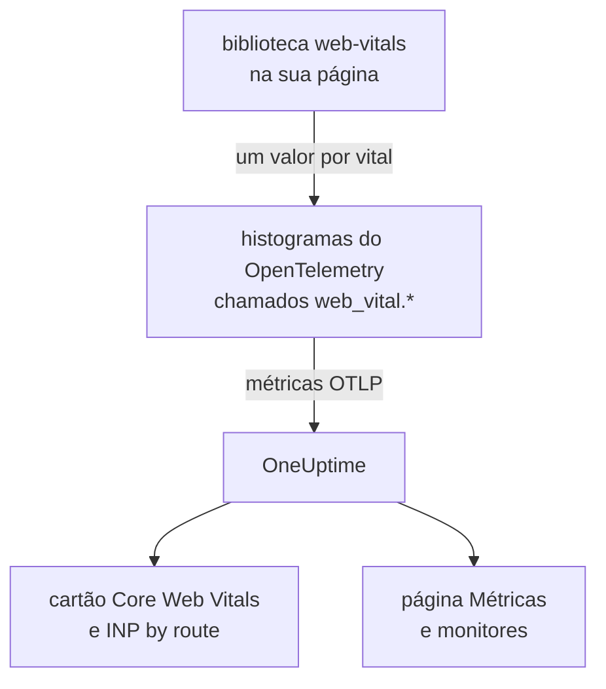
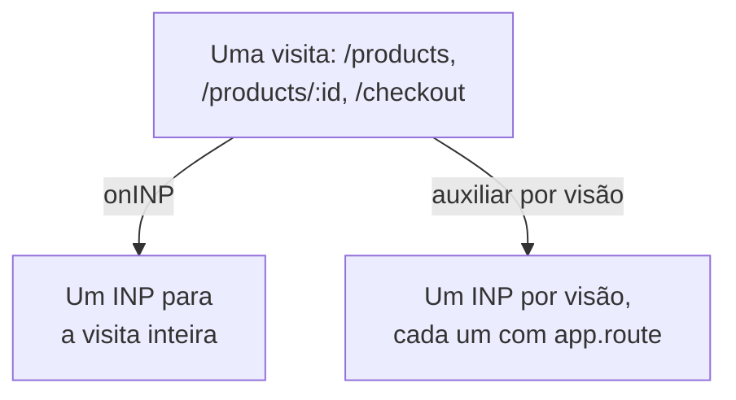

# Core Web Vitals

O cartão **Core Web Vitals** na visão geral de uma aplicação RUM mostra LCP, INP, CLS, FCP e TTFB, cada um avaliado pelos limites do Google. O OneUptime não mede nenhum deles por conta própria: o cartão só se preenche com as métricas que a sua instrumentação do navegador informa, e esta página mostra como enviá-las.

:::cards
- [Enviá-los](#enviá-los-do-seu-aplicativo): Repassar os valores da biblioteca web-vitals como métricas do OpenTelemetry.
- [Nomes que o OneUptime lê](#nomes-de-métrica-que-o-oneuptime-reconhece): Os nomes de métrica com que cada vital pode chegar.
- [Aplicativos de página única](#aplicativos-de-página-única): O INP de cada visão, não um valor por carregamento de página.
- [Alertar sobre um vital](#alertar-sobre-um-vital): Monitores prontos para vitals ruins.
:::

## Como funciona

A biblioteca [`web-vitals`](https://github.com/GoogleChrome/web-vitals) mede cada vital na página; é a mesma biblioteca que as ferramentas do Chrome usam. O seu código registra cada valor em um histograma do OpenTelemetry, e o pipeline de métricas do navegador o exporta para o OneUptime.



O OpenTelemetry ainda não tem uma convenção de nomes definitiva para web vitals, então o OneUptime procura cada vital com vários nomes e usa o primeiro que tem dados. Use os nomes `web_vital.*` em instrumentações novas.

## Antes de começar

- Um aplicativo web configurado como em [Configuração para navegadores](/docs/rum/browser-setup), com o pipeline de métricas dele: é o `MeterProvider` de [Adicionar registros e métricas](/docs/rum/browser-setup#adicionar-registros-e-métricas) que exporta esses valores.

## Enviá-los do seu aplicativo

:::steps
### Instalar a biblioteca

```bash
npm install web-vitals
```

### Registrar cada vital em um histograma

Crie `src/web-vitals.ts`. Cada vital é um histograma, para que a página **Métricas** possa calcular percentis depois, com os limites dos buckets nos limites de bom e ruim do Google.

```ts title="src/web-vitals.ts"
// Import after ./telemetry
import { metrics } from "@opentelemetry/api";
import { onCLS, onFCP, onINP, onLCP, onTTFB, type Metric } from "web-vitals";

const meter = metrics.getMeter("web-vitals");

// Histograms, so the Metrics tab can compute percentiles later. The bucket
// edges sit on each vital's good / poor limits: a percentile is read from
// the buckets, and the defaults are far too coarse for these ranges.
const buckets = (...edges: number[]) => ({ advice: { explicitBucketBoundaries: edges } });

const lcp = meter.createHistogram("web_vital.lcp", { unit: "ms", ...buckets(0, 1000, 1500, 2000, 2500, 3000, 3500, 4000, 5000, 7500, 10000) });
const inp = meter.createHistogram("web_vital.inp", { unit: "ms", ...buckets(0, 50, 100, 150, 200, 250, 300, 400, 500, 750, 1000, 2000) });
const fcp = meter.createHistogram("web_vital.fcp", { unit: "ms", ...buckets(0, 600, 1200, 1800, 2400, 3000, 4000, 6000, 10000) });
const ttfb = meter.createHistogram("web_vital.ttfb", { unit: "ms", ...buckets(0, 200, 400, 600, 800, 1200, 1800, 2500, 4000) });
const cls = meter.createHistogram("web_vital.cls", { unit: "1", ...buckets(0, 0.025, 0.05, 0.1, 0.15, 0.2, 0.25, 0.4, 0.6, 1) });

function record(
  histogram: { record: (v: number, a?: Record<string, string>) => void },
) {
  return (metric: Metric): void => {
    histogram.record(metric.value, {
      // Keep attributes low-cardinality. Never put a full URL or a user id here.
      "web_vital.rating": metric.rating,
    });
  };
}

onLCP(record(lcp));
onINP(record(inp));
onCLS(record(cls));
onFCP(record(fcp));
onTTFB(record(ttfb));
```

### Importá-lo depois da sua configuração de telemetria

```ts
import "./telemetry";
import "./web-vitals";
```

### Conferir a página Métricas

Carregue algumas páginas e depois procure `web_vital.lcp` na página **Métricas** da aplicação. Quando as métricas estiverem lá, o cartão **Core Web Vitals** se preenche para o intervalo que você escolher.
:::

## Enviar os últimos valores antes de a página fechar

`onINP` e `onCLS` informam quando a página fica oculta, não durante a visita. Com o intervalo de exportação de 30 segundos de [Configuração para navegadores](/docs/rum/browser-setup), um visitante que fecha a aba logo depois do último valor pode sair antes de ele ser exportado. Se a completude importa, encurte `exportIntervalMillis`, ou guarde o `MeterProvider` que você montou em `telemetry.ts` e esvazie-o quando a página ficar oculta:

```ts
// In telemetry.ts, export the provider you created:
export const meterProvider = new MeterProvider({ /* ... */ });

// Anywhere after setup:
import { meterProvider } from "./telemetry";

document.addEventListener("visibilitychange", () => {
  if (document.visibilityState === "hidden") {
    void meterProvider.forceFlush();
  }
});
```

## Nomes de métrica que o OneUptime reconhece

O OneUptime tenta os nomes nesta ordem, e vence o primeiro que tem dados no intervalo selecionado.

| Vital | Nomes de métrica, qualquer um | Unidade |
| --- | --- | --- |
| LCP: Largest Contentful Paint | `web_vital.lcp`, `browser.largest_contentful_paint`, `largest_contentful_paint`, `web.vitals.lcp` | ms |
| INP: Interaction to Next Paint | `web_vital.inp`, `browser.interaction_to_next_paint`, `interaction_to_next_paint`, `web.vitals.inp` | ms |
| CLS: Cumulative Layout Shift | `web_vital.cls`, `browser.cumulative_layout_shift`, `cumulative_layout_shift`, `web.vitals.cls` | pontuação |
| FCP: First Contentful Paint | `web_vital.fcp`, `browser.first_contentful_paint`, `first_contentful_paint`, `web.vitals.fcp` | ms |
| TTFB: Time to First Byte | `web_vital.ttfb`, `browser.time_to_first_byte`, `time_to_first_byte`, `web.vitals.ttfb` | ms |

Os outros nomes existem para que um aplicativo que já envia segundo uma convenção da comunidade apareça sem mudanças.

## Limites de avaliação

O cartão avalia cada valor com os limites de Core Web Vitals publicados pelo Google:

| Vital | **Good** | **Needs work** | **Poor** |
| --- | --- | --- | --- |
| LCP | abaixo de 2500 ms | de 2500 a 4000 ms | 4000 ms ou mais |
| INP | abaixo de 200 ms | de 200 a 500 ms | 500 ms ou mais |
| CLS | abaixo de 0,1 | de 0,1 a 0,25 | 0,25 ou mais |
| FCP | abaixo de 1800 ms | de 1800 a 3000 ms | 3000 ms ou mais |
| TTFB | abaixo de 800 ms | de 800 a 1800 ms | 1800 ms ou mais |

O cartão mostra a **média** do intervalo selecionado, não o percentil 75 que as ferramentas de campo do Google informam. É de propósito: o OneUptime lê os percentis de um histograma a partir dos buckets dele, então um percentil só é tão preciso quanto os buckets, enquanto a média vem da soma e da contagem exatas do histograma. Com os buckets padrão do OpenTelemetry (`0, 5, 10, 25, 50, …`), todo valor de CLS cai no primeiro bucket, e um percentil 75 mostraria 2,5 para uma página que quase não se mexe.

> [!TIP]
> Leia o cartão como uma tendência. Para o percentil 75, registre com os limites de buckets acima e depois mostre a métrica na página **Métricas** com a agregação **P75**. Um monitor de métricas oferece a mesma opção.

## Aplicativos de página única

`onINP` mede o INP como o navegador o define: **um valor por carregamento de página**. Um aplicativo de página única carrega uma vez e depois muda de rota com `history.pushState`, então uma visita a `/products`, `/products/42` e `/checkout` produz um único INP para a visita inteira. As interações de todas as visões disputam esse único número, e um atributo de rota nele indica a página que estava na tela quando ele foi informado, não a página que estava lenta.



Para ver o INP por visão, meça-o por visão: cada mudança de rota encerra a visão atual e começa uma nova, e cada visão informa o próprio INP. O auxiliar abaixo faz isso com a API Event Timing do navegador, os mesmos dados que `onINP` usa, e trata a parte fácil de errar: o clique que **causou** uma navegação é entregue depois que a rota já mudou, mas pertence à página em que foi feito.

```ts title="src/inp-per-route.ts"
// INP for each view of a single-page app.
type Report = (inpMs: number, route: string) => void;

interface View {
  route: string;
  path: string; // the URL path it was opened for
  start: number; // performance.now() when the view began
  latencies: Map<number, number>; // interactionId -> its slowest entry
}

// Long enough for the click that navigated to be delivered: its entry
// arrives after the next paint, i.e. after the route has changed.
const SETTLE_MS = 1000;

let views: Array<View> = [];
let report: Report = () => {};

// The path, plus the hash when a hash router keeps the route there.
const currentPath = (): string =>
  location.pathname + (location.hash.startsWith("#/") ? location.hash : "");

function close(view: View): void {
  if (!views.includes(view)) return; // already reported
  views = views.filter((v) => v !== view);

  const sorted = [...view.latencies.values()].sort((a, b) => b - a);
  if (sorted.length === 0) return; // nobody interacted: no INP, not 0

  // web-vitals' p98: skip one outlier for every 50 interactions.
  report(sorted[Math.min(sorted.length - 1, Math.floor(sorted.length / 50))]!, view.route);
}

function record(entries: PerformanceEntryList): void {
  for (const entry of entries as Array<PerformanceEventTiming & { interactionId?: number }>) {
    if (!entry.interactionId) continue; // hovers, scrolls: not interactions

    // The view the interaction STARTED in, so the click that navigated
    // counts towards the page it was clicked on.
    const view = [...views].reverse().find((v) => entry.startTime >= v.start);
    if (!view) continue;

    const slowest = view.latencies.get(entry.interactionId) ?? 0;
    view.latencies.set(entry.interactionId, Math.max(slowest, entry.duration));
  }
}

export function observeInpPerRoute(route: string, onReport: Report): void {
  if (typeof PerformanceObserver === "undefined" || !PerformanceObserver.supportedEntryTypes?.includes("event")) return;

  report = onReport;
  views = [{ route, path: currentPath(), start: 0, latencies: new Map() }];

  const observer = new PerformanceObserver((list) => record(list.getEntries()));
  observer.observe({ type: "event", durationThreshold: 40, buffered: true } as PerformanceObserverInit);

  // The tab may never come back: report every view now, then keep
  // measuring the current route as a fresh view.
  document.addEventListener("visibilitychange", () => {
    if (document.visibilityState !== "hidden") return;
    record(observer.takeRecords());
    const current = views[views.length - 1]?.route ?? route;
    [...views].forEach(close);
    views = [{ route: current, path: currentPath(), start: performance.now(), latencies: new Map() }];
  });
}

// Call after every navigation, with the route PATTERN ("/products/:id").
// Safe to call when nothing changed (a router's initial navigation, a
// query-string update): the view only ends when the path does.
export function startView(route: string): void {
  const closing = views[views.length - 1];
  if (!closing || closing.path === currentPath()) return;

  views.push({ route, path: currentPath(), start: performance.now(), latencies: new Map() });
  setTimeout(() => close(closing), SETTLE_MS);
}
```

As duas funções recebem o **padrão** da rota, nunca a URL: `/products/42` e `/products/7` precisam ser uma só rota, senão cada produto vira uma série própria. Use o padrão do seu roteador quando ele tiver um; caso contrário, agrupe os IDs você mesmo:

```ts
// "/products/42" -> "/products/:id", also for UUIDs.
export const toRoutePattern = (path: string): string =>
  path.replace(/\/(\d+|[0-9a-f]{8}-[0-9a-f-]{27})(?=\/|$)/gi, "/:id");
```

Registre o que o auxiliar informa no mesmo histograma `web_vital.inp`, com a rota em `app.route`, e **remova o `onINP`** do snippet acima: manter os dois contaria cada interação duas vezes.

```ts
// src/web-vitals.ts, in place of onINP(record(inp))
import { observeInpPerRoute } from "./inp-per-route";

observeInpPerRoute(toRoutePattern(location.pathname), (inpMs, route) => {
  inp.record(inpMs, {
    "app.route": route,
    "web_vital.rating": inpMs <= 200 ? "good" : inpMs <= 500 ? "needs-improvement" : "poor",
  });
});
```

Depois chame `startView` onde o seu roteador anuncia uma navegação concluída. A chamada é ignorada quando o caminho da URL não mudou, então um roteador que também informa o primeiro carregamento, ou uma mudança na query string, não divide a visão:

:::tabs
@tab Vue Router
```ts
router.afterEach((to) => startView(to.matched[to.matched.length - 1]?.path ?? toRoutePattern(to.path)));
```
@tab React Router
```tsx
// In a component that stays mounted inside the router
const { pathname } = useLocation();
useEffect(() => startView(toRoutePattern(pathname)), [pathname]);
```
:::

O que você ganha:

- **INP by route** na visão geral, do mais lento para o mais rápido, a partir de `app.route`; o OneUptime também lê o atributo `url.template` do OpenTelemetry.
- Um filtro de rota para alertas: filtre um monitor de métricas sobre `web_vital.inp` por `app.route` para vigiar um único fluxo, como `/checkout`, separadamente.
- O INP geral do aplicativo no cartão **Core Web Vitals** continua funcionando: é a mesma métrica, agora com um valor por visão em vez de um por carregamento de página.

Os navegadores Chromium informam os IDs de interação de que isso precisa. O Safari não informa nenhum, e é também por isso que `onINP` não informa nada nele. A API experimental Soft Navigations do Chrome pretende fazer isso nativamente, mas não está disponível de forma geral; este auxiliar funciona hoje.

> [!NOTE]
> O gravador do [Session Replay](/docs/telemetry/session-replay) já mede o INP por visão, sem código: cada gravação mostra uma linha de INP para cada rota em que o usuário interagiu, com o elemento lento e como o tempo dele se dividiu entre atraso de entrada, processamento e apresentação.

## Manter a cardinalidade sob controle

Os atributos de métrica se multiplicam. `web_vital.rating` tem três valores possíveis, o que é tranquilo, e um atributo de rota ou de tipo de página costuma valer a pena:

```ts
histogram.record(metric.value, {
  "web_vital.rating": metric.rating,
  "app.route": routePattern, // "/product/:id" — the PATTERN, not "/product/8842"
});
```

Registrar a URL concreta em vez do padrão da rota cria uma série temporal por página de produto, o que deixa a página **Métricas** lenta e a conta de armazenamento alta. O mesmo vale para IDs de usuário, IDs de sessão e tamanhos de tela.

## Alertar sobre um vital

A página **Recommendations** da aplicação oferece um monitor pronto para cada vital. Cada um lê a média de cinco minutos da sua métrica e dispara quando ela atinge o limite de ruim do Google:

| Recomendação | Métrica | Dispara em | Gravidade |
| --- | --- | --- | --- |
| **Poor Largest Contentful Paint** | `web_vital.lcp` | 4000 ms | **Crítico** |
| **Poor Interaction to Next Paint** | `web_vital.inp` | 500 ms | **Crítico** |
| **Poor Cumulative Layout Shift** | `web_vital.cls` | 0,25 | **Crítico** |
| **Slow First Contentful Paint** | `web_vital.fcp` | 3000 ms | **Warning** |
| **Slow Time to First Byte** | `web_vital.ttfb` | 1800 ms | **Warning** |

Esses monitores só leem os nomes `web_vital.*`. Se o seu aplicativo envia um vital com outro nome, edite a métrica do monitor criado. Para alertar sobre uma única rota, adicione um filtro `app.route` ao monitor. Você também pode montar o seu próprio monitor sobre qualquer uma dessas métricas: veja [Monitor de métricas](/docs/monitor/metrics-monitor).

## Solução de problemas

:::details O cartão diz "No web vitals reported yet"
O cartão só se preenche com as métricas que o seu aplicativo envia. Verifique, na ordem:

1. Se você tem um pipeline de métricas: traços sozinhos nunca preenchem este cartão.
2. Se os nomes de métrica estão entre os que o OneUptime lê: veja [Nomes de métrica que o OneUptime reconhece](#nomes-de-métrica-que-o-oneuptime-reconhece).
3. Se as métricas estão na página **Métricas** da aplicação. Se estiverem, a exportação funciona, e o problema é o nome ou o intervalo de tempo.
4. Se o INP e o CLS são informados quando a página fica oculta, então uma visita curta pode terminar antes da próxima exportação: veja [Enviar os últimos valores antes de a página fechar](#enviar-os-últimos-valores-antes-de-a-página-fechar).

Se nada disso ajudar, [Solução de problemas de RUM](/docs/rum/troubleshooting) verifica o pipeline inteiro.
:::

:::details O INP é informado, mas não por rota
O cartão **INP by route** precisa do atributo `app.route`, ou `url.template`, em `web_vital.inp`. Registre o padrão da rota com cada valor como em [Aplicativos de página única](#aplicativos-de-página-única).
:::

:::details Os valores diferem do relatório do Google
O cartão mostra a média do intervalo que você escolheu, e o Google informa o percentil 75 dos próprios visitantes. Mostre o **P75** na página **Métricas** para comparar coisas equivalentes.
:::

## Próximos passos

:::cards
- [Configuração para navegadores](/docs/rum/browser-setup): O pipeline de traços, registros e métricas pelo qual esses vitals viajam.
- [Monitor de métricas](/docs/monitor/metrics-monitor): Alertar sobre qualquer vital, para o aplicativo inteiro ou uma única rota.
- [Reprodução de sessões](/docs/telemetry/session-replay): Ver o INP por visão nas gravações, sem código.
- [Solução de problemas de RUM](/docs/rum/troubleshooting): Cada verificação, na ordem em que os problemas costumam acontecer.
:::
