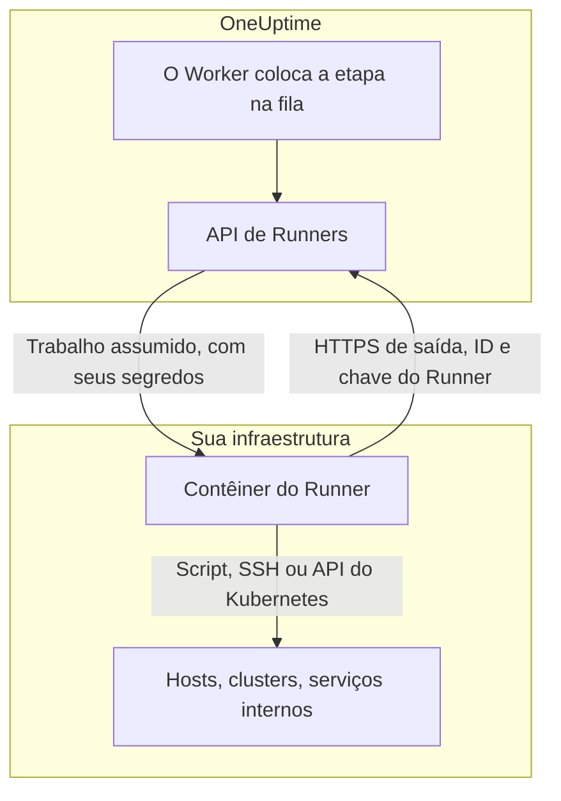
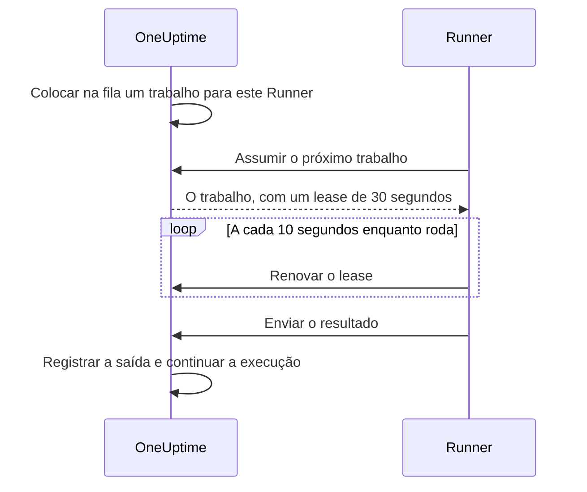

# Agentes de runbook

Um **agente de runbook**, chamado de **Runner** no painel, é um pequeno processo auto-hospedado que executa as etapas JavaScript, Bash, SSH e kubectl dos seus runbooks **dentro da sua própria infraestrutura**. O Worker do OneUptime nunca executa seus scripts: ele os coloca na fila, e o Runner escolhido por quem escreveu a etapa assume cada um, executa e devolve o resultado. Esta página é para quem instala e opera Runners. Uma etapa que não escolhe nenhum Runner roda no [Runner padrão do projeto](#o-runner-padrão-do-projeto), se você definiu um; caso contrário, uma etapa JavaScript roda em um [Runner global](#runners-globais), um dos que o OneUptime executa para todos os projetos.

:::cards
- [Instalar um Runner](#instalar-um-runner): Do painel a um contêiner conectado, em cinco etapas.
- [Apontar uma etapa para um Runner](#apontar-uma-etapa-para-um-runner): Ligar uma etapa ao Runner que deve executá-la.
- [O Runner padrão do projeto](#o-runner-padrão-do-projeto): O Runner em que roda uma etapa ou um repositório de código que não escolhe nenhum.
- [Runners globais](#runners-globais): Os Runners que o OneUptime executa para todos os projetos, e o que eles executam.
- [Timeouts](#timeouts): Os timeouts de assunção e de execução, e como interagem.
- [Variáveis de ambiente](#variáveis-de-ambiente): O que o contêiner lê ao iniciar.
:::

## Como funciona



1. Você cria um Runner no OneUptime. O OneUptime gera um ID e uma chave secreta para ele.
2. Você executa o contêiner do Runner em um host dentro da sua infraestrutura, com esse ID, essa chave e a URL do seu OneUptime.
3. O Runner pede trabalho ao OneUptime a cada 5 segundos e informa que está vivo a cada 60 segundos.
4. Ao escrever uma etapa JavaScript, Bash, SSH ou kubectl, você escolhe o Runner em uma lista suspensa, em **Mais campos** da etapa. A etapa fica ligada a esse Runner. Uma etapa que não escolhe nenhum roda no Runner padrão do projeto, se você definiu um, e, caso contrário, uma etapa JavaScript roda em **Runner global**.
5. Quando a etapa roda, o Worker coloca na fila um trabalho com `targetAgentId` apontando para esse Runner. Só esse Runner pode assumi-lo.
6. O Runner executa o job localmente — `bash -c <script>` para Bash e kubectl, um sandbox `isolated-vm` para JavaScript, uma conexão SSH que executa o script com bash na máquina —, captura o resultado, oculta nele os segredos da etapa e o envia de volta. O Worker retoma o runbook com o resultado.

O Runner só precisa de **HTTPS de saída** para a sua instância do OneUptime. Ele não aceita conexões de entrada.

Um Runner guarda só seu ID e sua chave. Todo o resto ele recebe com o job que assume: um script com as [variáveis de runbook](/docs/runbooks/variables) que ele nomeia já inseridas, e a chave ou senha de uma etapa SSH ou o kubeconfig de uma etapa kubectl. Ele só recebe um segredo quando esse segredo permite. Por isso qualquer pessoa com a chave de um Runner pode agir como esse Runner: trate a chave como os segredos que ele pode usar.

## Por que os scripts rodam em um Runner

Executar scripts no Worker do OneUptime tinha dois problemas:

- **Fronteira de confiança.** Qualquer pessoa que pudesse escrever um runbook podia executar código no Worker, com acesso a tudo o que o Worker alcançava.
- **Alcance.** A maioria das etapas úteis age sobre a _sua_ infraestrutura ("reinicie este serviço", "consulte um registro no nosso banco de dados interno"), não sobre a do OneUptime.

Com os Runners, essas etapas rodam em um host que você controla, e você decide o que esse host pode fazer. As etapas de requisição HTTP e de IA continuam rodando no Worker, porque não precisam de nada da sua rede.

## Runners globais

Runners globais são os Runners que o OneUptime executa para todos os projetos. Uma etapa JavaScript que não escolhe um Runner próprio roda em um deles, a menos que o projeto tenha um [Runner padrão](#o-runner-padrão-do-projeto), então você pode escrevê-la antes de instalar qualquer coisa. **Runbooks → Agentes de runbook** os lista em **Runners globais**, acima dos seus próprios Runners, e a lista suspensa **Runner** de uma etapa JavaScript oferece **Runner global** primeiro, ou logo depois do Runner padrão do projeto. A lista suspensa de uma etapa Bash, SSH ou kubectl o mostra por último, esmaecido, com **Roda só etapas de JavaScript.** Essas etapas rodam em um Runner seu, dentro da sua rede, nunca em um que todos os projetos compartilham.

| | Runner global | Seu próprio Runner |
| --- | --- | --- |
| Etapas que executa | JavaScript | JavaScript, Bash, SSH e kubectl |
| O que uma etapa alcança | Endereços públicos da internet | O que o host dele alcança |
| Tempo máximo de uma etapa | 5 minutos | 1 hora |
| Variáveis secretas | As que você deixa os Runners globais usarem | As que o listam |
| Comandos Bash da OneUptime AI | Nunca | Para as regras de IA que o escolhem |

Um Runner global executa as etapas de muitos projetos, então cada etapa fica separada de todas as outras:

- Cada etapa roda em um sandbox `isolated-vm` próprio, criado para essa etapa e descartado depois dela: sem arquivos, sem processos, sem variáveis de ambiente e nada guardado de uma etapa para a seguinte.
- As requisições HTTP dela alcançam apenas endereços públicos da internet, nunca um endereço privado, de loopback ou link-local nem um endpoint de metadados de nuvem, então um Runner global nunca alcança a sua rede.
- Ele só recebe uma variável secreta quando o interruptor **Runners globais podem usá-lo** dela está ligado, e só para uma etapa do próprio projeto da variável.
- Um projeto roda no máximo três etapas por vez nos Runners globais, então nenhum projeto fica com eles só para si.

Escolha um dos seus próprios Runners para uma etapa que precisa alcançar a sua rede, ou para manter a etapa em hosts que você controla. Para manter todas as etapas nos seus próprios Runners, desligue **Usar Runners globais** no fim de **Runbooks → Agentes de runbook**. Uma etapa JavaScript que não escolhe nenhum Runner passa então a rodar no Runner padrão do projeto ou, se não houver um, a falhar, dizendo isso, até escolher um dos seus; uma etapa que escolhe um dos seus Runners o mantém de qualquer forma. Um repositório de código que não escolhe nenhum Runner nas configurações dele em Código também trabalha no Runner padrão do projeto ou, se não houver um, em um Runner global, e precisa de um dos seus enquanto a opção estiver desligada; consulte [Código](/docs/ai/ai-agent#escolha-o-runner-do-repositório).

### De onde vêm os Runners globais

No OneUptime Cloud, o OneUptime os executa. Uma instalação auto-hospedada executa um próprio por padrão, assim como executa as próprias sondas globais: o serviço `global-runner` no Docker Compose e o deployment `globalRunner` no chart Helm. Ele tem a própria chave, `GLOBAL_RUNNER_KEY`, e nada mais do servidor.

Um administrador principal pode adicionar mais, para rodar etapas a partir de outros hosts: no Painel de administração, abra **Configurações**, depois **Runners globais**, crie um e rode o comando que o **Mostrar ID e chave** dele fornece em um host que alcance a internet.

Para desligar o incluído, defina `GLOBAL_RUNNER_REPLICAS=0` no `config.env` do Docker Compose, ou `globalRunner.enabled` como `false` no chart Helm. Sem nenhum Runner global, **Runbooks → Agentes de runbook** lista apenas os seus próprios Runners, e toda etapa JavaScript escolhe um deles.

## Antes de começar

- **Um host com Docker** dentro da sua infraestrutura, que alcance a URL do seu OneUptime por HTTPS e os sistemas sobre os quais suas etapas agem.
- **Uma função que cria Runners.** Project Owner, Project Admin, Project Member e Runbook Admin podem criar um. Só um Project Owner, Project Admin ou Runbook Admin pode ver a chave de um Runner, que o comando de instalação contém.

## Instalar um Runner

### 1. Criar o registro do agente

Vá para **Runbooks → Agentes de runbook** e crie um novo agente. Clique em **Criar: Runner** e preencha os campos dele, todos em uma só página:

| Campo | Onde | Observações |
| --- | --- | --- |
| **Nome** | Na página | Um nome claro, normalmente onde ele roda e o que alcança, como `prod-eu-west-1`. É o que você escolhe ao escrever uma etapa. |
| **Descrição** | Na página | Opcional. Uma frase sobre o que este host alcança. |
| **Executa runbooks** | Em **Mais campos** | Ligado por padrão. Permite que este Runner assuma etapas de runbook. |
| **Rótulos** | Em **Mais campos** | Opcional. |

Um Runner aplica uma mudança nas suas capacidades no próximo heartbeat; não é preciso reiniciá-lo. A IA não é uma capacidade. Um repositório de código escolhe, nas configurações dele em Código, o Runner em que a IA trabalha nele, e a página do Runner lista os repositórios que o escolhem. Uma regra de IA escolhe o Runner em que a OneUptime AI executa os seus comandos: escolher um Runner ali é o que permite que os comandos da OneUptime AI sejam executados nele.

### 2. Copiar o comando de instalação

Na linha do Runner, clique em **Mostrar instruções de configuração**. A caixa de diálogo **Configuração do Agente de Runbook** mostra um comando `docker run` já preenchido com o ID e a chave deste Runner. O mesmo comando está na página do Runner, em **Instruções de configuração**.

Só um Project Owner, Project Admin ou Runbook Admin pode ler a chave. Os demais veem "Você não tem permissão para visualizar a chave deste agente de runbook" no lugar do comando.

### 3. Executá-lo em um host da sua infraestrutura

Execute o comando em um host do seu ambiente que consiga:

- alcançar sua instância do OneUptime por HTTPS, e
- fazer o que suas etapas precisam, como alcançar outros hosts por SSH, chamar o servidor de API de um cluster ou falar com um banco de dados.

```bash
docker run --name oneuptime-runner --restart unless-stopped \
  -e ONEUPTIME_RUNNER_ID=<runner-id> \
  -e ONEUPTIME_RUNNER_KEY=<runner-key> \
  -e ONEUPTIME_URL=https://oneuptime.yourdomain.com \
  -d oneuptime/runner:release
```

### 4. Verificar que o agente está conectado

Volte para **Runbooks → Agentes de runbook**. Até um minuto depois de o contêiner iniciar, o **Status** do Runner deve mostrar **Conectado**, com um **Visto pela última vez** recente. Na página do Runner, o cartão **Status do Agente de Runbook** mostra a **Versão do Agente de Runbook** e o **Host**. Se ele continuar em **Nunca conectado** ou **Desconectado**, consulte [Solução de problemas](#solução-de-problemas).

### 5. Manter o agente atualizado

Quando um agente roda uma versão mais antiga que o seu OneUptime, um sinal de alerta aparece ao lado da **Versão do Agente de Runbook** na página dele. Selecione-o para ver como atualizar: baixe a nova imagem e remova o contêiner, depois execute de novo o comando de instalação da etapa 2. Um agente instalado pelo chart do agente Kubernetes é atualizado com o chart.

```bash
docker pull oneuptime/runner:release
docker rm -f oneuptime-runner
```

## Apontar uma etapa para um Runner

:::steps
### Adicionar uma etapa que roda em um Runner

Nas **Etapas** do seu runbook, adicione uma etapa JavaScript, Bash, SSH ou kubectl.

### Escolher o Runner

Abra **Mais campos** da etapa: a lista **Runner** dela mostra todos os Runners do projeto e se cada um está conectado, e a linha recolhida nomeia o Runner em que a etapa roda. Se o projeto ainda não tiver nenhum, a etapa avisa e indica **Runbooks › Runners**. A primeira opção é onde roda uma etapa que não escolhe nenhum Runner: o [Runner padrão do projeto](#o-runner-padrão-do-projeto), marcado como **Padrão do projeto**, ou, caso contrário, para uma etapa JavaScript, **Runner global**.

### Salvar as etapas

Clique em **Save Steps**. Quando uma execução chega à etapa, o Worker coloca na fila um trabalho para o ID desse Runner, e só esse Runner pode assumi-lo. Uma etapa em **Runner global** espera pelo Runner global que estiver livre.
:::

O Bash é executado com `bash -c`. O JavaScript roda em um sandbox `isolated-vm` no Runner, sem acesso ao sistema de arquivos nem a processos; ele pode chamar APIs HTTP públicas com `axios`, mas não endereços de uma rede privada. Uma etapa SSH ou kubectl entra com uma [variável de runbook](/docs/runbooks/variables) secreta, que precisa listar o Runner da etapa em **Seus Runners que podem usá-lo**.

Precisa de mais de um Runner? Crie-os e aponte cada etapa para o adequado. Para ter redundância, rode um segundo Runner e divida as etapas entre os dois, ou mantenha um runbook de reserva cujas etapas apontem para o outro Runner.

## O Runner padrão do projeto

Um projeto pode tornar um dos seus próprios Runners o padrão, assim como torna uma configuração do Twilio a padrão. Toda etapa de runbook que não escolhe nenhum Runner passa então a rodar nele: as etapas Bash, SSH e kubectl, e as etapas JavaScript, que de outra forma rodariam em um Runner global. O mesmo vale para a IA em todo repositório de código que não escolhe nenhum Runner nas configurações dele em Código.

Para tornar um Runner o padrão, vá a **Runbooks → Agentes de runbook**, abra o menu **⋯** na linha do Runner, clique em **Definir como padrão do projeto** e confirme com **Tornar padrão do projeto**. Ou abra o Runner e, no cartão **Padrão do projeto** dele, ligue **Usar como padrão do projeto**. A lista marca o padrão como **Padrão do projeto**, ao lado do nome, e a lista suspensa **Runner** de uma etapa faz o mesmo, na primeira opção. Um projeto tem um só Runner padrão: tornar outro Runner o padrão o substitui. **Deixar de usar como padrão do projeto**, no mesmo menu, ou o interruptor na página do Runner, deixa de usá-lo.

Onde roda uma etapa que não escolhe nenhum Runner:

| O projeto | Uma etapa JavaScript | Uma etapa Bash, SSH ou kubectl |
| --- | --- | --- |
| Tem um Runner padrão | O Runner padrão | O Runner padrão |
| Não tem, e usa Runners globais | Um Runner global | Em nenhum: a etapa falha, dizendo que não tem Runner |
| Não tem, e não usa Runners globais | Em nenhum: a etapa falha, dizendo isso | Em nenhum: a etapa falha, dizendo que não tem Runner |

Uma etapa que escolheu um Runner o mantém, seja qual for o padrão, e uma etapa JavaScript ainda pode escolher **Runner global** por conta própria. Definir um padrão não altera nenhuma etapa salva.

O padrão é um dos Runners próprios do projeto que roda etapas de runbook: não um Runner global, não o Runner dentro do cluster que o agente do Kubernetes instalou, e não um com **Executa runbooks** desligado. Enquanto um Runner é o padrão, o **Executa runbooks** dele continua ligado. Quando o padrão não está conectado, a lista suspensa de uma etapa avisa, e uma etapa nele espera por ele, como por qualquer Runner, até o claim timeout dela acabar.

As etapas de runbook e os repositórios de código que não escolhem nenhum Runner usam o padrão, e acompanham a mudança quando outro Runner se torna o padrão. Uma regra de IA escolhe o próprio Runner, e uma regra nova começa no padrão.

## Notas de operação

### Timeouts

Dois timeouts valem para cada etapa que roda em um Runner:

| Timeout | Padrão | O que controla |
| --- | --- | --- |
| **Tempo limite para assumir** | 2 minutos | Por quanto tempo o Worker espera o Runner escolhido assumir o trabalho. Se o Runner não o assumir a tempo, a etapa falha por tempo esgotado e o runbook segue (ou para, conforme **Continuar em caso de falha**). |
| **Tempo limite de execução** | 30 segundos | Por quanto tempo o Runner deixa a etapa rodar antes de pará-la. O Bash recebe `SIGKILL`; o sandbox do JavaScript é destruído. |

Os dois são configuráveis por etapa. Abra **Runbooks › seu runbook › Etapas**, expanda a etapa e defina **Tempo limite de execução** e **Tempo limite para assumir** (em segundos) em **Mais campos**. Deixe um campo vazio para usar o padrão. Cada um aceita de 1 segundo a 1 hora; valores fora dessa faixa são ajustados ao limite quando a etapa roda.

A janela de espera total do Worker é `claim timeout + execution timeout + a few seconds`. Escolha valores adequados à etapa.

Duas coisas a lembrar ao reduzir o claim timeout:

- O Runner pede trabalho em um ciclo de consulta (`ONEUPTIME_RUNNER_POLL_INTERVAL_MS`, 5 segundos por padrão). Um claim timeout menor que um ciclo pode expirar antes que um Runner perfeitamente saudável sequer veja o trabalho, e a etapa falha com a mesma mensagem que um Runner offline provoca.
- Um Runner executa um trabalho por vez por padrão (`ONEUPTIME_RUNNER_CONCURRENCY`). Enquanto uma etapa longa o ocupa, as outras etapas apontadas para o mesmo Runner esgotam seus próprios claim timeouts. Se você aumentar um execution timeout para minutos, aumente também o claim timeout das etapas que compartilham esse Runner, ou dê a elas outro Runner.

### Lease e heartbeat



Quando um Runner assume um trabalho, ele recebe um lease curto (30 segundos por padrão). Enquanto a etapa roda, o Runner renova o lease a cada 10 segundos. Se o Runner morrer ou perder a rede no meio de um script, o lease expira e o Worker marca o trabalho como `TimedOut` em vez de esperar para sempre.

Os processos filhos do Bash **não** são cancelados automaticamente quando o lease expira (um sandbox de JavaScript também é deixado terminar, se terminar), mas o Worker para de esperar por eles, e o Runner não consegue enviar um resultado depois que outra assunção tomou o lugar. Projete scripts que possam rodar de novo com segurança se a execução única for importante para você.

### Se o Worker do OneUptime reiniciar no meio de uma etapa

Uma execução de runbook roda em um único Worker do início ao fim, então um deploy ou uma queda pode interrompê-la enquanto uma etapa está em andamento. O que acontece depois depende de a execução ser retomada:

- **Ela é retomada.** O Worker que a retoma encontra o trabalho que sua etapa já criou e **se reconecta a ele**. Ele espera esse trabalho em vez de enviar ao seu Runner uma segunda cópia do script. Se o Runner já tinha terminado, o resultado registrado é usado como está. Uma etapa é enviada a um Runner no máximo uma vez por execução.
- **Ela não é retomada.** Se a execução nunca for retomada, uma varredura a marca como `Failed` quando ela ultrapassar a janela de assunção e execução configurada para a etapa atual, com uma mensagem que nomeia essa etapa. Uma execução nunca fica presa em `Running`.

A única coisa que isso não consegue dizer é até onde um script chegou antes de o Worker sumir. Uma etapa que estava no meio da execução é informada como falha, com uma nota de que pode ter rodado em parte: verifique o sistema de destino antes de executar o runbook de novo.

### Nenhum agente online

Se o Runner escolhido estiver offline quando a etapa rodar, o trabalho espera como `Pending` até o claim timeout acabar, e então a etapa falha com "No runbook agent picked up this step before the wait window expired." A página **Agentes de runbook** é onde você confirma a cobertura antes de executar um runbook para valer. Uma etapa em um Runner global falha, em vez disso, com "No global Runner picked up this step before the wait window expired."

### Limite de saída

stdout e stderr juntos são limitados a **50 KB** por etapa. Uma saída maior é cortada com um marcador. Se precisar do log completo, grave-o a partir do script no seu armazenamento de logs ou em um armazenamento de objetos e mostre a URL com `echo`.

### Cancelamento

Cancelar uma execução de runbook, pela página da execução ou pela API, marca imediatamente todos os seus trabalhos `Pending`, `Claimed` e `Running` como `Cancelled`. Um Runner que já está no meio de um script termina o trabalho, mas o servidor não aceita o resultado, e nenhuma etapa posterior do runbook é enviada.

### Concorrência

Cada Runner executa um trabalho por vez por padrão. Para permitir mais, defina `ONEUPTIME_RUNNER_CONCURRENCY` no contêiner, mas lembre que o Runner divide o host com tudo o que já roda lá.

## Variáveis de ambiente

O Runner lê estas variáveis ao iniciar:

| Variável | Obrigatória | Padrão | Observações |
| --- | --- | --- | --- |
| `ONEUPTIME_URL` | sim | — | URL base da sua instância do OneUptime, como `https://oneuptime.yourdomain.com`. |
| `ONEUPTIME_RUNNER_ID` | sim | — | O ID do Runner, do comando de instalação. |
| `ONEUPTIME_RUNNER_KEY` | sim | — | A chave secreta do Runner, do comando de instalação. |
| `ONEUPTIME_RUNNER_POLL_INTERVAL_MS` | não | `5000` | Com que frequência o Runner pede novos trabalhos. Um valor abaixo de `1000` volta ao padrão. |
| `ONEUPTIME_RUNNER_HEARTBEAT_INTERVAL_MS` | não | `60000` | Com que frequência o Runner informa que está vivo. Um valor abaixo de `5000` volta ao padrão. |
| `ONEUPTIME_RUNNER_JOB_HEARTBEAT_INTERVAL_MS` | não | `10000` | Com que frequência o Runner renova o lease de um trabalho em andamento. Um valor abaixo de `1000` volta ao padrão. |
| `ONEUPTIME_RUNNER_CONCURRENCY` | não | `1` | Número máximo de trabalhos simultâneos neste Runner. |
| `ONEUPTIME_RUNNER_ENABLE_RUNBOOKS` | não | — | Defina como `false` para que este Runner pare de assumir etapas de runbook, diga o que disser o painel. Só pode desligar a capacidade. |
| `ONEUPTIME_RUNNER_ENABLE_CODE_FIXES` | não | — | Defina como `false` para que este Runner pare de assumir correções de código por IA, mesmo para um repositório de código que o escolhe. |
| `ONEUPTIME_RUNNER_ENABLE_AI_COMMANDS` | não | — | Defina como `false` para que este Runner pare de executar comandos de remediação por IA, diga o que disser o painel. |

## Trocar a chave de um agente

Se uma chave vazar, redefina-a. A chave antiga para de funcionar na hora.

:::steps
### Redefinir a chave

Abra o Runner em **Runbooks → Agentes de runbook**, clique em **Redefinir chave do Agente de Runbook** e confirme. O Runner para de se conectar até ter a nova chave.

### Executar o contêiner com a nova chave

Copie o novo comando das **Instruções de configuração** do Runner, remova o contêiner antigo e execute o novo comando no mesmo host:

```bash
docker rm -f oneuptime-runner
```

### Verificar que ele se reconecta

Em **Runbooks → Agentes de runbook**, o **Status** do Runner volta para **Conectado** em até um minuto.
:::

## Permissões

O gerenciamento de agentes fica no grupo de permissões Runbooks existente:

- `CreateRunner`, `EditRunner`, `DeleteRunner`, `ReadRunner` — gerenciar os registros dos agentes.
- `RunbookAdmin`, `RunbookMember`, `RunbookViewer` (funções) — `RunbookAdmin` constrói runbooks, suas regras e os Runners em que eles rodam, e os executa. `RunbookMember` abre runbooks e suas execuções e os executa — inicia uma execução, conclui ou pula suas etapas e a cancela —, mas não cria, altera nem exclui nenhum runbook ou Runner. `RunbookViewer` lê runbooks e suas execuções e não executa nada. `RunbookAdmin` reúne todas as permissões granulares acima.
- Runners globais não pertencem a nenhum projeto: só um administrador principal adiciona, altera ou remove um, no Painel de administração. Todos que podem ler os Runners de um projeto os veem, e desligar **Usar Runners globais** exige a permissão de editar o projeto.

Disparar um runbook (e com isso enviar suas etapas aos Runners) exige uma função que executa runbooks — `ProjectOwner`, `ProjectAdmin`, `ProjectMember`, `RunbookAdmin` ou `RunbookMember` — ou `CreateRunbookExecution`; concluir, pular ou cancelar uma execução também aceita `EditRunbookExecution`. Uma função só executa os runbooks que seu escopo alcança.

A chave de um Runner só pode ser lida por Project Owners, Project Admins e Runbook Admins.

## API do agente

Para os curiosos: o Runner usa estes endpoints, montados em `/runner-ingest`. O caminho anterior à fusão, `/runbook-agent-ingest`, ainda é servido para os agentes que ainda não foram reimplantados, então atualizar o servidor não os quebra. Eles são autenticados pelo ID e pela chave do Runner no corpo JSON (`agentId` e `agentKey`), ou nos headers `x-agent-id` e `x-agent-key`.

| Endpoint | Finalidade |
| --- | --- |
| `POST /heartbeat` | Sinal de vida. Atualiza o último contato, a versão e as informações do host do Runner, e devolve as capacidades que o projeto concedeu a ele. |
| `POST /claim-next-job` | Assumir de forma atômica o trabalho `Pending` mais antigo destinado ao ID deste Runner. Devolve `{ job: null }` quando não há nada a fazer. Um Runner global assume, em vez disso, a etapa mais antiga que espera por qualquer Runner global. |
| `POST /job/:jobId/heartbeat` | Renovar o lease do trabalho. Devolve 404 quando o lease expirou ou o trabalho terminou. |
| `POST /job/:jobId/result` | Enviar o resultado final. É ignorado se o lease já tiver passado adiante. |
| `POST /disconnect` | Desconectar-se em um desligamento limpo. |

Você não deve precisar chamá-los manualmente: o Runner incluído faz isso. Eles estão documentados aqui para que você possa construir seu próprio agente se tiver uma restrição à qual o nosso não se adapta.

## Solução de problemas

:::details O Runner fica em Nunca conectado ou Desconectado
- Verifique os logs do contêiner com `docker logs oneuptime-runner` em busca de erros de autenticação ou de rede.
- Verifique se o host alcança a URL do seu OneUptime, por exemplo com `curl`.
- Verifique se o ID e a chave foram copiados sem espaços, e se `ONEUPTIME_URL` é o endereço pelo qual você abre o OneUptime.

**Nunca conectado** significa que o Runner nunca se apresentou. **Desconectado** significa que ele se apresentou, mas não nos últimos 5 minutos.
:::

:::details As etapas falham com "No runbook agent picked up this step before the wait window expired."
O Runner da etapa não assumiu o trabalho dentro do seu claim timeout. Verifique se o Runner está **Conectado**, se **Executa runbooks** está ligado para ele e se ele não está ocupado com uma etapa longa: ele executa um trabalho por vez, a menos que você aumente `ONEUPTIME_RUNNER_CONCURRENCY`. Um claim timeout menor que o intervalo de consulta falha da mesma forma.
:::

:::details As etapas falham com "The runbook agent stopped responding while this step was running."
O Runner assumiu o trabalho e depois parou de renovar o lease: travou, reiniciou ou perdeu a rede. Verifique se ele está online e depois verifique o sistema de destino antes de executar o runbook de novo.
:::

:::details O Runner registra "No capability is enabled"
Todas as capacidades estão desligadas para este Runner. Ligue **Executa runbooks** na página do Runner no OneUptime. Ele aplica a mudança no próximo heartbeat.
:::

:::details Uma etapa falha porque seu Runner não pode usar uma variável secreta
A etapa nomeia uma variável secreta que não permite o uso pelo seu Runner, então o Runner não a recebeu e a etapa não foi executada. O erro nomeia o segredo e o que mudar. Em **Runbooks → Configurações → Variáveis globais**, ou em **Configurações → Variáveis** do runbook, adicione o Runner em **Seus Runners que podem usá-lo**, ou ligue **Runners globais podem usá-lo** para uma etapa em um Runner global. Ou escolha um Runner que o segredo permita.
:::

:::details Uma etapa kubectl falha porque seu Runner é antigo demais
A etapa falhou com "This kubectl step runs a script, and this Runner is too old to run one, so it was not run." Um Runner anterior aos scripts kubectl não consegue executar um. Uma etapa Kubernetes levada a um script kubectl na atualização ainda é executada nele como a ação com que foi escrita, até que seu script ou seu kubeconfig mude. Atualize o Runner, como mostra [Manter o agente atualizado](#5-manter-o-agente-atualizado), e execute o runbook de novo.
:::

## Próximos passos

:::cards
- [Escrever um runbook](/docs/runbooks/authoring): Escrever as etapas que rodam no seu Runner.
- [Variáveis de runbook](/docs/runbooks/variables): Os valores e segredos que suas etapas usam, e os Runners que os recebem.
- [Configuração e segurança de runbooks](/docs/runbooks/configuration): Limites, permissões e proteção.
:::
