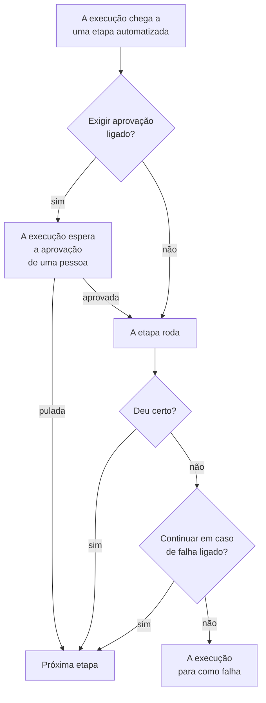

# Escrever um runbook

Você escreve um runbook como uma lista ordenada de etapas na página **Etapas** dele. Esta página mostra como criar um runbook, como configurar cada um dos sete tipos de etapa e como falhas e aprovações mudam o rumo de uma execução.

:::cards
- [Criar um runbook](#criar-um-runbook): De um runbook vazio a etapas salvas.
- [Tipos de etapa](#tipos-de-etapa): Manual, JavaScript, HTTP request, Bash, SSH, kubectl e AI.
- [Tratamento de falhas e aprovações](#tratamento-de-falhas-e-aprovações): O que acontece quando uma etapa falha ou espera uma aprovação.
- [Um exemplo completo](#um-exemplo-completo): Um failover de banco de dados em cinco etapas.
:::

## Antes de começar

- **Uma função que escreve runbooks.** Project Owner, Project Admin e Runbook Admin criam runbooks e salvam suas etapas. Com permissões granulares, você precisa de **Create Runbook** e **Edit Runbook**. Consulte [Permissões](/docs/runbooks/configuration#permissões).
- **Um Runner, para etapas Bash, SSH e kubectl.** Essas etapas são executadas em um [Runner](/docs/runbooks/agents) dentro da sua própria infraestrutura, nunca no Worker do OneUptime. Instale um primeiro. Uma etapa que não escolhe nenhum Runner roda no [Runner padrão do projeto](/docs/runbooks/agents#o-runner-padrão-do-projeto), se você definiu um; caso contrário, uma etapa JavaScript roda em um [Runner global](/docs/runbooks/agents#runners-globais).
- **Uma variável secreta, para etapas SSH e kubectl.** A chave, a senha ou o kubeconfig com que uma etapa entra é uma [variável de runbook](/docs/runbooks/variables) secreta. Project Owner e Project Admin criam as variáveis, e Runbook Admin as escolhe nas etapas que escreve. Uma etapa kubectl pode usar, em vez disso, o acesso próprio do Runner.
- **Um provedor de LLM, para etapas de IA.** Consulte [Provedores de LLM](/docs/ai/llm-provider).

## Criar um runbook

:::steps
### Abrir Runbooks

Abra **Produtos → Runbooks**. Runbooks fica no grupo **Painéis e automação**.

### Criar o runbook

Clique em **Criar: Runbook**, informe um **Nome** e, se quiser, uma **Descrição** do propósito do runbook. Em **Mais campos** ficam o interruptor **Habilitado**, ligado por padrão, e os **Rótulos**. O novo runbook abre na página **Etapas** dele.

### Adicionar etapas

Em **Comece seu runbook**, escolha o tipo da primeira etapa; abaixo da última etapa, **Adicionar outra etapa** oferece os mesmos sete tipos. Cada etapa abre com seu **Título** e o que o seu tipo precisa; o resto, como sua **Descrição** e os tempos limite, fica recolhido em **Mais campos**. Assim que o runbook tiver uma etapa, **Adicionar etapa**, no topo do cartão, adiciona uma etapa Manual.

### Ordenar as etapas

As etapas são executadas **em ordem**. Para mudar a ordem, arraste uma etapa pela alça à esquerda do cabeçalho; pelo teclado, coloque o foco na alça, pressione Espaço, mova a etapa com as setas e pressione Espaço de novo.

### Salvar as etapas

Clique em **Salvar etapas**. Até fazer isso, o editor mostra **Alterações não guardadas**. Depois de salvar, você vê **Salvo**, e o runbook está pronto para [ser executado](/docs/runbooks/running).
:::

## Anatomia de uma etapa

Toda etapa tem estes campos. Uma etapa automatizada mostra seu **Título** e as configurações do seu tipo, e recolhe o resto em **Mais campos**, que diz o que está definido:

| Campo | Finalidade |
| --- | --- |
| **Título** | Um rótulo curto, mostrado na lista de etapas e em cada execução. |
| **Descrição** | Contexto opcional para quem responde, em Markdown, em **Mais campos**. Em uma etapa Manual, são as **Instruções** que essa pessoa lê e segue, mostradas abaixo do título. |
| **Continuar em caso de falha** | Só etapas automatizadas. Se ligado, uma etapa que falha não interrompe a execução: a próxima etapa roda mesmo assim. |
| **Exigir aprovação** | Só etapas automatizadas. Se ligado, a execução para antes desta etapa até que alguém a aprove, e só então a executa. O interruptor diz **Exigir aprovação antes de executar esta etapa**, e o cabeçalho da etapa mostra **Requer aprovação**. |
| Configurações específicas do tipo | O script, a URL, o Runner, uma variável secreta ou o prompt. Consulte [Tipos de etapa](#tipos-de-etapa). |

## Tipos de etapa

| Tipo | É executada em | Precisa de |
| --- | --- | --- |
| [Manual](#manual) | Uma pessoa | Nada |
| [JavaScript](#javascript) | Um Runner | Um Runner |
| [HTTP request](#http-request) | O Worker do OneUptime | Nada |
| [Bash](#bash) | Um Runner | Um Runner |
| [SSH](#ssh) | Um Runner | Um Runner e uma variável secreta para entrar |
| [kubectl](#kubectl) | Um Runner | Um Runner, e uma variável de kubeconfig ou o acesso próprio do Runner |
| [AI](#ai) | O Worker do OneUptime | Um provedor de LLM |

Em cada etapa automatizada abaixo, **Mais campos** da etapa traz primeiro o **Runner** dela, para uma etapa que roda em um, depois **Exigir aprovação** e **Continuar em caso de falha**, depois as configurações próprias da etapa - os headers de uma chamada HTTP, a porta e a frase secreta da chave de uma etapa SSH, o provedor e os interruptores de contexto de uma etapa de IA - e por último a **Descrição** e os tempos limite. Recolhido, ele nomeia o Runner da etapa, para você ver onde uma etapa roda sem abri-la.

### Manual

Um item de checklist para uma pessoa: suas **Instruções** dizem o que fazer ou verificar. A execução pausa ao chegar a uma etapa Manual e fica em `WaitingForManualStep` (**Aguardando você**) até que alguém clique em **Marcar como concluído** ou **Pular**. Uma execução que espera por uma pessoa nunca expira. Uma etapa Manual não tem interruptor de aprovação: ela já para a execução por uma pessoa.

Use-a para o que só uma pessoa pode verificar ou fazer: "Confirmar no painel do balanceador de carga que o tráfego foi para a região secundária."

### JavaScript

Um trecho de JavaScript, executado em um sandbox `isolated-vm` em um [agente de runbook](/docs/runbooks/agents), não no Worker do OneUptime: em um dos seus, ou em um [Runner global](/docs/runbooks/agents#runners-globais) quando a etapa não escolhe nenhum.

| Campo | O que faz | Padrão |
| --- | --- | --- |
| **Runner** | Em **Mais campos**. O Runner que executa a etapa: **Runner global**, ou um dos seus. Só o Runner que você escolhe pode assumir o trabalho; qualquer Runner global pode assumir uma etapa em **Runner global**. | O [Runner padrão do projeto](/docs/runbooks/agents#o-runner-padrão-do-projeto), se você definiu um; caso contrário, **Runner global**, quando houver um |
| **Script** | O JavaScript a executar. Retorne um valor com `return` para capturá-lo; cada linha de `console.log` também é capturada. Lançar um erro faz a etapa falhar. | — |
| **Tempo limite de execução** | Por quanto tempo o Runner deixa o trecho rodar antes de destruir o sandbox. Um Runner global o deixa rodar no máximo 5 minutos. | 30 segundos |
| **Tempo limite para assumir** | Por quanto tempo o Worker espera o Runner assumir o trabalho. | 2 minutos |

```javascript
const start = Date.now();
// ... your logic ...
console.log("replica lag checked");
return { durationMs: Date.now() - start };
```

O sandbox tem 128 MB de memória e não tem acesso ao sistema de arquivos nem a processos. Ele pode fazer requisições HTTP com `axios`, mas só para endereços públicos: uma requisição para uma rede privada, para o próprio host do Runner ou para um endpoint de metadados da nuvem é recusada. Para chegar a um serviço da sua rede, use uma etapa [Bash](#bash) com `curl`.

### HTTP request

Uma chamada HTTP de saída, feita pelo Worker do OneUptime. Nenhum Runner é necessário.

| Campo | O que faz | Padrão |
| --- | --- | --- |
| **Método** | `GET`, `POST`, `PUT`, `PATCH`, `DELETE` ou `HEAD`. | `GET` |
| **URL** | O endpoint a chamar. | Vazio |
| **Cabeçalhos (JSON)** | Em **Mais campos**. Um objeto JSON, como `{ "Authorization": "Bearer ..." }`. Headers que não são JSON válido fazem a etapa falhar. | Nenhum |
| **Corpo** | Mostrado para `POST`, `PUT`, `PATCH` e `DELETE`. Enviado como JSON quando puder ser interpretado como JSON, e como texto caso contrário. | Nenhum |
| **Tempo limite da solicitação** | Por quanto tempo esperar a resposta do endpoint antes de fazer a etapa falhar. | 30 segundos |

A etapa dá certo com uma resposta `2xx` ou `3xx` e falha com qualquer outra, com `HTTP <status>` como erro. Redirecionamentos não são seguidos. O status, os headers e o corpo da resposta são capturados, até 50 KB.

> [!NOTE]
> O Worker nunca chama endereços de loopback ou link-local, como um endpoint de metadados da nuvem. No OneUptime Cloud, ele chama apenas endereços públicos. Um OneUptime auto-hospedado também alcança redes privadas, a menos que `DATA_SOURCE_BLOCK_PRIVATE_ADDRESSES` seja `true`. Para chamar um serviço da sua rede a partir do OneUptime Cloud, use uma etapa [Bash](#bash) com `curl`.

Útil para: abrir um incidente no PagerDuty, publicar em um webhook do Slack, chamar a API pública do seu provedor de nuvem ou a sua.

### Bash

Um script bash, executado com `bash -c <script>` em um [agente de runbook](/docs/runbooks/agents) na sua própria infraestrutura. Bash nunca roda no Worker do OneUptime.

| Campo | O que faz | Padrão |
| --- | --- | --- |
| **Runner** | Em **Mais campos**. O Runner que executa a etapa. Só esse Runner pode assumir o trabalho. Runners globais rodam só etapas JavaScript. | O Runner padrão do projeto, se você definiu um |
| **Script Bash** | O script. A saída (stdout e stderr) é capturada até 50 KB, e um código de saída diferente de zero faz a etapa falhar. | — |
| **Tempo limite de execução** | Por quanto tempo o Runner deixa o script rodar antes de matá-lo com `SIGKILL`. Aumente-o para etapas que legitimamente levam minutos. | 30 segundos |
| **Tempo limite para assumir** | Por quanto tempo o Worker espera o Runner assumir o trabalho. | 2 minutos |

O script roda dentro do contêiner do Runner, com as ferramentas que a imagem traz, como `curl`, `wget` e o cliente `ssh`, e com o acesso de rede do host onde roda. Por exemplo, para verificar um serviço que só a sua rede alcança:

```bash
set -euo pipefail
HTTP_CODE=$(curl -s -o /tmp/resp.txt -w "%{http_code}" "http://payments.internal:8080/health")
echo "HTTP $HTTP_CODE"
cat /tmp/resp.txt
if [[ "$HTTP_CODE" != "200" ]]; then
  echo "Health check failed"
  exit 1
fi
```

Se o Runner escolhido estiver offline quando a execução chegar a esta etapa, a etapa espera até o **claim timeout** (2 minutos por padrão) e depois falha por tempo esgotado. Adicione um agente em **Runbooks → Agentes de runbook** antes de contar com uma etapa Bash.

> [!TIP]
> Mantenha senhas e tokens fora do script. Guarde-os como [variáveis de runbook](/docs/runbooks/variables) secretas e escreva `{{global.variables.NAME}}` onde o valor deve ficar: o Runner recebe o script com o valor inserido, e a saída da etapa mostra `[REDACTED]` no lugar dele.

### SSH

Entrar em uma máquina por SSH e executar um script bash nela. O Runner abre a conexão, então a máquina só precisa ser alcançável a partir do Runner, e a chave ou senha com que a etapa entra é uma [variável de runbook](/docs/runbooks/variables) secreta, nunca escrita na etapa.

| Campo | O que faz |
| --- | --- |
| **Runner** | Em **Mais campos**. O Runner que abre a conexão. Ele precisa alcançar a máquina pela rede. Uma etapa que não escolhe nenhum roda no Runner padrão do projeto. |
| **SSH para** | O usuário e a máquina, como você os escreveria depois de `ssh`: `deploy@10.0.4.21`. |
| **Entrar com** | A variável secreta que guarda a chave privada ou a senha; o valor diz qual é. Só variáveis secretas são oferecidas, e a etapa avisa quando seu Runner não pode usar a escolhida. |
| **Script Bash** | Executa com `bash` na máquina, como o usuário com que entra. A saída é capturada até 50 KB, e um código de saída diferente de zero faz a etapa falhar. |
| **Porta** | Em **Mais campos**. 22 quando deixada vazia. |
| **Frase secreta da chave** | Em **Mais campos**. A variável secreta que guarda a frase secreta de uma chave que tenha uma. |
| **Tempo limite de execução** | Cobre conexão, login e execução do script juntos, para que um script travado não mantenha a etapa aberta. Padrão de 30 segundos. |
| **Tempo limite para assumir** | Por quanto tempo o Worker espera o Runner assumir o trabalho. 2 minutos por padrão. |

Por exemplo, para reiniciar um serviço e mostrar que ele voltou:

```bash
sudo systemctl restart nginx
systemctl status nginx --no-pager
```

### kubectl

Executar comandos kubectl em um cluster. O script roda com bash no Runner, que traz o `kubectl`, com `KUBECONFIG` apontando para o cluster: qualquer comando kubectl funciona, e também qualquer bash ao redor.

| Campo | O que faz |
| --- | --- |
| **Runner** | Em **Mais campos**. O Runner que executa o kubectl. Ele precisa alcançar o servidor de API do cluster. Uma etapa que não escolhe nenhum roda no Runner padrão do projeto. |
| **Kubeconfig** | A variável secreta que guarda o kubeconfig do cluster, ou **O acesso próprio do Runner**: o kubeconfig do próprio Runner, ou a conta de serviço dele quando roda dentro do cluster. O Runner grava um kubeconfig em um arquivo que só ele pode ler, e o remove quando o script termina. |
| **Script** | Os comandos kubectl. A saída é capturada até 50 KB, e um código de saída diferente de zero faz a etapa falhar. |
| **Tempo limite de execução** | Por quanto tempo o Runner deixa o script rodar antes de pará-lo com `SIGKILL`. Padrão de 30 segundos. |
| **Tempo limite para assumir** | Por quanto tempo o Worker espera o Runner assumir o trabalho. 2 minutos por padrão. |

Por exemplo, para reiniciar um deployment e esperar até que seus novos pods estejam prontos:

```bash
kubectl rollout restart deployment/checkout-api --namespace checkout
kubectl rollout status deployment/checkout-api --namespace checkout --timeout=120s
```

**Exemplos — clique para inserir**, abaixo de cada script, insere scripts comuns como estes. Dê ao usuário do kubeconfig só o que seus scripts fazem: um Role nos namespaces em que eles agem, com os verbos que usam. Se o servidor de API recusar um comando, a própria mensagem do kubectl aparece na saída da etapa, então uma falha de permissão diz qual role binding ampliar.

### AI

Peça à IA para analisar, resumir ou decidir algo no meio da execução. A resposta vira a saída da etapa na execução. As etapas de IA rodam no Worker do OneUptime; nenhum Runner é necessário.

| Campo | O que faz |
| --- | --- |
| **Prompt** | O que a IA deve fazer. Por exemplo: "Revise a saída das etapas anteriores e diga se é seguro prosseguir com a remediação." |
| **Provedor de LLM** | Opcional. **Padrão do projeto** usa o provedor padrão do projeto. Fixe um provedor quando a etapa precisar de um modelo específico, como um auto-hospedado para dados que não podem sair da sua rede. Consulte [Provedores de LLM](/docs/ai/llm-provider). |
| **Incluir o contexto da etapa anterior** | Se ligado, a IA vê tudo sobre as etapas que rodaram antes desta: título, tipo, status, saída e mensagens de erro. Ela recebe até 4.000 caracteres da saída de cada etapa. |
| **Incluir o contexto do gatilho** | Se ligado, a IA vê o que iniciou a execução: o incidente, alerta ou evento de manutenção programada vinculado (descrição, severidade, estado atual, monitores afetados, causa raiz, histórico de estados e notas públicas), ou quem executou o runbook manualmente. |

Para manter uma pessoa no circuito, ligue **Exigir aprovação** na etapa que vem depois de uma etapa de IA: a IA analisa, alguém lê a resposta, e a etapa de remediação só roda depois que essa pessoa a aprova.

**O que a IA nunca vê.** A resposta de uma etapa de IA fica guardada como saída da etapa na execução, e as execuções podem ser lidas por qualquer pessoa com permissão de leitura de runbooks, um público maior que o do incidente. Por isso o contexto do gatilho deixa de fora as **notas internas privadas** e as **mensagens de canais do Slack e do Microsoft Teams**. A saída das etapas anteriores é analisada em busca de segredos (tokens, chaves, credenciais), que são ocultados antes do envio ao modelo. Imagens incorporadas e dados codificados longos, como uma captura de tela colada na descrição de um incidente, também ficam de fora, com uma nota curta no lugar.

As etapas de IA são medidas e cobradas como qualquer outro recurso de IA. A etapa falha, com uma mensagem que explica o motivo, quando não tem prompt, quando os recursos de IA estão desligados no projeto, quando não há provedor de LLM disponível ou quando o provedor fixado não está mais disponível para o projeto. Ligue **Continuar em caso de falha** se o resto do runbook ainda deve rodar.

## Tratamento de falhas e aprovações



Por padrão, uma etapa que falha interrompe a execução e a marca como `Failed`, com o erro da etapa como motivo. Com **Continuar em caso de falha** ligado, a falha é registrada e a próxima etapa roda, o que combina com runbooks do tipo "tente estas três coisas e depois avise".

**Exigir aprovação** vale antes de uma etapa rodar, aconteça o que acontecer antes: a execução espera até alguém clicar em **Aprovar e executar**, e a etapa roda, ou em **Pular**, e ela nunca roda. Ligue-o na etapa que muda alguma coisa - o reinício, o failover, a redução de escala - para que uma pessoa veja primeiro o que as etapas anteriores encontraram. A aprovação pertence à etapa, então mover a etapa também a move.

:::note
Pela API e pelo Terraform, o interruptor é o campo `requireApprovalBeforeRunning` de uma etapa. O campo `requireApproval` de uma etapa, que os runbooks gravavam antes de as aprovações passarem para a etapa que protegem, continua funcionando e significa o que significava: uma aprovação depois dessa etapa. O OneUptime o lê como uma aprovação antes da próxima etapa ou, depois da última etapa, como uma etapa Manual no fim, chamada **Approve the result**.
:::

## Salvar e editar

As alterações nas etapas valem quando você clica em **Salvar etapas**. Cada execução trabalha com o instantâneo tirado quando começou, então as execuções em andamento mantêm as etapas com que começaram, e editar nunca reescreve o histórico das execuções anteriores.

## Um exemplo completo

Um runbook para "DB primary unreachable":

| # | Tipo | O que faz |
| --- | --- | --- |
| 1 | JavaScript | Buscar o host primário atual no seu serviço de configuração e registrá-lo. |
| 2 | Manual | "Confirmar que o atraso de replicação no secundário está abaixo de 5 segundos." |
| 3 | HTTP request | `POST` para a API do seu orquestrador de failover. |
| 4 | Manual | "Verificar que as gravações agora vão para o novo primário." |
| 5 | HTTP request | `POST` de uma mensagem de normalidade para um webhook do Slack. |

Quem responde vê a etapa 1 rodar, marca a etapa 2, vê a etapa 3 rodar, marca a etapa 4, e a execução termina com a etapa 5. A saída de cada etapa é capturada para o postmortem.

## Próximos passos

:::cards
- [Executar um runbook](/docs/runbooks/running): Iniciar uma execução e concluir, aprovar ou pular suas etapas.
- [Regras de runbook](/docs/runbooks/rules): Iniciar este runbook automaticamente nos incidentes que corresponderem.
- [Agentes de runbook](/docs/runbooks/agents): Instalar o Runner de que suas etapas de script precisam.
- [Variáveis de runbook](/docs/runbooks/variables): Manter hosts, chaves, senhas e kubeconfigs fora das suas etapas.
:::
