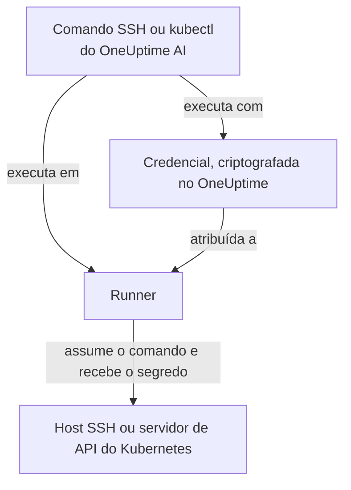

# Acesso da IA

O acesso da IA é como os próprios comandos do OneUptime AI alcançam algo que **não** é o host do próprio Runner: um servidor por SSH, ou o servidor de API de um cluster Kubernetes que não roda o chart do agente do Kubernetes. Cada acesso é uma credencial: esse acesso como objeto gerenciado, criptografado em repouso, atribuído a Runners específicos e escolhido pelo OneUptime AI em vez de escrito em um comando. As etapas de runbook não as usam: uma etapa SSH ou kubectl entra com uma [variável de runbook](/docs/runbooks/variables) secreta. Um Runner anterior a esta versão é a exceção: ele executa uma etapa Kubernetes levada a script a partir de uma ação com a credencial que a etapa nomeava, até que o script ou o kubeconfig da etapa mude.

Gerencie-as em **Runbooks → Agentes de runbook → Acesso da IA**.

:::cards
- [Criar uma credencial](#criar-uma-credencial): O acesso dela e os Runners que podem usá-la.
- [Privilégio mínimo do outro lado](#privilégio-mínimo-do-outro-lado): Limitar o que a chave ou o token pode fazer.
- [Runners que executam os comandos do OneUptime AI](#runners-que-executam-os-comandos-do-oneuptime-ai): Quem pode dar uma credencial SSH a um Runner assim.
:::

## Como uma credencial é usada

O OneUptime AI executa um comando SSH com uma das credenciais SSH atribuídas ao Runner em que roda, e um comando kubectl para um cluster que não roda o chart do agente do Kubernetes com a credencial do Kubernetes vinculada a esse cluster, como mostra [SRE com IA](/docs/ai/ai-sre). Quando o Runner assume o comando, o OneUptime verifica se a credencial está atribuída a ele, descriptografa o segredo e o entrega só na resposta a essa solicitação. O segredo nunca é guardado no job e nunca pode ser lido pela API.

## Antes de começar

- **Uma função que gerencia credenciais.** Project Owner e Project Admin, ou qualquer pessoa com a permissão **Create Runbook Credential**. A função Runbook Admin não a inclui. Atribuir uma credencial SSH a um Runner que executa os comandos do OneUptime AI também exige **Read Runbook Credential**; consulte [Runners que executam os comandos do OneUptime AI](#runners-que-executam-os-comandos-do-oneuptime-ai).
- **Um plano que as inclua.** No OneUptime Cloud, as credenciais de runbook exigem o plano **Growth** ou superior.
- **Um [Runner](/docs/runbooks/agents)** que alcance pela rede o host ou o servidor de API do cluster.

## Criar uma credencial

:::steps
### Abrir o acesso da IA

Abra **Runbooks → Agentes de runbook → Acesso da IA** e clique em **Criar: Credential**.

### Dar um nome e escolher o tipo

Na etapa **Credential**, informe um **Nome**, como `prod-cluster`, uma **Descrição** opcional e o **Tipo**: **SSH** ou **Kubernetes**. O tipo não pode ser alterado depois; crie uma nova credencial em vez disso.

### Informar o acesso

:::tabs
@tab SSH
Em **Host SSH**, informe o **Nome do host**, a **Porta** (22 se ficar vazia) e o **Nome de usuário**. Em **Autenticação SSH**, escolha como **Entrar com**: uma **Chave privada**, a melhor opção quando você pode escolher, e cole a **Private Key (PEM)**, com sua **Private Key Passphrase** se houver; ou uma **Senha**, para um host sem acesso por chave, e informe a **Senha**.
@tab Kubernetes
Em **Kubernetes**, informe a **API Server URL**, como `https://10.0.0.1:6443`, o **Service Account Token** e o **CA Certificate (PEM)** para que o Runner possa verificar o servidor de API. Deixe a CA vazia só se o servidor de API apresentar um certificado em que o Runner já confia.
:::

### Atribuí-la a Runners

Na etapa **Agentes de runbook**, escolha os Runners que podem usar a credencial e clique em **Criar: Credential**. Uma credencial não atribuída a nenhum Runner não pode ser usada por nenhum comando.

### Deixar o OneUptime AI usá-la

O OneUptime AI executa seus comandos SSH em um Runner com **Executa comandos de remediação por IA** ligado, com uma das credenciais SSH atribuídas a ele. Uma credencial do Kubernetes é usada assim que é vinculada, com um dos seus Runners, a um cluster: veja [SRE com IA](/docs/ai/ai-sre).
:::

## O que é guardado

| Tipo | Campos |
| --- | --- |
| SSH | Nome do host, porta (22 por padrão), nome de usuário e uma chave privada PEM (com senha opcional) ou uma senha. |
| Kubernetes | URL do servidor de API, um token de conta de serviço e o certificado da CA do cluster. |

## Os valores secretos são só de escrita

Chaves privadas, senhas de chave, senhas e tokens de conta de serviço são criptografados em repouso e a API **nunca os devolve**: nem ao painel, nem a um workflow, nem a uma exportação. A tabela pode mostrar o que uma credencial *é* sem nunca mostrar o que ela contém.

Por isso não existe "ver" para um valor secreto, só "substituir": informar o valor de novo é a forma de trocá-lo. Se você perder o original, emita uma nova chave no sistema de destino e atualize a credencial.

## Atribuir uma credencial a Runners

Uma credencial só pode ser usada pelos Runners aos quais você a atribui. Um comando que indica uma credencial não atribuída ao seu Runner **falha em vez de ser executado** — um Runner que silenciosamente não faz nada parece exatamente um que funcionou.

A atribuição é a fronteira de acesso, então mantenha-a estreita: um Runner que só reinicia um cluster não precisa da chave SSH dos seus hosts de banco de dados.

### Runners que executam os comandos do OneUptime AI

Em um Runner com **Executa comandos de remediação por IA** ligado, o OneUptime AI escolhe entre as credenciais SSH atribuídas ao Runner para os comandos que executa ali. Por isso uma credencial SSH só chega a um Runner assim por meio de alguém que pode ler as credenciais de runbook (**Read Runbook Credential**, ou um Project Owner ou Project Admin), seja qual for o que é salvo primeiro:

- **Atribuir a credencial.** Criar uma credencial SSH com um Runner assim, ou adicionar um Runner assim a uma credencial, exige essa permissão. Sem ela, o salvamento é recusado e nomeia o Runner: atribua a credencial a Runners que não executam comandos de remediação por IA, ou peça a alguém com a permissão que a atribua.
- **Ligar o interruptor.** Ligar **Executa comandos de remediação por IA** em um Runner que tem credenciais SSH exige a mesma permissão.

Remover Runners de uma credencial, salvar uma credencial com os Runners que ela já tem e as credenciais Kubernetes não pedem nada além disso: os comandos kubectl do OneUptime AI rodam com a credencial vinculada ao seu cluster. Atribuições de credenciais e o ligamento do interruptor por alguém sem essa permissão são salvos um de cada vez em um projeto, para que os dois não passem juntos nas verificações; um salvamento que chega enquanto outro está sendo salvo espera por ele e, se demorar demais, é recusado com *Try again in a moment*. Salve de novo.

As etapas de um workflow agem como Project Admin, mas não recebem emprestada a leitura de credenciais de runbook de um Project Admin: uma etapa só a tem se a pessoa que salvou por último as etapas do workflow a tiver. Consulte [O que as etapas de um workflow podem fazer](/docs/workflows/configuration#o-que-os-passos-de-um-workflow-podem-fazer).

## Privilégio mínimo do outro lado

O OneUptime não pode restringir o que sua credencial pode fazer no sistema de destino: isso cabe ao sistema de destino, e vale a pena fazer:

- **SSH** — prefira uma chave a uma senha, dê ao usuário só os comandos de que ele precisa (um comando forçado ou um shell restrito quando for prático) e não reutilize a chave pessoal de um administrador.
- **Kubernetes** — vincule a conta de serviço a um Role que permita só o que você deixa o OneUptime AI fazer, nos namespaces em que ele pode agir. Uma conta de serviço que só pode ler deixa o OneUptime AI investigar e recusa qualquer correção.

## Quem pode vê-las

Criar, editar e excluir credenciais exige as permissões de credenciais de runbook (ou Project Owner/Admin). Ler uma credencial mostra só seus campos não secretos.

Observe que a **chave de agente** de um Runner equivale às credenciais atribuídas a ele: qualquer coisa que tenha a chave pode assumir trabalho como esse Runner e receber material de credenciais. Por isso as chaves de agente só podem ser lidas por Project Owners, Project Admins e Runbook Admins: trate-as como você trataria as próprias credenciais.

## Próximos passos

:::cards
- [Variáveis de runbook](/docs/runbooks/variables): Os segredos com que as etapas SSH e kubectl entram.
- [Agentes de runbook](/docs/runbooks/agents): Instalar o Runner ao qual uma credencial é atribuída.
- [Configuração e segurança de runbooks](/docs/runbooks/configuration): Permissões e proteção para toda a pilha de runbooks.
:::
