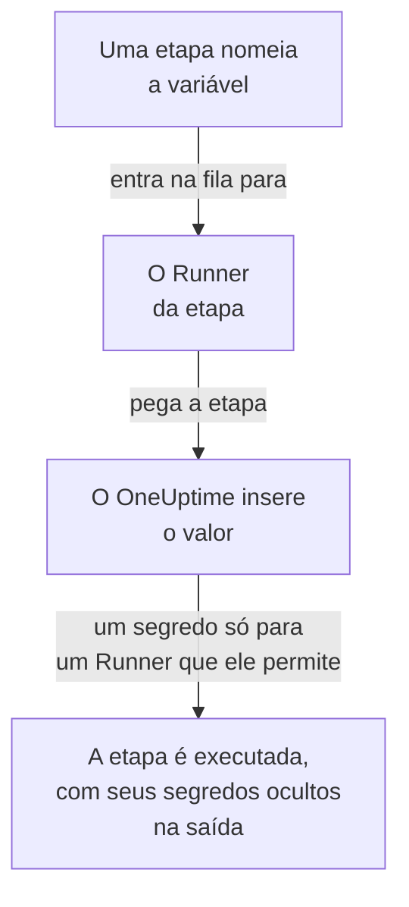

# Variáveis de runbook

Uma variável de runbook é um valor que suas etapas usam pelo nome em vez de guardá-lo elas mesmas: um host, um namespace ou uma URL, ou um segredo como uma chave SSH, uma senha, um kubeconfig ou um token de API. Altere o valor uma vez, e cada etapa que o nomeia usa o novo na próxima execução. Um segredo é criptografado, nunca mais é exibido e fica oculto no que as etapas imprimem.

:::cards
- [Criar uma variável](#criar-uma-variável): Um valor simples, ou um segredo e os Runners que podem usá-lo.
- [Usar uma variável em uma etapa](#usar-uma-variável-em-uma-etapa): Em um script ou uma requisição HTTP, ou como login de uma etapa SSH e kubeconfig de uma etapa kubectl.
- [Quem recebe um segredo](#quem-recebe-um-segredo): Seus Runners, os Runners globais quando você permite, e o OneUptime para uma etapa de requisição HTTP.
:::

## Como uma variável chega a uma etapa



Uma etapa guarda o nome da variável, nunca o seu valor. Quando o Runner da etapa a pega, o OneUptime insere o valor - no script, na máquina e no login de uma etapa SSH, ou no kubeconfig de uma etapa kubectl - e o entrega apenas a esse Runner. Uma etapa que nomeia uma variável que não pode ter falha com o motivo, em vez de ser executada com o nome no lugar do valor.

As etapas Bash, JavaScript, SSH, kubectl e de requisição HTTP usam variáveis. As etapas de IA não as inserem. O OneUptime envia ele mesmo uma etapa de requisição HTTP, sem Runner, então a etapa recebe cada variável que nomeia, segredos também, e os oculta na resposta que registra.

## Variáveis globais e variáveis de runbook

| | Variáveis globais | As variáveis próprias de um runbook |
| --- | --- | --- |
| Gerenciadas em | **Runbooks → Configurações → Variáveis globais** | **Configurações → Variáveis** do runbook |
| Usadas por | Todo runbook do projeto | Apenas as etapas desse runbook |
| Escritas em uma etapa como | `{{global.variables.NAME}}` | `{{local.variables.NAME}}` |

Um nome é usado uma única vez, sem diferenciar maiúsculas de minúsculas, entre as variáveis globais do projeto, e uma vez entre as próprias de um runbook. Uma variável de um runbook pode ter o mesmo nome de uma global: cada uma é escrita do seu jeito.

## Antes de começar

- **Uma função que gerencia variáveis.** Project Owner e Project Admin, ou a permissão **Create Runbook Variable**. Runbook Admin lê as variáveis, para escolhê-las nas etapas que escreve, mas não as altera.
- **Um plano que as inclua.** No OneUptime Cloud, as variáveis de runbook precisam do plano **Growth** ou superior.

## Criar uma variável

:::steps
### Abrir as variáveis

Abra **Runbooks → Configurações → Variáveis globais**, ou **Configurações → Variáveis** de um runbook, e clique em **Criar: Variável**.

### Dar um nome e informar o valor

Na etapa **Variável**, informe um **Nome**: letras, números, hifens e sublinhados, até 100 caracteres, como `PROD_DB_SSH_KEY`. **Segredo** começa ativado: cole a chave, a senha, o token ou o kubeconfig em **Valor do segredo** e clique em **Próximo**. Para um valor que qualquer pessoa pode ler, como um host, desative **Segredo**, informe-o em **Valor** e clique em **Criar: Variável**. Uma **Descrição** opcional aguarda em **Mais campos**.

### Escolher quem pode usar um segredo

Na etapa **Quem pode usá-lo**, escolha seus Runners em **Seus Runners que podem usá-lo**. Em um servidor com [Runners globais](/docs/runbooks/agents#runners-globais), **Runners globais podem usá-lo** também permite que as etapas deste projeto executadas em um Runner global usem o segredo: começa ativado enquanto o projeto usa Runners globais. Um segredo precisa de um ou de outro. Clique em **Criar: Variável**.
:::

Se uma variável é um segredo não pode ser alterado depois. Em vez disso, exclua-a e crie-a de novo com o mesmo nome: as etapas nomeiam as variáveis pelo nome, então continuam funcionando. O Runner interno de um cluster, o que o chart do agente do Kubernetes instala, nunca recebe um segredo.

## Valores secretos são somente de escrita

O valor de um segredo é criptografado em repouso e a API **nunca o devolve**: nem ao painel, nem a um workflow, nem a uma exportação. A lista mostra **Segredo** onde uma variável simples mostra seu valor, e sua coluna **Agentes de runbook** diz quais Runners recebem cada segredo. Para alterá-lo, clique em **Substituir valor** na linha dele: o novo valor é criptografado, o antigo some para sempre e as etapas recebem o novo na próxima execução.

Quando uma etapa imprime um segredo que recebeu, o Runner o substitui por `[REDACTED]` antes que a saída deixe seu host, e o OneUptime faz isso de novo antes de guardar a saída. Uma linha de uma chave privada, ou o token de um kubeconfig, também fica oculta. Um segredo com menos de 4 caracteres não é procurado.

## Usar uma variável em uma etapa

:::tabs
@tab Em um script
Escreva a referência onde o valor deve ficar, em um script Bash, JavaScript, SSH ou kubectl:

```bash
curl -s -X POST \
  -H "Authorization: Bearer {{global.variables.CDN_API_TOKEN}}" \
  "https://api.cdn.example.com/v1/purge"
```
@tab Em uma requisição HTTP
Escreva a referência na URL, nos headers ou no corpo de uma [etapa de requisição HTTP](/docs/runbooks/authoring#http-request):

```json
{ "Authorization": "Bearer {{global.variables.API_TOKEN}}" }
```
@tab Login SSH
Uma [etapa SSH](/docs/runbooks/authoring#ssh) escolhe em **Entrar com** a variável secreta que guarda sua chave privada ou senha, e em **Mais campos → Frase secreta da chave** a frase secreta da chave. O valor diz se é uma chave ou uma senha.
@tab Kubeconfig
Uma [etapa kubectl](/docs/runbooks/authoring#kubectl) escolhe em **Kubeconfig** a variável secreta que guarda o kubeconfig do cluster, ou **O acesso próprio do Runner** para usar o do Runner.
:::

Na página **Etapas** de um runbook, cada script e cada requisição HTTP listam em **Variáveis — clique para copiar** as variáveis que sua etapa pode usar, e o editor avisa quando uma etapa nomeia uma variável que não existe, ou um segredo que seu Runner não pode usar.

## Quem recebe um segredo

| Quem executa a etapa | Uma variável simples | Um segredo |
| --- | --- | --- |
| Um dos seus Runners | Sempre | Quando o segredo o lista em **Seus Runners que podem usá-lo** |
| Um Runner global | Sempre | Quando **Runners globais podem usá-lo** está ativado, para uma etapa do próprio projeto do segredo |
| O próprio OneUptime, para uma etapa de requisição HTTP | Sempre | Sempre |

Uma etapa que nomeia um segredo que seu Runner não pode usar falha, nomeando o segredo e o que mudar, e nada é entregue.

## Segredos e credenciais de runbook viraram variáveis

As variáveis de runbook tomaram o lugar dos segredos de runbook e das credenciais que as etapas SSH e Kubernetes nomeavam. Quando o OneUptime foi atualizado, o que cada projeto tinha foi movido uma vez, de modo que cada runbook é executado como antes:

- cada segredo de runbook virou uma variável global secreta com o mesmo nome, o mesmo valor, os mesmos Runners e o mesmo interruptor para Runners globais;
- `{{runbookSecrets.NAME}}` em um script foi reescrito como `{{global.variables.NAME}}`, e a forma antiga ainda lê a variável global `NAME`;
- cada credencial que uma etapa nomeava virou variáveis globais secretas com os mesmos Runners, nomeadas a partir dela: `<name>-ssh-key` (e `<name>-ssh-key-passphrase`, para uma chave que tinha uma), `<name>-ssh-password` ou `<name>-kubeconfig`;
- cada etapa SSH que nomeava uma credencial entra na sua máquina com elas e executa seu comando como script, e cada etapa Kubernetes virou uma etapa kubectl que executa o `kubectl patch` que sua ação fazia, sem precisar de mais acesso do que a etapa tinha.

Um Runner anterior a esta versão (14.0.79) não consegue executar um script kubectl: ele faz uma etapa kubectl falhar e avisa que o Runner precisa ser atualizado. Cada etapa Kubernetes levada a essa forma manteve primeiro sua credencial e sua ação ao lado do script, para um Runner assim; elas foram embora com as credenciais de runbook, então toda etapa kubectl precisa de um Runner da 14.0.79 ou posterior.

As credenciais de runbook foram removidas depois, e uma etapa que ainda nomeava uma foi levada antes à mesma forma. Uma etapa que nomeia uma credencial não é mais executada, e sua página de etapas oferece **Transformar em etapa de script**; um salvamento pela API ou pelo Terraform que dá uma a uma etapa é recusado. Veja [As credenciais de runbook foram removidas](/docs/installation/upgrading#as-credenciais-de-runbook-foram-removidas).

## Próximos passos

:::cards
- [Criar um runbook](/docs/runbooks/authoring): Escreva as etapas SSH e kubectl que usam uma variável.
- [Agentes de runbook](/docs/runbooks/agents): Instale o Runner ao qual um segredo é entregue.
- [Configuração e segurança de runbooks](/docs/runbooks/configuration): Permissões e proteção de toda a pilha de runbooks.
:::
