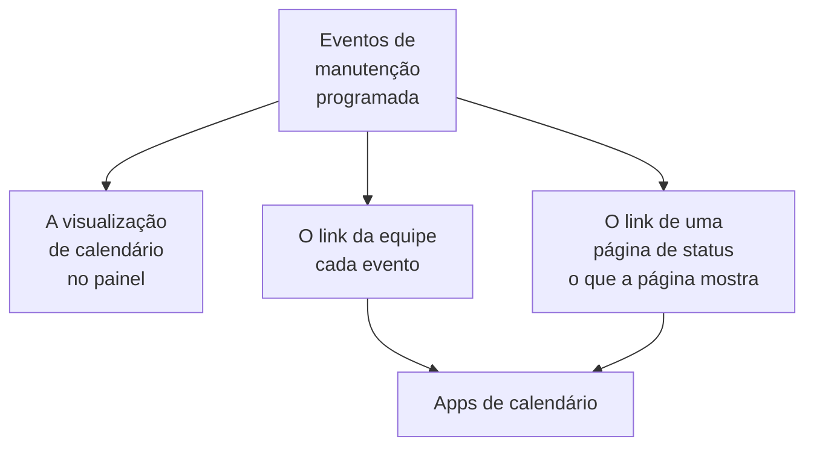

# Calendário de manutenção

O calendário de manutenção mostra a sua manutenção programada por data: como um calendário no painel, nos apps de calendário da sua equipe por meio de um link secreto e nos calendários das pessoas que acompanham as suas páginas de status. Esta página explica a visualização de calendário, o link de calendário da equipe, o calendário de uma página de status e o que cada evento do calendário contém.

:::cards
- [A visualização de calendário](#a-visualização-de-calendário): Cada evento em um mês, uma semana ou um dia, na cor do seu estado.
- [O link de calendário da equipe](#o-link-de-calendário-da-equipe): Cada evento do projeto no Google Agenda, no Outlook ou no Calendário da Apple.
- [O calendário de uma página de status](#o-calendário-de-uma-página-de-status): O que uma página de status mostra, nos calendários dos seus visitantes.
- [O que um evento do calendário contém](#o-que-um-evento-do-calendário-contém): O título, a janela, o estado e um link de volta.
:::



## A visualização de calendário

Abra **Manutenção programada → Todos os eventos**. Na extremidade direita da barra de filtros, **Lista** e **Calendário** alternam entre a tabela de eventos e um calendário deles. O seu navegador lembra a escolha, então a página abre no calendário da próxima vez.

- O calendário abre no mês atual, com o dia de hoje marcado. **Mês**, **Semana** e **Dia** mudam o quanto ele mostra; navegue com as setas e volte com **Hoje**. Os horários ficam no seu próprio fuso horário.
- Cada evento é um bloco na cor do seu estado, e as cores dos estados são indicadas abaixo do calendário. Clique em um evento para abri-lo.
- Os filtros acima do calendário funcionam como na lista: escolha um estado, um rótulo ou um responsável para ver só esses eventos.
- Um dia que ainda está por vir mostra um **+** quando você aponta para a semana dele. Ele abre **Criar Evento de Manutenção Programada** com **Começa em** nesse dia, na hora que o formulário escolheria hoje. Você só o vê se puder criar eventos.
- Uma visualização mostra até 500 eventos. Um mês mais cheio avisa: restrinja-o com os filtros ou olhe uma semana.

## O link de calendário da equipe

**Subscrever o calendário**, abaixo do calendário ou no menu **⋯** da lista, abre o link de calendário do projeto: um único link iCalendar (`.ics`) secreto que coloca cada evento de manutenção programada do projeto no Google Agenda, no Outlook, no Calendário da Apple ou em qualquer app que assine um calendário por URL.

:::steps
### Publique o link

Clique em **Publicar link**. Um projeto tem um único link, para a equipe toda, então isso só é preciso uma vez.

### Adicione-o ao seu app de calendário

**Google Agenda** abre o Google Agenda, que pergunta se deve adicionar o calendário. **Calendário da Apple / Outlook** abre o link no app de calendário do seu computador ou celular. **Copiar link** o copia para qualquer outro app.

### Verifique se funciona

O painel **Status** diz quando um app de calendário leu o link pela última vez, e qual. Um link novo mostra **A aguardar a primeira sincronização** até que um app o leia.
:::

O link tem esta aparência:

```text
https://<your host>/api/scheduled-maintenance-calendar/project/<token>/maintenance.ics
```

> [!WARNING]
> Qualquer pessoa com o link vê cada evento de manutenção programada do projeto, sem entrar. Trate-o como uma senha e gere-o de novo se ele for compartilhado por engano.

### Quem pode ver o link

O link mostra cada evento do projeto, então a caixa de diálogo só o mostra a quem pode ler cada evento. Quem tem um papel limitado a alguns eventos, por rótulo ou aos eventos de que é responsável, é informado do motivo.

| Ação | Quem pode fazer |
| --- | --- |
| Copiar o link | Quem pode ler cada evento de manutenção programada do projeto |
| **Publicar link** | Quem também pode criar eventos de manutenção programada |
| **Regenerar link**, **Desativar link** | Quem também pode editar eventos de manutenção programada |

### Gerenciar o link

**Regenerar link** e **Desativar link** ficam no menu **⋯** no topo da caixa de diálogo.

| Ação | O que acontece |
| --- | --- |
| **Regenerar link** | Cria um link novo. Durante 30 dias o antigo entrega um calendário vazio, para que os apps que o têm limpem a cópia deles; depois disso ele não é encontrado. Assine de novo com o link novo. |
| **Desativar link** | Mantém o link, mas ele entrega um calendário vazio até **Ativar link**. |

O calendário contém cada evento de 90 dias atrás até um ano à frente, até 1.000 eventos.

## O calendário de uma página de status

As pessoas que acompanham uma página de status podem colocar a manutenção programada dela no próprio calendário. Na página de eventos programados da página de status, **Subscrever o calendário** oferece o Google Agenda, o app de calendário do dispositivo delas ou o link para copiar. O link é o endereço da página seguido de `/maintenance.ics`, como `https://status.example.com/maintenance.ics`.

- **O que ele contém.** Exatamente o que a página mostra: os eventos da janela de histórico da página, cada evento que ainda vai começar e cada um em andamento, enquanto **Visível na página de status** estiver ativado. O que cada evento afeta é nomeado como a página nomeia os seus recursos, nunca pelos nomes dos seus monitores.
- **Uma página privada.** Um app de calendário não consegue entrar, então uma página privada não oferece **Subscrever o calendário**, e o link dela entrega um calendário vazio que diz que a página é privada.
- **Um evento.** **Adicionar ao calendário** na página de um evento adiciona só esse evento: o Google Agenda abre com ele preenchido, ou ele é baixado como um arquivo que o app de calendário do dispositivo abre. Funciona também em uma página privada, para um visitante que entrou, e não é oferecido depois que o evento termina.

## O que um evento do calendário contém

Todo calendário, o da equipe e o de uma página de status, escreve um evento da mesma forma.

| Parte | O que contém |
| --- | --- |
| Título | O título do evento |
| Início e fim | A janela planejada, em UTC; o app de calendário a mostra no seu próprio fuso horário |
| Descrição | A descrição em texto simples, o estado, o que ele afeta e um link para o evento; o link da equipe também nomeia as páginas de status dele |
| Status | Cancelado quando o evento foi cancelado: concluído sem nunca ter estado em andamento |
| Livre ou ocupado | Livre, para que uma janela de manutenção nunca bloqueie a sua disponibilidade |
| Categorias | Os rótulos dele; o calendário de uma página de status só os mostra quando a página mostra rótulos |

Um evento editado no OneUptime é atualizado no lugar em cada calendário que o contém, e um que é excluído, ou retirado de uma página de status, sai do calendário na próxima atualização.

## Com que frequência os calendários atualizam

Os apps de calendário leem um link assinado no seu próprio ritmo. O Google Agenda faz isso a cada poucas horas, às vezes só uma vez por dia; o Calendário da Apple e o Outlook geralmente a cada hora. O OneUptime guarda um calendário por no máximo cinco minutos, então a espera que você vê é a do app de calendário. Os passos de cada app estão em [Feeds de calendário](/docs/on-call/calendar-feeds#assine-no-seu-app-de-calendário), que funcionam da mesma forma para os turnos de plantão.

## Solução de problemas

:::details O app de calendário parou de mostrar eventos novos
O link foi gerado de novo ou desativado: abra **Subscrever o calendário** para ver o status dele. Um link gerado de novo precisa ser assinado outra vez com o link novo; um link desativado volta com **Ativar link**.
:::

:::details O Google Agenda não consegue adicionar o link
O Google Agenda lê o link a partir dos servidores do Google, então o servidor do OneUptime precisa ser acessível pela internet. Veja [Feeds de calendário](/docs/on-call/calendar-feeds#solução-de-problemas) para um servidor auto-hospedado.
:::

:::details Um evento não aparece no calendário de uma página de status
O calendário da página contém o que a página mostra. Verifique se o evento nomeia a página, se **Visível na página de status** está ativado nas **Configurações** dele e se ele começou dentro da janela de histórico da página.
:::

## Próximos passos

:::cards
- [Criar eventos de manutenção](/docs/scheduled-maintenance/creating-events): O formulário, campo por campo, e o que acontece em seguida.
- [Assinantes e comunicados](/docs/status-pages/subscribers#eventos-de-manutenção-programada): O que os assinantes de uma página de status ficam sabendo sobre manutenção.
- [Feeds de calendário](/docs/on-call/calendar-feeds): O mesmo tipo de link, para os turnos de plantão.
:::
