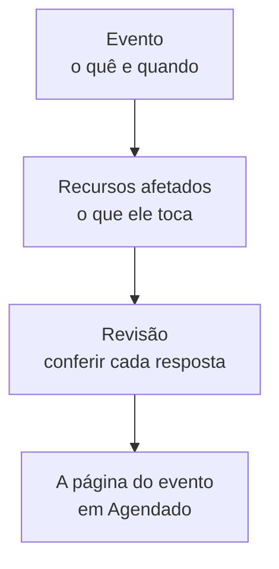

# Criar eventos de manutenção

Agende uma manutenção em dois passos curtos: diga o que acontece e quando, depois o que ela afeta e quem deve saber. Só o título precisa ser digitado; todo o resto começa com um padrão sensato. Esta página percorre o formulário, o que acontece no momento em que você cria um evento, como alterá-lo depois e como criar eventos pelo código.

:::cards
- [Criar um evento](#criar-um-evento): Dois passos e uma revisão.
- [O que acontece ao criar](#o-que-acontece-ao-criar): Seu número, regras, proprietários e as primeiras mensagens.
- [Alterar um evento depois](#alterar-um-evento-depois): Sua janela, recursos, páginas de status e notas.
- [Criar eventos pelo código](#criar-eventos-pelo-código): A API, o Terraform, os workflows e o chat.
:::

## Como funciona

O formulário faz duas perguntas, uma por passo, e depois mostra tudo em uma revisão antes de criar o evento. O evento começa no seu estado agendado, e a página dele se abre.



## Antes de começar

- **Sua função.** Criar um evento requer **Proprietário do projeto**, **Administrador do projeto**, **Membro do projeto**, **Administrador de manutenção programada** ou **Membro de manutenção programada**, ou uma função personalizada com **Create Scheduled Maintenance**.
- **Suas páginas de status.** Para avisar os clientes, você precisa de uma página de status que mostre eventos de manutenção programada. Veja [Visão geral das páginas de status](/docs/status-pages/index).

## Criar um evento

:::steps
### Abrir o formulário

Vá em **Manutenção programada → Todos os eventos** e clique em **Criar Evento de Manutenção Programada**. O formulário abre no primeiro passo, **Evento**.

### Dizer o que acontece e quando

Digite um **Título** e adicione uma **Descrição** se ajudar: ela é em Markdown e aparece nas suas páginas de status. **Começa em** já está na próxima hora cheia do seu relógio, e **Termina em** uma hora depois; mude-os só se estiverem errados. Mover **Começa em** move **Termina em** junto, para que a janela mantenha sua duração. **Proprietários** e **Rótulos** ficam recolhidos em **Mais campos**.

### Escolher o que ele afeta

Clique em **Próximo** para chegar a **Recursos afetados**. Escolha os **Monitores** que o trabalho toca. Assim que você escolhe um, **Alterar status do monitor para** aparece abaixo deles: o status para o qual os monitores mudam quando o evento começa. Depois escolha os **Outros recursos afetados** que houver, como hosts, clusters, bancos de dados, sites de rede ou serviços.

### Escolher quem fica sabendo

Escolha as páginas de status em **Mostrar evento nestas páginas de status**. **Notificações aos assinantes**, recolhido, diz em uma linha quem é avisado e quando; abra-o para mudar **Quando o evento é agendado**, **Quando o evento começa**, **Quando o evento termina** ou **Lembretes antes do evento**.

### Criá-lo

Clique em **Próximo** para ver a revisão, confira-a e depois clique em **Criar Evento de Manutenção Programada**. A página do evento se abre.
:::

Nada é enviado até você escolher uma página de status: um evento que não aparece em nenhuma página de status não avisa nenhum assinante.

## Os campos do formulário

| Campo                                | Passo              | Começa como                     | O que faz                                                                        |
| ------------------------------------ | ------------------ | ------------------------------- | -------------------------------------------------------------------------------- |
| **Título**                           | **Evento**         | Vazio, e obrigatório            | Dá nome ao evento em todo lugar, também nas suas páginas de status.              |
| **Descrição**                        | **Evento**         | Vazia                           | Explica o trabalho aos seus clientes, em Markdown.                               |
| **Começa em**                        | **Evento**         | A próxima hora cheia            | Quando o evento começa, sozinho.                                                 |
| **Termina em**                       | **Evento**         | Uma hora depois de **Começa em** | Quando o evento termina, sozinho. Precisa vir depois de **Começa em**.          |
| **Proprietários**                    | **Evento**         | Ninguém                         | Pessoas e equipes donas do evento, que são avisadas sobre ele.                   |
| **Rótulos**                          | **Evento**         | Nenhum                          | Rótulos que regras e filtros podem usar.                                         |
| **Monitores**                        | **Recursos afetados** | Nenhum                       | Os monitores que não são verificados enquanto o evento está em andamento.        |
| **Alterar status do monitor para**   | **Recursos afetados** | Sem alteração                | O status que esses monitores mostram durante o evento. Perguntado assim que um monitor é escolhido. |
| **Outros recursos afetados**         | **Recursos afetados** | Nenhum                       | Hosts, clusters, bancos de dados, sites de rede, serviços e mais.                |
| **Mostrar evento nestas páginas de status** | **Recursos afetados** | Nenhuma            | As páginas de status que mostram o evento e avisam seus assinantes.              |
| **Notificações aos assinantes**      | **Recursos afetados** | Os três momentos ativados, sem lembretes | Quando os assinantes dessas páginas são avisados.            |

Duas coisas preenchem o formulário para você no caminho:

- **Recursos vinculados.** Quando você escolhe um monitor, os hosts, clusters, serviços e outros recursos aos quais ele está vinculado são adicionados em **Outros recursos afetados**, e uma linha abaixo do campo os nomeia. Remova os que você não quiser.
- **Páginas de status sugeridas.** Em **Mostrar evento nestas páginas de status**, são sugeridas as páginas que mostram seus monitores: clique no nome de uma página para adicioná-la, ou em **Adicionar todas**. Nada é escolhido por você. Veja [Eventos de manutenção programada](/docs/status-pages/subscribers#eventos-de-manutenção-programada).

## Começar por um recurso ou um modelo

Na aba **Manutenção programada** de um host, um cluster Kubernetes, Proxmox, Ceph ou Docker Swarm, um host Docker ou Podman, um vCenter, um storage array, uma frota de IoT, um banco de dados, um serviço ou um site de rede, **Criar Evento de Manutenção Programada** abre o mesmo formulário com esse recurso já escolhido em **Outros recursos afetados**, e a aba lista os eventos que o afetam. A aba de um item de inventário escolhe o host, o serviço ou o cluster Kubernetes para o qual o item aponta.

**Criar a partir de modelo**, ao lado do botão de criar, pede que você use **Selecionar Modelo de Manutenção Programada** e depois abre o formulário preenchido a partir do modelo. Veja [Modelos e eventos recorrentes](/docs/scheduled-maintenance/templates).

## O que acontece ao criar

No momento em que você clica em **Criar Evento de Manutenção Programada**, o OneUptime percorre estes passos, nesta ordem:

1. **Ele recebe um número e um estado.** O número vem de um contador por projeto e aparece com o seu prefixo (`SM-42`). O evento começa no seu estado agendado, qualquer que seja o estado indicado por uma requisição.
2. **Suas ferramentas de chat ficam sabendo.** As regras do Slack e do Microsoft Teams em **Espaço de trabalho** o publicam nos canais delas, e uma regra pode criar um canal para o evento. O feed dele registra que foi criado.
3. **Sua linha do tempo de estado começa.** A primeira linha da **Linha do tempo de estado** dele é o seu estado agendado.
4. **Proprietários e rótulos são adicionados**: os que você escolheu, depois os das regras de proprietário e de rótulos que correspondem.
5. **As regras de runbook iniciam** os runbooks que correspondem ao evento.
6. **Os lembretes são agendados**, quando uma regra de lembrete corresponde, para os proprietários dele.

Em até um minuto, os assinantes das páginas de status dele são avisados de que foi agendado, a menos que você tenha desativado **Quando o evento é agendado**. O gatilho de workflow **On Create Scheduled Maintenance Event** inicia qualquer workflow construído sobre ele, e os proprietários ficam sabendo se ativaram essa notificação: veja [Configurações de notificação](/docs/notifications/notification-settings).

## Alterar um evento depois

Tudo o que está no formulário pode ser alterado nas páginas do evento, exceto os três momentos dos assinantes, definidos uma única vez, quando o evento é criado.

| Para alterar                                | Vá em                                                                          |
| ------------------------------------------- | ------------------------------------------------------------------------------ |
| O título, a janela ou os rótulos            | **Editar** no cartão **Maintenance Details** da sua **Visão geral**, passo **Evento** |
| As páginas de status ou os lembretes        | O mesmo **Editar**, passo **Páginas de status**                                 |
| Os monitores, o status deles ou outros recursos | **Editar** no cartão **Recursos afetados**                                  |
| A descrição                                 | **Descrição** no menu lateral dele                                             |
| Os proprietários                            | **Proprietários** no menu lateral dele                                         |

**Alterar status do monitor para** pode ser alterado até o evento começar. Depois disso, o cartão o mostra só para leitura, porque os monitores já estão nesse status. Uma edição adiciona ao **Agendado Manutenção Feed** uma entrada que nomeia o que ela mudou; salvar sem mudar nada não adiciona nenhuma.

## Publicar notas enquanto o trabalho avança

- As **Notas públicas** são atualizações para os seus clientes: aparecem nas páginas de status do evento, e cada uma pode avisar os assinantes delas com **Notify status page subscribers**.
- As **Notas privadas** são só para a sua equipe.

Escreva uma na página **Notas públicas** ou **Notas privadas** do evento, ou pelo menu **Ações** do **Agendado Manutenção Feed** com **Add Public Note** ou **Adicionar nota privada**. O mesmo menu executa um runbook com **Execute Runbook**. Um modelo de nota preenche um texto que a sua equipe escreve com frequência: veja [Regras e configurações da manutenção](/docs/scheduled-maintenance/settings#modelos-de-notas).

## Criar eventos pelo código

O modelo de evento tem uma API padrão, então `POST /api/scheduled-maintenance` cria um evento. Autentique-se com uma chave de API de **Configurações do projeto → Avançado → Chaves de API**, enviada no cabeçalho `apikey`; a chave identifica o projeto.

```bash
curl -X POST https://oneuptime.com/api/scheduled-maintenance \
  -H "apikey: $ONEUPTIME_API_KEY" \
  -H "Content-Type: application/json" \
  -d '{
    "data": {
      "title": "Database upgrade",
      "description": "Writes pause for a few minutes while the primary restarts.",
      "startsAt": "2030-06-01T02:00:00Z",
      "endsAt": "2030-06-01T04:00:00Z"
    }
  }'
```

| Campo                                                 | Observações                                                                               |
| ----------------------------------------------------- | ----------------------------------------------------------------------------------------- |
| `title`, `startsAt`, `endsAt`                          | Obrigatórios, como no formulário.                                                         |
| `monitors`, `statusPages`, `labels`                   | Os monitores, as páginas de status e os rótulos do evento, todos do projeto da chave de API. |
| `changeMonitorStatusToId`                             | O status de monitor para o qual seus monitores mudam quando ele começa.                   |
| `currentScheduledMaintenanceStateId`                  | Ignorado: todo evento começa no seu estado agendado.                                      |
| `shouldStatusPageSubscribersBeNotifiedOnEventCreated` | A chave **Quando o evento é agendado**. Os outros dois momentos têm campos próprios.      |

O mesmo evento como código é o recurso do Terraform `oneuptime_scheduled_maintenance_event`: veja [Exemplos](/docs/terraform/examples#manutenção-programada). Um workflow cria um com a etapa **Create One Scheduled Maintenance Event**, e `/oneuptime maintenance` abre o formulário no Slack: veja [Slack](/docs/workspace-connections/slack#criar-incidentes-e-manutenções-pelo-slack).

## Solução de problemas

:::details Termina em diz que precisa vir depois de Começa em
A janela precisa estar em ordem: o evento termina depois de começar. Mova primeiro **Começa em**, já que **Termina em** o acompanha, e depois ajuste **Termina em**.
:::

:::details Alterar status do monitor para não aparece no formulário
Ele só é perguntado quando o evento tem um monitor. Escolha um em **Monitores**, e ele aparece logo abaixo.
:::

:::details Alterar status do monitor para não pode mais ser alterado
O evento começou, e seus monitores já estão nesse status. O status vale do momento em que o evento começa até ele terminar.
:::

## Próximos passos

:::cards
- [Estados da manutenção](/docs/scheduled-maintenance/states): O que inicia e encerra um evento, e como movê-lo à mão.
- [Modelos e eventos recorrentes](/docs/scheduled-maintenance/templates): Salve as respostas do formulário para a próxima vez.
- [Assinantes e comunicados](/docs/status-pages/subscribers#eventos-de-manutenção-programada): Exatamente quem é avisado, e quando.
- [Regras e configurações da manutenção](/docs/scheduled-maintenance/settings): Adicione proprietários, rótulos e lembretes automaticamente.
:::
