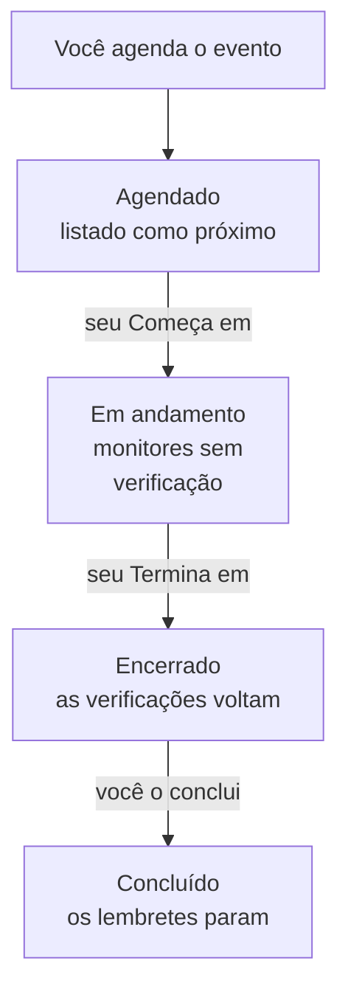

# Visão geral da manutenção programada

Um evento de manutenção programada avisa todos sobre um trabalho planejado antes que ele aconteça: uma atualização do banco de dados, uma mudança na rede, uma mudança para novos servidores. O OneUptime inicia e encerra o evento no horário, deixa de verificar os monitores afetados enquanto o trabalho acontece e o mostra nas suas páginas de status, para que uma parada planejada nunca pareça uma queda. Esta página explica como um evento transcorre, onde fica tudo no painel e o que um evento muda no restante do OneUptime.

:::cards
- [Como um evento transcorre](#como-um-evento-transcorre): De agendado a concluído, quase sempre sozinho.
- [De onde vêm os eventos](#de-onde-vêm-os-eventos): O formulário, os modelos, um agendamento, os formulários, o chat e o código.
- [O que um evento afeta](#o-que-um-evento-afeta): Monitores, páginas de status, assinantes e alertas.
- [As páginas de um evento](#as-páginas-de-um-evento): Sua visão geral, linha do tempo, notas e configurações.
:::

## Como um evento transcorre

Todo evento tem uma janela planejada, seu **Começa em** e seu **Termina em**, e desce pela sua lista de estados de manutenção. Uma tarefa que roda a cada minuto o faz avançar nas duas pontas da janela, então você agenda o trabalho uma vez e o OneUptime faz o resto.

Um evento novo começa em **Agendado**. No seu **Começa em**, ele passa para **Em andamento**: o OneUptime deixa de verificar seus monitores e, se você escolheu um status para eles, os mostra nesse status. No seu **Termina em**, ele passa para **Encerrado**: as verificações voltam e cada monitor volta a «operacional». **Concluído** é o último passo, e nada o dá sozinho: uma pessoa, um botão de chat ou a API marca o trabalho como aprovado, o que também interrompe os lembretes aos proprietários.

Você pode iniciar ou encerrar um evento mais cedo, ou adicionar estados próprios entre esses quatro. Veja [Estados da manutenção](/docs/scheduled-maintenance/states).

## Manutenção e comunicados

Os dois informam os visitantes das suas páginas de status. Use um evento de manutenção para um trabalho com início e fim, e um comunicado para qualquer outra coisa que eles devam ler.

|                              | Manutenção programada                                                   | Comunicado                                     |
| ---------------------------- | ----------------------------------------------------------------------- | ---------------------------------------------- |
| **O que é**                  | Um trabalho planejado, com uma janela                                   | Uma mensagem para os visitantes das suas páginas de status |
| **Seus monitores**           | Não são verificados enquanto ele acontece, e mostram o status escolhido | Sem alteração                                 |
| **Como avança**              | Pelos seus estados de manutenção, no horário                            | Aparece da hora de início até a hora de término, se tiver uma |
| **Quando os assinantes são avisados** | Quando é agendado, começa e termina, e antes de começar se você pedir | Uma vez, quando começa a aparecer      |
| **Números em um projeto novo** | `SM-42`                                                               | Nenhum                                         |

Os comunicados são tratados em [Assinantes e comunicados](/docs/status-pages/subscribers#anúncios).

## De onde vêm os eventos

- **O formulário.** Clique em **Criar Evento de Manutenção Programada** na lista de eventos, ou na aba **Manutenção programada** de um host, um cluster, um serviço, um site de rede ou outro recurso, que seleciona esse recurso para você. Veja [Criar eventos de manutenção](/docs/scheduled-maintenance/creating-events).
- **Um modelo.** **Criar a partir de modelo** preenche o formulário a partir de um modelo que você salvou para trabalhos frequentes. Veja [Modelos e eventos recorrentes](/docs/scheduled-maintenance/templates).
- **Um agendamento.** Um modelo recorrente cria um evento novo seguindo um agendamento, por exemplo toda semana ou todo mês, sem que ninguém abra o formulário.
- **Um formulário.** Um formulário cujos envios criam eventos de manutenção transforma um pedido de mudança em um evento. Veja [O que um envio cria](/docs/forms/on-submit#como-um-envio-se-torna-um-evento-de-manutenção-programada).
- **O chat.** `/oneuptime maintenance` no Slack, ou `maintenance` escrito para o bot do OneUptime no Microsoft Teams, abre o formulário na sua ferramenta de chat. Veja [Slack](/docs/workspace-connections/slack#criar-incidentes-e-manutenções-pelo-slack).
- **O código.** A API em `/api/scheduled-maintenance`, o recurso do Terraform `oneuptime_scheduled_maintenance_event` e a etapa **Create One Scheduled Maintenance Event** de um workflow.

## Onde fica a manutenção no painel

Abra **Manutenção programada** no menu **Produtos** da barra superior. A lista de eventos fica em `/dashboard/{projectId}/scheduled-maintenance-events`, e seu menu lateral reúne tudo sobre manutenção:

| Seção         | O que você faz ali                                                                                                         |
| ------------- | -------------------------------------------------------------------------------------------------------------------------- |
| **Visão geral** | **Todos os eventos** e **Eventos em andamento**, cujo selo conta os eventos em andamento neste momento.                  |
| **Calendário** | **Calendário de manutenção**: cada evento em um mês, uma semana ou um dia, ao lado dos calendários de fora do projeto que você adicionar. |
| **Espaço de trabalho** | **Slack** e **Microsoft Teams**, conforme o que o projeto conectou, ou **Conectar Slack ou Teams** quando não tem nenhum. |
| **Regras**    | **Regras de proprietário**, **Regras de runbook**, **Regras de Rótulos**, **Reminder Rules**.                               |
| **Configurações** | **Estado do evento**, **Modelos de eventos**, **Modelos de notas**, **Campos personalizados**, **Medições**, **Configurações do calendário**, **Numeração**. |

**Visão geral** e **Calendário** ficam abertas; **Espaço de trabalho**, **Regras**, **Configurações** e **Desenvolvedores** começam recolhidas, e uma seção se abre sozinha quando você está em uma de suas páginas. **Desenvolvedores** reúne **Terraform**, **API** e **Assistentes de IA**, para gerenciar a manutenção pelo código. Tudo sobre manutenção fica aqui, não nas **Configurações do projeto**.

A lista mostra **Número da manutenção programada**, **Título**, **Estado atual**, **Recursos afetados**, **Exibido na página de status**, **Começa em**, **Duração**, **Termina em**, **Rótulos** e **Proprietários**. Selecione eventos para agir sobre vários de uma vez: **Marcar como {{state}}**, **Alterar estado**, **Atribuir a mim**, **Add Owner**, **Remove Owner**, **Add Labels**, **Remove Labels** ou **Excluir**. O menu **⋯** no fim da linha de cada evento faz o mesmo só para esse evento: os passos **Marcar como {{state}}** enquanto o evento puder dá-los, **Alterar estado**, **Atribuir a mim** até você ser o proprietário e **Add Owner**.

**Calendário de manutenção**, na seção **Calendário**, mostra os mesmos eventos em um mês, uma semana ou um dia, e pode mostrar ao lado calendários de fora do projeto. Veja [Calendário de manutenção](/docs/scheduled-maintenance/calendar).

## O que um evento afeta

Enquanto um evento está em andamento, o OneUptime trata a queda que ele planeja como esperada:

- **Seus monitores não são verificados.** Cada monitor em **Monitores** deixa de ser verificado, e suas páginas dizem **Este monitor está desabilitado**. Se você escolheu um **Alterar status do monitor para**, os monitores mostram esse status, também nas suas páginas de status. Quando o evento termina, ou é excluído, as verificações voltam e cada monitor volta a «operacional», a menos que outro evento em andamento ainda o retenha.
- **Seus outros recursos ficam em silêncio.** Um monitor de telemetria que vigia muitos hosts, clusters, bancos de dados ou serviços, uma série cada, não cria incidente nem alerta para uma série cujo recurso o evento cobre, enquanto as outras séries continuam alertando.
- **Sites de rede e SLOs se seguram.** Um site de rede que o evento cobre deixa de contar a queda planejada contra os sites acima dele, e as regras de taxa de consumo de um SLO não disparam nada enquanto algum de seus monitores estiver em manutenção. Veja [Sites de rede](/docs/monitor/network-sites#manutenção-programada-para-sites-de-rede) e [Alertas e incidentes de taxa de consumo](/docs/slo/burn-rate-alerts#manutenção-programada).
- **Suas páginas de status o mostram.** O evento aparece nas páginas de status escolhidas, primeiro como próximo, depois em andamento, depois encerrado, enquanto **Visível na página de status** estiver ativado nas suas **Configurações**.
- **Os assinantes ficam sabendo.** Por padrão, os assinantes dessas páginas são avisados quando ele é agendado, quando começa e quando termina, e recebem um lembrete antes do início se você definir lembretes. Veja [Eventos de manutenção programada](/docs/status-pages/subscribers#eventos-de-manutenção-programada).
- **Sua equipe fica sabendo.** Seus proprietários são avisados conforme as [configurações de notificação](/docs/notifications/notification-settings) deles, e as regras do Slack e do Microsoft Teams em **Espaço de trabalho** o publicam nos seus canais.

## As páginas de um evento

Abra um evento na lista para ver suas páginas. Seu menu lateral reúne:

| Seção do menu lateral | Páginas                                                                                   |
| ----------------- | --------------------------------------------------------------------------------------------- |
| **Visão geral** | **Visão geral**, **Linha do tempo de estado**, **Descrição**, **Runbooks** |
| **Equipe** | **Proprietários** |
| **Notificações**     | **Logs de notificação** e **Registros de IA**: cada mensagem enviada sobre o evento, e o que a IA fez por ele |
| **Notas**         | **Notas privadas** e **Notas públicas**                                                        |
| **Desenvolvedores** | **Terraform**, **API** e **Assistentes de IA**: o evento gerenciado pelo código              |
| **Avançado**      | **Campos personalizados**, **Configurações**, **Registros de auditoria**, **Excluir evento**    |

**Visão geral**, **Equipe** e **Notas** ficam abertas; as outras seções começam recolhidas até você clicar nelas.

- **Visão geral** — o cabeçalho mostra o número, o título e o estado do evento, quanto falta para começar ou há quanto tempo ele dura, e os botões que o fazem avançar. Abaixo, **Começa**, **Termina** e **Duração** mostram a janela planejada no seu fuso horário. O **Agendado Manutenção Feed** registra tudo o que aconteceu com o evento, ao lado dos cartões **Maintenance Details** e **Recursos afetados**, e dos cartões **Medições** e **Campos personalizados** quando o seu projeto tem algum.
- **Linha do tempo de estado** — cada estado em que o evento esteve, quando e por quanto tempo. Veja [Estados da manutenção](/docs/scheduled-maintenance/states#a-linha-do-tempo-de-estado).
- **Notas públicas** — atualizações para suas páginas de status e os assinantes delas. As **Notas privadas** são só para a sua equipe.
- **Configurações** — **Visível na página de status**, que mostra ou oculta o evento nas suas páginas de status, e **Enviar lembretes**, que lembra os proprietários do evento até ele ser concluído. Cada chave salva no momento em que você a aciona.

## Solução de problemas

:::details Um evento não começou no seu Começa em
A tarefa que inicia os eventos roda a cada minuto, então espere um minuto. Se o cabeçalho disser **Start overdue**, o evento perdeu o início por mais de dois minutos: inicie-o com o botão do cabeçalho, que faz tudo o que a tarefa faz, e abra a **Linha do tempo de estado** dele para ver onde estava.
:::

:::details Um monitor continuou sendo verificado durante a manutenção
Só os monitores que o evento indica em **Monitores** deixam de ser verificados, e só enquanto o evento está em andamento. Um monitor de um host ou serviço que o evento indica em **Outros recursos afetados** continua sendo verificado. Edite o cartão **Recursos afetados** do evento para adicionar o monitor.
:::

:::details O evento não aparece na minha página de status
Confira se o evento indica a página em **Mostrar evento nestas páginas de status** e se **Visível na página de status** está ativado nas **Configurações** do evento. Depois confira a própria página de status: ela precisa mostrar eventos de manutenção programada, e um evento que começou há mais tempo que a janela de histórico da página, 14 dias se você não a mudou, não é mais listado.
:::

## Próximos passos

:::cards
- [Criar eventos de manutenção](/docs/scheduled-maintenance/creating-events): O formulário, campo a campo, e o que acontece depois.
- [Estados da manutenção](/docs/scheduled-maintenance/states): O que inicia e encerra um evento, e estados próprios.
- [Modelos e eventos recorrentes](/docs/scheduled-maintenance/templates): Reutilize um evento ou agende-o toda semana.
- [Regras e configurações da manutenção](/docs/scheduled-maintenance/settings): Proprietários, rótulos, runbooks e lembretes, automaticamente.
:::
