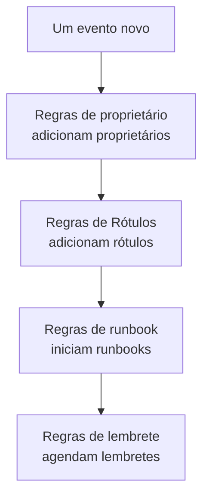

# Regras e configurações da manutenção

A configuração da manutenção fica dentro de **Manutenção programada**, não nas **Configurações do projeto**: as regras que agem sobre cada evento novo e as configurações que moldam cada evento do projeto. Esta página é a referência de cada uma delas, e de quem pode alterá-las.

:::cards
- [As regras pelas quais um evento novo passa](#as-regras-pelas-quais-um-evento-novo-passa): Em ordem, e o que cada uma faz.
- [Regras de lembrete](#regras-de-lembrete): Lembrar os proprietários até um evento ser concluído.
- [Configurações](#configurações): Modelos de notas, campos personalizados, medições e numeração.
- [Quem pode alterá-las](#quem-pode-alterá-las): As funções de manutenção, e os planos.
:::

## Onde ficam as configurações da manutenção

Abra **Manutenção programada** no menu **Produtos** da barra superior. As seções **Regras** e **Configurações** do menu lateral começam recolhidas, então expanda-as primeiro. Cada página aqui vale para o projeto inteiro, em um endereço que começa com `/dashboard/{projectId}/scheduled-maintenance-events/settings/`.

| Página de regras   | O que faz                                                           |
| ------------------ | ------------------------------------------------------------------- |
| **Regras de proprietário** | Adiciona proprietários aos eventos que correspondem.        |
| **Regras de runbook** | Inicia runbooks para os eventos que correspondem.                |
| **Regras de Rótulos** | Adiciona rótulos aos eventos que correspondem.                   |
| **Reminder Rules** | Lembra os proprietários em intervalos até um evento ser concluído.  |

A seção **Configurações** reúne **Estado do evento**, tratado em [Estados da manutenção](/docs/scheduled-maintenance/states), **Modelos de eventos**, tratado em [Modelos e eventos recorrentes](/docs/scheduled-maintenance/templates), e depois **Modelos de notas**, **Campos personalizados**, **Medições**, **Configurações do calendário** e **Numeração**. **Configurações do calendário** é tratado em [Calendário de manutenção](/docs/scheduled-maintenance/calendar#calendários-externos), e o resto abaixo.

A seção **Espaço de trabalho** reúne as regras do Slack e do Microsoft Teams que publicam eventos em canais. Veja [Slack](/docs/workspace-connections/slack#regras-de-notificação) e [Microsoft Teams](/docs/workspace-connections/microsoft-teams#regras-de-notificação).

## As regras pelas quais um evento novo passa

As regras se diferenciam em como resolvem várias correspondências:

- **Regras de proprietário**, **Regras de Rótulos** e **Regras de runbook** agem todas quando correspondem. Proprietários e rótulos que várias regras adicionam são adicionados uma só vez.
- **Reminder Rules** são verificadas de cima para baixo na lista, e vence a primeira que corresponde. Arraste uma regra para mudar o lugar dela; uma regra nova vai para o final.

Uma regra nova começa habilitada; desative **Habilitado** no formulário de edição dela para pausá-la, e a lista mostra para cada regra um **Habilitado** verde ou um **Desabilitado** vermelho. As regras de proprietário, de rótulos e de runbook agem sobre os eventos criados depois que você as salva. Para aplicar uma regra de proprietário ou de rótulos aos eventos que você já tem, use **Executar agora**: veja [Executar regras em recursos existentes](/docs/configuration/run-rules-now).

## Regras de proprietário e de rótulos

As **Regras de proprietário** adicionam usuários e equipes proprietários aos eventos novos que correspondem, e as **Regras de Rótulos** adicionam rótulos. Criar uma leva dois passos: **Corresponder**, as condições, e depois **Proprietários** ou **Rótulos**, o que a regra adiciona.

| Condição                                                        | Corresponde a                                                              |
| --------------------------------------------------------------- | -------------------------------------------------------------------------- |
| **Monitores**, **Rótulos do evento**, **Rótulos do Monitor**    | Eventos com qualquer um dos monitores ou rótulos que você escolher.        |
| **Título do evento**, **Descrição do evento**, **Nome do Monitor**, **Descrição do Monitor** | Um padrão, como expressão regular, sem diferenciar maiúsculas e minúsculas. |

Uma regra só corresponde quando todas as condições que você preencheu se cumprem; uma condição deixada vazia é ignorada.

- **Uma regra pode herdar.** Recolhidas em **Herdar Proprietários** ou **Herdar Rótulos**, seis chaves repassam os proprietários ou os rótulos dos monitores, hosts, clusters Kubernetes, hosts Docker, hosts Podman e serviços do evento.
- **Uma regra nova precisa adicionar algo**: escolha pelo menos um proprietário ou um rótulo, ou ative uma chave.
- **Notificar proprietários**, em **Mais campos** de uma regra de proprietário, decide se as pessoas adicionadas são avisadas.

[Regras de rótulos e proprietários](/docs/configuration/label-and-owner-rules) explica o formulário passo a passo, para cada tipo de recurso.

## Regras de runbook

As **Regras de runbook** iniciam um runbook quando um evento novo corresponde, como uma lista de verificação antes de cada atualização de banco de dados. Elas correspondem às mesmas coisas que as regras de proprietário e de rótulos; os eventos não têm severidade, então as regras de runbook de manutenção não a oferecem. A execução fica anexada ao evento, na página **Runbooks** dele. Veja [Regras de runbook](/docs/runbooks/rules).

## Regras de lembrete

**Manutenção programada → Regras → Reminder Rules** lembra os proprietários de um evento até o trabalho ser aprovado. Cada evento recebe a primeira regra que corresponde a ele, de cima para baixo na lista.

:::steps
### Escolher sobre quais eventos lembrar

Clique em **Criar: Scheduled Maintenance Reminder Rule**. Em **Corresponder**, deixe **Todos os eventos de manutenção programada** selecionado para lembrar de todos os eventos, ou escolha **Somente os eventos de manutenção programada que atendem às condições** e depois os **Rótulos** a que ela se aplica.

### Definir o intervalo

Em **Lembretes**, defina **Intervalo de lembrete (minutos)**, a frequência com que os proprietários são lembrados, e escolha quando lembrá-los em **Lembrar os proprietários**. O **Nome** dela acompanha os dois, como «Lembrar a cada 30 minutos enquanto estiver em andamento», até você digitar um próprio, e uma **Descrição** fica em **Mais campos**. Depois crie a regra.
:::

| Resposta | Quando os proprietários são lembrados |
| --- | --- |
| **Enquanto estiver em andamento** | Do início do evento até o fim dele. Uma regra nova começa com esta resposta. |
| **Antes de começar** | Desde o agendamento do evento até o início dele. |
| **Antes de começar e enquanto estiver em andamento** | Desde o agendamento do evento até o fim dele. |

Uma regra salva pela API ou pelo Terraform que espera o evento começar e para quando ele começa nunca envia um lembrete: a lista a marca com **Nunca envia lembretes**, e o formulário dela pede que você escolha uma resposta.

Os proprietários recebem cada lembrete como **Maintenance reminder**, ativado por e-mail para cada membro novo. Salvar, alterar ou excluir uma regra de lembrete volta a atribuir uma regra a cada evento que ainda não foi concluído. Para parar os lembretes de um evento, desative **Enviar lembretes** na página **Configurações** dele; a chave salva assim que você a aciona.

Esses lembretes são para a sua equipe. Os lembretes que os assinantes das suas páginas de status recebem antes de um evento começar são definidos no próprio evento, em **Lembretes antes do evento**.

## Configurações

### Modelos de notas

**Manutenção programada → Configurações → Modelos de notas** guarda textos prontos para atualizações de manutenção. O cartão **Modelos de nota pública ou privada para eventos de manutenção programada** os lista; **Criar: Agendado Manutenção Nota Modelo** pede um **Nome do modelo**, uma **Descrição do modelo** e a **Nota**. Um modelo é oferecido quando alguém escreve uma nota pública ou privada em um evento e quando muda o estado dele, e o texto pode ser editado antes de ser publicado. Ao contrário dos modelos de nota de incidentes, os modelos de nota de manutenção não preenchem variáveis.

### Campos personalizados

**Manutenção programada → Configurações → Campos personalizados** adiciona campos próprios a cada evento, como um ticket de mudança ou o nível do cliente. Preencha-os na página **Campos personalizados** de um evento, ou pela API como `customFields`. Um campo pode copiar seu valor de um campo personalizado de um monitor em vez de ser digitado: veja [Campos copiados de um monitor](/docs/incidents/settings#campos-copiados-de-um-monitor), que funciona da mesma forma para eventos.

### Medições

**Manutenção programada → Configurações → Medições** mede quanto tempo as coisas levam em cada evento. Escolha **Atraso no início**, do início planejado até ele começar, **Excesso de tempo**, do fim planejado até ele terminar, ou **Duração da manutenção**, de quando ele começa até terminar; ou dois momentos próprios com **Outra coisa**. Cada medição aparece na página do evento e é traçada em gráfico como `oneuptime.scheduled-maintenance.measurement.<key>`. Veja [Medições](/docs/incidents/settings#medições), que funciona da mesma forma para eventos.

### Numeração

**Manutenção programada → Configurações → Numeração** define o texto antes dos números dos eventos: `SM-` em um projeto novo, ou `#` sem nenhum. **Atualizar** pede o **Prefixo do número da manutenção programada** e mostra uma prévia do número enquanto você digita. Só os eventos criados depois recebem o prefixo novo; os existentes mantêm seus números. As regras de um prefixo estão em [Prefixos de número](/docs/incidents/settings#prefixos-de-número).

O cartão **Próximo número** abaixo define o número que o próximo evento recebe, para continuar os números de outra ferramenta: **Atualizar** abre **Próximo número de manutenção programada**, que deve ser maior que o mais alto usado até agora. Veja [Próximos números](/docs/incidents/settings#próximos-números).

> [!NOTE]
> No OneUptime Cloud, os campos personalizados requerem o plano **Growth** ou superior, assim como adicionar e alterar estados de manutenção e modelos.

## Workflows

Cada modelo de manutenção tem gatilhos e ações de workflow com o nome dele: **On Create Scheduled Maintenance Event**, **On Update Scheduled Maintenance Event**, **On Create or Update Scheduled Maintenance Event** e **On Delete Scheduled Maintenance Event**, o mesmo para **Scheduled Maintenance State Timeline** e os outros, e ações como **Create One Scheduled Maintenance Event** e **Update One Scheduled Maintenance Event**. As definições de campos personalizados e os valores das medições são as exceções: não têm etapas de workflow. Veja [Visão geral dos workflows](/docs/workflows/index).

## Quem pode alterá-las

| Função                            | O que pode fazer                                                                                     |
| --------------------------------- | ---------------------------------------------------------------------------------------------------- |
| **Visualizador de manutenção programada**  | Lê eventos e não altera nada.                                                                        |
| **Membro de manutenção programada**  | Cria, altera e exclui eventos com suas notas, linhas do tempo de estado e proprietários, e os dois tipos de modelos. |
| **Administrador de manutenção programada**   | Tudo o que um membro faz, e além disso cria, altera e exclui estados de manutenção.                  |

Regras, campos personalizados e medições exigem **Proprietário do projeto** ou **Administrador do projeto**, ou uma função personalizada com a permissão própria daquela página, como **Create Scheduled Maintenance Owner Rule**. As regras de runbook também aceitam **Administrador de runbooks**. **Membro do projeto** trabalha com eventos e modelos, como **Membro de manutenção programada**. Veja [Usuários, equipes e permissões](/docs/permissions/index).

## Solução de problemas

:::details Uma regra de proprietário não adicionou ninguém a um evento novo
Abra a regra e confira as condições: todas as condições preenchidas precisam se cumprir. Um padrão de título é uma expressão regular, então `db upgrade` não corresponde a «DB-Upgrade»; escreva `db.upgrade`. Além disso, uma regra só age sobre os eventos criados depois que ela foi salva: use **Executar agora** para os que você já tem.
:::

:::details Os proprietários não receberam nenhum lembrete
Confira se uma regra de lembrete corresponde aos rótulos do evento, se **Enviar lembretes** está ativado no evento e se **Maintenance reminder** está ativado nas configurações de notificação dos proprietários. Uma regra com **Enquanto estiver em andamento** não envia nada antes de o evento começar.
:::

## Próximos passos

:::cards
- [Estados da manutenção](/docs/scheduled-maintenance/states): A página Estado do evento, e o que cada estado faz.
- [Modelos e eventos recorrentes](/docs/scheduled-maintenance/templates): A página Modelos de eventos, em detalhe.
- [Regras de rótulos e proprietários](/docs/configuration/label-and-owner-rules): O formulário de regra, passo a passo.
- [Configurações de notificação](/docs/notifications/notification-settings): Como cada proprietário escolhe o que chega até ele.
:::
