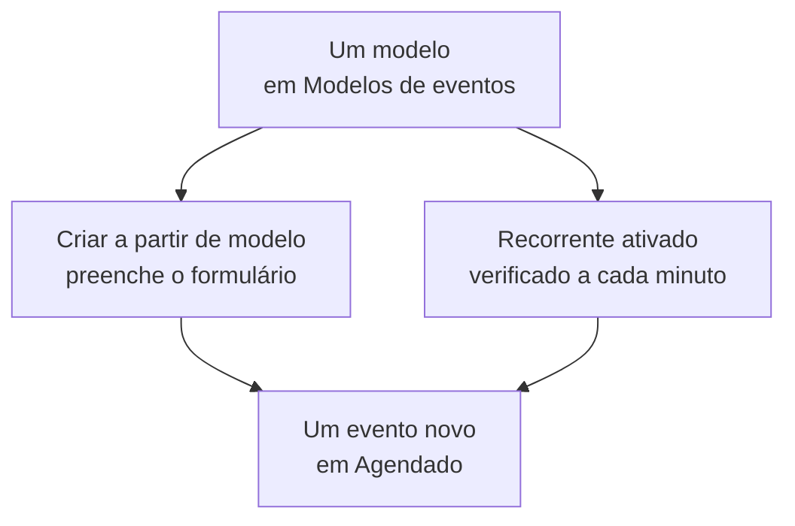

# Modelos e eventos recorrentes

Um modelo de manutenção programada salva um evento que você planeja com frequência: o título e a descrição, os monitores que ele pausa, as páginas de status em que aparece e quem é avisado. Use um para preencher o formulário com um clique, ou torne-o recorrente para que o OneUptime agende o evento por você, toda semana, todo mês ou no intervalo que você escolher.

:::cards
- [Criar um modelo](#criar-um-modelo): Os passos do formulário, com um nome no início e um agendamento no fim.
- [Usar um modelo](#usar-um-modelo): Preencher um evento novo a partir dele.
- [Eventos recorrentes](#eventos-recorrentes): Deixe o OneUptime agendar o evento sozinho.
- [Alterar ou parar um modelo](#alterar-ou-parar-um-modelo): Editá-lo, pausar o agendamento ou excluí-lo.
:::

## Como funciona

Um modelo é um ponto de partida. Um evento criado a partir dele é uma cópia com valores próprios: alterar o modelo depois muda só os eventos criados a partir de então.

## Antes de começar

- **Seu plano.** No OneUptime Cloud, os modelos requerem o plano **Growth** ou superior.
- **Sua função.** Criar um modelo requer **Proprietário do projeto**, **Administrador do projeto**, **Membro do projeto**, **Administrador de manutenção programada** ou **Membro de manutenção programada**, ou uma função personalizada que possa criar modelos de manutenção programada.

## Criar um modelo

:::steps
### Abrir os modelos

Vá em **Manutenção programada → Configurações → Modelos de eventos**. **Configurações** começa recolhida no menu lateral: expanda-a primeiro. Clique em **Criar: Agendado Manutenção Modelo**.

### Dar nome ao modelo

Em **Informações do modelo**, dê a ele um **Nome do modelo** e uma **Descrição do modelo**, para que sua equipe saiba quando usá-lo. Os dois são obrigatórios.

### Descrever o evento

Em **Evento**, preencha o **Título** e a **Descrição** com que começa cada evento criado a partir dele. **Proprietários** e **Rótulos** ficam em **Mais campos**.

### Escolher o que ele afeta

Em **Recursos afetados**, escolha os **Monitores**, o **Alterar status do monitor para** deles, os **Outros recursos afetados** que houver, as páginas de status em **Mostrar evento nestas páginas de status** e as **Notificações aos assinantes**.

### Decidir se ele se repete

Em **Recorrente**, deixe **Evento Recorrente** desativado para um modelo que você usa à mão, ou ative-o e preencha o agendamento. Clique em **Próximo** para conferir a revisão e depois crie o modelo.
:::

Um modelo pergunta **Alterar status do monitor para** mesmo quando não nomeia nenhum monitor: o status também vale para os monitores que você adiciona ao agendar um evento a partir dele. Em **Outros recursos afetados**, um modelo aceita hosts, clusters Kubernetes, hosts Docker, hosts Podman e serviços.

## O que um modelo preenche

| Parte do evento                                   | Criar a partir de modelo             | Um evento recorrente            |
| ------------------------------------------------- | ------------------------------------ | ------------------------------- |
| **Título** e **Descrição**                        | Preenchidos, e você pode alterá-los  | Copiados                        |
| **Monitores** e **Alterar status do monitor para** | Preenchidos                         | Copiados                        |
| **Outros recursos afetados**                      | Preenchidos                          | Copiados                        |
| As páginas de status e **Notificações aos assinantes** | Preenchidas                     | Copiadas                        |
| **Proprietários** e **Rótulos**                   | Preenchidos                          | Copiados                        |
| **Começa em** e **Termina em**                    | A próxima hora cheia, por uma hora   | Calculados pelo agendamento     |

## Usar um modelo

:::steps
### Escolher o modelo

Em **Manutenção programada → Todos os eventos**, clique em **Criar a partir de modelo** e escolha um modelo em **Selecionar Modelo de Manutenção Programada**.

### Conferir o formulário

Clique em **Criar a partir de modelo**. O formulário de criação abre com as respostas do modelo já preenchidas. Ajuste a janela e altere o que este evento precisar.

### Criar o evento

Percorra os passos com **Próximo** e depois clique em **Criar Evento de Manutenção Programada** na revisão.
:::

Quando o projeto ainda não tem nenhum modelo, **Criar a partir de modelo** avisa isso e leva para **Modelos de eventos**.

## Eventos recorrentes

Um modelo recorrente cria o evento seguindo um agendamento. Você define quando o primeiro evento é criado, quando ele começa e quando termina; cada evento seguinte mantém as mesmas distâncias, um intervalo depois.

| Campo                                    | O que significa                                                                                     |
| ---------------------------------------- | --------------------------------------------------------------------------------------------------- |
| **Evento Recorrente**                    | Ativa o agendamento.                                                                                |
| **Primeiro evento agendado para**        | Quando o OneUptime cria o primeiro evento, que é quando seus assinantes ficam sabendo que ele foi agendado. |
| **Primeiro evento começa em**            | Quando o primeiro evento começa.                                                                    |
| **Primeiro evento termina em**           | Quando o primeiro evento termina.                                                                   |
| **Com que frequência você gostaria que este evento se repetisse?** | Um número e uma unidade: horas, dias, semanas, meses ou anos.           |

Por exemplo, uma janela semanal cujo primeiro evento é criado numa segunda-feira para o sábado seguinte:

| Evento       | Criado             | Começa             | Termina            |
| ------------ | ------------------ | ------------------ | ------------------ |
| O primeiro   | `2030-06-03 09:00` | `2030-06-08 02:00` | `2030-06-08 04:00` |
| O segundo    | `2030-06-10 09:00` | `2030-06-15 02:00` | `2030-06-15 04:00` |

Defina **Primeiro evento agendado para** com toda a antecedência com que você quer que seus clientes fiquem sabendo do trabalho. Os três horários precisam estar no futuro quando você cria o modelo, o evento precisa ser criado antes de começar e de terminar, e precisa começar antes de terminar; o formulário diz qual regra um horário viola.

Uma tarefa verifica os modelos recorrentes a cada minuto. Quando chega o próximo horário de um modelo, ela adianta esse horário em um intervalo e cria o evento. A lista de modelos mostra esse horário na coluna **Evento Recorrente**, e **Não** para um modelo que não se repete. Um evento criado pelo agendamento é como qualquer outro: suas regras rodam, seus proprietários são adicionados e seus assinantes ficam sabendo que ele foi agendado.

## Alterar ou parar um modelo

Abra um modelo na lista para ver a página dele:

- **Detalhes do modelo de manutenção programada** mostra com o que os eventos novos começam. O **Editar** dele percorre **Informações do modelo**, **Evento**, **Páginas de status** e **Recorrente**.
- **Recursos afetados** reúne os **Monitores** dele, o **Alterar status do monitor para** desses monitores e os **Outros recursos afetados**, com um **Editar** próprio.
- **Proprietários** lista as pessoas e equipes donas de cada evento agendado a partir dele.

As alterações valem para os eventos criados depois de você salvá-las; os eventos já criados mantêm seus próprios valores. Para parar um agendamento, desative **Evento Recorrente** em **Editar**, ou exclua o modelo. Um modelo desativado mantém seu agendamento: ative-o de novo, e ele retoma no próximo horário do agendamento, pulando os horários em que ficou desativado. Excluir um modelo mantém os eventos que ele criou.

## Solução de problemas

:::details Ao criar um modelo recorrente aparece que um horário deveria estar no futuro
Os três primeiros horários precisam estar depois do momento atual quando você cria o modelo. Adiante-os: o agendamento continua depois a partir do primeiro evento.
:::

:::details Um modelo recorrente não criou nenhum evento
Confira se **Evento Recorrente** ainda está ativado e veja o horário na coluna **Evento Recorrente** da lista: o evento é criado nesse momento, não no início dele. A tarefa roda a cada minuto, então espere um minuto.
:::

:::details Falta em um evento criado a partir de um modelo um recurso que eu escolhi
Em **Outros recursos afetados**, um modelo aceita hosts, clusters Kubernetes, hosts Docker, hosts Podman e serviços. Adicione outros tipos de recursos ao próprio evento, com **Editar** no cartão **Recursos afetados** dele.
:::

## Próximos passos

:::cards
- [Criar eventos de manutenção](/docs/scheduled-maintenance/creating-events): O formulário que um modelo preenche.
- [Estados da manutenção](/docs/scheduled-maintenance/states): Como cada evento avança depois de criado.
- [Regras e configurações da manutenção](/docs/scheduled-maintenance/settings): Adicione proprietários e rótulos a cada evento novo automaticamente.
- [Visão geral da manutenção programada](/docs/scheduled-maintenance/index): Onde os modelos se encaixam no restante da manutenção.
:::
