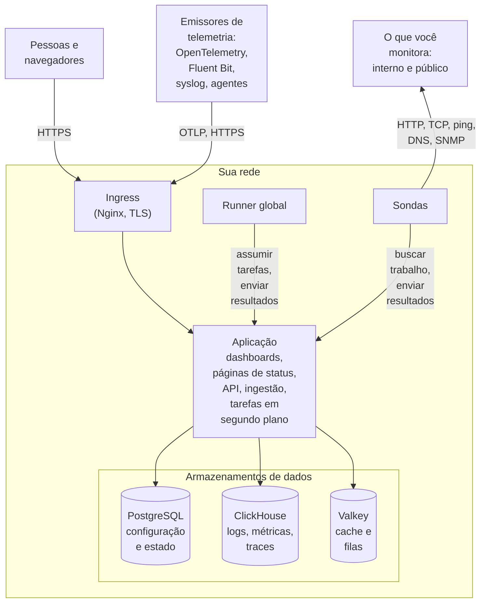

# Arquitetura

Uma instalação auto-hospedada do OneUptime é um punhado de contêineres: um ingress por onde entra cada requisição, uma imagem de aplicação que faz o trabalho, sondas que executam as verificações dos seus monitores e três armazenamentos de dados. Esta página mostra como eles se encaixam, o que cada um faz e quais conexões atravessam a sua rede.

## O que isto mostra

- As pessoas chegam ao OneUptime pelo **ingress**, que termina o TLS e encaminha cada requisição para a aplicação: o Dashboard, as páginas de status, a API e cada endpoint de ingestão para onde a telemetria é enviada.
- A **aplicação** lê e grava o seu estado no PostgreSQL, guarda a telemetria no ClickHouse e usa o Valkey (o fork com licença BSD do Redis 7.2) como cache e para as filas que as suas tarefas em segundo plano processam.
- As **sondas** podem rodar dentro do seu cluster (recomendado) e/ou em outro ponto da sua rede. Elas podem monitorar:
  - Serviços internos/privados atrás do seu firewall.
  - Recursos externos/públicos na internet.
- Os resultados das sondas são enviados para a aplicação, enfileirados no Valkey e processados pelas tarefas em segundo plano para os seus armazenamentos de dados. Uma sonda em outro ponto da sua rede chega à aplicação pelo ingress, na sua URL do OneUptime.
- A telemetria (métricas, traces, logs e mais) é ingerida pela mesma aplicação e armazenada no ClickHouse.

> [!NOTE]
> Se você usa PostgreSQL, Valkey (ou Redis) ou ClickHouse externos em vez dos incluídos, a aplicação se conecta aos seus endpoints externos. O fluxo lógico continua o mesmo.

## Os componentes

| Componente | Serviço do Docker Compose | Chart do Helm | O que faz |
| --- | --- | --- | --- |
| Ingress | `ingress` | `nginx` | Termina o TLS, atende o seu nome de host e os domínios das suas páginas de status e encaminha cada requisição para a aplicação. |
| Aplicação | `app` | `app` | O Dashboard, as páginas de status, os endpoints de API e de ingestão e, a menos que você os separe, as tarefas em segundo plano. |
| Worker | Parte de `app` | `worker` (desligado por padrão) | As tarefas em segundo plano, em pods próprios, para que o processamento pesado das filas nunca concorra com as requisições à API. |
| Telemetry writer | Parte de `app` | `telemetryWriter` (desligado por padrão) | Uma camada de tamanho fixo que faz cada inserção no ClickHouse, para que as inserções continuem limitadas por mais que os workers escalem. |
| Sonda | `probe-1` | `probes` | Executa as verificações dos monitores e envia os resultados de volta. Cada sonda incluída é uma sonda global que todos os projetos podem usar. |
| Runner global | `global-runner` | `globalRunner` | Um [Runner global](/docs/runbooks/agents#runners-globais): executa as etapas JavaScript de todos os projetos que não escolhem um Runner próprio, cada uma em um sandbox que só alcança a internet, e as correções de código da OneUptime AI em todo repositório de código que não escolhe nenhum. Tem a sua própria chave e nada mais do servidor. Os passos Bash, SSH e kubectl rodam em [Runners](/docs/runbooks/agents) que você instala onde eles devem rodar. |
| PostgreSQL | `postgres` | `postgresql`, ou `postgresOperator.cnpg` | Projetos, monitores, incidentes, usuários e todas as outras configurações e estados. |
| ClickHouse | `clickhouse` | `clickhouse`, ou `clickhouseOperator.altinity` | Logs, métricas, traces, exceções, perfis e logs de monitores. |
| Valkey | `valkey` | `valkey` | O cache, as filas de tarefas e o estado de curta duração, como os recibos de push pendentes. |

Todos os papéis da aplicação são a mesma imagem: o Docker Compose os executa em um único contêiner `app`, e o chart do Helm pode executar o worker e o telemetry writer como deployments próprios. Para dimensionar cada camada, veja [Dimensionamento e planejamento de capacidade](/docs/installation/sizing).

## Conexões que saem da sua rede

Quatro conexões são feitas, a menos que você mude uma configuração:

- Uma vez por dia, a aplicação pergunta à API do GitHub (`api.github.com`) se saiu uma versão mais nova. Ela também lê os avisos de segurança que o OneUptime publicou, para que os seus administradores master sejam informados quando um deles afetar a versão que você executa ([Verificações de atualização e segurança](/docs/self-hosted/update-checks)). Para desligar isso, defina `updateCheck.disabled: true` no chart do Helm, ou `DISABLE_UPDATE_CHECK=true` no `config.env` com o Docker Compose.
- Uma vez por dia, a aplicação informa a `oneuptime.com` o endereço da sua instalação e a versão que ela executa, para que o OneUptime saiba quais instalações ainda executam uma versão com uma falha de segurança. Nada sobre seus usuários, projetos ou dados de monitoramento é enviado. Para desligar isso, defina `instanceCheckIn.disabled: true` no chart do Helm, ou `DISABLE_INSTANCE_CHECK_IN=true` no `config.env` com o Docker Compose.
- Cadastrar-se com “Notifique-me sobre patches de segurança e novas versões” marcado, como vem de início, envia para `oneuptime.com` o nome e o e-mail da pessoa, a empresa e o telefone que ela informou, e o endereço e a versão da sua instalação. Desmarque essa opção em uma rede sem acesso à internet.
- No Kubernetes, as sondas recorrem aos resolvedores públicos `8.8.8.8` e `1.1.1.1` depois do DNS do seu próprio cluster. Defina `dnsConfig.nameservers` como `[]` para manter todas as consultas no seu próprio DNS.

Todo o resto só se conecta para fora quando você o ativa, e cada um tem uma página que indica os endereços exatos a liberar:

| Conexão de saída | Usada para | Onde ler mais |
| --- | --- | --- |
| E-mail (SMTP, ou a API do SendGrid) | Notificações e convites | [SMTP](/docs/emails/smtp) |
| Twilio | SMS e chamadas telefônicas | [Integração com o Twilio](/docs/self-hosted/twilio-integration) |
| O relay de push do OneUptime, ou o Expo | Notificações push móveis | [Notificações push](/docs/self-hosted/push-notifications) |
| Slack e Microsoft Teams | Notificações e ações no workspace | [Integração com o Slack](/docs/self-hosted/slack-integration) |
| Um provedor de LLM, como OpenAI, Anthropic, Microsoft Foundry ou um modelo que você mesmo executa | OneUptime AI | [Provedores de LLM](/docs/ai/llm-provider) |
| `oneuptime.com` | Ativar uma licença Enterprise online | [Edição Enterprise](/docs/self-hosted/enterprise) |

As conexões no sentido contrário – o SendGrid entregando e-mails recebidos, o Slack e o Microsoft Teams chamando de volta – exigem que o ingress seja acessível pela internet. Quais endereços privados a aplicação e as sondas podem alcançar é você quem decide: veja [Acesso à rede privada](/docs/self-hosted/private-network-access).

O logotipo do OneUptime vai dentro de cada e-mail que o OneUptime envia, então ele aparece até em uma rede sem acesso à internet, e abrir um e-mail não pede nada a nenhum outro host. As imagens que você mesmo envia, como o seu próprio logotipo ou o de uma página de status, são mostradas a partir da sua URL do OneUptime, que quem lê esses e-mails precisa conseguir acessar.

## Próximos passos

:::cards
- [Docker Compose](/docs/installation/docker-compose): Instale todos os componentes em uma única máquina.
- [Dimensionamento e planejamento de capacidade](/docs/installation/sizing): Quanta CPU, memória e disco cada camada precisa.
- [Sondas personalizadas](/docs/probe/custom-probe): Execute uma sonda dentro de outra rede.
- [Edição Enterprise](/docs/self-hosted/enterprise): O que as imagens Enterprise acrescentam e como funciona o licenciamento.
:::
