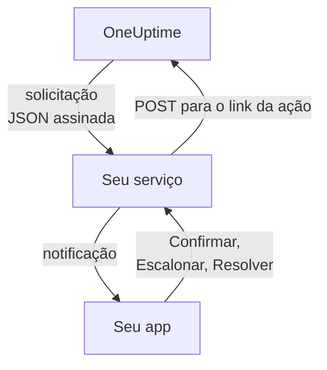

# Canais de notificação personalizados

Um canal personalizado envia os acionamentos de plantão para um serviço que você mantém: o app da sua empresa, um sistema de pager ou um gateway que controla o que sai da sua rede. Você o adiciona uma única vez, para o servidor inteiro, e todos podem ser acionados por ele sem configurar nada. No Admin Dashboard eles se chamam **Custom Channels**.

> [!NOTE]
> Os canais personalizados fazem parte da [Enterprise Edition do OneUptime](/docs/self-hosted/enterprise) e precisam de uma licença Enterprise que os inclua. A Community Edition não tem a página **Custom Channels** e não envia nada a nenhum canal. Veja [Sem licença](#sem-licença).

:::cards
- [Adicionar um canal](#adicionar-um-canal): Um nome, uma URL e um segredo de assinatura.
- [O que o seu serviço recebe](#o-que-o-seu-serviço-recebe): Uma solicitação JSON assinada por pessoa e por acionamento.
- [Agir sobre um acionamento](#agir-sobre-um-acionamento): Confirmar, escalonar ou resolver pelo seu próprio app.
- [Entrega e novas tentativas](#entrega-e-novas-tentativas): O que acontece quando o seu serviço está fora do ar.
- [Outras notificações](#outras-notificações): Notificações de responsáveis, notas e turnos, para quem quiser.
- [Sem licença](#sem-licença): O que para e o que é mantido.
:::

## Como funciona



Quando uma política de plantão aciona alguém e a regra de plantão dessa pessoa usa o canal, o OneUptime envia uma solicitação para a URL do canal. Ela diz para quem é o acionamento (o nome e o e-mail da pessoa) e do que se trata, e traz os links que o seu serviço chama quando a pessoa o confirma, escalona ou resolve no seu app.

## Adicionar um canal

1. No Admin Dashboard, abra **Configurações**, depois **Custom Channels**, e selecione **Add**.
2. Na etapa **Channel**, preencha:
   - **Nome**: o que as pessoas veem nos seus métodos de notificação e nas suas regras de plantão, por exemplo `CorpoApp`.
   - **Webhook URL**: para onde o OneUptime envia cada acionamento. Pode estar na sua rede privada.
   - **Signing Secret**: o OneUptime cria um para você. Copie-o para o seu serviço, que confere cada solicitação com ele. Você pode vê-lo de novo editando o canal.
3. Na etapa **Delivery**, salve e depois selecione **Send test** para enviar ao seu serviço uma [solicitação de teste](#solicitações-de-teste).

Na etapa **Delivery**, **Page everyone through this channel** está ativado. O OneUptime então adiciona o canal às regras de plantão de todos em todos os projetos, e às regras de quem entrar em um projeto depois, e o usa para alcançar um plantonista que não tem regra para o que disparou. Desative-o para deixar que cada pessoa adicione o canal às próprias regras.

As pessoas veem o canal em **Configurações do usuário**, depois **Métodos de notificação**, depois **Custom Channels**, com um botão **Send test**, e o escolhem nas suas regras de plantão como `Custom Channel: CorpoApp`. Elas não configuram nada: o seu serviço fica sabendo para quem é cada acionamento.

Para parar de enviar sem mudar as regras de ninguém, edite o canal e desative **Ativado**. Os acionamentos que iriam para ele são registrados no registro de plantão como não enviados. Excluir um canal exclui todas as regras de plantão que o usam.

## O que o seu serviço recebe

Cada acionamento é uma solicitação `POST` com um corpo JSON:

| Cabeçalho | O que contém |
| --- | --- |
| `Content-Type` | `application/json` |
| `X-OneUptime-Event` | O evento, como `on-call.incident.created` |
| `X-OneUptime-Signature` | `sha256=` e o HMAC-SHA256 em hexadecimal do corpo bruto, feito com o segredo de assinatura do canal |

```json title="An incident page"
{
  "version": 1,
  "event": "on-call.incident.created",
  "notificationId": "5f2c8a1e-6b1d-4c3a-9e7f-2a4b6c8d0e1f",
  "sentAt": "2026-10-27T03:14:15.000Z",
  "channel": { "id": "0b7e…", "name": "CorpoApp" },
  "title": "New Incident INC-42: API latency high",
  "message": "A new incident has been created: INC-42 (API latency high) in Agency A. Click to view details.",
  "project": { "id": "8d1f…", "name": "Agency A" },
  "team": { "id": "2c9a…", "name": "SRE" },
  "user": { "id": "4e6b…", "name": "Jane Tan", "email": "jane@example.com" },
  "recordType": "incident",
  "record": {
    "id": "9a3c…",
    "number": "INC-42",
    "title": "API latency high",
    "description": "p95 latency above 2 seconds for 5 minutes.",
    "severity": "Critical",
    "state": "Created",
    "url": "https://oneuptime.example.com/dashboard/8d1f…/incidents/9a3c…"
  },
  "onCallPolicy": { "id": "1d4e…", "name": "Primary" },
  "escalationRule": { "id": "7b2f…", "name": "Level 1" },
  "isPageAgain": false,
  "actions": {
    "acknowledge": "https://oneuptime.example.com/api/custom-notification-channel/page/5f2c…/acknowledge?token=…",
    "escalate": "https://oneuptime.example.com/api/custom-notification-channel/page/5f2c…/escalate?token=…",
    "resolve": "https://oneuptime.example.com/api/custom-notification-channel/page/5f2c…/resolve?token=…"
  }
}
```

| Campo | O que é |
| --- | --- |
| `version` | `1`. Campos só são acrescentados a esta versão. |
| `event` | `on-call.incident.created`, `on-call.alert.created`, `on-call.incidentEpisode.created`, `on-call.alertEpisode.created`, `notification` para [outras notificações](#outras-notificações), ou `test` |
| `notificationId` | Um por pessoa e por acionamento. Use-o para descartar uma solicitação que você já tratou. |
| `title`, `message` | Prontos para exibir, como uma notificação push os exibiria |
| `user` | Para quem é o acionamento. Encontre a conta da pessoa no seu app por `email` ou `id`. |
| `team` | A equipe pela qual a pessoa foi acionada, ou `null` quando foi acionada diretamente |
| `recordType`, `record` | Do que trata o acionamento: um `incident`, `alert`, `incidentEpisode` ou `alertEpisode` |
| `onCallPolicy`, `escalationRule` | A política e o nível que acionaram a pessoa |
| `isPageAgain` | `true` quando o registro foi confirmado há algum tempo e ainda não está resolvido |
| `actions` | Os links que o seu serviço chama para [agir sobre o acionamento](#agir-sobre-um-acionamento) |

Um acionamento para várias pessoas é uma solicitação por pessoa, cada uma com os links da própria pessoa, para que o OneUptime saiba quem respondeu. O título, a mensagem e a descrição juntos são limitados a 16.384 caracteres; uma descrição mais longa é cortada e termina com "… (truncated — see OneUptime for the full text)".

### Verificar a assinatura

Calcule o HMAC do corpo bruto da solicitação, antes de interpretá-lo, e compare-o com o cabeçalho:

```javascript title="Node.js"
const crypto = require("crypto");

function isFromOneUptime(rawBody, signatureHeader, secret) {
  const expected =
    "sha256=" + crypto.createHmac("sha256", secret).update(rawBody).digest("hex");
  const received = String(signatureHeader || "");

  return (
    received.length === expected.length &&
    crypto.timingSafeEqual(Buffer.from(received), Buffer.from(expected))
  );
}
```

## Agir sobre um acionamento

Quando a pessoa aperta um botão no seu app, o seu serviço envia uma solicitação `POST` para o link correspondente em `actions`. Não é preciso chave de API: cada link carrega um token para aquele acionamento, válido por 7 dias, e a ação fica registrada como feita pela pessoa acionada.

| Ação | O que faz |
| --- | --- |
| `acknowledge` | Confirma o acionamento da pessoa e, com ele, o incidente, alerta ou episódio |
| `escalate` | A pessoa não pode atender: aciona agora o próximo nível da política de plantão e para de acionar a pessoa |
| `resolve` | Resolve o incidente, alerta ou episódio, se as permissões da própria pessoa permitirem |

```bash title="Acknowledge a page"
curl -X POST "https://oneuptime.example.com/api/custom-notification-channel/page/5f2c…/acknowledge?token=…"
```

A resposta diz o que aconteceu, em palavras que o seu app pode exibir como estão:

```json title="The answer"
{
  "action": "acknowledge",
  "result": "acknowledged",
  "message": "Acknowledged."
}
```

`result` é um de `acknowledged`, `alreadyAcknowledged`, `escalated`, `notEscalated`, `resolved` e `alreadyResolved`. Um link expirado ou errado é recusado com um status 4xx e uma mensagem.

## Outras notificações

Os acionamentos não são as únicas notificações que as pessoas recebem: o OneUptime também avisa quando um incidente do qual são responsáveis muda de estado, quando uma nota é publicada, quando o turno de plantão delas começa, e mais. Cada pessoa escolhe para onde vai cada uma delas em **Configurações do usuário > Configurações de notificação**, que tem uma coluna **Custom Channels** enquanto houver um canal ativado. Ela fica desativada para todos até que cada pessoa a ative.

Uma notificação vai para cada canal ativado, como uma solicitação por canal, com `event` definido como `notification`:

```json title="A notification"
{
  "version": 1,
  "event": "notification",
  "notificationId": null,
  "sentAt": "2026-10-27T03:20:00.000Z",
  "channel": { "id": "0b7e…", "name": "CorpoApp" },
  "title": "Incident INC-42 acknowledged",
  "message": "Incident INC-42 (API latency high) was acknowledged in Agency A.",
  "project": { "id": "8d1f…", "name": "Agency A" },
  "team": null,
  "user": { "id": "4e6b…", "name": "Jane Tan", "email": "jane@example.com" },
  "recordType": null,
  "record": null,
  "onCallPolicy": null,
  "escalationRule": null,
  "isPageAgain": false,
  "actions": null,
  "notificationType": "Send incident state changed notification when I am the owner of the incident",
  "url": "https://oneuptime.example.com/dashboard/8d1f…/incidents/9a3c…"
}
```

`title` e `message` são o que a notificação push da pessoa diria. `notificationType` nomeia a configuração pela qual ela foi enviada, e `url` leva ao que ela se refere, ou é `null`. Não há nada a fazer, então `actions` é `null`.

## Entrega e novas tentativas

Uma solicitação conta como entregue quando o seu serviço responde com um status 2xx em até 10 segundos. Uma solicitação que ele não respondeu, ou respondeu com 408, 429 ou um status 5xx, é enviada de novo depois de 1 segundo e depois de mais 4 segundos: três tentativas no total. Nenhum outro status 4xx gera novo envio.

O resultado de cada tentativa fica no registro de plantão da pessoa, com o nome do canal e o status que o seu serviço respondeu, nunca a URL. Um acionamento não entregue não interrompe a política de plantão: se ninguém confirmar, ele é escalonado como de costume. Mantenha uma regra de e-mail ou SMS mais adiante nas suas regras se o seu serviço for a única forma de alcançar as pessoas.

## Solicitações de teste

**Send test**, na página do Admin Dashboard ou nos métodos de notificação de uma pessoa, envia uma solicitação com `event` definido como `test`, a pessoa que o apertou como `user`, e `notificationId`, `record` e `actions` definidos como `null`. Use-o para experimentar o seu serviço antes que chegue um acionamento de verdade.

## Sem licença

Os canais personalizados funcionam durante o período de teste de 14 dias da Enterprise Edition e o período de carência de 30 dias depois que uma licença expira. Depois disso, ou com uma licença que não os inclua:

- **Nada é enviado a um canal personalizado.** Um acionamento que iria para um deles é registrado no registro de plantão da pessoa como não enviado, e um teste também.
- **Os canais deixam de ser oferecidos.** Eles saem dos métodos de notificação, das regras de plantão e das configurações de notificação das pessoas, e a prontidão e a alternativa deixam de contá-los.
- **A página fica somente leitura.** Você pode ver e excluir canais, mas não adicioná-los nem alterá-los, e ninguém pode apontar uma regra ou uma configuração de notificação para um deles.
- **Nada é excluído.** Os canais, e as regras de plantão e as configurações que os usam, são mantidos.

Tudo volta a funcionar assim que uma licença é ativada, sem reiniciar. Quem entrou em um projeto enquanto os canais personalizados estavam parados não recebe nas suas regras um canal que aciona todos: pode adicioná-lo por conta própria.
