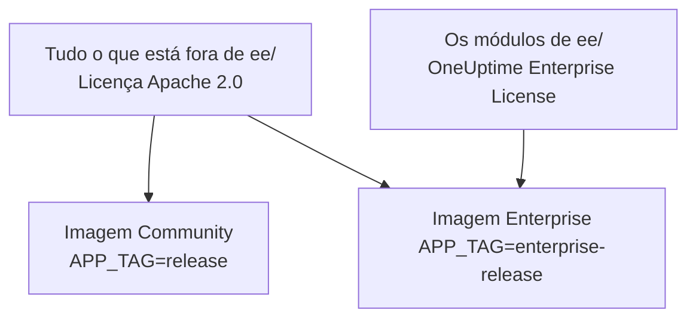
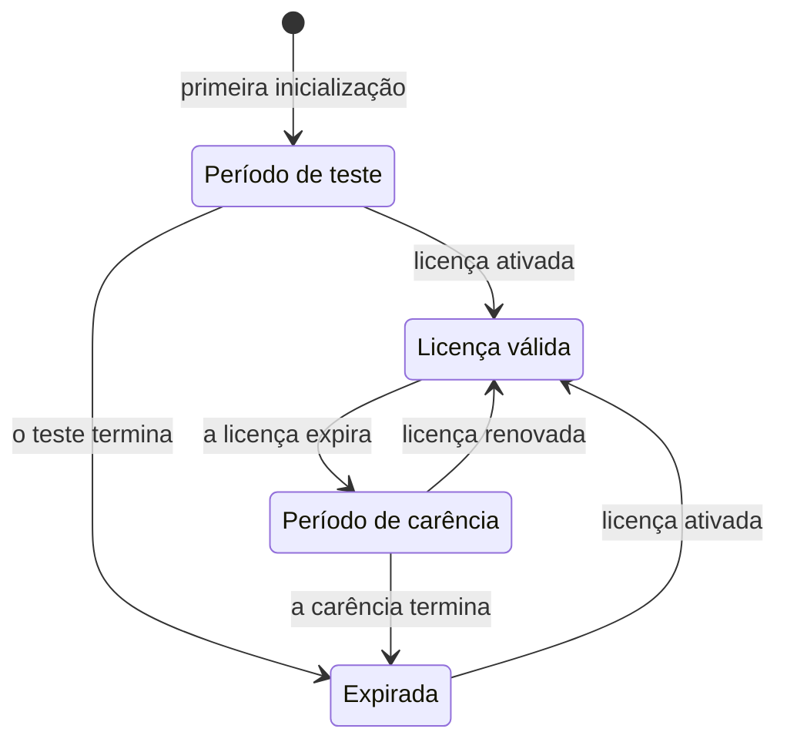

# Edição Enterprise

O OneUptime é construído a partir de um único repositório e distribuído em duas edições:

- **Community Edition**: toda a plataforma de monitoramento, incidentes e observabilidade, incluindo o login único SAML e OpenID Connect, de código aberto sob a licença Apache 2.0 e gratuita para hospedar por conta própria em qualquer escala.
- **Enterprise Edition**: a Community Edition mais os módulos enterprise do diretório [`ee/`](https://github.com/OneUptime/oneuptime/tree/master/ee) do repositório. Esses módulos acrescentam o provisionamento SCIM e recursos de governança e de administração da instância. Eles são licenciados sob a [OneUptime Enterprise License](https://github.com/OneUptime/oneuptime/blob/master/ee/LICENSE), e o uso em produção exige uma licença Enterprise para o seu número de usuários.

As duas edições são imagens de contêiner separadas. A imagem Community não contém código de `ee/`. O OneUptime Cloud executa a Enterprise Edition, e na nuvem é o seu plano que decide quais desses recursos você recebe.



> [!NOTE]
> **O login único está em todas as edições.** O login SAML e OIDC em projetos e páginas de status, o SSO global e «Require SSO for login» fazem parte da Community Edition, e nenhum estado da licença os desativa.

Esta página explica o que cada edição inclui, como executar a Enterprise Edition, como funciona o licenciamento e o que acontece quando você troca de edição.

:::cards
- [Comparar as edições](#o-que-cada-edição-inclui): O que a Enterprise Edition acrescenta.
- [Executar a imagem Enterprise](#executar-a-enterprise-edition): Uma única configuração, no Kubernetes ou no Docker Compose.
- [Ativar uma licença](#licenciamento): Online com uma chave, ou offline com um token assinado.
- [Quando uma licença expira](#quando-uma-licença-expira-ou-está-ausente): O que para, o que nunca para e como tudo volta.
:::

## O que cada edição inclui

| Recurso | Community | Enterprise | OneUptime Cloud |
| --- | --- | --- | --- |
| Monitoramento, alertas, incidentes, plantão, páginas de status, logs, métricas, traces, exceções, dashboards, workflows, recursos de IA, API e Terraform | Sim | Sim | Todos os planos |
| Login com senha, autenticação de dois fatores, equipes, funções e chaves de API | Sim | Sim | Todos os planos |
| [SSO SAML e OpenID Connect](/docs/identity/sso) para login em projetos | Sim | Sim | Plano Scale e superiores |
| SSO SAML e OpenID Connect para login em páginas de status privadas | Sim | Sim | Plano Scale e superiores |
| [SSO e OIDC globais (para toda a instância)](/docs/identity/global-sso) | Sim | Sim | Não se aplica |
| [Provisionamento SCIM](/docs/identity/scim) para projetos e páginas de status | Não | Sim | Plano Scale e superiores |
| Configurações de conformidade de equipes | Não | Sim | Plano Scale e superiores |
| Logs de auditoria | Não | Sim | Plano Enterprise |
| Substituições de retenção: retenção por tipo de telemetria (logs, traces, métricas, perfis, com regras por severidade do log e status do trace) e retenção por serviço e por recurso | Não | Sim | Plano Scale e superiores |
| Painéis **Health** da administração: visão geral da instância, filas em segundo plano, logs da instância, PostgreSQL, Valkey, cluster ClickHouse, logs de diagnóstico e ingestão de telemetria | Não | Sim | Não se aplica |
| **Query Console** da administração | Não | Sim | Não disponível |
| Alertas de saúde do PostgreSQL e do Valkey (Redis) | Não | Sim | Não se aplica |
| Visão de capacidade do ClickHouse, alertas de capacidade e limpeza automática de disco | Sim | Sim | Não se aplica |
| Status das migrações, pacote de suporte e probes globais no painel do administrador | Sim | Sim | Não se aplica |
| Gestão da licença Enterprise, de assentos e de instâncias | Não | Sim | Não se aplica |

O login único inclui «Require SSO for login» para projetos, páginas de status privadas e a instância inteira, nas duas edições.

Todas as edições têm a retenção de telemetria padrão do projeto, em **Configurações do projeto > Telemetria e APM > Retenção de dados**. As substituições de retenção são o que a Enterprise Edition acrescenta por cima disso.

No OneUptime Cloud, um recurso pago sempre pode ser desativado, em qualquer plano. Uma substituição de retenção que um período de teste (ou uma mudança para um plano inferior) deixou configurada continua valendo para a telemetria nova, então abaixo do plano Scale as páginas de retenção a mostram sob o cartão de upgrade com um botão **Remover substituição**. A remoção funciona em todos os planos; configurar uma de novo exige o plano Scale. A telemetria já armazenada mantém a retenção com que foi armazenada. Da mesma forma, **Configurações do projeto > Segurança > SSO** mostra a chave **Exigir SSO para login** sob o seu cartão de upgrade enquanto o projeto ainda exigir SSO, para que ela possa ser desligada.

As linhas «Não se aplica» são recursos de administração da instância. No OneUptime Cloud, o OneUptime opera a instância para você.

## Executar a Enterprise Edition

As duas edições usam a mesma configuração, os mesmos bancos de dados e os mesmos dados. Trocar de edição muda a imagem que você executa e nada mais. Nenhuma migração é necessária em nenhuma das direções.

:::tabs
@tab Kubernetes
Defina o tipo de imagem no seu `values.yaml`:

```yaml title="values.yaml"
image:
  type: enterprise-edition
```

Depois atualize como de costume:

```bash
helm upgrade my-oneuptime oneuptime/oneuptime -f values.yaml
```

O chart então baixa a variante `enterprise-` de cada tag de imagem, por exemplo `oneuptime/app:enterprise-release`, ou `enterprise-<version>` quando você fixa `image.tag`. Defina `image.type: community-edition` (o padrão) para executar a Community Edition.
@tab Docker Compose
Defina `APP_TAG` no seu `config.env`:

```bash title="config.env"
APP_TAG=enterprise-release
```

Use `enterprise-<version>` para fixar uma versão. Depois baixe as imagens e reinicie:

```bash
npm run update
```

Para voltar à Community Edition, defina `APP_TAG=release` **e** `IS_ENTERPRISE_EDITION=false`. Enquanto `IS_ENTERPRISE_EDITION=true` estiver definido, `npm run update` volta `APP_TAG` para `enterprise-release`, e a imagem Community se recusa a iniciar.
:::

### `IS_ENTERPRISE_EDITION` está obsoleta

A imagem que você executa decide a edição. `IS_ENTERPRISE_EDITION` não ativa mais os recursos enterprise e será removida numa versão futura. Você pode deixá-la sem definir.

Definir `IS_ENTERPRISE_EDITION=true` na imagem Community **não** ativa os recursos enterprise. Em vez disso, o App **se recusa a iniciar**, para que um upgrade que termine na imagem Community nunca possa parar silenciosamente o provisionamento SCIM (incluindo o desprovisionamento) e o registro de auditoria. O erro diz o que definir: `APP_TAG=enterprise-<version>` para manter a Enterprise Edition, ou `IS_ENTERPRISE_EDITION=false` para executar a Community Edition. Com o Helm isso não pode acontecer: o chart deriva a variável de `image.type`.

`ONEUPTIME_EDITION=community` faz a imagem Enterprise funcionar como a Community Edition. Isso é útil para testar um downgrade antes de fazê-lo. A própria imagem Enterprise define `ONEUPTIME_EDITION=enterprise`; não a substitua por nada além de `community`.

## Licenciamento

O arquivo [`LICENSE`](https://github.com/OneUptime/oneuptime/blob/master/LICENSE) na raiz do repositório define qual licença cobre o quê: tudo o que está no diretório `ee/` está sob a [OneUptime Enterprise License](https://github.com/OneUptime/oneuptime/blob/master/ee/LICENSE), os componentes de terceiros mantêm as licenças sob as quais seus proprietários os fornecem, e todo o resto está sob a licença Apache 2.0.

Uma nova instalação da Enterprise Edition funciona como um **período de teste de 14 dias**, contado a partir da primeira vez que a instalação inicia a Enterprise Edition. O teste serve para avaliação: o uso em produção da Enterprise Edition exige uma assinatura sob a OneUptime Enterprise License. Ative uma licença antes que o teste termine: depois dele, SCIM, o registro de auditoria e as substituições de retenção param e a configuração enterprise passa a ser somente leitura (veja [Quando uma licença expira ou está ausente](#quando-uma-licença-expira-ou-está-ausente)). Para obter uma licença, entre em contato com [sales@oneuptime.com](mailto:sales@oneuptime.com).

A licença é gerenciada a partir do **rótulo da edição**, que os administradores master veem no cabeçalho do painel do administrador e no rodapé do Dashboard. Ele mostra o status da licença, o uso de assentos e, para os administradores master, o ID da instância.

### Ativação online (chave de licença)

:::steps
1. Entre como administrador master e abra o rótulo da edição.
2. Insira a sua chave de licença e valide-a.
:::

A instalação verifica a chave com o OneUptime e armazena a licença que recebe. A partir daí, mantém a licença atualizada com uma sincronização diária. Use **Refresh license** no rótulo da edição para buscar alterações na hora, como assentos extras ou uma renovação.

A ativação online precisa de HTTPS de saída do servidor do OneUptime para `https://oneuptime.com`. Se o servidor só chega à internet através de um relay, defina `ENTERPRISE_LICENSE_SERVER_URL` com o endereço `https://` do relay. O relay deve encaminhar `/api/enterprise-license/` para oneuptime.com.

### Ativação offline (instalações isoladas da rede)

Uma instalação sem rota para a internet pode usar um **token de licença assinado** em vez de uma chave:

:::steps
1. Entre como administrador master, abra o rótulo da edição e anote o **ID da instância**.
2. Peça ao OneUptime ([sales@oneuptime.com](mailto:sales@oneuptime.com)) um token de licença offline para esse ID da instância.
3. Cole o token no campo de token do rótulo da edição e ative-o.
:::

A instalação verifica o token por conta própria, com as chaves de assinatura do OneUptime embutidas na sua versão. Ela nunca contata o OneUptime. Um token emitido para um ID da instância é recusado por todas as outras instalações, e um token emitido sem ID da instância (como o token que uma instalação ativada online recebe) também é recusado. Para renovar ou adicionar assentos, ative um novo token antes que o atual expire.

> [!IMPORTANT]
> **A ativação offline precisa de uma versão que confie na chave de assinatura de licenças do OneUptime.** Se a sua versão ainda não inclui essa chave, a ativação falha com «this build does not trust the key that signed this token». Nesse caso, ative online ou atualize para uma versão que inclua a chave.

### O que a sincronização diária da licença envia

Uma instalação ativada online envia um relatório ao OneUptime uma vez por dia. Ele contém:

- a chave de licença;
- o ID da instância (um identificador aleatório gerado pela instalação) e o nome de host com que a instalação está configurada (`HOST`);
- a versão do OneUptime que a instalação executa;
- o número de usuários da instalação;
- um **hash SHA-256** do endereço de e-mail de cada usuário, em minúsculas. O OneUptime usa os hashes para contar como um único assento uma pessoa que tem contas em várias das suas instalações. Os endereços de e-mail dos usuários comuns nunca são enviados em texto puro;
- os endereços de e-mail dos **administradores master** da instalação, para que o OneUptime possa contatar você sobre renovações e limites de assentos.

A resposta traz a licença como o OneUptime a conhece naquele dia: nome da empresa, expiração, limite de assentos, a contagem combinada de usuários de todas as suas instalações e as instalações registradas na licença. As outras réplicas da instalação recebem uma alteração em cerca de um minuto.

Quando você ativa ou atualiza a licença, a instalação envia apenas a chave de licença, o ID da instância, o nome de host e a versão.

Nada mais é enviado. Nenhum dado de monitoramento, telemetria, log ou configuração sai da instalação. A Community Edition não envia nada disso, e uma instalação ativada offline também não.

### Quando uma licença expira ou está ausente

Todos os recursos enterprise funcionam durante o período de teste de 14 dias e por 30 dias depois que uma licença expira (o período de carência). O rótulo da edição avisa antes que qualquer um deles termine. Depois disso, **SCIM, o registro de auditoria e as substituições de retenção param** até que uma licença seja ativada, como na Community Edition, e a configuração enterprise passa a ser somente leitura. O login único não é um recurso enterprise: o login SAML e OIDC, o SSO global e «Require SSO for login» funcionam da mesma forma em qualquer estado da licença.



| Estado | O que acontece |
| --- | --- |
| **Licença válida** | Todos os recursos enterprise funcionam. Não é possível adicionar novos usuários além do número de assentos licenciados. Os usuários existentes nunca são removidos. |
| **Período de teste ou de carência** (os primeiros 14 dias de uma instalação sem licença, ou 30 dias depois que uma licença expira), ou uma instalação com uma licença cuja expiração nunca foi registrada | Todos os recursos enterprise funcionam, e o rótulo da edição mostra um aviso. Durante o período de carência após uma expiração, o limite de assentos continua valendo. Uma instalação com uma licença sem expiração registrada passa pelo mesmo período de teste de 14 dias que uma instalação sem licença, e o limite de assentos não é aplicado, porque o registro de licença que ela guarda já está incompleto. |
| **Depois do período de teste ou de carência** (licença expirada, ausente ou inválida, ou uma licença que não inclui o recurso) | O provisionamento SCIM, o registro de auditoria e as substituições de retenção **param** (veja abaixo). A configuração enterprise passa a ser **somente leitura**: você pode vê-la e excluí-la, mas não criá-la nem alterá-la. Uma alteração sempre funciona, para que você possa responder a um incidente: substituir um token bearer do SCIM. As páginas de configurações do SCIM a oferecem enquanto todo o resto é somente leitura: **Redefinir token Bearer** numa configuração SCIM, que mostra o novo token uma única vez. Pela API, envie só `bearerToken` (pelo menos 32 caracteres). O registro de auditoria não pode ser ativado nem ampliado. Os painéis Health enterprise e a Query Console ficam bloqueados. O limite de assentos deixa de ser aplicado. |

O que para quando uma licença expira:

- **O provisionamento SCIM para.** As solicitações SCIM do seu provedor de identidade são recusadas, incluindo o desprovisionamento, e os bloqueios de equipe do SCIM são removidos, então as equipes gerenciadas por grupos push do SCIM podem ser editadas manualmente.
- **O registro de auditoria deixa de gravar.** Os logs de auditoria gravados até então são mantidos.
- **As substituições de retenção deixam de valer.** A telemetria nova é mantida pela retenção padrão do projeto. A telemetria já armazenada mantém a retenção com que foi gravada. Você ainda pode apagar uma substituição pela API, mas não configurar uma.

O que **não** para:

- **O login único.** O login SAML e OIDC em projetos, páginas de status privadas, na instância inteira (SSO global) e nos aplicativos móveis, e «Require SSO for login», fazem parte de todas as edições. Uma licença expirada não muda nada disso, e a configuração do login único continua editável.
- **O monitoramento principal nunca é afetado**: monitores, alertas, incidentes, plantão, páginas de status e telemetria continuam funcionando.
- **Os administradores master sempre podem entrar com a sua senha.**
- **Nada é excluído.** A configuração do SCIM, os logs de auditoria e as substituições de retenção ficam como estão.

**Tudo volta a funcionar assim que uma licença é ativada**, sem reiniciar: o provisionamento SCIM, o registro de auditoria e as substituições de retenção voltam com a configuração que você tem. O OneUptime só os desliga quando sabe que a licença expirou. Enquanto não consegue ler o estado da licença, por exemplo por um momento enquanto o servidor inicia, SCIM, o registro de auditoria e as substituições de retenção continuam ligados.

> [!WARNING]
> **Se o seu provedor de identidade desprovisiona usuários pelo SCIM, ative uma licença antes que o período de teste ou de carência termine.** Depois disso, o SCIM não desprovisiona mais as pessoas que você remove no seu provedor de identidade: as contas delas no OneUptime continuam e, a menos que «Require SSO for login» se aplique a elas, qualquer pessoa que ainda consiga acessar a caixa de e-mail de uma dessas contas pode definir uma senha e entrar. Se você deixar a licença expirar, remova você mesmo esses usuários no OneUptime.

## Passar de Enterprise para Community

A sua configuração fica no banco de dados. Voltar para a imagem Enterprise restaura tudo como estava, desde que a instalação tenha uma licença válida ou ainda esteja no período de teste ou de carência. O login único não muda: o login SAML e OIDC, o SSO global e «Require SSO for login» funcionam da mesma forma nas duas imagens. Na imagem Community:

- **O SCIM para.** Os seus endpoints de provisionamento deixam de existir, então as chamadas SCIM disparadas pelo IdP falham. Isso inclui o desprovisionamento SCIM.
- **Os bloqueios de equipe do SCIM são removidos**, então as equipes que eram gerenciadas por grupos push do SCIM podem ser editadas manualmente. Na inicialização, o servidor registra em quais projetos os bloqueios de equipe do SCIM foram removidos.
- **O registro de auditoria para.** Os logs de auditoria gravados até então são mantidos, mas as páginas de logs de auditoria mostram um convite para fazer upgrade.
- **As substituições de retenção deixam de valer.** A telemetria nova é mantida pela retenção padrão do projeto, e os cartões de retenção em **Configurações do projeto > Telemetria e APM > Retenção de dados** e na página de configurações de cada serviço e de cada recurso mostram um convite para fazer upgrade. As substituições ficam no banco de dados e voltam a valer quando você volta.
- **As páginas de configurações enterprise mostram um convite para fazer upgrade.** Pela API você ainda pode ler e excluir a configuração enterprise e redefinir um token bearer do SCIM, mas não criar nem alterar mais nada. O registro de auditoria não pode ser ativado.
- **Os painéis Health enterprise, a Query Console e os alertas de saúde do PostgreSQL e do Valkey param.** O monitoramento de capacidade e a limpeza do ClickHouse, o status das migrações e o pacote de suporte continuam funcionando.

> [!CAUTION]
> **Antes de passar para a imagem Community uma instalação cujo provedor de identidade desprovisiona usuários pelo SCIM, revise quem tem acesso.** Sem o SCIM, as pessoas que você remove no seu provedor de identidade mantêm as suas contas no OneUptime e, a menos que «Require SSO for login» se aplique a elas, qualquer pessoa que ainda consiga acessar a caixa de e-mail de uma dessas contas pode definir uma senha e entrar. Remova esses usuários primeiro.

## Solução de problemas

:::details O App se recusa a iniciar depois de um upgrade
`IS_ENTERPRISE_EDITION=true` está definido na imagem Community. Defina `APP_TAG=enterprise-<version>` para manter a Enterprise Edition, ou `IS_ENTERPRISE_EDITION=false` para executar a Community Edition, e depois execute `npm run update` de novo.
:::

:::details A ativação offline falha com «this build does not trust the key that signed this token»
A sua versão foi compilada antes de confiar na chave de assinatura de licenças do OneUptime. Ative online ou atualize para uma versão que inclua a chave.
:::

:::details As solicitações SCIM do seu provedor de identidade são recusadas
Na imagem Enterprise, a licença expirou: ative uma, e o provisionamento volta sem reiniciar. Na imagem Community, os endpoints SCIM simplesmente não existem.
:::

## Próximos passos

:::cards
- [Atualização](/docs/installation/upgrading): Passar para uma nova versão, e entre as imagens das edições.
- [SSO](/docs/identity/sso): Login único, em todas as edições.
- [SSO global](/docs/identity/global-sso): Um único provedor de identidade para a instância inteira.
- [SCIM](/docs/identity/scim): Provisione usuários e equipes a partir do seu provedor de identidade.
:::
