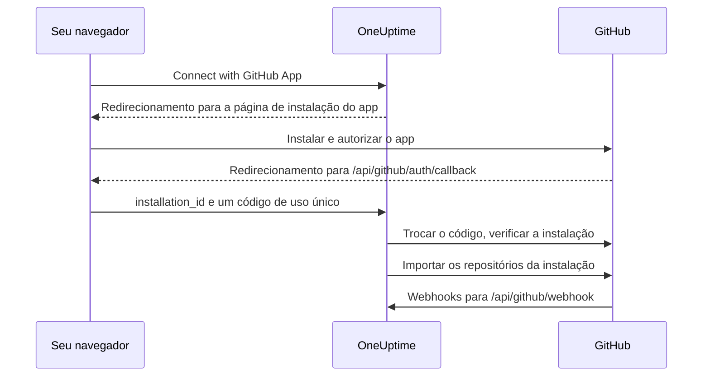

# Integração com GitHub

Conecte o seu OneUptime auto-hospedado ao GitHub com um GitHub App seu. Depois que o app é instalado a partir do OneUptime, os repositórios da instalação são importados para o seu projeto e mantidos sincronizados, as tarefas de correção com IA abrem pull requests, e a equipe pode passar trabalho para o app pelo GitHub mencionando-o.

Esta página é para quem administra o servidor do OneUptime: você cria o app uma vez, e depois cada projeto o conecta em **Repositórios de código**.

:::cards
- [Criar o GitHub App](#criar-o-github-app): Registre o app com as URLs, permissões e eventos certos.
- [Configurar o OneUptime](#configurar-o-oneuptime): Entregue ao servidor os seis valores do app.
- [Conectar repositórios](#conectar-repositórios): Instale o app a partir do OneUptime.
- [Solução de problemas](#solução-de-problemas): O que as mensagens de Repositórios de código significam.
:::

## Como funciona

A instalação começa no OneUptime, não no GitHub: é o link com que o OneUptime envia você ao GitHub que vincula a instalação ao seu projeto.



- O redirecionamento do navegador leva a instalação e um código OAuth de uso único. O OneUptime troca o código para confirmar que a conta do GitHub que instalou o app administra essa instalação e, em seguida, importa os repositórios dela.
- Os webhooks mantêm a lista de repositórios sincronizada e passam trabalho para o app: menções, atribuições, labels de acionamento e pedidos de revisão. O GitHub assina cada um com o webhook secret, e o OneUptime rejeita os que não consegue verificar.

## Antes de começar

- Uma conta do GitHub que possa criar GitHub Apps para a organização ou o usuário onde o app será instalado. Para instalá-lo em uma organização, você precisa ser proprietário dela ou ter um proprietário que aprove o pedido.
- Um nome de host HTTPS público para o OneUptime que o GitHub consiga alcançar para os webhooks. Veja [Acesso à rede](#acesso-à-rede-para-implantações-auto-hospedadas).
- Acesso à configuração do servidor: `config.env` no Docker Compose, ou os seus values do Helm no Kubernetes.

## Criar o GitHub App

:::steps
### Abra as configurações de GitHub Apps

- **Para uma organização:** `https://github.com/organizations/YOUR_ORG/settings/apps`
- **Para uma conta pessoal:** `https://github.com/settings/apps`

Selecione **New GitHub App**.

### Preencha o formulário de registro

| Campo | Valor |
| --- | --- |
| **GitHub App name** | Qualquer nome único, por exemplo `OneUptime`. Anote-o exatamente: ele é `GITHUB_APP_NAME`. |
| **Homepage URL** | `https://your-oneuptime-domain.com` |
| **Callback URL** | `https://your-oneuptime-domain.com/api/github/auth/callback` |
| **Request user authorization (OAuth) during installation** | Ligado. **É obrigatório**: veja a nota abaixo. |
| **Setup URL** | `https://your-oneuptime-domain.com/api/github/auth/callback`, se o GitHub deixar você informar uma (veja abaixo). |
| **Redirect on update** | Opcional. Depois que alguém altera uma instalação no GitHub, o OneUptime leva a pessoa para **Repositórios de código**. |
| **Webhook URL** | `https://your-oneuptime-domain.com/api/github/webhook`, com o webhook **Active**. |
| **Webhook secret** | Uma string aleatória longa. Anote-a: ela é `GITHUB_APP_WEBHOOK_SECRET`. **Obrigatório**: o OneUptime rejeita webhooks não assinados, então deixar `GITHUB_APP_WEBHOOK_SECRET` sem valor interrompe a sincronização dos repositórios em vez de aceitar payloads não verificados. |

Segundo a documentação do GitHub, com **Request user authorization (OAuth) during installation** ligado [você não pode informar uma Setup URL](https://docs.github.com/en/apps/creating-github-apps/registering-a-github-app/about-the-setup-url): os usuários são enviados para a Callback URL depois de instalar o app. As duas apontam para o mesmo endereço do OneUptime, então o redirecionamento chega ao lugar certo de qualquer forma.

> [!IMPORTANT]
> **Por que "Request user authorization (OAuth) during installation" é obrigatório.** Depois de uma instalação, o GitHub redireciona com um `installation_id` na URL. Esse número sozinho não prova nada sobre quem é o dono da instalação — qualquer pessoa pode digitar outro. Com essa opção ligada, o GitHub também devolve um `code` OAuth de uso único, vinculado à conta do GitHub que fez a instalação, que o OneUptime troca para confirmar que essa conta realmente administra a instalação antes de conectá-la ao seu projeto.
>
> Sem ela, o OneUptime se recusa a conectar a instalação e o painel mostra um erro pedindo que você ligue essa configuração. Isso é proposital: aceitar o ID da instalação sem verificação permitiria que um projeto do OneUptime reivindicasse os repositórios de outra organização.

### Defina as permissões

Em **Permissions & events**, defina estas **Repository permissions**:

| Permissão | Acesso | Para que o OneUptime a usa |
| --- | --- | --- |
| Contents | Read and write | Ler arquivos do repositório e enviar os branches das pull requests de correção com IA |
| Pull requests | Read and write | Abrir e atualizar pull requests, e publicar revisões |
| Issues | Read and write | Publicar os comentários do app — **inclusive em pull requests**, cuja conversa o GitHub encaminha pela API de issues |
| Checks | Read-only | Opcional. Ler o resultado de CI das pull requests de correção. Sem ela, o status de CI delas fica sem verificação |
| Metadata | Read-only | Metadados básicos do repositório (exigidos pelo GitHub) |

**É Issues: Read and write que torna o app interativo.** Sem ela, as menções são recebidas e depois falham em silêncio quando o app tenta responder — o GitHub entrega os comentários das conversas de pull requests pela API de issues, então essa única permissão controla cada resposta que o app escreve. Veja [Trabalhar com o OneUptime pelo GitHub](/docs/ai/github-app).

O OneUptime não precisa de permissões de organização nem de conta.

### Assine os eventos de webhook

O OneUptime usa dois conjuntos de eventos, e eles têm funções diferentes.

**Sincronização de repositórios** — `installation` e `installation_repositories`. Os GitHub Apps os recebem automaticamente; eles mantêm o conjunto de repositórios conectados alinhado com onde o app está instalado.

**O app interativo** — estes precisam ser assinados explicitamente, e cada um habilita uma forma específica de passar trabalho para o app:

| Evento | O que habilita |
| --- | --- |
| **Issue comment** | comandos `@mention` em issues **e** em pull requests |
| **Issues** | atribuir uma issue ao app, e a label de acionamento do repositório |
| **Pull request** | pedir uma revisão ao app |
| **Pull request review** | uma menção escrita no corpo de uma revisão enviada |
| **Pull request review comment** | uma menção em um comentário inline no diff |

Se nenhum deles estiver assinado, o GitHub App ainda conecta repositórios e ainda abre pull requests de correção pelo OneUptime — ele simplesmente nunca responde a nada escrito no GitHub. Essa é a causa mais comum de "o bot me ignora". Veja [Trabalhar com o OneUptime pelo GitHub](/docs/ai/github-app) para saber quais são os comandos e quem pode usá-los.

Outros eventos (**Push**, **Workflow run**) são confirmados e ignorados; assiná-los não habilita notificações nem automação de CI/CD.

### Escolha onde o app pode ser instalado

Em **Where can this GitHub App be installed?**, escolha:

- **Only on this account** - Para uso privado/interno
- **Any account** - Se você quiser que outras pessoas instalem o seu app

### Crie o app e anote os IDs dele

Selecione **Create GitHub App**. O GitHub abre a página de configurações do app. Anote o **App ID**, no topo da página, e o **Client ID**, na seção **About**.

### Gere um client secret

Em **Client secrets**, selecione **Generate a new client secret**. Copie-o na hora: o GitHub só o mostra uma vez.

### Gere uma chave privada

Em **Private keys**, selecione **Generate a private key**. O GitHub baixa um arquivo `.pem`. Guarde-o com segurança: ele permite que o OneUptime se autentique como o app.
:::

## Configurar o OneUptime

:::tabs
@tab Docker Compose
O `config.env` tem um valor por linha, então informe a chave privada codificada em base64, em uma única linha. O OneUptime a decodifica:

```bash
base64 < private-key.pem | tr -d '\n'
```

```bash title="config.env"
GITHUB_APP_ID=YOUR_APP_ID
GITHUB_APP_NAME=YOUR_APP_NAME
GITHUB_APP_CLIENT_ID=YOUR_CLIENT_ID
GITHUB_APP_CLIENT_SECRET=YOUR_CLIENT_SECRET
GITHUB_APP_PRIVATE_KEY=YOUR_BASE64_ENCODED_PRIVATE_KEY
GITHUB_APP_WEBHOOK_SECRET=YOUR_WEBHOOK_SECRET
```

Aplique a alteração com `npm run start`, que recria os contêineres. `docker compose restart` não lê o `config.env` de novo.
@tab Kubernetes
```yaml title="values.yaml"
gitHubApp:
  id: "YOUR_APP_ID"
  name: "YOUR_APP_NAME" # The exact name of your GitHub App
  clientId: "YOUR_CLIENT_ID"
  clientSecret: "YOUR_CLIENT_SECRET"
  privateKey: "<BASE64_ENCODED_PRIVATE_KEY_CONTENT>"
  webhookSecret: "YOUR_WEBHOOK_SECRET"
```

`privateKey` também aceita o próprio PEM, como um bloco de várias linhas (`privateKey: |`). Aplique a alteração com `helm upgrade`.
:::

Quando o OneUptime voltar, **Repositórios de código** mostra **Connect with GitHub App** em vez de **GitHub App is not configured on this server**.

### Referência das variáveis de ambiente

| Docker Compose (`config.env`) | Helm (`values.yaml`) | Valor |
| --- | --- | --- |
| `GITHUB_APP_ID` | `gitHubApp.id` | O **App ID**. Usado para se autenticar como o app. |
| `GITHUB_APP_NAME` | `gitHubApp.name` | O nome exato do app. O link de instalação e o identificador `@mention` do app (em minúsculas, com hifens no lugar dos espaços) são montados a partir dele. Sem ele, **Repositórios de código** não consegue conectar. |
| `GITHUB_APP_CLIENT_ID` | `gitHubApp.clientId` | O **Client ID**. Necessário para verificar quem instalou o app. |
| `GITHUB_APP_CLIENT_SECRET` | `gitHubApp.clientSecret` | O client secret que você gerou. Necessário junto com o client ID. |
| `GITHUB_APP_PRIVATE_KEY` | `gitHubApp.privateKey` | A chave privada: o PEM, ou o PEM codificado em base64. |
| `GITHUB_APP_WEBHOOK_SECRET` | `gitHubApp.webhookSecret` | O webhook secret. Todo webhook é verificado com ele, e nenhum é aceito sem ele. |

As seis são obrigatórias.

## Conectar repositórios

Comece a conexão pelo OneUptime, não pela página do app no GitHub: é o link com que o OneUptime envia você ao GitHub que vincula a instalação ao seu projeto.

:::steps
1. Entre no seu painel do OneUptime
2. Vá em **Produtos** > **Tarefas** > **Repositórios de código**
3. Clique em **Connect with GitHub App**. O OneUptime leva você ao GitHub
4. Selecione a organização ou a conta onde instalar o app, e escolha quais repositórios ele pode acessar: **All repositories** (todos os repositórios atuais e futuros) ou **Only select repositories**
5. Clique em **Install** (ou em **Save**, se o app já estiver instalado ali)
6. O GitHub devolve você para **Repositórios de código**, e todo repositório da instalação é importado. Repositórios adicionados à instalação ou removidos dela depois são sincronizados automaticamente.
:::

**Quem pode conectar.** Conectar importa os repositórios da instalação para o projeto, então exige permissão para adicionar repositórios de código: **Project Owner**, **Project Admin**, **Project Member**, **Settings Admin**, **Settings Member**, ou uma equipe com **Create Code Repository**. Uma equipe que bloqueia a permissão a retira. No OneUptime Cloud, repositórios de código exigem o plano Growth ou superior. Para qualquer outra pessoa, o cartão fica bloqueado e diz o que é preciso.

**Conclua em até 15 minutos, no mesmo navegador.** O link funciona uma vez, por 15 minutos, no navegador que o iniciou. Quando o GitHub devolve você, o OneUptime verifica a permissão de novo antes de importar qualquer coisa.

## Acesso à rede para implantações auto-hospedadas

### Sentido do tráfego e endpoints

| Tráfego | Acesso necessário |
| --- | --- |
| Do OneUptime para o GitHub | DNS e HTTPS de saída na TCP 443 para `api.github.com`, para tokens do GitHub App e chamadas à API de repositórios, e para `github.com`, para a troca do token OAuth e operações Git por HTTPS |
| Do GitHub para o OneUptime | HTTPS público na TCP 443 para `POST /api/github/webhook`, para a sincronização de instalações e do acesso aos repositórios, e para o app interativo |
| Do navegador do usuário para o OneUptime | Acesso ao painel e `GET /api/github/auth/callback` para os redirecionamentos de instalação e autorização; eles podem continuar acessíveis pela VPN do usuário |

O callback é um [redirecionamento do navegador](https://docs.github.com/en/apps/creating-github-apps/registering-a-github-app/about-the-user-authorization-callback-url), enquanto o webhook é uma requisição dos servidores do GitHub. A conexão VPN de um usuário não dá ao GitHub acesso ao webhook. Os domínios acima cobrem as requisições essenciais da integração; outras ferramentas de repositório, downloads, LFS ou pacotes podem exigir outros destinos. Estas configurações descrevem o GitHub.com; mudar o firewall não configura o suporte a um nome de host do GitHub Enterprise Server.

### Implantações privadas e segurança dos callbacks

Exponha `/api/github/webhook` por um gateway público com DNS público, um certificado HTTPS de confiança pública com a cadeia completa e uma rota privada até o ingress do OneUptime. Libere a TCP 443 de entrada para o gateway e restrinja o encaminhamento público a esta rota POST. Mantenha o painel e o callback do navegador no ingress privado se os usuários os acessam pela VPN; com DNS dividido, o mesmo nome de host pode ser servido interna e externamente.

Defina `HOST=oneuptime.example.com` e `HTTP_PROTOCOL=https` no `config.env`, ou `host: oneuptime.example.com` e `httpProtocol: https` no Helm. Aplique a configuração e espere o OneUptime reiniciar. Esses valores geram URLs; eles não provisionam DNS, TLS nem acesso à rede. Se o nome de host mudar, atualize as URLs de webhook, callback, setup e página inicial do GitHub App.

Preserve o método, o caminho original, a query string, o corpo, `Content-Type`, `X-Hub-Signature-256`, `X-GitHub-Event` e `X-GitHub-Delivery`. Preserve o host público e o esquema HTTPS por cabeçalhos de proxy confiáveis. Isente o webhook do SSO do navegador, de CAPTCHA e das páginas de login do proxy. Mantenha ativada a verificação SSL do GitHub e configure o mesmo `GITHUB_APP_WEBHOOK_SECRET` nos dois sistemas: o OneUptime rejeita requisições não assinadas e não consegue validar webhooks sem esse secret. Veja as [orientações do GitHub sobre validação de webhooks](https://docs.github.com/en/webhooks/using-webhooks/validating-webhook-deliveries).

Se você também restringir os IPs de origem dos webhooks, use as faixas `hooks` atuais da Meta API do GitHub e atualize-as com regularidade; não as substitua pelas faixas dos runners do GitHub Actions nem dispense a verificação da assinatura. O GitHub avisa que [os endereços dele mudam e a lista publicada não é completa](https://docs.github.com/en/authentication/keeping-your-account-and-data-secure/about-githubs-ip-addresses).

### Verificar o acesso e entender as limitações

:::steps
1. Conecte uma instalação em **Repositórios de código**.
2. Nas configurações do GitHub App, abra **Advanced** e veja **Recent Deliveries**. Reenvie uma entrega e confirme que o gateway a encaminha e que o OneUptime a aceita.
3. Adicione ou remova um repositório de teste da instalação, e verifique se a lista de repositórios no OneUptime acompanha.
:::

O GitHub documenta o [diagnóstico de entregas](https://docs.github.com/en/webhooks/testing-and-troubleshooting-webhooks/viewing-webhook-deliveries) e exige [uma confirmação 2xx em até dez segundos](https://docs.github.com/en/webhooks/using-webhooks/best-practices-for-using-webhooks). Um GET do navegador no webhook não testa um POST assinado.

> [!WARNING]
> Sem acesso de entrada, a autorização no navegador e as operações de API e Git de saída podem funcionar, mas os webhooks não chegam ao OneUptime: instalações excluídas e mudanças no acesso aos repositórios não são sincronizadas, e o app nunca responde a menções, atribuições ou pedidos de revisão.

A [configuração de acesso à rede privada](/docs/self-hosted/private-network-access) controla requisições de saída para destinos privados e não torna o webhook alcançável pelo GitHub.

## Solução de problemas

### A conexão não foi concluída

Quando o GitHub devolve você e a instalação não foi conectada, **Repositórios de código** mostra **O GitHub não foi conectado**, com uma frase no seu idioma dizendo por quê. O restante da página carrega normalmente, então você pode conectar de novo ali mesmo. Ela nunca mostra o que o próprio GitHub respondeu: isso fica no log do servidor do OneUptime, com o motivo.

| A página diz | O que fazer |
| --- | --- |
| **"Este link de conexão é inválido, expirou ou já foi usado. Comece novamente."** | O link funciona uma vez, por 15 minutos, no navegador que o iniciou. Comece de novo em **Repositórios de código** e conclua no GitHub em até 15 minutos, no mesmo navegador. Instalar o app pela página dele no GitHub não o conecta a nenhum projeto. |
| **"Você não tem permissão para adicionar repositórios de código a este projeto."** | Conectar exige permissão para adicionar repositórios de código (veja [Conectar repositórios](#conectar-repositórios)). Peça a um administrador do projeto que a conceda. Ela é verificada de novo quando o GitHub devolve você, então uma permissão retirada nesse meio-tempo também encerra a conexão aqui. |
| **"Conectar o GitHub exige o plano ...."** | No OneUptime Cloud, repositórios de código exigem o plano que a frase cita. Mude o plano do projeto e conecte de novo. |
| **"O GitHub não confirmou quem instalou o app, então não foi possível verificar a instalação."** | Ligue **Request user authorization (OAuth) during installation** nas configurações do GitHub App (veja [Criar o GitHub App](#criar-o-github-app)) e conecte de novo. |
| **"O OneUptime não conseguiu confirmar que sua conta do GitHub pode gerenciar esta instalação."** | A conta do GitHub que concluiu a instalação não a administra. Instale o app com uma conta que seja dona da organização ou do usuário onde ele é instalado, ou peça isso a um proprietário. |
| **"O GitHub não enviou nenhuma instalação de volta."** | Quando um membro da organização pede o app em vez de instalá-lo, um proprietário da organização precisa aprovar o pedido primeiro. Conecte de novo depois que ele aprovar. |
| **"O GitHub App não está configurado neste servidor do OneUptime."** | Defina `GITHUB_APP_CLIENT_ID` e `GITHUB_APP_CLIENT_SECRET` (veja [Configurar o OneUptime](#configurar-o-oneuptime)) e reinicie o OneUptime. |
| **"O OneUptime não conseguiu concluir a conexão. Tente novamente."** | O GitHub respondeu com um erro, ou uma requisição ou uma gravação falhou durante a conclusão. O log do servidor do OneUptime diz qual. Tente de novo; se continuar acontecendo, verifique o log e as configurações do GitHub App. |

### Outros problemas

:::details Repositórios de código diz "GitHub App is not configured on this server"
`GITHUB_APP_NAME` não está definido. Defina-o com o nome exato do app, junto com os outros cinco valores, e reinicie o OneUptime.
:::

:::details Não volto para o OneUptime depois de instalar o app
Verifique se a **Callback URL** do app é `https://your-oneuptime-domain.com/api/github/auth/callback`, e também a **Setup URL**, se houver uma definida. As duas precisam apontar para o mesmo endpoint `/api/github/auth/callback`, no nome de host de `HOST`.
:::

:::details As Recent Deliveries do GitHub mostram "Invalid webhook signature"
O webhook secret do GitHub App e `GITHUB_APP_WEBHOOK_SECRET` são diferentes, `GITHUB_APP_WEBHOOK_SECRET` não está definido, ou um proxy alterou o corpo da requisição. Defina o mesmo secret nos dois, reinicie o OneUptime e garanta que o gateway encaminhe o corpo sem alterações.
:::

:::details Os eventos de webhook não chegam
Verifique se a URL do webhook é alcançável publicamente por HTTPS e, depois, veja **Advanced > Recent Deliveries** nas configurações do GitHub App para cada tentativa e a resposta dela. Os webhooks são recusados enquanto `GITHUB_APP_WEBHOOK_SECRET` não estiver definido.
:::

:::details Repositórios ou tarefas de correção falham com um erro de autenticação
O OneUptime se autentica como o app com `GITHUB_APP_ID` e `GITHUB_APP_PRIVATE_KEY`. Verifique se o App ID está certo e se a chave é o PEM completo, incluindo as linhas `BEGIN` e `END`, ou esse PEM codificado em base64. Se o app foi desinstalado do GitHub, conecte-o de novo em **Repositórios de código**.
:::

:::details Faltam repositórios depois da instalação
Verifique quais repositórios a instalação pode acessar, nas configurações dela no GitHub. Os repositórios que você adicionar lá são importados automaticamente, desde que os webhooks cheguem ao OneUptime.
:::

:::details O app ignora menções no GitHub
Dê ao app **Issues: Read and write** e assine os eventos interativos de [Assine os eventos de webhook](#assine-os-eventos-de-webhook). Além disso, as menções só correspondem ao identificador montado a partir de `GITHUB_APP_NAME`, então defina-o com o nome real do app.
:::

## Boas práticas de segurança

- **Troque os segredos regularmente.** Gere novos client secrets e chaves privadas periodicamente.
- **Mantenha o webhook secret definido.** O OneUptime recusa webhooks que não consegue verificar.
- **Limite o acesso aos repositórios.** Conceda à instalação só os repositórios que precisam ser conectados.
- **Acompanhe as entregas de webhooks.** Verifique regularmente se há entregas com falha ou atividade suspeita.
- **Mantenha as chaves privadas fora do controle de versão.**

## Próximos passos

:::cards
- [Trabalhar com o OneUptime pelo GitHub](/docs/ai/github-app): Os comandos que se podem dar ao app, e quem pode dá-los.
- [Tarefas de correção](/docs/ai/ai-agent): Como o agente de IA abre pull requests de correção.
- [Acesso à rede privada](/docs/self-hosted/private-network-access): Deixe workflows e webhooks alcançarem ferramentas internas.
:::
