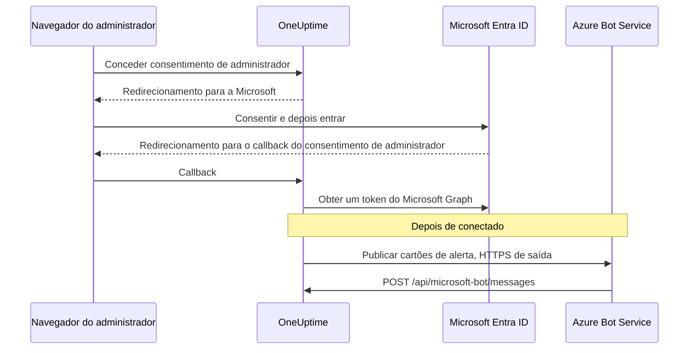

# Integração com Microsoft Teams

Conecte seu OneUptime auto-hospedado ao Microsoft Teams. Você registra um app no Microsoft Entra ID, cria um Azure Bot para ele, fornece ao OneUptime as credenciais do app e instala o pacote de app do Teams que o seu servidor gera. A partir daí, o OneUptime publica alertas e incidentes nos seus canais e chats, e a sua equipe age sobre eles diretamente no Teams.

Esta página é para quem administra o servidor do OneUptime. Depois que o Teams estiver conectado, as regras de notificação são configuradas por projeto: veja [Microsoft Teams](/docs/workspace-connections/microsoft-teams).

:::cards
- [Configurar a integração](#configurar-a-integração): Nove passos, do portal do Azure à sua primeira equipe.
- [Variáveis de ambiente](#variáveis-de-ambiente): Os três valores que o OneUptime precisa do registro do app.
- [Acesso de rede](#acesso-de-rede): O endpoint do bot que a Microsoft precisa conseguir alcançar.
- [Solução de problemas](#solução-de-problemas): Endpoints inalcançáveis, instalações ausentes e conexões que falharam.
:::

## Como funciona

O OneUptime usa um Azure Bot para a integração com o Teams. O tráfego segue nos dois sentidos, e os dois sentidos são independentes: o OneUptime chama a Microsoft para publicar mensagens, e o Azure Bot Service chama o seu servidor quando alguém aperta um botão, escreve para o bot ou o adiciona a um chat.



Um Incoming Webhook ou uma URL de fluxo de trabalho do Teams não substitui o endpoint de mensagens deste bot.

As videochamadas (uma reunião do Teams para um incidente) não usam este bot: elas precisam de um registro de app próprio, descrito em [Videochamadas](/docs/workspace-connections/video-calls#one-click-connect-on-a-self-hosted-server).

## Antes de começar

- Uma assinatura do Azure, para o recurso Azure Bot.
- Uma conta que possa criar registros de app no Microsoft Entra ID, e um administrador do Microsoft 365 para conceder o consentimento de administrador.
- Um nome de host HTTPS público para o OneUptime que o Azure Bot Service consiga alcançar. Veja [Acesso de rede](#acesso-de-rede).
- Acesso à configuração do servidor: `config.env` no Docker Compose, ou os seus values do Helm no Kubernetes.
- Para conectar um projeto, a função **Project Owner**, **Project Admin** ou **Project Member** nele.

## Configurar a integração

:::steps
### Passo 1: Crie o registro de app do Azure

No [portal do Azure](https://portal.azure.com), abra **App registrations** e selecione **New registration**. Preencha o formulário:

- **Name:** oneuptime
- **Supported account types:** Accounts in this organizational directory only (Single tenant)
- **Redirect URI:** Web - `https://your-oneuptime-domain.com/api/microsoft-teams/auth`

Selecione **Register** e depois adicione um segundo URI de redirecionamento Web, `https://your-oneuptime-domain.com/api/microsoft-teams/admin-consent/callback`. Anote o **Application (client) ID** e o **Directory (tenant) ID**: você vai precisar dos dois mais adiante.

> [!NOTE]
> **Por que um único locatário:** uma instância auto-hospedada do OneUptime atende uma organização, e o bot dela é registrado para o único locatário que você define em `MICROSOFT_TEAMS_APP_TENANT_ID` (passo 6). Registrar o app como multilocatário não amplia isso e introduz um modo de falha: usuários convidados / B2B cujo locatário Microsoft de origem é diferente do seu chegam ao bot com o próprio ID de locatário, que o OneUptime não consegue associar ao seu projeto. Se você já registrou um app multilocatário, ele continua funcionando; só garanta que `MICROSOFT_TEAMS_APP_TENANT_ID` seja o seu próprio locatário, e conte com o fato de que contas convidadas vão precisar de uma conta no seu locatário para usar o bot.

### Passo 2: Configure as permissões do app

No registro do app, abra **API permissions**, selecione **Add a permission** e escolha **Microsoft Graph**.

**Adicionar permissões delegadas** (ao agir em nome de um usuário conectado):

- **User.Read** - Necessária para obter as informações de perfil do usuário autenticado (nome de exibição, e-mail) durante o fluxo OAuth
- **Team.ReadBasic.All** - Necessária para listar as equipes das quais o usuário é membro ao escolher qual equipe conectar
- **Channel.ReadBasic.All** - Necessária para ler as informações dos canais e listar os canais das equipes para a entrega de notificações
- **ChannelMessage.Send** - Necessária para enviar notificações de alertas e incidentes aos canais do Teams

**Adicionar permissões de aplicativo** (ao agir como o próprio app, sem um usuário conectado):

- **Team.ReadBasic.All** - Necessária para listar todas as equipes da organização depois que o consentimento de administrador for concedido
- **Channel.ReadBasic.All** - Necessária para verificar se os canais existem e obter os detalhes deles
- **TeamsAppInstallation.ReadForTeam.All** - Necessária para o diagnóstico. Permite que o OneUptime leia qual pacote de app está de fato instalado em uma equipe e o compare com o ID de cliente desta instância, para que um envio com falha possa dizer *qual* das possíveis causas ocorreu. Sem ela, o OneUptime não consegue distinguir "não instalado" de "instalado, mas é o pacote de outra pessoa", e se limita a relatar o que a Microsoft disse, que é o principal motivo pelo qual depurar esta integração leva dias em vez de minutos. Conceda-a.
- **Chat.ReadBasic.WhereInstalled** - Opcional. Permite que o OneUptime leia o nome de cada chat em que o app do OneUptime está. Sem ela, cada chat concede isso pela permissão **ChatSettings.Read.Chat** do manifesto (abaixo), que um chat adicionado com um manifesto anterior só tem depois que o app é atualizado nele.

`ChannelMessage.Send` é apenas uma permissão delegada; não existe uma variante como permissão de aplicativo na [referência de permissões do Microsoft Graph](https://learn.microsoft.com/en-us/graph/permissions-reference#channelmessagesend). Mantenha-a na lista de permissões delegadas acima.

Depois selecione **Grant admin consent** para a sua organização.

O próprio bot usa permissões de consentimento específico de recurso (RSC) definidas no manifesto do app do Teams. Elas são concedidas quando o app é instalado ou atualizado em uma equipe ou em um chat, não no Entra ID:

- **ChannelMessage.Send.Group** - Permite que o bot envie mensagens aos canais das equipes
- **ChannelMessage.Read.Group** - Permite que o bot leia as mensagens dos canais para os comandos interativos
- **Channel.Create.Group** - Permite que o bot crie canais quando necessário
- **ChatMessage.Read.Chat** - Permite que o bot leia as mensagens dos chats aos quais foi adicionado (para os comandos interativos)
- **ChatMember.Read.Chat** - Permite que o bot leia os membros dos chats aos quais foi adicionado (para dar nome aos chats no OneUptime)
- **ChatSettings.Read.Chat** - Permite que o OneUptime leia o nome dos chats em grupo aos quais o app foi adicionado. O Teams não envia de forma confiável o nome de um chat em grupo ao bot, então sem ela um chat em grupo com nome aparece com os nomes dos membros
- **TeamsAppInstallation.Read.Group** - Permite que o OneUptime confirme que o app está instalado em uma equipe na qual vai publicar

Se você enviou o manifesto do app antes de essas permissões existirem, baixe-o novamente em **Configurações do projeto > Espaço de trabalho > Microsoft Teams** e envie-o ao Teams como uma atualização do app OneUptime. O Teams concede as permissões de equipe e de chat quando o app é instalado ou atualizado naquela equipe ou naquele chat, então aceite a atualização em cada equipe e em cada chat que já tem o app. Para os chats, veja [Um chat em grupo aparece com os nomes dos membros](#um-chat-em-grupo-aparece-com-os-nomes-dos-membros).

### Passo 3: Crie um segredo do cliente

No registro do app, abra **Certificates & secrets** e selecione **New client secret**. Adicione uma descrição, escolha uma validade (24 meses é uma escolha sensata) e selecione **Add**. Copie o valor do segredo imediatamente: o Azure o mostra uma única vez.

> [!IMPORTANT]
> Copie o **Value** do segredo, não o **Secret ID** dele. O valor é a cadeia mais longa.

### Passo 4: Crie um Bot Service

No portal do Azure, crie um recurso **Azure Bot**:

- **Bot handle:** oneuptime-bot
- **Subscription** e **Resource group:** os seus
- **Pricing tier:** F0 (Free) basta para testes
- **Type of App:** Single Tenant, com o registro de app existente: o **Application (client) ID** e o **Directory (tenant) ID** dele do passo 1

Selecione **Review + create** e depois **Create**. Depois que o bot for implantado, abra a página **Configuration** dele, defina **Messaging endpoint** como `https://your-oneuptime-domain.com/api/microsoft-bot/messages` e salve.

**Verifique o endpoint antes de continuar.** O Azure Bot Service chama esta URL pela Internet pública, então teste-a de algum lugar fora da sua rede: não de dentro do cluster, nem de uma VPN que enxerga o host quando o Azure não consegue:

```bash
curl -sS -i https://your-oneuptime-domain.com/api/microsoft-bot/messages
```

Use `-i` em vez de olhar só o código de status: em um 404, **o corpo é a única coisa que diz quem o gerou**, e essa distinção é todo o diagnóstico.

- **405** está correto e significa que você terminou. O endpoint aceita apenas POST, então um GET recebe `405 Method Not Allowed`, com `Allow: POST` e uma descrição do endpoint. Alcançá-lo é exatamente o que está sendo testado.
- **Um 404 com o corpo JSON `{"message":"Page not found - /api/microsoft-bot/messages"}`** vem do OneUptime, então a requisição *chegou*. Ou esta instância é anterior à resposta 405 acima (versões mais antigas serviam esta rota apenas para POST, então um GET caía no manipulador genérico de "not found"), ou algo na frente do OneUptime reescreve o caminho e remove o prefixo `/api` antes de o app vê-lo (um ingress do Kubernetes com `rewrite-target: /` é o culpado de sempre).
- **Um 404 com uma página de erro HTML** do nginx, do seu ingress ou de um balanceador de carga significa o contrário: a requisição nunca chegou ao OneUptime, e o que está na frente dele não encaminha `/api` para o app.
- **Um erro de TLS, um tempo limite esgotado ou uma conexão recusada** significa que o Azure também não vai chegar. Veja [a seção de solução de problemas do endpoint de mensagens](#os-botões-dos-cartões-dizem-unable-to-reach-app-e-os-chats-nunca-aparecem) mais abaixo.

### Passo 5: Adicione o canal do Microsoft Teams ao bot

No recurso Azure Bot, abra **Channels** e adicione **Microsoft Teams**. Mantenha as opções de mensagens padrão, a não ser que você tenha necessidades específicas, e salve. Sem esse canal, o bot nunca é provisionado nas conversas do Teams.

### Passo 6: Configure as variáveis de ambiente do OneUptime

Forneça ao OneUptime as credenciais do app:

:::tabs
@tab Docker Compose
```bash title="config.env"
MICROSOFT_TEAMS_APP_CLIENT_ID=YOUR_TEAMS_APP_CLIENT_ID
MICROSOFT_TEAMS_APP_CLIENT_SECRET=YOUR_TEAMS_APP_CLIENT_SECRET
MICROSOFT_TEAMS_APP_TENANT_ID=YOUR_MICROSOFT_TENANT_ID
```

Aplique a alteração com `npm run start`, que recria os containers. `docker compose restart` não relê `config.env`.
@tab Kubernetes
```yaml title="values.yaml"
microsoftTeamsApp:
  clientId: YOUR_TEAMS_APP_CLIENT_ID
  clientSecret: YOUR_TEAMS_APP_CLIENT_SECRET
  tenantId: YOUR_MICROSOFT_TENANT_ID
```

Para guardar os valores em um Secret do Kubernetes que você gerencia, defina em vez disso `microsoftTeamsApp.existingSecret`: o `name` dele e as chaves `clientIdKey`, `clientSecretKey` e `tenantIdKey`. Aplique a alteração com `helm upgrade`.
:::

Quando o OneUptime voltar, **Configurações do projeto > Espaço de trabalho > Microsoft Teams** mostra o cartão **Conceder Consentimento de Administrador** no lugar do guia de configuração.

### Passo 7: Conceda o consentimento de administrador no OneUptime

Abra **Configurações do projeto > Espaço de trabalho > Microsoft Teams** e selecione **Conceder Consentimento de Administrador**. Entre na Microsoft como administrador do Microsoft 365 e aceite as permissões. A Microsoft devolve você à mesma página, e o cartão mostra **Admin Consent Completed**: o projeto agora está conectado ao seu locatário.

Depois selecione **Connect my account with Microsoft Teams** para vincular a sua própria conta. Os outros membros do projeto fazem o mesmo em **Configurações do usuário > Espaço de trabalho > Microsoft Teams**.

### Passo 8: Envie o manifesto do app do Teams

Depois do consentimento de administrador, **Configurações do projeto > Espaço de trabalho > Microsoft Teams** mostra o cartão **Action Required: Install This Deployment's App on Microsoft Teams**. Selecione **Baixar o zip do manifesto do app**: o pacote leva o ID de bot desta instância.

No Microsoft Teams, abra **Apps > Manage your apps**, selecione **Upload an app**, depois **Upload a custom app**, e escolha o zip que você baixou.

> [!WARNING]
> Não instale o "OneUptime" pela loja do Microsoft Teams para uma instância auto-hospedada. O app da loja aponta para o bot do OneUptime Cloud, então o Teams o aceita e depois recusa cada mensagem que esta instância envia.

### Passo 9: Adicione o OneUptime a cada equipe (obrigatório)

Enviar o manifesto instala o app para **você**. Isso **não** dá ao bot acesso aos canais de nenhuma equipe. A Microsoft só aceita mensagens em uma equipe à qual o app foi adicionado, então você precisa fazer isso em cada equipe em que quer notificações:

1. No Microsoft Teams, clique em "..." ao lado do **nome da equipe** (não do nome do canal)
2. Escolha **Manage team** > **Apps** > **More apps**
3. Procure **OneUptime** e clique em **Add**

Observações:

- Instalar o OneUptime para você, ou adicioná-lo a um chat, é uma instalação **diferente**. Nenhuma das duas permite que ele publique nos canais de uma equipe.
- **Canais privados** precisam do app instalado no próprio canal: abra o canal > "..." > **Manage channel** > **Apps** > **Add an app**. Uma instalação no nível da equipe não cobre os canais privados.
- **Canais compartilhados** não podem receber notificações de forma alguma: o Microsoft Teams não oferece suporte a bots em canais compartilhados. O OneUptime os oculta no seletor de canais.
- Se **Manage team > Apps > More apps** estiver vazio ou esmaecido, a política de configuração de apps do Teams bloqueia apps personalizados. Corrija isso no centro de administração do Teams, em **Teams apps > Manage apps** e **Setup policies**.
:::

## Variáveis de ambiente

| Docker Compose (`config.env`) | Helm (`values.yaml`) | Valor |
| --- | --- | --- |
| `MICROSOFT_TEAMS_APP_CLIENT_ID` | `microsoftTeamsApp.clientId` | O **Application (client) ID**. Ele também é o ID do bot no pacote de app do Teams, então precisa ser um GUID. |
| `MICROSOFT_TEAMS_APP_CLIENT_SECRET` | `microsoftTeamsApp.clientSecret` | O **Value** do segredo do cliente, não o ID dele. |
| `MICROSOFT_TEAMS_APP_TENANT_ID` | `microsoftTeamsApp.tenantId` | O **Directory (tenant) ID**. O bot se autentica como um app de locatário único nesse locatário. |
| `HOST` | `host` | O seu nome de host público. Os URIs de redirecionamento, o endpoint de mensagens e o pacote de app do Teams são montados a partir dele. |
| `HTTP_PROTOCOL` | `httpProtocol` | `https`. O Azure Bot Service só chama endpoints HTTPS. |

Os três valores `MICROSOFT_TEAMS_APP_*` são obrigatórios:

- Sem o ID de cliente, a página do Microsoft Teams mostra o guia de configuração em vez de **Conceder Consentimento de Administrador**.
- Sem o ID de cliente ou o segredo, a conexão termina com **"O Microsoft Teams não está configurado neste servidor do OneUptime."**
- Sem o ID do locatário, o bot não consegue se autenticar, então a publicação e o endpoint do bot falham.

## Acesso de rede

A Microsoft exige um [endpoint HTTPS acessível publicamente para um bot auto-hospedado](https://learn.microsoft.com/en-us/azure/bot-service/bot-service-resources-faq-security?view=azure-bot-service-4.0). Um endereço IP privado, um nome DNS interno ou a conexão VPN de um funcionário não dão ao Azure Bot Service acesso ao OneUptime.

| Sentido | Destino | Finalidade |
| --- | --- | --- |
| Do OneUptime para a Microsoft | HTTPS por TCP 443 para o Microsoft Graph, a identidade da Microsoft e os serviços do Bot Framework | Troca de tokens, consulta de equipes e canais, e entrega de notificações |
| Da Microsoft para o OneUptime | `POST /api/microsoft-bot/messages` | Mensagens do bot, eventos de instalação em conversas e ações de cartões |
| Do navegador do usuário para o OneUptime | `/api/microsoft-teams/auth` e `/api/microsoft-teams/admin-consent/callback` | Redirecionamentos de login e de consentimento de administrador |

Os redirecionamentos do registro do app para `/api/microsoft-teams/auth` e `/api/microsoft-teams/admin-consent/callback` voltam pelo navegador do usuário. Esse navegador precisa alcançar o OneUptime, por exemplo pela rede corporativa ou pela VPN. As mensagens do bot e as ações dos cartões chegam dos servidores da Microsoft e precisam de um ingress acessível próprio. A entrega de alertas de saída, sozinha, não verifica a conectividade de entrada.

### Publicar o endpoint do bot a partir de uma implantação privada

```mermaid title="Publicar o endpoint do bot a partir de uma implantação privada"
flowchart LR
    Azure["Azure Bot Service"] -->|HTTPS 443| GW["Gateway público"]
    GW -->|"POST /api/microsoft-bot/messages"| ING["Ingress do OneUptime"]
    Users["Funcionários na VPN"] --> ING
    ING --> App["App do OneUptime"]
```

:::steps
1. Aponte o DNS público do nome de host do OneUptime para um proxy reverso ou um balanceador de carga exposto à Internet. Permita TCP 443 de entrada e sirva um certificado TLS publicamente confiável com a cadeia completa.
2. Conecte o gateway ao ingress privado do OneUptime, diretamente ou pela sua própria VPN site a site / link privado, e permita a porta de serviço de origem dele. Um serviço `ClusterIP` do Kubernetes precisa de um ingress acessível ou de outra rota a partir do gateway. Mantenha privados os bancos de dados e os demais serviços internos.
3. Publique `/api/microsoft-bot/messages` por esse gateway e defina o **Messaging endpoint** do Azure Bot do passo 4 com a URL HTTPS pública completa. Preserve o método, o prefixo `/api`, a query string, o corpo e o cabeçalho `Authorization`. Preserve o `Host` público e defina cabeçalhos de encaminhamento confiáveis para o host público e o esquema HTTPS. Não adicione a esta rota redirecionamentos, SSO do navegador, CAPTCHA nem login do proxy; o adaptador do Bot Framework do OneUptime precisa receber e autenticar a requisição.
4. Mantenha as outras rotas privadas, se necessário. Com DNS dividido, os funcionários podem resolver o mesmo nome de host para o ingress privado pela rede corporativa ou pela VPN. Esse ingress também precisa servir HTTPS com um certificado válido para o nome de host e permitir os redirecionamentos do navegador da tabela acima. Restrinja o acesso à origem ao gateway e aos clientes internos autorizados.
5. Defina `HOST=oneuptime.example.com` e `HTTP_PROTOCOL=https` no `config.env` do Docker Compose, ou `host: oneuptime.example.com` e `httpProtocol: https` nos values do Helm. Substitua o exemplo pelo seu domínio, aplique a atualização da implantação e aguarde o app reiniciar. Esses valores geram URLs; eles não provisionam DNS, TLS nem acesso de rede. Se o nome de host mudar, atualize o endpoint do Azure Bot e os redirecionamentos do registro do app, e baixe e envie novamente o manifesto do Teams.
:::

As [configurações de acesso à rede privada](/docs/self-hosted/private-network-access) do OneUptime regem as requisições de saída para serviços internos. Ativar `ALLOW_PRIVATE_NETWORK_WEBHOOKS` não torna o endpoint do bot acessível para a Microsoft.

### Acesso de saída e restrições de IP

Permita a resolução de DNS e o HTTPS de saída a partir do app do OneUptime. Use `graph.microsoft.com`, `login.microsoftonline.com`, os endpoints de autenticação e de canal do Bot Framework, e a URL do serviço conector fornecida para uma conversa. O conector de fallback da nuvem comercial é `https://smba.trafficmanager.net/teams/`; as URLs de serviço das conversas podem ser diferentes. Aplique as [orientações de firewall da Microsoft](https://learn.microsoft.com/en-us/azure/bot-service/bot-service-resources-faq-security?view=azure-bot-service-4.0) e inspecione o tráfego bloqueado durante os testes; esta não é uma lista completa de nomes de host.

A Microsoft não oferece suporte a listas fixas de IPs permitidos para o tráfego de entrada do Bot Framework, porque os endereços de origem dela mudam. As faixas de IP de mídia dos clientes do Teams não descrevem as origens dos webhooks de bots. Mantenha a autenticação do Bot Framework ativada em vez de tratar um IP de origem como prova de identidade.

### Testes e implantações sem acesso de entrada

Use o passo 4 para verificar o DNS público, o TLS e o roteamento de fora da sua rede e da sua VPN. Depois conecte o Teams, envie uma notificação de teste, escreva para o bot e aperte um botão de um cartão. Confirme a ação no OneUptime e relacione os diagnósticos de entrega da Microsoft com os logs do gateway e do app. Uma rota GET acessível ou uma notificação entregue não verificam, sozinhas, um POST de entrada autenticado do bot.

Para desenvolvimento, o [guia da Microsoft para testar bots do Teams localmente](https://learn.microsoft.com/en-us/microsoftteams/platform/bots/how-to/authentication/add-authentication#testing-the-bot-locally-in-teams) descreve como expor um serviço local com um túnel. Encaminhe para um proxy que permita o endpoint do bot e use `/api/microsoft-bot/messages`, em vez do caminho de exemplo `/api/messages` da Microsoft. Atualize o nome de host configurado e o endpoint do Azure Bot sempre que a URL pública do túnel mudar, pare o túnel depois dos testes e use um ingress estável em produção. Um túnel também abre acesso de entrada.

> [!WARNING]
> Se uma política proíbe a conectividade de entrada, a integração completa do bot do Teams não funciona: comandos, ações de cartões e a descoberta de conversas dependem de a Microsoft alcançar o OneUptime. O Azure Bot Private Endpoint não resolve esse requisito. As [instruções de isolamento de rede](https://learn.microsoft.com/en-us/azure/bot-service/dl-network-isolation-how-to?view=azure-bot-service-4.0) da Microsoft descrevem o isolamento do Direct Line e informam que desativar o acesso à rede pública quebra a configuração dos canais do Teams. Uma instalação totalmente desconectada não pode usar o Teams.

## Solução de problemas

Comece por estas verificações:

- O registro do app tem as permissões acima, e o consentimento de administrador foi concedido.
- Os URIs de redirecionamento correspondem exatamente (troque `your-oneuptime-domain.com` pelo seu domínio real).
- As variáveis de ambiente estão definidas, e o OneUptime foi reiniciado depois de você defini-las.
- O endpoint de mensagens do bot é acessível pela Internet, e o bot tem o canal do Microsoft Teams.
- O pacote de app do Teams que você enviou é o que foi baixado desta instância.

### Os botões dos cartões dizem "Unable to reach app" e os chats nunca aparecem

Esses sintomas costumam significar que **o Azure Bot Service não consegue entregar atividades autenticadas ao seu endpoint de mensagens**. Verifique o roteamento, a autenticação do bot e a configuração do projeto.

O que confunde é que os cartões de alerta continuam chegando ao Teams, o que faz a integração parecer quase saudável. Ela não está: os dois sentidos são independentes, e só um deles funciona:

| Sentido | Como trafega | O Azure precisa alcançar você? |
| --- | --- | --- |
| O OneUptime publica um cartão de alerta em um canal | O OneUptime chama a Microsoft, autenticando-se com o seu segredo do cliente | **Não** |
| Você aperta um botão nesse cartão | O Azure Bot Service envia um POST para `/api/microsoft-bot/messages` | **Sim** |
| Você escreve `help` para o bot | O Azure Bot Service envia um POST para `/api/microsoft-bot/messages` | **Sim** |
| Um chat é registrado em **Microsoft Teams Chats** | O Azure Bot Service envia por POST uma atividade do bot para `/api/microsoft-bot/messages` | **Sim** |

Então um alerta que funciona verifica aquele envio de saída; ele não verifica cada permissão do Graph nem o endpoint de entrada do bot. Os recursos interativos exigem que as atividades de entrada do bot sejam processadas com sucesso.

O OneUptime registra os chats a partir de atividades do bot, como a instalação do app, a adição do bot à conversa ou uma mensagem enviada ao bot naquele chat. Todas chegam pelo mesmo endpoint de entrada. Uma lista **Microsoft Teams Chats** vazia depois de adicionar o app e escrever para ele significa que nenhum chat foi registrado para aquele projeto; verifique as requisições de entrada, os erros de autenticação e a associação entre locatário e projeto. Clicar em **Refresh Chats** relê os chats que o OneUptime armazenou e relê na Microsoft o nome de cada chat em grupo armazenado.

**Diagnostique nesta ordem:**

1. **Procure o POST, não os 404.** É aqui que a maioria das investigações se perde:

   ```bash
   grep 'POST /api/microsoft-bot/messages' <your access log>
   ```

   Se não houver linhas POST, confirme que o log de acesso certo está registrando requisições e depois verifique o endpoint configurado no Azure e o caminho de rede. Se chegarem POSTs, examine as respostas e os erros de autenticação ou de associação de projeto do OneUptime. Linhas `GET` que retornam 404 são uma verificação à parte; veja a nota abaixo.

2. **Chame o endpoint de fora da sua rede,** como no passo 4, com `curl -i` para ver o corpo. Um `405` prova que a rota está ativa e acessível de onde você executou o comando. Um erro de TLS, um tempo limite esgotado ou uma conexão recusada é a sua resposta.

3. **Verifique a cadeia de certificados.** O Azure exige HTTPS com um certificado publicamente confiável servido com a cadeia completa. Um certificado autoassinado, uma CA interna ou um intermediário ausente fazem o handshake TLS falhar antes de o OneUptime ver a requisição, então o seu log de acesso fica vazio e parece que o Azure nunca tentou:

   ```bash
   openssl s_client -connect your-oneuptime-domain.com:443 -servername your-oneuptime-domain.com -verify_return_error </dev/null
   ```

4. **Verifique se o host pode ser resolvido publicamente.** Um nome DNS privado, um registro split-horizon ou um ingress somente interno alcançam você e a sua VPN, mas continuam invisíveis para o Azure. Resolva-o a partir de uma rede sem acesso à sua.

5. **Confirme o endpoint no recurso Azure Bot**: ele precisa corresponder exatamente a esta instância, incluindo o esquema e o caminho: `https://your-oneuptime-domain.com/api/microsoft-bot/messages`.

**Um 404 em `GET /api/microsoft-bot/messages` não é a falha, nem prova de que o Azure não conseguiu alcançar você.** O endpoint sempre aceitou apenas POST, então nas versões anteriores a esta um GET do navegador caía no manipulador genérico de "not found" do OneUptime e voltava como `{"message":"Page not found - /api/microsoft-bot/messages"}`. Isso parece uma rota ausente e já levou mais de um administrador a procurar uma regressão que não existia; mas repare no que isso realmente prova: o OneUptime gerou essa resposta, então a requisição chegou ao app. Ela tem 58 bytes, por isso aparece em um log de acesso como `"GET /api/microsoft-bot/messages HTTP/1.1" 404 58`.

Esta versão responde a um GET com `405 Method Not Allowed` e uma descrição de si mesma, então a distinção não precisa mais de explicação. Se você ainda está em uma versão anterior, julgue um 404 pelo corpo: o JSON do OneUptime significa que a requisição chegou; uma página de erro HTML do seu proxy significa que não chegou.

### Um chat em grupo aparece com os nomes dos membros

O Teams não envia de forma confiável o nome de um chat em grupo ao bot, então o OneUptime o lê no Microsoft Graph. Para isso é preciso a permissão **ChatSettings.Read.Chat** do manifesto, que cada chat concede quando o app do OneUptime é instalado ou atualizado nele. Os chats aos quais o app foi adicionado com um manifesto anterior não a têm, e **Refresh Chats** os sinaliza. Corrija de uma destas duas formas:

1. Baixe o manifesto novamente em **Configurações do projeto > Espaço de trabalho > Microsoft Teams**, envie-o ao Teams como uma atualização do app OneUptime, aceite a atualização em cada um desses chats e depois clique em **Refresh Chats**.
   - O Teams só aceita o envio como atualização quando a versão dele é maior que a instalada. As imagens de release a definem a partir de `APP_VERSION`. Um build sem `APP_VERSION` usa um valor de fallback fixo que só muda quando o OneUptime altera o manifesto; se o Teams disser que o pacote não é mais novo, aumente a `version` do manifesto antes de enviá-lo.
   - Se o seu locatário só permite permissões de chat para apps pré-aprovados, adicione primeiro **ChatSettings.Read.Chat** à política de pré-aprovação do OneUptime (por exemplo `Update-MgBetaTeamAppPreapproval -TeamsAppId <app id> -ResourceSpecificApplicationPermissionsAllowedForChats @('ChatMember.Read.Chat','ChatMessage.Read.Chat','ChatSettings.Read.Chat')`), senão o app atualizado não poderá ser adicionado aos chats.
2. Ou conceda ao registro do app a permissão de aplicativo **Chat.ReadBasic.WhereInstalled** (passo 2) com consentimento de administrador e depois clique em **Refresh Chats**. Isso cobre de uma vez cada chat em que o app está, sem atualizar chat por chat. O OneUptime continua usando o token atual do Microsoft Graph até ele expirar, então uma permissão recém-concedida pode levar até uma hora para fazer efeito.

Um chat em grupo que não tem nome no Teams aparece com os nomes dos membros, por design. Um chat renomeado no Teams assume o novo nome na próxima vez que alguém clicar em **Refresh Chats**.

### Verificar a configuração do bot desta instância

```bash
curl -sS https://your-oneuptime-domain.com/api/microsoft-bot/test | jq
```

Isso informa o que o OneUptime consegue ver localmente: se `MICROSOFT_TEAMS_APP_CLIENT_ID` e `MICROSOFT_TEAMS_APP_CLIENT_SECRET` estão definidos, o endpoint de mensagens que esta instância espera e, o mais útil, o **ID do bot** que o seu pacote de app do Teams precisa levar.

Ele lê variáveis de ambiente e nada mais. Não chama o Azure, então não consegue dizer se o recurso Azure Bot existe, se o endpoint de mensagens dele aponta para cá, se o canal do Teams está ativado, se o segredo ainda é válido ou se o Azure consegue alcançar você. A resposta diz isso ela mesma, listando o que verificou e o que não verificou, para nunca ser confundida com sinal verde.

A única verificação decisiva que ele permite: compare o `botId` que ele retorna com o ID do bot do app OneUptime instalado no Teams. Se forem diferentes, esse pacote não pode receber mensagens desta instância; veja o passo 8.

### "The OneUptime app is not installed in the Microsoft Teams team ..."

O OneUptime verificou com o Microsoft Graph e o app realmente não está naquela equipe (ou, em um canal privado, naquele canal). Conclua o **passo 9** acima. O OneUptime consegue listar cada canal do seu locatário com as permissões de aplicativo do Graph, mas só consegue *publicar* nas equipes das quais o app é membro.

### "Microsoft Teams refused the message ... because the OneUptime bot is not a member of that conversation"

A Microsoft recusou a publicação (nas palavras dela, `BotNotInConversationRoster`) e o OneUptime **não** conseguiu confirmar que o app está ausente, então não presuma isso. Percorra as causas na ordem abaixo; as duas primeiras são idênticas, vistas do Teams, a uma configuração correta.

1. **O app da equipe é outro pacote.** Ver um ícone chamado "OneUptime" em **Manage team > Apps** não basta: o que importa é se o ID do bot desse pacote é o `MICROSOFT_TEAMS_APP_CLIENT_ID` *desta* instância. O app público do OneUptime na loja do Teams aponta para o bot do OneUptime Cloud e nunca vai aceitar publicações da sua instância auto-hospedada. Só o manifesto baixado em **Configurações do projeto > Espaço de trabalho > Microsoft Teams** (passo 8) foi feito para a sua instância. Na dúvida, remova o app da equipe, envie de novo o seu próprio manifesto e adicione esse.
2. **O Azure Bot não tem o canal do Microsoft Teams.** Conclua o **passo 5**. Sem ele, o bot nunca é provisionado nas conversas do Teams, então ele não está na lista de membros de nenhum canal, mesmo que o app seja instalado sem problemas e a lista de apps pareça correta.
3. **O app está instalado para você, ou em um chat, mas não na equipe.** Conclua o **passo 9**.
4. **O canal é privado.** Uma instalação no nível da equipe não cobre os canais privados; veja as observações do passo 9.

Conceda **TeamsAppInstallation.ReadForTeam.All** (passo 2) para que o OneUptime diga qual delas é, em vez de listá-las.

### As notificações funcionam em uma equipe, mas não em outra

A instalação é por equipe. Adicionar o OneUptime a uma equipe não faz nada pelas outras, e conectar a integração também não: isso concede acesso de *leitura* ao Graph em todo o locatário, por isso o seletor de canais pode mostrar canais de equipes nas quais o bot não pode publicar. Conclua o **passo 9** em cada equipe em que você quer notificações.

### "Regra de teste" funciona, mas as notificações reais nunca chegam

Verifique quais destinos a regra realmente tem ativados. Uma regra só exercita aquilo para o que está configurada: com **Create Microsoft Teams Channel** ativado, o teste cria um canal e publica nele, o que prova que o bot pode publicar *na equipe em que esse canal foi criado*, e nada sobre qualquer outra equipe. **Configurações do projeto > Notificações > Logs de notificação** registra cada envio de teste, incluindo o erro exato da Microsoft quando um falha.

### "Sorry, I couldn't find your project configuration"

O locatário Microsoft de onde veio a atividade do bot não é o locatário conectado a nenhum projeto do OneUptime. Verifique o ID do locatário nos logs do servidor:

```bash
grep "Project auth not found for tenant ID" <your app logs>
```

Compare-o com o locatário armazenado para o projeto:

```sql
SELECT "projectId", "workspaceProjectId"
FROM "WorkspaceProjectAuthToken"
WHERE "workspaceType" = 'MicrosoftTeams';
```

Se forem diferentes, o usuário que escreve para o bot entrou em outro locatário Microsoft (muitas vezes uma conta convidada / B2B cujo locatário de origem não é o seu). Peça que ele use uma conta do locatário conectado, ou que mencione o bot com @ em um canal da equipe conectada em vez de em um chat 1:1.

### "This Microsoft 365 organization is connected to more than one OneUptime project"

Dois ou mais projetos do OneUptime conectaram o mesmo locatário Microsoft. Uma mensagem do bot só leva um ID de locatário, então o OneUptime não consegue saber a qual projeto você se refere e recusa em vez de adivinhar. Desconecte o Microsoft Teams de todos os projetos, exceto um.

### "Microsoft Teams App Client ID must be a valid GUID"

**Baixar o zip do manifesto do app** se recusa a gerar um pacote quando `MICROSOFT_TEAMS_APP_CLIENT_ID` não é um GUID, porque o Teams exige um para o ID do app e do bot. Copie novamente o **Application (client) ID** da página de visão geral do registro do app, defina-o e aplique a configuração.

### A conexão não foi concluída

Quando a Microsoft devolve você e a conexão não foi feita (ao conceder o consentimento de administrador ou ao entrar com a Microsoft), a página do Microsoft Teams de onde você começou (**Configurações do projeto > Espaço de trabalho > Microsoft Teams**, ou as suas próprias **Configurações do usuário > Espaço de trabalho > Microsoft Teams** se você estava conectando a sua conta) mostra **O Microsoft Teams não foi conectado**, com uma frase no seu idioma que diz o motivo. O resto da página carrega normalmente, então você pode tentar de novo ali mesmo. Ela nunca mostra o que a própria Microsoft respondeu (um código `AADSTS`, por exemplo): isso fica no log do servidor do OneUptime, junto com o motivo.

| A página diz | O que fazer |
| --- | --- |
| **"Este link de conexão é inválido, expirou ou já foi usado. Comece novamente."** | O link funciona uma vez, por 15 minutos, no navegador que o iniciou. Comece de novo pela página do Microsoft Teams e termine em menos de 15 minutos, no mesmo navegador. |
| **"Você não tem permissão para conectar este projeto ao Microsoft Teams."** | Conceder o consentimento de administrador para o projeto exige **Project Owner**, **Project Admin** ou **Project Member**. Isso é verificado de novo quando a Microsoft devolve você. |
| **"Você não é mais membro deste projeto."** | Para conectar a sua própria conta Microsoft, você precisa ser membro do projeto quando a Microsoft devolve você. |
| **"Você entrou em uma organização do Microsoft 365 diferente daquela a que esta conexão se destina."** | Entre com uma conta da organização do Microsoft 365 que concedeu o consentimento de administrador, ou à qual o projeto está conectado. |
| **"Sua organização do Microsoft 365 ainda não tem equipes."** | Crie uma equipe no Microsoft Teams e depois conceda o consentimento de administrador novamente. |
| **"A conexão foi cancelada, então nada foi alterado."** | O consentimento não foi concedido na Microsoft. Comece de novo e aceite-o. |
| **"O Microsoft Teams não está configurado neste servidor do OneUptime."** | Defina o ID de cliente e o segredo do app do Microsoft Teams (veja o [passo 6](#passo-6-configure-as-variáveis-de-ambiente-do-oneuptime)) e reinicie o OneUptime. |
| **"O OneUptime não conseguiu concluir a conexão. Tente novamente."** | A Microsoft respondeu com um erro, ou uma requisição ou uma gravação falhou durante a conclusão. O log do servidor do OneUptime diz qual. Tente de novo; se continuar acontecendo, verifique o log e as configurações do registro do app. |

Queremos melhorar esta integração, então os seus comentários são bem-vindos em [hello@oneuptime.com](mailto:hello@oneuptime.com).

## Próximos passos

:::cards
- [Microsoft Teams](/docs/workspace-connections/microsoft-teams): Crie regras de notificação e resumos para o projeto.
- [Integração com Slack](/docs/self-hosted/slack-integration): Configure também o app do Slack no seu servidor.
- [Acesso à rede privada](/docs/self-hosted/private-network-access): Permita que fluxos de trabalho e webhooks alcancem ferramentas internas.
:::
