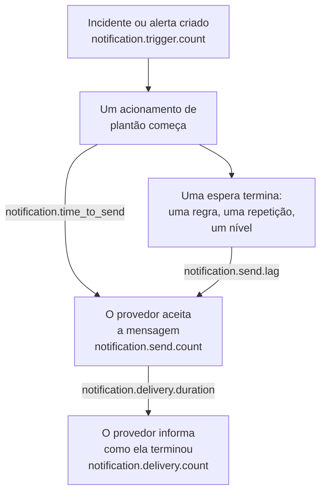

# Métricas de entrega de notificações

O OneUptime registra como foram as notificações que envia: quantos incidentes e alertas as pedem, se cada mensagem chegou ao seu provedor, quanto tempo um acionamento de plantão levou para sair e se chegou ao telefone. Envie a telemetria do próprio OneUptime para um projeto do OneUptime, ou para qualquer backend OpenTelemetry, para definir objetivos de entrega para as pessoas que a sua instalação atende e verificar se você os cumpre.

:::cards
- [Ativá-las](#ativá-las): Duas configurações, e sem elas nada é registrado.
- [As métricas](#as-métricas): Sete métricas, do gatilho ao telefone.
- [Como um acionamento é cronometrado](#como-um-acionamento-é-cronometrado): De onde partem o tempo de envio e o atraso de envio.
- [SLOs para começar](#slos-para-começar): Quatro objetivos, consulta por consulta.
:::

## Como funciona



Cada mensagem conta em `notification.send.count`, em todos os canais, não só os acionamentos de plantão. Os dois tempos, `notification.time_to_send` e `notification.send.lag`, cobrem apenas os acionamentos de plantão.

## Ativá-las

Nada é registrado até que o OneUptime tenha um exportador OpenTelemetry: sem ele, as métricas não custam nada e não ficam guardadas em lugar nenhum. Aponte-o para um projeto do OneUptime, com uma [chave de ingestão](/docs/telemetry/ingestion-keys) do tipo Server desse projeto, ou para qualquer backend que aceite OTLP via HTTP.

:::tabs
@tab Kubernetes
```yaml
openTelemetryExporter:
  endpoint: https://oneuptime.example.com/otlp
  headers: x-oneuptime-token=YOUR_INGESTION_KEY
```
Os deployments `app` e `worker` as enviam: mantenha `app.disableTelemetryCollection` e `worker.disableTelemetryCollection` em `false`, o padrão deles.
@tab Docker Compose
```bash
OPENTELEMETRY_EXPORTER_OTLP_ENDPOINT=https://oneuptime.example.com/otlp
OPENTELEMETRY_EXPORTER_OTLP_HEADERS=x-oneuptime-token=YOUR_INGESTION_KEY
DISABLE_TELEMETRY_FOR_APP=false
```
Defina-as em `config.env` e depois execute `npm start`. `DISABLE_TELEMETRY_FOR_APP` é `true` por padrão, e então nada é enviado.
:::

O OneUptime precisa tanto do endpoint quanto dos cabeçalhos: sem um cabeçalho, ele não envia nada. Escreva cada cabeçalho como `name=value` e separe vários com `;`. Um valor pode conter `=`. O OneUptime acrescenta `/v1/metrics` ao endpoint por conta própria, e as mesmas configurações também enviam os traces e logs dele. Cada métrica aparece assim que o OneUptime a registra pela primeira vez: `notification.send.count` com a primeira mensagem enviada.

### Enviar deltas para um projeto do OneUptime

O OneUptime envia contadores e histogramas como o OpenTelemetry faz por padrão: cada ponto contém o total acumulado desde que aquele processo do servidor começou. O explorador de métricas soma os pontos de cada passo de um gráfico, então só lê com exatidão as contagens e os percentis de um intervalo de tempo a partir de deltas, pontos que contêm o que aconteceu desde o anterior. Quando as métricas vão para um projeto do OneUptime, envie deltas:

:::tabs
@tab Kubernetes
```yaml
extraEnv:
  - name: OTEL_EXPORTER_OTLP_METRICS_TEMPORALITY_PREFERENCE
    value: delta
```
A lista própria de um serviço substitui a do chart inteiro: se você definir `app.extraEnv` ou `worker.extraEnv`, adicione-a lá também.
@tab Docker Compose
```yaml title="docker-compose.override.yml"
services:
  app:
    environment:
      OTEL_EXPORTER_OTLP_METRICS_TEMPORALITY_PREFERENCE: delta
```
Crie-o ao lado de `docker-compose.yml`, ou acrescente isto ao que você já tem, e depois execute `npm start`.
:::

Isso vale para toda métrica que o OneUptime envia sobre si mesmo. Um backend que interpreta sozinho os totais acumulados, como o Prometheus, não precisa de nenhuma mudança.

## As métricas

| Métrica | Tipo | Unidade | O que ela responde |
| --- | --- | --- | --- |
| `notification.trigger.count` | Contador | `1` | Quantos registros pediram notificações |
| `notification.send.count` | Contador | `1` | Como foi cada mensagem entregue a um provedor |
| `notification.send.duration` | Histograma | `ms` | Quanto tempo o provedor levou para aceitá-la |
| `notification.time_to_send` | Histograma | `ms` | Quanto tempo depois do seu gatilho um acionamento chegou ao seu provedor |
| `notification.send.lag` | Histograma | `ms` | Quanto tempo depois do seu vencimento uma notificação enviada mais tarde chegou ao seu provedor |
| `notification.delivery.count` | Contador | `1` | Como terminaram as mensagens que os provedores aceitaram |
| `notification.delivery.duration` | Histograma | `ms` | Quanto tempo depois de o seu provedor aceitá-la uma mensagem terminou |

Cada atributo assume um de poucos valores fixos, nunca um projeto, uma pessoa, um número de telefone ou um registro. A única exceção são o ID e o nome de um canal personalizado: uma instalação tem um punhado deles, e distingui-los é justamente o objetivo.

### Registros que notificam pessoas

`notification.trigger.count` conta cada incidente, alerta, episódio de incidentes e episódio de alertas no momento em que é criado.

| Atributo | Valores |
| --- | --- |
| `notification.trigger.type` | `incident`, `alert`, `incident_episode`, `alert_episode` |
| `notification.trigger.source` | `automatic` quando o OneUptime o criou, a partir de um monitor ou de uma regra; `manual` quando uma pessoa ou a API o fez |
| `monitor.type` | O tipo do monitor que criou um incidente ou um alerta, como `Incoming Request`, `Logs` ou `Metrics`; omitido quando nenhum monitor o criou |

### Mensagens entregues a um provedor

`notification.send.count` conta cada mensagem entregue a um provedor, e `notification.send.duration` cronometra a chamada ao provedor. Ambas carregam estes atributos:

| Atributo | Valores |
| --- | --- |
| `notification.channel` | `email`, `sms`, `call`, `whatsapp`, `telegram`, `push`, `webhook`, `slack`, `microsoft_teams`, `mattermost`, `custom_channel` |
| `notification.provider` | `twilio`, `sms_and_call_gateway`, `smtp`, `sendgrid`, `amazon_ses`, `mailgun`, `postmark`, `resend`, `microsoft_graph`, `expo`, `push_relay`, `web_push`, `meta_whatsapp`, `telegram_bot_api`, `slack`, `microsoft_teams`, `mattermost`, `webhook`, `custom_channel`, ou `none` quando nada foi entregue a nenhum |
| `notification.provider.config` | `global` para a conta e as configurações da própria instalação; `project` para a conta do Twilio, o servidor SMTP, o webhook ou a conexão com o workspace de um projeto, cujas falhas cabe ao projeto corrigir |
| `notification.on_call_page` | `true` para uma notificação de um acionamento de plantão, senão `false` |
| `outcome` | `success`, `failure` ou `not_sent`, como abaixo |
| `notification.destination` | Slack, Microsoft Teams e Mattermost: `direct_message` para uma pessoa, `channel` para uma publicação em um canal ou em um chat em grupo do Teams, `incoming_webhook` para um webhook de entrada, como o de um assinante de uma página de status. Webhooks: `status_page_subscriber` para o webhook próprio de um assinante de uma página de status. Omitido no webhook de uma pessoa e em todos os outros canais |
| `notification.custom_channel.id`, `notification.custom_channel.name` | Somente canais personalizados: o ID do canal, e o nome dele cortado em 100 caracteres |

- `success`: o provedor aceitou a mensagem.
- `failure`: o provedor a recusou ou não pôde ser alcançado, ou o envio falhou. Um canal de chat que não foi encontrado é uma falha sem duração.
- `not_sent`: não enviada de propósito. O projeto desativou o canal, tem saldo insuficiente ou está bloqueado, o push está desativado neste servidor, ou um canal personalizado está desativado, excluído ou não coberto pela licença. Uma taxa de sucesso as deixa de fora: são configurações em ação, não a plataforma falhando.

Uma mensagem para o webhook próprio de um assinante de uma página de status conta uma vez, não importa quantas vezes foi tentada: `success` quando o endpoint respondeu com um status 2xx, e `failure` quando respondeu com outro status, não pôde ser alcançado ou o endereço dele não é permitido.

### O que chegou ao telefone

`notification.delivery.count` conta como terminou cada mensagem que um provedor aceitou, como o provedor informa mais tarde, uma vez por mensagem. `notification.delivery.duration` cronometra quanto tempo depois de o provedor aceitá-la. Ambas carregam `notification.channel`, `notification.provider`, `notification.provider.config`, `notification.on_call_page` e `outcome`, o status final:

| Canal | Provedor | `outcome` | Duração |
| --- | --- | --- | --- |
| `sms` | `twilio` | `delivered`, `undelivered`, `failed` | Até o Twilio informar o status |
| `call` | `twilio` | `answered`, `not_answered`, `failed` | Até a chamada ser atendida, ou senão terminar |
| `push` | `expo`, `push_relay` | `delivered`, `undelivered`, `failed` | Não cronometrado: um recibo diz se a Apple ou o Google aceitou o push, não quando |
| `whatsapp` | `meta_whatsapp` | `delivered`, `failed` | Até a Meta informar o status |

Uma chamada que tocou sem resposta, deu ocupado ou foi recusada é `not_answered`. Um push para um app que não existe mais é `undelivered`, e uma mensagem do WhatsApp lida conta como entregue. `notification.provider.config` é `project` somente para SMS e chamadas na conta do Twilio de um projeto.

Os status só chegam onde o provedor consegue informá-los:

- SMS e chamadas: pelo Twilio, quando o Twilio consegue alcançar o seu servidor no `HOST` dele (veja [Integração do Twilio](/docs/self-hosted/twilio-integration#3-configure-o-acesso-à-rede)). O gateway de SMS e chamadas não informa nenhum.
- WhatsApp: quando o webhook da Meta está configurado para a sua instalação.
- Push: a partir dos recibos do Expo, que o OneUptime lê cerca de 15 minutos depois do push, também pelo relay de push. A instalação que enviou o push o conta.
- E-mail, Telegram, webhooks, chat e canais personalizados não informam nenhum status final.

## Como um acionamento é cronometrado

### Tempo de envio

`notification.time_to_send` vai do gatilho de um acionamento até o provedor aceitar a notificação. Ele cronometra apenas as notificações devidas quando o acionamento começa: as pessoas da primeira regra de escalonamento, pelas regras de plantão delas que não esperam nada, e qualquer nível para o qual o acionamento passa na hora porque não alcançou ninguém. As esperas que a configuração de plantão pede não são um atraso da plataforma, por isso ficam de fora: estão no [atraso de envio](#atraso-de-envio). Só são cronometradas as notificações que o provedor aceitou; uma falha aparece em `notification.send.count`.

| Atributo | Valores |
| --- | --- |
| `notification.channel` | Como em `notification.send.count` |
| `notification.page.start` | De onde o tempo parte, como abaixo |
| `notification.trigger.type` | O registro ao qual o acionamento se refere: `incident`, `alert`, `incident_episode`, `alert_episode` |
| `notification.custom_channel.id`, `notification.custom_channel.name` | Somente canais personalizados |

| `notification.page.start` | O tempo parte de |
| --- | --- |
| `monitor_data_received` | Quando o OneUptime recebeu os dados que dispararam o monitor: uma requisição de entrada, o relatório de um agente de servidor, um e-mail de entrada, a verificação de uma sonda, um trap SNMP ou a consulta a um dispositivo de rede. Inclui o tempo que os dados esperaram na fila para serem avaliados. |
| `record_created` | Quando o incidente, o alerta ou o episódio foi criado: por um monitor de telemetria, uma regra ou uma pessoa, e numa verificação de ausência, como um heartbeat que parou. |
| `page_started` | Quando um acionamento começou mais tarde: uma pessoa, um fluxo de trabalho ou uma regra que agora corresponde o iniciou, ou é um acionamento direto. Para um acionamento retido pela regra de plantão dele ou pela OneUptime AI, quando a retenção terminou, ou quando ele começou, se foi antes. Para um novo acionamento, quando o tempo limite após a confirmação se esgotou. Assim, um worker que chegou atrasado a qualquer um deles aparece no tempo. |

Numa requisição de entrada, o tempo parte da última requisição que o endpoint recebeu, então pode ficar um pouco curto.

### Atraso de envio

`notification.send.lag` vai do momento em que uma notificação enviada mais tarde venceu até o provedor aceitá-la. Dois workers as enviam, uma vez por minuto cada um, então um worker em dia mostra até cerca de um minuto, e um que ficou para trás mostra quanto.

| `notification.schedule` | Vence quando |
| --- | --- |
| `rule_wait` | A regra de plantão de uma pessoa que espera, como "me ligue depois de 10 minutos": esse tempo depois de a pessoa ser acionada. Nunca antes da última vez que o worker percorreu as regras dela, então uma regra adicionada ou alterada mais tarde vence a partir de então. |
| `repeat` | Um push repetido até alguém reconhecer: cada vez que o intervalo dele termina. |
| `escalation` | Um nível de escalonamento posterior: quando o nível anterior terminou a espera dele, ou na hora quando uma pessoa repassa o acionamento. |
| `policy_repeat` | A política recomeçando pelo primeiro nível: quando a espera do último nível dela terminou. |

Ele também carrega `notification.channel`, `notification.trigger.type` e, para canais personalizados, `notification.custom_channel.id` e `notification.custom_channel.name`. Uma notificação devida quando o acionamento dela começa nunca está nele, nem quando um worker iniciou o acionamento com atraso, após uma retenção ou como novo acionamento: está no tempo de envio.

### Buckets dos histogramas

Cada histograma tem limites de bucket próprios, em milissegundos, definidos para que um objetivo possa ser lido em um limite:

| Histograma | Limites dos buckets, em milissegundos |
| --- | --- |
| `notification.send.duration` | `5, 10, 25, 50, 100, 250, 500, 1000, 2500, 5000, 10000, 30000, 60000, 120000` |
| `notification.time_to_send` | `250, 500, 1000, 2000, 5000, 10000, 15000, 30000, 60000, 120000, 300000, 600000, 1800000, 3600000` |
| `notification.send.lag` | `1000, 5000, 10000, 15000, 30000, 45000, 60000, 75000, 90000, 120000, 180000, 300000, 600000, 1800000, 3600000` |
| `notification.delivery.duration` | `500, 1000, 2000, 5000, 10000, 15000, 30000, 60000, 120000, 300000, 600000, 1800000, 3600000, 14400000, 86400000` |

Um percentil é calculado a partir dos buckets, e desenhado como o meio do bucket em que cai. Por isso, compare-o com o limite de um bucket: um P95 de `notification.time_to_send` igual ou abaixo de 30000 significa que 95% dos acionamentos levaram 30 segundos ou menos.

## SLOs para começar

Quatro objetivos que a maioria das instalações pode prometer, cada um montado com uma ou duas consultas no explorador de métricas do projeto que recebe as métricas. Eles leem um intervalo de tempo com exatidão assim que as métricas chegam como deltas: veja [Enviar deltas para um projeto do OneUptime](#enviar-deltas-para-um-projeto-do-oneuptime).

### Montar um no explorador de métricas

:::steps
1. Abra o [Explorador de métricas](/docs/telemetry/metrics-explorer) do projeto e clique na primeira métrica do objetivo. A consulta dela é `a`.
2. Escolha a agregação dela em **Aggregate by**. Depois abra **Filters & grouping** e adicione cada uma das condições dela em **Filter by attributes**.
3. Para uma segunda consulta, clique em **Adicionar métrica** e configure `b` da mesma forma.
4. Para uma fórmula, clique em **Adicionar fórmula** e escreva-a em **Fórmula**.
5. Para ser avisado quando o objetivo não for cumprido, clique em **Ações → Criar monitor a partir desta visualização** e alerte quando o valor passar do objetivo: veja [Monitor de métricas](/docs/monitor/metrics-monitor).
:::

Para acompanhar um objetivo ao longo de 30 dias com um orçamento de erros, vincule esse monitor a um [SLO](/docs/slo/introduction): ele conta o tempo em que o objetivo não foi cumprido.

### SMS de plantão chegam ao Twilio

No máximo 1% dos SMS de plantão enviados pela conta do Twilio da própria instalação falham, então 99% são aceitos.

| Consulta | Métrica | Agregação | Condições |
| --- | --- | --- | --- |
| `a` | `notification.send.count` | **Soma** | `notification.channel = sms`, `notification.on_call_page = true`, `notification.provider.config = global`, `outcome != not_sent` |
| `b` | `notification.send.count` | **Soma** | As mesmas, com `outcome = failure` |

A fórmula `$b / $a * 100` é a parcela que falhou, e o objetivo se mantém enquanto ela ficar igual ou abaixo de 1. Um passo sem falha não desenha nenhum ponto, já que `b` não tem nenhum. `outcome != not_sent` deixa de fora o que as configurações próprias dos projetos seguraram, e `global` as contas do Twilio dos próprios projetos. Em uma instalação que envia os SMS pelo seu gateway de SMS e chamadas, as mesmas consultas medem o gateway. Para outro canal, troque `sms`: `call`, `push` ou `email`.

### Acionamentos saem em até 30 segundos

95% dos acionamentos de plantão chegam ao seu provedor em até 30 segundos depois do gatilho.

| Consulta | Métrica | Agregação | Condições |
| --- | --- | --- | --- |
| `a` | `notification.time_to_send` | **P95** | `notification.page.start != page_started` |

O objetivo se mantém enquanto `a` ficar igual ou abaixo de 30000. Acionamentos iniciados mais tarde são cronometrados a partir do início ou do vencimento deles, não de um gatilho, por isso ficam de fora. Agrupe por `notification.page.start` para ver a fila dos monitores (`monitor_data_received`) separada do resto, ou por `notification.channel` para encontrar um canal lento.

### Notificações enviadas mais tarde saem em até 90 segundos

99% das notificações enviadas depois de uma espera chegam ao seu provedor em até 90 segundos depois do vencimento.

| Consulta | Métrica | Agregação | Condições |
| --- | --- | --- | --- |
| `a` | `notification.send.lag` | **P99** | — |

O objetivo se mantém enquanto `a` ficar igual ou abaixo de 90000. Agrupe por `notification.schedule` para ver qual worker ficou para trás: `rule_wait` e `repeat` são de um worker, `escalation` e `policy_repeat` do outro.

### SMS de plantão chegam ao telefone

No máximo 5% dos SMS de plantão que o Twilio aceitou para a conta da própria instalação não são entregues.

| Consulta | Métrica | Agregação | Condições |
| --- | --- | --- | --- |
| `a` | `notification.delivery.count` | **Soma** | `notification.channel = sms`, `notification.on_call_page = true`, `notification.provider.config = global` |
| `b` | `notification.delivery.count` | **Soma** | As mesmas, com `outcome != delivered` |

A fórmula `$b / $a * 100` é a parcela não entregue. Operadoras e telefones desligados decidem parte dela, então defina o objetivo pelo que você vê ao longo de algumas semanas. Para chamadas, use `call` e `outcome != answered`. O Twilio precisa conseguir alcançar o seu servidor: veja [O que chegou ao telefone](#o-que-chegou-ao-telefone).

## Solução de problemas

:::details Nenhuma métrica de notificação chega
Verifique se `OPENTELEMETRY_EXPORTER_OTLP_ENDPOINT` e `OPENTELEMETRY_EXPORTER_OTLP_HEADERS` estão ambas definidas, e no Docker Compose se `DISABLE_TELEMETRY_FOR_APP` é `false`, e depois reinicie o OneUptime. Ao iniciar, o OneUptime registra um aviso quando não consegue ler um cabeçalho ou quando não envia nada. Uma métrica só aparece quando algo é registrado, então envie uma notificação primeiro.
:::

:::details Uma contagem só cresce, ou um percentil quase não se mexe
As métricas chegam como totais acumulados. Envie deltas: veja [Enviar deltas para um projeto do OneUptime](#enviar-deltas-para-um-projeto-do-oneuptime).
:::

:::details Nenhum status final chega
Os status finais vêm dos provedores, mais tarde, e só onde eles conseguem informá-los: veja [O que chegou ao telefone](#o-que-chegou-ao-telefone). Numa instalação que o Twilio não consegue alcançar, SMS e chamadas são contados como enviados, mas nunca como entregues.
:::

## Próximos passos

:::cards
- [Explorador de métricas](/docs/telemetry/metrics-explorer): Traçar, combinar e comparar qualquer métrica.
- [Monitor de métricas](/docs/monitor/metrics-monitor): Alertar quando um objetivo não for cumprido.
- [Integração do Twilio](/docs/self-hosted/twilio-integration): Deixar o Twilio informar o que chegou ao telefone.
- [Regras de escalonamento](/docs/on-call/escalation-rules): As esperas de onde parte o atraso de envio.
:::
