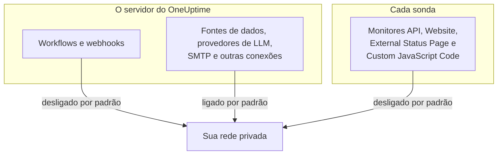

# Acesso à rede privada

O OneUptime se recusa a enviar certas requisições de saída para hosts que se resolvem em uma faixa privada, de loopback ou link-local. Se você já tentou apontar um workflow para uma ferramenta interna, viu a mensagem:

> Webhook URL resolves to a private, loopback, or link-local address and is not allowed

Esse padrão é o correto para o produto hospedado, onde qualquer pessoa pode se cadastrar e o destino de um webhook é uma entrada não confiável. Numa instância auto-hospedada, ele atrapalha algo comum: publicar um alerta num Mattermost, num Jira ou num sistema de tickets auto-hospedado que só existe na sua própria rede.

Esta página explica como permitir isso, de forma deliberada e restrita. Três chaves decidem isso, cada uma para o seu tipo de conexão, e elas são configuradas em máquinas diferentes:

| O que você quer alcançar internamente | Onde fica a configuração | Padrão numa instalação auto-hospedada |
| --- | --- | --- |
| Workflows, webhooks de projeto, webhooks de usuário do plantão | O ambiente do **servidor de API** | Endereços privados recusados |
| Fontes de dados, provedores de LLM, servidores SMTP, descoberta OIDC e outras conexões | O ambiente do **servidor de API** | Endereços privados permitidos |
| **Monitores** API, Website, External Status Page e Custom JavaScript Code | O ambiente próprio da **sonda** | Endereços privados recusados |



Os tipos de monitor nativos de rede, como Ping, Port, Certificado SSL, DNS, DNSSEC, SNMP / Dispositivo de rede, Consulta SQL, Saúde do banco de dados, Synthetic e Network Path, usam os seus próprios transportes. A configuração desta página rege os transportes HTTP que devolvem conteúdo de resposta arbitrário a um projeto: os monitores API, Website, External Status Page e Custom JavaScript Code.

:::cards
- [Webhooks e workflows](#webhooks-e-workflows): Permita que um webhook publique na sua rede.
- [Outras conexões de saída](#outras-conexões-de-saída): Fontes de dados, provedores de LLM e servidores de e-mail.
- [Sondas e monitores](#sondas-e-monitores): Deixe uma sonda verificar sites privados.
- [Verificando se funciona](#verificando-se-funciona): Leia qual chave uma recusa nomeia.
:::

## O que está bloqueado e o que pode ser liberado

Os destinos bloqueados se dividem em dois níveis.

| Nível | Faixas | Pode ser permitido? |
| --- | --- | --- |
| **Privado** | RFC-1918 (`10.0.0.0/8`, `172.16.0.0/12`, `192.168.0.0/16`), CGNAT (`100.64.0.0/10`), IPv6 unique-local (`fc00::/7`) e site-local (`fec0::/10`) | Sim |
| **Proibido** | Loopback (`127.0.0.0/8`, `::1`), o endereço não especificado, link-local (`169.254.0.0/16`, `fe80::/10`), multicast, reservado, broadcast, e os nomes `localhost` e `metadata.google.internal` | Só nomeando o host ou CIDR exato na lista de permissões de webhooks. Nunca para monitores. |

O endpoint de metadados da nuvem `169.254.169.254` está no nível proibido por um motivo. Numa VM na nuvem ele entrega as credenciais IAM da instância a qualquer coisa que consiga fazer uma requisição HTTP a partir da máquina, então nenhuma configuração geral vai abri-lo.

As grafias de IPv6 que carregam um destino IPv4 dentro de si – IPv4-mapped (`::ffff:10.0.0.5`), NAT64, 6to4, Teredo – são classificadas pelo endereço IPv4 que alcançam, então não servem para contrabandear um endereço proibido por uma permissão do nível privado.

## Webhooks e workflows

Estes destinos estão cobertos, porque o destino é uma URL escrita por um membro autenticado do seu projeto:

- Os componentes **API** dos workflows (GET / POST / PUT / PATCH / DELETE)
- As requisições HTTP feitas pelo componente de workflow **Custom JavaScript**
- As notificações de webhook do projeto (incidentes, alertas, monitores, plantão, manutenção agendada, eventos de páginas de status)
- Os **webhooks de usuário** do plantão

**Não** estão cobertos, e nunca estarão: os **webhooks de assinantes de páginas de status**. Qualquer visitante de uma página de status pública pode registrar um, então afrouxar esse destino deixaria qualquer pessoa na internet fazer o seu servidor enviar POSTs para a sua rede privada. Isso não é configurável.

As conexões de saída que não são webhooks – fontes de dados externas, provedores de LLM, servidores SMTP (as configurações de SMTP de um projeto e o componente de workflow **Email**), endpoints de tokens OAuth de SMTP, descoberta OIDC e passos HTTP de runbooks – são regidas separadamente, por `DATA_SOURCE_BLOCK_PRIVATE_ADDRESSES`, e já permitem faixas privadas em instalações auto-hospedadas. Veja [Outras conexões de saída](#outras-conexões-de-saída).

### Configurando o servidor de API

Defina uma ou as duas variáveis abaixo no servidor de API e reinicie-o. Elas são desligadas por padrão, então uma instância que não define nenhuma se comporta exatamente como antes.

| Variável | Valor do Helm | O que ela permite |
| --- | --- | --- |
| `ALLOW_PRIVATE_NETWORK_WEBHOOKS` | `webhooks.allowPrivateNetwork` | Todo o nível privado, quando definida como `true`. |
| `PRIVATE_NETWORK_WEBHOOK_ALLOWLIST` | `webhooks.privateNetworkAllowlist` | Os hosts e CIDRs que ela nomeia, seja qual for o nível. |

:::tabs
@tab Docker Compose
```bash title="config.env"
ALLOW_PRIVATE_NETWORK_WEBHOOKS=true
PRIVATE_NETWORK_WEBHOOK_ALLOWLIST=mattermost.internal,*.svc.cluster.local,10.20.0.0/16
```
@tab Kubernetes
```yaml title="values.yaml"
webhooks:
  allowPrivateNetwork: true
  privateNetworkAllowlist: "mattermost.internal,10.20.0.0/16"
```
:::

No Docker Compose, o `config.env` tem uma linha `ALLOW_PRIVATE_NETWORK_WEBHOOKS=false`: altere-a em vez de adicionar uma segunda e depois execute `npm run start`. No Kubernetes, atualize a release.

As entradas da lista de permissões podem ser separadas por vírgulas, espaços ou quebras de linha, e cada uma pode ser:

- um nome de host – `mattermost.internal`
- um curinga – `*.svc.cluster.local` (corresponde aos subdomínios, não ao sufixo sozinho)
- um endereço IPv4 ou IPv6 – `10.20.30.40`, `fd00::1`
- um CIDR – `10.20.0.0/16`, `fd12:3456::/32`

O esquema, a porta, o caminho ou as informações de usuário de uma entrada são removidos, então colar a URL de webhook que você já tem funciona.

Um nome de host listado na lista de permissões é aceito **sem verificação de DNS** – é justamente para isso que você o nomeia, já que se espera que ele se resolva em algo que a lista de bloqueio recusaria. Uma entrada de endereço é comparada com o literal da URL e com cada endereço que o DNS retorna para ela.

> [!CAUTION]
> **Nunca coloque `169.254.169.254`, nem qualquer faixa que o contenha, na lista de permissões.** Numa VM na nuvem, isso dá a todo membro do projeto as credenciais IAM da sua instância.

## Outras conexões de saída

Uma segunda proteção cobre as conexões de saída cujo destino um membro do projeto escolhe, mas que não são webhooks:

- fontes de dados externas (conexões PostgreSQL, MySQL, SQL Server, ClickHouse, Elasticsearch e API REST), conexões de eventos de segurança como o Splunk e feeds de threat intel
- provedores de LLM, incluindo um Ollama ou vLLM auto-hospedado
- servidores SMTP – as configurações de SMTP de um projeto e o componente de workflow **Email** – e as URLs de tokens OAuth de SMTP e de workflows
- a descoberta OIDC para o login único
- a verificação de domínios personalizados de páginas de status e dashboards
- os passos HTTP de runbooks
- a URL da API do Grafana OnCall da qual uma importação lê (**Configurações do projeto** > **Básico** > **Importar de outra ferramenta**)

Essa proteção funciona ao contrário das configurações de webhook. Numa instalação auto-hospedada, ela **permite** o nível privado por padrão, porque o banco de dados, o servidor de e-mail ou o servidor de modelos a que essas conexões se ligam costumam ficar na sua própria rede. O nível proibido – loopback, link-local e o endpoint de metadados da nuvem – é recusado de qualquer forma, e não há lista de permissões para ele.

`DATA_SOURCE_BLOCK_PRIVATE_ADDRESSES` a torna mais rígida. Defina-a como `true` para recusar o nível privado também nessas conexões, por exemplo quando os projetos da sua instância pertencem a pessoas que não deveriam alcançar a sua rede interna:

:::tabs
@tab Docker Compose
```bash title="config.env"
DATA_SOURCE_BLOCK_PRIVATE_ADDRESSES=true
```
@tab Kubernetes
```yaml title="values.yaml"
outboundConnections:
  blockPrivateNetwork: true
```
:::

Essa configuração não se aplica a um provedor de LLM global, que um administrador configura em vez de um projeto (com as variáveis `GLOBAL_LLM_PROVIDER_*`, o valor `vllm.globalProvider` do chart do Helm, ou no Painel do administrador em **Configurações** > **Provedores de LLM globais**): um provedor assim ainda pode alcançar endereços privados, embora loopback e link-local continuem recusados também para ele.

Só o valor exato `true` a liga. Numa instância com `BILLING_ENABLED=true`, ela está sempre ligada, seja o que for que você defina. Ela não muda quais destinos as configurações de webhook acima ou a configuração das sondas abaixo permitem; cada barreira é configurada separadamente. Ela muda, porém, como as recusas são escritas, também para webhooks e requisições de workflows: com ela ligada, um nome de host recusado é informado sem dizer para o que ele se resolveu (veja [Verificando se funciona](#verificando-se-funciona)).

No Docker Compose, o `config.env` tem uma linha `DATA_SOURCE_BLOCK_PRIVATE_ADDRESSES=false` (adicione-a se o seu `config.env` for anterior). Mude essa linha para `true` em vez de adicionar uma segunda e depois execute `npm run start` para que os contêineres sejam recriados com o novo valor; `docker compose restart` não relê o `config.env`. No Kubernetes, defina-a no seu arquivo de valores e atualize a release; o chart a repassa aos pods da aplicação e do worker.

Com ela ligada, um nome de host recusado é informado sem dizer para o que ele se resolveu, por exemplo _"LLM provider host ollama.internal could not be reached."_ Um nome que nem se resolve recebe a mesma mensagem, para que membros do projeto não possam usar esses campos para descobrir quais nomes internos existem. Um endereço digitado como IP continua sendo nomeado junto com o motivo, por exemplo _"LLM provider host 10.0.4.12 is not allowed: private network address."_ Com `LOG_LEVEL=DEBUG`, a aplicação registra o endereço para o qual cada nome recusado se resolveu.

## Sondas e monitores

Quatro tipos de monitor são afetados: **API**, **Site**, **External Status Page** e **Custom JavaScript Code**. Numa sonda padrão, eles podem alcançar destinos HTTP(S) públicos, mas recusam o espaço de endereços privado. Os monitores API, Website e External Status Page validam e fixam os resultados de DNS em cada conexão e revalidam cada redirecionamento; o Custom JavaScript Code aplica a mesma política de endereços na ponte da sua sandbox.

A chave é lida pelo **processo da sonda a partir do seu próprio ambiente**, não do ambiente do servidor de API, e toda sonda a lê: as incluídas no Docker Compose, as que o chart do Helm implanta e qualquer [sonda personalizada](/docs/probe/custom-probe) que você mesmo execute. Quem implanta uma sonda controla o ambiente dela, e é quem sabe qual rede essa sonda consegue ver – uma sonda personalizada costuma ser outra máquina, muitas vezes operada por outra pessoa, e nunca lê a configuração do servidor de API.

:::tabs
@tab Docker Compose
O `config.env` já tem uma linha `PROBE_ALLOW_PRIVATE_NETWORK_MONITORS=false`: mude essa linha para `true` em vez de adicionar uma segunda, porque quando uma variável aparece duas vezes, a linha posterior vence. Depois execute `npm run start`, que recria os contêineres com o novo valor; `docker compose restart` não relê o `config.env`. Toda sonda incluída lê essa mesma linha, então ela vale para `probe-1` e, onde a sua stack executa uma segunda sonda, para `probe-2`.

```bash title="config.env"
PROBE_ALLOW_PRIVATE_NETWORK_MONITORS=true
```
@tab Kubernetes
Defina-a por sonda no seu arquivo de valores e atualize a release. Cada entrada em `probes:` é uma sonda separada, então defina-a em cada uma que deva alcançar endereços privados:

```yaml title="values.yaml"
probes:
  one:
    allowPrivateNetworkMonitors: true
```
:::

Numa sonda personalizada, defina `PROBE_ALLOW_PRIVATE_NETWORK_MONITORS=true` no ambiente próprio dessa sonda e reinicie-a. O valor precisa ser exatamente `true`; qualquer outro, como `TRUE` ou `1`, deixa a chave desligada, e a sonda avisa isso na inicialização, seja qual for o valor de `LOG_LEVEL`.

As sondas incluídas são **sondas globais**: elas se registram com o `REGISTER_PROBE_KEY` da instância, e qualquer projeto da instância pode selecioná-las. Ligar a chave numa sonda incluída, portanto, permite que monitores de **todo projeto da instância** alcancem endereços privados por meio dela. Normalmente é isso que uma instalação de uma única equipe quer. Onde os projetos não devem compartilhar esse alcance – equipes separadas ou clientes que você hospeda –, deixe-a desligada nas sondas incluídas e implante em vez disso uma sonda privada (personalizada) dentro de cada rede, ligada só ali.

Há uma exceção. Uma sonda que se registra com `REGISTER_PROBE_KEY` e tem `BILLING_ENABLED=true` no próprio ambiente – uma sonda global do produto hospedado com cadastro aberto, onde qualquer pessoa pode se cadastrar e todos os projetos compartilham as sondas globais – continua só pública mesmo com a chave ligada, e registra na inicialização um aviso de que a está ignorando. As sondas incluídas no Docker Compose e no chart do Helm recebem automaticamente o `BILLING_ENABLED` da instância; passe-o a qualquer outra sonda `REGISTER_PROBE_KEY` que você execute para uma instância assim. Uma sonda não tem outra forma de saber que é global, então uma sonda global criada no Painel do administrador e executada com `PROBE_ID` e `PROBE_KEY` respeita a chave como uma privada: não a ligue ali se os projetos não devem compartilhar a rede dessa sonda. Uma sonda privada respeita a chave em qualquer instância.

Toda sonda registra na inicialização a sua política efetiva de rede privada: se o monitoramento de rede privada está ligado ou desligado, e por quê. Um valor que está sendo ignorado, e uma sonda global que a chave abre a todos os projetos, são registrados como avisos em qualquer `LOG_LEVEL`. A linha habitual de ligado ou desligado, e o JSON "Probe environment" que registra a mesma decisão em `privateNetworkMonitors`, são registrados em `LOG_LEVEL=INFO`, o padrão do chart do Helm; o Docker Compose vem com `LOG_LEVEL=ERROR`, então defina `LOG_LEVEL=INFO` para vê-los ali. Confira esse log primeiro quando um monitor numa sonda que você acabou de alterar continuar sendo recusado.

Ligá-la **não** abre o loopback, o link-local nem o endpoint de metadados da nuvem. Esses continuam recusados em toda sonda, o que importa principalmente para sondas que rodam numa rede que não pertence ao autor do monitor.

> [!WARNING]
> Deixe-a desligada nas sondas que você opera em nome de outras pessoas.

## Verificando se funciona

Execute o workflow ou o monitor de novo. Se ainda for recusado, a mensagem de erro nomeia qual barreira está fechada:

- _"...points to a private network address and is not allowed. Self-hosted instances can allow this by setting `ALLOW_PRIVATE_NETWORK_WEBHOOKS`..."_ – falta a configuração do servidor de API.
- _"...private network address... Set PROBE_ALLOW_PRIVATE_NETWORK_MONITORS=true on the probe running this monitor to allow it."_ – uma sonda privada (personalizada) executou o monitor, e a chave dela está desligada. Repare que isso é definido na sonda, não no servidor de API.
- _"...private network address... Set PROBE_ALLOW_PRIVATE_NETWORK_MONITORS=true on the probe running this monitor to allow it (probes.<name>.allowPrivateNetworkMonitors in the Helm chart). This is a global probe, so that allows it for every project on this instance; otherwise, select a private probe deployed on that network."_ – uma sonda incluída (global) executou o monitor, e a chave dela está desligada. Ligue-a para essa sonda como descrito acima se todo projeto da instância puder alcançar essa rede; caso contrário, selecione uma sonda privada no monitor.
- _"...Global probes cannot monitor private network addresses. Deploy and select a private probe for this target."_ – uma sonda global com `BILLING_ENABLED=true` no ambiente executou o monitor. Sondas globais registradas automaticamente continuam só públicas ali, diga o que disser a chave delas; implante uma sonda privada dentro da rede do destino e selecione-a no monitor.
- _"Monitor target host ... could not be reached."_ – um monitor API, Website ou External Status Page cujo destino é um **nome de host** informa isso tanto quando o nome se resolve num endereço recusado quanto quando o DNS falha, para que um monitor não possa ser usado para mapear quais nomes internos existem. Os detalhes do erro mostrados com ele mencionam `PROBE_ALLOW_PRIVATE_NETWORK_MONITORS` nos dois casos; eles não dizem qual caso ocorreu. Se o nome aponta para um endereço privado, confira no log de inicialização da sonda a política de rede privada dela; se estiver desligada, a solução é a mesma das mensagens acima. Com `LOG_LEVEL=DEBUG`, a sonda também registra o motivo exato de cada nome recusado.
- _"Request URL could not be reached."_ – a mesma regra para um monitor **Custom JavaScript Code**: um script que requisita um **nome de host** recebe isso tanto quando o nome se resolve num endereço recusado quanto quando o DNS falha. Com `LOG_LEVEL=DEBUG`, a sonda registra o motivo exato.
- _"Webhook URL could not be reached."_ ou, a partir de um workflow, _"Request URL could not be reached."_ – a instância roda com `DATA_SOURCE_BLOCK_PRIVATE_ADDRESSES=true` (ou `BILLING_ENABLED=true`), então um **nome de host** recusado não é explicado: ou ele se resolveu num endereço recusado, ou não se resolveu. Com `LOG_LEVEL=DEBUG`, a aplicação ou o worker registram qual dos dois, e o endereço.
- _"...points to a private, loopback, or link-local address and is not allowed."_ – o destino está no nível proibido. Para um webhook, nomeie o host ou CIDR exato em `PRIVATE_NETWORK_WEBHOOK_ALLOWLIST` se você realmente precisar. Para um monitor, não há exceção.
- _"...hostname could not be resolved via DNS."_ – o contêiner não consegue resolver o nome. Verifique se ele compartilha uma rede com o destino.

## Notas de segurança

Abrir isso muda de verdade o que a sua instância do OneUptime pode ser levada a alcançar, então vale a pena fazer isso de forma deliberada:

- **Prefira a lista de permissões à chave geral.** Nomear `mattermost.internal` é uma permissão muito menor do que abrir todo endereço RFC-1918.
- **Qualquer pessoa que possa criar um workflow ou um monitor API, Website, External Status Page ou Custom JavaScript Code consegue alcançar tudo o que você permitiu.** Trate a participação nesses projetos de acordo.
- **O corpo da resposta volta.** Um componente API de workflow devolve o status, os cabeçalhos e o corpo ao log do workflow, então um host permitido pode ser lido, não só receber escrita.
- **Os redirecionamentos nunca são seguidos** nas requisições de webhook, então um host público permitido não consegue redirecionar o servidor para um interno num segundo salto.
- **Restrinja por sonda em vez de para a instância inteira sempre que possível.** Uma sonda implantada dentro de uma rede é uma permissão mais estreita do que abrir a saída do servidor de API.

## Próximos passos

:::cards
- [Sondas personalizadas](/docs/probe/custom-probe): Execute uma sonda dentro da rede que ela deve verificar.
- [Configuração de workflows](/docs/workflows/configuration): O que os passos de um workflow podem alcançar e fazer.
- [Provedores de LLM](/docs/ai/llm-provider): Conecte o OneUptime AI a um modelo na sua rede.
- [Arquitetura](/docs/self-hosted/architecture): Qual parte de uma instalação auto-hospedada faz cada conexão.
:::
