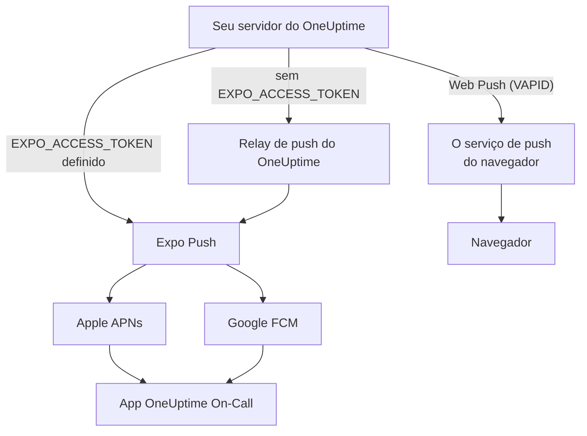
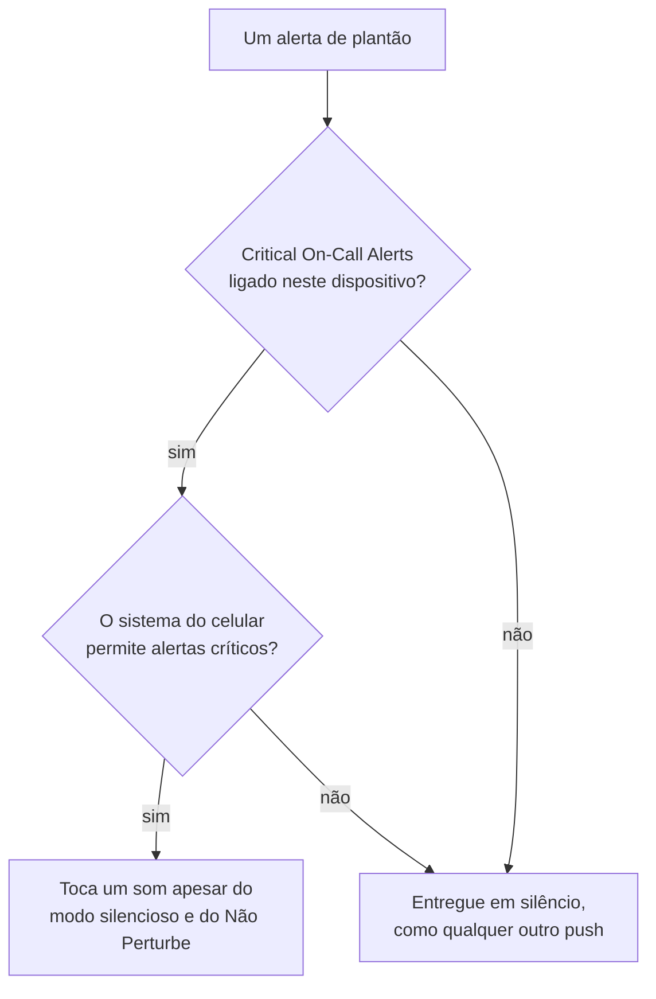

# Notificações push

O OneUptime alerta as pessoas no celular pelo app **OneUptime On-Call**, e no navegador pelo Web Push. Os pushes móveis usam o **Expo Push**: uma instância auto-hospedada os envia por padrão pelo relay de push do OneUptime, então ela precisa de acesso de rede de saída ao relay e de nenhuma credencial própria do Expo, da Apple ou do Google.

:::cards
- [Escolha como os pushes são enviados](#configuração-auto-hospedada): O relay de push, ou o seu próprio token de acesso do Expo.
- [Abra o firewall](#acesso-de-rede): Os endereços que o seu servidor e os dispositivos da sua equipe alcançam.
- [Toque mesmo no modo silencioso](#alertas-críticos-de-plantão-ignorando-o-modo-silencioso): Faça os alertas de plantão tocarem num celular silenciado.
- [Corrija pushes que nunca chegam](#solução-de-problemas): O que significa cada erro do Expo.
:::

## Como funciona



O app móvel do OneUptime registra um token do Expo Push no backend. O backend envia as notificações pelo relay de push do OneUptime, ou diretamente ao Expo quando `EXPO_ACCESS_TOKEN` está configurado. O Expo encaminha as mensagens para o Apple APNs ou o Google FCM para entrega no dispositivo.

As notificações Web Push continuam usando chaves VAPID e o protocolo Web Push.

## Configuração auto-hospedada

Com o app móvel oficial e o relay padrão, o servidor não precisa de credenciais do Expo. Para entrega direta pelo Expo, configure `EXPO_ACCESS_TOKEN` com credenciais adequadas ao projeto do Expo do seu app. O Web Push exige `VAPID_PUBLIC_KEY`, `VAPID_PRIVATE_KEY` e `VAPID_SUBJECT`.

| Variável | Valor do Helm | Padrão | O que faz |
| --- | --- | --- | --- |
| `PUSH_NOTIFICATION_RELAY_URL` | `pushNotification.relayUrl` | `https://oneuptime.com/api/notification/push-relay/send` | Para onde vão os pushes móveis enquanto `EXPO_ACCESS_TOKEN` não está definido. |
| `EXPO_ACCESS_TOKEN` | `expo.accessToken` | Vazio | Envia os pushes móveis diretamente ao Expo, com o token do seu projeto do Expo. |
| `VAPID_PUBLIC_KEY` | `vapid.publicKey` | Vazio | A metade pública do par de chaves com que os navegadores se inscrevem. |
| `VAPID_PRIVATE_KEY` | `vapid.privateKey` | Vazio | A metade privada, que assina cada Web Push. |
| `VAPID_SUBJECT` | `vapid.subject` | `mailto:support@oneuptime.com` | Um endereço de contato pelo qual os serviços de push dos navegadores podem falar com você. |

Gere um par de chaves VAPID uma única vez com `npx web-push generate-vapid-keys` e guarde-o: navegadores que se inscreveram com um par de chaves deixam de receber pushes quando ele muda.

:::tabs
@tab Docker Compose
```bash title="config.env"
VAPID_PUBLIC_KEY=your-public-key
VAPID_PRIVATE_KEY=your-private-key
VAPID_SUBJECT=mailto:oncall@example.com
# Leave unset to send mobile pushes through the push relay.
EXPO_ACCESS_TOKEN=
```
@tab Kubernetes
```yaml title="values.yaml"
vapid:
  publicKey: your-public-key
  privateKey: your-private-key
  subject: mailto:oncall@example.com
# Leave empty to send mobile pushes through the push relay.
expo:
  accessToken:
```
:::

## Acesso de rede

| Direção | Destino | Protocolo / porta | Quando é necessário |
| --- | --- | --- | --- |
| OneUptime → relay de push padrão | `https://oneuptime.com/api/notification/push-relay/send`, `https://oneuptime.com/api/notification/push-relay/receipts` | HTTPS / TCP 443 | Push móvel quando `EXPO_ACCESS_TOKEN` não está definido. |
| OneUptime → Expo | `https://exp.host/--/api/v2/push/send`, `https://exp.host/--/api/v2/push/getReceipts` | HTTPS / TCP 443 | Push móvel direto quando `EXPO_ACCESS_TOKEN` está definido. |
| OneUptime → serviço de push do navegador | O endpoint HTTPS guardado na inscrição de push do navegador | HTTPS / normalmente TCP 443 | Web Push. |
| App móvel ou navegador → OneUptime | O seu nome de host do OneUptime | HTTPS / TCP 443 | Entrar, registrar o dispositivo e abrir os links das notificações. |

Se você alterar `PUSH_NOTIFICATION_RELAY_URL`, libere o nome de host de destino e a porta configurada. Um relay personalizado precisa implementar a API de relay do OneUptime. Esses padrões e a troca entre relay e entrega direta são definidos na [configuração do OneUptime](https://github.com/OneUptime/oneuptime/blob/master/config.example.env) e no [serviço de push](https://github.com/OneUptime/oneuptime/blob/master/packages/Common/Server/Services/PushNotificationService.ts). As requisições diretas ao Expo usam o endpoint documentado no [guia de envio do Expo](https://docs.expo.dev/push-notifications/sending-notifications/). O OneUptime lê os recibos de entrega do relay no mesmo endereço, com `/receipts` no lugar de `/send`. Um relay sem essa rota ainda entrega pushes; um dispositivo cujo app foi removido só é percebido quando um push posterior para ele é recusado.

Para o Web Push, libere os hosts reais dos endpoints de inscrição dos navegadores que a sua equipe usa. O OneUptime aceita `fcm.googleapis.com`, `android.googleapis.com`, `push.services.mozilla.com`, `notify.windows.com` e `push.apple.com`, incluindo os subdomínios. Exemplos típicos são `updates.push.services.mozilla.com` e `web.push.apple.com`. A [inscrição de push do navegador](https://developer.mozilla.org/en-US/docs/Web/API/PushSubscription) fornece o destino; liberar só o Expo ou o relay do OneUptime não habilita o Web Push.

Permita a resolução de DNS e o TLS de saída a partir do processo do OneUptime que envia as notificações. O repositório de confiança dele precisa validar o certificado do destino, e os proxies precisam deixar passar as requisições à API sem autenticação interativa. Os provedores de push não chamam nenhum webhook no seu servidor do OneUptime, então o servidor pode continuar privado se os dispositivos dos usuários o acessarem por VPN ou outra conexão privada. Um servidor sem acesso ao seu relay ou aos serviços de push externos não consegue entregar essas notificações.

A conectividade dos dispositivos é um requisito à parte. Dispositivos iOS precisam de acesso ao APNs, normalmente TCP 5223 com TCP 443 como alternativa; consulte os [requisitos de rede atuais da Apple](https://support.apple.com/en-us/102266) para as faixas de destino. Dispositivos Android precisam de acesso ao FCM em TCP 5228–5230 e 443; use as [orientações atuais do Google sobre hosts e firewall](https://firebase.google.com/docs/cloud-messaging/network-configuration). Essas portas dos dispositivos não precisam ser abertas como entrada no OneUptime, e o fluxo do servidor móvel usa o relay ou o Expo em vez de se conectar diretamente ao APNs/FCM.

:::steps
1. Verifique o DNS e o HTTPS a partir do contêiner ou pod que envia as notificações até o destino do seu modo de entrega: o relay, o Expo ou o serviço de push de um navegador.
2. Envie um teste em **Configurações do usuário > Métodos de notificação > Push Notifications** com **Notificação de teste**, e confirme que ele chega a um dispositivo registrado. Para o Web Push, teste cada navegador separadamente.
3. Verifique os erros do relay, do Expo ou do Web Push nos logs do OneUptime; um envio bem-sucedido à API, sozinho, não confirma a entrega no dispositivo.
:::

Para os pushes móveis, o OneUptime também lê o recibo de entrega do Expo cerca de 15 minutos depois de cada push: um push que nunca chegou ao dispositivo aparece então como não entregue no log de push e, para um alerta de plantão, na linha do tempo do plantão.

## Alertas críticos de plantão (ignorando o modo silencioso)

Por padrão, uma notificação push obedece ao aparelho: um celular no silencioso continua em silêncio, e o Não Perturbe segura a notificação. Para quem está de plantão esse é o padrão errado às 3 da manhã, então o app móvel oferece uma configuração por dispositivo – **Settings > Notifications > Critical On-Call Alerts** – que deixa *apenas os alertas de plantão* tocarem um som apesar dos dois.

O alcance é deliberadamente restrito. Só os alertas produzidos por uma regra de notificação de plantão se qualificam. Inscrições de proprietários, avisos de notas publicadas, atualizações de mudança de estado e notificações de monitores nunca são escalonados, diga o que disser essa configuração.



Três coisas precisam ser verdadeiras para um alerta ignorar o modo silencioso. Se faltar qualquer uma delas, o alerta ainda é entregue – só que em silêncio.

1. **A pessoa ligou a configuração nesse dispositivo.** Guardada por dispositivo, desligada por padrão, em `UserPush.isCriticalAlertEnabled`. O celular e o tablet de uma mesma pessoa são decisões separadas.
2. **O servidor marca o alerta como crítico.** Ele envia o payload de som crítico do APNs mais `interruptionLevel: critical` para iOS, e usa o canal de notificação `oncall_critical` para Android.
3. **O sistema operacional permite**, e é aí que as duas plataformas diferem.

:::tabs
@tab iOS
Alertas críticos no iOS exigem o entitlement `com.apple.developer.usernotifications.critical-alerts`, que a Apple concede por conta de desenvolvedor, mediante solicitação, a apps que avisam as pessoas sobre eventos urgentes. Solicite-o no [formulário de solicitação de Critical Alerts da Apple](https://developer.apple.com/contact/request/notifications-critical-alerts-entitlement/).

O app oficial **OneUptime On-Call** da App Store tem o entitlement a partir da **versão 1.5.0**. Versões anteriores não têm, e o iOS nunca oferece alertas críticos a elas; então atualize o app antes de ligar a configuração.

Se você mesmo compila o app, o entitlement é opcional. Um perfil de provisionamento não pode carregar um entitlement que não foi concedido à equipe, e um build que declara um que não pode carregar **falha na assinatura**. Só o perfil `production` em `packages/MobileApp/eas.json` o liga, porque a Apple o concedeu à equipe que publica o app oficial. Um fork que assina com a sua própria equipe da Apple precisa remover essa entrada `env` até que a Apple conceda o entitlement também a essa equipe. Depois disso, ligue-o ao compilar:

```bash
EXPO_IOS_CRITICAL_ALERTS_ENTITLEMENT=true npx expo prebuild
```

ou adicione `EXPO_IOS_CRITICAL_ALERTS_ENTITLEMENT: "true"` ao bloco `env` do perfil de build em `packages/MobileApp/eas.json`.

No dispositivo, ligue **Settings > Notifications > Critical On-Call Alerts** no app e permita os alertas críticos quando o iOS perguntar. O iOS só adiciona um interruptor **Critical Alerts** para o app, em **Settings > Notifications > OneUptime On-Call** nos ajustes do iOS, depois que o app pede a permissão; então esse interruptor não existe antes de você ligar a configuração no app. Se recusar a solicitação, você pode permitir os alertas críticos depois com esse interruptor nos ajustes do iOS.

Num build sem o entitlement, o iOS não mostra solicitação nem interruptor, e a tela de configurações do app diz que esta versão do app não pode receber alertas críticos. Ela não manda a pessoa procurar um interruptor que o iOS não está mostrando.
@tab Android
O Android não tem etapa de aprovação do fabricante, mas a dispensa do Não Perturbe é concedida pelo usuário numa tela do sistema, e não por uma solicitação dentro do app. Quando alguém liga a configuração, o app abre **Settings > Notifications > Do Not Disturb access** para a pessoa e verifica de novo quando ela volta.

Dois mecanismos atuam, e cobrem casos diferentes:

- O canal de notificação `oncall_critical` solicita `bypassDnd`, que cobre o Não Perturbe e precisa do acesso descrito acima.
- O mesmo canal usa o fluxo de áudio de **alarme**, que é audível num celular cujo toque está apenas no mudo. Essa metade não precisa de permissão alguma.

O Android congela as configurações de um canal quando ele é criado pela primeira vez, então elas não podem ser alteradas por uma atualização do app – só lançando um novo id de canal.
:::

Para verificar se funciona, envie uma notificação de teste ao dispositivo em **Configurações do usuário > Métodos de notificação > Push Notifications**. Quando o dispositivo tem os alertas críticos ativados, o teste também é enviado como alerta crítico – então silencie o celular antes, e você vai ouvir se um alerta real chegaria até você.

## Solução de problemas

### As notificações push não chegam

- Garanta que o app móvel foi compilado com o EAS Build (o Expo Go não oferece suporte a notificações push)
- Verifique se o dispositivo está registrado na tabela `UserPush` do seu banco de dados
- Procure erros da API do Expo Push nos logs do servidor do OneUptime
- Confirme que o dispositivo tem conexão ativa com a internet e as permissões de notificação ativadas
- Confira **Configurações do usuário > Métodos de notificação > Push Notifications**: um dispositivo marcado como **Não está recebendo notificações** deixou de recebê-las e precisa ser registrado de novo (veja abaixo)

### Não há interruptor de Critical Alerts nos ajustes do iOS

- Atualize o OneUptime On-Call pela App Store. Versões anteriores à 1.5.0 foram compiladas sem o entitlement de alertas críticos da Apple, e o iOS não mostra nenhum interruptor Critical Alerts para elas
- Ligue **Settings > Notifications > Critical On-Call Alerts** no app. O iOS só adiciona o interruptor aos próprios ajustes depois que o app pede a permissão, e o app pede quando essa configuração é ligada
- Remover e adicionar de novo regras de notificação de plantão ou dispositivos de push não muda isso. A configuração pertence ao app no dispositivo, não a uma regra

### Os alertas críticos não ignoram o modo silencioso

- Verifique se o interruptor está ligado **nesse** dispositivo – a configuração é por dispositivo, e uma reinstalação ou um celular novo configurado do zero cria um novo registro de dispositivo (um celular configurado a partir de um backup do antigo assume o registro do celular antigo assim que este deixa de receber notificações, com a configuração que o app tinha)
- **iOS**: confirme que o build tem o entitlement de alertas críticos da Apple (veja acima) e que Critical Alerts está permitido em iOS Settings > Notifications > OneUptime On-Call
- **Android**: confirme que o app tem acesso ao Não Perturbe em Settings > Notifications > Do Not Disturb access
- A tela de configurações diz qual deles está faltando; ela lê o estado atual do sistema operacional em vez de confiar no que o app pediu por último

### Pushes marcados como "não entregues"

O Expo aceitar um push não significa que ele chegou ao dispositivo: a Apple ou o Google ainda podem recusá-lo. O OneUptime lê o recibo de entrega de cada push móvel cerca de 15 minutos depois do envio, pelo relay de push quando `EXPO_ACCESS_TOKEN` não está definido. Quando o recibo informa um erro, o log de push e a linha do tempo do plantão do alerta mudam de enviado para **Push notification not delivered**, com o código de erro do Expo:

- `DeviceNotRegistered`: o app móvel foi removido do dispositivo, ou o token de push dele não é mais válido. Veja a próxima seção.
- `MessageRateExceeded`: notificações demais foram enviadas ao dispositivo em pouco tempo. Os pushes seguintes para ele são enviados normalmente.
- `MessageTooBig`: a notificação era maior do que os serviços de push aceitam. O OneUptime encurta as notificações para caberem, então isso não deveria acontecer; avise-nos se acontecer.
- `InvalidCredentials` ou `MismatchSenderId`: as credenciais de push do projeto do Expo que enviou o push não são válidas. Com `EXPO_ACCESS_TOKEN`, verifique as credenciais de push do seu projeto do Expo; com o relay padrão, fale com o suporte do OneUptime.

Quando o Expo recusa um push de imediato, o log de push mostra o motivo na hora. Pelo relay de push isso também funciona: o relay repassa o código de erro do Expo em vez de responder com um erro de servidor.

### Erros "DeviceNotRegistered" nos logs

O Expo informa `DeviceNotRegistered` quando o app móvel foi removido do dispositivo ou o token de push do dispositivo não é mais válido. Normalmente isso aparece no recibo de entrega de um push, que o OneUptime lê cerca de 15 minutos depois do push, e às vezes o Expo recusa o push de imediato. Em qualquer caso, o OneUptime para de enviar para esse dispositivo. Ele é marcado como não recebendo notificações em vez de ser excluído, então as regras de notificação dele continuam, e o log de push e a linha do tempo do plantão do alerta que não chegou dizem o porquê. **Configurações do usuário > Métodos de notificação > Push Notifications** o mostra como **Não está recebendo notificações**. Os outros dispositivos e métodos de notificação do dono dele continuam sendo alertados.

Para recuperar o dispositivo, abra o app móvel nele com a sessão iniciada. O app se registra de novo, o que renova o token de push dele no Expo, e o dispositivo volta a receber notificações com as suas regras. Se o app foi removido, instale-o de novo e entre. Um recibo de um push enviado antes de o app se registrar de novo não marca o dispositivo. Quando um app móvel atualizado é configurado num celular novo a partir de um backup do antigo, ele informa ao OneUptime o token de push que tinha antes; se o dispositivo do celular antigo não recebe mais notificações, o celular novo o assume com as suas regras.

Pelo relay de push (sem `EXPO_ACCESS_TOKEN`) funciona da mesma forma: o relay informa `DeviceNotRegistered` quando envia um push, e lê os recibos de entrega que a sua instância pergunta a ele.

Se nada disso ajudar, escreva para [hello@oneuptime.com](mailto:hello@oneuptime.com) com os erros dos seus logs do OneUptime.

## Próximos passos

:::cards
- [Apps móveis](/docs/mobile-desktop-apps/index): Instale o app OneUptime On-Call e entre.
- [Solução de problemas do app móvel](/docs/mobile-desktop-apps/faq-troubleshooting): Corrija problemas de login e de notificação no celular.
- [Regras de escalonamento](/docs/on-call/escalation-rules): Decida quem é alertado, e quando.
- [Acesso à rede privada](/docs/self-hosted/private-network-access): O que o seu servidor pode alcançar na sua própria rede.
:::
