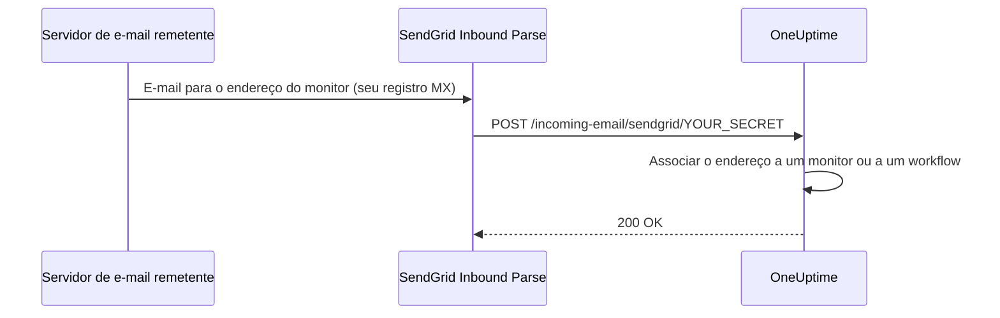

# E-mail recebido SendGrid

O **Incoming Email Monitor** do OneUptime permite criar e resolver alertas com base em e-mails enviados para endereços únicos, específicos de cada monitor. Isso é útil para integrar sistemas legados, ferramentas de alerta ou qualquer serviço capaz de enviar e-mails.

A mesma configuração permite que workflows recebam e-mail: um workflow com o gatilho **Incoming Email** recebe um endereço próprio no mesmo domínio, e cada e-mail enviado a ele inicia o workflow. Veja [Gatilhos](/docs/workflows/triggers#incoming-email).

Este guia explica como configurar o SendGrid Inbound Parse para encaminhar e-mails recebidos para a sua instância auto-hospedada do OneUptime. O OneUptime Cloud não precisa de nada disso: os endereços funcionam de imediato.

:::cards
- [Antes de começar](#pré-requisitos): Uma conta no SendGrid, um domínio e um endereço HTTPS público.
- [Configuração](#instruções-de-configuração): Sete passos, do registro MX a um e-mail de teste.
- [Variáveis de ambiente](#referência-das-variáveis-de-ambiente): As três configurações e seus valores padrão.
- [Solução de problemas](#solução-de-problemas): E-mails que nunca chegam e webhooks que falham.
:::

## Como funciona



1. Você cria um **Incoming Email Monitor** no OneUptime
2. O OneUptime gera um endereço de e-mail único para esse monitor (por exemplo, `monitor-abc123@inbound.yourdomain.com`)
3. Quando um e-mail é enviado para esse endereço, o SendGrid o recebe e o encaminha ao OneUptime por webhook
4. O OneUptime avalia o e-mail de acordo com os critérios que você configurou para criar ou resolver alertas

## Pré-requisitos

- Uma conta no SendGrid com acesso ao Inbound Parse
- Um domínio que você controle, com acesso às configurações de DNS
- Um endpoint HTTPS público que encaminhe os webhooks do SendGrid para a sua instância do OneUptime

## Acesso de rede

No Inbound Parse, é o SendGrid que abre a conexão com o OneUptime. Permitir apenas o acesso de saída à internet a partir do OneUptime não basta.

| Direção | Destino | Protocolo / porta | Finalidade |
| --- | --- | --- | --- |
| SendGrid → OneUptime | `https://your-oneuptime-domain.com/incoming-email/sendgrid/YOUR_SECRET` | HTTPS / TCP 443 | Entregar o e-mail analisado como um POST multipart. |
| Servidores de e-mail remetentes → SendGrid | `mx.sendgrid.net`, escolhido pelo registro MX público do seu domínio de entrada | SMTP / TCP 25 | Receber o e-mail no SendGrid; esta conexão não vai para o seu servidor do OneUptime. |
| OneUptime → SendGrid, apenas quando o envio de e-mail pelo provedor SendGrid estiver configurado à parte | `api.sendgrid.com` | HTTPS / TCP 443 | Enviar e-mails de notificação pela Mail Send API. |

Publique o DNS do nome de host do webhook e sirva um certificado confiável para clientes públicos. Uma implantação privada do OneUptime pode expor apenas o caminho do webhook por meio de um proxy reverso ou gateway públicos que alcancem o OneUptime internamente. Preserve o caminho, o segredo, o tipo de conteúdo e o corpo multipart da requisição, e deixe o POST passar sem login interativo nem desafio do navegador. O servidor do OneUptime não precisa de um listener SMTP de entrada. Veja [a configuração do Inbound Parse no SendGrid](https://www.twilio.com/docs/sendgrid/for-developers/parsing-email/setting-up-the-inbound-parse-webhook).

Defina `INBOUND_EMAIL_WEBHOOK_SECRET` com um valor aleatório forte e substitua `YOUR_SECRET` na URL por esse valor. A rota exige o último segmento do caminho. O OneUptime verifica o valor dele quando o segredo está configurado; deixar a variável vazia desativa essa verificação. Mantenha em sigilo a URL completa e os endereços de e-mail dos monitores, inclusive nos logs do proxy. Atualmente o OneUptime não valida os cabeçalhos assinados do Inbound Parse do SendGrid nem tokens OAuth. Se você precisa desses mecanismos, configure um gateway que os valide antes de encaminhar ao OneUptime, seguindo [a documentação do SendGrid sobre segurança de webhooks](https://www.twilio.com/docs/sendgrid/for-developers/parsing-email/securing-your-parse-webhooks).

O SendGrid não fornece uma lista confiável de IPs de origem estáticos para o Inbound Parse. Os IPs de envio de e-mail dele e os endereços resolvidos para `mx.sendgrid.net` não são uma lista de permissões para o webhook. Siga [as orientações do SendGrid sobre firewall](https://support.sendgrid.com/hc/en-us/articles/44375457225371-How-to-Configure-Firewall-Settings-for-SendGrid-Webhook-and-Inbound-Parse-IPs) em vez de fixar um resultado de DNS atual.

O Inbound Parse é separado do envio de e-mail de saída. Receber os e-mails dos monitores não exige que o OneUptime chame a API do SendGrid. Se você também escolher o SendGrid para enviar notificações, permita a resolução de DNS e o HTTPS de saída para `api.sendgrid.com`; o [Mail Send](https://www.twilio.com/docs/sendgrid/api-reference/mail-send/mail-send) não precisa de nenhum callback de entrada para o envio. Se usar SMTP, permita o servidor e a porta SMTP configurados no OneUptime.

## Instruções de configuração

:::steps
### Escolha o seu domínio de entrada

Escolha um subdomínio dedicado a receber e-mails para o OneUptime, como `inbound.yourdomain.com`, `email.yourdomain.com` ou `monitor.yourdomain.com`. Ele é usado apenas para e-mails destinados a monitores e workflows do OneUptime, então nenhuma caixa de correio sua fica nele.

### Aponte o registro MX dele para o SendGrid

Adicione um registro MX que encaminhe os e-mails do subdomínio para o SendGrid:

| Tipo | Host/Nome | Prioridade | Valor |
| --- | --- | --- | --- |
| MX | inbound | 10 | mx.sendgrid.net |

Se o seu domínio é `example.com` e você usa `inbound.example.com`, o registro fica assim:

```text
inbound.example.com.  IN  MX  10  mx.sendgrid.net.
```

Alterações de DNS podem levar até 48 horas para se propagar, mas normalmente terminam em poucas horas.

### Autentique o domínio no SendGrid

O domínio de recebimento precisa pertencer a um dos seus [domínios autenticados no SendGrid](https://www.twilio.com/docs/sendgrid/ui/account-and-settings/inbound-parse). No [painel do SendGrid](https://app.sendgrid.com), vá em **Settings** > **Sender Authentication**, clique em **Authenticate Your Domain** e adicione os registros DNS solicitados (registros CNAME para DKIM).

### Adicione o webhook do Inbound Parse

No painel do SendGrid, vá em **Settings** > **Inbound Parse** e clique em **Add Host & URL**. Preencha como abaixo e clique em **Add**:

| Campo | Valor |
| --- | --- |
| **Receiving Domain** | Seu subdomínio de entrada (por exemplo, `inbound.yourdomain.com`) |
| **Destination URL** | `https://your-oneuptime-domain.com/incoming-email/sendgrid/YOUR_SECRET` |
| **Check incoming emails for spam** | Opcional – ative se quiser |
| **Send raw, full MIME message** | Deixe desmarcado (não é necessário) |
| **POST the raw, full MIME message** | Deixe desmarcado (não é necessário) |

### Configure o OneUptime

Defina as variáveis de e-mail recebido, com o mesmo segredo da Destination URL:

:::tabs
@tab Docker Compose
```bash title="config.env"
INBOUND_EMAIL_PROVIDER=SendGrid
INBOUND_EMAIL_DOMAIN=inbound.yourdomain.com
INBOUND_EMAIL_WEBHOOK_SECRET=replace-with-a-strong-random-secret
```
@tab Kubernetes
```yaml title="values.yaml"
inboundEmail:
  provider: "SendGrid"
  domain: "inbound.yourdomain.com"
  webhookSecret: "replace-with-a-strong-random-secret"
```
:::

Depois aplique-as: execute `npm run start` no Docker Compose, o que recria os contêineres com os novos valores, ou atualize a release do Helm no Kubernetes.

### Crie um monitor Incoming Email

[Crie um monitor Incoming Email](/docs/monitor/incoming-email-monitor#criar-um-monitor-de-e-mails-recebidos). A página **Visão geral** dele mostra o endereço, como `monitor-abc123def456@inbound.yourdomain.com`, e os critérios dele decidem quais e-mails criam um alerta e quais o resolvem.

Os workflows usam o mesmo domínio. Adicione o gatilho **Incoming Email** a um workflow e clique nele: o endereço (`workflow-…@inbound.yourdomain.com`) aparece no topo das configurações dele. Enquanto as variáveis de e-mail recebido acima não estiverem definidas, o gatilho informa que o servidor não está preparado para receber e-mail.

### Envie um e-mail de teste

Envie um e-mail para o endereço do monitor, com um assunto que corresponda aos critérios dele. O resumo do monitor mostra o e-mail, e um alerta é criado quando os critérios correspondem.
:::

## Referência das variáveis de ambiente

| Variável | Valor do Helm | Descrição | Obrigatória | Padrão |
| --- | --- | --- | --- | --- |
| `INBOUND_EMAIL_PROVIDER` | `inboundEmail.provider` | O provedor de e-mail recebido. O SendGrid é o único. | Não | `SendGrid` |
| `INBOUND_EMAIL_DOMAIN` | `inboundEmail.domain` | O subdomínio configurado para e-mails recebidos. O recebimento de e-mail fica desligado até que ele seja definido. | Sim | Vazio |
| `INBOUND_EMAIL_WEBHOOK_SECRET` | `inboundEmail.webhookSecret` | Segredo comparado com o último segmento da URL do webhook: `/incoming-email/sendgrid/YOUR_SECRET`. Configure-o para endpoints públicos; um valor vazio desativa a validação. | Recomendada | Vazio |

Em que um monitor Incoming Email pode se basear – o assunto, o remetente, o corpo, o destinatário e se um e-mail chegou a tempo – está em [Tipos de filtro disponíveis](/docs/monitor/incoming-email-monitor#tipos-de-filtro-disponíveis).

## Solução de problemas

:::details Os e-mails não estão sendo recebidos
1. **Verifique a propagação do DNS:** `dig MX inbound.yourdomain.com` deve retornar `mx.sendgrid.net`.
2. **Confira as configurações do Inbound Parse no SendGrid:** no painel do SendGrid, em **Settings** > **Inbound Parse**, confira o seu domínio e a URL do webhook.
3. **Verifique os logs do OneUptime:** procure as requisições do webhook de e-mail recebido, e qualquer erro, nos logs do serviço `app` do OneUptime. O SendGrid não guarda logs detalhados do Inbound Parse, então esses logs são o registro do que chegou.
:::

:::details Os webhooks estão falhando
1. **Verifique a rota pública do webhook:** a URL completa, incluindo o segredo, precisa chegar ao OneUptime pela internet. A URL sem o último segmento secreto não corresponde à rota.
2. **Verifique as regras do firewall:** permita requisições HTTPS POST para o caminho do webhook sem redirecionamentos de login nem desafios do navegador, e não use os IPs de envio de e-mail do SendGrid como lista de origens permitidas do webhook.
3. **Verifique o certificado SSL:** use para o nome de host do webhook um certificado válido e confiável publicamente, e inclua a cadeia de certificados dele.
:::

:::details O monitor não cria alertas
1. **Confira os critérios:** verifique se os seus critérios de criação de alertas correspondem ao conteúdo do e-mail, e teste primeiro com textos exatos antes de usar padrões.
2. **Verifique o monitor:** confirme que ele não está desativado e que o tipo dele é Incoming Email.
3. **Revise o resumo do monitor:** verifique se o e-mail foi recebido e processado, e leia os logs de avaliação para ver como os critérios corresponderam.
:::

:::details O gatilho informa que o servidor não está preparado para receber e-mail
`INBOUND_EMAIL_DOMAIN` está vazia no servidor. Defina-a, aplique a alteração e abra de novo o gatilho do workflow.
:::

## Boas práticas de segurança

1. **Use HTTPS:** use sempre HTTPS no endpoint do seu webhook
2. **Segredo do webhook:** configure `INBOUND_EMAIL_WEBHOOK_SECRET` e inclua-o na URL do seu webhook (por exemplo, `/incoming-email/sendgrid/your-secret`) como validação adicional
3. **Verificação do domínio:** verifique o seu domínio no SendGrid para mais segurança de e-mail
4. **Restrinja o acesso:** crie monitores apenas para origens de e-mail confiáveis
5. **Monitore os logs:** revise regularmente os logs de e-mails recebidos em busca de atividade suspeita

## Próximos passos

:::cards
- [Incoming Email Monitor](/docs/monitor/incoming-email-monitor): Critérios, formatos de endereço e exemplos.
- [Gatilhos de workflow](/docs/workflows/triggers): Inicie um workflow a partir de um e-mail.
- [Acesso à rede privada](/docs/self-hosted/private-network-access): O que o seu servidor pode alcançar na sua própria rede.
- [Arquitetura](/docs/self-hosted/architecture): Onde o webhook chega em uma instalação auto-hospedada.
:::
