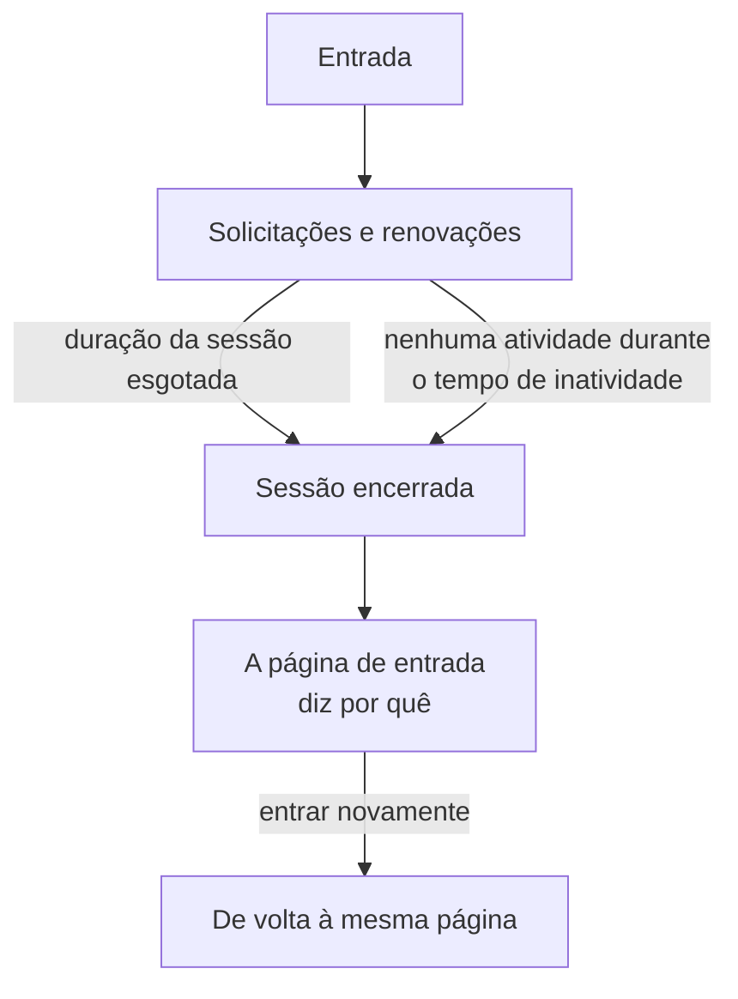

# Duração da sessão

Escolha por quanto tempo as pessoas permanecem conectadas ao OneUptime antes de entrar novamente: um tempo fixo depois de entrarem, um tempo sem uso, ou ambos. Vale para cada entrada no painel, no Admin Dashboard e no aplicativo móvel, com senha, chave de acesso, entrada com o Google, entrada com a Microsoft ou login único. As entradas por SSO podem ter durações próprias.

> [!NOTE]
> A duração da sessão faz parte do [OneUptime Enterprise Edition](/docs/self-hosted/enterprise). A Community Edition não tem a página **Duração da sessão**, e cada entrada dura como [Sem limite](#sem-limite) descreve.

:::cards
- [Definir uma duração da sessão](#definir-uma-duração-da-sessão): Duas configurações no Admin Dashboard.
- [Como uma sessão termina](#como-uma-sessão-termina): O que o servidor conta, e quando.
- [Entradas por SSO](#entradas-por-sso): Durações próprias para o login único.
- [O que não é uma entrada](#o-que-não-é-uma-entrada): Chaves de API, conexões MCP e leitores de páginas de status.
:::

## Sem limite

Enquanto você não definir uma duração, uma entrada não tem nenhuma. O token de acesso dela dura 15 minutos e é renovado em segundo plano com um token de atualização, que dura 30 dias e recomeça a cada uso. Quem abre o OneUptime pelo menos uma vez a cada 30 dias permanece conectado; quem não abre entra novamente.

## Definir uma duração da sessão

:::steps
### Abrir Duração da sessão
No Admin Dashboard, abra **Configurações** e depois **Duração da sessão** no menu lateral.

### Escolher as durações
- **Desconectar as pessoas após**: quanto tempo uma entrada dura a partir do momento em que a pessoa entra, por mais ativa que esteja.
- **Desconectar as pessoas após uma inatividade de**: quanto tempo alguém pode ficar sem clicar, digitar ou rolar no OneUptime.

Cada escolha é salva assim que você a faz.

### Confirmar quem é desconectado
Uma duração mais curta vale para todos que estão conectados agora. Quando ela desconecta pessoas imediatamente, o OneUptime informa primeiro quantas, e se você é uma delas. Selecione **Salvar e desconectá-los** para continuar.
:::

| Configuração | Opções | Padrão |
| --- | --- | --- |
| **Desconectar as pessoas após** | De 1 hora a 90 dias | **Sem limite** |
| **Desconectar as pessoas após uma inatividade de** | De 15 minutos a 14 dias | 30 dias, o máximo possível |

Pela API, `sessionLengthInMinutes` aceita qualquer número inteiro de minutos de 15 a 525600 (um ano) e `sessionIdleTimeoutInMinutes` de 15 a 43200 (30 dias), na configuração global do servidor. Vazio é o padrão.

## Como uma sessão termina

- O servidor conta as duas durações a partir da própria sessão: quando ela entrou, e quando a pessoa dela esteve ativa pela última vez. Ele as verifica em cada solicitação, cada renovação e cada atualização ao vivo, e nunca deixa a desconexão por conta do navegador.
- O tempo de inatividade conta a partir do último clique, tecla pressionada ou rolagem em qualquer aba do painel ou do Admin Dashboard. Uma aba deixada aberta não mantém uma sessão viva.
- O aplicativo móvel conta como ativo cada vez que é usado.
- Quando uma sessão termina, o navegador vai para a página de entrada, que diz por quê. Depois de entrar novamente, a pessoa volta à página em que estava.

| Alteração | O que acontece com as pessoas conectadas agora |
| --- | --- |
| Uma duração da sessão ou um tempo de inatividade mais curto | Todos que o ultrapassaram são desconectados imediatamente, os demais quando o atingirem |
| Um mais longo, ou nenhum | Ninguém é desconectado, e as sessões duram mais a partir da próxima renovação |

## Entradas por SSO

As entradas por login único seguem as mesmas duas configurações. Para dar a elas durações próprias, abra **Mais configurações** na página **Duração da sessão** e ative **Durações separadas para entradas por SSO**. As duas configurações abaixo passam então a valer para as entradas pelo provedor SAML ou OpenID Connect de um projeto, ou pelo [SSO global](/docs/identity/global-sso) do próprio servidor, e as duas no topo da página para todas as outras entradas.

Um projeto que exige SSO, além disso, só deixa uma sessão entrar enquanto a entrada por SSO dela durar, o que nunca é mais longo que a duração seguida pelas entradas por SSO.

Pela API, a chave é `useSeparateSsoSessionLengths`, e as durações das entradas por SSO são `ssoSessionLengthInMinutes` e `ssoSessionIdleTimeoutInMinutes`, com os mesmos intervalos.

## O que não é uma entrada

- **As chaves de API** mantêm a expiração que você der a elas.
- **As conexões MCP**, assistentes de IA conectados com OAuth, mantêm a própria vida útil. Em um projeto que exige SSO, uma conexão nunca dura mais que a entrada por SSO com a qual foi aprovada.
- **As páginas de status privadas** têm uma duração própria para os leitores: veja [Usuários privados](/docs/status-pages/index#usuários-privados).

## Sem licença

Depois do teste ou do período de carência, sem uma licença válida ou com uma que não inclua as durações da sessão, as durações não podem ser definidas nem alteradas. As que já estão definidas continuam desconectando as pessoas, e você ainda pode removê-las. Com a imagem da Community Edition, nenhuma duração se aplica: os valores ficam no banco de dados e voltam a valer quando você voltar.

## Próximos passos

:::cards
- [SSO](/docs/identity/sso): Conecte as pessoas com o seu provedor de identidade.
- [SSO global](/docs/identity/global-sso): Um provedor de identidade para todo o servidor.
- [Enterprise Edition](/docs/self-hosted/enterprise): O que a Enterprise Edition adiciona, e a licença dela.
:::
