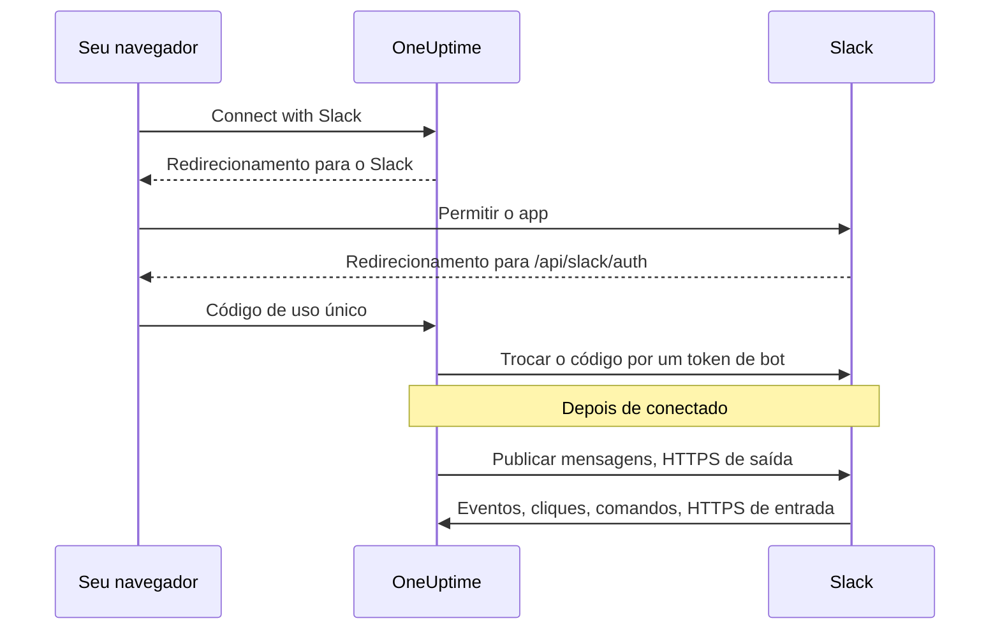

# Integração com Slack

Conecte o seu OneUptime auto-hospedado ao Slack. Você cria um app do Slack a partir do manifesto que o seu servidor gera, entrega ao OneUptime as credenciais do app e conecta cada projeto a um workspace. A partir daí, o OneUptime publica incidentes, alertas e manutenções programadas nos seus canais, e a equipe age sobre eles pelo Slack.

Esta página é para quem administra o servidor do OneUptime. Depois que o Slack estiver conectado, as regras de notificação são configuradas por projeto: veja [Slack](/docs/workspace-connections/slack).

:::cards
- [Configurar o app do Slack](#configurar-o-app-do-slack): Crie o app a partir do seu manifesto e conecte um projeto.
- [Variáveis de ambiente](#variáveis-de-ambiente): Os três valores de que o OneUptime precisa do app.
- [Acesso à rede](#acesso-à-rede-para-implantações-auto-hospedadas): Os callbacks que o Slack precisa conseguir alcançar.
- [Solução de problemas](#solução-de-problemas): O que as mensagens da página do Slack significam e o que fazer.
:::

## Como funciona

O app do Slack é seu: ele fica instalado no seu workspace e só conversa com o seu servidor. O tráfego segue nos dois sentidos, e cada sentido precisa do próprio acesso à rede.



- **Saída**: o OneUptime chama a Web API do Slack para publicar mensagens, criar canais e enviar imagens.
- **Entrada**: o Slack chama quatro rotas no seu servidor para eventos, cliques em botões, menus e comandos de barra. Cada requisição é assinada com o signing secret do app. O OneUptime rejeita uma requisição cuja assinatura não confere ou cujo carimbo de data e hora tem mais de cinco minutos.

## Antes de começar

- Um workspace do Slack em que você possa criar e instalar apps.
- Um nome de host HTTPS público para o OneUptime que o Slack consiga alcançar. Veja [Acesso à rede](#acesso-à-rede-para-implantações-auto-hospedadas).
- Acesso à configuração do servidor: `config.env` no Docker Compose, ou os seus values do Helm no Kubernetes.
- Para conectar um projeto, a função **Project Owner**, **Project Admin** ou **Project Member** nele.

## Configurar o app do Slack

:::steps
### Defina a URL pública

O OneUptime monta o manifesto do app e cada URL de callback a partir de `HOST` e `HTTP_PROTOCOL`. Defina-os com o nome de host que o Slack vai chamar, por HTTPS:

:::tabs
@tab Docker Compose
```bash title="config.env"
HOST=oneuptime.example.com
HTTP_PROTOCOL=https
```
@tab Kubernetes
```yaml title="values.yaml"
host: oneuptime.example.com
httpProtocol: https
```
:::

Esses valores só geram URLs. Eles não criam registros DNS, certificados nem regras de firewall.

### Copie o manifesto do app

Abra **Configurações do projeto > Espaço de trabalho > Slack**. Enquanto o Slack não estiver configurado no servidor, a página mostra **Integrating Slack with your OneUptime Project** com o manifesto gerado para o seu nome de host. Ele também é servido em `https://oneuptime.example.com/api/slack/app-manifest`.

Confira se cada URL do manifesto começa com o seu nome de host público. Se não começar, corrija primeiro `HOST` e `HTTP_PROTOCOL` e aplique a alteração.

### Crie o app do Slack

Em [api.slack.com/apps](https://api.slack.com/apps), crie um novo app a partir de um manifesto, escolha o seu workspace e cole o manifesto. Use sempre o manifesto que o seu próprio servidor gera, para que as URLs dele correspondam ao seu nome de host.

### Copie as credenciais do app

Na página **Basic Information** do app, em **App Credentials**, copie o **Client ID**, o **Client Secret** e o **Signing Secret**.

### Adicione as credenciais ao OneUptime

:::tabs
@tab Docker Compose
```bash title="config.env"
SLACK_APP_CLIENT_ID=YOUR_SLACK_APP_CLIENT_ID
SLACK_APP_CLIENT_SECRET=YOUR_SLACK_APP_CLIENT_SECRET
SLACK_APP_SIGNING_SECRET=YOUR_SLACK_APP_SIGNING_SECRET
```
@tab Kubernetes
```yaml title="values.yaml"
slackApp:
  clientId: "YOUR_SLACK_APP_CLIENT_ID"
  clientSecret: "YOUR_SLACK_APP_CLIENT_SECRET"
  signingSecret: "YOUR_SLACK_APP_SIGNING_SECRET"
```

Para manter os valores em um Secret do Kubernetes que você gerencia, defina `slackApp.existingSecret` em vez disso: o `name` dele e as chaves `clientIdKey`, `clientSecretKey` e `signingSecretKey`.
:::

### Aplique a configuração

:::tabs
@tab Docker Compose
```bash
npm run start
```

Isso recria os contêineres com o novo `config.env`. `docker compose restart` não o lê de novo.
@tab Kubernetes
```bash
helm upgrade my-oneuptime oneuptime/oneuptime -f values.yaml
```
:::

Quando o OneUptime voltar, **Configurações do projeto > Espaço de trabalho > Slack** mostra um botão **Connect with Slack** no lugar do manifesto.

### Verifique a URL de requisição de eventos

Nas **Event Subscriptions** do app do Slack, verifique a URL de requisição. O OneUptime só responde ao challenge do Slack depois que o signing secret estiver definido, então tente de novo se a verificação falhou enquanto você criava o app.

### Conecte o projeto

Em **Configurações do projeto > Espaço de trabalho > Slack**, selecione **Connect with Slack** e permita o app no Slack. O Slack devolve você à mesma página, que agora mostra o nome do seu workspace.

### Conecte a sua própria conta do Slack

Botões, formulários e comandos agem como o usuário do OneUptime vinculado à conta do Slack que os usa. Cada pessoa abre **Configurações do usuário > Espaço de trabalho > Slack** e seleciona **Connect my account with Slack**. Quem não conectou uma conta recebe do app uma mensagem direta pedindo que conecte.
:::

## Variáveis de ambiente

| Docker Compose (`config.env`) | Helm (`values.yaml`) | Obrigatória | Valor |
| --- | --- | --- | --- |
| `SLACK_APP_CLIENT_ID` | `slackApp.clientId` | Sim | O **Client ID** do app. Sem ele, a página do Slack mostra o guia de configuração em vez de **Connect with Slack**. |
| `SLACK_APP_CLIENT_SECRET` | `slackApp.clientSecret` | Sim | O **Client Secret** do app, usado para trocar por um token o código que o Slack devolve. |
| `SLACK_APP_SIGNING_SECRET` | `slackApp.signingSecret` | Sim | O **Signing Secret** do app. Toda requisição do Slack é verificada com ele. |
| `HOST` | `host` | Sim | O seu nome de host público, sem o esquema. |
| `HTTP_PROTOCOL` | `httpProtocol` | Sim | `https`. O Slack só chama URLs HTTPS. |

## O que o app pode fazer

O manifesto configura estes recursos. Cada um alcança o seu servidor pela rota indicada, então só funciona quando o Slack consegue alcançar essa rota.

| Recurso | O que faz | Rota |
| --- | --- | --- |
| `/incident` e o atalho **Create New Incident** | Declarar um incidente pelo Slack | `POST /api/slack/interactive` |
| `/maintenance` e o atalho **Create Scheduled Event** | Agendar uma manutenção pelo Slack | `POST /api/slack/interactive` |
| `/oneuptime` | Perguntar ao OneUptime AI sobre os seus logs, traces, métricas, incidentes e monitores | `POST /api/slack/command` |
| Botões e formulários nas mensagens do OneUptime | Reconhecer, resolver, adicionar uma nota, mudar o estado, executar uma política de plantão | `POST /api/slack/interactive` e `POST /api/slack/options-load` |
| Eventos | Menções, mensagens, reações e fixações, por exemplo para salvar uma mensagem como nota | `POST /api/slack/events` |

### Imagens nas mensagens

As descrições de incidentes e alertas podem trazer capturas de tela, como a de um monitor sintético (veja [Mostrar uma captura de tela](/docs/monitor/incident-alert-templating#mostrar-uma-captura-de-tela)). O OneUptime as mostra nas mensagens do Slack enviando cada uma ao seu workspace como arquivo privado, o que exige o escopo de bot `files:write`. O manifesto gerado o inclui.

Se você criou o seu app do Slack a partir de um manifesto mais antigo, adicione `files:write` em **OAuth & Permissions > Bot Token Scopes** (ou atualize o app a partir do manifesto atual). Depois, selecione de novo **Connect with Slack** em **Configurações do projeto > Espaço de trabalho > Slack**, para que o novo escopo seja concedido. Até lá, cada captura de tela aparece como o seu texto alternativo.

## Acesso à rede para implantações auto-hospedadas

### Sentido do tráfego e endpoints

| Tráfego | Acesso necessário |
| --- | --- |
| Do OneUptime para o Slack | DNS e HTTPS de saída na TCP 443 para `slack.com`, para chamadas à Web API e a troca do token OAuth; `hooks.slack.com` para URLs de resposta de comandos e notificações por incoming webhook, quando usados |
| Do Slack para o OneUptime | HTTPS público na TCP 443 para as quatro rotas POST abaixo, para a integração completa |
| Do navegador do usuário para o OneUptime | Acesso ao painel e redirecionamentos OAuth para `/api/slack/auth/:projectId/:userId` e `/api/slack/auth/:projectId/:userId/user`; eles podem continuar acessíveis pela VPN do usuário |

Os domínios de saída descrevem a integração do OneUptime com o Slack, não uma allowlist completa para clientes do Slack ou para cada recurso do Slack. Um *incoming webhook* do Slack é hospedado pelo Slack: o OneUptime envia para ele, então ele não é um endpoint de entrada no seu servidor. Veja o [guia de incoming webhooks](https://docs.slack.dev/messaging/sending-messages-using-incoming-webhooks/) do Slack.

Encaminhe estes callbacks ao OneUptime pelo ingress dele:

| Método e caminho | Finalidade |
| --- | --- |
| `POST /api/slack/events` | Verificação da Events API, reações, fixações, menções e mensagens |
| `POST /api/slack/interactive` | Botões, atalhos, envios de modais, `/incident` e `/maintenance` |
| `POST /api/slack/options-load` | Pedidos de opções de menus interativos |
| `POST /api/slack/command` | Comando `/oneuptime` |

O OAuth é um [redirecionamento do navegador seguido de uma troca do token no servidor](https://docs.slack.dev/authentication/installing-with-oauth/). O manifesto registra `/api/slack/auth` como prefixo da URL de redirecionamento, e o OneUptime acrescenta os caminhos do projeto e do usuário ao iniciar a autorização. O acesso pelo navegador, sozinho, não permite que o Slack entregue eventos nem cliques em botões.

### Implantações privadas e segurança dos callbacks

```mermaid title="Publicar os callbacks do Slack a partir de uma implantação privada"
flowchart LR
    Slack["Slack"] -->|HTTPS 443| GW["Gateway público"]
    GW -->|"/api/slack/* só POST"| ING["Ingress do OneUptime"]
    Users["Funcionários na VPN"] --> ING
    ING --> App["App do OneUptime"]
```

Use DNS público e um gateway com um certificado HTTPS de confiança pública, uma cadeia de certificados completa e uma rota privada até o seu ingress do OneUptime. Libere a TCP 443 de entrada para o gateway e encaminhe só as quatro rotas de callback acima. Um `ClusterIP` privado, um nome DNS interno ou a conexão VPN de um funcionário não são alcançáveis pelo Slack. Com DNS dividido, o painel e as rotas OAuth podem continuar privados sob o mesmo nome de host.

Gere o manifesto de novo e atualize o app do Slack depois de mudar o nome de host.

Pelo gateway, preserve:

- o método, o caminho, a query string e o corpo original;
- `Content-Type`, `X-Slack-Signature` e `X-Slack-Request-Timestamp`;
- o host público e o esquema HTTPS, por cabeçalhos de proxy confiáveis.

Isente as rotas de callback do SSO do navegador, de CAPTCHA e das páginas de login do proxy, e mantenha as verificações de signing secret e de carimbo de data e hora do OneUptime. Mantenha o relógio do servidor sincronizado: uma requisição com mais de cinco minutos de diferença é rejeitada. O Slack documenta a [verificação da assinatura das requisições](https://docs.slack.dev/authentication/verifying-requests-from-slack/); uma verificação do IP de origem não a substitui.

### Verificar o acesso e entender as limitações

:::steps
1. Nas **Event Subscriptions** do app do Slack, verifique a URL de requisição. O Slack envia um [challenge por POST e verifica o TLS](https://docs.slack.dev/apis/events-api/using-http-request-urls/).
2. Envie uma notificação de teste, execute um comando de barra, clique em um botão de uma mensagem de incidente e dispare um evento assinado.
3. Verifique os logs do gateway e do OneUptime em busca de entregas com falha, sem registrar segredos.
:::

O Slack espera confirmações rápidas, incluindo [uma resposta em até três segundos para interações](https://docs.slack.dev/interactivity/handling-user-interaction/). Um GET do navegador ou uma mensagem de saída bem-sucedida não verificam esses callbacks POST.

> [!WARNING]
> Se toda conectividade de entrada for proibida, um app já autorizado ainda pode enviar mensagens por HTTPS de saída, mas eventos, botões, atalhos e comandos não funcionam. O manifesto do OneUptime usa callbacks HTTP e desativa o Socket Mode; ativar o Socket Mode do Slack não é um substituto suportado para essas rotas.

As [configurações de acesso à rede privada](/docs/self-hosted/private-network-access) controlam requisições de saída para destinos privados. Elas não expõem os callbacks ao Slack.

## Solução de problemas

### A conexão não foi concluída

Quando o Slack devolve você e a conexão não foi feita, a página do Slack de onde você começou (**Configurações do projeto > Espaço de trabalho > Slack**, ou as suas próprias **Configurações do usuário > Espaço de trabalho > Slack**, se você estava conectando a sua conta) mostra **O Slack não foi conectado**, com uma frase no seu idioma dizendo por quê. O restante da página carrega normalmente, então você pode conectar de novo ali mesmo. Ela nunca mostra o que o próprio Slack respondeu: isso fica no log do servidor do OneUptime, com o motivo.

| A página diz | O que fazer |
| --- | --- |
| **"Este link de conexão é inválido, expirou ou já foi usado. Comece novamente."** | O link funciona uma vez, por 15 minutos, no navegador que o iniciou. Comece de novo pela página do Slack e conclua no Slack em até 15 minutos, no mesmo navegador. |
| **"Você não tem permissão para conectar este projeto ao Slack."** | Instalar o OneUptime no Slack exige **Project Owner**, **Project Admin** ou **Project Member**. Isso é verificado de novo quando o Slack devolve você, então uma função retirada nesse meio-tempo também encerra a conexão aqui. |
| **"Você não é mais membro deste projeto."** | Para conectar a sua própria conta do Slack, você precisa ser membro do projeto quando o Slack devolver você. |
| **"Este projeto ainda não está conectado a um workspace do Slack."** | Instale primeiro o OneUptime no Slack em **Configurações do projeto > Espaço de trabalho > Slack** e depois conecte a sua própria conta. |
| **"Você entrou em um workspace do Slack diferente daquele ao qual este projeto está conectado."** | Conecte a sua conta enquanto estiver conectado ao workspace do Slack em que o projeto está instalado. |
| **"A conexão foi cancelada, então nada foi alterado."** | O pedido não foi permitido no Slack. Comece de novo e permita. |
| **"O Slack não está configurado neste servidor do OneUptime."** | Defina `SLACK_APP_CLIENT_ID` e `SLACK_APP_CLIENT_SECRET` (veja [Variáveis de ambiente](#variáveis-de-ambiente)) e reinicie o OneUptime. |
| **"O OneUptime não conseguiu concluir a conexão. Tente novamente."** | O Slack respondeu com um erro, ou uma requisição ou uma gravação falhou durante a conclusão. O log do servidor do OneUptime diz qual. Tente de novo; se continuar acontecendo, verifique o log e as configurações do app do Slack. |

### Outros problemas

:::details O Slack não consegue verificar a URL de requisição de eventos
O OneUptime só responde ao challenge do Slack quando `SLACK_APP_SIGNING_SECRET` está definido e a requisição chega até ele. Defina o signing secret, aplique a configuração e tente a verificação de novo. Se ainda falhar, verifique se `POST /api/slack/events` é alcançável pela internet com um certificado de confiança pública.
:::

:::details Botões e comandos de barra não fazem nada, mas as notificações chegam
As notificações são de saída, então funcionam sem acesso de entrada. Botões, atalhos e comandos são de entrada: verifique se o Slack consegue alcançar `POST /api/slack/interactive` e `POST /api/slack/command`, e se o gateway preserva o corpo e os cabeçalhos `X-Slack-Signature` e `X-Slack-Request-Timestamp`.
:::

:::details O app diz que a minha conta do Slack não está conectada ao OneUptime
Botões, formulários e comandos precisam da sua conta do Slack vinculada ao seu usuário do OneUptime. Abra **Configurações do usuário > Espaço de trabalho > Slack** e selecione **Connect my account with Slack**. Se você foi removido do projeto, o app diz isso em vez disso, e as ações feitas pelo Slack são recusadas.
:::

:::details As capturas de tela aparecem como texto
Falta ao app do Slack o escopo `files:write`. Veja [Imagens nas mensagens](#imagens-nas-mensagens).
:::

## Próximos passos

:::cards
- [Slack](/docs/workspace-connections/slack): Crie regras de notificação e resumos para o projeto.
- [Integração com Microsoft Teams](/docs/self-hosted/microsoft-teams-integration): Configure também o bot do Teams no seu servidor.
- [Acesso à rede privada](/docs/self-hosted/private-network-access): Deixe workflows e webhooks alcançarem ferramentas internas.
:::
