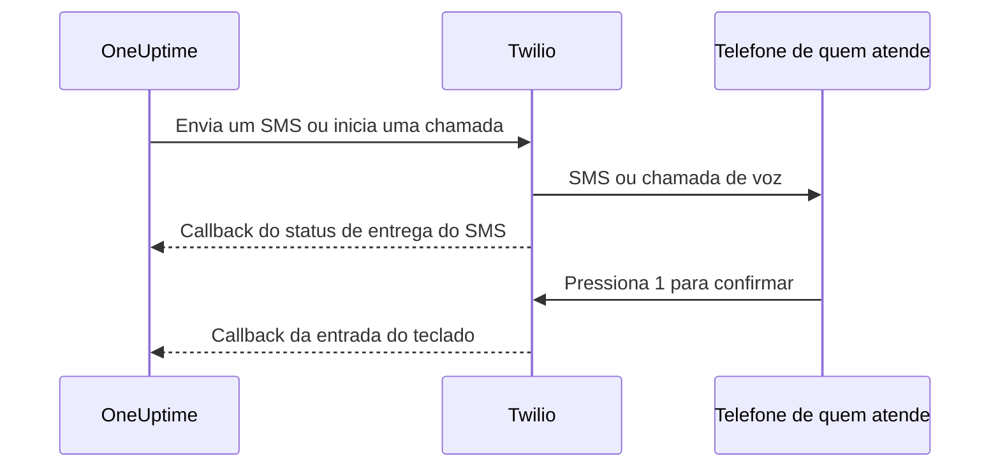

# Integração do Twilio

O OneUptime auto-hospedado envia alertas por SMS e por voz pela sua própria conta do Twilio, e você paga o Twilio diretamente. As credenciais do Twilio ficam salvas no painel do OneUptime, não em variáveis de ambiente: o envio de notificações lê a configuração salva, e o chart do Helm não tem valores para as credenciais do Twilio.

> [!NOTE]
> Uma migração antiga importou `TWILIO_ACCOUNT_SID`, `TWILIO_AUTH_TOKEN` e `TWILIO_PHONE_NUMBER`; alterar essas variáveis não é a forma de atualizar as credenciais de uma instalação existente.

:::cards
- [Prepare sua conta Twilio](#1-prepare-sua-conta-twilio): As credenciais, um número de telefone e os limites da conta.
- [Salve as credenciais](#2-salve-as-credenciais-no-oneuptime): Para um projeto, ou para a instalação inteira.
- [Configure o acesso à rede](#3-configure-o-acesso-à-rede): O que o Twilio precisa alcançar no seu servidor, e quando.
- [Verifique números de telefone](#5-verifique-os-números-de-telefone-dos-membros-da-equipe): Como os números dos membros da equipe são verificados.
:::

## 1. Prepare sua conta Twilio

:::steps
### Copie suas credenciais

Abra o [Twilio Console](https://console.twilio.com/) e copie o seu **Account SID** e o seu **Auth Token**.

### Obtenha um número de telefone

Obtenha um número de telefone do Twilio com os recursos de SMS e/ou voz de que você precisa. Use o formato E.164, com o código do país, para os números de remetente e de destinatário.

### Verifique os limites da conta

Verifique o saldo da conta, as permissões dos países de destino e os requisitos de registro de remetentes aplicáveis. Contas de avaliação têm restrições de destinatários, geográficas e outras que podem impedir que alertas reais do OneUptime funcionem; leia a [documentação do Twilio sobre contas e avaliação gratuita](https://www.twilio.com/docs/usage/tutorials/how-to-use-your-free-trial-account) antes de testar. Em produção, use uma conta atualizada.
:::

## 2. Salve as credenciais no OneUptime

Salve as credenciais para um projeto, ou uma única vez para a instalação inteira:

| | Configuração do projeto | Configuração da instalação |
| --- | --- | --- |
| Onde | O cartão **Configuração do Twilio** em **Configurações do projeto > Notificações > Configurações de notificação** | **Admin Dashboard > Configurações > Chamadas e SMS** |
| Quem pode definir | **Project Owner**, **Project Admin**, ou **Create Call and SMS** em uma função personalizada | Um administrador mestre |
| Usada para | SMS e chamadas aos membros do projeto enquanto ela for a padrão do projeto, as páginas de status às quais está atribuída e as políticas de chamadas recebidas que a usam | SMS e chamadas aos membros de qualquer projeto que não tenha configuração padrão |

Para adicionar uma configuração de projeto:

:::steps
1. Vá para **Configurações do projeto > Notificações > Configurações de notificação**.
2. Em **Configuração do Twilio**, selecione **Criar: Configuração do Twilio**.
3. Informe um nome, **SID da Conta Twilio**, **Token de Autenticação Twilio** e **Número de Telefone Principal do Twilio**. Se quiser, informe **Números de Telefone Secundários do Twilio** separados por vírgulas para outros países.
4. **Definir como padrão do projeto** começa ligado na primeira configuração do projeto, então os SMS e as chamadas aos membros do projeto, inclusive as notificações de plantão, passam por ela assim que você salva. Desligue se essa conta for só para páginas de status ou chamadas recebidas. Uma configuração posterior começa com a chave desligada: ligue-a, ou escolha **Definir como padrão do projeto** no menu da linha da configuração, para levar essas mensagens para ela. Uma requisição à API que omite `isProjectDefault` é tratada da mesma forma.
5. Salve. Só uma configuração pode ser a padrão do projeto. As páginas de status usam a configuração atribuída explicitamente a cada uma.

> [!IMPORTANT]
> **SMS** e **Chamadas telefônicas** começam desligados em todos os projetos, e enquanto não estiverem ligados ninguém no projeto pode adicionar um número de telefone para eles. Um proprietário do projeto, um **Billing Admin** ou alguém com **Manage Billing** os liga no cartão **Canais de notificação** da mesma página.
:::

Para um padrão que valha para a instalação inteira, um administrador pode abrir **Admin Dashboard > Configurações > Chamadas e SMS**, editar as credenciais e os números de telefone do Twilio e salvar. As notificações dos membros usam essa configuração global quando o projeto deles não tem um padrão. Mantenha o Auth Token em sigilo.

## 3. Configure o acesso à rede

O envio funciona só com acesso de saída. As atualizações de entrega, a confirmação pelo teclado e as chamadas recebidas precisam que o Twilio alcance o seu servidor.

Uma implantação privada precisa de resolução DNS e de HTTPS de saída pela porta TCP 443 até o Twilio para enviar SMS e chamadas. O Twilio recomenda liberar o HTTPS de saída para `*.twilio.com`, porque os endereços da API dele são dinâmicos; veja [os endereços IP do Twilio](https://help.twilio.com/articles/115015934048-All-About-Twilio-IP-Addresses). Aplique isso à saída da carga de trabalho da aplicação OneUptime, incluindo as NetworkPolicies do Kubernetes e os firewalls externos.

O acesso de entrada depende do recurso:

| Recurso | O Twilio precisa alcançar o OneUptime? |
| --- | --- |
| Envio de SMS | Não. As atualizações do status de entrega, porém, precisam de um callback. |
| Uma chamada de voz de teste simples | Não. O OneUptime envia as instruções faladas junto com a requisição de saída à API. |
| Pressionar 1 para confirmar um alerta de plantão | Sim. O Twilio envia a entrada do teclado ao OneUptime. |
| Políticas de chamadas recebidas | Sim. O Twilio pede as instruções da chamada e informa os resultados da discagem. |

Estes são os caminhos externos, pelo gateway Nginx do OneUptime. Os marcadores variam a cada notificação:

| Método | Caminho | Finalidade |
| --- | --- | --- |
| POST | `/notification/sms/status-callback/:smsLogId/:token` | Status de entrega do SMS |
| POST | `/api/user-notification-log-timeline/call/gather-input/:itemId?token=...` | Confirmação pelo teclado |
| POST | `/notification/incoming-call/voice` | Instruções opcionais de chamadas recebidas |
| POST | `/notification/incoming-call/dial-status/:callLogId/:callLogItemId` | Resultados opcionais do roteamento de chamadas recebidas |

O OneUptime gera automaticamente as URLs dos SMS e da confirmação. Não substitua os tokens delas por uma URL de webhook fixa. Para chamadas recebidas, siga [as políticas de chamadas recebidas](/docs/on-call/incoming-call-policy), que configuram o webhook do número quando você o associa.

O Twilio exige [URLs de webhook acessíveis publicamente](https://www.twilio.com/docs/usage/webhooks/webhooks-overview). Use um certificado TLS de confiança pública e preserve, através dos proxies, o host, o protocolo, o caminho, os parâmetros de consulta, o corpo e o cabeçalho `X-Twilio-Signature` originais. Os handlers de chamadas recebidas validam as assinaturas do Twilio; a entrega de SMS usa um token de URL por mensagem, e a confirmação pelo teclado, um token de consulta assinado. Não exponha os tokens em logs compartilhados nem em capturas de tela. Veja [a segurança dos webhooks do Twilio](https://www.twilio.com/docs/usage/webhooks/webhooks-security).

### Publicar callbacks a partir de uma implantação privada

:::steps
1. Publique o DNS do seu nome de host do OneUptime, por exemplo `oneuptime.example.com`, apontando para um proxy reverso ou balanceador de carga exposto à internet. Libere a porta TCP 443 de entrada e configure um certificado de confiança pública com a cadeia completa. Um IP privado, um DNS só interno ou a conexão VPN de um administrador não dão conectividade ao Twilio.
2. Dê a esse gateway uma rota de rede até o ingress privado do OneUptime, diretamente ou pela sua própria VPN site a site ou link privado. Libere a porta do serviço de origem. Um serviço `ClusterIP` do Kubernetes precisa de um ingress acessível ou de outra rota a partir do gateway. Mantenha privados os bancos de dados e os outros serviços internos.
3. Publique só os caminhos de callback da tabela acima que você usa. Encaminhe-os pelo gateway Nginx do OneUptime, que mapeia o prefixo externo `/notification` para a aplicação. Mantenha `/api` na rota da confirmação pelo teclado. Preserve o método HTTP e os dados da requisição; não redirecione para outra URL. Preserve o `Host` público e defina no seu proxy cabeçalhos de encaminhamento confiáveis para o host público e o esquema HTTPS.
4. Exclua essas rotas do SSO do navegador, dos CAPTCHAs e das páginas de login do proxy. Mantenha ativada a autenticação de callbacks do OneUptime. Limite o acesso à origem privada ao gateway e aos clientes internos autorizados.
5. Defina `HOST=oneuptime.example.com` e `HTTP_PROTOCOL=https` no `config.env` do Docker Compose, ou `host: oneuptime.example.com` e `httpProtocol: https` nos values do Helm. Aplique a mudança na implantação e espere a aplicação reiniciar. Essas configurações geram URLs; elas não criam DNS, certificados nem regras de firewall. O OneUptime não tem uma configuração separada de nome de host para os callbacks do Twilio. Se o nome de host mudar, atualize também o webhook dos números de telefone do Twilio existentes.
:::

O painel pode ficar num ingress privado: com DNS dividido, os funcionários resolvem o mesmo nome de host para esse ingress pela rede corporativa ou pela VPN, enquanto o Twilio o resolve para o gateway. Sirva nos dois caminhos um certificado válido para esse nome de host. As [configurações de acesso a redes privadas](/docs/self-hosted/private-network-access) do OneUptime regem as requisições de saída para serviços internos; `ALLOW_PRIVATE_NETWORK_WEBHOOKS` não publica um endpoint de entrada.

### Restrições de IP e implantações sem acesso de entrada

Os endereços de origem comuns dos webhooks do Twilio mudam, então não use faixas de IP de SIP ou de mídia como lista de permissões dos callbacks. As edições do Twilio elegíveis oferecem [Static Proxy for Webhooks](https://www.twilio.com/docs/iam/twilio-editions/twilio-static-proxy). Confirme a elegibilidade da sua edição e os produtos compatíveis, e configure o seu firewall com as faixas publicadas atualmente pelo Twilio; continue validando os callbacks mesmo ao usá-lo.

> [!WARNING]
> Se uma política proíbe conexões de entrada, o envio de SMS e a reprodução de voz simples embutida podem funcionar com HTTPS de saída. As atualizações de entrega de SMS, a confirmação pelo teclado e o roteamento de chamadas recebidas não funcionam sem callbacks acessíveis. Uma instalação totalmente desconectada não pode usar o Twilio.

Para desenvolvimento, o [guia de testes de webhooks](https://www.twilio.com/docs/usage/webhooks/webhook-testing) do Twilio descreve o uso de um túnel público: encaminhe-o para um proxy que permita só as rotas necessárias, configure o nome de host resultante como acima e encerre-o depois dos testes. Um túnel ainda assim abre um acesso de entrada.

## 4. Teste a entrega e os callbacks separadamente

:::steps
1. De fora da rede corporativa e da VPN, verifique se o nome de host dos callbacks resolve para o gateway público e apresenta um certificado TLS válido. Um GET no navegador não testa esses callbacks POST.
2. Use **Enviar SMS de teste** e **Enviar chamada de teste** na configuração do Twilio do projeto. Confirme o recebimento no telefone de destino. As duas ações exigem permissão para adicionar configurações do Twilio: **Project Owner**, **Project Admin**, ou **Create Call and SMS** e **Read Call and SMS** em uma função personalizada.
3. Configure o contato de SMS ou chamada verificado do usuário e as regras de notificação, e então dispare um alerta de plantão controlado. Pressione 1 e confirme o reconhecimento no OneUptime. Se você usa políticas de chamadas recebidas, ligue para o número configurado e verifique o roteamento e o registro de chamadas.
4. Confirme o status de entrega dos SMS no OneUptime e nos logs de mensagens do Twilio. Um envio aceito não prova a entrega; [o Twilio informa mudanças de status posteriores por callbacks](https://www.twilio.com/docs/messaging/guides/track-outbound-message-status).
:::

| Sintoma | Onde olhar |
| --- | --- |
| Nada é enviado | As credenciais, os recursos do número, as restrições da conta e a conectividade de saída. |
| O SMS ou a chamada chega, mas o status ou a confirmação não é atualizado | A URL do callback e os logs do ingress público. O [guia do Twilio sobre falhas de obtenção HTTP](https://www.twilio.com/docs/api/errors/11200) ajuda a diagnosticar callbacks inacessíveis, problemas de TLS e erros HTTP. |

Uma chamada de teste bem-sucedida, sozinha, não prova que os callbacks são acessíveis.

## 5. Verifique os números de telefone dos membros da equipe

Adicionar um número de telefone para SMS ou chamadas envia o código de verificação dele na hora, e o diálogo de verificação se abre. Ele mostra quando o código foi enviado e até quando vale, e envia um código novo quando pedido, no máximo uma vez por minuto. Nada precisa ser reenviado antes de verificar.

Quando nenhum código pode ser enviado, o diálogo diz por quê, em vez de afirmar que um código foi enviado: por exemplo, que nenhuma conta do Twilio está configurada, até que exista uma configuração padrão do projeto ou a configuração da instalação descrita acima. Um número cujo primeiro código não pode ser enviado não é adicionado, e o formulário mostra o motivo, como o Twilio recusar um país de destino.

Um número verificado para SMS também fica verificado para chamadas, sem um segundo código. A verificação por chamada não verifica o SMS, porque um número que recebe chamadas, como um telefone fixo, nem sempre consegue receber mensagens de texto. Se o Twilio aceitar um código que nunca chega, o log de SMS do projeto mostra o status de entrega dele.

## Próximos passos

:::cards
- [Política de chamadas recebidas](/docs/on-call/incoming-call-policy): Deixar quem liga falar com os seus engenheiros de plantão por um número do Twilio.
- [Regras de escalonamento](/docs/on-call/escalation-rules): Decidir quem é acionado em cada nível, por SMS, chamada ou qualquer outro método.
- [SMTP](/docs/emails/smtp): Enviar também os e-mails pelo seu próprio servidor de e-mail.
- [Acesso a redes privadas](/docs/self-hosted/private-network-access): Deixar workflows e webhooks alcançarem ferramentas internas.
:::
