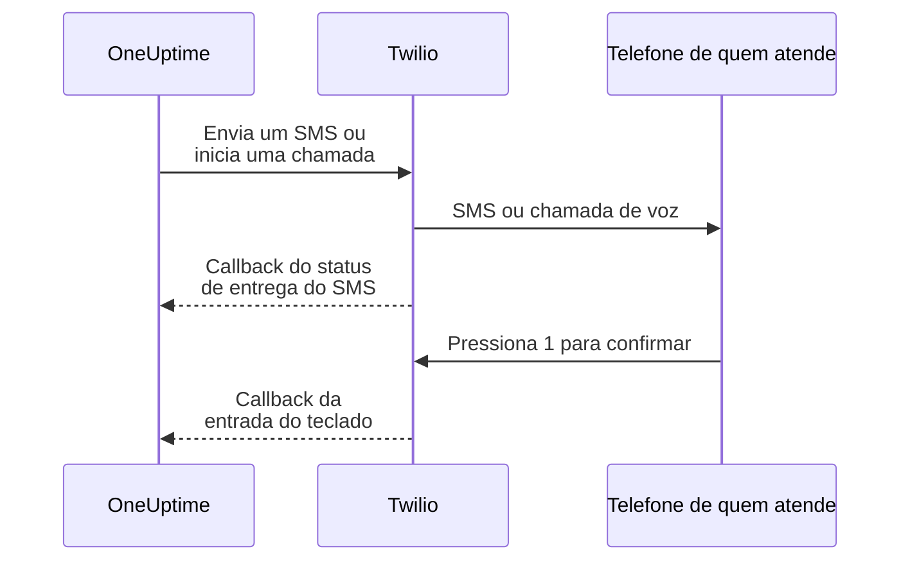

# Integração do Twilio

O OneUptime auto-hospedado envia alertas por SMS e por voz pela sua própria conta do Twilio, e você paga o Twilio diretamente. As credenciais do Twilio ficam salvas no painel do OneUptime, para um projeto ou para a instalação inteira. Uma instalação implantada a partir de código pode, em vez disso, definir a conta da instalação inteira com variáveis de ambiente, que o chart do Helm e o Docker Compose repassam: veja [Definir a conta da instalação inteira com variáveis de ambiente](#definir-a-conta-da-instalação-inteira-com-variáveis-de-ambiente).

> [!NOTE]
> Uma migração antiga importou uma vez `TWILIO_ACCOUNT_SID`, `TWILIO_AUTH_TOKEN` e `TWILIO_PHONE_NUMBER`; alterar essas variáveis não atualiza as credenciais de uma instalação existente. As variáveis `GLOBAL_TWILIO_` abaixo atualizam.

:::cards
- [Prepare sua conta Twilio](#1-prepare-sua-conta-twilio): As credenciais, um número de telefone e os limites da conta.
- [Salve as credenciais](#2-salve-as-credenciais-no-oneuptime): Para um projeto, ou para a instalação inteira.
- [Configure o acesso à rede](#3-configure-o-acesso-à-rede): O que o Twilio precisa alcançar no seu servidor, e quando.
- [Verifique números de telefone](#5-verifique-os-números-de-telefone-dos-membros-da-equipe): Como os números dos membros da equipe são verificados.
:::

## 1. Prepare sua conta Twilio

:::steps
### Copie suas credenciais

Abra o [Twilio Console](https://console.twilio.com/) e copie o seu **Account SID** e o seu **Auth Token**.

### Obtenha um número de telefone

Obtenha um número de telefone do Twilio com os recursos de SMS e/ou voz de que você precisa; o Twilio Console mostra o que cada número pode fazer. Use o formato E.164, com o código do país, para os números de remetente e de destinatário. Onde nenhum número faz as duas coisas, obtenha um para chamadas e outro para SMS: veja [Números separados para chamadas e SMS](#números-separados-para-chamadas-e-sms).

### Verifique os limites da conta

Verifique o saldo da conta, as permissões dos países de destino e os requisitos de registro de remetentes aplicáveis. Contas de avaliação têm restrições de destinatários, geográficas e outras que podem impedir que alertas reais do OneUptime funcionem; leia a [documentação do Twilio sobre contas e avaliação gratuita](https://www.twilio.com/docs/usage/tutorials/how-to-use-your-free-trial-account) antes de testar. Em produção, use uma conta atualizada.
:::

## 2. Salve as credenciais no OneUptime

Salve as credenciais para um projeto, ou uma única vez para a instalação inteira:

| | Configuração do projeto | Configuração da instalação |
| --- | --- | --- |
| Onde | O cartão **Configuração do Twilio**, em **Mais configurações** de **Configurações do projeto > Notificações > Canais de notificação** | **Admin Dashboard > Configurações > Chamadas e SMS** |
| Quem pode definir | **Proprietário do projeto**, **Administrador do projeto**, ou **Create Call and SMS** em uma função personalizada | Um administrador mestre |
| Quem pode ler o Auth Token | **Proprietário do projeto**, **Administrador do projeto**, ou **Read Call and SMS** em uma função personalizada. Os demais que veem a configuração veem o restante dela; o token é armazenado criptografado | Um administrador mestre |
| Usada para | SMS e chamadas aos membros do projeto enquanto ela for a padrão do projeto, as páginas de status às quais está atribuída e as políticas de chamadas recebidas que a usam | SMS e chamadas aos membros de qualquer projeto que não tenha configuração padrão |

Para adicionar uma configuração de projeto:

:::steps
1. Vá para **Configurações do projeto > Notificações > Canais de notificação** e abra **Mais configurações**.
2. Em **Configuração do Twilio**, selecione **Criar configuração do Twilio**.
3. Informe um nome e escolha em **Usar esta conta para** o que a conta envia: **Chamadas e SMS**, **Somente SMS** ou **Somente chamadas**. Depois informe **SID da Conta Twilio**, **Token de Autenticação Twilio** e o número que a escolha pede: **Número de Telefone Principal do Twilio** para chamadas, ou **Números de Telefone SMS do Twilio** para **Somente SMS**. Em **Mais campos**, se quiser, informe **Números de Telefone Secundários do Twilio** separados por vírgulas para outros países, e **Números de Telefone SMS do Twilio** se os seus números não puderem enviar SMS.
4. **Definir como padrão do projeto** começa ligado na primeira configuração do projeto, então os SMS e as chamadas aos membros do projeto, inclusive as notificações de plantão, passam por ela assim que você salva. Desligue se essa conta for só para páginas de status ou chamadas recebidas. Uma configuração posterior começa com a chave desligada: ligue-a, ou escolha **Definir como padrão do projeto** no menu da linha da configuração, para levar essas mensagens para ela. Uma requisição à API que omite `isProjectDefault` é tratada da mesma forma.
5. Salve. Um projeto tem uma configuração padrão para SMS e outra para chamadas, então uma configuração em **Somente SMS** e outra em **Somente chamadas** podem ser padrão ao mesmo tempo: veja [Uma conta só para SMS, ou só para chamadas](#uma-conta-só-para-sms-ou-só-para-chamadas). As páginas de status usam a configuração atribuída explicitamente a cada uma.

> [!IMPORTANT]
> **SMS** e **Chamadas telefônicas** começam desligados em todos os projetos, e enquanto não estiverem ligados ninguém no projeto pode adicionar um número de telefone para eles. Um proprietário do projeto, um **Administrador de cobrança** ou alguém com **Manage Billing** os liga no cartão **Canais de notificação** da mesma página.
:::

Para um padrão que valha para a instalação inteira, um administrador pode abrir **Admin Dashboard > Configurações > Chamadas e SMS**, escolher o que a conta envia, editar as credenciais e os números de telefone do Twilio e salvar. As notificações dos membros usam essa configuração global quando o projeto deles não tem um padrão. Mantenha o Auth Token em sigilo.

### Definir a conta da instalação inteira com variáveis de ambiente

Uma instalação nova pode subir com SMS e chamadas funcionando, sem nada para configurar à mão: defina a conta da instalação inteira com variáveis de ambiente, pelo Terraform ou pelo que implanta o OneUptime. Assim que `GLOBAL_TWILIO_ACCOUNT_SID` está definida, a conta é a que as variáveis descrevem. A conta salva em **Admin Dashboard > Configurações > Chamadas e SMS** não é usada, e essa página mostra esta em modo somente leitura, cada campo com a variável que o define. Deixe `GLOBAL_TWILIO_ACCOUNT_SID` vazia para configurar a conta no Admin Dashboard. As configurações dos projetos não mudam.

| Variável | Valor do Helm | O que contém |
| --- | --- | --- |
| `GLOBAL_TWILIO_ACCOUNT_SID` | `twilio.accountSid` | O Account SID. É defini-la que faz o OneUptime ler as outras variáveis |
| `GLOBAL_TWILIO_AUTH_TOKEN` | `twilio.authToken`, ou um Secret indicado em `twilio.existingSecret.name` | O Auth Token |
| `GLOBAL_TWILIO_USED_FOR` | `twilio.usedFor` | `calls-and-sms` (também quando vazia), `sms-only` ou `calls-only` |
| `GLOBAL_TWILIO_PRIMARY_PHONE_NUMBER` | `twilio.primaryPhoneNumber` | O número de onde saem as chamadas, com o código do país. Não é necessário para `sms-only` |
| `GLOBAL_TWILIO_SECONDARY_PHONE_NUMBERS` | `twilio.secondaryPhoneNumbers` | Opcional, separados por vírgulas: números usados no lugar do principal para os destinatários do país deles |
| `GLOBAL_TWILIO_SMS_PHONE_NUMBERS` | `twilio.smsPhoneNumbers` | Números separados por vírgulas de onde sai cada SMS. Obrigatório para `sms-only` |

Com o Helm, defina-as em `twilio` nos seus values. Para manter o auth token fora dos values que o Helm salva a cada release, coloque-o em um Secret seu e indique esse Secret em `twilio.existingSecret.name`:

```bash
kubectl create secret generic oneuptime-twilio --namespace oneuptime \
  --from-literal=authToken=YOUR_TWILIO_AUTH_TOKEN
```

```yaml
twilio:
  accountSid: ACXXXXXXXXXXXXXXXXXXXXXXXXXXXXXXXX
  usedFor: calls-and-sms
  primaryPhoneNumber: "+14155550100"
  existingSecret:
    name: oneuptime-twilio
```

Coloque os números de telefone entre aspas em um arquivo de values, e passe-os com `--set-string` em vez de `--set`: sem aspas, `+14155550100` é um número, que o chart recusa. O chart também recusa outros valores de `twilio` sem `twilio.accountSid`, um Account SID sem auth token e um auth token informado tanto em `twilio.authToken` quanto em um Secret. Com o Terraform, defina os mesmos valores em um `helm_release`, com o auth token como valor sensível.

Com o Docker Compose, defina as configurações `GLOBAL_TWILIO_` no `config.env` e depois execute `npm run start` para recriar os contêineres.

O OneUptime lê as variáveis ao iniciar. Se alguma estiver errada, como um número de telefone que o OneUptime não consegue ler ou um auth token ausente, a conta não envia SMS nem faz chamadas até que isso seja corrigido; o log do servidor, **Admin Dashboard > Configurações > Chamadas e SMS** e a lista de verificação em `/admin/setup` indicam a variável. O auth token nunca é exibido. Para mudar a conta, altere as variáveis e reinicie o OneUptime: o Admin Dashboard não a altera.

### Gerenciar configurações de projeto com o Terraform

Uma configuração de projeto também é o recurso `oneuptime_call_and_sms_config` do [provider do Terraform](/docs/terraform/index), e uma fonte de dados com o mesmo nome lê uma. O Auth Token é sensível, então planos, logs e saídas nunca o exibem. Passe-o em uma variável sensível:

```hcl
variable "twilio_auth_token" {
  type      = string
  sensitive = true
}

resource "oneuptime_call_and_sms_config" "production" {
  name                        = "Production Twilio"
  used_for                    = "Calls and SMS"
  twilio_account_sid          = "ACXXXXXXXXXXXXXXXXXXXXXXXXXXXXXXXX"
  twilio_auth_token           = var.twilio_auth_token
  twilio_primary_phone_number = "+14155550100"
  is_project_default          = true
}
```

- **Configuração padrão.** O Terraform só torna uma configuração a padrão do projeto com `is_project_default = true`. Quando o atributo é omitido, o Terraform envia `false`, então a primeira configuração de um projeto não se torna a padrão como acontece no painel. Defina-o em uma única configuração para cada tipo de mensagem: duas com o mesmo `used_for` que o definem tomam a padrão uma da outra a cada apply. O OneUptime define `is_project_default_for_sms` e `is_project_default_for_calls`, que o Terraform apenas lê.
- **Números de telefone.** Escreva cada número com `+` e o código do país. Espaços, hífens, pontos e parênteses entre os dígitos são aceitos: o OneUptime guarda `+1 415 555 0100` como `+14155550100`, e o Terraform o reconhece como o número que você escreveu, então um plan não mostra alterações.
- **Chave de API.** A chave que o Terraform usa precisa poder ler o Auth Token: **Proprietário do projeto**, **Administrador do projeto**, ou **Read Call and SMS** em uma função personalizada, além de criar e editar configurações. Com uma chave que não pode, a leitura da configuração falha, e o erro informa quem pode ler o token.
- **Referências.** O `call_sms_config_id` de uma página de status e o `project_call_sms_config_id` de uma política de chamadas recebidas recebem o `id` da configuração.

### Números separados para chamadas e SMS

Um número do Twilio pode fazer chamadas e enviar SMS, ou só uma das duas coisas, e em alguns países nenhum número faz as duas: os números nacionais podem ser só de voz, enquanto os SMS precisam de um número móvel. Uma configuração, a de um projeto ou a da instalação, pode listar números para SMS em **Mais campos**:

| Campo | O que sai dele |
| --- | --- |
| **Número de Telefone Principal do Twilio** | As chamadas, e os SMS enquanto nenhum número de SMS estiver listado |
| **Números de Telefone Secundários do Twilio** | As chamadas, e os SMS enquanto nenhum número de SMS estiver listado, para destinatários no país de cada número |
| **Números de Telefone SMS do Twilio** | Cada SMS, depois de listados: do número do país do destinatário ou, se não houver, do primeiro |

Se o seu número só pode fazer chamadas, mantenha-o como **Número de Telefone Principal do Twilio** e informe um número que possa enviar SMS, como um número móvel, em **Números de Telefone SMS do Twilio**. Assim que uma configuração lista números de SMS, nenhum SMS sai dos seus outros números; por isso, liste todos os números que devem enviar SMS.

Uma configuração sem números de SMS envia os SMS dos mesmos números que as chamadas, como antes. **Enviar SMS de teste** e **Enviar chamada de teste** saem do número de que sairia um SMS ou uma chamada real para o mesmo destinatário. Se o Twilio recusar um SMS com o erro 21606, o número não pode enviar SMS: adicione um que possa em **Números de Telefone SMS do Twilio**.

> [!NOTE]
> Quais números podem enviar SMS, e se um remetente precisa ser registrado antes, varia de país para país: onde o registro é obrigatório, um SMS de um número não registrado pode ser bloqueado ou marcado como spam. Antes de contar com um número, consulte [as diretrizes de SMS do Twilio](https://www.twilio.com/en-us/guidelines/sms) de cada país para o qual você envia.

### Uma conta só para SMS, ou só para chamadas

Uma conta que você usa só para SMS, ou só para chamadas, não precisa de número para a outra coisa. Escolha isso em **Usar esta conta para**, e o formulário pede só os números de que essa escolha precisa:

| Escolha | Números de que precisa | O que nunca envia |
| --- | --- | --- |
| **Chamadas e SMS** | **Número de Telefone Principal do Twilio** | Nada |
| **Somente SMS** | **Números de Telefone SMS do Twilio** | Chamadas |
| **Somente chamadas** | **Número de Telefone Principal do Twilio** | SMS |

Um projeto tem uma configuração padrão para SMS e outra para chamadas, e uma configuração é a padrão do que ela envia. No menu da linha de uma configuração, **Definir como padrão do projeto para SMS** ou **Definir como padrão do projeto para chamadas** a torna a padrão do que ela envia e deixa a outra como está, então uma configuração em **Somente SMS** e outra em **Somente chamadas** podem ser padrão ao mesmo tempo. Uma configuração em **Chamadas e SMS** fica com as duas coisas. A coluna **Padrão do projeto** mostra de que cada configuração é padrão, e **Deixar de usar como padrão do projeto** no menu da linha encerra isso.

O que nenhuma configuração padrão envia sai como sairia sem configuração: enquanto a única padrão estiver em **Somente SMS**, as chamadas para os membros do projeto passam pela configuração da instalação inteira. Se nenhuma configuração puder enviar uma mensagem, o log da mensagem diz que a configuração do projeto não é usada para isso e quem pode mudar essa escolha.

As páginas de status oferecem só as configurações que enviam SMS, e **Enviar SMS de teste** e **Enviar chamada de teste** aparecem só para o que uma configuração envia. Toda configuração existente fica em **Chamadas e SMS**, como antes. Pela API e pelo Terraform, a escolha é o campo `usedFor`, e uma configuração sem os números de que sua escolha precisa é recusada.

## 3. Configure o acesso à rede

O envio funciona só com acesso de saída. As atualizações de entrega, o resultado das chamadas, a confirmação pelo teclado e as chamadas recebidas precisam que o Twilio alcance o seu servidor.



Uma implantação privada precisa de resolução DNS e de HTTPS de saída pela porta TCP 443 até o Twilio para enviar SMS e chamadas. O Twilio recomenda liberar o HTTPS de saída para `*.twilio.com`, porque os endereços da API dele são dinâmicos; veja [os endereços IP do Twilio](https://help.twilio.com/articles/115015934048-All-About-Twilio-IP-Addresses). Aplique isso à saída da carga de trabalho da aplicação OneUptime, incluindo as NetworkPolicies do Kubernetes e os firewalls externos.

O acesso de entrada depende do recurso:

| Recurso | O Twilio precisa alcançar o OneUptime? |
| --- | --- |
| Envio de SMS | Não. As atualizações do status de entrega, porém, precisam de um callback. |
| Uma chamada de voz de teste simples | Não. O OneUptime envia as instruções faladas junto com a requisição de saída à API. |
| Saber se uma chamada de plantão foi atendida | Sim. O Twilio informa como cada chamada terminou, para que o feed do incidente possa dizer quando alguém não atendeu. As chamadas saem mesmo sem isso. |
| Pressionar 1 para confirmar um alerta de plantão | Sim. O Twilio envia a entrada do teclado ao OneUptime. |
| Políticas de chamadas recebidas | Sim. O Twilio pede as instruções da chamada e informa os resultados da discagem. |

Estes são os caminhos externos, pelo gateway Nginx do OneUptime. Os marcadores variam a cada notificação:

| Método | Caminho | Finalidade |
| --- | --- | --- |
| POST | `/notification/sms/status-callback/:smsLogId/:token` | Status de entrega do SMS |
| POST | `/notification/call/status-callback/:callLogId/:token` | Resultado da chamada |
| POST | `/api/user-notification-log-timeline/call/gather-input/:itemId?token=...` | Confirmação pelo teclado |
| POST | `/notification/incoming-call/voice` | Instruções opcionais de chamadas recebidas |
| POST | `/notification/incoming-call/dial-status/:callLogId/:callLogItemId` | Resultados opcionais do roteamento de chamadas recebidas |

O OneUptime gera automaticamente as URLs dos SMS, do resultado das chamadas e da confirmação. Não substitua os tokens delas por uma URL de webhook fixa. Para chamadas recebidas, siga [as políticas de chamadas recebidas](/docs/on-call/incoming-call-policy), que configuram o webhook do número quando você o associa.

O Twilio exige [URLs de webhook acessíveis publicamente](https://www.twilio.com/docs/usage/webhooks/webhooks-overview). Use um certificado TLS de confiança pública e preserve, através dos proxies, o host, o protocolo, o caminho, os parâmetros de consulta, o corpo e o cabeçalho `X-Twilio-Signature` originais. Os handlers de chamadas recebidas validam as assinaturas do Twilio; a entrega de SMS e o resultado das chamadas usam um token de URL por mensagem ou chamada, e a confirmação pelo teclado, um token de consulta assinado. Não exponha os tokens em logs compartilhados nem em capturas de tela. Veja [a segurança dos webhooks do Twilio](https://www.twilio.com/docs/usage/webhooks/webhooks-security).

### Publicar callbacks a partir de uma implantação privada

:::steps
1. Publique o DNS do seu nome de host do OneUptime, por exemplo `oneuptime.example.com`, apontando para um proxy reverso ou balanceador de carga exposto à internet. Libere a porta TCP 443 de entrada e configure um certificado de confiança pública com a cadeia completa. Um IP privado, um DNS só interno ou a conexão VPN de um administrador não dão conectividade ao Twilio.
2. Dê a esse gateway uma rota de rede até o ingress privado do OneUptime, diretamente ou pela sua própria VPN site a site ou link privado. Libere a porta do serviço de origem. Um serviço `ClusterIP` do Kubernetes precisa de um ingress acessível ou de outra rota a partir do gateway. Mantenha privados os bancos de dados e os outros serviços internos.
3. Publique só os caminhos de callback da tabela acima que você usa. Encaminhe-os pelo gateway Nginx do OneUptime, que mapeia o prefixo externo `/notification` para a aplicação. Mantenha `/api` na rota da confirmação pelo teclado. Preserve o método HTTP e os dados da requisição; não redirecione para outra URL. Preserve o `Host` público e defina no seu proxy cabeçalhos de encaminhamento confiáveis para o host público e o esquema HTTPS.
4. Exclua essas rotas do SSO do navegador, dos CAPTCHAs e das páginas de login do proxy. Mantenha ativada a autenticação de callbacks do OneUptime. Limite o acesso à origem privada ao gateway e aos clientes internos autorizados.
5. Defina `HOST=oneuptime.example.com` e `HTTP_PROTOCOL=https` no `config.env` do Docker Compose, ou `host: oneuptime.example.com` e `httpProtocol: https` nos values do Helm. Aplique a mudança na implantação e espere a aplicação reiniciar. Essas configurações geram URLs; elas não criam DNS, certificados nem regras de firewall. O OneUptime não tem uma configuração separada de nome de host para os callbacks do Twilio. Se o nome de host mudar, atualize também o webhook dos números de telefone do Twilio existentes.
:::

O painel pode ficar num ingress privado: com DNS dividido, os funcionários resolvem o mesmo nome de host para esse ingress pela rede corporativa ou pela VPN, enquanto o Twilio o resolve para o gateway. Sirva nos dois caminhos um certificado válido para esse nome de host. As [configurações de acesso a redes privadas](/docs/self-hosted/private-network-access) do OneUptime regem as requisições de saída para serviços internos; `ALLOW_PRIVATE_NETWORK_WEBHOOKS` não publica um endpoint de entrada.

### Restrições de IP e implantações sem acesso de entrada

Os endereços de origem comuns dos webhooks do Twilio mudam, então não use faixas de IP de SIP ou de mídia como lista de permissões dos callbacks. As edições do Twilio elegíveis oferecem [Static Proxy for Webhooks](https://www.twilio.com/docs/iam/twilio-editions/twilio-static-proxy). Confirme a elegibilidade da sua edição e os produtos compatíveis, e configure o seu firewall com as faixas publicadas atualmente pelo Twilio; continue validando os callbacks mesmo ao usá-lo.

> [!WARNING]
> Se uma política proíbe conexões de entrada, o envio de SMS e a reprodução de voz simples embutida podem funcionar com HTTPS de saída. As atualizações de entrega de SMS, o resultado das chamadas, a confirmação pelo teclado e o roteamento de chamadas recebidas não funcionam sem callbacks acessíveis. Uma instalação totalmente desconectada não pode usar o Twilio.

Para desenvolvimento, o [guia de testes de webhooks](https://www.twilio.com/docs/usage/webhooks/webhook-testing) do Twilio descreve o uso de um túnel público: encaminhe-o para um proxy que permita só as rotas necessárias, configure o nome de host resultante como acima e encerre-o depois dos testes. Um túnel ainda assim abre um acesso de entrada.

## 4. Teste a entrega e os callbacks separadamente

:::steps
1. De fora da rede corporativa e da VPN, verifique se o nome de host dos callbacks resolve para o gateway público e apresenta um certificado TLS válido. Um GET no navegador não testa esses callbacks POST.
2. Use **Enviar SMS de teste** e **Enviar chamada de teste** na configuração do Twilio do projeto. Confirme o recebimento no telefone de destino. As duas ações exigem permissão para adicionar configurações do Twilio: **Proprietário do projeto**, **Administrador do projeto**, ou **Create Call and SMS** e **Read Call and SMS** em uma função personalizada.
3. Configure o contato de SMS ou chamada verificado do usuário e as regras de notificação, e então dispare um alerta de plantão controlado. Pressione 1 e confirme o reconhecimento no OneUptime. Se você usa políticas de chamadas recebidas, ligue para o número configurado e verifique o roteamento e o registro de chamadas.
4. Confirme o status de entrega dos SMS no OneUptime e nos logs de mensagens do Twilio. Um envio aceito não prova a entrega; [o Twilio informa mudanças de status posteriores por callbacks](https://www.twilio.com/docs/messaging/guides/track-outbound-message-status).
:::

| Sintoma | Onde olhar |
| --- | --- |
| Nada é enviado | As credenciais, os recursos do número, as restrições da conta e a conectividade de saída. |
| O Twilio recusa SMS com o erro 21606 | O número não pode enviar SMS. Adicione um que possa em **Números de Telefone SMS do Twilio**: veja [Números separados para chamadas e SMS](#números-separados-para-chamadas-e-sms). |
| Chamadas ou SMS saem por outra conta que não a do projeto | Nenhuma configuração é a padrão do projeto para elas: a coluna **Padrão do projeto** mostra de que cada configuração é padrão. Veja [Uma conta só para SMS, ou só para chamadas](#uma-conta-só-para-sms-ou-só-para-chamadas). |
| O SMS ou a chamada chega, mas o status ou a confirmação não é atualizado | A URL do callback e os logs do ingress público. O [guia do Twilio sobre falhas de obtenção HTTP](https://www.twilio.com/docs/api/errors/11200) ajuda a diagnosticar callbacks inacessíveis, problemas de TLS e erros HTTP. |

Uma chamada de teste bem-sucedida, sozinha, não prova que os callbacks são acessíveis.

## 5. Verifique os números de telefone dos membros da equipe

Adicionar um número de telefone para SMS ou chamadas envia o código de verificação dele na hora, e o diálogo de verificação se abre. Ele mostra quando o código foi enviado e até quando vale, e envia um código novo quando pedido, no máximo uma vez por minuto. Nada precisa ser reenviado antes de verificar.

Quando nenhum código pode ser enviado, o diálogo diz por quê, em vez de afirmar que um código foi enviado: por exemplo, que nenhuma conta do Twilio está configurada, até que exista uma configuração padrão do projeto ou a configuração da instalação descrita acima. Um número cujo primeiro código não pode ser enviado não é adicionado, e o formulário mostra o motivo, como o Twilio recusar um país de destino.

Um número verificado para SMS também fica verificado para chamadas, sem um segundo código. A verificação por chamada não verifica o SMS, porque um número que recebe chamadas, como um telefone fixo, nem sempre consegue receber mensagens de texto. Se o Twilio aceitar um código que nunca chega, o log de SMS do projeto mostra o status de entrega dele.

## Próximos passos

:::cards
- [Política de chamadas recebidas](/docs/on-call/incoming-call-policy): Deixar quem liga falar com os seus engenheiros de plantão por um número do Twilio.
- [Regras de escalonamento](/docs/on-call/escalation-rules): Decidir quem é acionado em cada nível, por SMS, chamada ou qualquer outro método.
- [Gateway de SMS e chamadas](/docs/self-hosted/sms-and-call-gateway): Enviar SMS e chamadas pelo seu próprio provedor em vez do Twilio.
- [SMTP](/docs/emails/smtp): Enviar também os e-mails pelo seu próprio servidor de e-mail.
- [Acesso a redes privadas](/docs/self-hosted/private-network-access): Deixar workflows e webhooks alcançarem ferramentas internas.
- [Métricas de entrega de notificações](/docs/self-hosted/notification-delivery-metrics): Medir quantos SMS e chamadas chegam ao Twilio e ao telefone.
:::
