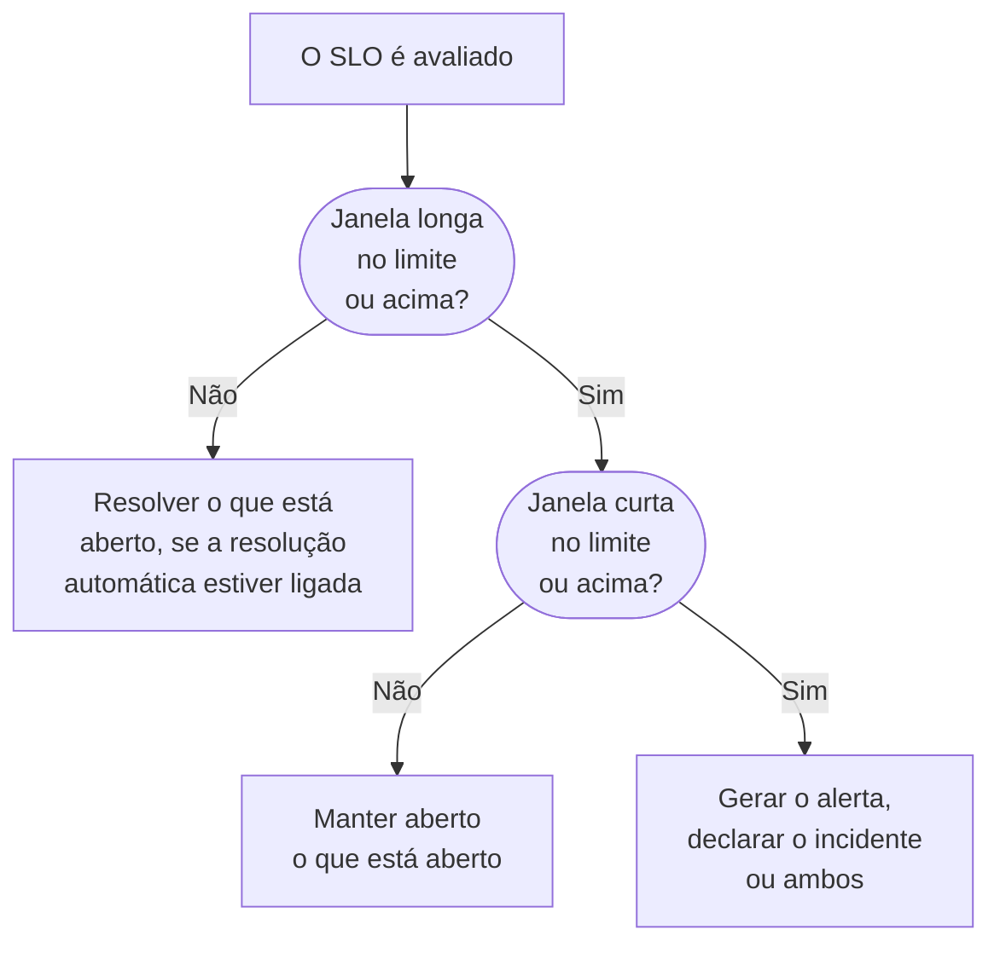

# Alertas e incidentes de taxa de consumo

Os orçamentos de erros dizem onde você está; as regras de taxa de consumo dizem quando é hora de sair da cama. Quando um SLO gasta o orçamento de erros rápido o bastante para importar, uma regra de taxa de consumo gera um alerta, declara um incidente ou as duas coisas, com seu próprio título e descrição, severidade, proprietários, rótulos, escalonamento de plantão e notificações do workspace.

:::cards
- [Como uma regra decide](#como-uma-regra-decide-disparar): Duas janelas, ambas acima do limite.
- [Regras padrão](#regras-padrão): Fast burn e Slow burn, ajustadas à janela do SLO.
- [Criar uma regra](#criar-ou-editar-uma-regra): Cinco etapas na página Burn Rate Rules do SLO.
- [Variáveis de modelo](#o-que-cada-alerta-e-incidente-diz): Escreva seus próprios títulos e descrições.
:::

## O que significa taxa de consumo

A taxa de consumo é a velocidade com que você gasta o orçamento de erros, comparada a um ritmo constante:

```text
burn rate = (share of time that was bad) ÷ (share of time the target allows to be bad)
```

Com uma taxa de consumo de 1, você gasta o orçamento exatamente ao longo da janela e atinge a meta sem nada sobrando. Números maiores esgotam o orçamento antes. Para um SLO de 99,9% em 30 dias:

| Taxa de consumo, se continuar | Orçamento esgotado em |
| --- | --- |
| 1 | 30 dias |
| 2 | 15 dias |
| 6 | 5 dias |
| 14.4 | cerca de 2 dias (50 horas) |

A taxa de consumo não depende de quanto orçamento resta. Ela responde a "quão ruim está agora?", que é o que você precisa saber para decidir se aciona alguém.

## Como uma regra decide disparar

O OneUptime verifica cada regra de taxa de consumo habilitada a cada avaliação do SLO, a cada 5 minutos. Cada regra mede a taxa de consumo em duas janelas e só dispara quando as duas estão no limite dela ou acima:

- A **janela longa** (por exemplo, 1 hora) mostra que o consumo é sustentado e relevante, e não uma única verificação com falha.
- A **janela curta** (por exemplo, 5 minutos) mostra que ainda está acontecendo. Sem ela, um pico de uma hora atrás continuaria alertando muito depois da recuperação.

Esse é o padrão de várias janelas e várias taxas de consumo do Google SRE Workbook, e o que o OneUptime configura para você.



Uma regra não pode disparar até o SLO ter uma janela longa completa de histórico de monitoramento: senão, a primeiríssima verificação com falha de um monitor, dividida por poucos minutos de histórico, daria uma taxa de consumo enorme. Então um SLO novo não pode disparar a regra **Fast burn** na primeira hora, nem a regra **Slow burn** nas primeiras seis. Se depois um SLO deixar de ter tanto histórico, por exemplo depois que seus monitores foram trocados por novos, a regra resolve o que abriu em vez de deixar pendurado. Uma regra também não dispara enquanto algum dos monitores do SLO está em uma manutenção programada: veja [Manutenção programada](#manutenção-programada).

## Regras padrão

Todo SLO novo recebe duas regras de taxa de consumo. Para uma janela de 30 dias:

| Regra | Limite | Janela longa | Janela curta | Dispara quando |
| --- | --- | --- | --- | --- |
| **Fast burn** | 14.4× | 1 hora | 5 minutos | Cerca de 2% do orçamento é consumido em uma hora: acabaria em cerca de 2 dias. |
| **Slow burn** | 6× | 6 horas | 30 minutos | Cerca de 5% do orçamento é consumido em seis horas: acabaria em cerca de 5 dias. |

Os limites de 14.4× e 6× são calculados para um orçamento de 30 dias, então o OneUptime os ajusta à janela do seu SLO. Cada regra sempre significa "2% do orçamento em 1 hora" ou "5% do orçamento em 6 horas":

| Janela do SLO | Limite de Fast burn | Limite de Slow burn |
| --- | --- | --- |
| 7 dias | 3.36× | 1.4× |
| 28 dias | 13.44× | 5.6× |
| 30 dias | 14.4× | 6× |
| 90 dias | 43.2× | 18× |

SLOs de mês do calendário recebem os valores de 30 dias. As duas regras geram um alerta com a severidade de alerta mais alta do projeto, com o título e a descrição padrão, resolvem-no automaticamente e não adicionam proprietários nem rótulos. Elas não declaram incidentes, então atualizar o OneUptime nunca começa a declarar incidentes por você. Edite-as, exclua-as ou adicione as suas.

## Criar ou editar uma regra

Você precisa de permissão para criar regras de taxa de consumo de SLO.

:::steps
### Abrir Burn Rate Rules

Abra o SLO, vá para **Burn Rate Rules** e clique em **Criar: SLO Burn Rate Rule**, ou edite uma das regras padrão.

### Dar um nome à regra

Em **Rule**, informe um **Nome**, como "Fast burn". **Habilitado** está ligado.

### Definir a janela de consumo

Em **Burn Window**, defina o **Burn Rate Threshold** (por exemplo `14.4`), a **Long Window (Minutes)** e a **Short Window (Minutes)**, e se quiser a **Re-fire Suppression (Minutes)**.

### Escolher o que ela declara

Em **What It Declares**, ligue **Criar alerta**, **Declarar incidente** ou os dois. **Add SLO Owners as Owners** também torna os proprietários do SLO proprietários de tudo o que a regra cria.

### Descrever o alerta e o incidente

As etapas **Alerta** e **Incidente** aparecem só para o que a regra declara. Cada uma tem um título e uma severidade, e seções recolhidas: **Descrição**, **Propriedade e rótulos**, **Plantão** e **Mais campos**, que guarda a resolução automática, a privacidade e as notas de correção. Regras novas começam com o título e a descrição padrão, prontos para editar. Clique em **Criar: SLO Burn Rate Rule** na última etapa.
:::

O OneUptime confere os números de uma regra quando você a salva:

| Configuração | Precisa ser |
| --- | --- |
| **Burn Rate Threshold** | Maior que 0. |
| **Short Window (Minutes)** | Maior que 0. |
| **Long Window (Minutes)** | Mais longa que a janela curta. |
| **Re-fire Suppression (Minutes)** | 0 ou mais. Vazio significa a duração da janela longa. |

Uma regra precisa criar um alerta, declarar um incidente ou os dois: uma regra com os dois desligados é recusada, porque seria verificada a cada avaliação sem nunca declarar nada.

A tabela de regras mostra, para cada regra, o limite, as janelas e a supressão, o que ela declara (e se o alerta ou o incidente só se resolve à mão, ou é privado), as severidades, as políticas de plantão, os proprietários e os rótulos.

> [!TIP]
> Um bom ponto de partida: mantenha as duas regras padrão, envie a regra de consumo rápido para a política de plantão que aciona as pessoas, com severidade alta, e deixe a regra de consumo lento gerar um alerta de severidade mais baixa para o horário comercial. Se sua equipe trabalha com incidentes, ligue **Declarar incidente** na regra de consumo rápido, e desligue ali **Criar alerta** se preferir não receber os dois.

## O que uma regra declara

|  | **Criar alerta** | **Declarar incidente** |
| --- | --- | --- |
| No início | Ligado | Desligado |
| O que é | O sinal leve: vai para a lista de alertas. | O sinal pesado: recebe um número de incidente e inicia todo o fluxo de resposta. |
| Título e descrição | Os próprios, ou o texto padrão | Os próprios, ou o texto padrão |
| Severidade | **Severidade do alerta**: a mais alta do projeto, se vazia | **Severidade do incidente**: a mais alta do projeto, se vazia |
| Escalonamento | **Alert On-Call Duty Policies** | **Incident On-Call Duty Policies** |
| Proprietários e rótulos | **Proprietários do alerta** e **Rótulos de alerta** | **Proprietários do incidente** e **Rótulos de incidentes** |
| Privado | Desligado | Desligado |
| Resolução automática | Ligada | Ligada |
| Páginas de status | Nunca publicado | Nunca publicado |

Como cada um é configurado separadamente, você pode enviar um alerta curto para a escala da equipe responsável e um incidente detalhado para a sua escala de incidentes graves. Eles também vivem separados: cada um é deduplicado, resolvido e suprimido por conta própria, então resolver o incidente não zera a supressão do alerta, nem o contrário.

### O SLO é um recurso afetado

Cada alerta e incidente que uma regra de taxa de consumo cria lista seu SLO em **Recursos afetados** e leva a ele. O filtro **Recursos afetados** das listas de alertas e incidentes os limita a um SLO, e as páginas **Alertas** e **Incidentes** do SLO os listam, com selos no menu lateral que contam os abertos. O OneUptime cria esse vínculo sozinho, e editar o alerta ou o incidente nunca o remove.

### Incidentes de taxa de consumo ficam internos

Um orçamento de erros sendo consumido rápido é um sinal para a engenharia, não uma queda declarada. Um incidente de taxa de consumo nunca é mostrado nas páginas de status e nunca avisa os assinantes das páginas de status. Ele também não é vinculado a nenhum monitor, porque resolvê-lo reescreveria o próprio histórico de status dos monitores a partir do qual o SLO é medido.

Se você resolver um incidente desses à mão, nada o declara de novo até o consumo se recuperar e a regra disparar de verdade outra vez, então você nunca fica brigando com a regra enquanto trabalha em um incidente.

## O que cada alerta e incidente diz

Regras novas começam com o título e a descrição padrão, tanto no alerta quanto no incidente. Esvazie um título ou uma descrição para voltar ao texto padrão. O título padrão é:

```text
SLO burn rate: {{sloName}} — {{ruleName}}
```

A descrição padrão nomeia a regra, informa a taxa de consumo das duas janelas em relação ao limite e o orçamento de erros restante.

Para escrever os seus, use variáveis de modelo no título, na descrição e nas notas de correção. Cada um desses campos as lista em **Variáveis de modelo**: clique em uma para inseri-la onde está o cursor, ou digite `{{` no campo e escolha uma. A descrição e as notas de correção também têm **Inserir variável** na barra de ferramentas. As variáveis são preenchidas quando a regra dispara:

| Variável | O que contém | Exemplo |
| --- | --- | --- |
| `{{sloName}}` | Nome do SLO. | `Checkout availability` |
| `{{sloId}}` | ID do SLO. | `b7f4c2d8-1f3e-4a5b-9c6d-7e8f9a0b1c2d` |
| `{{sloLink}}` | Link para o SLO no painel do OneUptime. | `https://oneuptime.com/dashboard/project-id/slos/slo-id` |
| `{{sloStatus}}` | Status do SLO depois desta avaliação. | `At Risk` |
| `{{ruleName}}` | Nome da regra de taxa de consumo que disparou. | `Fast burn` |
| `{{burnRateThreshold}}` | O limite de taxa de consumo da regra (um múltiplo do ritmo sustentável). | `14.4` |
| `{{longWindowBurnRate}}` | Taxa de consumo medida na janela longa da regra. | `21.5` |
| `{{shortWindowBurnRate}}` | Taxa de consumo medida na janela curta da regra. | `36` |
| `{{longWindowInMinutes}}` | Duração da janela longa da regra, em minutos. | `60` |
| `{{shortWindowInMinutes}}` | Duração da janela curta da regra, em minutos. | `5` |
| `{{targetPercentage}}` | A meta do SLO, em porcentagem. | `99.9` |
| `{{currentSliPercentage}}` | O SLI medido na janela de conformidade do SLO, em porcentagem. | `99.87` |
| `{{errorBudgetRemainingPercentage}}` | Parcela do orçamento de erros ainda disponível, em porcentagem. Negativa quando o orçamento foi ultrapassado. | `42.5` |
| `{{errorBudgetRemaining}}` | Orçamento de erros ainda disponível, como duração. Começa com um sinal de menos quando o orçamento foi ultrapassado. | `18m 22s` |
| `{{errorBudgetRemainingMinutes}}` | Orçamento de erros ainda disponível, em minutos. | `18.37` |
| `{{windowDescription}}` | A janela de conformidade do SLO, por extenso. | `rolling 30-day window` |

Por exemplo, o título `{{ruleName}}: {{sloName}} is burning {{longWindowBurnRate}}x` vira `Fast burn: Checkout availability is burning 21.5x`.

:::details Como as variáveis são preenchidas
- Os números são arredondados para duas casas decimais.
- Espaços dentro das chaves não atrapalham: `{{ sloName }}` funciona.
- Uma variável escrita errado fica exatamente como está, para que um erro de digitação apareça no alerta em vez de sumir sem avisar.
- Os títulos podem ter 500 caracteres, e as descrições e as notas de correção 50.000. Um título que passa de 500 caracteres depois de preencher as variáveis é colocado em uma linha e encurtado com reticências, para que o alerta ou o incidente seja criado mesmo assim.
- Se o link para o SLO não puder ser montado quando a regra dispara, `{{sloLink}}` fica vazio e o alerta ou o incidente é criado mesmo assim.
:::

## Proprietários, rótulos e privacidade

- **Proprietários do alerta** e **Proprietários do incidente** são pessoas e equipes, escolhidas em uma única lista com **Adicionar proprietário**. Eles são adicionados ao alerta ou ao incidente assim que ele é criado, e são notificados. As pessoas precisam ser membros do projeto.
- **Add SLO Owners as Owners** também adiciona os proprietários do SLO, seus usuários proprietários e os membros das equipes proprietárias, a tudo o que a regra cria. Os proprietários do SLO já ficam sabendo das mudanças de status do próprio SLO, então isso pode avisá-los duas vezes. Fica desligado por padrão.
- Cada proprietário é adicionado uma vez: um usuário que já é proprietário do alerta ou do incidente, por exemplo pelas regras de proprietários do projeto, ou que está em uma equipe proprietária adicionada, não é adicionado de novo.
- **Rótulos de alerta** e **Rótulos de incidentes** são adicionados ao alerta ou ao incidente, para que filtros, regras de proprietários e regras de notificação do workspace possam corresponder a eles.
- Um alerta ou incidente privado só é visível para seus proprietários, para os administradores do projeto e para os proprietários do projeto.

Rótulos, equipes proprietárias e políticas de plantão precisam pertencer ao projeto do SLO.

## Resolução e supressão de novos disparos

- **A resolução segue a janela longa.** Com a resolução automática ligada (o padrão), o OneUptime resolve o alerta e o incidente de uma regra assim que a taxa de consumo da janela longa cai abaixo do limite. Resolver pela janela curta faria tudo oscilar: uma queda intermitente se resolveria depois de cinco minutos tranquilos e acionaria as pessoas de novo a noite inteira.
- **Resolução automática desligada.** Desligue **Resolver alerta automaticamente** ou **Resolver incidente automaticamente** e esse registro fica aberto até alguém resolvê-lo, mesmo depois que o consumo se recuperou. A regra não abre outro por cima, e depois que ele é resolvido à mão e a janela longa está abaixo do limite, a regra pode disparar de novo após a supressão.
- **Supressão de novos disparos.** Depois que um registro é resolvido, a regra não declara de novo esse tipo de registro durante o período de supressão, por padrão a duração da janela longa. Assim, um sistema em recuperação tem tempo de se recuperar sem acionar ninguém pelo ruído que sobra.

Algumas mudanças sempre resolvem o que uma regra abriu, não importa o que digam as configurações de resolução automática dela, para que nada continue escalando por uma regra que não pode mais justificar isso:

- desligar **Criar alerta** ou **Declarar incidente** fecha o que essa saída tinha aberto;
- desligar a regra ou excluí-la;
- desligar a avaliação do SLO, arquivar o SLO ou excluí-lo;
- o SLO passar para **Pausado** ou **Misconfigured**, porque então ele não mede nada;
- a regra perder o limite ou as janelas, ou o SLO deixar de ter uma janela longa completa de histórico.

## Manutenção programada

Enquanto um monitor do SLO está em um evento de manutenção programada em andamento, as regras de taxa de consumo dele não geram alertas nem declaram incidentes: trabalho planejado não deve acionar ninguém. O que as regras já abriram ainda se resolve como sempre. O tempo continua contando no orçamento de erros, conforme os status de indisponibilidade do SLO.

## O feed do SLO

O **Feed** do SLO publica cada alerta que uma regra gera e cada incidente que ela declara, com um link e as taxas de consumo que o explicam, e quando cada um é resolvido, automaticamente ou à mão. Um registro que a regra retoma porque ainda estava aberto não é publicado duas vezes. Criar, editar e excluir uma regra também é publicado, e registrado nos **Registros de auditoria** do SLO. Veja [Feed e registros de auditoria de SLO](/docs/slo/feed-and-audit-logs).

## Solução de problemas

:::details Uma regra não disparou logo depois que o SLO foi criado
Uma regra só dispara quando o SLO tem uma janela longa completa de histórico de monitoramento: uma hora para a regra de consumo rápido padrão, seis horas para a de consumo lento.
:::

:::details Um alerta foi resolvido enquanto a queda continuava
A resolução automática segue a janela longa: assim que a taxa de consumo da janela longa cai abaixo do limite, o alerta é resolvido. Dê à regra uma janela longa maior, ou desligue **Resolver alerta automaticamente** e resolva o alerta à mão.
:::

:::details Nada disparou durante um evento de manutenção programada
As regras de taxa de consumo ficam em silêncio enquanto algum dos monitores do SLO está em um evento de manutenção programada em andamento. A indisponibilidade continua contando no orçamento.
:::

:::details Existe um número mínimo de amostras?
Não para SLOs medidos pela disponibilidade dos monitores. A disponibilidade é medida em segundos, então cada segundo da janela é uma amostra e não há um caso de pouco tráfego contra o qual se proteger. Um número mínimo de amostras só importa para SLIs baseados em eventos, que ainda não estão disponíveis.
:::

## Próximos passos

:::cards
- [Orçamentos de erros](/docs/slo/error-budget): O que é o orçamento e quanto ele dura.
- [Regras de escalonamento](/docs/on-call/escalation-rules): Quem é acionado, e em que ordem.
- [Feed e registros de auditoria de SLO](/docs/slo/feed-and-audit-logs): Cada alerta e incidente que uma regra gera.
:::
