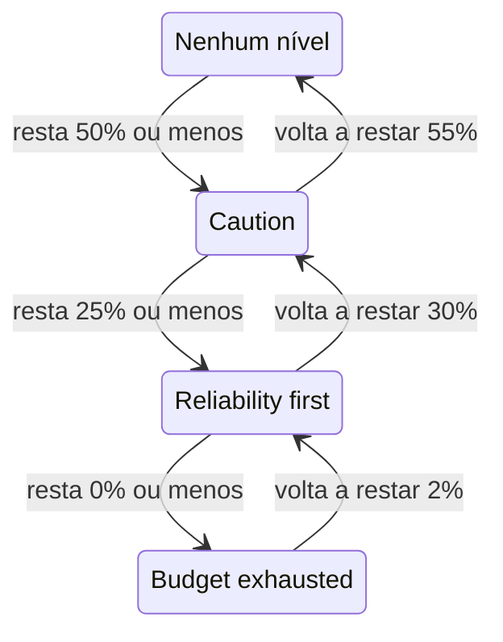

# Política de orçamento de erros

Uma política de orçamento de erros deixa escrito o que sua equipe combinou fazer à medida que o orçamento de erros de um SLO acaba, como revisar mudanças arriscadas quando metade dele foi gasta, ou congelar lançamentos quando ele foi todo gasto. O OneUptime coloca o SLO no nível da política que o orçamento dele atingiu, mostra o combinado da equipe para esse nível nas páginas do SLO e pode gerar um alerta ou declarar um incidente quando o SLO entra em um nível. É a prática de política de orçamento de erros do [Google SRE Workbook](https://sre.google/workbook/error-budget-policy/).

:::cards
- [Como os níveis funcionam](#como-os-níveis-funcionam): Qual nível se aplica e quando o SLO o deixa.
- [Configure uma política](#configure-uma-política): Comece pela política recomendada ou escreva seus próprios níveis.
- [Alertas e incidentes](#alertas-e-incidentes): Acione sua equipe quando o SLO entra em um nível.
- [Leia o nível pela API](#leia-o-nível-pela-api): Verifique o nível a partir de CI e scripts.
:::

## Como os níveis funcionam

Uma política é um conjunto de níveis. Cada nível tem três campos:

| Campo | O que guarda |
| --- | --- |
| **Nome** | Como a equipe chama o nível, por exemplo "Reliability first". |
| **Limite de orçamento restante (%)** | A parcela do orçamento de erros restante igual ou abaixo da qual o nível se aplica. De 0 a 100, com decimais. Cada nível de um SLO tem um limite próprio. |
| **O que fazemos** | O que a equipe combinou fazer enquanto o SLO está no nível, em Markdown. Obrigatório, até 10.000 caracteres. |

Um nível se aplica enquanto o orçamento restante está no limite dele ou abaixo, então um nível em 0% é o de um orçamento esgotado. Quando vários níveis se aplicam, o SLO fica no de limite mais baixo: o mais grave. Quando nenhum se aplica, o SLO não está em nenhum nível. Com níveis em 50%, 25% e 0%, um SLO com 30% do orçamento restante está no nível de 50%, e um com 10% restante está no nível de 25%.

### Entrar em um nível e sair dele

O nível acompanha o orçamento restante do mesmo jeito que o status do SLO:

- Entrar em um nível é imediato: a avaliação que encontra o orçamento no limite de um nível ou abaixo coloca o SLO nesse nível. Um orçamento que cai abaixo de vários limites de uma vez vai direto para o nível mais grave.
- Sair de um nível para um menos grave espera até o orçamento voltar claramente. Um nível em 0% é deixado quando volta a restar 2% do orçamento. Qualquer outro nível é deixado quando o orçamento está 5 pontos acima do limite dele.

Assim, um nível em 0% se move com o status **Orçamento esgotado**, e um nível no limite de risco do SLO se move com **Em risco**: veja [Mudanças de status e o limite de risco](/docs/slo/error-budget#mudanças-de-status-e-o-limite-de-risco). Uma janela móvel que fica em torno de um limite não faz o nível ir e voltar.



## Configure uma política

Você precisa de permissão para criar níveis de política de orçamento de erros de SLO.

:::steps
### Abra Política de orçamento de erros

Abra o SLO e vá para **Política de orçamento de erros** na seção **Regras** do menu lateral dele. A página lista os níveis do SLO, cada um com o nome, o orçamento restante em que se aplica e o que a equipe faz.

### Comece pela política recomendada

Enquanto o SLO não tem níveis, a página oferece **Usar a política recomendada**. Clique, confira os três níveis listados e confirme. Depois, ajuste o texto de cada nível ao combinado da sua equipe.

### Ou adicione um nível você mesmo

Clique em **Criar: Nível da política de orçamento de erros do SLO**. Informe um **Nome** e um **Limite de orçamento restante (%)**, e escreva o combinado da equipe em **O que fazemos**.

### Escolha o que o nível gera

Um nível registra e mostra o combinado. Para também acionar alguém quando o SLO entra nele, abra as configurações recolhidas de alerta e incidente e ligue um alerta, um incidente ou os dois. Os dois vêm desligados. Veja [Alertas e incidentes](#alertas-e-incidentes).
:::

Adicionar, editar ou excluir um nível vale na hora: o OneUptime avalia o SLO de novo em cerca de um minuto. Se o orçamento já está no limite de um nível ou abaixo, o SLO entra nesse nível, e o nível gera o que estiver configurado para gerar. Desligar um nível ou excluí-lo resolve o que ele gerou, e o SLO passa para o nível em que o orçamento dele está. Desligar o alerta ou o incidente de um nível resolve esse alerta ou esse incidente.

### A política recomendada

**Usar a política recomendada** adiciona três níveis, na metade do orçamento, em um quarto e em zero, com este texto em inglês:

| Nível | Aplica-se com | O que a equipe faz |
| --- | --- | --- |
| **Caution** | 50% restante ou menos | Half of the error budget is spent. Review risky changes before they ship, and find out what has been spending the budget. |
| **Reliability first** | 25% restante ou menos | Reliability comes first. Only reliability improvements and critical fixes ship until the budget recovers. |
| **Budget exhausted** | 0% restante ou menos | The error budget is spent. Freeze non-critical releases: only fixes for this SLO's reliability and security fixes ship until the budget is back. |

Nenhum deles gera alerta ou declara incidente até você ligar isso. Só são adicionados os níveis que o SLO não tem: um nível com o mesmo nome, ou com o mesmo limite, conta como existente, esteja ligado ou não. Por isso, pedir duas vezes, de uma segunda aba ou pela API, não adiciona nada em dobro. Cada nível adicionado assim é registrado nos registros de auditoria do SLO como adicionado por você.

## Onde o nível aparece

- A **Visão geral** do SLO mostra o nível em que ele está e o que a equipe combinou fazer ali, para que todos que abrem o SLO vejam o combinado que vale agora.
- O gráfico **Burn-down do orçamento de erros** traça uma linha com rótulo no limite de cada nível, ao lado da linha do limite de risco.
- O **Feed** do SLO publica cada mudança de nível: o nível que o SLO deixou e o nível em que entrou, o orçamento restante e o que a equipe combinou fazer no novo nível.
- Os **Registros de auditoria** do SLO registram cada mudança de nível como uma mudança feita pelo próprio OneUptime, então só a mostram com **Armazenar Eventos do Sistema** ligado: veja [Ligar os registros de auditoria](/docs/slo/feed-and-audit-logs#ligar-os-registros-de-auditoria). Adicionar, editar e remover um nível é registrado em nome da pessoa que fez isso.
- A API de leitura do SLO devolve o nível: veja [Leia o nível pela API](#leia-o-nível-pela-api).

## Alertas e incidentes

Cada nível pode gerar um alerta, declarar um incidente ou os dois quando o SLO entra nele. Eles têm as opções do alerta e do incidente de uma regra de taxa de consumo: gravidade, políticas de plantão, modelos de título, descrição e notas de correção, privacidade, resolução automática, rótulos, equipes e usuários proprietários, e a inclusão dos proprietários do SLO como proprietários. Veja [O que uma regra declara](/docs/slo/burn-rate-alerts#o-que-uma-regra-declara). Os dois vêm desligados, então um nível não aciona ninguém até você ligar um deles.

- Entrar em um nível mais grave resolve o que o nível anterior gerou, seja qual for a configuração de resolução automática dele, porque o novo nível o substitui. Assim, no máximo o alerta e o incidente de um nível ficam abertos ao mesmo tempo, e eles pertencem ao nível em que o SLO está.
- Voltar para um nível menos grave, ou sair de todos os níveis, os resolve quando a resolução automática do nível está ligada, como vem por padrão. Com a resolução automática desligada, eles ficam abertos até alguém resolvê-los.
- Não há supressão de novos disparos. Um nível só gera de novo depois que o SLO o deixou claramente e entrou nele outra vez, então ele não oscila. Se alguém resolver manualmente o que ele gerou enquanto o SLO ainda está no nível, aquilo fica resolvido.
- Enquanto algum monitor do SLO está em manutenção programada, os níveis não geram nada. O nível em si continua mudando, e o que está aberto continua sendo resolvido. Se o SLO ainda estiver no nível quando a manutenção terminar, o nível gera então o que estiver configurado para gerar.

Como numa regra de taxa de consumo, um alerta ou incidente que um nível gera lista o SLO em **Recursos afetados**, e um incidente nunca aparece em páginas de status. O feed do SLO publica cada um, e quando ele é resolvido.

### O que eles dizem

O título, a descrição e as notas de correção de um nível aceitam variáveis de modelo, como os de uma regra: veja [O que cada alerta e incidente diz](/docs/slo/burn-rate-alerts#o-que-cada-alerta-e-incidente-diz). Os campos de um nível oferecem as variáveis do SLO e do orçamento dele, e três próprias do nível: `{{sloName}}`, `{{sloId}}`, `{{sloLink}}`, `{{sloStatus}}`, `{{policyTier}}`, `{{policyTierThresholdPercentage}}`, `{{policyTierWhatWeDo}}`, `{{targetPercentage}}`, `{{currentSliPercentage}}`, `{{errorBudgetRemainingPercentage}}`, `{{errorBudgetRemaining}}`, `{{errorBudgetRemainingMinutes}}` e `{{windowDescription}}`. As variáveis próprias de uma regra, como `{{ruleName}}` e as taxas de consumo, não são oferecidas e ficam vazias nos modelos de um nível.

As três variáveis de nível também funcionam nos modelos das regras de taxa de consumo:

| Variável | O que guarda |
| --- | --- |
| `{{policyTier}}` | O nome do nível em que o SLO está após a avaliação, ou `None` quando não está em nenhum nível. |
| `{{policyTierThresholdPercentage}}` | O limite desse nível, como `25`. Vazio quando o SLO não está em nenhum nível. |
| `{{policyTierWhatWeDo}}` | O que a equipe combinou fazer nesse nível. Vazio quando o SLO não está em nenhum nível. |

Um nível cujo título fica vazio usa o título padrão:

```text
SLO error budget policy: {{sloName}} — {{policyTier}}
```

A descrição padrão nomeia o nível, compara o orçamento restante com o limite do nível e diz o que a equipe combinou fazer nele.

## Quando o orçamento não é medido

- Um SLO **Pausado** ou **Mal configurado** não mede nenhum orçamento, então o nível dele fica onde estava, e o que o nível gerou fica aberto até a medição voltar. As regras de taxa de consumo, ao contrário, resolvem então o que têm aberto.
- Desligar a avaliação do SLO, ou arquivar o SLO, resolve o que os níveis dele geraram. O nível em que o SLO está fica como estava.
- Excluir o SLO exclui os níveis dele e resolve o que eles geraram.

## Leia o nível pela API

A API de leitura do próprio SLO devolve o nível em que ele está, para que um job de CI ou um script possa verificá-lo antes de agir, por exemplo antes de um lançamento. Os três campos ficam vazios enquanto o SLO não está em nenhum nível:

| Campo | O que guarda |
| --- | --- |
| `currentErrorBudgetPolicyTierId` | O ID do nível. |
| `currentErrorBudgetPolicyTierName` | O nome do nível. |
| `currentErrorBudgetPolicyTierEnteredAt` | Quando o SLO entrou no nível. |

Eles são lidos com a permissão de leitura do próprio SLO, a mesma de que o orçamento dele precisa. Por exemplo, com uma [chave de API](/docs/api-reference/api-reference) do projeto:

```bash
curl -X POST 'https://oneuptime.com/api/service-level-objective/<slo-id>/get-item' \
  -H "ApiKey: $ONEUPTIME_API_KEY" \
  -H 'Content-Type: application/json' \
  -d '{ "select": { "name": true, "errorBudgetRemainingPercentage": true, "currentErrorBudgetPolicyTierName": true, "currentErrorBudgetPolicyTierEnteredAt": true } }'
```

Os níveis em si são um recurso próprio, `/api/service-level-objective-error-budget-policy-tier`, com as requisições de listar, ler, criar, alterar e excluir que todo recurso tem. Mais duas requisições servem a política recomendada. As duas recebem `{ "serviceLevelObjectiveId": "..." }` e respondem com os níveis em `tiers`:

| Requisição | O que faz |
| --- | --- |
| `POST /api/service-level-objective-error-budget-policy-tier/recommended-policy` | Lista os níveis recomendados que faltam ao SLO. Não grava nada. |
| `POST /api/service-level-objective-error-budget-policy-tier/recommended-policy/add` | Adiciona-os e lista o que adicionou. Pedir de novo não adiciona nada. |

## Permissões

| Permissão | Permite a uma função |
| --- | --- |
| **Read SLO Error Budget Policy Tier** | Ver os níveis de um SLO. |
| **Create SLO Error Budget Policy Tier** | Adicionar níveis, manualmente ou com **Usar a política recomendada**. |
| **Edit SLO Error Budget Policy Tier** | Alterar níveis e ligá-los ou desligá-los. |
| **Delete SLO Error Budget Policy Tier** | Remover níveis. |

Essas permissões ficam no grupo SLO de uma função. As funções Project Owner e Project Admin têm todas, e as funções Project Member e Viewer podem ler os níveis.

## Ainda não disponível

Algumas partes de uma política de orçamento de erros ainda não estão disponíveis: um bloqueio de implantação que barre lançamentos por conta própria (em vez disso, um job de CI pode ler o nível pela API), gatilhos de fluxo de trabalho e notificações do Slack ou do Microsoft Teams para cada nível, uma política compartilhada por vários SLOs, reconhecer um nível ou conceder uma exceção a ele, e níveis baseados na autonomia do orçamento em vez do orçamento restante.

## Próximos passos

:::cards
- [Orçamentos de erros](/docs/slo/error-budget): O que é o orçamento e como o status o acompanha.
- [Alertas e incidentes de taxa de consumo](/docs/slo/burn-rate-alerts): Acione sua equipe quando o orçamento é consumido rápido demais.
- [Feed e registros de auditoria de SLO](/docs/slo/feed-and-audit-logs): Cada mudança de nível e o que os níveis geraram.
:::
