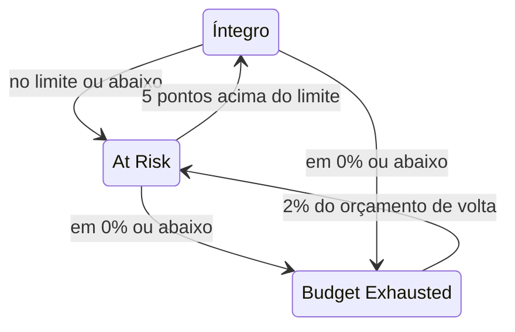

# Orçamentos de erros

O orçamento de erros é a indisponibilidade que a meta de um SLO permite. Uma meta de 99,9% não significa "nunca cair": significa "você pode ficar fora do ar até 43 minutos em 30 dias, então gaste esse tempo com sabedoria". Esta página explica como o OneUptime conta o orçamento, quanto ele dura, como ele volta e quem fica sabendo.

:::cards
- [Como o orçamento é calculado](#como-o-orçamento-é-calculado): A fórmula e o orçamento das metas mais comuns.
- [Autonomia do orçamento](#autonomia-do-orçamento): Quanto o orçamento dura no ritmo atual.
- [Como o orçamento se recupera](#como-o-orçamento-se-recupera): Janelas móveis e meses do calendário.
- [Notificações aos proprietários](#notificações-aos-proprietários): Quem fica sabendo quando o orçamento está acabando.
:::

## Como o orçamento é calculado

O orçamento total é a parte da janela que sua meta não promete:

```text
total budget = (100% − target) × window length
```

| Meta | Janela de 7 dias | Janela de 28 dias | Janela de 30 dias | Janela de 90 dias |
| --- | --- | --- | --- | --- |
| 99% | 1h 40m 48s | 6h 43m 12s | 7h 12m | 21h 36m |
| 99.5% | 50m 24s | 3h 21m 36s | 3h 36m | 10h 48m |
| 99.9% | 10m 5s | 40m 19s | 43m 12s | 2h 9m 36s |
| 99.95% | 5m 2s | 20m 10s | 21m 36s | 1h 4m 48s |
| 99.99% | 1m 0s | 4m 2s | 4m 19s | 12m 58s |

A página **Configurações** do SLO mostra o orçamento que a meta permite ao lado da meta, por exemplo "43m 12s de indisponibilidade por janela de 30 dias".

### O orçamento de um SLO com vários monitores

No modo **Any Monitor Down**, o orçamento é `(100% − target) × window`, não importa quantos monitores o SLO mede: a janela é uma única linha do tempo.

No modo **Monitor Seconds Average**, o orçamento é contado em segundos-monitor, somados entre os monitores, então cresce com o número de monitores: um SLO de três monitores com 99,9% em 30 dias tem cerca de 129 minutos de orçamento em vez de 43. As porcentagens (SLI, orçamento restante, taxa de consumo) significam a mesma coisa; só as durações mudam.

### O orçamento de um mês do calendário

Um SLO de mês do calendário tem o orçamento do mês inteiro desde o primeiro dia: um SLO de 99,9% em um mês de 31 dias tem todos os seus 44m 38s no dia 1. O orçamento não é proporcional à parte do mês que já passou, então uma queda de um minuto na manhã do dia 1 gasta um minuto do orçamento do mês.

## Orçamento restante

À medida que a indisponibilidade se acumula, a **Visão geral** mostra o orçamento restante no bloco **Error budget left**:

- como porcentagem do total, que também decide o status do SLO e preenche a barra. A barra tem uma marca no limite de risco do SLO;
- como duração, por exemplo "31m 4s left of 43m 12s".

Quando o orçamento acaba, o bloco mostra **No budget left**. Quando a indisponibilidade o ultrapassa, o bloco mostra **Budget exceeded** e o excesso como tempo, por exemplo "4d 23m over budget · 5m 47s allowed": o SLO usou todos os 5 minutos e 47 segundos do orçamento, e mais 4 dias e 23 minutos. A barra fica vazia e vermelha.

O orçamento restante é guardado como número com sinal para cálculos e gráficos de histórico, então ali um orçamento ultrapassado aparece como porcentagem negativa. Uma porcentagem muito negativa significa que o excesso é grande em relação ao orçamento; não é a parcela do tempo em que o serviço ficou fora do ar.

Quais segundos contam como indisponibilidade é decidido pelos status de indisponibilidade do SLO e, para um SLO de vários monitores, pelo modo de vários monitores, ambos em **Configurações** → **Downtime Calculation**. Veja [Visão geral dos SLOs](/docs/slo/introduction).

## Autonomia do orçamento

O bloco **Budget runway** da **Visão geral** responde a "se continuar assim, quando acaba o orçamento?". Ele divide o orçamento restante pela taxa de consumo dos últimos 60 minutos:

```text
runway = budget left ÷ (burn rate × (100% − target))
```

| O bloco mostra | O que significa |
| --- | --- |
| Uma duração, como **~2d 5h** | No ritmo atual, o orçamento acaba em mais ou menos esse tempo. Em âmbar, e em vermelho quando falta um dia ou menos. **Under 1m** significa menos de um minuto. |
| **Not burning** | Nenhum orçamento foi gasto nos últimos 60 minutos. |
| **Sustainable** | Só janelas móveis: a autonomia é de pelo menos uma janela inteira, então o orçamento não é gasto mais rápido do que a indisponibilidade antiga sai da janela. Nesse ritmo, ele não acaba. |
| **Lasts until reset** | Só meses do calendário: o orçamento é zerado no início do próximo mês antes de acabar. |
| **Overspent** | O orçamento já foi gasto. O bloco diz quanto foi ultrapassado. |

Para SLOs de mês do calendário, o bloco também diz quando o orçamento é zerado.

A autonomia é uma projeção em linha reta. Em uma janela móvel, a indisponibilidade antiga que sai da janela devolve orçamento, o que a projeção ignora: leia-a como o tempo mínimo que você tem. Ela não é mostrada antes da primeira avaliação, nem para SLOs no modo **Monitor Seconds Average**, cujo orçamento é contado em segundos-monitor e não em tempo real.

## Consumo do orçamento de erros

O gráfico **Error budget burn-down** da **Visão geral** traça o orçamento restante, em porcentagem, ao longo da janela de conformidade atual:

- Uma linha em 0% marca onde o orçamento acaba, e uma linha tracejada marca o limite de risco do SLO.
- Para SLOs de mês do calendário, uma linha suave desce de forma constante de um orçamento cheio no início do mês até um vazio no reinício. Abaixo dessa linha, o mês está gastando o orçamento rápido demais.
- Um ponto é registrado a cada avaliação, a cada 5 minutos, então o gráfico de um SLO novo fica vazio até a primeira avaliação.
- Arraste no gráfico para ampliar uma parte da janela. Clique duas vezes, ou clique em **Reset zoom**, para voltar a ver a janela inteira.

**Open metrics** abre a página **Métricas** do SLO, cuja aba **Error Budget History** vai até 400 dias para trás. Veja [Métricas e painéis de SLO](/docs/slo/metrics).

## Como o orçamento se recupera

Como o orçamento volta depende do tipo de janela do SLO:

:::tabs
@tab Rolling
Uma janela móvel sempre olha para trás a mesma distância a partir de agora, então a indisponibilidade acaba saindo dela: uma queda deixa de contar exatamente uma janela depois de acontecer. Uma queda de 30 minutos em 1º de junho sai das contas de um SLO de 30 dias em 1º de julho, e o orçamento volta aos poucos, à medida que cada segundo de indisponibilidade sai da janela, não tudo de uma vez.

Então a recuperação é conquistada, não agendada. Se pequenas quedas continuam acontecendo, a indisponibilidade antiga sai enquanto a nova entra, e o orçamento fica parado em vez de se recuperar.
@tab Calendar Month
Um SLO de mês do calendário é zerado à meia-noite do primeiro dia de cada mês, no fuso horário dele. O orçamento inteiro volta de uma vez e o mês anterior é encerrado. Nada passa de um mês para o outro, em nenhuma direção: um mês ruim não prejudica o seguinte, e um mês ótimo não dá folga a ele.
:::

### SLOs novos

Um SLO de janela móvel mais novo que a própria janela é medido com os dados que existem até agora, e o orçamento total cresce com eles: um SLO de 30 dias criado há uma semana tem, por enquanto, um orçamento de 7 dias. Até a janela ficar cheia, a **Visão geral** mostra o quanto ela está preenchida, com um indicador **Window 23% full** e a mesma nota no bloco **Error budget left**. Espere que os números se estabilizem à medida que a janela se enche.

## Mudanças de status e o limite de risco

O orçamento restante decide o status do SLO:

| Status | Quando |
| --- | --- |
| **Íntegro** | Resta mais orçamento do que o limite de risco. |
| **At Risk** | O orçamento restante está no limite de risco ou abaixo dele: 20% por padrão. |
| **Budget Exhausted** | O orçamento restante está em zero ou abaixo. |

Defina o limite de risco em **Configurações** → **Objective**.

Janelas móveis se recuperam um segundo de cada vez, então um SLO perto de um limite poderia ficar indo e voltando entre dois status. Para que cada mudança de status tenha significado, um SLO só sai de um status quando passou claramente do limite:



Com o limite padrão de 20%, um SLO em risco volta a íntegro com 25% de orçamento restante, e um SLO com orçamento esgotado volta a em risco com 2%. Cada mudança de status aparece no **Feed** do SLO, com o SLI, o orçamento e a taxa de consumo que a explicam.

## Notificações aos proprietários

Quando um SLO passa para **At Risk** ou **Budget Exhausted**, o OneUptime avisa os proprietários dele:

- Os proprietários são os usuários e os membros das equipes na página **Proprietários** do SLO que ainda são membros do projeto. Um SLO sem proprietários avisa os proprietários do projeto no lugar deles.
- Cada proprietário recebe um e-mail por padrão, e a notificação em qualquer outro canal que ele ativar para **SLO status changed** em **Configurações do usuário** → **Configurações de notificação** → **Monitoramento**.
- O assunto do e-mail traz o status e o SLO, por exemplo `[SLO At Risk] API Availability`.

Para que um SLO perto de um limite não fique avisando sem parar, os proprietários recebem no máximo uma notificação por hora. Uma passagem para **Budget Exhausted** é sempre enviada, mesmo dentro dessa hora.

> [!TIP]
> As notificações aos proprietários avisam os responsáveis por um SLO que o orçamento dele está em apuros. Para acionar sua equipe de plantão pelas políticas de escalonamento, use [Alertas e incidentes de taxa de consumo](/docs/slo/burn-rate-alerts). Uma regra de taxa de consumo também pode adicionar os proprietários do SLO a cada alerta e incidente que cria.

## Próximos passos

:::cards
- [Alertas e incidentes de taxa de consumo](/docs/slo/burn-rate-alerts): Avise sua equipe quando o orçamento é consumido rápido demais.
- [Métricas e painéis de SLO](/docs/slo/metrics): Coloque o orçamento em gráficos ao longo do tempo.
- [Visão geral dos SLOs](/docs/slo/introduction): Metas, janelas e status de indisponibilidade.
:::
