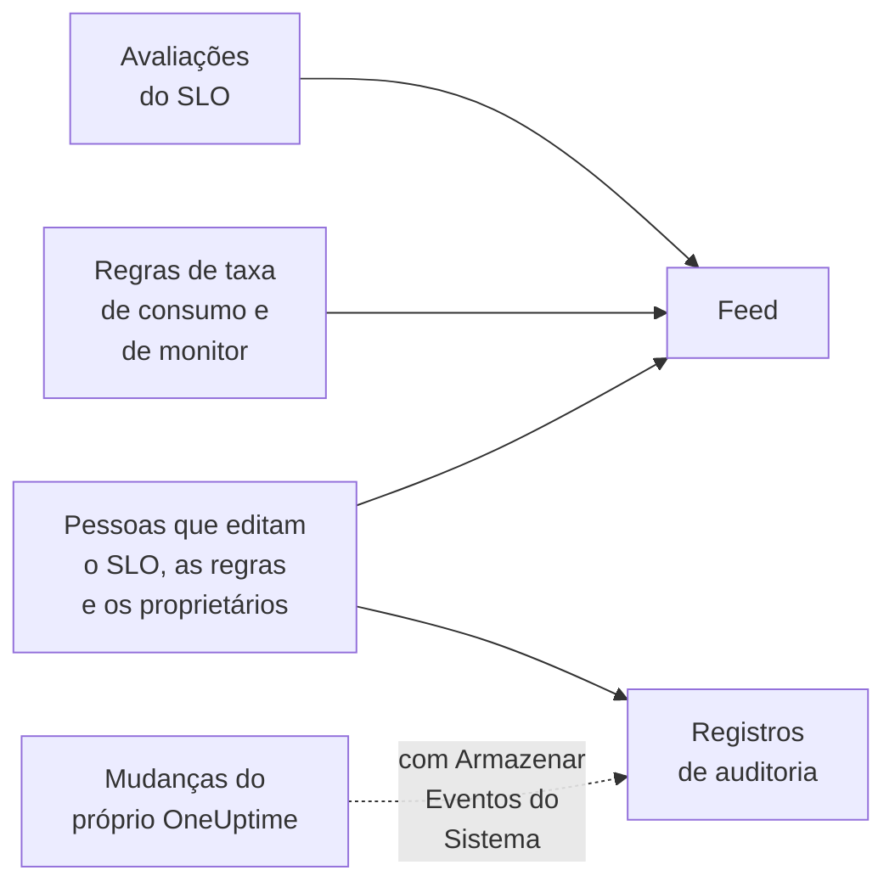

# Feed e registros de auditoria de SLO

Um SLO guarda dois registros da sua história, e eles respondem a perguntas diferentes. O **Feed** responde a "o que aconteceu com este SLO?", escrito para as pessoas que cuidam dele. Os **Registros de auditoria** respondem a "quem mudou o quê, exatamente?", campo por campo, para revisões e conformidade.

## Feed ou registros de auditoria?

| | **Feed** | **Registros de auditoria** |
| --- | --- | --- |
| Responde a | O que aconteceu com o SLO | Quem mudou o quê, e quando |
| Registra | Mudanças de status, alertas e incidentes de taxa de consumo, e mudanças no SLO, nas regras, nos monitores e nos proprietários dele | Cada mudança que pessoas fizeram no SLO, nas regras de taxa de consumo, nas regras de monitor e nos proprietários dele, com os valores antigo e novo |
| Inclui o trabalho do próprio OneUptime | Sim: as avaliações e as regras de monitor que associam monitores | Só com **Armazenar Eventos do Sistema** ligado |
| Planos | Todos os planos | O plano Enterprise no OneUptime Cloud, ou a Enterprise Edition em uma instalação auto-hospedada |
| Mantido por | Três anos no OneUptime Cloud | 7 dias por padrão, até 180 |

## O feed do SLO

O feed fica na página **Feed** do SLO, e os itens mais recentes dele em **Recent activity** na **Visão geral** do SLO. Os itens levam ao SLO, aos monitores, aos alertas e aos incidentes que mencionam, e a maioria tem uma seção **More Information** com os números ou os valores antigos e novos.

| Evento | Publicado quando |
| --- | --- |
| SLO criado | O SLO é criado. Lista a meta, a janela de conformidade, o SLI, o limite de risco, a descrição e as regras de taxa de consumo padrão com que ele começou. |
| SLO atualizado | Mudam o nome, a descrição, os rótulos, a meta, a janela de conformidade, o fuso horário, o limite de risco, o modo de vários monitores ou os status de indisponibilidade. Mostra cada valor antigo e novo. |
| SLO habilitado ou desabilitado | A avaliação é ligada ou desligada. |
| SLO arquivado ou restaurado | O SLO é arquivado ou desarquivado. |
| Status alterado | Uma avaliação leva o SLO a um novo status. Mostra o SLI, o orçamento de erros, a taxa de consumo e o limite de risco que o explicam, e o motivo no caso de **Pausado** ou **Misconfigured**. |
| Alerta de taxa de consumo gerado | Uma regra de taxa de consumo cria um alerta. Leva a ele e mostra as taxas de consumo que o dispararam. |
| Incidente de taxa de consumo declarado | Uma regra de taxa de consumo declara um incidente. Leva a ele e mostra as taxas de consumo que o dispararam. |
| Alerta ou incidente de taxa de consumo resolvido | O alerta ou o incidente de uma regra é fechado: resolvido automaticamente, ou à mão enquanto a resolução automática estava desligada. |
| Regra de taxa de consumo adicionada, alterada ou removida | Alguém cria, edita ou exclui uma regra de taxa de consumo. As regras padrão de um SLO novo aparecem no item "SLO criado" dele. |
| Regra de monitor adicionada, alterada ou removida | Alguém cria, edita ou exclui uma regra de monitor. Um salvamento que não muda nada relevante não é publicado. |
| Monitores associados ou desassociados | Monitores são adicionados ao SLO ou removidos dele, à mão ou por uma regra de monitor. Listas longas nomeiam os primeiros monitores "e mais N". |
| Proprietário adicionado ou removido | Um usuário ou uma equipe é adicionado aos proprietários do SLO ou removido deles. |
| Regra de rótulos aplicada | Uma regra de rótulos associou rótulos ao SLO, quando ele foi criado ou quando alguém executou a regra. Nomeia as regras que corresponderam. Veja [Regras de rótulos e proprietários](/docs/slo/label-and-owner-rules). |
| Regra de proprietários aplicada | Uma regra de proprietários adicionou proprietários ao SLO. Nomeia as regras que corresponderam; cada proprietário que ela adicionou também recebe seu próprio item "Proprietário adicionado". |

Alguns detalhes:

- Os itens dizem quem fez uma mudança quando foi uma pessoa. As mudanças que o próprio OneUptime faz, como uma avaliação ou uma regra de monitor que associa um monitor, e as mudanças feitas pela API ou por uma automação não têm usuário.
- Um alerta ou incidente que uma regra retoma porque ainda estava aberto não é publicado duas vezes.
- Para um alerta ou incidente privado, o item omite o título, o número e o link, porque todos que podem ler o SLO podem ler o feed dele. Ele ainda diz que um registro privado foi criado, e mostra as taxas de consumo que o dispararam.
- Ninguém pode editar nem excluir itens do feed. No OneUptime Cloud, os itens com mais de três anos são removidos.

## Registros de auditoria

A página **Registros de auditoria** do SLO lista as mudanças feitas em:

- o próprio SLO: detalhes, configurações, rótulos, monitores e arquivamento;
- as regras de taxa de consumo dele;
- as regras de monitor dele;
- os usuários proprietários e as equipes proprietárias dele.

As mudanças nas regras e nos proprietários são registradas na regra ou no proprietário e agrupadas no SLO, então a página dele mostra toda a história em um só lugar, e cada entrada leva à página a que pertence. Itens relacionados, como rótulos e monitores, são registrados com o nome, não só com o ID.

Duas coisas ficam de fora:

- **Os resultados das avaliações.** O SLI, o orçamento de erros, a taxa de consumo, o status e os horários de avaliação mudam a cada poucos minutos. O histórico deles está na **Visão geral**, na página **Métricas** e no **Feed**.
- **As mudanças que o próprio OneUptime faz**, como uma regra de monitor que associa ou desassocia um monitor, a menos que **Armazenar Eventos do Sistema** esteja ligado no projeto. O **Feed** registra as associações e desassociações de monitores de qualquer forma.

### Ligar os registros de auditoria

Os registros de auditoria são um recurso Enterprise: eles exigem o plano **Enterprise** no OneUptime Cloud, ou a Enterprise Edition em uma instalação auto-hospedada. Em outros planos, a página **Registros de auditoria** do SLO explica como obtê-lo. Em uma instalação auto-hospedada, o registro de auditoria para de gravar sem uma licença válida (depois do teste de 14 dias, ou 30 dias depois que uma licença expira), e volta assim que uma licença é ativada (veja [When a license expires or is missing](/docs/self-hosted/enterprise#when-a-license-expires-or-is-missing)). As páginas **Registros de auditoria** avisam quando ele não está gravando.

Os registros de auditoria também ficam desligados por padrão em todo projeto. Para ligá-los:

:::steps
### Abrir as configurações dos registros de auditoria

Vá para **Configurações do projeto**, abra **Registros de auditoria** no menu lateral e clique em **Configurações**.

### Editar as configurações

Clique em **Edit Audit Log Settings** e ligue **Habilitar registros de auditoria**.

### Escolher o que guardar

Defina **Retenção (dias)**, de 7 (o padrão) a 180, e ligue **Armazenar Eventos do Sistema** para registrar também as mudanças que o próprio OneUptime faz. Salve. A mudança vale em cerca de um minuto.
:::

Enquanto o registro de auditoria está desligado, a página **Registros de auditoria** do SLO mostra **Audit logging is off**, com um link para ligá-lo. As entradas gravadas antes de ele ser desligado continuam visíveis. O registro de auditoria completo do projeto, de todos os recursos, fica em **Configurações do projeto** → **Registros de auditoria** → **Registros de auditoria**.

## Próximos passos

:::cards
- [Visão geral dos SLOs](/docs/slo/introduction): Cada página que um SLO tem.
- [Monitores e regras de monitor](/docs/slo/monitor-rules): O que associa e desassocia monitores.
- [Alertas e incidentes de taxa de consumo](/docs/slo/burn-rate-alerts): O que gera e resolve os alertas e incidentes do feed.
- [Regras de rótulos e proprietários](/docs/slo/label-and-owner-rules): O que adiciona rótulos e proprietários automaticamente.
:::
