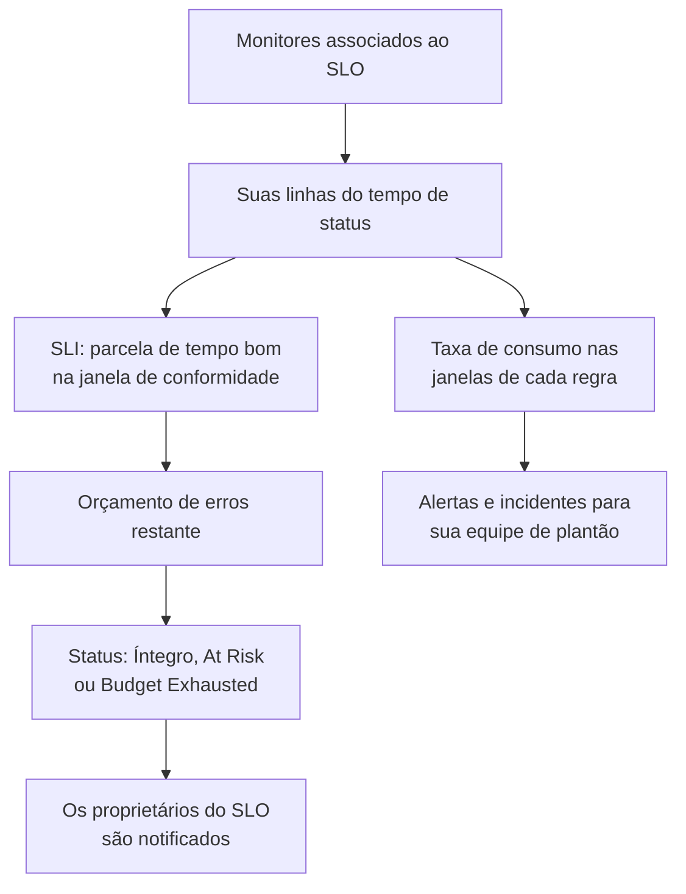

# Visão geral dos SLOs

Um objetivo de nível de serviço (SLO) é uma meta de confiabilidade para o que você opera, como "disponível 99,9% do tempo em 30 dias móveis" ou "99,9% das requisições de checkout têm sucesso". O OneUptime mede cada SLO em relação à sua meta a cada 5 minutos, então, em vez de "está funcionando agora?", você consegue responder "fomos confiáveis o suficiente, em uma janela que importa para nossos usuários, e quanta margem de falha ainda temos?". O [Glossário](/docs/introduction/glossary#slo) coloca os SLOs ao lado das outras palavras que o OneUptime usa.

:::cards
- [Criar um SLO](#criar-um-slo): O que ele mede, um nome e uma meta. Todo o resto começa com um valor padrão.
- [Monitores e regras de monitor](/docs/slo/monitor-rules): Escolha os monitores que um SLO mede.
- [SLOs de requisições e latência](/docs/slo/request-slos): Meça as requisições de serviços a partir dos traços deles.
- [Orçamentos de erros](/docs/slo/error-budget): Quanta indisponibilidade uma meta permite e como ela se recupera.
- [Alertas e incidentes de taxa de consumo](/docs/slo/burn-rate-alerts): Avise sua equipe quando o orçamento é consumido rápido demais.
:::

## Como funciona

Um SLO mede uma de duas coisas. Um SLO de disponibilidade dos monitores lê as linhas do tempo de status dos monitores associados a ele: os mesmos dados que suas páginas de status mostram. Um SLO de requisições conta as requisições que seus serviços atendem, a partir dos traços deles: veja [SLOs de requisições e latência](/docs/slo/request-slos). O restante desta página descreve os SLOs de disponibilidade dos monitores, e os SLOs de requisições funcionam do mesmo jeito, a menos que ela diga o contrário. A partir desses dados, o OneUptime calcula quanto da janela de conformidade foi tempo bom, quanto resta do orçamento de erros e com que velocidade ele está sendo consumido. O tempo com o monitoramento de um monitor desligado fica de fora: nada verifica o monitor nesse período, então esse tempo não consome o orçamento de erros nem conta como tempo bom. O tempo antes da primeira verificação de um monitor também fica de fora: até algo verificar um monitor, o status dele é só o operacional com que todo monitor é criado, então um SLO é medido a partir das primeiras verificações dos seus monitores, e um SLO cujos monitores nada verificou ainda não tem nada a medir até eles serem verificados.



## Conceitos principais

As palavras usadas em todo o OneUptime estão no [Glossário](/docs/introduction/glossary).

| Termo | Significado |
| --- | --- |
| **SLI** (indicador de nível de serviço) | A medição: a porcentagem da janela de conformidade em que os monitores do SLO estavam disponíveis, ou das requisições dos serviços dele que foram boas. |
| **SLO** (objetivo de nível de serviço) | Uma meta para o SLI, por exemplo "pelo menos 99,9% nos últimos 30 dias". |
| **Orçamento de erros** | A indisponibilidade que a meta permite: `(100% − target) × window`. Com 99,9% em 30 dias, são 43 minutos e 12 segundos. Para um SLO de requisições, são as requisições ruins que a meta permite: uma em cada 1.000 com 99,9%. |
| **Taxa de consumo** | A velocidade com que o orçamento é gasto, comparada a um ritmo constante. Com uma taxa de consumo de 1, o orçamento acaba exatamente no fim da janela. |

Um orçamento de erros transforma a confiabilidade em algo que você pode gastar. Se sobra muito, publique mais rápido e assuma riscos; se sobra pouco, desacelere e invista em estabilidade. O SLO dá a essa conversa um número que todos veem.

## Criar um SLO

Você precisa de uma função que possa criar SLOs: Proprietário do projeto, Administrador do projeto ou uma função personalizada com a permissão Create Service Level Objective.

:::steps
### Abrir os SLOs

Abra **SLOs** no menu **Produtos** da barra superior. Ele fica no primeiro grupo, ao lado de monitores e incidentes. Clique em **Criar: Objetivo de nível de serviço**.

### Escolher o que ele mede

Em **O que mede**, mantenha **Disponibilidade dos monitores** para medir a parcela do tempo em que os monitores estão disponíveis. Para medir as requisições de serviços em vez disso, escolha **Sucesso das requisições** ou **Latência das requisições** e escolha os **Serviços**: veja [SLOs de requisições e latência](/docs/slo/request-slos). Escolha **Métrica** para contar os eventos bons de um contador ou de um histograma que seus serviços enviam: veja [SLOs a partir de uma métrica](/docs/slo/request-slos#slos-a-partir-de-uma-métrica). Clique em **Próximo**.

### Dar um nome e definir uma meta

Informe um **Nome**, por exemplo "API Availability", e uma **Meta (%)**: a parcela do tempo, ou das requisições, que precisa ser boa. A meta começa em `99.9`. Ela precisa ser maior que 0 e no máximo 99,999, porque uma meta de 100% não deixa nenhum orçamento de erros para acompanhar.

### Conferir os valores padrão em Mais campos

**Mais campos** fica recolhido, com uma linha que diz o que seus valores padrão fazem: o SLO é medido em uma janela móvel de 30 dias e fica em risco quando resta menos de 20% do seu orçamento de erros. Expanda para mudar qualquer campo da tabela abaixo.

### Salvar o SLO

Clique em **Criar: Objetivo de nível de serviço**. O OneUptime abre o novo SLO. A **Visão geral** de um SLO de disponibilidade dos monitores mostra **Choose what this SLO measures**, porque ele ainda não tem monitores.

### Associar monitores

Para um SLO de disponibilidade dos monitores, clique em **Criar uma regra de monitor** para associar todos os monitores que correspondem, agora e no futuro, ou em **Adicionar monitores** para escolhê-los à mão. Veja [Monitores e regras de monitor](/docs/slo/monitor-rules).

### Ver os primeiros números chegarem

O OneUptime avalia os SLOs habilitados a cada 5 minutos. O SLI, o orçamento de erros e o gráfico de consumo aparecem depois da primeira avaliação que tem monitores para medir ou requisições para contar.
:::

Os campos em **Mais campos**:

| Campo | O que você define | Padrão |
| --- | --- | --- |
| **Descrição** | Para que serve o SLO. | Vazio |
| **Limite de risco (%)** | A parcela do orçamento de erros restante em que o SLO passa para **Em risco**. Um número inteiro de 0 a 100. | 20 |
| **Tipo de janela** | **Móvel**: os últimos N dias, que se recuperam à medida que a indisponibilidade antiga sai da janela. **Mês do calendário**: cada mês por conta própria, zerado no dia 1. | **Móvel** |
| **Janela (dias)** | Só janelas móveis: quantos dias olhar para trás, de 1 a 366. O comum é 28 ou 30. | 30 |
| **Fuso horário** | Só meses do calendário: o fuso horário em que cada mês começa e termina. | UTC |
| **Rótulos** | Rótulos para organizar e filtrar os SLOs. | Nenhum |

Tudo o que define como o SLO mede começa com um valor padrão que você muda depois:

| Configuração | Um SLO novo começa com | Onde mudar |
| --- | --- | --- |
| Monitores | Nenhum | **Monitores** ou **Regras de monitor** |
| Status de indisponibilidade | Todos os status não operacionais do projeto | **Configurações** → **Cálculo de inatividade** |
| Modo de vários monitores | **Qualquer monitor fora do ar** | **Configurações** → **Cálculo de inatividade** |
| Avaliação | Ligada | **Configurações** → **Avaliação** |
| Regras de taxa de consumo | Uma regra **Fast burn**, uma regra **Slow burn** e uma regra **Slow leak**, ajustadas à janela | **Regras de taxa de consumo** |

## Do que um SLO é feito

| Parte | O que ela decide |
| --- | --- |
| O que ele mede | **Disponibilidade dos monitores**, **Sucesso das requisições** ou **Latência das requisições**. |
| Monitores ou serviços | De onde vem o SLI: monitores, associados à mão ou com regras de monitor (veja [Monitores e regras de monitor](/docs/slo/monitor-rules)), ou os serviços cujas requisições um SLO de requisições conta. |
| Meta | A parcela de tempo bom que o SLO promete, maior que 0 e no máximo 99,999. |
| Janela de conformidade | O período em que o SLI e o orçamento são medidos: uma janela móvel de 1 a 366 dias, ou um mês do calendário. |
| Limite de risco | A parcela do orçamento restante em que o SLO passa para **Em risco**. |
| Status de indisponibilidade | Quais status de monitor contam como indisponibilidade. |
| Modo de vários monitores | Como a indisponibilidade de vários monitores é combinada. |

### Quais status contam como indisponibilidade

Cada SLO tem sua própria lista de status de monitor que contam como indisponibilidade. Um SLO novo começa com todos os status do projeto que não estão marcados como operacionais, como Degraded e Offline, assim como fazem suas páginas de status. Mude a lista em **Configurações** → **Cálculo de inatividade**. Deixe-a vazia para contar todos os status não operacionais, inclusive os que forem adicionados ao projeto depois.

> [!TIP]
> Meça os mesmos monitores de duas formas com dois SLOs: um SLO de disponibilidade rigoroso em que tanto Degraded quanto Offline contam, e um SLO de queda total mais tolerante em que só Offline conta.

### Janelas de conformidade

| Tipo de janela | Como se comporta |
| --- | --- |
| **Móvel** | Olha para trás um número fixo de dias a partir de agora. A indisponibilidade antiga sai da janela, então o orçamento volta aos poucos. |
| **Mês do calendário** | Mede a partir do primeiro dia do mês, no fuso horário do SLO (UTC por padrão). O orçamento inteiro volta no início de cada mês. |

### Vários monitores em um SLO

Quando um SLO mede mais de um monitor, o **Modo de vários monitores** dele decide como a indisponibilidade dos monitores é combinada. Um SLO novo usa **Qualquer monitor fora do ar**.

| Modo | Como conta a indisponibilidade | Use quando |
| --- | --- | --- |
| **Qualquer monitor fora do ar** | Qualquer momento em que pelo menos um monitor está fora do ar conta como indisponibilidade para o SLO inteiro. Quedas sobrepostas contam uma vez. | Os monitores juntos formam um único serviço: se qualquer um cai, os usuários percebem. |
| **Média de segundos dos monitores** | A indisponibilidade de cada monitor conta separadamente, na média de todo o tempo monitorado: SLI = 1 − (segundos fora do ar de todos os monitores ÷ segundos monitorados de todos os monitores). | Os monitores são uma frota de recursos parecidos e um impacto parcial deve contar parcialmente. |

Por exemplo, o monitor A fica fora do ar das 10:00 às 11:00 enquanto o monitor B continua disponível. **Qualquer monitor fora do ar** registra 60 minutos de indisponibilidade; **Média de segundos dos monitores** registra o equivalente a 30 minutos, porque um de dois monitores ficou fora do ar por uma hora. Nesse modo, o orçamento também é contado em segundos-monitor: veja [Orçamentos de erros](/docs/slo/error-budget).

## Status do SLO

O OneUptime dá um status a cada SLO avaliado:

| Status | O que significa |
| --- | --- |
| **Íntegro** | Resta mais orçamento do que o limite de risco. |
| **Em risco** | O orçamento restante caiu para o limite de risco ou abaixo dele: 20% por padrão. |
| **Orçamento esgotado** | O orçamento foi todo gasto, ou ultrapassado. |
| **Aguardando** | Nada verificou seus monitores ainda: um monitor criado há um minuto ou uma sonda auto-hospedada que não está conectada. Ele é medido a partir da primeira verificação deles. |
| **Mal configurado** | O SLO não pode ser medido: não tem monitores, seus monitores não existem mais ou ainda não registraram nenhum status na janela, ou sua meta está fora do intervalo. Um SLO de requisições fica mal configurado sem serviços, sem um limite de latência ou antes de os serviços dele atenderem uma requisição na janela. |
| **Pausado** | Todos os monitores que ele mede estão arquivados ou com o monitoramento ativo desligado, à mão, por um incidente manual ou por uma manutenção programada. Ele retoma sozinho assim que algum deles volta a ser monitorado. |

Um SLO desligado ou arquivado não é avaliado, então seu status fica como estava; a lista de SLOs mostra no lugar um selo **Desabilitado** ou **Arquivado**. Os proprietários de um SLO são notificados quando o status muda para **Em risco** ou **Orçamento esgotado**: veja [Orçamentos de erros](/docs/slo/error-budget). Uma regra também pode publicar as mudanças de status no Slack, no Microsoft Teams ou no Mattermost: veja [Mudanças de status](/docs/slo/error-budget-policy#mudanças-de-status).

## A lista de SLOs

A página **SLOs** lista cada SLO não arquivado, com status, SLI, orçamento restante, taxa de consumo, meta, janela, monitores, rótulos e proprietários. A coluna **O que mede** mostra os serviços de um SLO de requisições onde mostra os monitores de um SLO de disponibilidade, e o filtro **Serviços** encontra os SLOs que medem um serviço.

- Os blocos acima da lista contam os SLOs por status: **Íntegro**, **Em risco**, **Orçamento esgotado**, **Aguardando**, **Mal configurado**, **Pausado** e **Desabilitado**. Eles aparecem assim que existe um SLO que não está arquivado. Clique em um bloco para ver só esses SLOs, e de novo para ver todos.
- Selecione SLOs para adicionar ou remover rótulos e proprietários, ativá-los ou desativá-los, dar a eles as [regras de taxa de consumo recomendadas](/docs/slo/burn-rate-alerts#adicioná-las-a-vários-slos-de-uma-vez) que estiverem faltando ou a [política de orçamento de erros recomendada](/docs/slo/error-budget-policy#a-política-recomendada), arquivá-los ou excluí-los, todos de uma vez.
- O filtro **Implantações** mostra os SLOs cuja política de orçamento de erros congela as implantações agora, ou aqueles em que ela as permite. Mostre a coluna **Implantações** pelo seletor de colunas da lista para ver desde quando cada um está congelado: veja [Bloqueio de implantações](/docs/slo/error-budget-policy#bloqueio-de-implantações).
- A seção **Configurações** do menu lateral contém **Regras de Rótulos** e **Regras de proprietário**, que rotulam os SLOs novos e definem seus proprietários: veja [Regras de rótulos e proprietários](/docs/slo/label-and-owner-rules).
- A seção **Avançado** do menu lateral contém **Arquivado**, a lista de SLOs arquivados.

## As páginas de um SLO

Abra um SLO para ver suas páginas no menu lateral:

| Página | O que mostra |
| --- | --- |
| **Visão geral** | O status, os números principais, o consumo do orçamento de erros, a atividade recente, os alertas e incidentes abertos e as regras de taxa de consumo. |
| **Métricas** | As métricas `oneuptime.slo.*` do SLO, seu histórico de longo prazo do orçamento de erros e as métricas dos incidentes e alertas que o afetam. Veja [Métricas e painéis de SLO](/docs/slo/metrics). |
| **Relatório mensal** | Como o SLO se saiu em cada mês do calendário e no período inteiro. Veja [O relatório mensal](#o-relatório-mensal). |
| **Incidentes** | Os incidentes que suas regras de taxa de consumo e sua política de orçamento de erros declararam. O selo conta os abertos. |
| **Alertas** | Os alertas que suas regras de taxa de consumo e sua política de orçamento de erros geraram. O selo conta os abertos. |
| **Feed** | O que aconteceu com o SLO, como linha do tempo. Veja [Feed e registros de auditoria de SLO](/docs/slo/feed-and-audit-logs). |
| **Monitores** | Os monitores que ele mede, e se cada um foi associado por uma pessoa ou por uma regra. Só SLOs de disponibilidade dos monitores. |
| **Regras de monitor** | As regras que associam os monitores que correspondem. Só SLOs de disponibilidade dos monitores. |
| **Regras de taxa de consumo** | As regras que geram alertas e declaram incidentes quando o orçamento é consumido rápido demais. |
| **Política de orçamento de erros** | O que a equipe combinou fazer à medida que o orçamento de erros acaba, e os alertas e incidentes que cada nível da política gera. Veja [Política de orçamento de erros](/docs/slo/error-budget-policy). |
| **Proprietários** | Os usuários e equipes que ficam sabendo das mudanças de status. |
| **Configurações** | O que ele mede, a meta, o período de conformidade, o cálculo da indisponibilidade, o interruptor de avaliação e o cartão de arquivamento. |
| **Registros de auditoria** | Quem mudou o SLO, suas regras e seus proprietários, e quando. |
| **Excluir SLO** | Exclui o SLO para sempre e resolve os alertas e incidentes de taxa de consumo que ele tinha abertos. |

**Monitores** fica na seção **Visão geral**, abaixo de **Visão geral**; **Regras de monitor**, **Regras de taxa de consumo** e **Política de orçamento de erros** em uma seção **Regras**; e **Proprietários**, **Configurações**, **Registros de auditoria** e **Excluir SLO** em uma seção **Gerenciamento**. **Regras** e **Gerenciamento** começam recolhidas, assim como uma seção **Desenvolvedores** para gerenciar o SLO a partir de código: clique no título de uma seção para abri-la.

Quando algo impede um SLO de medir, um banner no topo de cada uma das suas páginas diz o que está errado e leva à página que resolve: veja [Solução de problemas](#solução-de-problemas).

### A visão geral

A **Visão geral** responde a "estamos dentro do orçamento?", de cima para baixo:

- **O resumo**: o status, uma frase sobre o que ele significa e a descrição. Ao lado ficam **Atualizar** e quando o SLO foi avaliado pela última vez. Abaixo ficam a meta, a **Janela de conformidade** (com um indicador de preenchimento enquanto uma janela móvel nova se enche: veja [SLOs novos e o indicador de preenchimento da janela](#slos-novos-e-o-indicador-de-preenchimento-da-janela)), o número de monitores (ou de serviços, em um SLO de requisições) e os proprietários, com **Adicionar proprietários** para adicionar um ali mesmo.
- **Os números principais**:
  - **SLI**: a parcela de tempo bom na janela, e quanto ela está acima ou abaixo da meta.
  - **Orçamento de erros restante**: uma porcentagem, uma duração como "Restam 12 min 30 s de 43 min 12 s" (para um SLO de requisições, uma contagem de requisições ruins) e uma barra com uma marca no limite de risco. Quando o orçamento é ultrapassado, mostra **Orçamento excedido** e por quanto.
  - **Taxa de consumo**: a velocidade com que o orçamento é gasto nos últimos 60 minutos, o período que a regra de consumo rápido padrão usa. Fica âmbar acima de 1× e vermelho, com **Limite da regra atingido**, no limite mais baixo das regras de taxa de consumo habilitadas do SLO cujo período é de 6 horas ou menos. Uma hora diz pouco sobre uma regra cujo período é de dias, como **Slow leak**, por isso a taxa não é comparada com regras assim.
  - **Autonomia do orçamento**: quanto o orçamento dura nesse ritmo. Veja [Orçamentos de erros](/docs/slo/error-budget#autonomia-do-orçamento).
- **Burn-down do orçamento de erros**: o orçamento restante ao longo da janela atual. Veja [Orçamentos de erros](/docs/slo/error-budget#consumo-do-orçamento-de-erros).
- **Atividade recente**: os itens mais recentes do feed do SLO.
- **Detalhes do SLO**: o nome, a descrição e os rótulos, as únicas configurações editadas na visão geral.
- **Alertas e incidentes abertos**: o que as regras de taxa de consumo têm aberto agora.
- **Burn rate rules**: o limite de cada regra habilitada ao lado da taxa de consumo atual, para as regras cujo período é de 6 horas ou menos, e o que a regra declara.

Quando o SLO está em um nível da sua política de orçamento de erros, a **Visão geral** também mostra esse nível e o que a equipe combinou fazer nele: veja [Política de orçamento de erros](/docs/slo/error-budget-policy).

O cartão **Usado por** lista as regras de taxa de consumo e os níveis da política de orçamento de erros que atuam no SLO, e os painéis que o mostram. Arquivar ou excluir o SLO diz isso primeiro: suas regras e níveis vão junto com ele.

### Configurações

A página **Configurações** reúne como um SLO mede, um cartão para cada coisa:

| Cartão | O que você muda | Bom saber |
| --- | --- | --- |
| **O que mede** | **O que mede**, **Serviços**, **Limite de latência (ms)**, **Filtro de requisições** e **Métrica**, com **Editar o que mede**. | Depois de uma mudança, um SLO de requisições conta as requisições de novo desde o início. |
| **Objetivo** | **Meta (%)** e **Limite de risco (%)**, com **Editar objetivo**. | Mostra a indisponibilidade que a meta permite, por exemplo "43 min 12 s de inatividade por janela de 30 dias". |
| **Período de conformidade** | **Tipo de janela**, **Janela (dias)** e **Fuso horário**, com **Editar período**. | As regras de taxa de consumo mantêm seus limites quando a janela muda, então revise-as depois. |
| **Cálculo de inatividade** | **Modo de vários monitores** e **Status de monitor de indisponibilidade**, com **Editar cálculo de inatividade**. | Só SLOs de disponibilidade dos monitores. Sem nenhum status, contam todos os status não operacionais, inclusive os adicionados depois. |
| **Avaliação** | O interruptor **Avaliar este SLO**, que salva assim que você o muda. | Desligá-lo pede confirmação, porque também resolve os alertas e incidentes de taxa de consumo abertos do SLO. |
| **Arquivar: SLO** | **Arquivar** ou **Desarquivar**. | Veja [Arquivar um SLO](#arquivar-um-slo). |

Depois de uma mudança no que ele mede, na meta, no período ou no cálculo da indisponibilidade, o OneUptime avalia o SLO de novo na execução seguinte.

### O relatório mensal

O **Relatório mensal** mostra como o SLO se saiu em cada mês do calendário dos últimos **3 meses**, **6 meses**, **9 meses** ou **12 meses**, ou de um ano civil. Cada mês mostra o SLI, o tempo de inatividade (num SLO de requisições, as requisições com falha ou lentas; num SLO de métrica, os eventos ruins), a parte do orçamento de erros que usou e o resultado:

| Resultado | O que significa |
| --- | --- |
| Atendido | O mês terminou, e o SLI dele atingiu a meta. |
| Não atendido | O mês terminou sem atingir a meta, ou o mês ainda está em andamento e já tem mais tempo de inatividade do que o mês inteiro permite. |
| No caminho certo | O mês ainda está em andamento, e o SLI dele até agora atinge a meta. |
| Abaixo da meta | O mês ainda está em andamento, e o SLI dele até agora está abaixo da meta. |
| Sem dados | Nada foi medido naquele mês. |

A linha **Total** mede o período inteiro como um só. Um SLO com vários monitores também ganha uma tabela **Por monitor**: o SLI de cada monitor em cada mês, com primeiro o monitor que mais custou ao SLO. **Baixar CSV** salva o relatório como um arquivo para uma planilha.

Nada a mais é guardado para o relatório. Cada mês é calculado a partir do histórico de status dos monitores quando você o abre, com os monitores, os status de indisponibilidade e a meta do SLO como estão agora, então ele volta até antes de o SLO ser criado. Os meses de um SLO de requisições vêm das requisições que o OneUptime contou para ele, e os de um SLO de métrica dos eventos da métrica dele, guardados por 400 dias. Os meses seguem o fuso horário do SLO, ou UTC quando ele não tem um.

A API responde com o mesmo relatório:

```bash
curl -sS "https://oneuptime.com/api/service-level-objective/<slo-id>/monthly-report?months=12" \
  -H "ApiKey: $ONEUPTIME_API_KEY"
```

Peça com `months` de 1 a 24 meses terminando no mês atual, ou um ano civil com `year`, como `year=2025`.

## Arquivar um SLO

Arquive um SLO que você não mede mais, mas quer guardar, como um serviço desativado ou a meta do ano passado. Arquive-o em **Configurações** → **Arquivar: SLO**, ou selecione SLOs na lista e escolha **Arquivar**.

Um SLO arquivado:

- fica oculto da lista de SLOs, dos blocos de status e dos seletores e listas de SLO dos painéis;
- não é avaliado: seus números ficam como na última avaliação, suas regras de taxa de consumo não disparam e ele não envia métricas;
- tem seus alertas e incidentes de taxa de consumo abertos resolvidos;
- mantém configurações, histórico, regras e proprietários. Suas regras de monitor mantêm a lista de monitores atualizada, então ele retoma com os monitores certos.

Os SLOs arquivados aparecem na página **Arquivado**, em **Avançado** no menu lateral da lista de SLOs. Selecione-os lá e escolha **Desarquivar** para trazê-los de volta: eles são avaliados de novo na execução seguinte, com o SLI e o orçamento recalculados a partir do histórico dos seus monitores.

Arquivar e desligar a avaliação são interruptores separados. Um SLO que estava desligado antes de ser arquivado continua desligado quando você o desarquiva: ligue-o de novo com **Ligar a avaliação** no banner dele, ou com **Avaliar este SLO** em **Configurações** → **Avaliação**.

| Você quer | Faça isto |
| --- | --- |
| Parar de medir por um tempo e mantê-lo na lista | Desligue a avaliação |
| Aposentá-lo, mas guardar o histórico e as configurações | Arquive-o |
| Removê-lo para sempre | Exclua-o |

## SLOs em alertas, incidentes e monitores

Cada alerta e incidente que uma regra de taxa de consumo cria está vinculado ao seu SLO:

- A página do alerta ou do incidente lista o SLO em **Recursos afetados**, com um link para ele.
- As listas de alertas e incidentes mostram o SLO entre os recursos afetados, e o filtro **Recursos afetados** limita uma lista a um SLO.
- As páginas **Alertas** e **Incidentes** do SLO os listam, e os selos delas no menu lateral contam os abertos.

O OneUptime cria esse vínculo quando uma regra cria o alerta ou o incidente; você não pode adicioná-lo à mão, e editar o alerta ou o incidente nunca o remove.

O menu lateral de um monitor também tem uma página **SLOs**: os SLOs que medem esse monitor, para você saber quais metas dependem dele antes de pausá-lo ou mudá-lo.

## SLOs novos e o indicador de preenchimento da janela

Um SLO de janela móvel mais novo que a própria janela é medido com os dados que existem até agora: um SLO de 30 dias criado ontem tem um dia de dados. Seu orçamento de erros começa pequeno e cresce à medida que a janela se enche, então os primeiros números oscilam mais do que vão oscilar depois.

Enquanto for assim, a **Visão geral** avisa: o resumo mostra um indicador **Janela 23% preenchida** (**Janela com menos de 1% preenchido** no primeiro dia), e o bloco **Orçamento de erros restante** repete isso abaixo do número. Os dois somem quando a janela está cheia. SLOs de mês do calendário nunca os mostram, porque o orçamento deles cobre o mês inteiro desde o primeiro dia, e os SLOs no modo **Média de segundos dos monitores** também não, porque o orçamento deles é contado entre os monitores. Um SLO de requisições os mostra enquanto o OneUptime ainda está contando as requisições mais antigas dos serviços dele: veja [SLOs de requisições e latência](/docs/slo/request-slos#como-as-requisições-são-contadas).

## Solução de problemas

Um banner no topo das páginas do SLO diz o que o impede de medir:

| Banner | O que significa | O que fazer |
| --- | --- | --- |
| **Nenhum monitor vinculado** | O SLO não tem monitores, então não há nada para medir. | Associe monitores ou crie uma regra de monitor. |
| **Aguardando a avaliação do SLO** | Há monitores associados, mas a última avaliação não tinha dados de status deles. | Confira se os monitores estão sendo verificados. Os números aparecem depois da próxima avaliação com dados. |
| **Aguardando a primeira verificação** | Há monitores associados, mas nada os verificou ainda: um monitor criado há um minuto ou uma sonda auto-hospedada que não está conectada. | Nada: o SLO é medido a partir da primeira verificação deles. Se ela não chegar, abra os monitores para ver por quê. |
| **A medição está pausada** | Todos os monitores que ele mede estão arquivados ou com o monitoramento ativo desligado. | Ligue de novo o monitoramento de pelo menos um monitor, ou espere a manutenção terminar. |
| **A meta está fora do intervalo** | A meta não é maior que 0 e menor que 100. | Defina uma meta como 99,9 em **Configurações** → **Objetivo**. |
| **Este SLO está desabilitado** | A avaliação está desligada. | Clique em **Ligar a avaliação**. |
| **Este SLO está arquivado** | O SLO está arquivado. | Desarquive-o em **Configurações**. |
| **Ainda não avaliado** | O SLO acabou de ser criado. | Espere a primeira avaliação, alguns minutos no máximo. |
| **Nenhum serviço escolhido** | Um SLO de requisições não tem serviços, então não tem requisições para contar. | Escolha os serviços dele em **Configurações** → **O que mede**. |
| **Nenhum limite de latência** | Um SLO de latência das requisições não tem limite, então nenhuma requisição pode contar como rápida o suficiente. | Defina o **Limite de latência (ms)** em **Configurações** → **O que mede**. |
| **Aguardando requisições** | Nenhum dos serviços de um SLO de requisições atendeu uma requisição na janela ainda. | Confira se os serviços enviam traços ao OneUptime. Os números aparecem depois da próxima avaliação que contar uma requisição. |
| **Nenhuma métrica para contar** | Um SLO de métrica não tem uma métrica que possa contar: nenhuma foi escolhida, ou falta definir como os eventos bons dele se distinguem dos outros. | Escolha a métrica, e a condição ou o valor dos eventos bons dela, em **Configurações** → **O que mede**. |
| **Aguardando a métrica dele** | Nenhum dos serviços de um SLO de métrica enviou um evento da métrica dele na janela ainda. | Confira se os serviços enviam a métrica ao OneUptime, com o nome que o SLO conta. Os números aparecem depois da próxima avaliação que contar um evento. |

## Próximos passos

:::cards
- [Monitores e regras de monitor](/docs/slo/monitor-rules): Associe monitores à mão ou com regras.
- [SLOs de requisições e latência](/docs/slo/request-slos): Meça as requisições de um serviço a partir dos traços dele.
- [Orçamentos de erros](/docs/slo/error-budget): O cálculo do orçamento, a autonomia e como o orçamento volta.
- [Verificações de lançamento](/docs/slo/release-checks): Reverta um lançamento que consome o orçamento de erros.
:::
