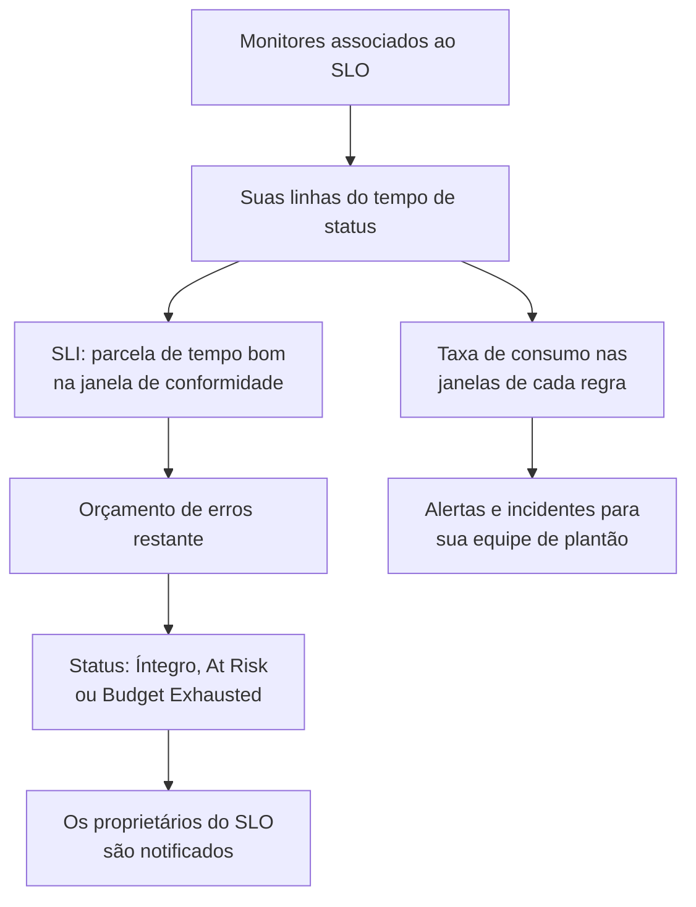

# Visão geral dos SLOs

Um objetivo de nível de serviço (SLO) é uma meta de confiabilidade para o que você monitora, como "disponível 99,9% do tempo em 30 dias móveis". O OneUptime mede cada SLO em relação à sua meta a cada 5 minutos, então, em vez de "está funcionando agora?", você consegue responder "fomos confiáveis o suficiente, em uma janela que importa para nossos usuários, e quanta margem de falha ainda temos?".

:::cards
- [Criar um SLO](#criar-um-slo): Um nome e uma meta. Todo o resto começa com um valor padrão.
- [Monitores e regras de monitor](/docs/slo/monitor-rules): Escolha os monitores que um SLO mede.
- [Orçamentos de erros](/docs/slo/error-budget): Quanta indisponibilidade uma meta permite e como ela se recupera.
- [Alertas e incidentes de taxa de consumo](/docs/slo/burn-rate-alerts): Avise sua equipe quando o orçamento é consumido rápido demais.
:::

## Como funciona

Um SLO lê as linhas do tempo de status dos monitores associados a ele: os mesmos dados que suas páginas de status mostram. A partir delas, o OneUptime calcula quanto da janela de conformidade foi tempo bom, quanto resta do orçamento de erros e com que velocidade ele está sendo consumido.

## Conceitos principais

| Termo | Significado |
| --- | --- |
| **SLI** (indicador de nível de serviço) | A medição: a porcentagem da janela de conformidade em que os monitores do SLO estavam disponíveis. |
| **SLO** (objetivo de nível de serviço) | Uma meta para o SLI, por exemplo "pelo menos 99,9% nos últimos 30 dias". |
| **Orçamento de erros** | A indisponibilidade que a meta permite: `(100% − target) × window`. Com 99,9% em 30 dias, são 43 minutos e 12 segundos. |
| **Taxa de consumo** | A velocidade com que o orçamento é gasto, comparada a um ritmo constante. Com uma taxa de consumo de 1, o orçamento acaba exatamente no fim da janela. |

Um orçamento de erros transforma a confiabilidade em algo que você pode gastar. Se sobra muito, publique mais rápido e assuma riscos; se sobra pouco, desacelere e invista em estabilidade. O SLO dá a essa conversa um número que todos veem.

## Criar um SLO

Você precisa de uma função que possa criar SLOs: Project Owner, Project Admin ou uma função personalizada com a permissão Create Service Level Objective.

:::steps
### Abrir os SLOs

Abra **SLOs** no menu **Produtos** da barra superior. Ele fica no primeiro grupo, ao lado de monitores e incidentes. Clique em **Criar: Service Level Objective**.

### Dar um nome e definir uma meta

Informe um **Nome**, por exemplo "API Availability", e um **Target (%)**: a parcela do tempo em que seus monitores devem estar disponíveis. A meta começa em `99.9`. Ela precisa ser maior que 0 e no máximo 99,999, porque uma meta de 100% não deixa nenhum orçamento de erros para acompanhar.

### Conferir os valores padrão em Mais campos

**Mais campos** fica recolhido, com uma linha que diz o que seus valores padrão fazem: o SLO é medido em uma janela móvel de 30 dias e fica em risco quando resta menos de 20% do seu orçamento de erros. Expanda para mudar qualquer campo da tabela abaixo.

### Salvar o SLO

Clique em **Criar: Service Level Objective**. O OneUptime abre o novo SLO. A **Visão geral** dele mostra **Choose what this SLO measures**, porque um SLO novo ainda não tem monitores.

### Associar monitores

Clique em **Create a monitor rule** para associar todos os monitores que correspondem, agora e no futuro, ou em **Add monitors** para escolhê-los à mão. Veja [Monitores e regras de monitor](/docs/slo/monitor-rules).

### Ver os primeiros números chegarem

O OneUptime avalia os SLOs habilitados a cada 5 minutos. O SLI, o orçamento de erros e o gráfico de consumo aparecem depois da primeira avaliação que tem monitores para medir.
:::

Os campos em **Mais campos**:

| Campo | O que você define | Padrão |
| --- | --- | --- |
| **Descrição** | Para que serve o SLO. | Vazio |
| **Limite de risco (%)** | A parcela do orçamento de erros restante em que o SLO passa para **At Risk**. Um número inteiro de 0 a 100. | 20 |
| **Window Type** | **Rolling**: os últimos N dias, que se recuperam à medida que a indisponibilidade antiga sai da janela. **Calendar Month**: cada mês por conta própria, zerado no dia 1. | **Rolling** |
| **Window (Days)** | Só janelas móveis: quantos dias olhar para trás, de 1 a 366. O comum é 28 ou 30. | 30 |
| **Fuso horário** | Só meses do calendário: o fuso horário em que cada mês começa e termina. | UTC |
| **Rótulos** | Rótulos para organizar e filtrar os SLOs. | Nenhum |

Tudo o que define como o SLO mede começa com um valor padrão que você muda depois:

| Configuração | Um SLO novo começa com | Onde mudar |
| --- | --- | --- |
| Monitores | Nenhum | **Monitores** ou **Monitor Rules** |
| Status de indisponibilidade | Todos os status não operacionais do projeto | **Configurações** → **Downtime Calculation** |
| Modo de vários monitores | **Any Monitor Down** | **Configurações** → **Downtime Calculation** |
| Avaliação | Ligada | **Configurações** → **Avaliação** |
| Regras de taxa de consumo | Uma regra **Fast burn** e uma regra **Slow burn**, ajustadas à janela | **Burn Rate Rules** |

## Do que um SLO é feito

| Parte | O que ela decide |
| --- | --- |
| Monitores | De onde vem o SLI. Associe-os à mão ou com regras de monitor: veja [Monitores e regras de monitor](/docs/slo/monitor-rules). |
| Meta | A parcela de tempo bom que o SLO promete, maior que 0 e no máximo 99,999. |
| Janela de conformidade | O período em que o SLI e o orçamento são medidos: uma janela móvel de 1 a 366 dias, ou um mês do calendário. |
| Limite de risco | A parcela do orçamento restante em que o SLO passa para **At Risk**. |
| Status de indisponibilidade | Quais status de monitor contam como indisponibilidade. |
| Modo de vários monitores | Como a indisponibilidade de vários monitores é combinada. |

### Quais status contam como indisponibilidade

Cada SLO tem sua própria lista de status de monitor que contam como indisponibilidade. Um SLO novo começa com todos os status do projeto que não estão marcados como operacionais, como Degraded e Offline, assim como fazem suas páginas de status. Mude a lista em **Configurações** → **Downtime Calculation**. Deixe-a vazia para contar todos os status não operacionais, inclusive os que forem adicionados ao projeto depois.

> [!TIP]
> Meça os mesmos monitores de duas formas com dois SLOs: um SLO de disponibilidade rigoroso em que tanto Degraded quanto Offline contam, e um SLO de queda total mais tolerante em que só Offline conta.

### Janelas de conformidade

| Tipo de janela | Como se comporta |
| --- | --- |
| **Rolling** | Olha para trás um número fixo de dias a partir de agora. A indisponibilidade antiga sai da janela, então o orçamento volta aos poucos. |
| **Calendar Month** | Mede a partir do primeiro dia do mês, no fuso horário do SLO (UTC por padrão). O orçamento inteiro volta no início de cada mês. |

### Vários monitores em um SLO

Quando um SLO mede mais de um monitor, o **Multi Monitor Mode** dele decide como a indisponibilidade dos monitores é combinada. Um SLO novo usa **Any Monitor Down**.

| Modo | Como conta a indisponibilidade | Use quando |
| --- | --- | --- |
| **Any Monitor Down** | Qualquer momento em que pelo menos um monitor está fora do ar conta como indisponibilidade para o SLO inteiro. Quedas sobrepostas contam uma vez. | Os monitores juntos formam um único serviço: se qualquer um cai, os usuários percebem. |
| **Monitor Seconds Average** | A indisponibilidade de cada monitor conta separadamente, na média de todo o tempo monitorado: SLI = 1 − (segundos fora do ar de todos os monitores ÷ segundos monitorados de todos os monitores). | Os monitores são uma frota de recursos parecidos e um impacto parcial deve contar parcialmente. |

Por exemplo, o monitor A fica fora do ar das 10:00 às 11:00 enquanto o monitor B continua disponível. **Any Monitor Down** registra 60 minutos de indisponibilidade; **Monitor Seconds Average** registra o equivalente a 30 minutos, porque um de dois monitores ficou fora do ar por uma hora. Nesse modo, o orçamento também é contado em segundos-monitor: veja [Orçamentos de erros](/docs/slo/error-budget).

## Status do SLO

O OneUptime dá um status a cada SLO avaliado:

| Status | O que significa |
| --- | --- |
| **Íntegro** | Resta mais orçamento do que o limite de risco. |
| **At Risk** | O orçamento restante caiu para o limite de risco ou abaixo dele: 20% por padrão. |
| **Budget Exhausted** | O orçamento foi todo gasto, ou ultrapassado. |
| **Misconfigured** | O SLO não pode ser medido: não tem monitores, seus monitores não existem mais ou ainda não registraram nenhum status na janela, ou sua meta está fora do intervalo. |
| **Pausado** | Todos os monitores que ele mede estão arquivados ou com o monitoramento ativo desligado, à mão, por um incidente manual ou por uma manutenção programada. Ele retoma sozinho assim que algum deles volta a ser monitorado. |

Um SLO desligado ou arquivado não é avaliado, então seu status fica como estava; a lista de SLOs mostra no lugar um selo **Desabilitado** ou **Arquivado**. Os proprietários de um SLO são notificados quando o status muda para **At Risk** ou **Budget Exhausted**: veja [Orçamentos de erros](/docs/slo/error-budget).

## A lista de SLOs

A página **SLOs** lista cada SLO não arquivado, com status, SLI, orçamento restante, taxa de consumo, meta, janela, monitores, rótulos e proprietários.

- Os blocos acima da lista contam os SLOs por status: **Íntegro**, **At Risk**, **Budget Exhausted**, **Misconfigured**, **Pausado** e **Desabilitado**. Clique em um bloco para ver só esses SLOs, e de novo para ver todos.
- Selecione SLOs para adicionar ou remover rótulos e proprietários, arquivá-los ou excluí-los, todos de uma vez.
- A seção **Configurações** do menu lateral contém **Regras de Rótulos** e **Regras de proprietário**, que rotulam os SLOs novos e definem seus proprietários: veja [Regras de rótulos e proprietários](/docs/slo/label-and-owner-rules).
- A seção **Avançado** do menu lateral contém **Arquivado**, a lista de SLOs arquivados.

## As páginas de um SLO

Abra um SLO para ver suas páginas no menu lateral:

| Página | O que mostra |
| --- | --- |
| **Visão geral** | O status, os números principais, o consumo do orçamento de erros, a atividade recente, os alertas e incidentes abertos e as regras de taxa de consumo. |
| **Métricas** | As métricas `oneuptime.slo.*` do SLO, seu histórico de longo prazo do orçamento de erros e as métricas dos incidentes e alertas que o afetam. Veja [Métricas e painéis de SLO](/docs/slo/metrics). |
| **Incidentes** | Os incidentes que suas regras de taxa de consumo declararam. O selo conta os abertos. |
| **Alertas** | Os alertas que suas regras de taxa de consumo geraram. O selo conta os abertos. |
| **Feed** | O que aconteceu com o SLO, como linha do tempo. Veja [Feed e registros de auditoria de SLO](/docs/slo/feed-and-audit-logs). |
| **Monitores** | Os monitores que ele mede, e se cada um foi associado por uma pessoa ou por uma regra. |
| **Monitor Rules** | As regras que associam os monitores que correspondem. |
| **Burn Rate Rules** | As regras que geram alertas e declaram incidentes quando o orçamento é consumido rápido demais. |
| **Proprietários** | Os usuários e equipes que ficam sabendo das mudanças de status. |
| **Configurações** | A meta, o período de conformidade, o cálculo da indisponibilidade, o interruptor de avaliação e o cartão de arquivamento. |
| **Registros de auditoria** | Quem mudou o SLO, suas regras e seus proprietários, e quando. |
| **Delete SLO** | Exclui o SLO para sempre e resolve os alertas e incidentes de taxa de consumo que ele tinha abertos. |

**Monitores**, **Monitor Rules** e **Burn Rate Rules** ficam em uma seção **Configuração**, e **Proprietários**, **Configurações**, **Registros de auditoria** e **Delete SLO** em uma seção **Management**. As duas começam recolhidas, assim como uma seção **Desenvolvedores** para gerenciar o SLO a partir de código: clique no título de uma seção para abri-la.

Quando algo impede um SLO de medir, um banner no topo de cada uma das suas páginas diz o que está errado e leva à página que resolve: veja [Solução de problemas](#solução-de-problemas).

### A visão geral

A **Visão geral** responde a "estamos dentro do orçamento?", de cima para baixo:

- **O resumo**: o status, uma frase sobre o que ele significa e a descrição. Ao lado ficam **Atualizar** e quando o SLO foi avaliado pela última vez. Abaixo ficam a meta, a **Compliance window** (com um indicador de preenchimento enquanto uma janela móvel nova se enche: veja [SLOs novos e o indicador de preenchimento da janela](#slos-novos-e-o-indicador-de-preenchimento-da-janela)), o número de monitores e os proprietários.
- **Os números principais**:
  - **SLI**: a parcela de tempo bom na janela, e quanto ela está acima ou abaixo da meta.
  - **Error budget left**: uma porcentagem, uma duração como "12m 30s left of 43m 12s" e uma barra com uma marca no limite de risco. Quando o orçamento é ultrapassado, mostra **Budget exceeded** e por quanto.
  - **Burn rate**: a velocidade com que o orçamento é gasto nos últimos 60 minutos, o período que a regra de consumo rápido padrão usa. Fica âmbar acima de 1× e vermelho, com **Rule threshold reached**, no limite mais baixo das regras de taxa de consumo habilitadas do SLO.
  - **Budget runway**: quanto o orçamento dura nesse ritmo. Veja [Orçamentos de erros](/docs/slo/error-budget#autonomia-do-orçamento).
- **Error budget burn-down**: o orçamento restante ao longo da janela atual. Veja [Orçamentos de erros](/docs/slo/error-budget#consumo-do-orçamento-de-erros).
- **Recent activity**: os itens mais recentes do feed do SLO.
- **SLO Details**: o nome, a descrição e os rótulos, as únicas configurações editadas na visão geral.
- **Open alerts & incidents**: o que as regras de taxa de consumo têm aberto agora.
- **Burn rate rules**: o limite de cada regra habilitada ao lado da taxa de consumo atual, e o que a regra declara.

### Configurações

A página **Configurações** reúne como um SLO mede, um cartão para cada coisa:

| Cartão | O que você muda | Bom saber |
| --- | --- | --- |
| **Objective** | **Target (%)** e **Limite de risco (%)**, com **Edit Objective**. | Mostra a indisponibilidade que a meta permite, por exemplo "43m 12s de indisponibilidade por janela de 30 dias". |
| **Compliance Period** | **Window Type**, **Window (Days)** e **Fuso horário**, com **Edit Period**. | As regras de taxa de consumo mantêm seus limites quando a janela muda, então revise-as depois. |
| **Downtime Calculation** | **Multi Monitor Mode** e **Status de monitor de indisponibilidade**, com **Edit Downtime Calculation**. | Sem nenhum status, contam todos os status não operacionais, inclusive os adicionados depois. |
| **Avaliação** | O interruptor **Avaliar este SLO**, que salva assim que você o muda. | Desligá-lo pede confirmação, porque também resolve os alertas e incidentes de taxa de consumo abertos do SLO. |
| **Archive SLO** | **Arquivar** ou **Desarquivar**. | Veja [Arquivar um SLO](#arquivar-um-slo). |

Depois de uma mudança na meta, no período ou no cálculo da indisponibilidade, o OneUptime avalia o SLO de novo na execução seguinte.

## Arquivar um SLO

Arquive um SLO que você não mede mais, mas quer guardar, como um serviço desativado ou a meta do ano passado. Arquive-o em **Configurações** → **Archive SLO**, ou selecione SLOs na lista e escolha **Arquivar**.

Um SLO arquivado:

- fica oculto da lista de SLOs, dos blocos de status e dos seletores e listas de SLO dos painéis;
- não é avaliado: seus números ficam como na última avaliação, suas regras de taxa de consumo não disparam e ele não envia métricas;
- tem seus alertas e incidentes de taxa de consumo abertos resolvidos;
- mantém configurações, histórico, regras e proprietários. Suas regras de monitor mantêm a lista de monitores atualizada, então ele retoma com os monitores certos.

Os SLOs arquivados aparecem na página **Arquivado**, em **Avançado** no menu lateral da lista de SLOs. Selecione-os lá e escolha **Desarquivar** para trazê-los de volta: eles são avaliados de novo na execução seguinte, com o SLI e o orçamento recalculados a partir do histórico dos seus monitores.

Arquivar e desligar a avaliação são interruptores separados. Um SLO que estava desligado antes de ser arquivado continua desligado quando você o desarquiva: ligue-o de novo com **Ligar a avaliação** no banner dele, ou com **Avaliar este SLO** em **Configurações** → **Avaliação**.

| Você quer | Faça isto |
| --- | --- |
| Parar de medir por um tempo e mantê-lo na lista | Desligue a avaliação |
| Aposentá-lo, mas guardar o histórico e as configurações | Arquive-o |
| Removê-lo para sempre | Exclua-o |

## SLOs em alertas, incidentes e monitores

Cada alerta e incidente que uma regra de taxa de consumo cria está vinculado ao seu SLO:

- A página do alerta ou do incidente lista o SLO em **Recursos afetados**, com um link para ele.
- As listas de alertas e incidentes mostram o SLO entre os recursos afetados, e o filtro **Recursos afetados** limita uma lista a um SLO.
- As páginas **Alertas** e **Incidentes** do SLO os listam, e os selos delas no menu lateral contam os abertos.

O OneUptime cria esse vínculo quando uma regra cria o alerta ou o incidente; você não pode adicioná-lo à mão, e editar o alerta ou o incidente nunca o remove.

O menu lateral de um monitor também tem uma página **SLOs**: os SLOs que medem esse monitor, para você saber quais metas dependem dele antes de pausá-lo ou mudá-lo.

## SLOs novos e o indicador de preenchimento da janela

Um SLO de janela móvel mais novo que a própria janela é medido com os dados que existem até agora: um SLO de 30 dias criado ontem tem um dia de dados. Seu orçamento de erros começa pequeno e cresce à medida que a janela se enche, então os primeiros números oscilam mais do que vão oscilar depois.

Enquanto for assim, a **Visão geral** avisa: o resumo mostra um indicador **Window 23% full** (**Window under 1% full** no primeiro dia), e o bloco **Error budget left** repete isso abaixo do número. Os dois somem quando a janela está cheia. SLOs de mês do calendário nunca os mostram, porque o orçamento deles cobre o mês inteiro desde o primeiro dia, e os SLOs no modo **Monitor Seconds Average** também não, porque o orçamento deles é contado entre os monitores.

## Solução de problemas

Um banner no topo das páginas do SLO diz o que o impede de medir:

| Banner | O que significa | O que fazer |
| --- | --- | --- |
| **No monitors attached** | O SLO não tem monitores, então não há nada para medir. | Associe monitores ou crie uma regra de monitor. |
| **Waiting for SLO evaluation** | Há monitores associados, mas a última avaliação não tinha dados de status deles. | Confira se os monitores estão sendo verificados. Os números aparecem depois da próxima avaliação com dados. |
| **Measurement is paused** | Todos os monitores que ele mede estão arquivados ou com o monitoramento ativo desligado. | Ligue de novo o monitoramento de pelo menos um monitor, ou espere a manutenção terminar. |
| **The target is out of range** | A meta não é maior que 0 e menor que 100. | Defina uma meta como 99,9 em **Configurações** → **Objective**. |
| **This SLO is disabled** | A avaliação está desligada. | Clique em **Ligar a avaliação**. |
| **This SLO is archived** | O SLO está arquivado. | Desarquive-o em **Configurações**. |
| **Not evaluated yet** | O SLO acabou de ser criado. | Espere a primeira avaliação, alguns minutos no máximo. |

## Próximos passos

:::cards
- [Monitores e regras de monitor](/docs/slo/monitor-rules): Associe monitores à mão ou com regras.
- [Orçamentos de erros](/docs/slo/error-budget): O cálculo do orçamento, a autonomia e como o orçamento volta.
- [Alertas e incidentes de taxa de consumo](/docs/slo/burn-rate-alerts): Avise sua equipe de plantão quando o orçamento é consumido rápido demais.
- [Métricas e painéis de SLO](/docs/slo/metrics): Coloque SLOs em gráficos e crie um painel de SLOs.
:::
