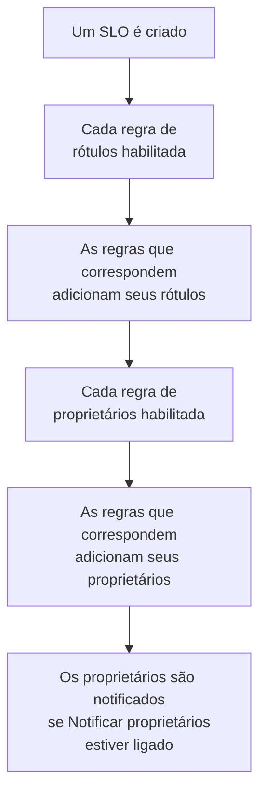

# Regras de rótulos e proprietários

As regras de rótulos e as regras de proprietários organizam seus SLOs por você. Uma **regra de rótulos** adiciona rótulos a cada SLO novo que corresponde a ela, e uma **regra de proprietários** adiciona usuários e equipes como proprietários: assim, um SLO novo de checkout recebe o rótulo _Checkout_ e pertence à equipe de checkout sem que ninguém precise se lembrar disso. As duas funcionam como as regras de rótulos e proprietários de qualquer outro produto: veja [Regras de rótulos e proprietários](/docs/configuration/label-and-owner-rules) para o que elas têm em comum.

## Como funciona

As regras são executadas quando um SLO é criado, pelo painel ou pela API. As regras de rótulos rodam primeiro, para que uma regra de proprietários possa corresponder a um rótulo que uma regra de rótulos acabou de adicionar.

Os dois tipos valem para o projeto inteiro. Você os encontra no menu lateral da lista de SLOs, em **Configurações**: **Regras de Rótulos** e **Regras de proprietário**. A seção **Configurações** começa recolhida; clique no título dela para abri-la.

## Criar uma regra

:::steps
### Abrir a lista de regras

Abra **SLOs**, depois **Configurações** → **Regras de Rótulos** ou **Configurações** → **Regras de proprietário** no menu lateral, e clique em **Criar: SLO Label Rule** ou **Criar: SLO Owner Rule**.

### Escolher a que a regra corresponde

Na etapa **Corresponder**, clique em **Adicionar condição** para cada condição que um SLO precisa atender (veja [Critérios de correspondência](#critérios-de-correspondência)). Com duas ou mais, escolha **Corresponder a todas** ou **Corresponder a qualquer**. Uma regra sem condições corresponde a todo SLO novo.

### Escolher o que a regra adiciona

A segunda etapa de uma regra de rótulos é **Rótulos**, onde você escolhe os **Rótulos a Adicionar**. A de uma regra de proprietários é **Proprietários**, onde você escolhe os **Proprietários** a adicionar — pessoas e equipes, escolhidas em uma única lista com **Adicionar proprietário**. Uma regra precisa adicionar pelo menos um rótulo ou um proprietário.

### Conferir o nome e os campos recolhidos

O **Nome** é preenchido a partir do que você escolhe, como _Adicionar Checkout, Production_ ou _Adicionar Checkout team como proprietários_, e acompanha suas escolhas até você digitar um nome seu. **Mais campos** guarda a **Descrição** opcional e, em uma regra de proprietários, **Notificar proprietários**.

### Salvar a regra

Clique de novo em **Criar: SLO Label Rule** ou **Criar: SLO Owner Rule** na última etapa. A regra começa habilitada.
:::

**Notificar proprietários** (em **Mais campos**) fica ligado por padrão: os proprietários que uma regra de proprietários adiciona recebem a mesma notificação "você foi adicionado como proprietário" que um proprietário adicionado à mão. Desligue para adicionar proprietários sem avisá-los.

Para pausar uma regra sem excluí-la, desligue **Habilitado** no formulário de edição dela. O formulário de edição nunca exige rótulos ou proprietários: uma regra mais antiga que não adiciona nada ainda pode ser renomeada, desligada ou excluída, e a lista a marca com **Não adiciona nada**.

Quando uma regra corresponde a um SLO:

- Uma regra de rótulos adiciona cada rótulo de **Rótulos a Adicionar**. Os rótulos que o SLO já tem não são adicionados duas vezes, e quando várias regras correspondem, o SLO recebe os rótulos de todas elas.
- Uma regra de proprietários adiciona como proprietário cada usuário e equipe da regra. Os proprietários que o SLO já tem são ignorados, e quando várias regras correspondem, o SLO recebe os proprietários de todas elas. Um usuário que não é mais membro do projeto, ou uma equipe de outro projeto, nunca é adicionado; os outros proprietários da regra são.

Os proprietários de um SLO são as pessoas que ficam sabendo das mudanças de status dele: veja [Orçamentos de erros](/docs/slo/error-budget).

## Critérios de correspondência

Cada condição compara um campo do SLO:

| Campo | Comparado com | Operadores |
| --- | --- | --- |
| **Rótulos do SLO** | Os rótulos do SLO. | **Tem algum de**, **Tem todos os**, **Não tem nenhum de** |
| **Nome do SLO** | O nome do SLO. | **Contém**, **Não contém**, **Igual a**, **Diferente de**, **Começa com**, **Termina com**, **Corresponde ao padrão**, **Não corresponde ao padrão** |
| **Descrição do SLO** | A descrição do SLO. | Os mesmos de **Nome do SLO** |

Uma condição nova de nome ou descrição começa em **Contém**. Um padrão é uma expressão regular, como `^checkout-.*`, ou um curinga `*`, como `*checkout*`, e não diferencia maiúsculas de minúsculas. Um padrão que não é nenhum dos dois, como `checkout-(01`, é recusado ao salvar, em vez de não corresponder a nada sem avisar.

| Você quer | Condições |
| --- | --- |
| Todo SLO do serviço de checkout | **Nome do SLO** contém `checkout` |
| Todo SLO de produção | **Rótulos do SLO** tem algum de _Production_ |
| Os SLOs de checkout, mas não os de staging | **Corresponder a todas**: **Nome do SLO** contém `checkout`, e **Rótulos do SLO** não tem nenhum de _Staging_ |

## Quando as regras são executadas

- **Quando um SLO é criado**, pelo painel ou pela API: cada regra de rótulos habilitada, depois cada regra de proprietários habilitada.
- **Quando você executa uma regra** com **Run Now**: veja abaixo.

Editar um SLO não aplica as regras de novo, e uma regra nunca remove nada: nem rótulos ou proprietários que alguém adicionou à mão, nem os que ela mesma adicionou. Uma regra desligada não faz nada.

## Executar uma regra em SLOs existentes

Uma regra que você escreve hoje vale para os SLOs criados depois dela. Para aplicá-la aos SLOs que você já tem, clique em **Run Now** na linha da regra, ou em **Visualizar** e depois em **Run Now** na página da regra. Você também pode selecionar várias regras e executá-las pelas ações em massa da tabela.

Uma execução verifica cada SLO do projeto, inclusive os arquivados, e informa a quantos correspondeu e quantos mudou. Os proprietários que uma execução adiciona só são notificados quando você escolhe notificá-los na caixa de diálogo da execução e a regra tem **Notificar proprietários** ligado. Veja [Executar regras em recursos existentes](/docs/configuration/run-rules-now).

As regras de rótulos também podem ser copiadas entre projetos: veja [Importar e exportar regras de rótulos](/docs/configuration/label-rule-import-export).

## Histórico

Sempre que uma regra muda um SLO, o **Feed** do SLO registra quais regras fizeram isso. Cada proprietário que uma regra adiciona também recebe seu próprio item "adicionado como proprietário" no feed, então o feed diz quem foi adicionado e por quê. Veja [Feed e registros de auditoria de SLO](/docs/slo/feed-and-audit-logs).

## Permissões

| Para | Você precisa de |
| --- | --- |
| Trabalhar com regras de rótulos | **Create SLO Label Rule**, **Edit SLO Label Rule**, **Delete SLO Label Rule** ou **Read SLO Label Rule** |
| Trabalhar com regras de proprietários | **Create SLO Owner Rule**, **Edit SLO Owner Rule**, **Delete SLO Owner Rule** ou **Read SLO Owner Rule** |
| Executar uma regra de rótulos | **Edit SLO Label Rule** e **Edit Service Level Objective** |
| Executar uma regra de proprietários | **Edit SLO Owner Rule**, **Edit Service Level Objective**, **Create SLO User Owner** e **Create SLO Team Owner** |

Essas permissões ficam no grupo SLO de uma função, e as funções Project Owner e Project Admin têm todas elas. Uma execução muda cada SLO do projeto, então uma permissão limitada a alguns rótulos, ou aos SLOs dos quais você é proprietário, não basta para executar uma regra.

## Próximos passos

:::cards
- [Regras de rótulos e proprietários](/docs/configuration/label-and-owner-rules): Como funcionam as regras de rótulos e proprietários de cada produto.
- [Executar regras em recursos existentes](/docs/configuration/run-rules-now): Como Run Now funciona para cada tipo de regra.
- [Visão geral dos SLOs](/docs/slo/introduction): Cada página que um SLO tem, e a lista de SLOs.
:::
