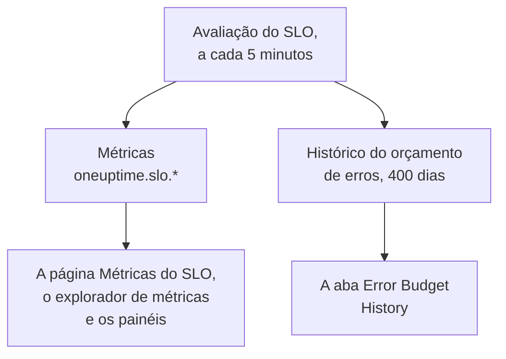

# Métricas e painéis de SLO

Toda vez que o OneUptime avalia um SLO, a cada 5 minutos, ele grava os resultados como métricas chamadas `oneuptime.slo.*`. Elas ficam no mesmo armazenamento de métricas que as métricas dos seus monitores, então você pode colocar um SLO em gráfico na página **Métricas** dele, abri-lo no explorador de métricas e colocá-lo em qualquer painel, filtrado e agrupado como qualquer outra série.

:::cards
- [As métricas](#as-métricas): Seis séries, suas unidades e como agregá-las.
- [A página Métricas](#a-página-métricas): Os gráficos, o histórico e as métricas de incidentes e alertas de um SLO.
- [SLOs em painéis](#slos-em-painéis): O widget de SLO e o modelo SLO Dashboard.
:::

## Como funciona

## As métricas

| Métrica | Unidade | Agregação | O que contém |
| --- | --- | --- | --- |
| `oneuptime.slo.sli.percent` | `%` | Avg | O SLI na janela de conformidade do SLO: a parcela do tempo medido que foi boa. |
| `oneuptime.slo.target.percent` | `%` | Avg | A meta do SLO, publicada a cada avaliação para que um gráfico possa desenhá-la sobre o SLI. |
| `oneuptime.slo.error.budget.remaining.percent` | `%` | Avg | Parcela do orçamento de erros ainda não gasta na janela. Negativa quando o orçamento foi ultrapassado. |
| `oneuptime.slo.error.budget.remaining.seconds` | `seconds` | Avg | Indisponibilidade que o SLO ainda pode absorver antes de ser violado. Negativa quando o orçamento foi ultrapassado. |
| `oneuptime.slo.burn.rate` | `x` | Max | A velocidade com que o orçamento é gasto, nos últimos 60 minutos. 1x gasta o orçamento exatamente ao longo da janela. |
| `oneuptime.slo.status` | — | Max | O status do SLO em cada avaliação: `0` é Íntegro, `1` é At Risk, `2` é Budget Exhausted. |

A agregação é como os gráficos do próprio SLO e o modelo SLO Dashboard combinam os pontos que caem em um mesmo intervalo do gráfico. Porcentagens e durações são calculadas pela média. A taxa de consumo e o status usam o máximo, para que um pico curto de consumo ou uma passagem rápida por Budget Exhausted não se perca na média.

Para um SLO no modo **Monitor Seconds Average**, `oneuptime.slo.error.budget.remaining.seconds` conta segundos-monitor somados entre os monitores dele, assim como o orçamento de erros: veja [Orçamentos de erros](/docs/slo/error-budget).

### Quando nenhum ponto é gravado

- Um SLO desligado ou arquivado não é avaliado, então não publica nada.
- Um SLO **Pausado** ou **Misconfigured** não mede nada, então publica só `oneuptime.slo.target.percent`, que é configuração e não uma medição. Os gráficos de SLI, orçamento, taxa de consumo e status dele mostram uma lacuna.
- Um valor que não é um número real, como uma taxa de consumo em uma janela sem dados, é ignorado, nunca gravado como 0.

### Atributos

Cada ponto carrega estes atributos:

| Atributo | Valor |
| --- | --- |
| `sloId` | ID do SLO. As páginas do próprio SLO filtram por ele, então renomear um SLO nunca divide os gráficos dele. |
| `sloName` | Nome do SLO quando o ponto foi gravado. |
| `projectId` | ID do projeto. |
| `oneuptime.label.<key>` | Um atributo por rótulo do SLO. Um rótulo chamado `Tier 1` vira `oneuptime.label.tier_1` = `true`, e um rótulo chamado `product:checkout` vira `oneuptime.label.product` = `checkout`. As chaves ficam em minúsculas, com espaços e pontuação transformados em `_`. |

As séries pertencem ao SLO, não a algum dos monitores dele, e não contam como uso de telemetria.

As métricas de incidentes e alertas carregam dois atributos correspondentes, `serviceLevelObjectiveIds` e `serviceLevelObjectiveNames`: listas separadas por vírgulas dos SLOs que o incidente ou o alerta afeta.

### Retenção

As métricas `oneuptime.slo.*` são mantidas pelo mesmo tempo que as métricas de monitores: **30 dias** por padrão. Em uma instalação auto-hospedada, um administrador master pode mudar isso com **Monitor Metric Retention (Days)** nas configurações de **Retenção de dados** do Admin Dashboard.

Isso não limita a aba **Error Budget History** da página **Métricas** do SLO. Esse histórico é guardado separadamente e mantido por 400 dias.

## A página Métricas

A página **Métricas** de um SLO tem quatro abas:

| Aba | O que mostra |
| --- | --- |
| **SLO Metrics** | As séries `oneuptime.slo.*` em três cartões que compartilham um intervalo de tempo, o último dia por padrão: **Objective** (o SLI com a meta por cima, e o orçamento restante), **Burn** (taxa de consumo e tempo de orçamento restante) e **Status**. |
| **Error Budget History** | O SLI, o orçamento restante e a taxa de consumo ao longo do histórico de longo prazo, com linhas na meta, nos limites de risco e de esgotamento, e no limite de cada regra de taxa de consumo habilitada. |
| **Métricas de incidente** | A contagem, o tempo até o reconhecimento, o tempo até a resolução e a duração dos incidentes que afetam este SLO, a última semana por padrão. Os incidentes declarados pelas regras de taxa de consumo dele estão incluídos. |
| **Métricas de alerta** | O mesmo para alertas. Os alertas gerados pelas regras de taxa de consumo dele estão incluídos. |

As abas **SLO Metrics**, **Métricas de incidente** e **Métricas de alerta** leem o armazenamento de métricas, o que exige permissão para ler telemetria. Uma função personalizada que pode ler SLOs, mas não telemetria, vê essas abas vazias, enquanto **Error Budget History** continua funcionando.

## SLOs em painéis

### Colocar qualquer métrica de SLO em gráfico

:::steps
#### Adicionar um gráfico

No modo de edição de um painel, adicione um widget de gráfico ou de valor e escolha uma das métricas `oneuptime.slo.*`.

#### Agrupar ou filtrar

Agrupe por `sloName` e `sloId` para ter uma linha por SLO; `sloId` separa dois SLOs que têm o mesmo nome. Ou filtre por `sloName`, ou por um atributo `oneuptime.label.*`.

#### Escolher a agregação

Use a agregação da tabela acima: Avg para as porcentagens e durações, Max para a taxa de consumo e o status.
:::

### O widget de SLO

O [widget de SLO](/docs/dashboards/widgets#slo) mostra o SLI, o orçamento restante ou a taxa de consumo de um SLO como bloco ou gráfico. Ele obtém o SLO de uma de duas formas:

| Configuração | Como se comporta |
| --- | --- |
| **Service Level Objective** | Fixa o widget em um SLO. O seletor lista os SLOs que não estão arquivados. |
| **Follow SLO Variable** | Mostra o SLO escolhido em uma variável do painel: uma variável **Telemetry Attribute** na chave `sloName`. É ignorado enquanto um SLO estiver fixado. |

Em um [painel público](/docs/dashboards/sharing), um widget que segue uma variável permite que os visitantes escolham pelo nome qualquer SLO não arquivado do projeto. Um widget fixado só mostra o próprio SLO, e continua mostrando os últimos números de um SLO arquivado depois.

### O modelo SLO Dashboard

Ao criar um painel, escolha o modelo **SLO Dashboard** para ter um painel pronto com todos os SLOs do projeto, em três faixas:

1. **Service Level Objectives**: uma lista de cada SLO não arquivado, com status, SLI em relação à meta, barra de orçamento e taxa de consumo, e uma contagem de SLOs por status. Os SLOs habilitados vêm primeiro, o de menor orçamento antes; um SLO desligado vem por último como **Desabilitado**, com os últimos números em cinza.
2. **Error Budget & Burn Rate**: os blocos **Lowest Error Budget Remaining**, **Least Error Budget Time Left** e **Peak Burn Rate**, e os gráficos **Error Budget Remaining by SLO** e **Burn Rate by SLO** com uma linha por SLO, agrupados por `sloName` e `sloId`.
3. **Selected SLO**: os blocos **SLI**, **Error Budget Remaining** e **Burn Rate** e os gráficos **SLI History**, **Error Budget History** e **Burn Rate History** de um SLO.

Uma variável de SLO na barra de ferramentas define o escopo do painel inteiro. É uma variável Telemetry Attribute em `sloName`, então as opções dela são os nomes de SLO encontrados nas métricas. Escolher um SLO restringe a lista a ele, limita os gráficos e blocos da faixa e preenche os widgets de **Selected SLO**, que seguem a variável. Até você escolher um, eles pedem que você escolha um SLO na barra de ferramentas.

## Solução de problemas

:::details Um SLO não aparece no seletor de SLO da barra de ferramentas
O seletor lista os nomes de SLO publicados no último dia. Um SLO novo aparece depois da primeira avaliação; um SLO **Pausado** ou **Misconfigured** continua disponível porque ainda publica a meta; um SLO desligado ou arquivado sai da lista cerca de um dia depois do último ponto.
:::

:::details Escolher um nome mostra dois SLOs
Dois SLOs têm esse nome. A lista e os gráficos mostram os dois, e os widgets de **Selected SLO** dizem que o nome é ambíguo. Dê nomes diferentes aos SLOs.
:::

:::details A aba SLO Metrics está vazia
Sua função não pode ler telemetria, ou o SLO ainda não foi avaliado. **Error Budget History** lê o próprio SLO e continua funcionando.
:::

## Próximos passos

:::cards
- [Widgets de painel](/docs/dashboards/widgets): Cada widget, incluindo o widget de SLO.
- [Variáveis de painel](/docs/dashboards/variables): Defina o escopo de um painel inteiro com um só seletor.
- [Orçamentos de erros](/docs/slo/error-budget): O que os números do orçamento significam.
:::
