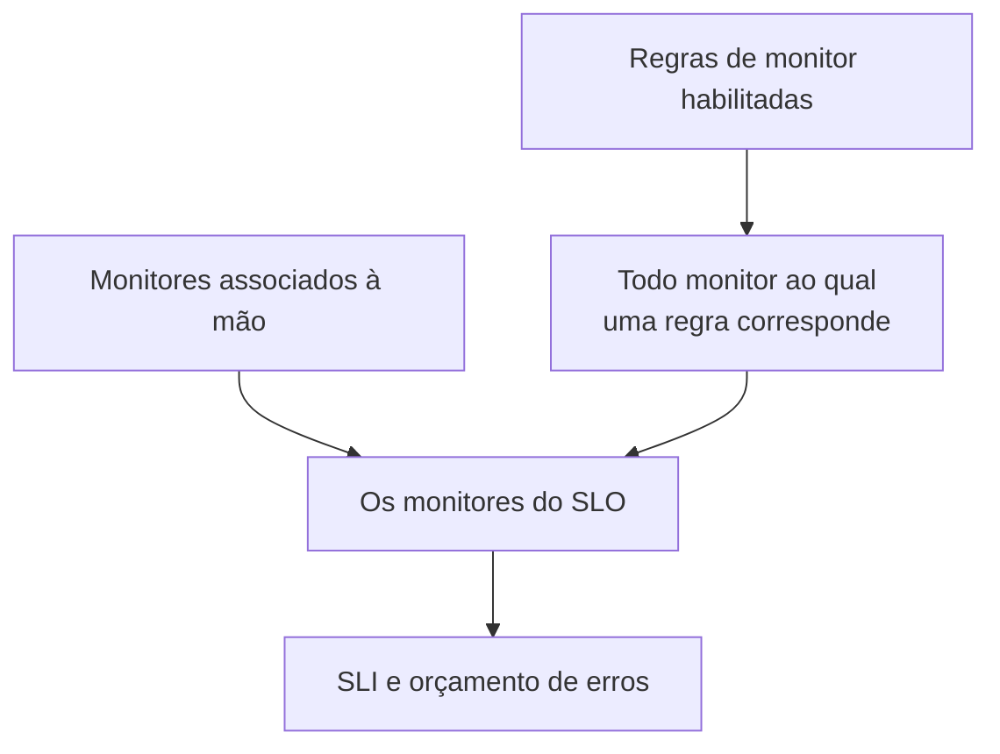

# Monitores e regras de monitor

Um SLO mede a disponibilidade dos monitores associados a ele. Associe-os à mão, deixe que regras de monitor associem cada monitor que corresponde, ou faça as duas coisas. Esta página trata das páginas **Monitores** e **Monitor Rules** de um SLO, ambas em **Configuração** no menu lateral dele.

:::cards
- [Escolher monitores à mão](#associar-monitores-à-mão): Ideal para um conjunto pequeno e fixo.
- [Associar monitores com uma regra](#associar-monitores-com-uma-regra): "Todo monitor com o rótulo Production", mantido em dia para você.
- [Critérios de correspondência](#critérios-de-correspondência): Os campos e operadores em que uma regra pode se basear.
:::

## Quais monitores um SLO mede

Um SLO mede a união dos monitores que você associou à mão e de todo monitor ao qual pelo menos uma das suas regras de monitor habilitadas corresponde.

Um SLO novo não tem monitores, porque o formulário de criação não pede nenhum. Enquanto não tiver um, ele não pode ser avaliado: suas páginas mostram **No monitors attached**, e a **Visão geral** dele oferece as duas formas de associar monitores.

## Associar monitores à mão

Você precisa de permissão para editar o SLO.

:::steps
### Abrir a página Monitores

Abra o SLO e vá para **Monitores**.

### Escolher os monitores

Clique em **Add Monitors** e escolha monitores do projeto. Só aparecem os monitores que ainda não estão associados.

### Salvar a lista

Clique em **Add Monitors**. Os monitores aparecem na lista com a origem **Manual** e contam para o SLI a partir da avaliação seguinte.
:::

Para tirar um monitor do SLO, clique em **Remover** na linha dele. O monitor em si não muda; ele só deixa de contar para o SLI e o orçamento de erros do SLO.

A página **Monitores** mostra, para cada monitor:

| Coluna | O que mostra |
| --- | --- |
| **Status Atual** | O status atual do monitor, ou **Arquivado**, **Desabilitado**, **Sondas não habilitadas**, **Sondas desconectadas** ou **Desconhecido** quando ele não está sendo verificado ou ainda não informou nada. |
| **Origem** | **Rule** se uma das regras de monitor do SLO o associou, **Manual** se alguém o associou à mão. |
| **Rótulos** | Os rótulos do monitor. |

## Associar monitores com uma regra

Uma regra de monitor descreve os monitores que um SLO deve medir, como "todo monitor com o rótulo Production" ou "todo monitor cujo nome começa com api-". Cada monitor que corresponde é associado, agora e sempre que monitores são criados ou mudam, para que ninguém precise se lembrar do monitor que alguém vai adicionar no mês que vem.

:::steps
### Abrir Monitor Rules

Abra o SLO, vá para **Monitor Rules** e clique em **Criar: SLO Monitor Rule**.

### Dar um nome à regra

Em **Informações básicas**, informe um **Nome** e, se quiser, uma **Descrição** de por que esses monitores pertencem a este SLO.

### Escolher a que ela corresponde

Em **Critérios de Correspondência**, clique em **Adicionar condição**, escolha um campo e um operador, e informe ou escolha o valor. Com duas ou mais condições, escolha **Corresponder a todas** ou **Corresponder a qualquer**. Uma regra de monitor precisa de pelo menos uma condição.

### Salvar a regra

Clique em **Criar: SLO Monitor Rule**. A regra começa habilitada e os monitores do SLO são reavaliados na hora: cada monitor que corresponde é associado com a origem **Rule**.
:::

A tabela de regras mostra, para cada regra, o nome, os critérios de correspondência por extenso e se ela está habilitada. Para pausar uma regra, desligue **Habilitado** no formulário de edição dela. **View Monitors** abre a página **Monitores** do SLO.

### Critérios de correspondência

Cada condição compara um campo de um monitor:

| Campo | Comparado com | Operadores |
| --- | --- | --- |
| **Rótulos do Monitor** | Os rótulos do monitor. | **Tem algum de**, **Tem todos os**, **Não tem nenhum de** |
| **Tipo de monitor** | O tipo do monitor, escolhido na lista de tipos. | **Igual a**, **Diferente de** |
| **Nome do Monitor** | O nome do monitor. | **Contém**, **Não contém**, **Igual a**, **Diferente de**, **Começa com**, **Termina com**, **Corresponde ao padrão**, **Não corresponde ao padrão** |
| **Descrição do Monitor** | A descrição do monitor. | Os mesmos de **Nome do Monitor** |

Um padrão é uma expressão regular, como `^api-.*`, ou um curinga `*`, como `*checkout*`, e não diferencia maiúsculas de minúsculas. Um padrão que não é nenhum dos dois, como `api-(01`, é recusado ao salvar, em vez de não corresponder a nada sem avisar. Para associar todos os monitores do projeto, adicione uma condição em **Nome do Monitor** que corresponde ao padrão `.*`.

| Você quer | Condições |
| --- | --- |
| Todo monitor de produção | **Rótulos do Monitor** tem algum de _Production_ |
| Todo monitor de API | **Tipo de monitor** igual a _API_ |
| Todo monitor, menos os manuais | **Tipo de monitor** diferente de _Manual_ |
| Todo monitor cujo nome começa com api- | **Nome do Monitor** corresponde ao padrão `^api-` |
| Os monitores de checkout, mas não os de staging | **Corresponder a todas**: **Nome do Monitor** corresponde ao padrão `*checkout*`, e **Rótulos do Monitor** não tem nenhum de _Staging_ |

### Quando as regras são executadas

- Quando você cria, edita, liga, desliga ou exclui uma regra, os monitores do SLO são reavaliados na hora.
- Quando um monitor é criado, ou seus rótulos, nome ou descrição mudam, todas as regras de monitor do projeto o verificam, inclusive os rótulos que suas regras de rótulos de monitor dão a ele.
- Quando um rótulo é excluído, os SLOs cujas regras o usavam são reavaliados.
- As regras mantêm a lista de monitores de um SLO atualizada mesmo enquanto o SLO está desligado ou arquivado, então ele retoma com os monitores certos.

As regras se ressincronizam a cada salvamento, então **Run Now** serve para colocar em dia o que o SLO deixou passar. Ele está em cada linha, na página da regra (**Visualizar**) e nas ações em massa da tabela. Executar uma regra reavalia todas as regras de monitor habilitadas do SLO juntas, e depois a caixa de diálogo diz quantos monitores foram associados e desassociados. Executar uma regra exige permissão para editar as regras de monitor de SLO. Veja [Executar regras em recursos existentes](/docs/configuration/run-rules-now).

### Quais monitores pertencem a uma regra

- Um monitor fica associado enquanto uma regra habilitada corresponder a ele, e é desassociado assim que nenhuma corresponde mais.
- Desligar ou excluir uma regra desassocia só os monitores aos quais nenhuma outra regra habilitada ainda corresponde.
- As regras desassociam só os monitores que uma regra associou. Um monitor associado à mão nunca é tomado por uma regra que por acaso corresponde a ele, nem desassociado quando deixa de corresponder. A origem dele continua **Manual**.

## Escolher à mão com regras ligadas

Enquanto pelo menos uma regra estiver habilitada, são as regras que gerenciam os monitores do SLO:

- não é possível adicionar monitores à mão: **Add Monitors** fica desativado, e um banner diz **This SLO's monitors are managed by its monitor rules**, com um link **Manage Monitor Rules**;
- os monitores que uma regra associou não podem ser removidos à mão, porque a regra os associaria de novo: o botão **Remover** deles fica bloqueado e a dica explica o motivo;
- os monitores associados à mão antes de as regras serem ligadas ainda podem ser removidos.

Isso vale também para a API. Desligue todas as regras para voltar a escolher os monitores você mesmo.

## Os SLOs para os quais um monitor conta

A página de um monitor lista os SLOs que o medem: abra o monitor e vá para **SLOs** no menu lateral dele. Confira essa página antes de pausar ou mudar um monitor, para ver quais metas dependem dele. Os SLOs arquivados não aparecem, porque não são avaliados.

## Vindo de Auto-Add Monitors With Labels

Versões anteriores tinham uma configuração **Auto-Add Monitors With Labels** no formulário do SLO. Na atualização, cada SLO que a usava recebe uma regra de monitor habilitada chamada **Auto-add monitors with labels** que corresponde aos mesmos rótulos, então ele continua medindo exatamente os mesmos monitores. O campo `monitorLabels` da API de SLO está obsoleto: use as regras de monitor de SLO no lugar dele.

:::details E se algo ainda salvar a configuração antiga?
Uma aba do painel aberta antes da atualização, ou um cliente de API ou workflow escrito para a versão anterior, ainda pode salvar a configuração antiga. Para que um SLO não perca monitores sem avisar dessa forma:

- **Um SLO sem regras de monitor** transforma os rótulos salvos em uma regra **Auto-add monitors with labels**, e seus monitores são reavaliados na hora. Salvar uma lista vazia desassocia os monitores que a configuração tinha associado, como antes.
- **Um SLO que tem regras de monitor**, ligadas ou não, ignora os rótulos salvos pela configuração antiga, porque são as regras dele que decidem o que ele mede.
- **Criar a primeira regra de monitor** de um SLO cujos monitores tinham sido associados pela configuração antiga converte primeiro a configuração em uma regra, então a nova regra é adicionada ao lado em vez de substituí-la.

Uma regra convertida que você exclui continua excluída, a menos que os monitores dela ainda estejam associados depois, por exemplo porque um servidor que ainda roda a versão anterior os associou de novo durante a atualização: a próxima alteração de monitor ou a próxima regra nova converte os rótulos outra vez. Exclua essa regra de novo quando a atualização terminar.
:::

## Histórico

Cada associação e desassociação, e cada regra criada, editada ou excluída, aparece no **Feed** do SLO. As mudanças nas regras também são registradas nos **Registros de auditoria** dele. Veja [Feed e registros de auditoria de SLO](/docs/slo/feed-and-audit-logs).

## Solução de problemas

:::details Add Monitors está desativado
Pelo menos uma das regras de monitor do SLO está habilitada, então são as regras que gerenciam os monitores dele. Mude as regras, ou desligue todas para escolher os monitores à mão.
:::

:::details O botão Remover de um monitor está bloqueado
Uma regra de monitor associou esse monitor e o associaria de novo. Mude ou desligue a regra que corresponde a ele.
:::

:::details Um monitor ao qual uma regra deveria corresponder não está associado
Confira se a regra está habilitada e se cada condição é atendida com **Corresponder a todas**. Os rótulos que uma regra de rótulos de monitor adiciona também contam. Clique em **Run Now** na regra para ressincronizar o SLO.
:::

:::details Salvar uma regra falha com um erro de padrão
O valor não é nem uma expressão regular nem um curinga `*`, por exemplo por causa de um parêntese não fechado. Corrija o padrão, ou use **Contém**.
:::

## Próximos passos

:::cards
- [Visão geral dos SLOs](/docs/slo/introduction): Como a indisponibilidade de vários monitores é combinada.
- [Orçamentos de erros](/docs/slo/error-budget): O que a indisponibilidade dos monitores consome.
- [Executar regras em recursos existentes](/docs/configuration/run-rules-now): Como Run Now funciona para cada tipo de regra.
:::
