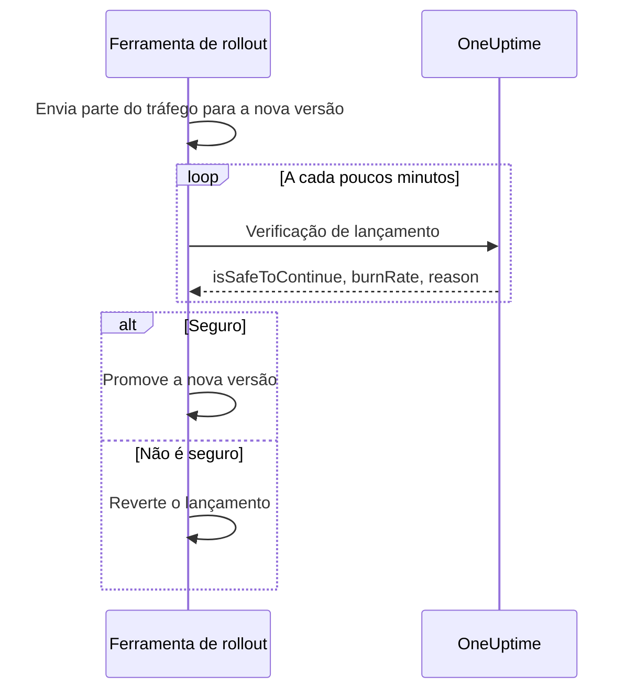

# Verificações de lançamento

Uma verificação de lançamento pergunta a um SLO "é seguro continuar liberando esta versão?" enquanto o lançamento está em andamento, e responde com base na velocidade com que o SLO consumiu o orçamento de erros nos últimos minutos. O Argo Rollouts, o Flagger ou um pipeline de implantação faz essa pergunta enquanto um canário recebe tráfego, e reverte o lançamento quando a resposta é não. O OneUptime não implanta nada por conta própria: sua ferramenta de rollout continua fazendo o rollout, e o OneUptime diz a ela como o lançamento está indo.

:::cards
- [Consultar a verificação](#consultar-a-verificação): Uma requisição com uma chave de API, e o que ela responde.
- [Argo Rollouts](#argo-rollouts): Uma análise que aborta o rollout.
- [Flagger](#flagger): Um webhook que interrompe o canário.
- [GitHub Actions](#github-actions): Uma etapa que reverte o lançamento depois de uma implantação.
:::

## Como funciona

O [bloqueio de implantações](/docs/slo/error-budget-policy#bloqueio-de-implantações) responde antes de um lançamento, a partir do orçamento de erros de toda a janela de conformidade. Um lançamento que quebra algo gastou quase nada do orçamento de um mês nos primeiros dez minutos, então a verificação de lançamento lê o que o lançamento muda: a taxa de consumo nos últimos minutos.



A verificação responde com um de três vereditos:

| Veredito | Quando | `isSafeToContinue` |
| --- | --- | --- |
| `Pass` | A janela consumiu o orçamento de erros a `maxBurnRate` ou mais devagar. | `true` |
| `Fail` | Ela consumiu mais rápido, ou a política de orçamento de erros do SLO congela as implantações. | `false` |
| `NotEnoughData` | A janela teve menos requisições que `minimumRequestCount`, ou os monitores do SLO não registraram nenhum status nela. É pouco demais para considerar o lançamento seguro. | `false` |

Com uma taxa de consumo de 1, a janela atingiu exatamente a meta do SLO, então o `maxBurnRate` padrão de `1` reprova um lançamento que se sai pior que a meta.

O que a verificação lê depende do que o SLO mede:

- Um [SLO de requisições](/docs/slo/request-slos) é julgado pelas requisições dos seus serviços na janela, lidas dos spans delas à medida que chegam. Adicione `serviceVersion` para julgar só as requisições da nova versão: o OneUptime compara esse valor com o atributo de recurso `service.version` dos spans, que um SDK do OpenTelemetry define a partir de `OTEL_RESOURCE_ATTRIBUTES=service.version=1.4.2`. Assim, o canário é julgado pelas próprias requisições, sem ser diluído pelas da versão antiga.
- Um [SLO de métrica](/docs/slo/request-slos#slos-a-partir-de-uma-métrica) é julgado pelos eventos da sua métrica na janela, contados como o SLI dele os conta, então `minimumRequestCount`, `goodRequestCount` e `totalRequestCount` são eventos. Com `serviceVersion`, só contam os pontos da métrica cujo atributo de recurso `service.version` tem esse valor: um SDK do OpenTelemetry o define nas métricas dele assim como nos spans.
- Um SLO de disponibilidade dos monitores é julgado pelas linhas do tempo de status dos seus monitores na janela. `minimumRequestCount` não se aplica a ele, e uma verificação com `serviceVersion` é recusada: monitores não têm versões.

## Antes de começar

Você precisa de um SLO que meça o que o lançamento afeta. Um SLO de requisições do serviço que você lança é o que melhor julga um canário, porque lê as requisições do próprio serviço.

## Configurar uma verificação de lançamento

:::steps
### Dar uma chave ao rollout

Crie uma [chave de API](/docs/api-reference/api-reference) do projeto cuja função possa ler SLOs e guarde-a como um segredo da sua ferramenta de rollout ou do seu pipeline.

### Copiar o ID do SLO

Abra o SLO e copie o ID dele do endereço: `/slos/<slo-id>`.

### Consultar a verificação uma vez à mão

Execute a requisição de [Consultar a verificação](#consultar-a-verificação) com a chave e o ID. Ela responde com `isSafeToContinue` e um `reason`.

### Adicioná-la ao seu rollout

Consulte a verificação a partir do [Argo Rollouts](#argo-rollouts), do [Flagger](#flagger) ou do [GitHub Actions](#github-actions), e reverta quando `isSafeToContinue` for `false`.
:::

## Consultar a verificação

A verificação é um `GET` ou um `POST` no endereço `release-check` do SLO. Envie as opções na query string, ou como um corpo JSON com `POST`:

```bash
curl -sS "https://oneuptime.com/api/service-level-objective/<slo-id>/release-check?windowInMinutes=10&serviceVersion=1.4.2" \
  -H "ApiKey: $ONEUPTIME_API_KEY"
```

A resposta traz primeiro o veredito e depois os dados de onde ele foi tirado:

```json
{
  "isSafeToContinue": false,
  "verdict": "Fail",
  "reason": "The last 10 minutes burned the error budget at 3.2x, faster than the 1x this check allows (SLI 99.68% against the 99.9% target).",
  "sloId": "<slo-id>",
  "sloName": "Checkout requests",
  "sliType": "Request Success",
  "targetPercentage": 99.9,
  "windowInMinutes": 10,
  "maxBurnRate": 1,
  "burnRate": 3.2,
  "sliPercentage": 99.68,
  "deploymentsAllowed": true,
  "errorBudgetPolicyTier": null,
  "sloStatus": "Healthy",
  "checkedAt": "2026-11-15T12:00:00.000Z",
  "goodRequestCount": 2492,
  "totalRequestCount": 2500,
  "minimumRequestCount": 1,
  "serviceVersion": "1.4.2"
}
```

As opções:

| Opção | Padrão | O que faz |
| --- | --- | --- |
| `windowInMinutes` | `10` | Até onde a verificação olha para trás, em minutos inteiros de 1 a 360. |
| `maxBurnRate` | `1` | A maior taxa de consumo que passa. `2` deixa a janela consumir o orçamento duas vezes mais rápido do que a meta permite. |
| `minimumRequestCount` | `1` | SLOs de requisições: o menor número de requisições que a verificação julga. Com `0`, uma janela sem requisições passa. |
| `serviceVersion` | Nenhum | SLOs de requisições: julga só as requisições cujos spans trazem este `service.version`. |
| `includeDeploymentGate` | `true` | Reprova enquanto a política de orçamento de erros do SLO congela as implantações. Com `false`, só a taxa de consumo decide. |
| `failWithStatusCode` | `false` | Responde um não com o status HTTP 412 em vez de 200, para ferramentas que leem só o código de status. |

Os campos da resposta:

| Campo | O que guarda |
| --- | --- |
| `isSafeToContinue` | `true` para seguir com o rollout, `false` para revertê-lo. |
| `verdict` | `Pass`, `Fail` ou `NotEnoughData`. |
| `reason` | Uma frase para o log do rollout, dizendo o que foi medido e por que a verificação respondeu assim. |
| `burnRate` e `sliPercentage` | A velocidade com que a janela consumiu o orçamento de erros, e o SLI na janela. |
| `goodRequestCount` e `totalRequestCount` | SLOs de requisições: as requisições que a janela teve, e quantas delas foram boas. |
| `deploymentsAllowed` e `errorBudgetPolicyTier` | Se a política de orçamento de erros do SLO permite implantações, e o nível em que ele está. |
| `checkedAt` | Quando a verificação foi medida. |

Um SLO que não pode ser medido (um SLO de requisições sem serviços, um SLO de latência sem limite, um SLO de métrica sem uma métrica que ele possa contar, um SLO de disponibilidade dos monitores sem monitores) recebe como resposta HTTP 400 e o que corrigir, para que um rollout pare em um erro claro, e não em um palpite. Em uma instalação auto-hospedada, use o endereço da própria instalação em vez de oneuptime.com.

## Argo Rollouts

Uma análise com uma métrica `web` consulta a verificação em cada etapa de um canário, e o Argo Rollouts aborta o rollout e reduz a escala do canário quando ela falha. Primeiro, guarde a chave de API como um segredo:

```bash
kubectl create secret generic oneuptime --from-literal=api-key="$ONEUPTIME_API_KEY"
```

Depois, adicione o modelo e execute-o após a primeira etapa do canário:

:::tabs
@tab AnalysisTemplate
```yaml title="oneuptime-release-check.yaml"
apiVersion: argoproj.io/v1alpha1
kind: AnalysisTemplate
metadata:
  name: oneuptime-release-check
spec:
  args:
    - name: version
    - name: api-key
      valueFrom:
        secretKeyRef:
          name: oneuptime
          key: api-key
  metrics:
    - name: slo-burn-rate
      interval: 2m
      count: 5
      failureLimit: 0
      successCondition: result == true
      provider:
        web:
          url: "https://oneuptime.com/api/service-level-objective/<slo-id>/release-check?windowInMinutes=10&serviceVersion={{args.version}}"
          headers:
            - key: ApiKey
              value: "{{args.api-key}}"
          jsonPath: "{$.isSafeToContinue}"
```
@tab Rollout
```yaml title="rollout.yaml"
apiVersion: argoproj.io/v1alpha1
kind: Rollout
metadata:
  name: checkout
spec:
  strategy:
    canary:
      steps:
        - setWeight: 10
        - analysis:
            templates:
              - templateName: oneuptime-release-check
            args:
              - name: version
                value: "1.4.2"
        - setWeight: 50
        - pause: { duration: 10m }
```
:::

A análise consulta cinco vezes, com dois minutos de intervalo, e o primeiro não aborta o rollout. Passe a mesma versão que os pods do canário definem em `OTEL_RESOURCE_ATTRIBUTES`. Se o canário puder ficar sem tráfego no primeiro peso, adicione `&minimumRequestCount=0` ao endereço; caso contrário, um canário sem tráfego reprova a análise com `NotEnoughData`.

## Flagger

O Flagger chama um webhook `rollout` em cada etapa da análise e interrompe e reverte o canário quando o webhook continua falhando. Os webhooks do Flagger não enviam cabeçalhos, então consulte a verificação pelo load tester do Flagger, que executa um comando para o webhook:

```yaml title="canary.yaml"
apiVersion: flagger.app/v1beta1
kind: Canary
metadata:
  name: checkout
spec:
  analysis:
    interval: 1m
    threshold: 2
    maxWeight: 50
    stepWeight: 10
    webhooks:
      - name: oneuptime-release-check
        type: rollout
        url: http://flagger-loadtester.test/
        timeout: 30s
        metadata:
          type: bash
          cmd: "curl -sSf -H \"ApiKey: $ONEUPTIME_API_KEY\" 'https://oneuptime.com/api/service-level-objective/<slo-id>/release-check?windowInMinutes=5&failWithStatusCode=true'"
```

Com `failWithStatusCode=true`, um não é HTTP 412, então o `curl -f` termina com erro e o webhook falha. Passe a chave ao load tester como `ONEUPTIME_API_KEY` no ambiente dele, a partir de um secret do Kubernetes. Quando `threshold` verificações tiverem falhado, o Flagger reverte o canário.

## GitHub Actions

Um pipeline que implanta tudo de uma vez ainda pode acompanhar o lançamento: implante, consulte a verificação algumas vezes e reverta quando ela disser não.

```yaml title=".github/workflows/deploy.yml"
name: Deploy
on:
  push:
    branches: [main]

jobs:
  deploy:
    runs-on: ubuntu-latest
    steps:
      - uses: actions/checkout@v4
      - name: Deploy
        run: ./deploy.sh
      - name: Watch the release against the SLO
        env:
          ONEUPTIME_API_KEY: ${{ secrets.ONEUPTIME_API_KEY }}
          SLO_ID: <slo-id>
          VERSION: ${{ github.sha }}
        run: |
          for attempt in 1 2 3 4 5; do
            sleep 120
            CHECK=$(curl -sS "https://oneuptime.com/api/service-level-objective/$SLO_ID/release-check?windowInMinutes=10&serviceVersion=$VERSION" \
              -H "ApiKey: $ONEUPTIME_API_KEY")
            echo "$CHECK" | jq -r '.reason'
            if [ "$(echo "$CHECK" | jq -r '.isSafeToContinue')" != "true" ]; then
              exit 1
            fi
          done
      - name: Roll back
        if: failure()
        run: ./rollback.sh
```

A etapa falha com um não, e com qualquer resposta sem `isSafeToContinue: true` (um ID errado, uma chave que não consegue ler o SLO, nenhuma resposta), então o pipeline nunca segue em frente com uma resposta que não recebeu. Defina `service.version` como o commit (`${{ github.sha }}`) quando o serviço iniciar, para que a verificação julgue só a nova versão.

## Próximos passos

:::cards
- [SLOs de requisições e latência](/docs/slo/request-slos): Meça as requisições de um serviço, o SLI que melhor julga um canário.
- [Política de orçamento de erros](/docs/slo/error-budget-policy): Congele as implantações enquanto o orçamento estiver baixo.
- [Alertas e incidentes de taxa de consumo](/docs/slo/burn-rate-alerts): Avise sua equipe quando o orçamento é consumido rápido demais.
:::
