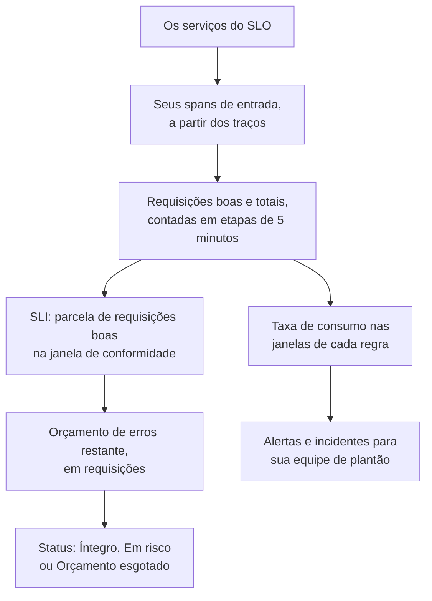

# SLOs de requisições e latência

Um SLO de requisições mede o que seus usuários recebem de um serviço: a parcela das requisições dele que têm sucesso, ou que são atendidas com rapidez suficiente. O OneUptime as conta a partir dos traços que seus serviços já enviam, então não há nenhum monitor para configurar: escolha os serviços e uma meta, e o OneUptime os mede a cada 5 minutos.

:::cards
- [Criar um SLO de requisições](#criar-um-slo-de-requisições): Os serviços, um limite para a latência e uma meta.
- [Contar só algumas requisições](#contar-só-algumas-requisições): Um endpoint, ou todas as requisições menos as verificações de saúde.
- [SLOs a partir de uma métrica](#slos-a-partir-de-uma-métrica): Um contador ou um histograma, para serviços que não enviam traços.
- [Como as requisições são contadas](#como-as-requisições-são-contadas): Quais spans contam, e quando.
- [Verificações de lançamento](/docs/slo/release-checks): Reverta um lançamento que consome o orçamento de erros.
:::

## Sucesso e latência das requisições

| O que mede | Uma requisição é ruim quando | O orçamento de erros conta |
| --- | --- | --- |
| **Sucesso das requisições** | O status do span dela é `Error`. Um span sem status conta como bom, como o OpenTelemetry o entende. | Requisições com falha |
| **Latência das requisições** | Ela levou mais tempo que o **Limite de latência (ms)** do SLO, seja qual for o status dela. | Requisições lentas |

O SLI é a parcela de requisições boas na janela de conformidade, e o orçamento de erros são as requisições ruins que a meta permite: com 99,9%, uma em cada 1.000. Um SLO de latência conta como boa uma requisição que falhou rápido, então meça um serviço importante das duas formas: um SLO de que ele funciona e outro de que ele é rápido.

## Como funciona

Uma requisição é um span de entrada de um dos serviços do SLO: o span em que uma requisição ou uma mensagem entra no serviço, como a lista de [traços](/docs/telemetry/traces-explorer#traços-e-spans) os mostra por padrão. Uma requisição que passa por dois dos serviços do SLO conta uma vez em cada um.

A partir daí, um SLO de requisições funciona como qualquer outro. O status, as regras de taxa de consumo, a política de orçamento de erros, os proprietários e as notificações são os mesmos, com o orçamento de erros em requisições em vez de minutos.

## Antes de começar

- Os serviços enviam traços ao OneUptime: veja [OpenTelemetry](/docs/telemetry/open-telemetry). Cada um aparece no [catálogo de serviços](/docs/telemetry/services) com o seu `service.name`.
- Uma função que possa criar SLOs: Proprietário do projeto, Administrador do projeto ou uma função personalizada com a permissão Create Service Level Objective.

## Criar um SLO de requisições

:::steps
### Abrir os SLOs

Abra **SLOs** no menu **Produtos** da barra superior e clique em **Criar: Objetivo de nível de serviço**.

### Escolher o que ele mede

Em **O que mede**, escolha **Sucesso das requisições** ou **Latência das requisições** e, depois, os **Serviços** cujas requisições ele conta. Para **Latência das requisições**, defina também o **Limite de latência (ms)**: uma requisição atendida dentro dele conta como rápida o suficiente, por exemplo `300`. Para contar só algumas das requisições deles, informe um **Filtro de requisições**: veja [Contar só algumas requisições](#contar-só-algumas-requisições). Clique em **Próximo**.

### Dar um nome e definir uma meta

Informe um **Nome**, por exemplo "Checkout requests", e uma **Meta (%)**: a parcela das requisições que precisa ser boa. Clique em **Criar: Objetivo de nível de serviço**.

### Ver os primeiros números chegarem

A primeira avaliação, em até 5 minutos, conta as requisições das últimas 6 horas, então o SLO já tem números logo de início. As avaliações seguintes contam também requisições mais antigas, até cobrir a janela de conformidade.
:::

A página **SLOs** de um serviço lista os SLOs que o medem, e o seu **Criar: Objetivo de nível de serviço** abre o mesmo formulário com o serviço já escolhido. Para mudar depois o que um SLO mede, os serviços dele, o limite ou o filtro, abra as **Configurações** dele e clique em **Editar o que mede**.

## Contar só algumas requisições

Um SLO de requisições conta todas as requisições dos seus serviços. Um **Filtro de requisições** conta só as que importam, como o endpoint de checkout, ou deixa algumas de fora, como as verificações de saúde, que fariam o SLI parecer melhor do que o que os usuários recebem. Escreva-o como uma pesquisa de traços, na mesma [sintaxe de pesquisa](/docs/telemetry/search-syntax#correspondência-de-valores) do explorador de traços:

| Filtro de requisições | Conta |
| --- | --- |
| `@http.route:/checkout*` | Requisições cuja rota começa com `/checkout`. |
| `-@http.route:/health` | Todas as requisições, menos as verificações de saúde. |
| `@http.request.method:[POST, PUT]` | Requisições POST e PUT. |
| `name:"POST /checkout"` | Requisições cujo span se chama `POST /checkout`. |

Todos os termos precisam corresponder, então `@http.route:/checkout* -@http.route:/checkout/health` conta as requisições de checkout, menos a verificação de saúde delas. Um termo com `@` é um atributo do span da requisição, e `name:` é o nome do span. Texto livre e os outros campos do explorador, como `status:` e `duration:`, não são filtros aqui: o SLO já decide quais requisições são ruins ou lentas. Um filtro tem até 10 termos em 500 caracteres.

A **Visão geral** mostra o filtro abaixo dos serviços do SLO, e as **Configurações** o mostram em **O que mede**. Mudar o filtro faz as requisições do SLO serem contadas de novo desde o início.

## SLOs a partir de uma métrica

Quando seus serviços já contam as requisições deles como métricas, ou não enviam traços, meça o SLO a partir de um contador ou de um histograma em vez disso. Em **O que mede**, escolha **Métrica** e os **Serviços** que enviam a métrica e, depois, na etapa **Métrica**:

| Campo | O que informar |
| --- | --- |
| **Métrica** | O nome da métrica, escolhido entre as métricas do seu projeto ou digitado, como `http_requests_total` ou `http.server.request.duration`. |
| **Eventos bons** | **Um contador, por uma condição** ou **Um histograma, por um valor**. |
| **Bom quando** | Para um contador: os eventos que são bons, como uma pesquisa nos atributos dele, por exemplo `@http.response.status_code:<500`. |
| **Bom até** | Para um histograma: o valor que uma observação boa não ultrapassa, na unidade da própria métrica, por exemplo `0.3` para 300 ms de um histograma em segundos. Use um dos limites dos buckets dele. |
| **Filtro de métrica** | Opcional: as séries que contam, por exemplo `-@http.route:/health`. |

Os eventos de um contador são quanto ele cresceu em cada etapa de 5 minutos, como o `increase()` do Prometheus o lê: um contador que reinicia volta a contar do zero, e tanto os contadores cumulativos quanto os delta contam. Os eventos de um histograma são as observações dele, e os bons são os que estão nos buckets até esse valor. Só contam os pontos da própria métrica, vindos dos serviços do SLO: um gauge com o mesmo nome não conta nada. Um SLO sobre um gauge, como é toda métrica de nuvem, diz isso na página dele, e o seletor de métricas também: meça uma métrica de nuvem com um monitor de métricas e um SLO da disponibilidade desse monitor.

A partir daí, um SLO de métrica funciona como um SLO de requisições, com o orçamento de erros, as regras de taxa de consumo e as verificações de lançamento em eventos. Mudar a métrica faz os eventos dela serem contados de novo desde o início.

## Como as requisições são contadas

O OneUptime conta as requisições boas e o total de requisições de cada SLO em etapas de 5 minutos e guarda essas contagens, então o SLO lê a janela a partir das próprias contagens, em vez de ler todos os spans a cada vez:

- Uma etapa é contada 2 minutos depois de terminar, para incluir os spans que chegam atrasados, e a avaliação seguinte conta de novo as duas últimas etapas para os spans que chegam mais tarde ainda.
- Um SLO novo começa pelas últimas 6 horas. Cada avaliação depois disso conta até um dia de requisições mais antigas, das mais recentes para as mais antigas, até cobrir a janela.
- Só podem ser contadas as requisições que ainda estão dentro da sua [retenção de telemetria](/docs/telemetry/data-retention#por-quanto-tempo-a-telemetria-é-mantida). As etapas contadas são guardadas por 400 dias, mais do que qualquer janela de conformidade, então uma janela mais longa que a retenção vai se preenchendo à medida que o SLO envelhece.
- Mudar o que o SLO mede, os serviços dele, o limite de latência ou o filtro de requisições faz as requisições serem contadas de novo desde o início. Uma janela de conformidade mais longa é preenchida contando mais para trás.

Enquanto as contagens cobrem só parte da janela de conformidade, a **Visão geral** avisa com um indicador **Janela 23% preenchida**, e o bloco **Orçamento de erros restante** repete isso abaixo do número. Os dois somem quando as contagens cobrem a janela inteira.

## O orçamento de erros em requisições

O orçamento são as requisições ruins que a meta permite entre as requisições contadas na janela, então ele cresce com o tráfego: com 99,9%, uma janela de 2.000.000 de requisições permite 2.000 com falha. Na **Visão geral**:

- **Orçamento de erros restante** diz quantas requisições ruins restam do total permitido, ou quanto o SLO passou do orçamento.
- **Autonomia do orçamento** diz quanto tempo o orçamento dura na taxa de consumo atual, desde que o tráfego continue como estava.
- O resumo conta os serviços do SLO, e um SLO de latência mostra o limite dele abaixo da meta.

Os alertas de taxa de consumo, as notificações e o feed também dizem o orçamento em requisições. A métrica `oneuptime.slo.error.budget.remaining.seconds` não é publicada para um SLO de requisições; use `oneuptime.slo.error.budget.remaining.percent` nos gráficos.

Um SLO de requisições recebe as mesmas regras **Fast burn**, **Slow burn** e **Slow leak** que qualquer SLO novo. Uma hora tranquila, com um punhado de requisições, pode ter um consumo rápido com uma única falha, então uma regra pode ignorar janelas com poucas requisições: defina o **Mínimo de requisições** da regra, e a regra ignora uma janela longa com menos requisições do que esse número.

## Solução de problemas

:::details O SLO mostra "Aguardando requisições"
Nenhum dos serviços dele atendeu uma requisição na janela ainda. Confira se os serviços enviam traços ao OneUptime e se os spans deles incluem spans de entrada: um serviço cujos spans são todos internos não tem requisições para contar. Se o SLO tiver um **Filtro de requisições**, pesquise com ele no [explorador de traços](/docs/telemetry/traces-explorer): um filtro que não encontra nenhuma requisição ali não deixa nenhuma para o SLO contar.
:::

:::details O SLI mudou depois que eu mudei os serviços
Mudar o que o SLO mede, os serviços dele, o limite de latência ou o filtro de requisições faz as requisições serem contadas de novo, começando pelas últimas 6 horas, então o SLI e o orçamento recomeçam a partir daí. O indicador **Janela 23% preenchida** mostra quanto da janela já foi contado.
:::

## Próximos passos

:::cards
- [Verificações de lançamento](/docs/slo/release-checks): Deixe o Argo Rollouts, o Flagger ou um pipeline reverter um lançamento que consome o orçamento.
- [Alertas e incidentes de taxa de consumo](/docs/slo/burn-rate-alerts): Avise sua equipe quando o orçamento é consumido rápido demais.
- [Política de orçamento de erros](/docs/slo/error-budget-policy): Combine o que a equipe faz à medida que o orçamento acaba.
:::
