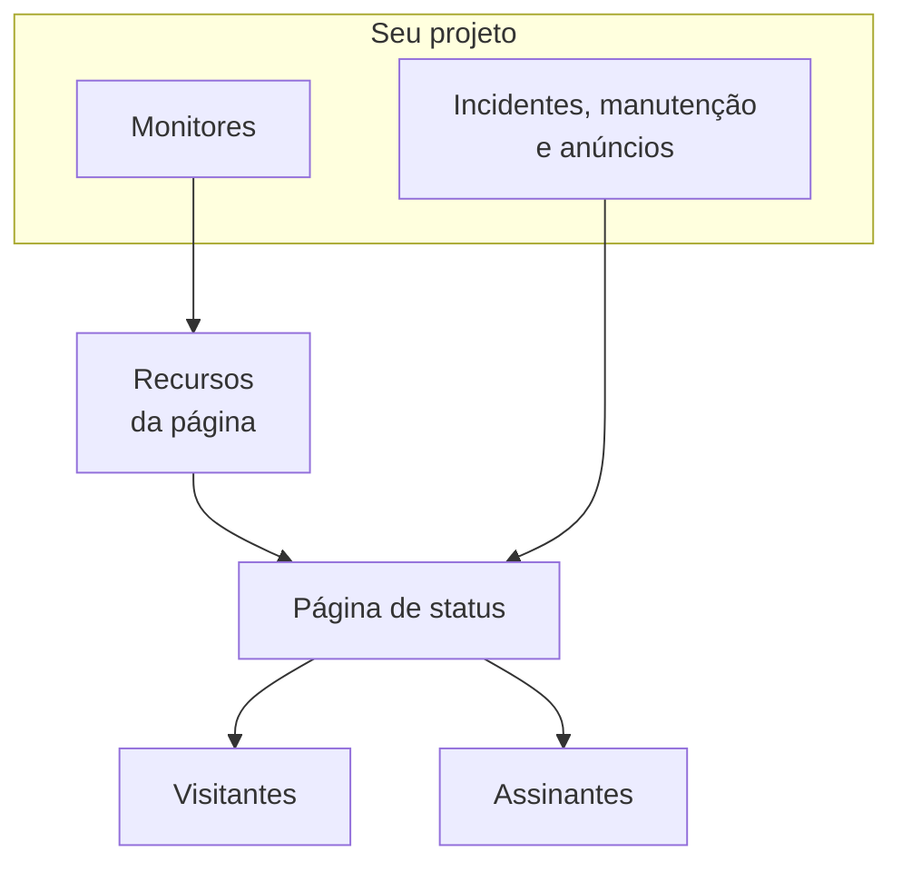

# Visão geral das páginas de status

Uma página de status é a face pública de tudo o que você monitora: uma única URL que seus clientes podem abrir em vez de escrever para você perguntando se o problema é só com eles. Ela mostra o status atual dos serviços que você escolhe expor, os incidentes em que você está trabalhando, a manutenção que você planejou e qualquer anúncio que queira fixar no topo.

Quando algo quebra às 2 da manhã, a página de status é a primeira coisa para a qual sua fila de suporte aponta. É também de onde seus assinantes são notificados, então vale a pena configurá-la antes de precisar dela, não no meio da indisponibilidade.

:::cards
- [Criar uma página de status](#criar-uma-página-de-status): Um nome para começar, todo o resto depois.
- [Escolher o que ela mostra](#escolher-o-que-aparece-na-página): Incidentes, episódios, anúncios, manutenção e tempo de atividade, em um único cartão.
- [Decidir quem pode vê-la](#restringir-quem-pode-ver-a-página): Qualquer pessoa com o link, apenas quem entra ou qualquer pessoa com a senha.
- [Arquivar uma página de status](#arquivar-uma-página-de-status): Tirar uma página do ar sem excluí-la.
:::

## Como funciona

As páginas de status ficam em **Páginas de status**, no menu **Produtos** da barra superior, entre os essenciais. Tudo nesta página vale por página de status: um projeto pode ter quantas quiser — uma pública para clientes, uma privada para um público interno, uma por região para um mercado específico.

A página mostra como recursos os monitores que você coloca nela, e os incidentes chegam a ela por meio desses monitores. Os [eventos de manutenção agendada](/docs/scheduled-maintenance/index) e os anúncios chegam a ela diretamente: cada um indica as páginas de status em que é exibido. Os visitantes leem a página, e os assinantes são avisados de cada mudança pelos canais que escolheram.

## Em resumo

- **Criada com um nome.** Uma nova página de status pede apenas o **Nome**; **Descrição** e **Rótulos** ficam em **Mais campos**. Recursos, marca e domínios são configurados depois.
- **Os recursos são o que os visitantes veem.** Cada linha da página é um **Página de status Recurso**: um monitor (ou grupo de monitores) com seu próprio nome de exibição, dica e opções de tempo de atividade. Os grupos dividem uma página longa em seções e podem ser aninhados.
- **Uma URL de pré-visualização desde o primeiro dia.** Toda página de status recebe um link de pré-visualização, para que você possa vê-la antes de existir um domínio personalizado.
- **As rotas para visitantes dependem de configurações.** Incidentes, episódios, anúncios e eventos agendados só aparecem enquanto seu interruptor em **O que sua página de status mostra** (em **Configurações avançadas**) estiver ligado, e a página de inscrição só enquanto **Mostrar página de assinantes** estiver ligado.
- **Quem pode vê-la é uma única escolha.** Qualquer pessoa com o link, apenas quem entra (usuários privados, SSO SAML ou OIDC) ou qualquer pessoa com a senha, na tela **Acesso** da página, com uma lista de IPs permitidos opcional em **Mais configurações**.
- **Os assinantes são notificados automaticamente.** Assinantes de e-mail, SMS, Slack, Microsoft Teams e webhook podem seguir uma página, cada canal atrás de seu próprio interruptor.

## Termos principais

| Termo | O que significa |
| --- | --- |
| **Página de status** | Uma página pública (ou privada), com sua própria marca, domínios, recursos e assinantes. O modelo `StatusPage`. |
| **Recurso** | Uma linha que os visitantes veem: um monitor ou grupo de monitores mostrado na página com um nome de exibição e opções de tempo de atividade. |
| **Grupo** | Uma seção nomeada que contém recursos. Grupos se aninham dentro de grupos, e cada nível resume o status de tudo o que está abaixo dele. |
| **Anúncio** | Uma mensagem que você publica em uma ou mais páginas de status, com um horário de início e um horário de término opcional. |
| **Assinante** | Alguém (ou algo) que segue a página por e-mail, SMS, Slack, Microsoft Teams ou um webhook. |
| **Domínio personalizado** | Um domínio seu, `status.example.com`, apontado para a página com um registro CNAME. A OneUptime emite o certificado SSL dele gratuitamente e o renova. |
| **Usuário privado** | Uma conta que pode entrar em uma página de status privada. Separada dos usuários do seu projeto OneUptime. |

## Criar uma página de status

:::steps
### Abrir o formulário de criação

Abra **Páginas de status → Todas as páginas de status** e clique em **Criar página de status**.

### Dar um nome à página

Na janela **Criar: Página de status**, preencha **Nome** (obrigatório, pelo menos dois caracteres) e clique em **Criar página de status**. **Descrição** e **Rótulos** são opcionais, em **Mais campos**.

Esse é o formulário inteiro. A lista **Páginas de status** mostra **Nome**, **Descrição**, **Rótulos** e **Proprietários**, e pode ser filtrada por **ID da página de status**, **Nome** e **Descrição**.

### Abrir a nova página

A nova página abre na tela **Visão geral** dela. Enquanto a página não tem nenhum recurso, a tela começa com **Ainda não há nada nesta página de status** e **Adicionar monitores**, que abre a tela **Recursos** dela. Depois vêm dois cartões: **Link da página de status**, com o link para a própria página e **Copiar link**, e **Detalhes da página de status**, onde você pode editar o nome, a descrição e os rótulos que acabou de definir. Quando o projeto tem campos personalizados de páginas de status, um cartão **Campos personalizados** vem em seguida.
:::

Uma página criada com a API ou com o Terraform está sujeita aos mesmos planos das configurações descritas abaixo. No OneUptime Cloud, criar uma página com uma configuração ligada que seu plano não inclui (por exemplo privada, uma lista oculta, HTML, CSS ou JavaScript personalizados, relatórios por e-mail, assinantes de SMS, Slack, Microsoft Teams ou webhook, uma lista de IPs permitidos) é recusado com `402 Payment Required`, e a mensagem cita o plano. O plano de cada configuração é indicado ao lado dela abaixo. As configurações deixadas no padrão, como este formulário as deixa, funcionam em todos os planos.

Em seguida, mais ou menos em ordem de utilidade:

- Adicione recursos para que a página mostre algo: veja [Recursos e grupos da página de status](/docs/status-pages/resources-and-groups).
- Defina o título da página, o favicon, o logotipo e a imagem de capa, e depois conecte um domínio personalizado: veja [Marca e domínios da página de status](/docs/status-pages/branding-and-domains).
- Decida por quais canais as pessoas podem se inscrever: veja [Assinantes e comunicados](/docs/status-pages/subscribers).
- Ajuste o que aparece na página em **Configurações avançadas**.

## Onde fica cada coisa

Depois de abrir uma página de status, o menu lateral esquerdo dela é agrupado em dez seções. Use-o como mapa para o resto desta parte da documentação.

| Seção | O que contém |
| --- | --- |
| **Básico** | **Visão geral**, **Anúncios**, **Proprietários**. |
| **Recursos** | Uma única tela **Recursos** (os grupos à esquerda, os monitores do grupo selecionado à direita). |
| **Regras** | **Regras de monitor**: regras que adicionam à página cada monitor que corresponde, agora e depois. |
| **Assinantes** | **Assinantes de e-mail**, **Assinantes de SMS**, **Assinantes do Slack**, **Assinantes do Microsoft Teams**, **Assinantes de webhook**, **Configurações de assinantes**. |
| **Logs de notificação** | **Logs de notificação**: o que foi enviado aos assinantes. |
| **Marca** | **Marca** (logotipo, título, favicon, links, rodapé, cores e idiomas, em uma única página), **Domínios personalizados**, **HTML, CSS e JavaScript**. |
| **Segurança** | **Acesso** (quem pode ver a página), **Usuários privados**, **SSO**, **OIDC**, **SCIM**. |
| **IA** | **MCP**. |
| **Desenvolvedores** | **Terraform**, **API**, **Assistentes de IA**: a página como código. |
| **Avançado** | **Status incorporado**, **Relatórios**, **Campos personalizados**, **Configurações avançadas**, **Registros de auditoria**, **Excluir página de status**. |

Apenas **Básico** e **Recursos**, o que a página mostra, começam abertas. Todas as outras seções começam recolhidas, como as seções pouco usadas de todos os menus da OneUptime: clique no título de uma seção para mostrar suas páginas. Uma seção se abre sozinha quando você está em uma das páginas dela, como **Configurações avançadas** ou **Assinantes de e-mail**.

Duas particularidades de nomes que vale conhecer antes de procurar:

- O item **Recursos** só se chama **Recursos** quando o projeto tem os grupos de monitores ativados. Caso contrário, ele se chama **Monitores**. É a mesma tela nos dois casos.
- Não há uma página de grupos separada. Grupos e recursos foram unificados, e a antiga rota `/groups` agora redireciona para a tela de recursos.

Fora de uma página específica, a própria seção **Páginas de status** lista **Todas as páginas de status**, e uma seção **Mais** contém **Anúncios**. Uma seção **Configurações** recolhida contém **Modelos de anúncios**, **Modelos de assinantes**, **Campos personalizados**, **Regras de proprietário** e **Regras de Rótulos**, que valem para todo o projeto e são compartilhados por todas as páginas de status. Uma seção **Avançado** recolhida contém **Arquivado**: as páginas de status que você tirou do ar (veja [Arquivar uma página de status](#arquivar-uma-página-de-status)).

**Regras de Rótulos** e **Regras de proprietário** rotulam novas páginas de status e atribuem proprietários a elas. Uma regra tem duas etapas (**Corresponder**, as condições que uma página de status precisa atender, e depois **Rótulos** ou **Proprietários**, o que a regra adiciona) e seu **Nome** é preenchido a partir do que você escolhe. Uma nova regra precisa adicionar pelo menos um rótulo ou proprietário; ao editar, isso nunca é cobrado, e a lista marca com **Não adiciona nada** uma regra antiga que não adiciona nada. Veja [Regras de rótulos e proprietários](/docs/configuration/label-and-owner-rules).

## O que os visitantes veem

A página pública é um aplicativo próprio, com um pequeno conjunto de rotas:

- `/`: a **Visão geral**.
- `/incidents` e `/incidents/:id`: a lista de incidentes e um único incidente.
- `/announcements` e `/announcements/:id`.
- `/scheduled-events` e `/scheduled-events/:id`.
- `/subscribe/email`, `/subscribe/sms`, `/subscribe/slack`, `/subscribe/microsoft-teams`, `/subscribe/webhooks`.
- `/confirm-subscription/:id`, `/update-subscription/:token` e `/unsubscribe/:token`: os links das mensagens que os assinantes recebem.
- `/rss`: o feed.
- `/login`, `/sso` e `/master-password`: relevantes apenas em uma página privada.

A barra de navegação superior sempre mostra **Visão geral**; o resto só aparece quando está ligado. **Incidentes**, **Anúncios** e **Eventos agendados** precisam cada um do seu interruptor; **Inscrever-se** precisa tanto de **Mostrar página de assinantes** quanto de pelo menos um canal de inscrição ligado. Uma página privada também tem um item **Sair**.

Um único incidente, episódio, anúncio ou evento agendado só abre se a página o listaria, qualquer que seja sua janela de histórico: um incidente ou episódio privado, um oculto das páginas de status, um evento agendado oculto das páginas de status ou um anúncio agendado para mais tarde também não é encontrado pelo link.

### A página de visão geral

A visão geral é a página que a maioria dos visitantes vê. De cima para baixo, ela mostra:

1. **Os anúncios em andamento**: os anúncios cujo horário de início já passou e cujo horário de término não.
2. **Um banner de status geral**: uma única linha que resume se todos os recursos ou apenas alguns estão afetados.
3. **Um percentual geral de tempo de atividade**, se você o ligou: no fim do banner de status geral, enquanto todos os recursos estiverem operacionais. Desligado por padrão.
4. **Os grupos de recursos**, cada um com seus recursos, o status atual deles e as barras de histórico de tempo de atividade.
5. **Incidentes ativos**, com os episódios ativos.
6. **Eventos de manutenção agendada**.

Uma página recém-criada sem conteúdo mostra um estado vazio pedindo que você adicione recursos pelo painel, o sinal para ir à tela **Recursos**.

A visão geral que um visitante vê tem no máximo 15 segundos, e tudo o que você tira da página some dela em menos de um segundo: um incidente, episódio ou evento agendado que você oculta das páginas de status, torna privado, limita a outras páginas ou exclui, um anúncio que você encerra, adia ou exclui, uma nota pública que você exclui, e um recurso, grupo ou monitor que você tira da página ou exclui. Outras mudanças, como um novo título, aparecem dentro desses 15 segundos.

Para saber o que coloca um incidente nesta página e o que o tira dela, veja [Estados e severidades de incidentes](/docs/incidents/states-and-severities).

## Escolher o que aparece na página

O que os visitantes veem é definido em um único cartão: **O que sua página de status mostra**, em **Páginas de status → sua página → Avançado → Configurações avançadas**. Ele tem uma linha para cada lista que a página pode mostrar, depois **Histórico de tempo de atividade** (com o percentual geral de tempo de atividade e os status que contam como indisponibilidade). A linha "Powered by OneUptime" tem um cartão próprio, logo abaixo. Não há botão de edição: um interruptor é salvo assim que você o muda, um número de dias quando você sai da caixa dele ou pressiona Enter, e uma escolha em uma lista assim que você a faz.

- **Mostrar incidentes** (`showIncidentsOnStatusPage`): ligado por padrão. Abaixo dele, **Mostrar … dias de histórico** (`showIncidentHistoryInDays`, 14 por padrão) define até onde vai a lista de incidentes, e **Mostrar rótulos de incidentes** (`showIncidentLabelsOnStatusPage`) é desligado por padrão.
- **Mostrar apenas incidentes limitados a esta página** (`onlyShowScopedIncidents`): também na linha de incidentes, desligado por padrão. Ligue-o e a página mostra, e notifica a seus assinantes, apenas os incidentes limitados a ela com **Limitar a estas páginas de status**. Incidentes não limitados a nenhuma página, incluindo os que um monitor, o Slack, o Microsoft Teams, a API ou a IA abrem sozinhos, nunca chegam a ela até que alguém adicione a página a eles. Ele também decide quais incidentes trazem seus episódios para a página, por isso continua disponível quando **Mostrar incidentes** está desligado. Para páginas que compartilham monitores mas atendem públicos diferentes, veja [Uma página de status por público](/docs/status-pages/one-status-page-per-audience).
- **Mostrar episódios** (`showEpisodesOnStatusPage`): ligado por padrão, com **Mostrar … dias de histórico** (`showEpisodeHistoryInDays`, 14 por padrão) e **Mostrar rótulos de episódios** (`showEpisodeLabelsOnStatusPage`, desligado por padrão). Episódios são um modelo próprio com seus próprios endpoints, não uma visão dos incidentes.
- **Mostrar anúncios** (`showAnnouncementsOnStatusPage`): ligado por padrão, com **Mostrar … dias de histórico** (`showAnnouncementHistoryInDays`, 14 por padrão).
- **Mostrar eventos de manutenção programada** (`showScheduledMaintenanceEventsOnStatusPage`): ligado por padrão, com **Mostrar … dias de histórico** (`showScheduledEventHistoryInDays`, 14 por padrão) e **Mostrar rótulos de eventos** (`showScheduledEventLabelsOnStatusPage`, desligado por padrão).
- **Histórico de tempo de atividade**: tudo sobre o tempo de atividade da página, em uma linha:
  - **Mostrar … dias de histórico** (`showUptimeHistoryInDays`) é o comprimento da barra de tempo de atividade ao lado de cada recurso. É 90 por padrão e precisa estar entre 1 e 90. Toda opção **Mostrar % de tempo de atividade** e **Mostrar gráfico de histórico de status** de um recurso ou grupo lê esse número, assim como o percentual geral de tempo de atividade.
  - **Mostrar percentual geral de tempo de atividade** (`showOverallUptimePercentOnStatusPage`): desligado por padrão. Ligue-o e o banner de status geral termina com um percentual de tempo de atividade para a página inteira, a média de seus recursos e grupos, enquanto tudo estiver operacional. Enquanto ele está ligado, **Precisão** (`overallUptimePercentPrecision`) escolhe quantas casas decimais ele mostra: `99%`, `99.9%`, `99.99%` (o padrão) ou `99.999%`. Cada recurso e cada grupo tem sua própria precisão.
  - **Conta como indisponibilidade** (`downtimeMonitorStatuses`): os status de monitor cujo tempo conta contra cada percentual de tempo de atividade da página: o de cada recurso, o de cada grupo e o geral. Cada status é um rótulo na própria cor. Adicione um pela lista ou remova um pelo **×** dele, e a mudança é salva na hora. Uma nova página de status começa com todos os status do projeto que não são operacionais. Sempre fica pelo menos um status: o último não pode ser removido, porque sem nenhum todo tempo de atividade da página marcaria 100%.

**Uma lista desligada** some da página, junto com seu item na barra de navegação, se tiver um; seu endpoint público recusa a solicitação, e os assinantes da página não são avisados sobre esse tipo de evento. A linha dela passa a mostrar apenas o próprio interruptor: até onde vai uma lista oculta, e se ela mostra rótulos, não muda nada.

**Powered by OneUptime**, o cartão logo abaixo, tem um único interruptor: **Mostrar a marca Powered By OneUptime**, ligado por padrão, então o rodapé para visitantes diz "Powered by OneUptime". Desligue-o para ocultar a linha; ele salva na hora. A coluna guarda isso ao contrário, como `hidePoweredByOneUptimeBranding`. No OneUptime Cloud, ocultar a linha precisa do **Scale**; abaixo dele, o cartão avisa quando uma página ainda oculta a linha, com um botão que a mostra de novo. Na hospedagem própria, ocultar a linha faz parte da Enterprise Edition: na Community Edition, todas as páginas de status a mostram.

**Planos.** No OneUptime Cloud, uma configuração que seu plano não pode mudar mostra ao lado o plano de que precisa. Os quatro interruptores de listas, os três de rótulos e o histórico dos episódios precisam do **Growth**; mostrar o percentual geral de tempo de atividade precisa do **Scale**. As outras janelas de histórico, **Histórico de tempo de atividade**, **Precisão**, **Conta como indisponibilidade** e **Mostrar apenas incidentes limitados a esta página** podem ser alterados em todos os planos, e cada um é salvo por conta própria: uma página cujo percentual geral de tempo de atividade já está ligado pode mudar a precisão dele em qualquer plano. Voltar uma configuração para como ela é em uma página nova (mostrar uma lista de novo, ocultar os rótulos ou o percentual geral de tempo de atividade, voltar o histórico dos episódios para 14 dias) funciona em todos os planos, então nada que um teste mudou fica assim por falta de plano: o interruptor diz que ainda pode voltar atrás, e qual plano é necessário para mudá-lo de novo.

Se a página mostra um item **Inscrever-se** (**Mostrar página de assinantes**, `showSubscriberPageOnStatusPage`, ligado por padrão) e por quais canais os visitantes podem se inscrever não é definido nesta tela: as duas coisas ficam no cartão **Canais** de **Assinantes → Configurações de assinantes** (veja [Canais de inscrição](/docs/status-pages/subscribers#canais-de-inscrição)).

Abaixo do cartão ficam **Exportar como JSON: Página de status**, que baixa as configurações da própria página de status em um arquivo que você pode importar de novo, e **Archive status page** (veja [Arquivar uma página de status](#arquivar-uma-página-de-status)). O percentual geral de tempo de atividade e os status de indisponibilidade eram antes dois cartões próprios aqui, cada um atrás de um botão **Editar**; agora são linhas do cartão.

**Onde ficam as cores.** As cores das barras de tempo de atividade não ficam aqui: a **Cor Padrão da Barra** e as regras de cor das barras ficam em **Mais configurações** em **Páginas de status → sua página → Marca → Marca**. O **Tema** da página (claro, escuro ou conforme o dispositivo de cada visitante) é um cartão perto do topo dessa mesma página. Não existe nenhuma configuração de cor da marca; tudo o que vai além desses controles é feito com **CSS Personalizado**.

## Ver como ficou antes de publicar

A tela **Visão geral** de cada página de status tem um cartão **Link da página de status** com cada endereço em que a página responde: primeiro seus domínios personalizados, depois seu endereço no OneUptime, cada um com **Copiar link** ao lado. Um domínio personalizado que ainda não está ativo aparece marcado como **Ainda não ativo**, com o motivo, e com **Configuração de DNS** quando ainda há algo a fazer. Quando os visitantes precisam entrar ou digitar uma senha, o cartão diz isso. Use o endereço do OneUptime enquanto ainda estiver adicionando recursos e antes de algum domínio personalizado estar ativo.

Nos bastidores, cada rota pública tem uma gêmea de pré-visualização em `/status-page/{statusPageId}/...`: uma visão geral de pré-visualização, uma lista de incidentes de pré-visualização, uma página de inscrição de pré-visualização e assim por diante. Por isso, uma URL ou captura de tela tirada da pré-visualização do painel não vai corresponder ao que um cliente vê depois que um domínio personalizado estiver conectado, então confira qualquer link que você colar em um runbook ou e-mail.

## Restringir quem pode ver a página

Nem toda página de status é para o público. Quem pode ver uma página é uma única escolha, o primeiro cartão de **Páginas de status → sua página → Segurança → Acesso**, **Quem pode ver esta página de status**:

- **Qualquer pessoa com o link**: a página é pública. Toda nova página de status começa aqui.
- **Apenas quem entra**: os visitantes chegam a `/login` e entram como usuário privado, ou com seu provedor de SSO ou OIDC (veja abaixo). Abaixo da escolha, o cartão lista o acesso configurado para a página (quantos usuários privados ela tem e se SSO e OIDC estão ligados, cada um com um link para a tela dele) e, enquanto for a escolha, avisa quando ainda ninguém consegue entrar.
- **Qualquer pessoa com a senha**: os visitantes chegam a `/master-password` e desbloqueiam a página com uma senha que você compartilha. Ninguém precisa de uma conta. Escolher essa opção pede a senha na mesma caixa de diálogo se a página não tiver uma; se já tiver, você pode mantê-la ou digitar outra. Depois, **Alterar senha** abaixo da escolha a substitui. A senha é armazenada como hash e não pode ser mostrada de novo, e quem digitou a antiga pode continuar vendo a página por até 7 dias.

Escolher uma opção pede confirmação, dizendo o que muda para os visitantes, e é salvo na hora. Não há botão de edição.

**Imagens.** Uma imagem no que a página mostra (uma nota pública, um anúncio, uma descrição) abre no próprio endereço longo e impossível de adivinhar, que funciona sem entrar, para que os e-mails dos seus assinantes também possam mostrá-la. A própria página continua pedindo o login ou a senha.

**O que é armazenado.** A escolha são três colunas, que a API e o Terraform leem e gravam como antes: `isPublicStatusPage`, `enableMasterPassword` e `masterPassword`. A senha só é pedida aos visitantes em uma página que não é pública, com `enableMasterPassword` ligado e uma senha definida; uma página privada com o interruptor ligado mas sem senha é uma página de login. Escolher **Qualquer pessoa com o link** também desliga `enableMasterPassword`, porque uma página pública nunca a pede. A tela **Acesso** grava apenas as colunas que uma escolha muda.

**Planos.** No OneUptime Cloud, tornar uma página privada precisa do plano **Growth**: em um plano inferior, as duas opções privadas mostram o plano de que precisam e não podem ser escolhidas. Torná-la pública de novo (**Qualquer pessoa com o link**) funciona em todos os planos, então uma página que ficou privada no fim de um teste, ou depois de mudar para um plano inferior, sempre pode ser reaberta; a caixa de diálogo diz que torná-la privada de novo precisa do **Growth**. Mudar de **Apenas quem entra** para **Qualquer pessoa com a senha** funciona em todos os planos, assim como **Alterar senha**.

### Usuários privados

Adicione as pessoas que podem entrar em **Páginas de status → sua página → Segurança → Usuários privados**. Há uma ação **Adicionar em massa**: cole uma lista de endereços de e-mail e cada um recebe um e-mail de convite. Os usuários privados têm seu próprio fluxo de senha esquecida e de redefinição, separado das contas do seu projeto OneUptime.

**Usuários privados e senha não se somam.** Enquanto **Qualquer pessoa com a senha** for a escolha, os usuários privados não conseguem entrar (eles também digitam a senha), e a tela **Usuários privados** diz isso, com um link de volta para **Acesso**.

### SSO e OIDC

Para uma página privada ligada ao seu provedor de identidade, **Páginas de status → sua página → Segurança → SSO** configura o SAML: **Adicionar provedor SSO** pede a URL de login, o emissor e o certificado x509, e os métodos de assinatura e de digest são preenchidos em **Mais campos**. **Páginas de status → sua página → Segurança → OIDC** configura o OpenID Connect: **Adicionar provedor OIDC** pede o emissor, o ID do cliente e o segredo, e a URL de descoberta, os escopos e os nomes das claims são preenchidos em **Mais campos**. Quando a página tem um provedor, o cartão **Testar o login** abaixo da lista leva ao login da página, para testá-lo. O **SCIM** provisiona usuários privados automaticamente a partir do IdP. No OneUptime Cloud, os três precisam do plano Scale ou superior. Em uma instalação auto-hospedada, SSO e OIDC fazem parte de todas as edições, e o SCIM precisa da [Edição Enterprise](/docs/self-hosted/enterprise).

Desligar ou excluir o provedor de SSO ou OIDC de uma página de status desconecta os usuários privados que ele fez entrar: as sessões deles terminam na próxima solicitação, e ligar o provedor de novo não as traz de volta; eles entram de novo por ele. Um novo certificado ou segredo do cliente, outras URLs ou um novo nome mantêm todos conectados. Em uma página que exige SSO, desligar seu último provedor deixa todos sem acesso até que você ligue um de novo ou desligue **Exigir SSO para login**; para trocar de provedor, configure e teste o novo antes de desligar o antigo.

Abaixo dos provedores, o cartão **Configurações de SSO** contém o interruptor **Exigir SSO para login** (`requireSsoForLogin`, desligado por padrão), que é salvo assim que você o muda. Ligá-lo pede confirmação primeiro, porque a partir daí os usuários privados não conseguem entrar com e-mail e senha: apenas as pessoas que seu provedor de SSO ou OIDC deixa entrar podem ver a página. Teste o link do cartão **Testar o login** acima dele antes de ligá-lo. Ele só importa enquanto **Apenas quem entra** for a escolha, e a tela **Acesso** o mostra como **SSO obrigatório** abaixo dessa escolha. Enquanto ele está ligado, um usuário privado que entrou com e-mail e senha também é desconectado na próxima solicitação: só contam as sessões que um provedor de SSO ou OIDC iniciou. No OneUptime Cloud, ligá-lo precisa do plano **Scale**, e desligá-lo funciona em todos os planos. Uma página que ainda exige SSO depois do fim de um teste do Scale, ou depois de mudar para um plano inferior, continua exigindo até que alguém o desligue: as páginas **SSO** e **OIDC** dela mostram o interruptor abaixo da oferta do plano para isso.

### Sessões de leitores

Por quanto tempo um usuário privado continua conectado é definido no cartão **Sessões de leitores** de **Acesso**, abaixo de **Quem pode ver esta página de status**: **Desconectar os visitantes após**, uma única escolha que é salva assim que você a faz. Com **Sem limite**, que é como toda página começa, um leitor continua conectado enquanto abrir a página pelo menos uma vez a cada 30 dias. Com uma duração, de 1 hora a 30 dias, todo leitor entra de novo quando passa esse tempo desde que entrou, por mais ativo que tenha estado. Com SSO ou OIDC, isso o leva de volta ao seu provedor de identidade, que decide de novo, então alguém que você removeu ou alterou lá perde o acesso dentro desse prazo. Uma nova duração também vale para os leitores que estão conectados agora.

A duração é a coluna `privateUserSessionLengthInHours`, em horas, de 1 a 8760, que a API e o Terraform leem e gravam; uma duração definida por lá que a lista não oferece aparece com o próprio valor. No OneUptime Cloud, definir uma duração precisa do plano **Scale**, e **Sem limite** funciona em todos os planos. Na hospedagem própria, definir uma duração faz parte da Enterprise Edition: na Community Edition, uma duração já definida continua valendo e só pode ser removida.

### Lista de IPs permitidos

Em **Mais configurações** de **Acesso**, a seção **Lista de IPs permitidos** (a coluna `ipWhitelist`) limita uma página a redes conhecidas. Ela vale qualquer que seja o público da página: um visitante de qualquer outro endereço é recusado, mesmo com a senha ou uma conta de usuário privado. Digite uma entrada por linha: um endereço IPv4 ou IPv6, ou um intervalo IPv4 como `10.0.0.0/8`; uma linha que não é nenhum dos dois é recusada ao salvar. Deixe-a vazia para permitir todos os endereços. Enquanto a lista estiver em vigor, o cabeçalho recolhido **Mais configurações** mostra **Lista de IPs permitidos** com o número de entradas que ela contém. No OneUptime Cloud, alterá-la precisa do plano **Scale**; esvaziá-la funciona em todos os planos. Na hospedagem própria, alterá-la faz parte da Enterprise Edition: na Community Edition, uma lista já definida continua valendo e só pode ser removida.

## O selo incorporável e o feed RSS

Três formas de mostrar o status em outro lugar que não a própria página.

**Selo de status incorporado.** Em **Páginas de status → sua página → Avançado → Status incorporado**, ligue **Habilitar selo de status incorporado** (`enableEmbeddedOverallStatus`, desligado por padrão). Na primeira vez que você o liga, o selo ganha o token dele (`embeddedOverallStatusToken`), e o cartão **Incorporar o selo** mostra o selo, servido em `/api/status-page/badge/<status-page-id>?token=<token>`, com o **HTML** e o **Markdown, com link para a página de status** dele para copiar, para que você possa colocar o status geral atual na sua documentação, no rodapé do seu aplicativo ou em uma página de marketing. O Markdown leva ao primeiro domínio personalizado no ar da página, incluindo um com um certificado que você enviou, ou ao endereço dela no OneUptime enquanto nenhum estiver no ar. O token fica no cartão **Token de segurança** em **Mais configurações**, com **Regenerar token** para quando o link tiver sido compartilhado demais.

**Feed RSS.** Toda página de status serve `/rss`: um feed intitulado "{título da página} Updates", com o **Título da página** definido em **Marca**, ou o nome dela se não tiver um, e cujos itens começam com `Incident: `, `Announcement: ` e `Scheduled Maintenance: `. Cada item é datado como a página o data: um incidente pelo momento em que foi declarado, um aviso pelo momento em que foi publicado, e um evento de manutenção programada pelo momento em que começa, com a descrição abrindo pela janela dele. Útil para quem prefere levar suas atualizações para um leitor ou um chatbot em vez de se inscrever por e-mail.

**Calendário de manutenção.** Toda página de status também serve `/maintenance.ics`: a manutenção programada que ela mostra, como um calendário que o Google Agenda, o Calendário da Apple ou o Outlook podem assinar. Os visitantes o adicionam com **Subscrever o calendário** na página **Eventos agendados**, e um único evento com **Adicionar ao calendário** na própria página do evento. O calendário de uma página privada fica vazio, já que um app de calendário não consegue entrar. Veja [Calendário de manutenção](/docs/scheduled-maintenance/calendar#o-calendário-de-uma-página-de-status).

Se você preferir buscar os dados por conta própria, a página de status se apoia em endpoints públicos de leitura para a visão geral, os incidentes, os eventos de manutenção programada, os anúncios e os episódios: veja [API pública](/docs/status-pages/public-api).

## Arquivar uma página de status

Arquive uma página de status para tirá-la do ar sem excluí-la. Uma página de status arquivada:

- **Fica fora do ar.** Sua URL, seus domínios personalizados, seu selo incorporado, sua API pública e seu servidor MCP respondem como se a página não existisse ("Status Page not found"), então um visitante não consegue distinguir uma página arquivada de uma que nunca existiu. O link de pré-visualização do painel também para de funcionar.
- **Não envia nada aos assinantes.** Nenhuma notificação de incidentes, episódios, manutenção ou anúncios, nenhum relatório e nenhuma confirmação de inscrição. Ninguém pode se inscrever nela.
- **Sai da lista de páginas de status.** Você a encontra em **Páginas de status → Avançado → Arquivado**.
- **Mantém tudo.** Seus recursos, grupos, marca, domínios, usuários privados e assinantes são mantidos, então desarquivá-la coloca a página de volta no ar exatamente como estava.

Para arquivar uma página de status, abra-a e vá a **Avançado → Configurações avançadas → Archive status page**. Para arquivar várias, selecione-as na lista **Páginas de status** e escolha **Arquivar**. Para recuperar uma, abra **Páginas de status → Avançado → Arquivado**, selecione-a e escolha **Desarquivar**, ou abra-a e clique em **Desarquivar** no banner no topo das páginas dela.

## Próximos passos

:::cards
- [Recursos e grupos da página de status](/docs/status-pages/resources-and-groups): Colocar monitores na página e organizá-los em seções.
- [Marca e domínios da página de status](/docs/status-pages/branding-and-domains): Seu logotipo e suas cores, e a página no seu próprio domínio.
- [Assinantes e comunicados](/docs/status-pages/subscribers): Os cinco canais de inscrição e a publicação de anúncios.
- [Uma página de status por público](/docs/status-pages/one-status-page-per-audience): Uma página por cliente, local ou região, e quais delas são avisadas de cada incidente.
:::
