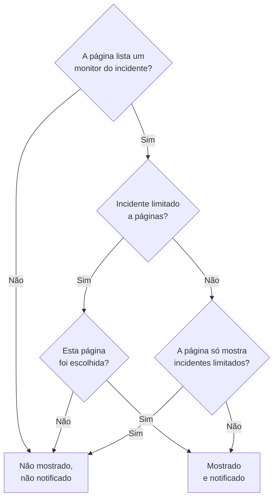

# Uma página de status por público

Pessoas diferentes precisam de notícias diferentes. Um cliente não quer saber da indisponibilidade de outro cliente, e a equipe de um local não quer um e-mail toda vez que outro local perde a rede. Na OneUptime, a unidade de público é a página de status: cada uma tem seus próprios assinantes, sua própria marca e sua própria privacidade. Então dê a cada público uma página própria, e decida incidente por incidente quais páginas ficam sabendo dele.

A infraestrutura compartilhada tornava isso difícil. Um incidente chega a uma página de status por meio dos monitores dele, então um monitor compartilhado por dez páginas de local avisava os dez locais sobre uma indisponibilidade que afetava dois. A única solução era uma página, ou um monitor, para cada combinação de locais. Esta página cobre as configurações que resolvem isso:

- **Limitar a estas páginas de status** em um incidente, para que ele apareça e notifique apenas nas páginas que você escolher.
- **Mostrar apenas incidentes limitados a esta página** em uma página de status, para que um incidente que ninguém limitou ainda não chegue a nenhuma dessas páginas até alguém decidir. Isso inclui os incidentes que um monitor, o Slack, o Microsoft Teams, a API ou a IA abrem sozinhos.
- Um registro de quais páginas foram avisadas de que um incidente foi criado, para que uma página que você adiciona depois seja avisada uma vez e as outras não sejam avisadas de novo.
- Um resumo **Serão notificados** que mostra quem vai ficar sabendo de um incidente antes de você declará-lo ou publicar uma nota pública, e a **Pré-visualização**, que mostra o que os assinantes de cada página vão receber.

:::cards
- [Configurar](#configurar-uma-página-por-público): Uma página por público, e o interruptor que mantém os incidentes sem limite fora delas.
- [Limitar um incidente](#limitar-um-incidente-a-páginas-de-status): Escolha as páginas ao declará-lo, ou depois.
- [Adicionar ou remover páginas](#adicionar-e-remover-páginas-de-status): Quem é avisado sobre uma página que você adiciona, e o que remover uma desfaz.
- [O que toda mensagem traz](#o-que-toda-mensagem-traz): Os valores que toda página recebe, e o que eles dizem a cada público.
:::

## Quando usar

- **Um provedor de serviços gerenciados** com uma página de status por cliente, em monitores que os clientes compartilham.
- **Uma organização com locais, fábricas ou regiões**, cada um com sua própria equipe a avisar.
- **A TI interna** com uma página por departamento ou prédio.

Se o seu público aceita escolher por conta própria, uma única página pode bastar: deixe os assinantes escolherem os recursos que interessam a eles (veja [Assinantes e comunicados](/docs/status-pages/subscribers)). Use uma página por público quando você faz a escolha por eles, incidente por incidente, ou quando um público não pode ver de jeito nenhum os incidentes de outro.

## Como um incidente chega a uma página de status

Um incidente chega a uma página de status por meio dos monitores dele. Uma página mostra um incidente, e avisa seus assinantes sobre ele, quando um dos recursos da página é um dos monitores do incidente, diretamente ou por um grupo de monitores na página. Duas configurações restringem isso:

- **Limitar a estas páginas de status** no incidente (`statusPages`). Deixado vazio, o incidente chega a toda página que lista os monitores dele, como sempre. Com páginas escolhidas, ele chega apenas às páginas escolhidas **entre** as que listam os monitores dele.
- **Mostrar apenas incidentes limitados a esta página** na página de status (`onlyShowScopedIncidents`, desligado por padrão). Com ele ligado, a página nunca mostra um incidente que não está limitado a páginas de status específicas, nem avisa ninguém sobre ele.



Para uma página que lista um dos monitores do incidente:

| O incidente está | Página com **Mostrar apenas incidentes limitados a esta página** desligado | Página com ele ligado |
| --- | --- | --- |
| Não limitado a nenhuma página de status | Mostrado e notificado | Não mostrado, não notificado |
| Limitado a páginas de status, e esta página foi escolhida | Mostrado e notificado | Mostrado e notificado |
| Limitado a páginas de status, mas não a esta | Não mostrado, não notificado | Não mostrado, não notificado |

Uma página que não lista nenhum dos monitores do incidente nunca o mostra, escolha você o que escolher, e um incidente sem monitores não notifica nenhum assinante de página de status. As regras de sempre continuam valendo por cima: o incidente precisa estar **Visível na página de status** e não ser privado, a página precisa ter **Mostrar incidentes** ligado, e um assinante que escolheu apenas alguns recursos ou tipos de evento recebe apenas o que escolheu.

As mesmas regras decidem tudo o que depende de quais páginas um incidente alcança:

- as listas de incidentes, a visão geral e a própria página do incidente na página de status pública, e a [API pública](/docs/status-pages/public-api) da página de status;
- as mensagens de e-mail, SMS, Slack, Microsoft Teams e webhook enviadas quando o incidente é criado, muda de estado, recebe uma nota pública ou recebe um post-mortem;
- as contagens de incidentes nos relatórios de páginas de status enviados por e-mail, que contam apenas os incidentes que a página mostra.

Um episódio de incidente chega a uma página quando pelo menos um dos incidentes dele chega. As notificações dele vão para toda página que os incidentes dele alcançam, e a página dele em uma página de status que nenhum deles alcança não é encontrada. Um incidente privado não chega a nenhuma página, então nunca leva o episódio dele para uma, e um episódio privado não é mostrado em nenhuma página.

## Configurar uma página por público

:::steps
### Criar uma página de status para cada público

Crie uma página por público, por exemplo de `Site 01` a `Site 10`. Torne-as privadas se o público for interno (veja [Restringir quem pode ver a página](/docs/status-pages/index#restringir-quem-pode-ver-a-página)). Os assinantes de uma página privada ainda podem cancelar a inscrição sem entrar, pelo link em toda mensagem (veja [Gerenciar e cancelar uma inscrição](/docs/status-pages/subscribers#gerenciar-e-cancelar-uma-inscrição)). Dê a elas rótulos como `Region East`, para que o seletor possa adicionar com um clique toda página que tem um rótulo.

### Colocar o monitor compartilhado em cada página

Adicione o monitor compartilhado a cada página como recurso (veja [Recursos e grupos da página de status](/docs/status-pages/resources-and-groups)). Uma regra em **Recursos → Monitor Rules** pode fazer isso por você a partir dos rótulos do monitor.

### Ligar Mostrar apenas incidentes limitados a esta página

Em cada uma dessas páginas, ligue-o. Ele fica no cartão **O que sua página de status mostra** em **Páginas de status → sua página → Avançado → Configurações avançadas**, abaixo de **Mostrar incidentes**, e é salvo no momento em que você o muda. A partir daí, nada chega à página de um local a menos que alguém a escolha.

### Adicionar os assinantes de cada público

Para a equipe, use **Adicionar em massa** em **Assinantes de e-mail**, e prefira o endereço de cada pessoa a uma lista de e-mail como `site03-all@`: qualquer pessoa da lista pode cancelar a inscrição dela para todos que estão nela. Se um assinante que você adicionou cancelar a inscrição, os proprietários da página e quem o adicionou recebem um e-mail (veja [Endereços compartilhados e listas de e-mail](/docs/status-pages/subscribers#endereços-compartilhados-e-listas-de-e-mail)).

### Deixar os responsáveis lerem as páginas de status

O seletor lista apenas as páginas de status que a pessoa pode ler, e as funções de incidente não podem ler páginas de status. Dê aos responsáveis a função **Status Page Viewer** ao lado da função de incidente deles; ela pode ser limitada a páginas com determinados rótulos. Sem ela, o seletor fica vazio.

### Decidir o que toda mensagem diz

Em **Incidentes → Configurações → Campos personalizados**, defina os campos personalizados de incidente que sua equipe responde toda vez, por exemplo `Impact` (uma lista suspensa), `Expected Resolution` (uma data e hora) e `Acknowledgement` (um interruptor sim/não). Arraste-os para a **Ordem** em que você quer que sejam perguntados e listados, e ligue **Mostrar na criação** para que o formulário de declaração os peça, **Obrigatório na criação** onde uma resposta é indispensável, e **Incluir nas notificações aos assinantes** para os que todo público pode ler. Eles passam então a estar no e-mail padrão de toda página. Veja [Campos personalizados](/docs/incidents/settings#campos-personalizados).

### Personalizar o e-mail de cada página (opcional)

No plano **Scale**, dê a cada página uma **Configuração SMTP Personalizada** e vincule modelos personalizados para os eventos de incidente; eles podem colocar qualquer campo com `{{incident.customFields.<key>}}`. Enquanto você escreve um modelo, a **Pré-visualização ao vivo** abaixo dele o mostra preenchido com valores de exemplo. Veja [O que um modelo personalizado precisa](/docs/status-pages/subscribers#o-que-um-modelo-personalizado-precisa), e [O que toda mensagem traz](#o-que-toda-mensagem-traz) antes de usar `{{affectedStatusPages}}`.

### Salvar modelos de incidente com páginas escolhidas (opcional)

Um modelo `Region East outage` pode trazer as páginas dos locais do leste, e respostas padrão para os campos personalizados.

### Conferir o e-mail de cada página antes da primeira indisponibilidade

Comece **Declarar incidente** com o monitor compartilhado e duas das páginas de local escolhidas, e no resumo antes de enviar, abra a **Pré-visualização**, ao lado de **Sim**: ela mostra o e-mail que os assinantes de cada página receberiam, e qual modelo ele usa e por quê. **Enviar teste para mim** envia um para a sua própria caixa de entrada. Ninguém mais recebe nada até você declarar o incidente, então saia do formulário sem enviá-lo quando terminar. Veja [Quem será notificado](#quem-será-notificado).
:::

## Limitar um incidente a páginas de status

### Ao declará-lo

Em **Incidentes → Todos os incidentes → Declarar incidente**, a etapa **Recursos afetados** tem **Limitar a estas páginas de status** em **Mais campos**, depois dos monitores e dos outros recursos. O texto de exemplo dele, **Todas as páginas de status que listam os monitores**, é o que deixá-lo vazio significa. Escolha as páginas pelo nome, ou abra a aba **Rótulos** do seletor e escolha um rótulo para adicionar toda página que o tem.

O formulário avisa você:

- quando uma página escolhida não lista nenhum dos monitores do incidente, ou nenhum monitor está anexado. O incidente não vai aparecer nessa página nem notificar os assinantes dela;
- quando você também define **Alterar status do monitor para**, logo abaixo dos monitores na mesma etapa. Veja [O status do monitor é compartilhado](#o-status-do-monitor-é-compartilhado);
- quando você também marca **Incidente privado**, em **Mais campos** na etapa **Detalhes do incidente**. Incidentes privados ficam ocultos de todas as páginas de status, incluindo as que você escolheu.

A etapa **Detalhes**, logo depois de **Recursos afetados**, pede os campos personalizados de incidente marcados com **Mostrar na criação** (veja [Declarar um incidente](/docs/incidents/declaring-incidents)). As respostas dela vão para toda página que o incidente alcança: os valores de campos personalizados pertencem ao incidente, não a uma página de status.

**Criar a partir de modelo** preenche o campo a partir do modelo. As páginas de um modelo são definidas na etapa **Recursos afetados** dele quando você o cria, e depois no cartão **Escopo de páginas de status** dele (**Incidentes → Configurações → Modelos de incidentes**). Como nos outros campos do modelo, uma lista que você mesmo define prevalece. As páginas de um modelo são preenchidas mesmo para um responsável que não pode ler páginas de status: quem configurou o modelo as escolheu para todos que declaram a partir dele.

### Quem será notificado

Em **Notificar assinantes da página de status**, logo abaixo do seletor em **Mais campos** na etapa **Recursos afetados**, e de novo no resumo antes de enviar, o formulário mostra quem o incidente vai alcançar:

> Serão notificados:
>
> - Site 03 (até 41 por e-mail)
> - Site 07 (até 18 por e-mail)

Abaixo disso, em **Não notificados:**, ele lista as páginas que listam os monitores mas não serão avisadas, e por quê: não é uma das páginas às quais o incidente está limitado, é uma página que só mostra incidentes limitados a ela, ou é uma página que não mostra incidentes.

Quando ninguém vai ser avisado, o resumo não mostra nada: o incidente não tem monitores, nenhuma página de status os lista, as páginas ainda não têm assinantes, **Notificar assinantes da página de status** está desligado, ou o incidente é privado. Ele só avisa quando o motivo é o escopo de páginas de status, e nomeia as páginas que deixa de fora: o incidente não está limitado e as páginas que listam os monitores dele só mostram incidentes limitados a elas, ele está limitado a outras páginas, ou as páginas às quais está limitado não listam nenhum dos monitores dele. No resumo, **Notificar assinantes da página de status** diz **Sim** ou **Não** como qualquer outra caixa, com a **Pré-visualização** ao lado de **Sim**; ela não é oferecida enquanto a caixa está desligada, o incidente é privado ou nenhum monitor está anexado.

O mesmo resumo aparece em **Notificar assinantes da página de status** quando você escreve uma nota na página **Notas públicas** do incidente, para o incidente como ele está. Ali ele também diz quando o incidente está oculto das páginas de status, já que nada será enviado nesse caso.

As contagens são "até". Elas contam por canal os assinantes confirmados de cada página que não cancelaram a inscrição, e um assinante que escolheu apenas alguns recursos ou tipos de evento pode não receber esta mensagem. As páginas que você não pode ler não são nomeadas. Elas são contadas como "mais páginas de status às quais você não tem acesso".

A **Pré-visualização**, ao lado de **Sim** no resumo e ao lado da caixa de seleção da nota, mostra o que eles vão receber: escolha uma página para ver o e-mail dela como os assinantes vão recebê-lo, com o assunto, e qual modelo ele usa e por quê, por exemplo que o modelo personalizado de uma página não é usado porque a página não tem **Configuração SMTP Personalizada**. **Enviar teste para mim** envia o e-mail da página para o e-mail da sua conta, e para mais ninguém. As páginas que você não pode ler são contadas, mas não pré-visualizadas. Veja [Pré-visualizar o e-mail antes do envio](/docs/status-pages/subscribers#pré-visualizar-o-e-mail-antes-do-envio).

### Depois de declarado

Abra o incidente e vá em **Avançado → Configurações**. O cartão **Escopo de páginas de status** lista as páginas às quais o incidente está limitado, e **Editar escopo de páginas de status** as muda. A **Visão geral** do incidente mostra a mesma lista como **Escopo de páginas de status**, somente para leitura, com um link **Alterar nas configurações**.

Em **Incidentes → Todos os incidentes**, o filtro **Página de status** encontra os incidentes limitados às páginas que você escolher, ou os que não estão limitados a nenhuma página.

### Pela API

`statusPages` é uma lista de ids de páginas de status, em `POST /api/incident` e nas atualizações de um incidente, e nos modelos de incidente. Toda página precisa pertencer ao projeto do incidente; uma página de outro projeto é recusada. Toda página que você adiciona também precisa ser uma que você pode ler, como no seletor, ou a solicitação é recusada. As páginas que o incidente ou o modelo já tem são mantidas, possa você lê-las ou não, e uma página de um modelo de incidente que você pode ler pode ser escolhida quando você declara um incidente. Duas outras colunas decorrem disso, e nenhuma delas cabe a você definir:

- `isScopedToStatusPages` é calculado a partir de `statusPages`. Qualquer coisa que você enviar para ele é ignorada.
- `statusPagesNotifiedOnCreation` é o registro das páginas que foram avisadas de que o incidente foi criado. Veja [Adicionar páginas de status](#adicionar-páginas-de-status).

Para ver quem um incidente alcançaria sem enviar nada, chame o endpoint de público:

```bash
curl -X POST https://oneuptime.com/api/incident/subscriber-audience \
  -H "apikey: $ONEUPTIME_API_KEY" \
  -H "Content-Type: application/json" \
  -d '{
    "monitorIds": ["<monitor-id>"],
    "statusPageIds": ["<status-page-id>"]
  }'
```

Envie em vez disso `{"incidentId": "<incident-id>"}` para um incidente que já existe. A resposta lista cada página que será notificada com uma contagem por canal (`email`, `sms`, `slack`, `microsoftTeams`, `webhook`), as páginas deixadas de fora e o motivo, e `hiddenStatusPageCount` para as páginas que quem chama não pode ler. Ela nunca devolve um endereço.

## Incidentes que ninguém limitou ainda

Critérios de monitor, o Slack, o Microsoft Teams, a API e a IA podem todos abrir um incidente sozinhos, e nenhum deles sabe quais locais uma falha em um monitor compartilhado afeta. Um incidente assim não está limitado a nenhuma página, então toda página que lista o monitor o mostraria, e avisaria os assinantes dela, em cerca de um minuto. Depois que um e-mail foi enviado a um assinante, não dá para desfazer.

**Mostrar apenas incidentes limitados a esta página** é o que impede isso. Uma página com ele ligado ignora todo incidente sem limite. O incidente continua sendo aberto, as políticas de plantão continuam acionando os responsáveis, e os proprietários dele continuam sendo avisados, mas nenhuma dessas páginas fica sabendo dele. Um responsável então descobre quem foi afetado e adiciona essas páginas na aba **Configurações** do incidente, com **Enviar a notificação de criação do incidente às páginas recém-adicionadas** marcado. Os assinantes delas são avisados em cerca de um minuto.

## Adicionar e remover páginas de status

### Adicionar páginas de status

Os assinantes de uma página ficam sabendo uma vez de que um incidente foi criado. Então, quando você adiciona páginas no cartão **Escopo de páginas de status**, o formulário de edição oferece **Enviar a notificação de criação do incidente às páginas recém-adicionadas**, marcado por padrão:

- Marcado, a notificação de "criado" do incidente volta para a fila, e vai apenas para as páginas que ainda não foram avisadas. O incidente mantém um registro das páginas avisadas, para que as outras não a recebam duas vezes.
- Desmarcado, as páginas adicionadas começam a mostrar o incidente, e ficam sabendo de tudo daqui em diante, mas não são avisadas de que ele foi criado.

A caixa de seleção só aparece quando marcá-la enviaria algo: pelo menos uma página que você adiciona ainda não foi avisada, e o incidente foi declarado com **Notificar assinantes da página de status** ligado, está visível nas páginas de status e não é privado. Alguns casos são tratados por você:

- **A notificação ainda está na fila, ou sendo enviada agora mesmo.** Um envio na fila lê as páginas quando sai, e um envio em andamento as lê de novo quando termina e então avisa as páginas adicionadas nesse meio-tempo. Então não há caixa de seleção: as páginas que você adiciona são avisadas de qualquer forma. (Se esse envio falhar, as páginas adicionadas nesse meio-tempo estão entre as que o **Tentar novamente** dele alcança.)
- **Toda página que você adiciona já foi avisada**, por exemplo uma página que você removeu e adiciona de novo, ou um incidente que alcançou todos os locais e agora foi restrito a dois deles. Ninguém é avisado de novo, então não há caixa de seleção.
- **O incidente nunca foi anunciado.** Quando ele foi publicado sem **Notificar os assinantes de que este incidente foi criado**, ou declarado sem monitores, ninguém foi avisado. Marcar a caixa de seleção avisa apenas as páginas que você adiciona, não as páginas às quais ele já estava limitado.
- **O incidente foi declarado antes do lançamento deste recurso.** A notificação de "criado" dele foi para toda página que listava os monitores dele, e não há registro dessas páginas. Adicionar páginas não a envia de novo, então a caixa de seleção não é oferecida.
- **O incidente está oculto.** Nada é enviado enquanto ele está oculto. Quando você liga **Visível na página de status** de novo, o cartão **Configurações de Incidente** oferece **Notificar os assinantes de que este incidente foi criado** para as páginas do escopo dele que nunca foram avisadas, como as adicionadas enquanto ele estava oculto.

Uma página adicionada depois fica sabendo do que acontece em seguida: as notas públicas posteriores, as mudanças de estado e o post-mortem. Ela não recebe as notas e as mudanças de estado que saíram antes de ela ser adicionada. Se ela precisar se atualizar, publique uma nota pública.

O mesmo registro faz o **Tentar novamente** em uma notificação de "criado" que falhou retomar de onde parou: as páginas que já foram avisadas são puladas. Uma página só conta como avisada quando todos os assinantes dela receberam a mensagem; uma página em que uma mensagem falhou, ou em que o envio parou no meio, a recebe de novo por inteiro. O registro é gravado à medida que cada página termina, então isso vale mesmo para um envio que foi interrompido. Ele é mantido por página, não por assinante: os assinantes de uma página em que o envio parou no meio e que já tinham recebido a mensagem a recebem uma segunda vez.

Para recomeçar do zero, por exemplo depois de corrigir um modelo ou uma configuração de SMTP, marque **Enviá-la novamente a todas as páginas de status, incluindo as já alcançadas** na confirmação do **Tentar novamente**: o botão passa a ser **Reenviar para todas as páginas**, o registro é esvaziado, e toda página que o incidente alcança agora a recebe de novo. Depois de uma notificação que saiu por inteiro, o **Status de notificação do assinante** na **Visão geral** do incidente oferece **Reenviar**, que faz o mesmo. As duas confirmações listam as páginas que ela alcançaria agora, ou dizem que não alcançaria ninguém; a confirmação simples do **Tentar novamente** lista as páginas já alcançadas como não reenviadas, já que as pula. Nenhuma delas é oferecida para uma notificação que foi pulada, ou que ainda está na fila ou sendo enviada, nem para quem não pode editar o incidente.

Pela API, envie `"miscDataProps": {"notifyAddedStatusPagesOfIncidentCreated": true}` com a atualização que muda `statusPages`. Voltar você mesmo `subscriberNotificationStatusOnIncidentCreated` para `Pending` ainda reenvia a notificação de "criado" para toda página que o incidente alcança, como sempre fez: o registro é esvaziado junto. Depois de uma falha, em vez disso, ela retoma de onde o envio que falhou parou. Para enviá-la a toda página também depois de uma falha, adicione `"miscDataProps": {"resendIncidentCreatedToAllStatusPages": true}` a essa atualização. Essa solicitação é recusada para uma notificação que foi pulada, ou que está na fila ou sendo enviada.

Gravar `shouldStatusPageSubscribersBeNotifiedOnIncidentCreated` não é um desses casos. Ele é escolhido quando o incidente é declarado, e nenhuma função de projeto pode mudá-lo pela API depois. Um workflow, que grava como o sistema, e o administrador mestre de uma instância podem, mas isso apenas armazena o novo valor. Gravá-lo de volta sem mudança, como faz um workflow que copia o incidente inteiro, não envia nada de novo, e ligá-lo depois não envia a notificação de "criado" sem a qual o incidente foi declarado. Desligado antes de essa notificação sair, ela é pulada.

### Remover páginas de status

Remover uma página não desfaz nada. A página deixa de mostrar o incidente, e os assinantes dela não ficam sabendo de mais nada sobre ele, nem mesmo que foi resolvido. Quando você remove uma página que já foi avisada sobre o incidente, o formulário de edição avisa você e sugere uma nota pública de encerramento. Publique essa nota primeiro, enquanto a página ainda está na lista, e depois remova a página.

Esvaziar a lista inteira é diferente de remover páginas: o incidente deixa de estar limitado. Ele volta a ser mostrado em, e a notificar, toda página que lista os monitores dele, exceto as páginas que só mostram incidentes limitados a elas. O formulário também avisa você sobre isso.

### Quando uma página de status escolhida é excluída

Excluir uma página de status a remove de todo incidente que estava limitado a ela. Um incidente cujas páginas escolhidas foram todas excluídas continua limitado, a nada: ele fica oculto de toda página de status em vez de aparecer em toda página que lista os monitores dele. O cartão **Escopo de páginas de status** diz isso. Escolha outras páginas, ou esvazie a lista, para mostrá-lo de novo.

Os modelos de incidente funcionam da mesma forma. Um modelo cujas páginas foram todas excluídas continua limitado: um incidente que um [formulário](/docs/forms/on-submit#o-modelo-de-incidente) ou a etapa **Create One Incident** de um workflow declara a partir dele fica oculto de toda página de status, o cartão **Escopo de páginas de status** do modelo avisa você, e **Declarar incidente** começa sem nenhuma página escolhida e pede que você escolha as páginas a que o incidente se destina. Escolha outras páginas no modelo, ou salve a lista dele vazia para parar de limitar os incidentes declarados a partir dele.

## Um e-mail por pessoa

Para um incidente limitado a páginas de status específicas, um endereço de e-mail ou número de telefone inscrito em mais de uma dessas páginas recebe um e-mail ou SMS por envio, não um por página. As páginas são percorridas em ordem de nome, então o modelo, a marca e o link de cancelamento da primeira página são os que essa pessoa recebe.

Mensagens de webhook, Slack e Microsoft Teams nunca são mescladas. Os payloads delas nomeiam a página de status a que se destinam, e uma integração que escuta por página precisa ver todas as páginas.

Isso vale apenas dentro de um envio. Alguém inscrito em `Site 03` e `Site 05` que recebeu o e-mail de "criado" por `Site 03` o recebe de novo quando `Site 05` é adicionado depois. Um incidente que não está limitado a nenhuma página envia uma mensagem por inscrição, como sempre.

## O que toda mensagem traz

Toda página que o incidente alcança recebe os mesmos valores: eles pertencem ao incidente, não a uma página de status.

- **Campos personalizados nas mensagens padrão.** Os campos personalizados de incidente com **Incluir nas notificações aos assinantes** ligado são listados nas mensagens de criação, mudança de estado, nota pública e post-mortem de toda página, na **Ordem** deles: e-mail, Slack, Microsoft Teams e webhooks, mas não SMS. Isso não exige nem o plano Scale nem SMTP personalizado. Veja [Campos personalizados de incidentes nas notificações](/docs/status-pages/subscribers#campos-personalizados-de-incidentes-nas-notificações).
- **Atualizações.** Mudar um campo personalizado sozinho não avisa ninguém. A próxima nota pública ou mudança de estado traz os valores atuais, então para avisar os locais de que `Expected Resolution` mudou, mude o campo e depois publique uma nota pública.
- **Modelos de nota.** Escolher um modelo de nota preenche espaços reservados como `{{incident.title}}` e `{{incident.customFields.<key>}}` com os valores atuais do incidente, e você ainda pode editar a nota antes de publicá-la. Veja [Modelos de nota](/docs/incidents/settings#modelos-de-notas).
- **Os nomes dos outros públicos.** `{{affectedStatusPages}}` em um modelo de assinante personalizado, e `{{incident.affectedStatusPages}}` em um modelo de nota, listam as páginas que o incidente alcança, e todos a quem a mensagem vai leem a lista: os assinantes de `Site 03` ficam sabendo que `Site 07` também foi afetado. Entre locais de uma mesma organização, isso pode ser o que você quer. Entre clientes, isso conta a um cliente sobre outro, então deixe os dois de fora dos modelos e das notas que essas páginas recebem.

## Como isso difere da manutenção programada

Os eventos de manutenção programada também têm uma lista **Páginas de status**, mas ela funciona de outro jeito:

- **A manutenção programada substitui.** O evento aparece exatamente nas páginas da lista dele, listem elas os monitores dele ou não.
- **Um incidente restringe.** A lista dele só escolhe entre as páginas que já listam os monitores dele. Escolher uma página que não lista nenhum deles não faz nada, e o formulário diz isso. Coloque o monitor nessa página primeiro.

Isso impede que uma escolha errada coloque um incidente em uma página sobre outra coisa totalmente diferente. Também significa que um incidente sem monitores não chega a nenhuma página de status, por mais que você escolha.

## O status do monitor é compartilhado

Um monitor tem um único status, e toda página de status que lista o monitor o mostra. Limitar um incidente não muda isso. Se o incidente define **Alterar status do monitor para**, ou o monitor cai sozinho, o monitor fica vermelho em toda página que o lista, incluindo páginas às quais o incidente não está limitado e páginas que só mostram incidentes limitados a elas. O formulário de declaração avisa você quando você combina uma mudança de status com páginas escolhidas.

**Quando cada local precisa de um status próprio, dê a cada local um monitor manual.** Crie um [Monitor manual](/docs/monitor/manual-monitor) por local, por exemplo `Site 03 network`, e liste-o apenas na página desse local. Anexe ao incidente os monitores manuais dos locais afetados, com **Alterar status do monitor para** se você quiser que o status deles mude, e deixe o monitor compartilhado para as páginas que devem vê-lo. O incidente então alcança exatamente os locais cujos monitores ele traz, e uma mudança de status aparece apenas nas páginas deles.

## O que é registrado

- **O feed do incidente.** A entrada de "criado" de um incidente limitado lista as páginas às quais ele está limitado. Toda mudança na lista adiciona uma entrada que lista as páginas adicionadas e removidas, e se as páginas adicionadas vão receber a notificação de "criado".
- **Cada notificação a assinantes.** A entrada **Notificação de assinante enviada** no feed do incidente tem um painel **More Information** que lista cada página para a qual o envio foi: quantas mensagens foram enviadas e quantas falharam em cada canal, e o assunto com que o e-mail dela saiu. Ele também lista as páginas que o envio pulou e por quê (já avisadas, ou sem mostrar incidentes), as páginas que o escopo deixou de fora, e se o e-mail e o SMS foram enviados uma vez por endereço. Quando o envio colocou valores de campos personalizados em uma mensagem, o painel termina com eles, em **Custom fields sent**.
- **O status da notificação.** A mensagem de status de cada notificação diz, para cada página, quantas mensagens foram enviadas e quantas falharam em cada canal, e depois de uma falha o que o **Tentar novamente** vai fazer. Um envio que foi interrompido no meio, porque o servidor dele reiniciou ou parou de responder, é marcado como falha com uma mensagem que começa com `Interrupted:`, em vez de ficar em andamento. Veja [Verificar o que foi enviado](/docs/status-pages/subscribers#verificar-o-que-foi-enviado).
- **Logs de notificação** em cada página de status mostram cada mensagem que aquela página enviou.

Veja [Notas, responsáveis e feed de incidentes](/docs/incidents/notes-owners-and-feed) para o próprio feed.

## Permissões

- **Escolher uma página de status exige acesso de leitura a ela.** As páginas de status são lidas pelas funções de página de status, não pelas funções de incidente, e uma página de status pode ser restrita por rótulo. Dê aos responsáveis **Status Page Viewer**, limitado a rótulos se quiser. Sem ela, o seletor fica vazio, e a API recusa uma página que quem chama não pode ler, tanto em incidentes quanto em modelos de incidente.
- **As páginas que quem edita não pode ver são mantidas.** Quem edita e só pode ler algumas das páginas de um incidente vê apenas essas no seletor, e salvar mantém as páginas que ele não pode ver.
- **As páginas às quais um incidente está limitado fazem parte do incidente.** Como os monitores dele, qualquer pessoa que pode ler o incidente vê os nomes delas, no cartão **Escopo de páginas de status**, na visão geral e no feed do incidente, possa ela ler essas páginas de status ou não.
- **O que um envio alcançou também faz parte do incidente.** Depois que uma notificação saiu, a mensagem de status dela e o item dela no feed nomeiam toda página de status para a qual ela foi, com o que foi enviado e o que falhou em cada uma, e qualquer pessoa que pode ler o incidente os vê, possa ela ler essas páginas de status ou não. Só o resumo e a pré-visualização abaixo, que olham para a frente, se limitam às páginas que a pessoa pode ler.
- **O resumo do público** está aberto às funções que podem declarar ou editar um incidente ou publicar uma nota pública nele. Ele nomeia apenas as páginas que a pessoa pode ler. As outras páginas que o incidente vai notificar são contadas como "mais páginas de status às quais você não tem acesso", e ele nunca mostra endereços.
- **A pré-visualização** está aberta às mesmas funções, e pré-visualiza apenas as páginas que a pessoa pode ler, no máximo sessenta vezes a cada dez minutos. Como o resumo, ela nunca mostra um endereço. **Enviar teste para mim** envia apenas para o e-mail da conta da pessoa, depois de verificado, no máximo dez vezes a cada 15 minutos.
- **Enviar uma notificação de novo** exige a permissão para editar o incidente, para a notificação de "criado" dele, e tanto a permissão para editar notas públicas quanto a permissão para publicar notas públicas que notificam assinantes, para uma nota — e o mesmo vale para avisar os assinantes sobre uma edição de uma nota. Nenhuma delas é aceita enquanto aquela notificação está sendo enviada.

## Atualizar um servidor auto-hospedado

Os workers que enviam as notificações a assinantes são o que mantém um incidente nas páginas às quais ele está limitado. Enquanto uma atualização para uma versão com este recurso é implantada, um worker ainda na versão anterior envia as notificações que pega como sempre fez: para toda página de status que lista os monitores do incidente, incluindo as páginas que só mostram incidentes limitados a elas. Então deixe o deployment dos workers terminar de ser implantado, ou escale os workers antigos para zero, antes que alguém limite um incidente a páginas de status ou ligue **Mostrar apenas incidentes limitados a esta página**. Com o Helm, `migrate.hook: true` também executa as migrações do banco de dados antes de qualquer pod novo iniciar.

## Próximos passos

:::cards
- [Assinantes e comunicados](/docs/status-pages/subscribers): Os canais de assinantes, e o que cada evento envia.
- [Declarar um incidente](/docs/incidents/declaring-incidents): O formulário de declaração, passo a passo.
- [Estados e severidades de incidentes](/docs/incidents/states-and-severities): O que mais mantém um incidente fora de uma página de status.
- [Monitor manual](/docs/monitor/manual-monitor): Monitores cujo status você mesmo define.
:::
