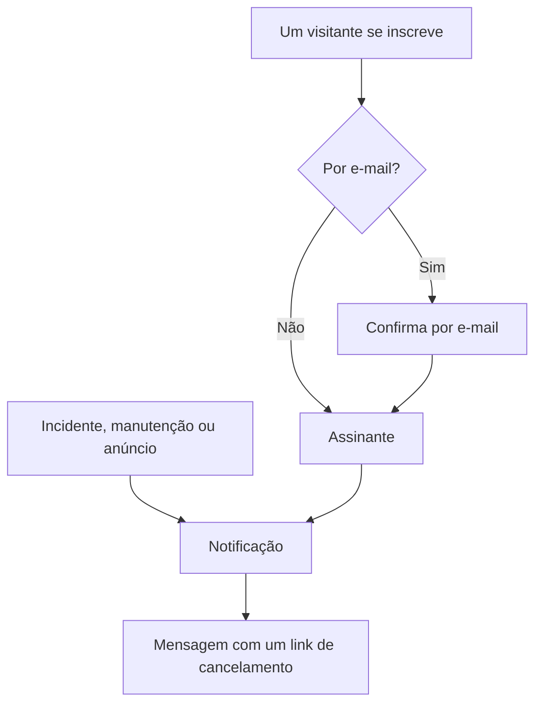

# Assinantes e comunicados

Uma página de status é um lugar aonde as pessoas vão. Os assinantes são as pessoas que preferem não precisar ir: elas entregam a você uma vez um endereço de e-mail, um número de telefone, um webhook do Slack ou um endpoint HTTP, e a partir daí suas atualizações chegam até elas.

Os anúncios são a outra metade do mesmo trabalho. Um monitor pode dizer aos seus visitantes que o checkout está retornando erros 500; nenhum monitor pode dizer a eles que você vai migrar bancos de dados no sábado, que um fornecedor externo está tendo um dia ruim ou que o incidente sobre o qual leram ontem está totalmente encerrado. Os anúncios são o canal de texto livre para tudo o que suas verificações não conseguem ver, e chegam à mesma lista de assinantes.

Esta página cobre os dois: os cinco canais de inscrição e como os visitantes se inscrevem, sobre o que os assinantes podem escolher ser avisados, os fluxos de dupla confirmação e de cancelamento, o relatório por e-mail que os assinantes podem receber todo mês, e como os anúncios são escritos, agendados e transformados em modelos.

:::cards
- [Canais de inscrição](#canais-de-inscrição): Os canais pelos quais os visitantes podem se inscrever, e a página em que se inscrevem.
- [O que os assinantes ficam sabendo](#sobre-o-que-os-assinantes-são-notificados): Anúncios, manutenção, incidentes e episódios, e as edições deles.
- [Verificar o que foi enviado](#verificar-o-que-foi-enviado): O status de cada notificação, e Tentar novamente e Reenviar.
- [Anúncios](#anúncios): Publicar um aviso em uma ou mais páginas de status.
:::

## Como funciona



Cada página de status mantém seus próprios assinantes. Um visitante se inscreve na página **Inscrever-se** da página de status, onde um endereço de e-mail confirma com um link antes de receber qualquer coisa, ou sua equipe o adiciona pelo painel. A partir daí, cada incidente, evento de manutenção programada e anúncio que chega à página notifica seus assinantes, cada um pelo canal com que se inscreveu, e toda mensagem traz o link que cancela a inscrição.

## Canais de inscrição

Uma página de status oferece cinco canais. Eles, e a página em que os visitantes se inscrevem, são ligados em um único lugar: o cartão **Canais** em **Páginas de status → sua página → Assinantes → Configurações de assinantes**. Cada interruptor é salvo assim que você o muda:

- **Mostrar página de assinantes** (`showSubscriberPageOnStatusPage`) — ligado por padrão. Coloca o item **Inscrever-se** na barra de navegação da página de status, onde os visitantes se inscrevem pelos canais abaixo.
- **E-mail** (`enableEmailSubscribers`) — ligado por padrão. Todo o resto fica desligado até você ligá-lo.
- **SMS** (`enableSmsSubscribers`) — desligado por padrão. No OneUptime Cloud, cada SMS é pago com o saldo de SMS e chamadas do projeto, a menos que a página tenha sua própria **Configuração do Twilio** (veja [abaixo](#rodapé-de-e-mail-smtp-próprio-e-twilio)). Ligá-lo também exige **SMS** ligado para o projeto, no cartão **Canais de notificação** em **Configurações do projeto > Notificações > Configurações de notificação**, o que pode ser feito por um proprietário do projeto, um **Billing Admin** ou alguém com **Manage Billing**.
- **Slack** (`enableSlackSubscribers`) — desligado por padrão.
- **Microsoft Teams** (`enableMicrosoftTeamsSubscribers`) — desligado por padrão.
- **Webhook** (`enableWebhookSubscribers`) — desligado por padrão.

Os interruptores decidem como os visitantes podem se inscrever sozinhos, e a página de status recusa uma inscrição por um canal desligado. Eles não interrompem as notificações: os assinantes que sua equipe adiciona pelo painel, com a API ou por um workflow recebem as atualizações quaisquer que sejam os canais ligados.

No OneUptime Cloud, um interruptor que seu plano não inclui mostra ao lado o nome do plano: **Growth** para **SMS** e **Mostrar página de assinantes**, **Scale** para **Slack**, **Microsoft Teams** e **Webhook**. Desligar um canal funciona em todos os planos, então um canal que um teste ligou sempre pode ser desligado de novo; o interruptor diz isso logo abaixo.

Cada canal também tem sua própria lista no menu lateral da página de status, em **Assinantes**: **Assinantes de e-mail**, **Assinantes de SMS**, **Assinantes do Slack**, **Assinantes do MS Teams** e **Assinantes de webhook**. É ali que você vê quem está inscrito, adiciona alguém manualmente ou deixa para si uma entrada **Notas** (`internalNote`) sobre um assinante específico. Enquanto um canal está desligado, o topo da lista dele diz isso, com o interruptor do canal ali mesmo, para que você possa ligá-lo sem sair da lista.

**Um interruptor não basta.** O item **Inscrever-se** na barra de navegação da página de status só aparece quando **Mostrar página de assinantes** está ligado *e* pelo menos um canal está ligado. Se você ligar **E-mail** mas deixar **Mostrar página de assinantes** desligado, os visitantes não têm como chegar ao formulário.

## O que um visitante vê na página Inscrever-se

A página **Inscrever-se** tem um submenu com uma aba para cada canal ligado. Cada aba pede o mínimo de que precisa:

| Aba | Endereço | Título | O que pede |
| --- | --- | --- | --- |
| **E-mail** | `/subscribe/email` | **Inscrever-se por e-mail** | **Seu e-mail**, com o exemplo `subscriber@company.com`. |
| **SMS** | `/subscribe/sms` | **Inscrever-se por SMS** | **Seu número de telefone**, com o exemplo `+11234567890`. |
| **Slack** | `/subscribe/slack` | **Inscrever-se via Slack** | **Nome do workspace do Slack** (usado para validação) e **URL do webhook de entrada do Slack**, com o exemplo `https://hooks.slack.com/services/...`. |
| **MS Teams** | `/subscribe/microsoft-teams` | **Inscrever-se via Microsoft Teams** | **Nome do workspace do Microsoft Teams** e **URL do webhook de entrada do Microsoft Teams**, com o exemplo `https://outlook.office.com/webhook/...`. |
| **Webhooks** | `/subscribe/webhooks` | **Inscrever-se por webhook** | **URL do webhook**, com o exemplo `https://example.com/webhook`. Uma solicitação JSON `POST` é enviada a ela a cada evento da página de status. |

O botão de envio diz **Inscrever-se**. Uma inscrição por SMS, Slack, Microsoft Teams ou webhook mostra *Você foi inscrito com sucesso.* Uma inscrição por e-mail diz que um link de confirmação foi enviado e para verificar a pasta de spam se ele não chegar (veja [Dupla confirmação por e-mail](#dupla-confirmação-por-e-mail)). As abas **E-mail**, **SMS**, **Slack** e **MS Teams** também têm a divisão **Nova inscrição** / **Gerenciar inscrição existente**, para que quem já se inscreveu possa voltar às suas preferências sem procurar uma mensagem antiga.

## Deixar o assinante escolher recursos e tipos de evento

Por padrão, um assinante recebe tudo o que está na página. Dois interruptores no cartão **Configurações avançadas de assinante** mudam isso:

- **Permitir que assinantes escolham recursos** (`allowSubscribersToChooseResources`) — desligado por padrão. Ligue-o e o formulário de inscrição ganha um interruptor **Inscrever-se em todos os recursos**; desligue-o e aparece **Selecionar recursos para inscrever-se**, para que o visitante possa escolher recursos individuais.
- **Permitir que assinantes escolham tipos de evento** (`allowSubscribersToChooseEventTypes`) — desligado por padrão. A mesma forma: um interruptor **Inscrever-se em todos os tipos de eventos**, e **Selecionar tipos de eventos para inscrever-se** abaixo quando ele é desligado.

Com qualquer um deles ligado, o formulário de inscrição continua sendo uma única página. Abaixo de para onde enviar as atualizações (o endereço de e-mail, o número de telefone, o workspace ou o webhook) vem **Preferências**, recolhido em uma linha que diz o que o visitante vai receber. Todo recurso e todo tipo de evento já estão escolhidos, então ela começa como "Você receberá todas as atualizações desta página de status.", e um visitante que quer tudo pressiona **Inscrever-se** sem abri-lo. Os demais abrem **Preferências** e restringem os recursos ou os tipos de evento; recolhida de novo, a linha acompanha o que escolheram ("Você receberá apenas as atualizações dos recursos que escolheu."). Com os dois desligados, não há **Preferências**: o formulário é para onde enviar as atualizações, e depois **Inscrever-se**.

A página **Atualizar inscrição** (veja abaixo) mostra as mesmas escolhas abertas, já que mudá-las é o motivo de um assinante ir até lá.

Os tipos de evento são `Incident`, `Announcement` e `Scheduled Event`.

**Um grupo de monitores representa todos os monitores que contém.** Um recurso da página é um monitor ou um grupo de monitores, e um assinante que escolhe um grupo de monitores é avisado sobre incidentes, eventos de manutenção programada (incluindo as notas deles) e anúncios de qualquer monitor do grupo, exatamente como se tivesse escolhido aquele monitor, que é também como a página de status os mostra. Quem escolheu apenas outros recursos não é avisado, e quem escolheu um monitor e o grupo que o contém recebe uma notificação, não duas.

As escolhas ficam no registro do assinante como **Is Subscribed to All Resources** (`isSubscribedToAllResources`, verdadeiro por padrão), **Is Subscribed to All Event Types** (`isSubscribedToAllEventTypes`, verdadeiro por padrão), **Subscribed to Resources** e **Subscribed to Event Types**.

**Um assinante escolhe entre os recursos da própria página.** **Subscribed to Resources** nomeia recursos da própria página de status do assinante, seja quem for que o grave: um visitante na página, um colega no painel, uma chave de API ou um workflow. Um visitante escolhe entre o que a página mostra a ele, então um recurso cujo monitor está arquivado, e que a página oculta, não é um que ele possa escolher. Um recurso de outra página de status, ou um que a página oculta de um visitante, é recusado com o `400` que nomeia o campo e o ID, assim como um ID que não corresponde a nada. Uma alteração só pergunta pelos recursos que adiciona, então uma inscrição mantém um recurso que já nomeia, como um cujo monitor foi arquivado depois de ser escolhido. Um assinante só é avisado sobre um evento por meio de recursos da própria página.

Bom para: uma página que cobre vários produtos. Um cliente que só usa sua API não quer um aviso toda vez que o site de marketing oscila — deixe que ele mesmo restrinja a lista em vez de vê-lo cancelar a inscrição de vez.

O mesmo cartão também traz **Fusos Horários do Assinante**.

## Dupla confirmação por e-mail

Assinantes de e-mail sempre confirmam. Quando um assinante é criado com um endereço de e-mail e não foi criado já confirmado, **Is Subscription Confirmed** (`isSubscriptionConfirmed`) é forçado para `false` e um **Subscription Confirmation Token** de seis dígitos é gerado. A OneUptime então envia por e-mail um link de confirmação no formato `{statusPageUrl}/confirm-subscription/{statusPageSubscriberId}?verification-token={token}`. O visitante chega a uma página **Confirmar inscrição** e, quando ela é concluída, vê *Inscrição confirmada com sucesso*.

Assinantes de SMS, Slack, Microsoft Teams e webhook pulam isso: são criados com `isSubscriptionConfirmed` já como `true`. O mesmo vale para os assinantes de e-mail que sua equipe adiciona em **Assinantes de e-mail**: ali **Não enviar link de confirmação** vem ligado por padrão. Desligue-o para que o endereço confirme como em uma inscrição.

**Não confirmado significa silêncio.** A consulta que busca os assinantes para uma notificação filtra por `isUnsubscribed: false` e `isSubscriptionConfirmed: true`. Um endereço de e-mail que nunca clicou no link fica na sua lista **Assinantes de e-mail** e não recebe nada. Se alguém jura que está inscrito mas não recebe nada, verifique essa coluna primeiro.

Não há interruptor para desligar a confirmação por e-mail — ela é incondicional para quem se inscreve pela página de status. Uma coluna separada por assinante, **Send You Have Subscribed Message** (`sendYouHaveSubscribedMessage`, verdadeiro por padrão), controla o e-mail "você se inscreveu" enviado quando um assinante é confirmado.

## Gerenciar e cancelar uma inscrição

Toda mensagem que um assinante recebe traz um link de cancelamento no formato `{statusPageUrl}/unsubscribe/{statusPageSubscriberId}-{token}`: no fim de um e-mail, no texto de um SMS ou de uma mensagem do Slack ou do Microsoft Teams, e como `unsubscribeUrl` no payload de um webhook. O token é um segredo aleatório que pertence apenas àquela inscrição, então o link funciona sem entrar. Isso inclui uma página de status privada, onde todo o resto exige um visitante que entrou.

A única exceção é um SMS de uma página de status **public**, que traz em vez disso o link **Atualizar inscrição** do assinante (veja abaixo). Essa página funciona em uma página de status pública sem entrar, e o link dela é 57 caracteres mais curto. Um SMS é cobrado por segmento de 160 caracteres, então o link mais longo levaria a maioria dos textos padrão a mais um segmento. O `{{unsubscribeUrl}}` de um modelo de SMS personalizado segue a mesma regra. Um SMS de uma página de status privada traz o link de cancelamento.

O log de SMS (a aba **SMS** de **Logs de notificação**, na página de status e nas configurações do projeto) guarda o texto de cada SMS, e mais membros do projeto podem lê-lo do que podem gerenciar assinantes. Por isso o log mostra um link de cancelamento com o token substituído por `[redacted]`, por exemplo `{statusPageUrl}/unsubscribe/{statusPageSubscriberId}-[redacted]`. Só o telefone do próprio assinante recebe o link que funciona. A API também nunca devolve o token de um novo assinante, nem mesmo na resposta à solicitação que o criou.

**Abrir o link não muda nada.** A página mostra o nome e o logotipo da página de status e a inscrição à qual o link pertence: um endereço de e-mail completo, um número de telefone mascarado exceto pelos quatro últimos dígitos, o nome de um workspace do Slack ou do Microsoft Teams, ou o host de um webhook. Ela pergunta *Deseja deixar de receber notificações desta página de status?* e só pressionar **Cancelar inscrição** cancela a inscrição, então scanners de e-mail e pré-visualizações de links que abrem todos os links de uma mensagem não conseguem cancelar a inscrição de ninguém. Nada mais da página é mostrado, e nenhum JavaScript personalizado dela é executado. Confirmar duas vezes, ou abrir o link de uma inscrição já cancelada, apenas diz que ela está cancelada. Em uma página de status pública, a página de cancelamento também leva à página **Atualizar inscrição** do assinante, para escolher em vez disso quais notificações receber.

A página **Atualizar inscrição**, `{statusPageUrl}/update-subscription/{statusPageSubscriberId}`, tem o título **Atualizar inscrição** e diz ao visitante que ele pode atualizar suas preferências ou cancelar a inscrição ali. Ela contém:

- Os seletores de recursos e de tipos de evento que a página permite.
- Um interruptor **Cancelar inscrição**, descrito como cancelar a inscrição em todos os recursos. Ele grava **Está Descadastrado** (`isUnsubscribed`, falso por padrão).
- Um botão de envio que diz **Atualizar inscrição**; salvar mostra *Suas alterações foram salvas.*

Em uma página de status privada, ela exige um visitante que entrou, como o resto da página. Quem perdeu o link usa **Gerenciar inscrição existente** na página **Inscrever-se** e pressiona **Enviar link de gerenciamento**. O link vai para a própria inscrição — seu endereço de e-mail, seu número de telefone ou seu canal do Slack ou do Microsoft Teams —, nunca para um endereço da solicitação, e a página responde da mesma forma tendo havido correspondência com uma inscrição ou não, então não pode ser usada para descobrir quem está inscrito. Essa mensagem leva à página **Atualizar inscrição**, e entrega a um modelo personalizado os dois links: `manageSubscriptionUrl` e `unsubscribeUrl`.

Os endpoints por trás de tudo isso são `POST .../subscribe/:statusPageId`, `POST .../manage-subscription/:statusPageId`, `POST .../get-subscription/:statusPageId/:subscriberId`, `PUT .../update-subscription/:statusPageId/:subscriberId`, e `GET` e `POST .../unsubscribe/:statusPageId/:subscriberId/:token`. O `GET` de cancelamento apenas descreve o link. O `POST` cancela a inscrição qualquer que seja o corpo, incluindo o corpo `List-Unsubscribe=One-Click` de uma solicitação de cancelamento com um clique. Os dois dão a mesma resposta para um token errado, um assinante excluído e um assinante de outra página de status, então não podem ser usados para descobrir quem está inscrito.

Cancelar a inscrição muda um indicador em vez de excluir uma linha, então o registro permanece na lista do canal com **Está Descadastrado** marcado — útil quando você precisar explicar depois por que um endereço específico parou de receber e-mails. Isso também registra **Inscrição cancelada em** (`unsubscribedAt`), seja quem for que cancelou a inscrição: o assinante pelo link ou pela página **Atualizar inscrição**, ou um colega pelo painel ou pela API. Cada lista de assinantes tem uma coluna e um filtro **Inscrição cancelada em**. Desligar **Está Descadastrado** de novo o limpa. Inscrições canceladas antes de a OneUptime registrar isso não têm data.

Links em mensagens enviadas antes de existir a página de cancelamento continuam funcionando: um link **Atualizar inscrição** ainda abre aquela página. Mensagens muito antigas traziam `/api/status-page-subscriber/unsubscribe/{statusPageSubscriberId}`, que cancelava a inscrição assim que era aberto. Ele não muda mais nada: leva à página de cancelamento, que diz que o link está desatualizado e para usar o de uma mensagem recente.

### Endereços compartilhados e listas de e-mail

Qualquer pessoa que consiga ler uma caixa de entrada pode cancelar a inscrição dela. Para um endereço que alguém inscreveu por conta própria, essa é a ideia. Para um que sua equipe adicionou, como a lista de e-mail de um local, por exemplo `site03-all@`, isso significa que um único leitor pode tirar da página todos os que estão na lista antes da próxima indisponibilidade. Então:

- **Adicione as pessoas pelos próprios endereços sempre que puder.** O formulário **Adicionar em massa** e o formulário de assinante de e-mail dizem isso, na descrição do campo de e-mail.
- **A equipe é avisada.** Um assinante que sua equipe adicionou é um adicionado pelo painel, com uma chave de API (a API REST, o Terraform, um script) ou por um workflow; a API o lê como **Is Added By Team** (`isAddedByTeam`). Quando um deles cancela a inscrição, pelo link ou pela página **Atualizar inscrição**, os proprietários da página de status (seus usuários proprietários e os membros de suas equipes proprietárias) recebem cada um um e-mail que nomeia o assinante, com um link para a lista de assinantes da página. O colega que o adicionou também recebe, quando foi um colega. Uma página sem proprietários envia o e-mail apenas a esse colega, então um assinante que uma chave de API ou um workflow adicionou a uma página sem proprietários não é informado. Pessoas que se inscreveram sozinhas na página de status nunca são informadas. Assinantes que uma chave de API ou um workflow adicionou antes de a OneUptime registrar isso não podem ser distinguidos de inscrições, e também não são informados.
- **As listas de assinantes mostram isso.** Acima de cada lista, um aviso nomeia os assinantes adicionados pela sua equipe que cancelaram a inscrição nos últimos 30 dias.

A página de cancelamento avisa o leitor de uma inscrição assim antes que ele confirme: se for um endereço compartilhado, cancelar a inscrição interrompe as notificações para todos que as recebem, e a equipe será avisada.

## Sobre o que os assinantes são notificados

Os assinantes são avisados sobre os três tipos de evento acima, mas cada origem tem seu próprio interruptor, então nada é enviado por acidente.

### Notificações de anúncio

O próprio anúncio traz **Should subscribers be notified?** (`shouldStatusPageSubscribersBeNotified`), exposto no formulário de criação como a caixa de seleção **Notificar assinantes da página de status** em **Agendamento e notificações**, e ligado por padrão. Os assinantes são avisados uma vez, quando o anúncio começa a ser exibido, então isso é decidido quando o anúncio é criado; uma edição não pode mudá-lo. Um workflow que o grava depois apenas o armazena: gravá-lo de volta sem mudança nunca envia o anúncio de novo, ligá-lo não o envia, e desligá-lo antes de a notificação sair pula a notificação. Se o anúncio nomeia monitores em **Monitores afetados**, a notificação fica limitada a esses monitores: em uma página em que os assinantes escolhem recursos, ela vai para os assinantes desses monitores, dos grupos de monitores que os contêm e de todos os recursos. Deixe vazio e todos os assinantes são notificados. Em uma página de status que não lista nenhum desses monitores, nem diretamente nem por um grupo, o anúncio é para todos que leem aquela página, então todo assinante dali que recebe anúncios é notificado.

### Eventos de manutenção programada

Um evento de manutenção programada tem seu próprio conjunto de colunas para assinantes: **Should subscribers be notified when event is created?**, **Should subscribers be notified when event is changed to ongoing?**, **Should subscribers be notified when event is changed to ended?**, além de **Subscriber notifications before the event** e **Next subscriber notification before the event at?** para avisos antecipados. **Páginas de status** no evento decide em quais páginas ele aparece, e **Should be visible on status page?** decide se ele aparece.

**Criar Evento de Manutenção Programada** percorre duas etapas e depois uma revisão, como faz **Declarar incidente**:

1. **Evento** — **Título**, **Descrição**, **Começa em** e **Termina em**. Um novo evento começa na próxima hora cheia do seu relógio e dura uma hora; mude os horários só quando estiverem errados. Mover **Começa em** move **Termina em** junto, para que a janela mantenha a duração, e o evento precisa terminar depois de começar. **Proprietários** e **Rótulos** esperam em **Mais campos**.
2. **Recursos afetados** — primeiro **Monitores**, e logo abaixo **Alterar status do monitor para** assim que um monitor é escolhido: os monitores passam para esse status quando o evento começa, e voltam a operacionais quando ele termina. Depois **Outros recursos afetados**: os hosts, clusters, hosts de contêineres, bancos de dados, frotas de IoT, sites de rede e serviços que a manutenção afeta. Depois **Mostrar evento nestas páginas de status**, e depois **Notificações aos assinantes**, recolhido em uma linha que diz o que vai acontecer. Por padrão ela diz "Os assinantes das páginas de status do evento são notificados quando ele é agendado, quando começa e quando termina." Abra-o para mudar **Quando o evento é agendado**, **Quando o evento começa**, **Quando o evento termina** e **Lembretes antes do evento**; a linha acompanha o que você marca, e a etapa de revisão também a mostra.

A partir da aba **Manutenção programada** de um host, de um cluster Kubernetes, Proxmox, Ceph ou Docker Swarm, de um host Docker ou Podman, de um vCenter, de um storage array, de uma frota de IoT, de um banco de dados, de um serviço ou de um site de rede, **Criar Evento de Manutenção Programada** (e **Criar a partir de modelo**) abre o mesmo formulário com esse recurso já escolhido em **Outros recursos afetados**, e a trilha de navegação volta para essa aba. A aba **Manutenção programada** de um item do inventário escolhe o host, o serviço ou o cluster Kubernetes para o qual o item aponta, e a trilha de navegação volta passando pela aba desse recurso.

Só o título precisa ser digitado: todo o resto tem um padrão, então **Próximo** percorre as outras etapas sem pedir nada, e **Criar Evento de Manutenção Programada** fica na revisão no fim. Ninguém é notificado até você escolher uma página de status. As três configurações **Quando o evento…** são escolhidas quando o evento é criado, e um workflow que grava **Quando o evento é agendado** depois apenas o armazena: gravado de volta sem mudança ou ligado, não envia nada, e desligado antes de a notificação de "agendado" sair, essa notificação é pulada. O botão **Editar** do cartão **Maintenance Details** do evento muda o título, a janela e os rótulos dele (**Evento**) e suas páginas de status e lembretes (**Páginas de status**). O botão **Editar** do cartão **Recursos afetados** pergunta da mesma forma que o formulário: **Monitores**, depois **Alterar status do monitor para** quando há um monitor, depois **Outros recursos afetados**, e o cartão mostra o status abaixo dos monitores. Quem pode editar o evento pode mudar o status dos monitores dele até o evento começar. Quando ele começa — no horário de início, ou quando alguém o move manualmente para um estado em andamento, pelo Slack ou pelo Microsoft Teams, ou pela API —, os monitores dele passam para o status que ele tem naquele momento, assim como os monitores adicionados enquanto ele está em andamento. Movê-lo de **Scheduled** direto para um estado seu posicionado entre **Ongoing** e **Ended**, como "Verifying", o inicia da mesma forma: os monitores dele passam para o status dele, como fariam em **Ongoing**, e voltam a operacionais quando ele termina. Daí em diante o status não pode mais ser mudado: o **Editar** do cartão o mostra somente para leitura, com "O evento já começou, então isso não pode mais ser alterado.", e a API recusa uma mudança com "Change Monitor Status to can no longer be changed: this event has already started." Gravar de volta o status que o evento já tem continua sendo aceito. Os modelos de manutenção programada (**Configurações → Modelos de eventos**) usam as mesmas etapas, com o nome do modelo na frente e o agendamento recorrente dele no fim. Um modelo pede **Alterar status do monitor para** nomeie ele monitores ou não, porque o status dele também se aplica aos monitores escolhidos quando um evento é agendado a partir dele. O cartão **Recursos afetados** de um modelo existente pergunta da mesma forma e mostra o status que o modelo escolhe, ou **Os monitores mantêm seu status.** quando ele não escolhe nenhum; quem pode editar o modelo pode mudá-lo ali.

**Quais páginas de status?** Assim que o evento nomeia monitores, as páginas de status que os mostram são sugeridas em **Mostrar evento nestas páginas de status**: "Páginas de status que mostram os monitores afetados:" seguido do nome de cada página. Clique em um nome para adicionar aquela página, ou em **Adicionar todas** para adicionar todas. Uma página conta quando lista um dos monitores, diretamente ou por um grupo de monitores. Só são sugeridas as páginas de status que você pode ver, e páginas arquivadas e páginas que não mostram eventos de manutenção programada ficam de fora. Nada é escolhido por você: uma página de status que você escolhe mostra o evento e, com as notificações padrão, avisa os assinantes dela, então isso continua sendo escolha sua. A etapa **Páginas de status** do **Editar** do evento e os formulários de um modelo de manutenção programada sugerem da mesma forma, a partir dos monitores do evento ou do modelo.

**Estados seus.** Um evento está em andamento em **Ongoing** e em todo estado seu posicionado entre **Ongoing** e **Ended** — uma etapa "Verifying", por exemplo. Um estado seu posicionado antes de **Ongoing** ainda não começou, e um posicionado depois de **Ended** — "Reviewing" — já terminou. Tudo o que pergunta se um evento está em andamento aplica essa única regra. Um evento assim aparece como em andamento nas suas páginas de status — na visão geral, na própria página do evento e no feed RSS — e nas listas **Ongoing** em **Manutenção programada** e **Início**, nos badges do menu delas e no bloco **Manutenção em andamento** em **Início**, e o aplicativo do Microsoft Teams o lista como manutenção em andamento. Os monitores dele continuam em manutenção, os sites de rede e as séries de telemetria que ele cobre continuam silenciados, e os alertas de burn rate de SLO dos monitores dele são retidos. No **Termina em** dele, ele é encerrado como um evento em andamento, e os assinantes dele são avisados se **Quando o evento termina** estiver ligado. Movê-lo de **Ongoing** ou "Verifying" direto para um estado seu posicionado depois de **Ended** o encerra como **Ended** faz: os monitores dele voltam a operacionais, e o cabeçalho do evento mostra quanto tempo ele levou. Movê-lo de **Ongoing** para "Verifying", ou de **Ended** para "Reviewing", não inicia nem encerra nada de novo. A posição de um estado é a posição dele na lista da página **Estado do evento**, em **Manutenção programada → Configurações**.

**Esperando para começar, encerrado e concluído.** A mesma posição diz o resto. Um evento espera pelo **Começa em** dele em **Scheduled** e em todo estado seu posicionado entre **Scheduled** e **Ongoing** — uma etapa "Confirmed", por exemplo. No horário de início, ele começa a partir dali como começa a partir de **Scheduled**: passa para **Ongoing**, os monitores dele passam para o **Alterar status do monitor para** dele, os proprietários dele são avisados e os assinantes também, se **Quando o evento começa** estiver ligado. Até lá ele aparece entre os eventos futuros — na visão geral, na página de eventos agendados e no feed RSS das páginas de status dele, e quando alguém pede ao aplicativo do Microsoft Teams a manutenção programada —, e os lembretes antes do evento continuam sendo enviados aos assinantes dele. O feed dele e a linha do tempo da página de status dele mostram um estado assim com o relógio que mostram para **Scheduled**. Um estado seu posicionado antes de **Scheduled** — um "Draft" ou uma etapa de aprovação — também não começou, mas espera por uma pessoa: nada inicia um evento ali no horário dele, e ele não aparece como futuro. Um evento está encerrado em **Ended**, em **Completed** e em todo estado seu posicionado depois de **Ended**, e a **Visão geral** do evento o trata como encerrado em toda parte — o cabeçalho dele, o cartão **Medições** dele e a linha do tempo que mostra. Ele está concluído em **Completed** e em todo estado seu posicionado depois dele — "Archived": é isso que interrompe os lembretes dos proprietários dele (**Remind until event is Completed**), aquilo para o que o Slack e o Microsoft Teams recusam **Mark as Complete**, e o que o feed dele e a linha do tempo da página de status dele marcam como feito. Em **Ended**, ou em "Reviewing" entre **Ended** e **Completed**, ele está encerrado mas ainda não concluído.

**Os sites de rede acompanham cada mudança de estado.** Os sites de rede que um evento cobre deixam de contar a indisponibilidade planejada dele contra os sites acima deles enquanto ele está em andamento. Cada mudança de estado do evento recalcula o status deles na hora, nas duas direções — também quando ele volta, como acontece quando a entrada do estado em que ele está é excluída da **Linha do tempo de estado** dele: movido de volta de "Verifying" para **Scheduled**, ele para de silenciá-los na hora, em vez de na próxima varredura, que continua rodando a cada cinco minutos como rede de segurança.

**O que o feed registra para uma edição.** Uma edição adiciona uma entrada **Scheduled Maintenance was updated.** ao **Agendado Manutenção Feed** do evento — publicada também nos canais do Slack e do Microsoft Teams dele — com uma linha para cada coisa que mudou: o título, **Começa em**, **Termina em**, a descrição, os lembretes antes do evento, o que o evento afeta, **Alterar status do monitor para**, as páginas de status em que ele é mostrado e os rótulos dele, cada um com o novo valor. Um valor salvo como estava não ganha linha, então salvar o cartão **Maintenance Details** sem mudar nada — ele envia o título, a janela, os rótulos, as páginas de status e os lembretes toda vez — ou um cliente de API, um workflow ou o Terraform gravando o evento de volta como está não adiciona entrada nenhuma. Um horário é o mesmo quando nomeia o mesmo instante, seja como for escrito — um escrito sem fuso horário é UTC, como é armazenado —, e os lembretes, as páginas de status, os recursos afetados e os rótulos são o mesmo conjunto em qualquer ordem. Tirar todos os lembretes, todas as páginas de status ou todos os rótulos é registrado como "No reminders before the event.", "Not shown on any status page." ou "All labels removed.", e tirar o último recurso afetado além dos monitores — o último host, cluster ou serviço, por exemplo — como "No other affected resources.". A regra de lembrete do evento é correspondida de novo, e a espera pelo próximo lembrete dele recomeça, apenas quando os rótulos dele mudam ou o interruptor **Enviar lembretes** dele é alternado. Uma regra de lembrete (**Manutenção programada → Regras → Reminder Rules**) com **Remind While Event is Scheduled** desligado conta o primeiro lembrete a partir do início do evento, então mover **Começa em** para outro horário move esse lembrete junto enquanto o início ainda está por vir; os lembretes de uma regra que lembra enquanto o evento está agendado ficam onde estão. O feed de um monitor registra da mesma forma uma edição do nome, da descrição e dos rótulos dele.

Se um evento é criado com **Quando o evento é agendado** desligado (em **Notificações aos assinantes**, na etapa **Recursos afetados** do formulário de criação), as novas notas públicas nele começam com **Notify status page subscribers** desligado, com uma linha abaixo da caixa de seleção explicando o motivo. Isso vale na página **Notas públicas** do evento e em **Add Public Note** no **Agendado Manutenção Feed**, que abre o mesmo editor de notas. Notas publicadas sem uma escolha explícita seguem a mesma configuração **Quando o evento é agendado**: notas do Slack e do Microsoft Teams, workflows e solicitações de API que omitem `shouldStatusPageSubscribersBeNotifiedOnNoteCreated`. Um `true` ou `false` explícito é sempre mantido. **Quando o evento é agendado** desliga apenas o anúncio enviado quando o evento é criado. Os lembretes (**Subscriber notifications before the event**, definidos com **Lembretes antes do evento** no formulário de criação) e as notificações definidas por **Quando o evento começa** e **Quando o evento termina** são configurações separadas e continuam sendo enviadas. Se os assinantes já ficaram sabendo do evento dessa forma, por exemplo por um lembrete ou pela notificação de em andamento, marque a caixa para avisá-los sobre a nota.

A janela **Marcar a manutenção programada como `<state name>`**, aberta pelos botões no topo da página **Visão geral** do evento, tem uma única caixa de seleção **Notificar assinantes da página de status** que cobre tanto a mudança de estado quanto a **Nota pública** da janela (recolhida em **Adicionar uma nota pública**). Em um evento criado com **Quando o evento é agendado** ligado, ela começa ligada, como antes. Em um evento criado com ele desligado, ela começa desligada, com a mesma linha abaixo, exceto em dois casos em que começa ligada, de acordo com o que a mudança de estado automática anunciaria:

- Você move o evento para o estado em andamento dele, ou de um estado em que ele não começou para um estado seu posicionado entre **Ongoing** e **Ended** (ele começa), e **Quando o evento começa** está ligado.
- Você move o evento para um estado encerrado ou concluído, ou de um estado em que ele está em andamento para um estado seu posicionado depois de **Ended** (ele termina), e **Quando o evento termina** está ligado.

**Uma nota enviada com uma mudança de estado é a única mensagem.** Escreva uma **Nota pública** nessa janela (ou na ação em massa **Alterar estado**) com **Notificar assinantes da página de status** ligado, e os assinantes recebem a nota, em todos os canais, em vez de uma mensagem separada de mudança de estado: uma mensagem, não duas. A mudança de estado mostra **Notificações enviadas**, e a mensagem de status dela diz que a nota a levou. A nota é publicada depois que a mudança de estado é salva: ela vem depois da mudança no feed do evento e no Slack e no Microsoft Teams, e uma mudança de estado que não é salva não publica nota nenhuma nem avisa ninguém. Uma nota só com espaços não é publicada, e os assinantes recebem a mensagem da mudança de estado. Com a caixa desligada, nem a mudança de estado nem a nota dela avisam ninguém. Pela API, a nota vai com a mudança de estado em `"miscDataProps": {"publicNote": "..."}` em `POST /api/scheduled-maintenance-state-timeline`, e `shouldStatusPageSubscribersBeNotified` decide pelas duas (omitido, a mudança de estado notifica e a nota dela não). Os incidentes funcionam da mesma forma; veja [Estados e severidades de incidentes](/docs/incidents/states-and-severities#avisar-os-assinantes-da-página-de-status-sobre-uma-mudança-de-estado).

**A nota nomeia o novo estado.** Como é a única mensagem, uma nota enviada com uma mudança de estado diz como o evento está agora, em todos os canais, como fazia a mensagem de mudança de estado: o assunto do e-mail é `[Ongoing Scheduled Maintenance] <title>` e os detalhes dele mostram uma linha **Status**, o SMS diz `Maintenance <title> on <status page> is Ongoing.`, as mensagens do Slack e do Microsoft Teams trazem uma linha `**Status:** Ongoing`, e o payload `ScheduledMaintenanceNoteCreated` do webhook traz `scheduledMaintenanceState` em `data`. Uma nota publicada sozinha é lida como sempre. Publicar a nota exige **Create Scheduled Maintenance Status Page Note** (as funções integradas de manutenção programada e de projeto têm essa permissão): a quem não a tem não é oferecido **Adicionar uma nota pública**, e uma mudança de estado que essa pessoa envia com uma nota é recusada, então o evento mantém o estado em vez de mudar sem que ninguém seja avisado.

O formulário manual na página **Linha do tempo de estado** do evento e a ação em massa **Alterar estado** na lista de manutenção programada não olham essas configurações: a caixa de seleção **Notificar assinantes da página de status** deles sempre começa ligada.

Eventos criados a partir de um modelo herdam **Quando o evento é agendado** do modelo, junto com as outras configurações de assinantes dele. **Criar a partir de modelo** preenche o formulário de criação com os valores do modelo, e os eventos recorrentes agendados por um modelo em **Configurações → Modelos de eventos** os copiam.

### Incidentes

`Incident` é o terceiro tipo de evento. O que faz um incidente chegar a uma página de status, para começar — quais recursos ele afeta e quais estados o mantêm visível —, é tratado em [Estados e severidades de incidentes](/docs/incidents/states-and-severities). As notas públicas de um incidente declarado sem notificar os assinantes começam com **Notificar assinantes da página de status** desligado; veja [Notas, responsáveis e feed de incidentes](/docs/incidents/notes-owners-and-feed#publicar-uma-nota-pública).

As mensagens de um incidente — criado, mudança de estado, nota pública e post-mortem — vão para os assinantes de toda página de status que lista um dos monitores dele. Duas configurações restringem isso. **Limitar a estas páginas de status** no incidente o mantém nas páginas que você escolhe entre essas, e **Mostrar apenas incidentes limitados a esta página** em uma página de status mantém longe todo incidente que não está limitado a ela. Para um incidente limitado a páginas específicas, um endereço de e-mail ou número de telefone inscrito em várias delas recebe um e-mail ou SMS por envio, não um por página; mensagens de webhook, Slack e Microsoft Teams nunca são mescladas. O formulário de declaração e a página **Notas públicas** mostram quem será notificado antes de qualquer envio. Veja [Uma página de status por público](/docs/status-pages/one-status-page-per-audience).

#### O post-mortem

Os assinantes ficam sabendo do post-mortem de um incidente uma vez, quando ele é publicado: a primeira vez que a página de status o mostra. A página de status mostra um post-mortem quando **Publicar na Página de status** está ligado e o post-mortem tem uma nota; os anexos dele são mostrados com a nota, nunca sem ela. Então ligar a publicação sobre uma nota escrita o publica, assim como escrever a nota de um post-mortem que está ligado. **Notificar assinantes**, no mesmo formulário, decide se eles são avisados. Depois disso:

- **Salvá-lo de novo não avisa ninguém.** O formulário **Editar nota do post-mortem** envia o post-mortem inteiro a cada salvamento, e um cliente de API, o Terraform ou um workflow pode gravar o incidente inteiro de volta; o que já estava publicado não é novidade.
- **Editar um post-mortem publicado também não avisa ninguém.** A página de status mostra a nova nota na hora, e o feed do incidente a registra uma vez, como **Postmortem Note updated**, mas os assinantes já foram avisados. Espaços em volta da nota não contam como mudança.
- **Tirá-lo da página de status não avisa ninguém, e publicá-lo de novo os avisa de novo**: eles o viram sumir. Esvaziar a nota de um post-mortem publicado também o tira da página de status.
- **Um post-mortem ligado sem nota não mostra nada**, então ninguém é avisado até que a nota dele seja escrita.
- **Um post-mortem publicado enquanto o incidente dele está oculto é enviado quando o incidente se torna visível.** A página de status só mostra um post-mortem em um incidente que ela mostra — **Visível na página de status** ligado, e o incidente não privado —, então ninguém é avisado enquanto o incidente está oculto, e o status da notificação diz **Ainda não enviado: incidente oculto nas páginas de status**. Ligar **Visível na página de status** o envia, uma vez (para um incidente privado, junto com desligar **Incidente privado**), e o interruptor na página **Configurações** do incidente avisa você disso antes de salvar. Ocultar o incidente e mostrá-lo de novo não envia mais nada, e mostrar um incidente cujo post-mortem já foi enviado, ou não está publicado, não envia nada. Um post-mortem que uma versão anterior pulou dessa forma é enviado da mesma maneira se o incidente dele ainda estava oculto quando você atualizou; um cujo incidente foi tornado visível desde então fica sem envio, porque a página de status já o mostrou desde então.
- **Notificar assinantes é lido quando a notificação sai.** Um post-mortem publicado com ele desligado não é anunciado, e ligá-lo depois não envia a notificação sem a qual ele foi publicado.

O status da notificação fica na página **Post-mortem** do incidente; uma que falhou oferece **Tentar novamente** (veja [Tentar novamente e reenviar](#tentar-novamente-e-reenviar)). Pela API, gravar `showPostmortemOnStatusPage` como `true` sobre um `postmortemNote` escrito o publica, mesmo quando a solicitação grava o incidente inteiro de volta, incluindo o status de notificação dele como está, e tornar visível um incidente oculto — gravar `isVisibleOnStatusPage` como `true`, e `isPrivate` como `false` para um privado — envia um post-mortem que espera por isso. Gravar `subscriberNotificationStatusOnPostmortemPublished` como `Pending` o envia de novo. Uma notificação que já está aguardando ou sendo enviada não entra na fila uma segunda vez, e um post-mortem publicado enquanto uma estava sendo preparada ainda é anunciado uma vez. O rascunho automático de post-mortem da IA nunca é gravado em um post-mortem que está ligado, então um rascunho não revisado nunca chega aos assinantes.

#### Pré-visualizar o e-mail antes do envio

**Pré-visualização** é um pequeno link ao lado do valor que ela pré-visualiza: ao lado de **Sim** em **Notificar assinantes da página de status** na última etapa de **Declarar novo incidente**, e ao lado da caixa de seleção **Notificar assinantes da página de status** enquanto você escreve uma nota pública. Ela abre **Pré-visualização da notificação**, que mostra o e-mail que os assinantes de cada página de status vão receber, montado e renderizado pelo mesmo código, modelo e configurações com que a notificação é enviada, então o que você vê é o que eles recebem:

- escolha uma página de status para ver o e-mail dela, com o assunto e as contagens "até" por canal;
- uma linha diz qual modelo é usado e por quê, por exemplo que o modelo personalizado da página não é usado porque a página não tem **Configuração SMTP Personalizada**;
- quando nada vai ser enviado (sem monitores, um incidente privado ou oculto, **Notificar assinantes da página de status** desligado, ou nenhuma página de status que mostre o incidente), ela diz isso em vez de mostrar um e-mail.

Só são pré-visualizadas as páginas de status que você pode ver; as outras são contadas. O e-mail é mostrado em um quadro isolado que não executa scripts. O link de cancelamento dele é um exemplo, porque o e-mail de cada assinante traz o seu.

**Enviar teste para mim** envia o e-mail da página mostrada para o e-mail da sua conta, com `[Test]` no início do assunto, pela **Configuração SMTP Personalizada** da página quando ela tem uma. Ele nunca envia para nenhum outro endereço, exige que o e-mail da sua conta esteja verificado, e cada pessoa pode enviar dez e-mails de teste a cada 15 minutos.

#### Campos personalizados de incidentes nas notificações

Os campos personalizados de incidentes com **Incluir nas notificações aos assinantes** ligado (em **Incidentes → Configurações → Campos personalizados**) saem com as mensagens do incidente — criado, mudança de estado, nota pública publicada ou atualizada, e post-mortem. Isso funciona em todo plano que tem campos personalizados; não precisa nem de um modelo personalizado nem de SMTP personalizado.

- **E-mail** os lista na caixa de detalhes, abaixo das linhas do próprio incidente, na **Ordem** dos campos. Um campo para o qual o incidente não tem valor fica de fora. Um campo sim/não diz **Sim** ou **Não**, uma data é o dia escolhido (o mesmo dia para todo destinatário, esteja onde estiver, para uma data escolhida em qualquer fuso horário de UTC−10:59 a UTC+13), uma data e hora é mostrada nos fusos horários de assinante da página de status, o texto longo mantém as linhas dele, e o rich text é mostrado formatado, com as mesmas regras de links das notas. As imagens embutidas dele ficam visíveis para as pessoas a quem é enviado, quando a primeira mensagem que o traz é enviada.
- **Slack** e **Microsoft Teams** os listam da mesma forma, um por linha.
- Os payloads de **Webhook** os trazem em `data.customFields`, com a **Variável de modelo** de cada campo como chave: `{ "name": ..., "type": ..., "value": ... }`, com o valor como está armazenado (`null` quando o incidente não tem nenhum). As chaves não mudam quando um campo é renomeado.
- **SMS** os deixa de fora. Uma mensagem de texto é cobrada por segmento e a padrão já está perto de um; um modelo de SMS personalizado pode colocar qualquer campo com `{{incident.customFields.<key>}}`.
- As notificações de **Incident episode** não trazem campos personalizados: um episódio agrupa incidentes que têm cada um seus próprios valores. As notificações de cada incidente membro trazem os campos dele.

A entrada **Notificação de assinante enviada** no feed do incidente lista, em **Custom fields sent**, os valores que cada envio colocou em uma mensagem. Os assinantes geralmente são de fora da sua equipe, então ligue a configuração apenas para campos que podem ser compartilhados com eles com segurança.

A seção **Logs de notificação** no menu lateral da página de status (`{id}/notification-logs`) é aonde você vai quando precisa ver o que a página realmente enviou.

### Episódios de incidentes

Um episódio de incidente registra em `shouldStatusPageSubscribersBeNotifiedOnEpisodeCreated` se os assinantes foram avisados de que ele foi criado. Episódios criados com o botão **Criar episódio** ou por **Regras de agrupamento** o têm ligado; uma solicitação de API pode criar um com ele como `false`.

Em um episódio criado com ele como `false`, as novas notas públicas começam com **Notify status page subscribers** desligado, com uma linha abaixo explicando o motivo, na página **Notas públicas** do episódio e em **Add Public Note** no **Feed do episódio**, que abre o mesmo editor de notas. Você ainda pode marcá-la. Notas publicadas sem uma escolha explícita seguem a mesma configuração: notas do Slack, workflows e solicitações de API que omitem `shouldStatusPageSubscribersBeNotifiedOnNoteCreated`. Um `true` ou `false` explícito é sempre mantido. Só essa configuração conta: diferentemente de um incidente, tornar um episódio privado não muda como a caixa começa.

Isso cobre apenas as notas públicas. As mudanças de estado do episódio (**Confirmar**, **Resolver** e a resolução automática) continuam notificando os assinantes, porque nem a janela de mudança de estado do episódio nem o formulário na página **Linha do tempo de estado** dele têm uma caixa de seleção **Notificar assinantes da página de status**.

Um episódio criado em um estado posterior — com **Estado Inicial** no formulário **Criar episódio**, ou um estado enviado pela API — é anunciado uma vez, pela notificação de criação dele: o primeiro estado dele nunca é enviado sozinho como mudança de estado, qualquer que seja, e um episódio criado com `shouldStatusPageSubscribersBeNotifiedOnEpisodeCreated` como `false` não o anuncia de jeito nenhum. A primeira linha da linha do tempo de estados dele registra essa notificação como pulada, com o motivo.

### Avisar os assinantes sobre uma edição

Os assinantes ficam sabendo de um anúncio ou de uma nota pública uma vez, quando ele é publicado. Editá-lo depois muda o que a página de status mostra, mas não avisa ninguém, a menos que você peça isso naquela edição.

O formulário de edição de um anúncio, e de uma nota pública em um incidente, um evento de manutenção programada ou um episódio de incidente, tem uma caixa de seleção **Notificar os assinantes sobre esta atualização**. Ela começa desmarcada toda vez, então a correção de um erro de digitação fica silenciosa; marque-a quando a mudança importa — uma nova janela de manutenção, um impacto revisado, uma atualização corrigida para os clientes. Ela não está nos formulários de criação, que têm sua própria escolha **Notificar assinantes da página de status**. Em um anúncio, ela fica na etapa **Anúncio**, logo abaixo da descrição.

Quando você salva com a caixa marcada, os assinantes recebem o conteúdo editado marcado como uma atualização em vez de uma nova publicação:

- **E-mail** usa seu próprio modelo — por exemplo o assunto `[Announcement Updated] <title>` e o título `Announcement Updated: <title>`, ou **Updated Note** na caixa de detalhes de um e-mail de nota.
- **SMS**, **Slack** e **Microsoft Teams** dizem que o anúncio ou a nota foi atualizado.
- Os assinantes de **Webhook** recebem `AnnouncementUpdated`, `IncidentNoteUpdated`, `ScheduledMaintenanceNoteUpdated` ou `EpisodeNoteUpdated` como `eventType`, com o conteúdo mais recente em `data`.

A atualização vai para as mesmas pessoas que o original alcançaria hoje: os mesmos interruptores de canal, as mesmas preferências de recurso e de tipo de evento, e as mesmas verificações de visibilidade (um incidente oculto ou uma página com **Mostrar anúncios** desligado continua não enviando nada).

Dois casos não enviam nada de propósito, e registram o motivo:

- **A notificação original ainda não saiu.** Se um anúncio ou nota ainda está esperando para ser anunciado, essa notificação lê o item quando é enviada e já traz sua edição, então uma mensagem separada de "atualizado" só confundiria as pessoas. Se o original está sendo enviado naquele momento, a atualização espera e sai quando o original termina: esse envio leu o item antes da sua edição, então os assinantes podem ter recebido o texto de antes dela.
- **O anúncio está agendado para mais tarde.** Até **Começar a mostrar anúncio em** passar, ele não está em nenhuma página de status, e quem for notificado quando ele entrar no ar vê a versão editada.

O item editado mostra um **Status de notificação de atualização** ao lado do original, com os mesmos estados (**Sending Soon**, **Notificações enviadas**, **Falhou** e assim por diante). **Tentar novamente** em uma notificação de atualização que falhou envia a atualização de novo, nunca a mensagem original de "publicado". Cada página de status pode personalizar essas mensagens com os tipos de evento de modelo **Subscriber Announcement Updated**, **Subscriber Incident Note Updated**, **Subscriber Scheduled Maintenance Note Updated** e **Subscriber Episode Note Updated**; sem um modelo personalizado, é usado o texto de atualização integrado.

Pela API, envie a escolha junto com os campos que você muda, em `miscDataProps`:

```json
{
  "data": {
    "description": "The maintenance now starts on Sunday at 02:00 UTC."
  },
  "miscDataProps": {
    "notifySubscribersOfUpdate": true
  }
}
```

como corpo de `PUT /api/status-page-announcement/<announcement-id>` (ou de `incident-public-note`, `scheduled-maintenance-public-note`, `incident-episode-public-note`). Omita `miscDataProps` e a edição fica silenciosa, como antes.

## Verificar o que foi enviado

Toda notificação a assinantes tem um status próprio, ao lado daquilo de que ela trata. Para um incidente, é a notificação de "criado" dele na **Visão geral** do incidente, cada linha da **Linha do tempo de estado** dele, cada nota pública e o **Post-mortem** dele. Eventos de manutenção programada e anúncios mostram os deles da mesma forma, e os episódios de incidente nas notas públicas deles. Clique no status para ler a mensagem dele, que diz o que aconteceu. As notas públicas mostram o status como um badge com texto próprio:

| Status | Em uma nota pública | O que significa |
| --- | --- | --- |
| **Sending Soon** | **Notifying subscribers soon** | Na fila. O job que a envia roda a cada minuto. |
| **Notifications Being Sent** | **Notifying subscribers** | O job está percorrendo os assinantes. |
| **Notificações enviadas** | **Subscribers notified** | Saiu. Veja abaixo o que isso significa. |
| **Falhou** | **Notification failed** | Nem todo assinante a recebeu, ou o envio parou. A mensagem diz o que foi enviado e o que **Tentar novamente** faz. |
| **Notifications skipped.** | **Subscribers not notified** | Não havia nada para enviar, por exemplo porque o incidente está oculto das páginas de status. A mensagem diz por quê. |

### Como um envio é contado

As notificações de incidentes e de episódios de incidente — criado, mudança de estado, nota pública publicada ou atualizada, e post-mortem — são contadas mensagem por mensagem:

- **Uma mensagem conta como enviada** quando o servidor de e-mail ou o provedor de SMS a aceitou, ou quando o endpoint do Slack, do Microsoft Teams ou do webhook respondeu. "Enviada" é até onde a OneUptime consegue ver: um servidor de e-mail ainda pode devolver um e-mail depois.
- **Uma mensagem conta como falha** quando é recusada, quando enviá-la dá erro ou quando não recebe resposta em 4 minutos. Uma única falha deixa a notificação como **Falhou**; os outros assinantes continuam a recebê-la.
- **Todo assinante é alcançado.** Os assinantes de uma página de status são lidos 10.000 de cada vez até o último, com 20 mensagens em andamento ao mesmo tempo. Uma notificação para de iniciar novas mensagens 20 minutos depois de começar: as páginas de status e os assinantes que ela não alcançou até então são listados como não enviados, e ela é marcada como **Falhou**.
- **As contagens são registradas por página de status.** A mensagem de status lista, para cada página de status, quantas mensagens foram enviadas e quantas falharam em cada canal, por exemplo `Site 03: 41 email sent. Site 07: 16 email, 2 SMS sent; 2 email failed.` A entrada **Notificação de assinante enviada** no feed do incidente lista as mesmas contagens com o assunto com que o e-mail de cada página saiu. **Logs de notificação** em cada página de status mostra cada mensagem.

As notificações de manutenção programada e de anúncios ainda não são contadas assim. As mensagens delas são entregues aos remetentes sem esperar resposta, então **Notificações enviadas** significa que foram entregues, e um envio alcança no máximo 10.000 assinantes de cada página de status.

### Envios interrompidos

Um envio cujo servidor reinicia ou para de responder no meio não consegue terminar, e nada mais o resolveria. Por isso, uma notificação ainda em **Notifications Being Sent** depois de 40 minutos, mais do que qualquer envio pode levar, é marcada como **Falhou**, com uma mensagem que começa com `Interrupted:` e diz o que **Tentar novamente** vai fazer. Isso cobre todas as notificações acima, incluindo manutenção programada e anúncios. A verificação roda a cada 5 minutos.

### Tentar novamente e reenviar

**Tentar novamente** é oferecido em uma notificação que **Falhou**. Ele coloca a notificação de volta na fila, e a próxima execução do job de envio, em até um minuto, a envia de novo. Em um incidente, enviar de novo depois que uma notificação saiu também é oferecido: **Reenviar notificação** em uma nota pública, e **Reenviar** na notificação de "criado" do incidente, na **Visão geral** dele. Os dois perguntam primeiro, listando as páginas de status que alcançariam agora com uma contagem "até" por canal. Nenhum deles é oferecido em uma notificação que foi pulada, ou enquanto uma ainda está na fila ou sendo enviada. Veja [Notas, responsáveis e feed de incidentes](/docs/incidents/notes-owners-and-feed#quando-uma-nota-pública-realmente-chega-aos-assinantes).

Uma notificação enviada de novo é enviada conforme as coisas estão quando ela sai: para as páginas de status que ela alcança então, e para os assinantes delas então. Para um incidente, isso significa que contam as páginas adicionadas ao escopo dele ou removidas dele desde então, assim como as pessoas que se inscreveram ou cancelaram a inscrição desde então.

**O progresso é mantido por página de status, não por assinante.**

- **A notificação de "criado" do incidente** registra cada página de status assim que todos os assinantes dela a receberam, e **Tentar novamente** pula essas páginas. Uma página em que uma mensagem falhou, ou em que o envio parou no meio, a recebe de novo por inteiro, então os assinantes dessa página que já a receberam a recebem uma segunda vez. Para enviá-la de novo a todas as páginas, use **Reenviar para todas as páginas** (veja [Adicionar páginas de status](/docs/status-pages/one-status-page-per-audience#adicionar-páginas-de-status)).
- **Qualquer outra notificação** — uma mudança de estado, uma nota pública, um post-mortem, e as de episódios, eventos de manutenção programada e anúncios — não mantém esse registro. **Tentar novamente** a envia de novo a todas as páginas de status, incluindo os assinantes que já a receberam.

Para um incidente limitado a páginas de status específicas, a regra de um e-mail ou SMS por pessoa vale dentro de cada envio, então uma nova tentativa, que é um envio próprio, pode alcançar alguém que recebeu o primeiro. Veja [Um e-mail por pessoa](/docs/status-pages/one-status-page-per-audience#um-e-mail-por-pessoa).

## Relatórios por e-mail

Uma página de status pode enviar por e-mail aos assinantes um relatório em um agendamento: para cada recurso da página, o tempo de atividade, a indisponibilidade e os incidentes dele em um período. Isso é definido no cartão **Relatórios por e-mail** em **Páginas de status → sua página → Avançado → Relatórios**.

- **Enviar relatórios por e-mail** liga e desliga os relatórios, e é salvo assim que você o muda. Não há nada para preencher em nenhum dos casos.
- **Na primeira vez que os relatórios são ligados**, a página ganha um agendamento: um relatório no dia 1º de cada mês às 09:00, a partir do próximo dia 1º, cada um cobrindo o mês de calendário inteiro anterior, então o relatório enviado em 1º de novembro cobre outubro. As 09:00 ficam no fuso horário do relatório, que é UTC a menos que você o mude.
- **Enquanto os relatórios estão ligados**, o cartão diz quando o próximo relatório sai e as datas que ele cobre, com que frequência os relatórios saem, o que cada um cobre e o fuso horário. **Editar agendamento** muda isso em uma única página: **Com que frequência**, e **Primeiro relatório em**, que todo relatório seguinte segue pela frequência com que você os envia, no mesmo horário do dia. Em **Mais campos** ficam o **Fuso horário do relatório** e o **Período do relatório**: o período de calendário inteiro anterior (um relatório semanal cobre de segunda a domingo) ou um número móvel de dias que termina quando o relatório é enviado. O próximo relatório e as datas dele são calculados enquanto você edita, antes de salvar. Se o cartão disser **Ainda não agendado** enquanto os relatórios estão ligados, salve o agendamento com **Editar agendamento**: isso calcula quando o próximo relatório sai.
- **Desligar os relatórios** mantém o agendamento. Ligados de novo, os relatórios voltam a sair nele a partir da próxima data, então uma página que ficou desligada por um mês não envia o relatório que perdeu.
- **Enviar relatório de teste**, abaixo do cartão, envia por e-mail um relatório para um endereço que você informa, para que você veja o que os assinantes recebem, estejam os relatórios ligados ou não. Ele exige o mesmo que ligar os relatórios: permissão para editar a página e, no OneUptime Cloud, o plano **Growth**.

Os relatórios vão para os assinantes de e-mail da página; assinantes de SMS, Slack, Microsoft Teams e webhook não os recebem. Um modelo **Subscriber Report** vinculado à página substitui o e-mail integrado quando a página tem uma **Configuração SMTP Personalizada** (veja [Personalizar modelos de notificação](#personalizar-modelos-de-notificação)). No OneUptime Cloud, ligar os relatórios exige o plano **Growth** ou superior, e em um plano inferior o interruptor mostra ao lado o nome do plano. Desligá-los funciona em todos os planos, então uma página que um teste deixou enviando relatórios sempre pode parar: o interruptor diz isso logo abaixo, e ligar os relatórios de novo exige o **Growth**.

**Pela API ou pelo Terraform**, ligar `isReportEnabled` sem `reportStartDateTime` ou `reportRecurringInterval` dá à página o mesmo agendamento padrão, em vez de deixar os relatórios ligados sem nada agendado. Um agendamento que você envia junto é mantido, assim como um que a página já tem. Envie `reportRecurringInterval` sem `reportStartDateTime` e o primeiro relatório sai às 09:00 no início do próximo período desse intervalo: no dia seguinte para um agendamento diário, na próxima segunda-feira para um semanal, no dia 1º do mês seguinte para um mensal e em 1º de janeiro para um anual; um agendamento por hora começa na próxima hora cheia. O servidor calcula `sendNextReportBy`, o horário em que o próximo relatório sai, e recusa um `reportStartDateTime` ou `reportRecurringInterval` que não consegue ler.

## Personalizar modelos de notificação

A aba **Modelos de notificação** de **Configurações de assinantes** lista os modelos que esta página de status usa, com as colunas **Nome do modelo**, **Tipo de evento** e **Método de notificação** — para que você possa variar o texto por tipo de evento e por canal em vez de aceitar uma única mensagem padrão para tudo.

Os modelos de todo o projeto ficam um nível acima, em **Páginas de status → Configurações → Modelos de assinantes**, ao lado de **Modelos de anúncios**.

### O que um modelo personalizado precisa

No OneUptime Cloud, os modelos de notificação de assinantes são um recurso do plano **Scale**; instalações auto-hospedadas não têm limites de plano. Um modelo só é usado depois de vinculado a uma página de status na aba **Modelos de notificação** dessa página, e dois canais também exigem que a página envie pelo seu próprio provedor:

| Canal | Um modelo vinculado é usado quando a página tem |
| --- | --- |
| **E-mail** | uma **Configuração SMTP Personalizada** (veja [abaixo](#rodapé-de-e-mail-smtp-próprio-e-twilio)) |
| **SMS** | uma **Configuração do Twilio** |
| **Slack** e **Microsoft Teams** | nada mais |

Sem elas, a página envia o e-mail ou o SMS padrão. Quando um modelo de e-mail ou de SMS vinculado não pode ser usado por esse motivo, a aba **Modelos de notificação** diz isso com **Modelos personalizados exigem configuração**. As configurações de SMTP personalizado e do Twilio exigem o plano **Growth** ou superior. Os assinantes de webhook sempre recebem o payload JSON padrão.

Nada disso é necessário para colocar campos personalizados de incidentes nas mensagens. Os campos marcados com **Incluir nas notificações aos assinantes** estão nas mensagens padrão de e-mail, Slack, Microsoft Teams e webhook em todo plano que tem campos personalizados (veja [Campos personalizados de incidentes nas notificações](#campos-personalizados-de-incidentes-nas-notificações)). Um modelo personalizado serve para você mesmo posicioná-los, em qualquer lugar do seu próprio layout.

### Variáveis de incidentes

Os modelos dos cinco tipos de evento de incidente — **Subscriber Incident Created**, **Subscriber Incident State Changed**, **Subscriber Incident Note Created**, **Subscriber Incident Note Updated** e **Subscriber Incident Postmortem Published** — podem usar estas, além das próprias variáveis:

| Variável | Preenchida com |
| --- | --- |
| `{{incidentLabels}}` | Os rótulos do incidente, separados por vírgulas. |
| `{{affectedStatusPages}}` | Os nomes de todas as páginas de status em que o incidente é mostrado, separados por vírgulas. |
| `{{incident.customFields.<key>}}` | O valor de um campo personalizado do incidente, pela **Variável de modelo** do campo, esteja o campo marcado com **Incluir nas notificações aos assinantes** ou não. |

A chave é a **Variável de modelo** do campo, que não muda quando o campo é renomeado; o formulário de modelo lista os campos personalizados de incidentes do projeto, cada um com sua variável, abaixo do corpo do modelo (veja [Inserir variáveis](#inserir-variáveis)). Modelos salvos com o antigo `{{customFields.<key>}}` são preenchidos da mesma forma. Um campo para o qual o incidente não tem valor fica vazio. No corpo de um e-mail, um campo simples é escapado como qualquer outro valor, enquanto um campo de rich text, de texto longo ou de data e hora entra como HTML: Markdown formatado, as linhas dele, ou uma linha por fuso horário de assinante. As imagens embutidas de um campo de rich text ficam visíveis para as pessoas a quem é enviado.

**Duas delas são dados internos.** `{{affectedStatusPages}}` nomeia todo público que o incidente alcança: com [uma página de status por público](/docs/status-pages/one-status-page-per-audience), os assinantes de um local ficam sabendo quais outros locais foram afetados, e um cliente fica sabendo os nomes de outros. Um campo personalizado pode conter notas destinadas à sua equipe. Coloque-os apenas em modelos cujos assinantes possam vê-los.

**Colocar rótulos e campos personalizados exige acesso aos incidentes.** `{{incidentLabels}}` e `{{incident.customFields.<key>}}` leem os registros de incidentes da sua equipe, que a página de status não mostra. Por isso, um modelo que os coloca só pode ser salvo por quem pode ler todo incidente e os campos personalizados dele — **Project Owner**, **Project Admin**, **Project Member** ou **Viewer**, ou **Incident Admin**, **Incident Member** ou **Incident Viewer**, sem um limite a alguns rótulos ou aos incidentes de que é proprietário. **Status Page Admin** e **Status Page Member** sozinhos podem escrever modelos, mas não adicionar esses espaços reservados; eles ainda podem editar o resto de um modelo que já os tem. `{{affectedStatusPages}}` não exige mais do que o próprio modelo.

### O estado nos modelos de nota

Os modelos de **Subscriber Incident Note Created** e **Subscriber Scheduled Maintenance Note Created** podem nomear o estado do evento com `{{incidentState}}` e `{{scheduledMaintenanceState}}`. Para uma nota publicada com uma mudança de estado, é o estado para o qual a mudança foi, mesmo que o evento tenha seguido adiante quando a mensagem é enviada; para qualquer outra nota, é o estado do evento quando a mensagem é enviada. Os modelos **Note Updated** recebem o estado do evento quando a atualização é enviada. Um modelo de e-mail personalizado sem assunto próprio usa, para uma nota publicada com uma mudança de estado, o assunto da mudança de estado: `[Incident Resolved] <title>` ou `[Scheduled Maintenance Ongoing] <title>`.

### Inserir variáveis

Você nunca precisa digitar o nome de uma variável. Abaixo do corpo do modelo — e abaixo do assunto de um modelo de e-mail —, **Variáveis de modelo** lista toda variável que o evento do modelo pode usar, com aquilo com que ela é preenchida: as da página de status, as do próprio evento e, para um evento de incidente, os campos personalizados de incidentes do projeto pelo nome. Ela fica recolhida até você abri-la, e um clique em uma variável a coloca onde está o cursor. O editor HTML de um modelo de e-mail também tem **Inserir variável** na barra de ferramentas, e em qualquer um desses campos digitar `{{` abre a lista sob o cursor: continue digitando para filtrá-la, escolha com as setas e pressione Enter ou Tab. Para um modelo de relatório, a lista termina com o que os loops dele alcançam, como `{{this.resourceName}}` dentro de `{{#each report.resources}}`. A página de um modelo mantém a **Referência de variáveis de modelo** completa.

### Valores nos modelos

O corpo de um modelo de **E-mail** é enviado como HTML, então os valores que a OneUptime coloca nele são escapados: um título, um nome, uma severidade ou um estado e uma URL são lidos como os caracteres que contêm, e uma marcação neles (um incidente com o título `<a href="...">`, por exemplo) aparece como texto em vez de virar um link. Descrições, notas, o post-mortem e `{{resourcesAffected}}` já são HTML e entram como estão. O HTML do próprio modelo é enviado como você o escreveu. Um assunto e um SMS mostram o texto como está escrito, então recebem cada valor simples sem mudança, e descrições, notas, o post-mortem e campos de rich text como texto simples: a formatação Markdown deles sai, assim como as tags e os comentários HTML, como `<b>`, `</p>` ou `<!-- draft -->`. Um `<` que não abre nenhum deles, como em `p99 < 200 ms`, permanece. Para manter os sinais de menor e maior, coloque o texto em um trecho de código inline, como em `Map<String, Integer>` entre crases simples: um bloco de código cercado fica de fora, assim como tudo o que está dentro de um comentário. Uma mensagem do Slack ou do Microsoft Teams é Markdown, então em toda mensagem a assinantes — a de um incidente, de um episódio de incidente, de um evento de manutenção programada ou de um anúncio, e as mensagens de boas-vindas e de teste — cada valor simples (um título, o nome da página de status, uma severidade ou um estado, os recursos afetados, o texto de um campo personalizado) é escapado para Markdown, tanto nas mensagens padrão quanto nos seus próprios modelos: ele é lido como os caracteres que contém, em uma única linha, e colchetes, `<` ou uma menção como `<!channel>` nele aparecem como texto em vez de virar um link, uma imagem ou um alerta. Descrições e notas já são Markdown e entram como estão.

Links e imagens em Markdown que chegam a um e-mail (descrições, notas, anúncios) são mantidos apenas para endereços `http`, `https` e `mailto` (`http` e `https` para imagens); qualquer outro link aparece como seu texto.

### Pré-visualização ao vivo

Enquanto você escreve um modelo, **Pré-visualização ao vivo** abaixo do corpo do modelo o preenche com valores de exemplo, da mesma forma que cada notificação é preenchida com valores reais. Um modelo de e-mail aparece como o e-mail apareceria, em um quadro isolado, com os valores HTML como HTML e todo outro valor escapado; os outros canais mostram o texto que enviariam. Os espaços reservados que o evento do modelo não oferece são listados abaixo da pré-visualização: eles são enviados como estão escritos. Os modelos de relatório não têm pré-visualização, porque são preenchidos com os dados do próprio relatório quando ele é enviado.

## Rodapé de e-mail, SMTP próprio e Twilio

Mais três cartões em **Configurações de assinantes** controlam como as mensagens a assinantes saem do seu projeto:

- **Configurações do rodapé do e-mail** — **Habilitar texto personalizado de rodapé do e-mail** e **Texto de Rodapé da Notificação por E-mail ao Assinante** colocam seu próprio rodapé nos e-mails aos assinantes.
- **SMTP Personalizado** — **Configuração SMTP Personalizada** envia os e-mails aos assinantes pelo seu próprio servidor de e-mail em vez do padrão.
- **Configuração do Twilio** — **Configuração do Twilio** é a conta do Twilio usada para os assinantes de SMS.

Vale configurar o SMTP personalizado cedo se você tem assinantes de e-mail: e-mails que saem do seu próprio domínio têm muito menos chance de ser filtrados, e muito mais chance de ganhar a confiança do cliente que os lê às 2 da manhã.

## Anúncios

Um anúncio é um registro no nível do projeto (o modelo `StatusPageAnnouncement`) que você distribui para uma ou mais páginas de status, opcionalmente limitado a monitores específicos, com uma janela durante a qual ele é mostrado.

Você cria um em **Páginas de status → Mais → Anúncios**, ou em **Anúncios** no menu lateral de uma página de status específica. Criado a partir de uma página de status, essa página já vem escolhida, então ele só pede um título e uma descrição: **Próximo** percorre o resto, e **Criar anúncio**, na revisão, leva você de volta à lista **Anúncios** da página (ou à lista do projeto, se você desmarcou essa página no caminho). O formulário de criação tem duas etapas e depois uma revisão:

1. **Anúncio** — **Título** (obrigatório, pelo menos dois caracteres) e **Descrição** (Markdown, obrigatória: é o texto que as pessoas leem na página de status). **Anexos**, para arquivos que devem ficar disponíveis com o anúncio na página de status, esperam em **Mais campos**.
2. **Páginas de status** — **Mostrar anúncio nestas páginas de status**, uma seleção múltipla obrigatória (um anúncio pode ter várias páginas como alvo ao mesmo tempo), e **Monitores afetados**: se você não selecionar nenhum, todos os assinantes são notificados. Depois que os monitores são escolhidos, as páginas de status que os mostram são sugeridas abaixo do seletor de páginas de status ("Páginas de status que mostram os monitores afetados:", e depois o nome de cada página). Clique em um nome para adicionar aquela página, ou em **Adicionar todas**; nada é escolhido por você. Abaixo deles, **Agendamento e notificações** fica recolhido em uma linha que diz o que vai acontecer: "É exibido agora e permanece até você encerrá-lo. Os assinantes são notificados quando ele começa a ser exibido." Abra-o para mudar **Começar a mostrar anúncio em** (o padrão é agora), **Parar de exibir o anúncio em** (vazio: o anúncio fica no ar até você definir um fim) ou **Notificar assinantes da página de status** (ligado por padrão). A linha acompanha suas respostas. O fim precisa vir depois do início e, em um anúncio novo, ainda estar por vir: um que já terminou nunca seria mostrado.

A etapa de revisão mostra a mesma linha. **Criar a partir de modelo** preenche o formulário a partir de um modelo; criado a partir de uma página de status, as próprias páginas de status do modelo são mantidas ao lado dessa página.

A própria página do anúncio o edita nas mesmas duas etapas. **Notificar os assinantes sobre esta atualização** fica abaixo da descrição (veja [Avisar os assinantes sobre uma edição](#avisar-os-assinantes-sobre-uma-edição)), e **Agendamento** contém o início e o fim. Definir um fim que já passou é a forma de tirar um anúncio do ar.

Os visitantes leem os anúncios em `/announcements`, divididos em **Anúncios ativos** e **Anúncios anteriores**, cada um marcado com **Anunciado em**. Os anúncios no ar no momento também ficam fixados no topo da página de visão geral. Quando não há nada para mostrar, a página diz *Sem anúncios* com a observação de que nenhum foi publicado até agora.

Os anexos são servidos em `GET {statusPageCrudPath}/status-page-announcement/attachment/:statusPageId/:announcementId/:fileId`, atrás da mesma verificação de leitura da própria página de status — então um anexo em uma página privada continua privado.

## Como funciona o agendamento de anúncios

**Show At** (`showAnnouncementAt`) e **End At** (`endAnnouncementAt`) comandam tudo, mas a página de visão geral e a lista de anúncios fazem perguntas diferentes, e a diferença confunde as pessoas.

- **A página de visão geral** mostra um anúncio quando `showAnnouncementAt` está no passado e `endAnnouncementAt` está no futuro ou vazio.
- **A lista `/announcements`** mostra os anúncios cujo `showAnnouncementAt` cai dentro da janela de histórico dos anúncios (`showAnnouncementHistoryInDays`, 14 por padrão), e depois os divide no cliente entre ativos e anteriores.

Duas consequências que vale planejar:

- **Um anúncio sem data de fim nunca expira.** Deixe **Parar de exibir o anúncio em** vazio e ele fica fixado na página de visão geral indefinidamente. Defina uma data de fim em tudo o que tem prazo.
- **Um anúncio antigo mas ainda ativo pode sumir da lista.** Se ele começou há mais de `showAnnouncementHistoryInDays` dias, ele sai de `/announcements` enquanto continua na visão geral. Aumente a janela de histórico se você mantém avisos de longa duração.

**As imagens acompanham o anúncio.** Uma imagem na descrição de um anúncio abre para todos a partir de **Começar a mostrar anúncio em**, não antes. Enquanto um anúncio está agendado para mais tarde, as imagens dele só abrem para os membros do seu projeto, assim como o próprio anúncio só aparece no painel. Assim que ele começa a ser exibido, as imagens dele abrem para todos, na página de status e nos e-mails que os assinantes recebem. Elas continuam assim depois que ele termina, porque as páginas de status dele ainda o listam em **Anúncios anteriores** e o link dele continua funcionando. Mova um anúncio para um horário posterior e as imagens dele voltam a ser privadas até lá.

Se os anúncios aparecem ou não é definido no cartão **O que sua página de status mostra** em **Configurações avançadas**: **Mostrar anúncios** (`showAnnouncementsOnStatusPage`, verdadeiro por padrão) e, abaixo dele, **Mostrar … dias de histórico** (`showAnnouncementHistoryInDays`, 14 por padrão). Com **Mostrar anúncios** desligado, o endpoint de anúncios recusa a solicitação de imediato.

## Modelos de anúncio

Se você publica o mesmo tipo de aviso repetidamente — um aviso mensal de manutenção, uma degradação recorrente de um terceiro —, deixe-o pronto. **Páginas de status → Configurações → Modelos de anúncios** armazena o modelo `StatusPageAnnouncementTemplate`. O formulário dele passa por **Informações do modelo** (**Nome do modelo**, **Descrição do modelo**) e depois pelas etapas do próprio anúncio: **Anúncio** (**Título**, **Descrição**) e **Páginas de status** (**Mostrar anúncio nestas páginas de status**, **Monitores afetados** e **Notificar assinantes da página de status**, ligado por padrão), então a distribuição e a decisão de notificar são tomadas uma vez em vez de toda vez. Um modelo não guarda agendamento: um anúncio criado a partir dele começa a ser exibido quando é criado, a menos que você mude isso em **Agendamento e notificações**.

## Assinantes de webhook e proteção contra SSRF

Os assinantes de webhook recebem uma solicitação JSON `POST` a cada evento da página de status, o que os torna a forma mais fácil de levar as atualizações da página de status para um sistema seu — um chatbot, um painel interno, uma fila de tickets. Os payloads de incidentes incluem `data.customFields`, os campos personalizados do incidente marcados com **Incluir nas notificações aos assinantes** (veja [Campos personalizados de incidentes nas notificações](#campos-personalizados-de-incidentes-nas-notificações)).

Como se inscrever é uma operação pública em uma página pública, a OneUptime protege o destino:

- Uma **URL do webhook** genérica é validada antes de ser aceita, e endereços privados, de loopback, link-local e de metadados de nuvem são recusados. Você não pode apontar uma inscrição para algo dentro da própria rede da instalação da OneUptime.
- Uma **URL do webhook de entrada do Slack** precisa começar com `https://hooks.slack.com/services/`.
- Uma **URL do webhook de entrada do Microsoft Teams** precisa ser um endereço `https` em `office.com`, `office365.com`, `logic.azure.com` ou `environment.api.powerplatform.com`, ou em um subdomínio de um deles.

Se uma inscrição de webhook for recusada no cadastro, uma URL interna ou malformada é a primeira coisa a verificar.

## Próximos passos

:::cards
- [Visão geral das páginas de status](/docs/status-pages/index): O que é uma página de status, e como ela é montada.
- [Recursos e grupos da página de status](/docs/status-pages/resources-and-groups): Os monitores e grupos entre os quais os assinantes escolhem.
- [Uma página de status por público](/docs/status-pages/one-status-page-per-audience): Limitar um incidente às páginas cujos assinantes devem ficar sabendo dele.
- [Marca e domínios da página de status](/docs/status-pages/branding-and-domains): A aparência da página para a qual suas mensagens apontam.
:::
