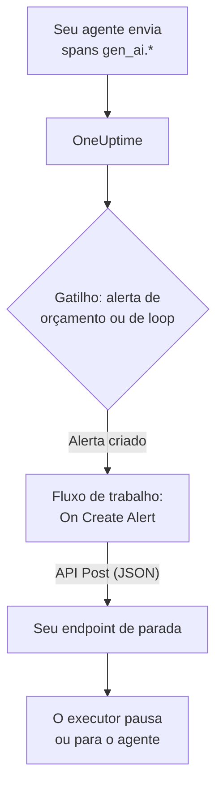

# Disjuntores para agentes de IA

Um agente de IA raramente falha travando. Ele falha continuando: tenta de novo uma ferramenta quebrada, replaneja a mesma etapa ou dispara mais subagentes, enquanto cada rodada fatura mais tokens. Esta página monta um disjuntor para isso com peças que o OneUptime já tem: um alerta que percebe o agente descontrolado e um fluxo de trabalho que chama um endpoint seu para pará-lo.

:::cards
- [Escolha um gatilho](#escolha-um-gatilho): Alerte sobre o gasto, ou sobre uma ferramenta chamada sem parar.
- [Crie o endpoint de parada](#crie-o-endpoint-de-parada): O pequeno serviço que pausa o seu agente.
- [Crie o fluxo de trabalho](#crie-o-fluxo-de-trabalho): De um novo alerta a uma chamada ao seu endpoint.
- [Teste o disjuntor](#teste-o-disjuntor): Dispare-o à mão, depois de verdade.
:::

## Como funciona



O disjuntor observa o OpenTelemetry que o seu agente já envia, diretamente ou [por meio de um gateway](/docs/telemetry/ai-gateways), e age ao lado do caminho das requisições, não dentro dele. Nada é acrescentado a cada chamada ao modelo, e trocar de provedor, de SDK ou de gateway não o quebra.

O preço é a velocidade: ele para um agente descontrolado em minutos, não em milissegundos. Mantenha limites de etapas e timeouts no próprio agente, e deixe o disjuntor pegar o que escapar deles.

| Gatilho | O que detecta | Tempo até o alerta |
| --- | --- | --- |
| Um alerta de orçamento, de um monitor de métricas | Um gasto que não para de subir, seja qual for a causa | Até 15 minutos, mais um minuto do monitor |
| Um alerta de loop, de um monitor de traces | A mesma ferramenta chamada sem parar | De 1 a 5 minutos |

## Antes de começar

- Seu agente envia spans GenAI ao OneUptime. Veja [Observabilidade de IA / LLM](/docs/telemetry/ai-llm-observability).
- Um endpoint HTTPS capaz de pausar ou parar o executor do seu agente, acessível a partir do OneUptime. Você o cria em [Crie o endpoint de parada](#crie-o-endpoint-de-parada).
- Permissão para criar monitores e fluxos de trabalho no projeto.

## Escolha um gatilho

Os dois gatilhos terminam do mesmo jeito: um monitor cria um alerta, e o novo alerta inicia o fluxo de trabalho. Você pode configurar os dois: o fluxo de trabalho não se importa com qual disparou.

### Um alerta de orçamento

O gasto é o sinal mais seguro de um agente descontrolado. Um orçamento soma o gasto de IA do dia a cada 15 minutos e o publica como duas métricas, `oneuptime.llm.budget.spend.usd` e `oneuptime.llm.budget.percent.used`, cada uma com o ID do orçamento em `oneuptime.llm.budget.id`.

:::steps
1. Abra **Produtos → AI / LLM → Orçamentos** e clique em **Criar: LLM Cost Budget**. Defina um **Orçamento diário (USD)** e escolha o serviço do agente em **Serviço (opcional)**, para que o orçamento vigie só esse agente.
2. No menu da linha do novo orçamento, escolha **Mostrar ID** e copie o ID.
3. Crie um [monitor de métricas](/docs/monitor/metrics-monitor) sobre `oneuptime.llm.budget.percent.used`, filtrado pelo atributo `oneuptime.llm.budget.id` com o ID que você copiou, e defina o seu **Intervalo de tempo** como **Past 30 Minutes**.
4. Adicione um critério **Greater Than Or Equal To** `100` que crie um alerta, e dê a ele um **Título do alerta** que nomeie o agente, como `LLM budget exceeded: support-bot`. O fluxo de trabalho e o seu endpoint leem esse título.
:::

Filtre pelo ID, não pelo nome: renomear um orçamento renomeia a sua série, e um monitor filtrado pelo nome antigo deixaria de corresponder sem avisar. Mantenha o intervalo em 30 minutos: um orçamento publica um ponto a cada 15 minutos, então um intervalo menor não encontra nada entre dois pontos e o alerta abre e se resolve sem parar.

Um segundo critério em `80` com uma severidade menor avisa antes uma pessoa, pela política de plantão do alerta, antes que o disjuntor desarme em `100`.

### Um alerta de loop

Um agente travado deixa um rastro reconhecível: o mesmo span de ferramenta, de novo e de novo. Uma execução saudável não chama uma ferramenta dezenas de vezes em poucos minutos, então uma contagem pega o loop muito antes do orçamento.

:::steps
1. Abra **Monitores**, clique em **Criar monitor** e escolha **Traços** em **Mais tipos de monitor**.
2. Em **Mais campos**, defina **Filtrar por serviço de telemetria** como o serviço do agente e **Filtrar por atributos** como `gen_ai.tool.name` igual à ferramenta em que você espera o loop, como `search_web`. Se a sua instrumentação dá nome ao span de cada ferramenta, coloque esse nome em **Nome do span**.
3. Defina **Monitorar Traços por (tempo)** como **Últimos 5 minutos**.
4. Adicione um critério **Span Count** **Greater Than** um número que nenhuma execução saudável atinge em cinco minutos, como `50`, que crie um alerta com um título como `Agent loop: support-bot`.
:::

Um segundo monitor de traces com **Filtrar por status do span** em **Erro** e uma contagem menor pega as tempestades de novas tentativas: uma ferramenta que não para de falhar e um agente que não para de tentar de novo.

## Crie o endpoint de parada

O fluxo de trabalho envia um `POST` com um corpo JSON a um endpoint que você opera. O que "parar" significa é você quem decide. Do menor efeito ao maior:

| Ação | Efeito |
| --- | --- |
| Parar o trabalho novo | O executor não inicia novas execuções para esse agente |
| Cancelar as execuções dele | As execuções em andamento desse agente são canceladas |
| Pausar o pool | Todos os workers esvaziam até alguém rearmar o disjuntor |

Um endpoint mínimo em Express que desarma um disjuntor por agente:

```typescript title="circuit-breaker.ts"
import express from "express";

const app = express();
app.use(express.json());

const tripped = new Set<string>(); // agents whose breaker is open

app.post("/circuit-breaker", (req, res) => {
  if (req.headers["authorization"] !== `Bearer ${process.env.KILL_TOKEN}`) {
    return res.status(401).end();
  }

  const alertTitle: string = req.body.alertTitle ?? "";

  // "LLM budget exceeded: support-bot" -> "support-bot"
  const agent: string = alertTitle.split(": ").pop() ?? "unknown";

  tripped.add(agent); // your run loop checks this set
  abortActiveRuns(agent); // cancel that agent's runs in flight

  // Answer fast; do the slow cleanup in the background.
  return res.status(200).json({ tripped: agent });
});
```

Construa-o com estas regras:

- Torne o disparo idempotente. Um aviso e uma ultrapassagem, ou um alerta de orçamento e um de loop juntos, podem dispará-lo mais de uma vez, e um segundo disparo não deve mudar nada.
- Responda em um ou dois segundos e faça a limpeza em segundo plano. O fluxo de trabalho conta qualquer resposta 2xx como sucesso.
- Exija um segredo. Quem puder chamar o endpoint pode parar os seus agentes, então verifique um token bearer, que o fluxo de trabalho envia a partir de uma variável global secreta.
- Rearme à mão. Um disjuntor desarmado continua desarmado até alguém examinar a execução: abra a conversa do agente em **Produtos → AI / LLM → Conversas** para ler ou reproduzir o que ele fez.

A requisição sai do OneUptime. No OneUptime Cloud, o seu endpoint precisa ser acessível pela internet. Uma instalação auto-hospedada recusa endereços de rede privados, a menos que um administrador os permita: veja [Acesso de rede de saída](/docs/workflows/configuration#acesso-de-rede-para-fora).

## Crie o fluxo de trabalho

Primeiro guarde o token do endpoint onde o fluxo de trabalho possa usá-lo sem exibi-lo: abra **Fluxos de trabalho → Variáveis globais**, clique em **Criar: Fluxo de trabalho Variável**, dê a ela o nome `AGENT_KILL_TOKEN`, coloque o token em **Conteúdo** e ative **Segredo**. Um valor secreto é removido dos registros das execuções e dos rastros das etapas.

:::steps
### Crie o fluxo

Abra **Produtos → Fluxos de trabalho** e clique em **Criar fluxo de trabalho**. Clique em **Começar do zero**, dê o nome `AI agent circuit breaker` e clique em **Criar fluxo de trabalho**. Ele abre no **Construtor**, desativado.

### Adicione o gatilho

Clique no bloco tracejado **Choose what starts this workflow** e escolha **On Create Alert** no painel **Add Trigger**. Clique no gatilho, marque o título e a descrição em **Select Fields** e clique em **Salvar**. O ID no bloco, `alert-on-create-1`, é como os blocos seguintes se referem a ele.

### Verifique o título

Clique em **Adicionar componente**, escolha **If / Else** e conecte a ele o ponto **Success** do gatilho. Defina **Value to check** como o título do alerta (clique em **{ }** e escolha-o), **Comparison** como **contém** e **Compare with** como o começo que os títulos dos seus gatilhos têm em comum, como `LLM budget exceeded`.

### Chame o seu endpoint

Adicione **API Post (JSON)** e conecte a ele o ponto **Yes** do **If / Else**. Defina a sua **URL** como o seu endpoint, como `https://agents.example.com/circuit-breaker`, e preencha os cabeçalhos e o corpo abaixo.

### Avise sobre uma falha

Adicione **Send Message to Slack**, ou **Send Email**, e conecte a ele o ponto **Error** do bloco de API. Um disjuntor que não consegue desarmar é o alerta que uma pessoa precisa ver.

### Ative-o

Ative **Habilitado** no topo do **Construtor**.
:::

Os **Request Headers** do bloco de API:

```json title="Request Headers"
{
  "Authorization": "Bearer {{global.variables.AGENT_KILL_TOKEN}}",
  "Content-Type": "application/json"
}
```

O seu **Request Body**:

```json title="Request Body"
{
  "source": "oneuptime-circuit-breaker",
  "alertId": "{{local.components.alert-on-create-1.returnValues.model._id}}",
  "alertTitle": "{{local.components.alert-on-create-1.returnValues.model.title}}",
  "alertDescription": "{{local.components.alert-on-create-1.returnValues.model.description}}"
}
```

Para reagir a vários gatilhos, comece todos os títulos deles do mesmo jeito, ou encadeie mais blocos **If / Else** a partir do ponto **No**. Veja [Criar um fluxo de trabalho](/docs/workflows/authoring) para a tela e [Variáveis](/docs/workflows/variables) para as referências `{{…}}`.

## Teste o disjuntor

:::steps
1. Dispare-o à mão. Abra **Alertas**, clique em **Criar alerta** e crie um com o título `LLM budget exceeded: test`. A execução aparece em **Fluxos de trabalho → Registros → Execuções**, e o seu endpoint recebe a chamada.
2. Dispare-o de verdade. Crie um orçamento com um limite minúsculo, como `0.01` USD, no serviço de um agente de teste, aponte um monitor de orçamento para ele e deixe o agente rodar: a porcentagem passa de 100, o alerta abre, o fluxo de trabalho roda e o disjuntor desarma. Para o alerta de loop, dê a um agente de teste uma ferramenta que sempre falha.
3. Dispare-o duas vezes. Crie o mesmo alerta de novo: o seu endpoint precisa aceitar o segundo disparo sem mudar nada.
:::

## Como o disjuntor se comporta com o tempo

- O fluxo de trabalho roda quando um alerta é criado, então um gatilho desarma o disjuntor uma vez por alerta, não uma vez por avaliação.
- Um orçamento conta o dia UTC, então a sua porcentagem volta a 0 à meia-noite UTC. Um alerta de orçamento pode então se resolver, e o próximo dia ruim abre um novo alerta que desarma o disjuntor de novo.
- Um monitor mantém o alerta aberto enquanto os critérios são atendidos. Com **Resolver alerta automaticamente** ativado, o alerta se resolve quando deixam de ser, e a próxima ultrapassagem abre um novo alerta.
- Rearmar é uma decisão de uma pessoa dos dois lados: resolva o alerta no OneUptime e rearme o disjuntor no seu executor.
- Cada novo alerta do projeto inicia o fluxo de trabalho. É o **If / Else** que mantém os outros alertas longe do disjuntor: não o remova.

## Solução de problemas

:::details O fluxo de trabalho não roda
Confira se **Habilitado** está ativado no topo do **Construtor**: os fluxos de trabalho são criados desativados. Depois confira se o alerta foi criado depois que você ativou o fluxo de trabalho: o gatilho inicia uma execução só para um alerta novo.
:::

:::details O fluxo de trabalho roda, mas sempre segue o ramo No
O título está vazio ou não corresponde. Um campo não marcado em **Select Fields** do gatilho chega vazio, então marque o título. Depois compare o título do alerta com **Compare with**: **contém** precisa encontrar exatamente esse texto nele.
:::

:::details O seu endpoint responde 401
O cabeçalho `Authorization` não bate com o token que o seu endpoint espera. Confira o nome em `{{global.variables.AGENT_KILL_TOKEN}}` e o valor salvo na variável global. O valor de uma variável secreta não pode ser lido de volta, então, na dúvida, digite-o de novo com **Update Content**.
:::

:::details O alerta de orçamento abre e se resolve sem parar
O **Intervalo de tempo** do monitor é menor que os 15 minutos entre dois pontos do orçamento. Defina-o como **Past 30 Minutes**.
:::

:::details A requisição nunca chega ao seu endpoint
Abra a execução em **Fluxos de trabalho → Registros → Execuções** e a etapa **API Post (JSON)**: ela diz por que a requisição falhou. No OneUptime Cloud, o endpoint precisa ser acessível pela internet; uma instalação auto-hospedada recusa endereços de rede privados, a menos que um administrador os permita.
:::

## Próximos passos

:::cards
- [Observabilidade de IA / LLM](/docs/telemetry/ai-llm-observability): Orçamentos, custos e os spans que o disjuntor vigia.
- [Monitor de traces](/docs/monitor/traces-monitor): Filtros de spans e critérios em detalhe.
- [Fluxos de trabalho](/docs/workflows/index): Gatilhos, componentes, variáveis e execuções.
- [Gateways de IA](/docs/telemetry/ai-gateways): As chamadas ao modelo de todos os agentes por uma única exportação.
:::
