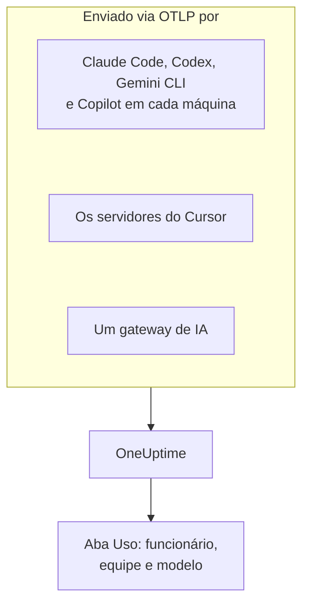

# Assistentes de programação com IA

Seus engenheiros usam Claude Code, Cursor, Codex, Gemini CLI e Copilot, e as faturas não param de crescer. Esta página responde às perguntas que um gestor faz: **quem usa qual ferramenta, com quais modelos, e quanto cada pessoa e cada equipe gasta**.

A maioria dos assistentes de programação exporta OpenTelemetry por conta própria, então não há nada para instalar nas máquinas dos desenvolvedores: aponte a exportação para o OneUptime, e tokens, custo e uso de ferramentas chegam ao lado das chamadas de IA das suas próprias aplicações. Tudo aqui chega pelo OpenTelemetry; o OneUptime não consulta a API de administração nem de faturamento de nenhum fornecedor.

:::cards
- [Matriz de suporte](#matriz-de-suporte): O que cada ferramenta envia, e se ela cita uma pessoa.
- [Atribuição a funcionários e equipes](#atribuição-a-funcionários-e-equipes): As chaves que colocam um nome e uma equipe no gasto.
- [A aba Uso](#a-aba-uso): O que as tabelas de gasto podem e não podem mostrar para um assistente de programação.
- [Por onde começar](#por-onde-começar): Uma ordem de implantação que mostra resultados no primeiro dia.
:::

## Como funciona

Cada ferramenta envia sua telemetria para o endpoint OTLP do OneUptime com sua chave de ingestão: de cada máquina de desenvolvedor, dos servidores do fornecedor (Cursor), ou de um gateway pelo qual passa seu tráfego para os modelos.



## Antes de começar

1. Crie uma chave de ingestão de telemetria em **Configurações do projeto → Telemetria e APM → Chaves de ingestão**.
2. Seu endpoint OTLP é `https://oneuptime.com/otlp`, ou `https://YOUR-ONEUPTIME-HOST/otlp` se você hospeda o OneUptime por conta própria.
3. Cada exportação envia a chave no cabeçalho `x-oneuptime-token`.

Uma única chave de ingestão para toda a frota é suficiente. Ela acaba em cada máquina de desenvolvedor, então trate-a como uma credencial compartilhada que só pode enviar dados, e faça a rotação dela como de qualquer outra.

## Matriz de suporte

Três coisas decidem o que você obtém de uma ferramenta: se ela envia OpenTelemetry, como a telemetria dela chega ao OneUptime, e se algo nela cita uma pessoa.

| Ferramenta | O que envia | Como chega ao OneUptime | Quem cita | Guia |
| --- | --- | --- | --- | --- |
| Claude Code | Métricas e logs; traces em beta | De cada máquina; variáveis de ambiente ou um arquivo de configurações gerenciadas | `user.email`, com login feito com uma conta Claude | [Claude Code](/docs/telemetry/claude-code) |
| Cursor | Métricas e logs | Dos servidores do Cursor, configurado uma vez no painel do Cursor; só no plano Enterprise | `cursor.user.id`, um número inteiro | [Cursor](/docs/telemetry/cursor) |
| OpenAI Codex | Traces, métricas e logs, cada um ativado em `~/.codex/config.toml` | De cada máquina, uma URL completa por sinal | Ninguém em spans ou métricas: você define `user.id` e `user.email` em `[otel.span_attributes]` | [OpenAI Codex](/docs/telemetry/openai-codex) |
| Gemini CLI | Traces, métricas e logs | De cada máquina, normalmente por um collector local | `user.email`, com login feito | [Gemini CLI e GitHub Copilot](/docs/telemetry/gemini-cli-and-copilot) |
| GitHub Copilot | Traces, métricas e logs, só das suas superfícies de agente | Do editor ou do host do agente | Ninguém: você define `enduser.id` e `user.email` em cada máquina | [Gemini CLI e GitHub Copilot](/docs/telemetry/gemini-cli-and-copilot) |
| Cline | Métricas e logs | Configurado centralmente, no painel da organização do Cline | Um `user_id` anonimizado | — |
| LiteLLM e Portkey | Traces de cada chamada que passa pelo gateway | Do processo do gateway | Com o LiteLLM, o dono da chave virtual | [Gateways de IA](/docs/telemetry/ai-gateways) |
| Suas próprias aplicações | O que sua instrumentação GenAI envia | Da sua aplicação | Quem você definir como `user.id` | [Observabilidade de IA / LLM](/docs/telemetry/ai-llm-observability) |
| Windsurf, JetBrains AI, Amazon Bedrock, Azure OpenAI | Nenhum OpenTelemetry próprio | Só por um gateway que você coloca na frente | Quem o gateway citar | [Gateways de IA](/docs/telemetry/ai-gateways) |

Um traço significa que o OneUptime ainda não tem um guia para a ferramenta. A telemetria dela é ingerida mesmo assim, como qualquer outro OpenTelemetry.

:::details O que exatamente o GitHub Copilot exporta
O Copilot exporta OpenTelemetry só das suas superfícies de agente: o chat e o modo agente do VS Code, o host do agente por trás do Copilot CLI, o Copilot SDK, e os workflows de agente nos IDEs da JetBrains pelo plugin do Copilot. O GitHub não documenta nenhuma exportação para as sugestões inline, o Copilot no github.com ou a revisão de código do Copilot. O Copilot não envia nenhum atributo de usuário, então defina `enduser.id` e `user.email` por máquina via `resourceAttributes` ou `OTEL_RESOURCE_ATTRIBUTES`.
:::

:::details Amazon Bedrock, Azure OpenAI, Windsurf e JetBrains AI
- **Amazon Bedrock**: as APIs `InvokeModel` e `Converse` não enviam OpenTelemetry. O Bedrock AgentCore é diferente: a AWS documenta métricas, spans e logs para ele, enviados ao CloudWatch por padrão. Definir `DISABLE_ADOT_OBSERVABILITY=true` desativa a configuração ADOT padrão do runtime, para que você possa apontar o SDK do ADOT para o OneUptime.
- **Azure OpenAI**: o serviço não envia nada, e as métricas dele no Azure Monitor não têm dimensão de usuário. Instrumente o cliente, ou coloque o API Management ou outro gateway na frente.
- **Windsurf**: não documenta nenhuma exportação de telemetria. Os dados por usuário ficam na API Enterprise do Windsurf, que o OneUptime não consulta.
- **JetBrains AI Assistant e Junie**: não exportam uso. O plugin de OpenTelemetry da JetBrains recebe a telemetria da sua própria aplicação dentro do IDE; ele não envia nada para fora.
:::

## Atribuição a funcionários e equipes

O OneUptime copia a pessoa que fez uma chamada, e a equipe dela, para colunas assim que a telemetria chega, para que a aba **Uso** possa ordenar pessoas e equipes sem filtros de atributos.

### Atributos lidos como o funcionário

Em um span, vence a primeira chave presente, nesta ordem:

| Coluna | Chaves, da preferida em diante |
| --- | --- |
| Id do funcionário | `user.id`, `enduser.id`, `litellm.metadata.user_api_key_user_id`, `metadata.user_api_key_user_id`, `traceloop.association.properties.user_id`, `langfuse.user.id`, `user.account_uuid`, `user.account_id`, `cursor.user.id` |
| E-mail do funcionário | `user.email`, `litellm.metadata.user_api_key_user_email`, `metadata.user_api_key_user_email`, `traceloop.association.properties.user_email`, `enduser.email` |
| Equipe / centro de custo | `team.id`, `team`, `cost_center`, `department`, `litellm.metadata.user_api_key_team_id`, `litellm.team.id`, `metadata.user_api_key_team_id`, `cursor.team.id` |

Em um ponto de dados de métrica, a lista é mais curta e começa pelo e-mail, porque os assistentes de programação que enviam métricas enviam `user.email` por conta própria:

| Coluna | Chaves, da preferida em diante |
| --- | --- |
| Funcionário | `user.email`, `user.id`, `user.account_uuid`, `user.account_id`, `cursor.user.id` |
| Equipe / centro de custo | `team.id`, `team`, `cost_center`, `department`, `cursor.team.id` |
| Modelo | `gen_ai.request.model`, `model`, `cursor.model.name` |

Como essas chaves são lidas:

- **Cada chave também é lida com o prefixo `resource.`.** A ingestão OTLP armazena os atributos de recurso sob esse prefixo, então `OTEL_RESOURCE_ATTRIBUTES=team.id=platform` chega como `resource.team.id`. As chaves sem prefixo são testadas primeiro, então um valor no span vence um do processo inteiro.
- **A aba Uso mostra o e-mail de uma pessoa quando a chamada tem um, e o id caso contrário.** Linhas que mostram o mesmo e-mail são somadas, então um engenheiro em duas máquinas é uma linha só.
- **A identidade só é lida de chamadas de IA.** `user.id`, `user.email` e `team.id` são chaves genéricas que spans de navegador e de backend também carregam; só os spans já reconhecidos como chamadas de IA recebem as colunas.
- **Os registros de log não são lidos para identidade.** Isso importa para o Codex, que coloca `user.email` só nos logs.
- O LiteLLM escreve essas chaves de dois jeitos: o callback `otel` padrão dele usa o prefixo `metadata.`, e o modo opcional OpenTelemetry v2 (`LITELLM_OTEL_V2=true`) o namespace `litellm.`. O OneUptime lê ambos, então um proxy padrão funciona sem configuração extra.

### Equipes e centros de custo

Nenhuma instrumentação envia `team.id`, `team`, `cost_center` ou `department`: quem os define é a sua organização, normalmente via `OTEL_RESOURCE_ATTRIBUTES` no processo da ferramenta.

```bash
export OTEL_RESOURCE_ATTRIBUTES="team.id=platform,team=Platform_Engineering,cost_center=eng-123,department=engineering"
```

Defina isso onde você já prepara as máquinas dos desenvolvedores: um perfil de MDM, um arquivo de configurações gerenciadas ou um perfil de shell dos seus dotfiles. Os valores não podem conter espaços: use sublinhados, ou codificação percentual como `%20`. O Codex não tem atributos de recurso, então defina as mesmas chaves no `[otel.span_attributes]` dele.

Para separar o gasto por aplicação, use o nome do serviço (`OTEL_SERVICE_NAME`, ou a configuração própria da ferramenta). A divisão **Aplicação / Serviço** cobre só ferramentas que enviam spans GenAI.

### O que deliberadamente não é tratado como o funcionário

Uma chamada pode carregar duas pessoas diferentes: o funcionário que a fez, e o cliente para quem foi feita. Estas chaves carregam o cliente, e o OneUptime nunca as lê para uma coluna de identidade:

- `gen_ai.user` e `llm.user`: como as instrumentações repetem o parâmetro de requisição `user` da OpenAI, que a OpenAI descreve como um identificador dos seus usuários finais.
- `litellm.metadata.user_api_key_end_user_id`, `metadata.user_api_key_end_user_id` e `litellm.end_user.id`: o usuário final do LiteLLM, ao contrário do dono da chave, que é o funcionário.

Ler o id de um cliente como funcionário transformaria um bot de suporte que atende 40.000 clientes em 40.000 funcionários fantasmas, enquanto o engenheiro dono do gasto pareceria não gastar nada. As chaves continuam nos atributos do span, e a aba **LLM** do visualizador de traces as mostra como o usuário final.

### Privacidade

A coluna de e-mail do funcionário contém dados pessoais. As **Regras de mascaramento** dos traces a cobrem exatamente como cobrem o atributo de onde ela foi lida, então uma regra que mascara e-mails também mascara a coluna. Você as encontra em **Traços → Configurações**.

## Métricas de assistentes de programação que o OneUptime lê

Os assistentes de programação nomeiam suas métricas com um prefixo próprio em vez de `gen_ai.*`, então o OneUptime conhece cada uma pelo nome:

| Métrica | Ferramenta | Unidade |
| --- | --- | --- |
| `claude_code.token.usage` | Claude Code | Tokens |
| `claude_code.cost.usage` | Claude Code | USD |
| `cursor.token.usage` | Cursor | Tokens |
| `cursor.cost.usage` | Cursor | USD, uma estimativa segundo o próprio Cursor |
| `codex.turn.token_usage` | OpenAI Codex | Tokens |
| `codex.turn.cost_microusd` | OpenAI Codex | Milionésimos de USD: o OneUptime converte, então não converta você |

O OneUptime também lê tokens de `gen_ai.client.token.usage`, `gen_ai.client.token.count`, `llm.token.usage` e `llm.usage.tokens`, e custo de `gen_ai.client.cost`, `gen_ai.client.cost.usd`, `gen_ai.usage.cost`, `litellm_spend_metric` e `litellm.cost.total`.

Duas coisas para saber antes de ler os números:

- **`gemini_cli.token.usage` fica de fora de propósito.** O Gemini CLI envia seus tokens duas vezes, como métrica própria e como `gen_ai.client.token.usage`, e ler as duas os dobraria. Os tokens dele são contados uma vez, via `gen_ai.client.token.usage`. O Gemini CLI não envia nenhuma métrica de custo: ative os traces dele para que cada chamada tenha preço.
- **Só os tokens de entrada e de saída são contados.** O tipo de token é lido de `gen_ai.token.type`, `llm.token.type`, `type`, `cursor.token.type` ou `token_type`, e só `input` e `output` (ou os antigos `prompt` e `completion`) contam. Leituras e gravações de cache, o `total` do Codex (que repete os outros) e `reasoning_output` (parte de `output`) ficam de fora, então um total vindo de métricas é menor que a soma de tudo o que uma ferramenta envia.

## A aba Uso

Abra **Produtos → AI / LLM** e vá para **Uso**. Ela ordena **Funcionário**, **Equipe**, **Modelo**, **Provedor** e **Aplicação / Serviço** por gasto, nos últimos 7 dias, a menos que você escolha outro período. Chamadas que não citam ninguém são contadas em **Sem atribuição**: uma linha grande de **Sem atribuição** mostra qual ferramenta ainda precisa ter a identidade definida.

### As métricas de assistentes de programação são um recurso alternativo, não uma soma

Os spans GenAI vêm primeiro: as métricas só são lidas para um número que os spans não informaram, e os dois nunca são somados ([por quê](/docs/telemetry/ai-llm-observability#primeiro-os-spans-as-métricas-completam)). Para os assistentes de programação isso tem uma consequência direta: **se o mesmo projeto recebe spans GenAI com custo, o gasto dos assistentes de programação não aparece.** Dê aos assistentes de programação um projeto só deles, com sua própria chave de ingestão.

Quando o recurso alternativo se aplica, é isto que cada divisão pode mostrar para uma ferramenta que envia só métricas:

| Divisão | Das métricas |
| --- | --- |
| **Funcionário** | Sim, de cada chave de identidade acima, com e sem o prefixo `resource.` |
| **Equipe** | Sim, das chaves de equipe |
| **Modelo** | Sim: o Claude Code e o Codex enviam um `model` sem prefixo, o Cursor `cursor.model.name` |
| **Provedor** | Não: as métricas dos assistentes de programação não citam nenhum provedor |
| **Aplicação / Serviço** | Não: as métricas deles não pertencem a nenhum serviço do OneUptime |

Uma linha lida das métricas carrega só o custo: as células de chamadas e tokens mostram `—`, porque um contador de gasto não tem detalhe por chamada, e um 0 ali diria que a pessoa não fez nenhuma chamada. A tabela é marcada como **das métricas GenAI**.

## Sem OpenTelemetry? Coloque um gateway na frente

Para o Windsurf, o JetBrains AI, as APIs de modelos do Bedrock, o Azure OpenAI e qualquer outra coisa sem exportação própria, coloque um gateway de IA na frente. Cada chamada passa então por um único processo que envia OpenTelemetry, e você configura a exportação uma vez.

**Use o LiteLLM com uma chave virtual por funcionário.** O LiteLLM coloca em cada span o id e o e-mail do dono da chave, que o OneUptime lê como o funcionário, e a equipe da chave como a equipe. Ele também calcula sozinho o preço de cada chamada, com as tarifas personalizadas que você definir no proxy, e o custo que ele informa vence a estimativa do OneUptime. Não use o id de usuário final dele para isso: esse é o cliente. A configuração está em [Gateways de IA](/docs/telemetry/ai-gateways).

Dois limites antes de planejar em torno de um gateway:

- **Um gateway só vê o tráfego enviado por ele.** A substituição da URL base do próprio Cursor é uma configuração por usuário que cobre só os modelos de chat (o preenchimento com Tab continua usando os modelos do Cursor), então prefira a exportação nativa do Cursor.
- **Um gateway vê a chamada ao modelo, não o agente.** Ele registra prompts e respostas, mas não as chamadas de ferramentas, as edições de arquivos e as decisões de aceitar ou rejeitar que a telemetria própria de uma ferramenta informa.

## Conteúdo dos prompts: os padrões mudam de ferramenta para ferramenta

Prompts e respostas são os dados mais arriscados deste pipeline: eles costumam conter código-fonte, dados de clientes e credenciais coladas. Confira o padrão de cada ferramenta:

| Ferramenta | Conteúdo dos prompts por padrão |
| --- | --- |
| Claude Code | Desativado: cada tipo de conteúdo tem sua própria variável para ativá-lo |
| Cursor | Desativado: só a família opcional `conversation_content` envia o texto das mensagens |
| OpenAI Codex | Desativado: `log_user_prompt` é `false` por padrão |
| Gemini CLI | **Ativado**: `logPrompts` é `true` por padrão, então defina-o como `false` quando ativar a telemetria |
| GitHub Copilot | Desativado: `captureContent`, que as configurações gerenciadas podem travar com `lockCaptureContent` |
| LiteLLM | Ativado com o callback `otel` padrão (desative com `turn_off_message_logging`); desativado no modo OpenTelemetry v2 |

O Codex também envia suas métricas para a OpenAI por padrão: veja [OpenAI Codex](/docs/telemetry/openai-codex). Onde você captura conteúdo de propósito, as **Regras de mascaramento** e os **Filtros de descarte** dos traces se aplicam a ele como a qualquer outra telemetria.

## O que o OneUptime ainda não faz

- **Nenhum conector de administração ou de faturamento de fornecedores.** O OneUptime não consulta a Admin API da Anthropic, a Admin API do Cursor, os endpoints de uso e custos da OpenAI, o faturamento do Copilot no GitHub, nem as APIs do Windsurf ou da JetBrains. Para números no nível da fatura, busque-os no fornecedor.
- **O custo é uma estimativa, a menos que uma ferramenta o informe.** Um custo informado é usado como está; caso contrário, o OneUptime calcula o preço dos tokens pelos preços de tabela. O próprio `cursor.cost.usage` do Cursor é uma estimativa.
- **A identidade nos registros de log não é lida.** O `user.email` do Codex, que ele envia só nos logs, não é ligado ao gasto.
- **O `cursor.user.email` do Cursor ainda não é lido**, então os usuários do Cursor aparecem como seu número inteiro `cursor.user.id`.
- **Os spans do Codex não citam nenhum modelo**, então o OneUptime não consegue calcular o preço deles: o Codex mostra tokens por pessoa, e seu custo só nos totais.
- **As ferramentas mudam rápido.** Se esta página diz que uma ferramenta não tem exportação, confira a documentação atual dela antes de construir em torno de um gateway.

## Por onde começar

Implante nesta ordem; cada passo é útil por si só. Use um projeto que ainda não recebe spans GenAI das suas próprias aplicações, ou [a regra do recurso alternativo](#as-métricas-de-assistentes-de-programação-são-um-recurso-alternativo-não-uma-soma) mantém o gasto dos assistentes de programação fora da página.

1. **Gemini CLI**, se alguém usa. Ele envia `user.email` sem configuração, então mostra a atribuição funcionando de ponta a ponta. Ative também os traces dele: ele não envia nenhuma métrica de custo.
2. **Claude Code**: um arquivo de configurações gerenciadas para a frota, `user.email` de graça, uma métrica de custo real, e taxa de aceitação, commits, pull requests e linhas de código por desenvolvedor.
3. **Cursor**, no plano Enterprise: uma tela no painel do Cursor, nenhuma máquina de desenvolvedor tocada, embora as pessoas cheguem como números inteiros.
4. **Copilot e Codex**, que precisam de uma identidade definida em cada máquina. Faça isso quando preparar as máquinas: chamadas que chegaram sem identidade não podem ser atribuídas depois.
5. **Um gateway LiteLLM** para todo o resto, com uma chave virtual por funcionário.

## Próximos passos

:::cards
- [Claude Code](/docs/telemetry/claude-code): Ative a exportação do Claude Code para uma máquina ou para a frota inteira.
- [Cursor](/docs/telemetry/cursor): Envie a telemetria da equipe do Cursor a partir do painel do Cursor.
- [OpenAI Codex](/docs/telemetry/openai-codex): Configure os três exportadores do Codex e coloque uma identidade nos spans dele.
- [Observabilidade de IA / LLM](/docs/telemetry/ai-llm-observability): Conversas, alertas, custo e orçamentos para cada chamada de IA.
:::
